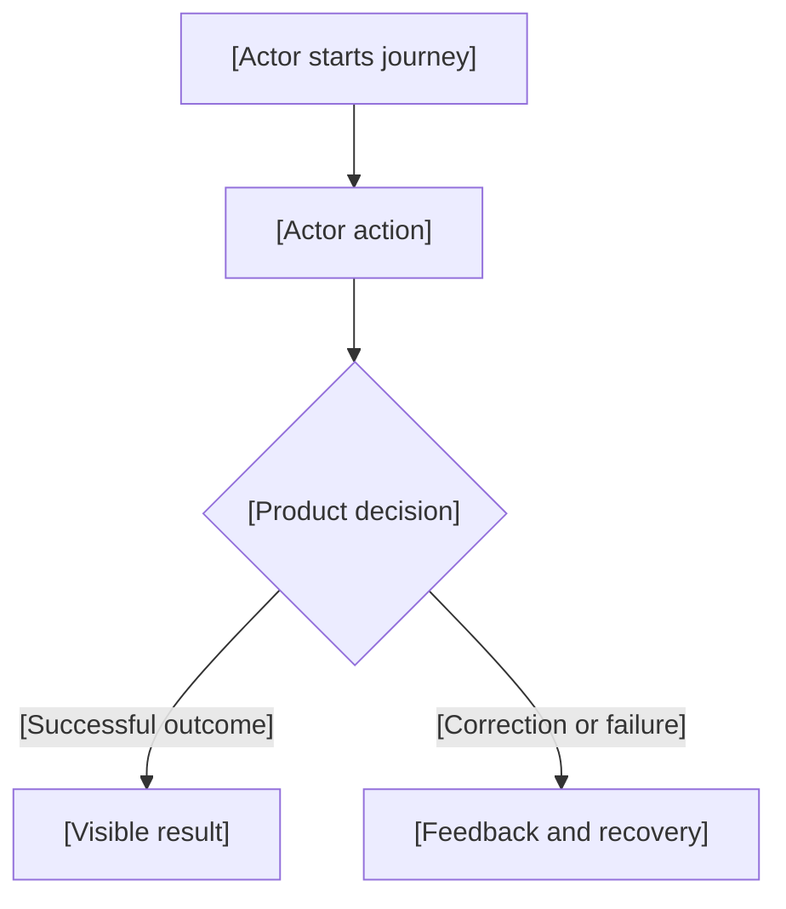

<!-- PM-Skills | https://github.com/product-on-purpose/pm-skills | Apache 2.0 -->
<!-- Locally modified 2026-10-11. Replace slots with facts or explicit unknowns; adapt depth to the release. -->

# PRD: [Product and release]

| Field | Value |
|---|---|
| Version / status | [Version; Draft / Ready for technical design; preserve an evidenced approval status when applicable] |
| Owner | [Known owner or Unassigned] |
| Created / updated | [Dates and relevant timezone] |
| Release purpose / deadline | [Requested delivery and confirmed deadline/timezone, if any] |

## 1. Summary and problem

[Explain the delivery, user need, intended result, and assessment context where applicable. Separate confirmed facts from an unvalidated commercial hypothesis. State the product/technical-design boundary.]

## 2. Authority, sources, and decision status

[Explain external obligations, user commitments, and latest corrections. Preserve existing assessment and decision IDs. Brainstorming and conversations inform authoring; complete applicable content lives here. Omit private authoring paths, organizational links, and unrelated personal context.]

| Existing source ID | Complete obligation or decision | Origin / status | Limitation or superseding decision | Requirement / acceptance IDs |
|---|---|---|---|---|
| [Preserved ID, if supplied] | [Self-contained statement] | [External brief / user decision; Required / Committed / Working design / Recommended / Open / Deferred] | [Extracted-source limitation, conflict, or explicit later adoption] | [Internal IDs or Deferred scope reference] |

[Reference accessible primary material only where relevant. Samples supply documentation structure, never product requirements. Internal traceability must remain usable without external access.]

## 3. Application users, permissions, and journeys

[Define actual application users and explain unfamiliar terms at first use. State capability overlap/inheritance. Identify a connected assistant's user-bound authority, or an independently established role when applicable.]

| Capability | [Application actor] | [Application actor] | Preconditions / visibility rule |
|---|---|---|---|
| [Read or manage behavior] | [Allowed / denied / conditional] | [Allowed / denied / conditional] | [State, ownership, or permission] |

| Journey ID | Application actor and need | Entry / preconditions | Normal flow and observable outcome | Requirements / acceptance |
|---|---|---|---|---|
| [Preserved or appended J ID] | [Actor and job] | [Initial state and permission] | [Actions and result] | [IDs] |

[Put developer, reviewer, and operational responsibilities in section 12 unless the product grants them an actual application role.]

## 4. Goals and success criteria

| ID | Intended outcome | Measure or planned verification | Baseline | Target and status |
|---|---|---|---|---|
| SC-01 | [Outcome] | [Observable evidence] | [Known / Unknown / Not applicable] | [Confirmed / Recommended; verification status] |

[Proposed thresholds and unmeasured baselines retain their uncertainty. PRD completion is not evidence of a passing software test.]

## 5. Release scope and business rules

### Included release

[Complete external obligations and commitments, prioritized only where supported. State permissions, required metadata, and rules governing relevant entities and relationships.]

### Excluded and deferred

[Capabilities outside this release, with status and rationale. Functionality-first sequencing does not remove committed security, quality, or operational outcomes.]

### Input and artwork / attachment policies, where applicable

| Field / upload | Required or optional | Minimum when supplied | Maximum | Unit / formats | Policy status and evidence | Configurable behavior |
|---|---|---|---|---|---|---|
| [Actual input] | [Requirement and unknown/clear behavior] | [Selected / Recommended / Open] | [Selected / Recommended / Open] | [Counting rule, bytes, supported formats] | [Source and evidence limitation] | [Overrides, invalid settings, existing-content compatibility] |

[Describe Unicode/whitespace handling, inclusive boundaries, omitted edit values versus clearing, safe display, content validity, actionable errors, draft retention, and relevant bypass attempts. Investigate unsupported suggested values using primary sources; an example is not population coverage. Keys, libraries, and processing mechanisms belong to section 10's handoff.]

## 6. Functional and nonfunctional requirements index

| ID | Self-contained requirement | Source IDs / origin | Status | Priority and rationale | Acceptance IDs |
|---|---|---|---|---|---|
| FR-001 | [Product capability and observable rule] | [Preserved source IDs or explicit new user authority] | [Status] | [Supported priority] | AC-001 |
| NFR-001 | [Product quality outcome or concise delivery constraint] | [Source] | [Status] | [Priority] | AC-002 |

[Preserve valid existing FR/NFR/US/AC/OD and source IDs. Append without reuse. Every included obligation and commitment maps to requirements and acceptance; engineering handoff retains that coverage.]

## 7. Stories and observable acceptance criteria

### US-001: [Capability]

As a [application actor], I want [capability], so that [intended outcome].

Requirements: [FR/NFR IDs]. Preconditions and permissions: [Established conditions]. Source/status: [IDs and status].

| ID | Scenario | Given | When | Then | Decision dependency, if any |
|---|---|---|---|---|---|
| AC-001 | [Normal flow] | [Initial state / permission] | [Action] | [Visible outcome and persistence effect] | [None / OD ID] |
| AC-002 | [Boundary / failure] | [Relevant state] | [Action or failure] | [Result, retained information, feedback, and recovery] | [None / unresolved product OD] |

[Repeat for included capabilities. Cover applicable validation, missing/empty data, denied access, loading/processing, stale drafts, duplicates/concurrency, interrupted/partial/uncertain effects, restart persistence, and recovery. Pending behavior stays explicit. Use separate compact delivery/engineering acceptance groups in sections 10 or 12 instead of presenting delivery roles as application users.]

## 8. UX behavior, feedback, and product flowcharts

| Surface / operation | Loading / processing | Empty / missing | Success | Failure / uncertainty / recovery |
|---|---|---|---|---|
| [Surface] | [Visible feedback] | [Visible feedback] | [Confirmed result] | [Actionable response and retained draft/current information] |

[State responsive/accessibility outcomes and applicable field-level limits/errors. Explain consequential confirmations and permission-dependent navigation.]

### Material journey flowcharts

[Embed Mermaid flowcharts for the material journeys of this product; select coverage by user value and branching behavior, without a fixed diagram count. Nodes describe actors, actions, decisions, and visible results. Reference related journey, story, and acceptance IDs. Keep services, databases, RPC calls, queues, and encryption internals in the later techdoc.]

[Replace this illustrative flow with the release's actual journeys and branches.]

## 9. Conceptual information and integration outcomes

[Define domain vocabulary, entities, identities, relationships, required/optional data, unknown versus omitted versus cleared values, units, date precision, provenance, lifecycle effects, and persistence. Clarify shared-entity behavior and restoration/deletion consequences where relevant. Explain user-visible integration outcomes and authority boundaries. Avoid detailed schemas and API/transport contracts.]

## 10. Security, privacy, reliability, and engineering handoff

### Product outcomes

[Reference NFR/AC IDs for permissions, private information, audit visibility, safe text/upload handling, resilience, bounded recovery, and operational visibility. Specify observable outcomes or an explicit open product policy. Protect sensitive information in public surfaces, searches, diagnostics, and AI payloads where applicable. Do not imply regulatory compliance or ISO certification without evidence.]

### Compact assessment and engineering constraints

| Source ID | Obligation / chosen constraint | Status | Requirement / acceptance | Assigned technical-design detail |
|---|---|---|---|---|
| [Preserved ID] | [Mandated technology or agreed engineering commitment] | [Required / Committed / Working design / Recommended / Open] | [NFR/AC IDs; planned observable evidence] | [Architecture, contracts, mechanisms, configuration, tooling, or policy values] |

[Separate assessment minimums from preferred designs. Consolidation preserves commitments; it does not mark them delivered. Keep detailed implementation out of product stories.]

## 11. Dependencies, risks, and mitigations

| Dependency / risk | Product acceptance or delivery impact | Mitigation / decision needed | Affected IDs | Owner / status |
|---|---|---|---|---|
| [Item] | [Concrete impact] | [Known action or open decision] | [IDs] | [Known owner / Unassigned; status] |

## 12. Document readiness and eventual release verification

### Ready for technical design checklist

| Check | Passing condition | Actual document-review result |
|---|---|---|
| Coverage | Included obligations and commitments have internal requirement/acceptance mappings | [Checked / gap] |
| Product coherence | Permissions, scope, rules, journeys, flowcharts, states, and criteria agree | [Checked / gap] |
| Independence and precision | Private notes are unnecessary; source statuses, IDs, references, and uncertainty are preserved | [Checked / gap] |
| Writing pass | Humanizer follows substantive review; technical meaning and obligations are rechecked | [Checked / limitation] |
| Material product decisions | Scope and observable acceptance are settled; engineering matters are assigned separately | [Settled / blocking OD IDs] |

[Use Draft while material product scope or observable acceptance remains unresolved. Use Ready for technical design once these checks pass. Engineering choices and unexecuted software tests do not block document readiness.]

### Planned delivery / release evidence

| Gate | Observable passing condition | Requirement / acceptance IDs | Responsible function | Evidence status |
|---|---|---|---|---|
| [Implementation, testing, reproducible setup, or submission gate] | [Condition] | [IDs] | [Development / review / operations, as applicable] | [Planned / Verified with evidence] |

[Keep delivery responsibilities and journeys here, separate from app personas. Preserve recorded deadlines/timezones. Internal targets are Recommended unless adopted; scheduling needs known availability. Release approval requires separate evidence.]

## 13. Resolved product decisions, open decisions, and assumptions

### Resolved product decisions

| Existing decision ID / topic | Selected product policy | Source / status / superseded position | Affected requirements / acceptance |
|---|---|---|---|
| [Preserved ID or topic] | [Complete decision] | [Latest user authority, with prior recommendation status preserved] | [IDs] |

### Product blockers and explicitly labeled assumptions

| ID | Question / assumption | Status and readiness impact | Affected IDs | Owner | Needed by |
|---|---|---|---|---|---|
| OD-001 | [Unresolved observable behavior or proposed assumption] | [Open product blocker / labeled assumption] | [IDs] | [Owner / Unassigned] | [Decision gate] |

### Matters assigned to technical design

| Existing OD ID / topic | Settled product portion | Remaining engineering question | Product impact / constraint | Owner | Decision gate |
|---|---|---|---|---|---|
| [Existing OD ID; append only for new questions] | [Policy and affected IDs] | [Open engineering choice] | [Boundary that design must preserve] | [Owner / Unassigned] | [Technical-design gate] |

[Retain OD history when splitting mixed decisions. Engineering matters alone do not keep the PRD Draft. Record unknown values explicitly without inventing providers, retry counts, thresholds, retention periods, or schemas.]

## 14. References and revision history

[Relevant accessible references, extracted-source limitations, and concise dated changes. Complete requirements remain above; private brainstorming and samples are not required reading. Preserve source identity while removing private access dependencies.]

| Version | Date / timezone | Change and actual evidence |
|---|---|---|
| [Version] | [Date] | [Product change, document checks, remaining uncertainty; no implied software verification] |

[For model-generated product output only, embed applicable evaluation requirements from [AI-BEHAVIOR.md](AI-BEHAVIOR.md) within this PRD. Remove template instructions from the delivered document.]
