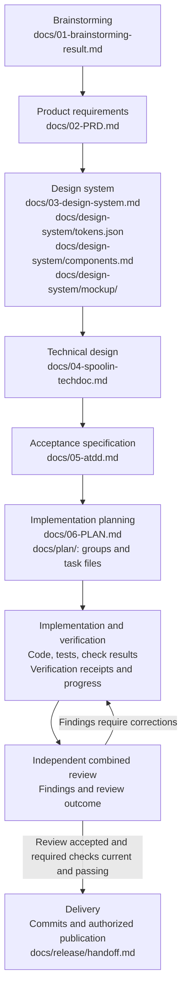

# Agentic Workflow

A portable workflow for getting software work from an approved brief to verified delivery in **Codex, Cursor AI, Claude Code, and GitHub Copilot**.

Version **1.4.0** (source update; no release tag published) combines 74 bundled skills, native agent roles, and a small Python standard-library CLI. Your existing chat coordinates the work. Helpers track scope, ownership, checks, review findings, and recovery state; no separate agent service is required.

The workflow is:

**Read the approved outcome → implement → run agreed checks → obtain one independent combined review → correct findings → deliver.**

Use it to bring the same working agreements into multiple projects and coding agents, keep project-specific instructions with the code, and resume work with recorded evidence instead of relying only on chat history.

## Requirements

- macOS or Linux, Python **3.11+**, and Git.
- At least one supported coding-agent client, installed and authenticated separately.
- Your project's own language tools, dependencies, scanners, and browser tools for the checks you select.
- A separate supported reviewer for independent review. Reviewing your own changes does not meet that requirement.

The CLI itself uses only the Python standard library. Installing the workflow does not install application dependencies, configure accounts, or start application tasks.

## Quick start

### Install from a reviewed source checkout

Clone the source repository and select the reviewed commit for bundle 1.4.0. This update does not publish a release tag.

```sh
git clone https://github.com/okfriansyah-moh/agentic-workflow.git
cd agentic-workflow
python3 scripts/agent-workflow --version
python3 scripts/agent-workflow install --global
python3 scripts/agent-workflow doctor --global
```

### Install into a project

From the reviewed version 1.4.0 source directory, replace `/path/to/project` with an existing project:

```sh
python3 scripts/agent-workflow install --repo /path/to/project --profile general
python3 scripts/agent-workflow doctor --repo /path/to/project
```

`general` is the default profile. Configure the project's actual check commands before requesting implementation. Use `--profile movie-app` only for projects adopting the bundled Kotlin/Spring/JPA, Svelte/TypeScript, Node, and PostgreSQL checks; inspect its tool requirements first.

Open the target project in your coding agent, load its project instructions, and request a bounded task. For example:

> Implement the approved task in docs/tasks/T001.md. Follow this project's workflow instructions, run the agreed affected checks, obtain one independent combined review, and deliver within my existing authorization.

### Optional global installation

From the same reviewed version 1.4.0 source directory, make the bundle available across projects:

```sh
python3 scripts/agent-workflow install --global
python3 scripts/agent-workflow doctor --global
```

Add `~/.local/bin` to your shell's PATH to use the global `agent-workflow` command. A project installation is self-contained and uses its own pinned bundle before global fallback.

## How it works

- **Skills** provide guidance for planning, implementation, design, verification, and delivery. Load the guidance relevant to the task rather than every skill.
- **Native roles** separate coordination, backend, frontend, operations, evidence collection, security, integration, and independent review. Models and permissions remain controlled by the coding-agent host.
- **Python helpers** manage installation, task indexing, ownership, selection state, check execution, and verification receipts.
- **Project bundles** pin the workflow version so a global update does not silently change another project's rules.
- **Verification receipts** retain the inputs and results behind delivery claims. Missing tools, unavailable services, and unobserved host behavior remain explicit limitations.

The shared [reuse and cleanup policy](docs/DELIVERY.md#reuse-and-evidence-based-cleanup) makes implementation the priority: reuse suitable existing code, keep document topics in one owning source, and require consumer evidence before removing material. Prevention uses existing project checks and focused additions rather than a separate cleanup framework.

Work is serial by default. Authorized workers can own separate contributions, followed by one independent combined review. See the [delivery policy](docs/DELIVERY.md), [role catalog](agents/catalog.json), and [skill catalog](docs/SKILLS.md).

## Integrate with an existing project

Installation creates `.ai/config.json`, a versioned `.ai/bundles/1.4.0/` bundle, a local `.ai/bin/agent-workflow` launcher, and host-specific discovery files. Commit the generated project configuration, bundle, launcher, adapters, discovery links, and ownership metadata together. Keep transient state, reports, evidence, and installation backups out of version control according to your project's policy; review generated files before committing.

Existing instructions receive a bounded managed block. Unrelated settings, skills, hooks, permissions, and Git work are preserved. Conflicting managed files are reported rather than silently overwritten. Copy or clone the complete project, including dot directories and symlinks, when moving it.

| Coding agent | Project entry points |
| --- | --- |
| Codex | `AGENTS.md`, `.codex/agents`, `.agents/skills` |
| Cursor AI | `AGENTS.md`, `.cursor/rules`, `.cursor/agents`, `.cursor/skills` |
| Claude Code | `CLAUDE.md`, `.claude/agents`, `.claude/skills` |
| GitHub Copilot | `.github/copilot-instructions.md`, `.github/agents`, `.github/skills` |

Reload or restart the host's discovery view after installation. A successful `doctor` result checks installation structure; it does not prove that an IDE loaded the instructions, trusted hooks, or invoked an independent reviewer. See [host setup and verification](docs/HOSTS.md).

From the target project, inspect its installation and approved plan:

```sh
python3 .ai/bin/agent-workflow doctor --repo .
python3 .ai/bin/agent-workflow task-index --plan docs/06-PLAN.md
python3 .ai/bin/agent-workflow resources --repo .
```

Replace the example plan path with your own. The shared resource controller admits substantial checks using the execution device's available capacity. Unsafe or unmeasured checks stay pending; resource stops require inspection and explicit healthy recovery. See [check configuration and resource budgets](docs/GATES.md).

## From idea to delivery: stages and outputs

[SpoolIn](https://github.com/okfriansyah-moh/spoolIn) is a movie and TV discovery and catalog-management app. Its public documents show how an idea becomes product requirements, visual and technical specifications, acceptance cases, and implementation tasks.

**Brainstorming → PRD → Design system → Technical design → Acceptance specification → Implementation plan → Implementation and verification → Review and delivery**

Use the stages needed for your project. An approved existing specification can be reused; a routine change does not require recreating every document. The numbered filenames below are SpoolIn's convention, not required filenames for every project.



| Stage and skill | What goes in → what comes out | SpoolIn output example |
| --- | --- | --- |
| **1. Brainstorming** — `brainstorming` | Idea, constraints, and open choices → agreed direction, scope, alternatives, decisions, and unresolved questions. | [`docs/01-brainstorming-result.md`](https://github.com/okfriansyah-moh/spoolIn/blob/main/docs/01-brainstorming-result.md) records the movie-app direction and delivery decisions. |
| **2. Product requirements** — `deliver-prd` | Agreed direction and source obligations → a PRD defining users, permissions, journeys, business rules, release scope, and observable acceptance criteria. | [`docs/02-PRD.md`](https://github.com/okfriansyah-moh/spoolIn/blob/main/docs/02-PRD.md) describes the initial SpoolIn release and its requirements. |
| **3. Design system** — `design-system` | Approved product behavior and visual direction → a design specification, tokens, component contracts, screen/state examples, and requirements coverage. | [`docs/03-design-system.md`](https://github.com/okfriansyah-moh/spoolIn/blob/main/docs/03-design-system.md), [tokens](https://github.com/okfriansyah-moh/spoolIn/blob/main/docs/design-system/tokens.json), [component contracts](https://github.com/okfriansyah-moh/spoolIn/blob/main/docs/design-system/components.md), and [mockup source](https://github.com/okfriansyah-moh/spoolIn/blob/main/docs/design-system/mockup/index.html). |
| **4. Technical design** — `techdoc-creation` | PRD, adopted design, and engineering constraints → architecture, frontend/backend responsibilities, API and data contracts, database design, security controls, and operational behavior. | [`docs/04-spoolin-techdoc.md`](https://github.com/okfriansyah-moh/spoolIn/blob/main/docs/04-spoolin-techdoc.md) connects the browser application, services, contracts, and storage. |
| **5. Acceptance specification** — `atdd-creation` | Requirements, technical contracts, and UI states → traceable acceptance cases with preconditions, actions, expected outcomes, and required proof boundaries. | [`docs/05-atdd.md`](https://github.com/okfriansyah-moh/spoolIn/blob/main/docs/05-atdd.md) defines the acceptance cases; authored cases are separate from execution results. |
| **6. Implementation planning** — `plan-creation` | Approved specifications and acceptance cases → a plan index, dependency-ordered feature groups, and task files with scope, source references, implementation guidance, and verification requirements. | [`docs/06-PLAN.md`](https://github.com/okfriansyah-moh/spoolIn/blob/main/docs/06-PLAN.md), the [plan directory](https://github.com/okfriansyah-moh/spoolIn/tree/main/docs/plan), and a [foundation group](https://github.com/okfriansyah-moh/spoolIn/blob/main/docs/plan/01-reproducible-foundation/group.md). |
| **7. Implementation and verification** — `forge`, with relevant implementation and acceptance skills | A selected task or group → working code, relevant tests, check results, verification receipts, and retained progress or findings. | SpoolIn's [source repository](https://github.com/okfriansyah-moh/spoolIn) and [release evidence documents](https://github.com/okfriansyah-moh/spoolIn/tree/main/docs/release) show implementation and recorded observations. |
| **8. Independent review and delivery** — independent reviewer, then `task-delivery` | The complete implemented selection and actual check results → review findings, verified corrections, commits, and the authorized delivery destination with remaining limits stated. | [`docs/release/handoff.md`](https://github.com/okfriansyah-moh/spoolIn/blob/main/docs/release/handoff.md) records the release handoff and remaining obligations. |

### Example stage requests

Request each output explicitly and pass the approved outputs into the next stage. For example:

> Use brainstorming to explore a movie catalog with Viewer and Maintainer journeys. Record the agreed direction and open questions in docs/01-brainstorming-result.md.

> Use deliver-prd to turn the approved brainstorming decisions into docs/02-PRD.md. Define the release scope, permissions, journeys, and acceptance criteria.

> Use design-system with docs/02-PRD.md. Create docs/03-design-system.md and the supporting package under docs/design-system/, including tokens, component contracts, and screen/state examples.

> Use techdoc-creation with the approved PRD and design system. Write docs/04-spoolin-techdoc.md with engineering responsibilities, interfaces, storage, security, and verification boundaries.

> Use atdd-creation to derive docs/05-atdd.md from the approved requirements, design, and technical contracts. Then use plan-creation to produce docs/06-PLAN.md and dependency-ordered groups and tasks under docs/plan/.

After reviewing the plan, select a bounded task or group using the examples below. Writing specifications or mockups does not establish that software was implemented or tested. SpoolIn is an example to inspect; its product scope, stack, and historical results do not become requirements or verification evidence for your project.

## Everyday use

Give the agent the desired outcome, allowed changes, relevant requirements or designs, acceptance checks, and delivery destination. Ordinary language works; saved tasks are useful for larger selections.

**Start a saved task:**

> Use running prompt for T001.

**Implement a group:**

> Implement G02 from docs/06-PLAN.md using its approved references and agreed checks. Implement directly; use scoped workers only when useful. Obtain one independent combined review and deliver within existing authorization.

**Resume, including in another host:**

> Resume the retained selection. Restore its scope, ownership, constraints, valid results, and next action. Preserve correction and repair limits.

**Request review:**

> Review the complete selection independently against the approved requirements, project standards, and actual verification results. Return actionable findings without changing implementation or task status.

Resume uses retained Git-shared selection state; chat history does not transfer between hosts. Transfer ownership before another coordinator changes the same selection. A plain task request does not replace host permissions or authorize unrelated external messages.

## Update, rollback, and uninstall

Review the policy and source changes before updating. From the reviewed bundle 1.4.0 source checkout:

```sh
python3 scripts/agent-workflow update --global
python3 scripts/agent-workflow update --repo /path/to/project
python3 scripts/agent-workflow doctor --repo /path/to/project
```

Run only the update commands for installations you use. Updates retain project profiles, preserve unrelated configuration, and refuse conflicting edits to managed files. Installation changes keep transactional backups.

To restore a repository installation, replace `TRANSACTION` with the backup reported by the installer:

```sh
python3 scripts/agent-workflow rollback --repo /path/to/project --backup /path/to/project/.ai/install-backups/TRANSACTION
```

Later edits to managed files can block rollback to protect your work. Keep backups intact until the installation is accepted.

```sh
python3 scripts/agent-workflow uninstall --repo /path/to/project
python3 scripts/agent-workflow uninstall --global
```

Uninstall preserves unrelated content and reports edited files it retained. See the [installation guide](docs/INSTALLATION.md) for conflict resolution, global skill selection, and recovery details.

## Troubleshooting and limits

| Situation | Next step |
| --- | --- |
| Global command is missing | Add `~/.local/bin` to PATH, or use the project's Python launcher. |
| Installer reports a conflict | Inspect the reported file and preserve personal edits; use the documented update or recovery procedure. |
| Roles or skills do not appear | Reload discovery, check workspace trust, and inspect the host-specific paths in the host guide. |
| A check cannot run | Install its required project tool or record the check as pending; do not count unavailable checks as passes. |
| A resource stop is retained | Inspect capacity and stop details before the documented explicit recovery action. |
| No independent reviewer is available | Leave review pending; implementation and self-review alone do not establish acceptance. |

Managed edit hooks provide notifications only and never execute checks. Explicit verification and CI remain necessary. File generation, CLI fixtures, live host loading, and product behavior are separate observations. Historical verification reports establish only the versions and environments they assessed.

## Repository guide

| Location | Purpose |
| --- | --- |
| `agent_workflow/`, `scripts/agent-workflow` | Python CLI and source-checkout launcher |
| `skills/`, `manifest.json` | Bundled guidance, provenance, dependencies, and content digests |
| `agents/`, `adapters/`, `prompts/` | Shared roles, host integration, and task entry points |
| `profiles/`, `schemas/`, `resources/` | Check profiles, configuration schemas, and shared resources |
| `docs/`, `tests/` | Detailed contracts, release evidence, and helper tests |

## Contributing

Read `AGENTS.md`, the installation manifest, the affected helper, and [delivery policy](docs/DELIVERY.md) before changing behavior. Test installers with temporary homes and repositories; preserve unrelated settings and Git work. Runtime changes require:

```sh
python3 -m unittest discover -s tests -v
```

Use shared resource admission before substantial checks. Changed external-tool profiles also require the optional fixture runner described in [tool integration](docs/TOOLS.md). Keep skill digests current after skill edits, align documentation and adapters with CLI behavior, and obtain independent review before publication.

## Documentation and attribution

Start with [installation](docs/INSTALLATION.md), [host setup](docs/HOSTS.md), [coordination](docs/COORDINATION.md), [checks](docs/GATES.md), and [release 1.3.0](docs/RELEASE-1.3.md).

This repository combines project-authored workflow material and adapted skills. The owner has confirmed permission to publish the bundled material. Existing third-party licenses, notices, and attribution remain applicable; publication does not assign a blanket license to every component. Consult [provenance](docs/PROVENANCE.md), `manifest.json`, and each skill's retained license files for source details.

## Permanent quality standard

The [quality contract](docs/GATES.md#permanent-quality-contract) requires per-component 80% unit and changed-line coverage, analyzer line and combined coverage at least 80%, and zero security, reliability and raw duplication counts. Existing failures block feature completion. Installation establishes enforcement; it does not certify product checks or native instruction loading.
