# SpoolIn

SpoolIn is a movie catalog for people who want to discover films and maintain the information behind them. Browse movies and TV entries, search titles and people, explore cast and creator credits, and sign in as a Maintainer to update the catalog.

## Why SpoolIn?

SpoolIn takes its name from the spool that holds a length of film. Unspooling reveals a story frame by frame; “In” invites you to explore the films and people behind those stories. The name was adopted on 11 October 2026. Read the [brand history](docs/design-system/brand-history.md) for the original naming and visual identity notes.

## Contents

- [Why SpoolIn?](#why-spoolin)
- [What you can do](#what-you-can-do)
- [Run SpoolIn on your computer](#run-spoolin-on-your-computer)
  - [Before you start](#before-you-start)
  - [Windows](#windows)
  - [macOS](#macos)
  - [Ubuntu Linux](#ubuntu-linux)
  - [Download SpoolIn](#download-spoolin)
  - [Start and sign in](#start-and-sign-in)
  - [Seeded catalog](#seeded-catalog)
  - [Everyday commands](#everyday-commands)
  - [Troubleshooting](#troubleshooting)
  - [Verification limits](#verification-limits)
- [Use SpoolIn](#use-spoolin)
  - [Choose the right account](#choose-the-right-account)
  - [Viewer example: find a movie](#viewer-example-find-a-movie)
  - [Viewer example: explore movie details](#viewer-example-explore-movie-details)
  - [Viewer example: read movie credits](#viewer-example-read-movie-credits)
  - [Viewer example: explore cast and creator profiles](#viewer-example-explore-cast-and-creator-profiles)
  - [Maintainer example: create and edit a movie](#maintainer-example-create-and-edit-a-movie)
  - [Maintainer example: manage cast and creators](#maintainer-example-manage-cast-and-creators)
  - [Maintainer example: manage credits](#maintainer-example-manage-credits)
  - [Maintainer example: upload artwork](#maintainer-example-upload-artwork)
  - [Maintainer example: archive and delete records](#maintainer-example-archive-and-delete-records)
  - [Maintainer example: review History](#maintainer-example-review-history)
  - [Understand feedback](#understand-feedback)
  - [Use a smaller screen](#use-a-smaller-screen)
- [How it works](#how-it-works)
- [Develop and test](#develop-and-test)
  - [Source development](#source-development)
  - [Test scope](#test-scope)
- [AI assistance](#ai-assistance)
  - [Human decisions and AI assistance](#human-decisions-and-ai-assistance)
  - [Progress tracking](#progress-tracking)
- [Project references](#project-references)

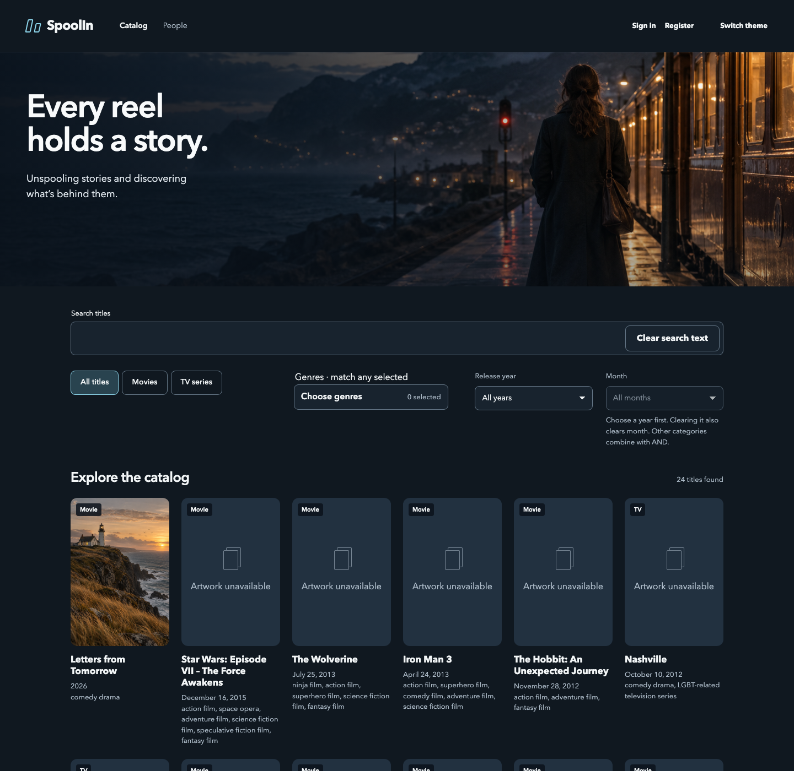

## What you can do

Visitors can browse movies and people without an account. Movie pages bring together the synopsis, artwork, release information, cast, and creators. Maintainers can create and edit movies and people, manage credits, upload poster artwork, and archive records. Archives retain a recovery path instead of making a mistaken removal immediately permanent.

SpoolIn also has account registration, retained editing drafts, conflict review when another edit changes a record, and an audit view for catalog changes. Forms show validation errors and save outcomes. Artwork uploads distinguish transfer progress from server processing.

## Run SpoolIn on your computer

Use this guide if you're starting from a computer that doesn't have development tools installed. Commands go in a terminal, one block at a time. Don't type the ``` marks around a block. When `sudo` asks for your computer password, the terminal may show nothing as you type; press Enter when you're done.

### Before you start

You need an internet connection for the first download, permission to install software, and enough free storage for container images and build dependencies. Docker runs Linux containers, including on macOS and Windows. Check Docker's linked requirements for your operating system and hardware before installing it. Local startup was exercised with 8 GiB of Docker memory, 8 CPUs, and about 15 GiB of free storage before builds. These are observed development resources, not established minimum requirements. Container builds can need additional disk space as caches grow.

| Tool | Why you need it |
| --- | --- |
| Git | Downloads the repository and later updates |
| Docker and Compose | Builds and runs the database and application services |
| Make | Gives the setup commands short, consistent names |
| Python 3.10 or newer | Runs the local setup helper |
| A browser | Opens the application |

Java, Node.js, npm, an editor, and Mermaid preview tools are optional for this container workflow. Docker builds the required application toolchains inside containers and starts PostgreSQL, so you don't need a separate database installation.

### Windows

Use Windows PowerShell for the first step, then Ubuntu for all project commands. WSL2 provides the Linux terminal that the setup scripts expect.

1. Open Start, search for **PowerShell**, and select **Run as administrator**. Install Ubuntu in WSL:

   ```powershell
   wsl --install -d Ubuntu
   ```

   Restart Windows if prompted. Open **Ubuntu** from Start and create the Linux username and password it requests. This is a separate account from your Windows account. Microsoft's [WSL installation guide](https://learn.microsoft.com/en-us/windows/wsl/install) covers installation failures and virtualization requirements.

2. In PowerShell, update WSL and check the installed distribution:

   ```powershell
   wsl --update
   wsl --list --verbose
   ```

   Ubuntu should show version `2`. If it shows `1`, run `wsl --set-version Ubuntu 2`.

3. Download and run [Docker Desktop for Windows](https://docs.docker.com/desktop/setup/install/windows-install/). Select the WSL2 backend when offered, launch Docker Desktop, and wait until the engine is running. In **Settings > Resources > WSL Integration**, enable Ubuntu and apply the change. See [Docker's WSL guide](https://docs.docker.com/desktop/features/wsl/).

4. Open **Ubuntu**, then install the remaining tools:

   ```bash
   sudo apt update
   sudo apt install -y git make python3 ca-certificates curl
   ```

5. In that same Ubuntu terminal, check the tools:

   ```bash
   git --version
   make --version
   python3 --version
   docker version
   docker compose version
   ```

   `docker version` must show both Client and Server. Keep Docker Desktop running. Continue to [Download SpoolIn](#download-spoolin) inside Ubuntu. Store the checkout under your Ubuntu home directory, not `/mnt/c`, to avoid Windows file permission and filesystem performance problems.

### macOS

1. Open **Terminal** from Applications > Utilities. Install Apple's command line tools:

   ```bash
   xcode-select --install
   ```

   Complete the installation dialog. If macOS says the tools are already installed, continue.

2. Install Homebrew, which installs command line software. This command downloads and runs Homebrew's installer; inspect [the Homebrew installation instructions](https://brew.sh/) first:

   ```bash
   /bin/bash -c "$(curl -fsSL https://raw.githubusercontent.com/Homebrew/install/HEAD/install.sh)"
   ```

   Follow the installer's **Next steps**, including its `brew shellenv` instructions, then reopen Terminal. The exact Homebrew path differs between Apple silicon and Intel Macs.

3. Install the tools and Docker Desktop:

   ```bash
   brew install git make python
   brew install --cask docker
   open -a Docker
   ```

   Finish Docker Desktop's first-run setup and wait for the engine. Docker's [Mac installation guide](https://docs.docker.com/desktop/setup/install/mac-install/) explains supported hardware and system requirements. Homebrew installs GNU Make as `gmake`; the macOS `make` command also supports this project's targets.

4. Check the tools:

   ```bash
   git --version
   make --version
   python3 --version
   docker version
   docker compose version
   ```

   `docker version` must include a Server section. Continue to [Download SpoolIn](#download-spoolin).

### Ubuntu Linux

These steps use Ubuntu 22.04 or newer with Docker Engine and Docker's Compose plugin. If you already use Docker Desktop on Ubuntu, keep that installation and verify its active context before continuing; don't install a second engine just for SpoolIn.

1. Open **Terminal** and install basic tools:

   ```bash
   sudo apt update
   sudo apt install -y git make python3 ca-certificates curl
   ```

2. If Docker is already installed, check [Docker's Ubuntu instructions](https://docs.docker.com/engine/install/ubuntu/) for conflicting packages before changing it. For a fresh machine, add Docker's package signing key and repository:

   ```bash
   sudo install -m 0755 -d /etc/apt/keyrings
   sudo curl -fsSL https://download.docker.com/linux/ubuntu/gpg -o /etc/apt/keyrings/docker.asc
   sudo chmod a+r /etc/apt/keyrings/docker.asc
   . /etc/os-release
   sudo tee /etc/apt/sources.list.d/docker.sources > /dev/null <<EOF_DOCKER
   Types: deb
   URIs: https://download.docker.com/linux/ubuntu
   Suites: ${UBUNTU_CODENAME:-$VERSION_CODENAME}
   Components: stable
   Architectures: $(dpkg --print-architecture)
   Signed-By: /etc/apt/keyrings/docker.asc
   EOF_DOCKER
   sudo apt update
   sudo apt install -y docker-ce docker-ce-cli containerd.io docker-buildx-plugin docker-compose-plugin
   sudo systemctl enable --now docker
   ```

   When copying the heredoc block, keep `EOF_DOCKER` on its own line without leading spaces. The package setup follows [Docker's official Ubuntu installation guide](https://docs.docker.com/engine/install/ubuntu/).

3. Allow your account to use Docker, then log out of Ubuntu and log back in:

   ```bash
   sudo usermod -aG docker "$USER"
   ```

   Membership in the Docker group grants privileges comparable to root. Use this on a machine where you control that access. See [Docker's Linux post-installation guide](https://docs.docker.com/engine/install/linux-postinstall/).

4. In a new terminal, check the tools:

   ```bash
   git --version
   make --version
   python3 --version
   docker version
   docker compose version
   docker run --rm hello-world
   ```

   Resolve any permission error before continuing. Run SpoolIn's commands as your normal user so generated files belong to your account.

### Download SpoolIn

Use Ubuntu on Windows, Terminal on macOS, or your Linux terminal:

```bash
mkdir -p ~/projects
cd ~/projects
git clone https://github.com/okfriansyah-moh/spoolIn.git
cd spoolIn
git switch main
```

The `main` branch includes the local setup helpers and packaged catalog described here. `git clone` creates the `spoolIn` folder. You only need it once. If you already have this repository, open its folder with `cd` and continue. Every `make local-*` command below runs from the folder containing `Makefile`.

### Start and sign in

1. Prepare the local environment:

   ```bash
   make local-setup
   ```

   Setup generates protected local configuration, certificates, and account secrets. Repeating setup preserves existing secrets and data.

2. Start the services:

   ```bash
   make local-start
   ```

   Wait for readiness checks to finish, then continue with certificate trust below. Startup checks artwork codec isolation too. A codec isolation error means the environment isn't ready, even if a catalog page responds.

3. Trust the local HTTPS certificate (once per installation):

   ```bash
   make local-trust
   ```

   Approve your operating system's prompt if asked, restart your browser, and open [SpoolIn](https://localhost:8443). See [certificate help](#trust-the-local-certificate) if a warning remains.

4. Select **Sign in** and choose one of these accounts for a fresh local installation:

   - **Viewer:** email `viewer@example.invalid`, password `SpoolInViewer123!`. Use this account for signed-in browsing of movies, TV series, people, and credits.
   - **Maintainer:** email `maintainer@example.invalid`, password `SpoolInMaintainer123!`. Use this account to manage movies, people, credits, artwork, and Archives, or review History.

   See [Choose the right account](#choose-the-right-account) for the access summary. Registration creates an additional Viewer; it doesn't grant catalog editing permissions.

   **Already set up SpoolIn before these demo passwords were added?** Setup and restarts preserve your existing credentials. Display the email and password pairs saved for your installation:

   ```bash
   cat .local/accounts.txt
   ```

   Use the password after the colon on the matching email's line. The new demo passwords don't replace older passwords, and you don't need to reset your data.

#### Trust the local certificate

Run `make local-trust` after `make local-setup`. This installs `.local/local-ca.crt` so your browser can recognize the app's local HTTPS certificate. It never imports a private key or disables certificate validation.

- **macOS:** adds trust for `localhost` to your login keychain. macOS may ask for your password or confirmation.
- **Windows through Ubuntu/WSL:** adds the certificate to your Windows user's Trusted Root store. Windows may ask you to confirm. Open the app in your Windows browser.
- **Ubuntu/Debian:** updates the system certificate store using `sudo`, which may ask for your password.

Restart your browser after running the command. Firefox on Windows and macOS normally uses [certificates trusted by the operating system](https://support.mozilla.org/en-US/kb/automatically-trust-third-party-certificates). Some Linux browsers use a separate store. If a warning remains, or your OS isn't supported, import `.local/local-ca.crt` in your browser's certificate settings. In Firefox: **Settings → Privacy & Security → Certificates → View Certificates → Authorities → Import**, then enable trust for identifying websites. Use `open .local` on macOS or `xdg-open .local` on Linux to find the certificate. Never import files from `.local/identities`.

Normal restarts don't require this command again. A reset generates a new certificate authority: remove the old **SpoolIn local development CA** from your certificate store and run `make local-trust` again. Remove that authority when you stop using this installation. Certificates expire after 365 days; don't reset valued data to renew them.

### Seeded catalog

A fresh installation loads the `public-pages-2026-10-v2` package:

| Included data | Count |
| --- | ---: |
| Movies | 100 |
| TV series | 100 |
| Packaged posters | 200, one for each title |
| Shared people | 1,213 |
| Credits | 1,475 |
| Genres | 165 |
| Credit roles | 4 |

These are real films, series, and credited people. The package includes original factual synopses, release dates at their known precision, genres, and available language, country, and runtime information. Unknown information stays unknown; a TV series' total running time isn't presented as an episode runtime. Credits reflect the packaged selection and aren't complete cast lists or filmographies.

Structured facts come from Wikidata, with enrichment and posters collected from public TMDB pages. Metadata and artwork source links are recorded separately. Each title's poster attribution links to its source; supplied creator or license details appear when available. Wikidata's CC0 metadata license does not grant rights to the posters, and the package makes no open-license claim for unspecified artwork rights.

The [seed manifest](data/seed/manifest.json) records the title identities, metadata, poster files, hashes, and attribution. The [public-page source ledger](data/seed/sources/tmdb-pages.json) records the collected sources. Preparation downloads are already packaged in the repository: startup reads local files through Media and doesn't request provider APIs, source accounts, or API keys. The first Docker build still needs internet access to download toolchains and dependencies.

#### Explore the loaded data

1. In **Catalog**, search for `Star Wars` and open **Star Wars: Episode VII – The Force Awakens**. Its details show the packaged poster, release information, synopsis, credits, and poster source link.

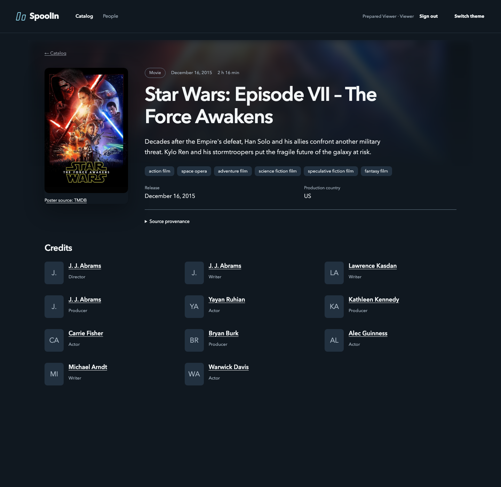

*Movie example: a real seeded title and its packaged poster, viewed in the running application.*

2. Return to **Catalog**, choose **TV series**, and search for `Nashville`. Open its details to see the TV metadata, credits, poster, and source link. TV records remain read-only in movie management.

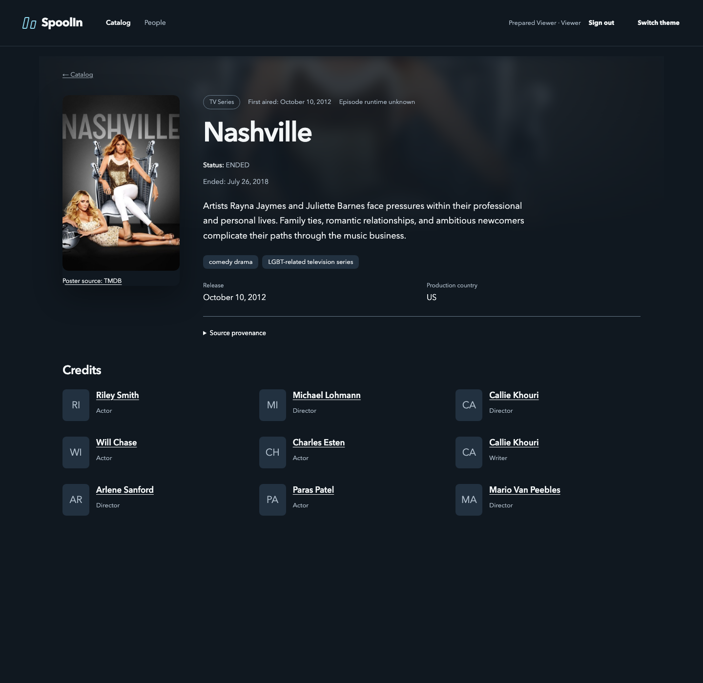

*TV example: the seeded series has its own artwork and metadata; unknown episode runtime remains explicit.*

#### Updating an existing local catalog

After pulling the latest `main`, run `make local-setup` and `make local-start` as usual. Setup preserves local credentials. The seed refresh retains stable record IDs and preserves user edits, credits, uploads, explicit artwork removals, archives, and deleted-record markers. Interrupted imports can resume, and repeating startup doesn't duplicate the seed records.

An existing installation can contain more or fewer active titles than the fresh package because of local creations, archives, and deletions. Your own artwork can also take precedence over a packaged poster. Don't use `make local-reset` to obtain the updated seed: it deletes your stored data.

The [seed upgrade record](docs/release/seed-public-pages-verification.md) documents the earlier fresh-load, preservation, and recovery checks. The counts above describe the frozen package, not a new verification run. Continue with the [stakeholder guide](#use-spoolin) for editing examples.

### Everyday commands

Run these commands from the repository folder when you need the corresponding action:

| Command | What it does |
| --- | --- |
| `make local-setup` | Prepares configuration and preserves existing credentials |
| `make local-trust` | Trusts the generated local HTTPS certificate in the host certificate store |
| `make local-start` | Builds and starts services, loads seed data, and checks readiness and codec isolation |
| `make local-status` | Checks container state, service readiness, and codec isolation |
| `make local-logs` | Prints the latest 200 log lines per service, then returns to the terminal |
| `make local-stop` | Stops the services while retaining data and artwork |
| `make local-test` | Runs the container-based checks described in [Test scope](#test-scope) |
| `make local-reset` | Requests confirmation before deleting local data, credentials, and build caches |

Container builds keep Linux dependencies in dedicated Docker volumes, preserving Node dependencies installed on your host. Stop and start reuse the same installation.

To update your checkout when you have no local source edits:

```bash
make local-stop
git pull --ff-only
make local-setup
make local-start
```

If Git reports local modifications, preserve or commit them before updating. Don't use a forced reset to fix an update error.

#### Delete local data and start again

`make local-reset` removes this local installation's stored data after its confirmation prompt. This includes accounts, catalog edits, and uploaded artwork. It isn't necessary for a normal restart.

```bash
make local-reset
make local-setup
make local-start
```

Type `DELETE` at the prompt only when you intend to discard the local installation. Keep a backup if the data matters to you.

### Troubleshooting

| What you see | What to check |
| --- | --- |
| `make: command not found` | Install Make for your platform and reopen the terminal. On Windows use Ubuntu. |
| `python3: command not found` | Install Python 3 using your platform steps above. |
| Cannot connect to Docker daemon | Start Docker Desktop, or run `sudo systemctl start docker` on Ubuntu Engine. Check `docker version`. |
| Docker permission denied on Ubuntu | Finish the Docker group step, then log out and back in. |
| `docker` missing inside WSL | Enable Docker Desktop's Ubuntu integration and reopen Ubuntu. |
| Port already in use | Stop the other service using the printed port, then start SpoolIn again. |
| Another local command is running | Wait for the current setup, start, or test command. After an interruption, confirm no local command remains before removing only the empty `.local/action.lock` directory with `rmdir .local/action.lock`. |
| Build download fails | Check your connection, proxy, free disk space, and registry access; retry setup. |
| Page can't be reached | Run `make local-status`, inspect `make local-logs`, and use the exact printed HTTPS address. |
| Artwork codec isolation fails | Preserve the diagnostic. Check Docker's Linux security support and the repository's Media policy; don't disable the sandbox to force a successful start. |
| Sign-in fails | Use the local demo credentials below, or `.local/accounts.txt` for an older installation. Registration creates a Viewer, while editing requires a Maintainer. |
| Save outcome is uncertain | Use the page's original-result check before submitting again. |

The [Media isolation policy](docs/release/media-sandbox-policy.md) describes deployment enforcement. The local Media profile uses `systempaths=unconfined` to let Bubblewrap mount a fresh private `/proc`: Docker Desktop's inherited process-filesystem masks blocked that mount in the macOS check. This setting applies only to Media. It retains non-root execution, dropped capabilities, a read-only filesystem, seccomp, and the codec worker's network, PID, user, and mount isolation. Local startup must still verify the codec boundary.

The local profile does not load the production AppArmor policy and is not equivalent to the production environment. Use trusted sample images on your development computer. Local helpers keep deployment configuration separate; don't substitute deployment `make start` for `make local-start`.

### Verification limits

The local workflow and browser walkthrough were exercised on macOS with Docker Desktop and Docker Engine `29.8.2`, running Linux ARM64 containers. Installer commands were checked against the linked vendor guides; this was not a fresh operating-system installation. Windows/WSL2 and native Ubuntu instructions received source inspection only.

Platform instructions follow the linked vendor installation guides. Successful tool installation depends on your OS version, virtualization settings, and Docker security support. Historical results and outstanding browser, accessibility, external-client, and production verification are recorded in [the release handoff](docs/release/handoff.md) and [release verification record](docs/release/remote-acceptance-assessment.json).

## Use SpoolIn

The catalog screenshots and seeded movie/TV examples show the updated real catalog with packaged posters. The later editing walkthrough uses fictional records so you can try changes without altering a seeded title. Its lighthouse poster was uploaded through the application.

### Choose the right account

The local setup creates two ready-to-use accounts. After completing [Start and sign in](#start-and-sign-in), choose the role you want to try:

| Account | Email | Password | Access |
| --- | --- | --- | --- |
| Visitor | No account needed | No password needed | Browse and search public movies, people, and credits |
| Viewer | `viewer@example.invalid` | `SpoolInViewer123!` | Browse with a signed-in account |
| Maintainer | `maintainer@example.invalid` | `SpoolInMaintainer123!` | Maintain movies, people, credits, artwork, and archived records; review History |

After `make local-setup` and `make local-start`, open `https://localhost:8443`, select **Sign in**, and enter an email and password from the table. Choose Maintainer to try editing, artwork uploads, Archives, and History; choose Viewer for signed-in browsing.

These published demo passwords apply only to fresh local installations. Deployment provisioning continues to use generated credentials. Keep the local demo environment on localhost.

If you set up SpoolIn before these defaults were added, your existing accounts and passwords stay unchanged. Read their credentials from the repository folder with:

```bash
cat .local/accounts.txt
```

On Windows, run this in the Ubuntu terminal from the setup guide. The same command works on macOS and Linux. Each line contains `email: password`; use the password after the colon for the matching email. Repeating setup and restarting preserve existing credentials and catalog data. You don't need to reset your installation.

To replace an older local Maintainer password with the published `SpoolInMaintainer123!` password, run:

```bash
make local-repair-maintainer
```

This explicit recovery command changes only the prepared Maintainer password and revokes its existing sessions. It updates `.local/accounts.txt` and preserves the account, Viewer credentials, catalog edits, and artwork. Normal startup continues to preserve passwords.

To restore both prepared accounts to the Viewer and Maintainer passwords in the table above, run `make local-repair-accounts`. It updates both passwords in one database transaction, revokes their existing sessions, and updates `.local/accounts.txt`. Account roles and other stored data are preserved. Restart the local app with `make local-stop` followed by `make local-start` when needed.

**Register** creates an additional Viewer account; catalog editing requires a Maintainer.

When a session expires, sign in again before continuing an edit. The page explains retained draft recovery when it is available. Don't assume a form is saved just because you can still see its values.

### Viewer example: find a movie

A Viewer can browse and search movies, people, and credits. Catalog editing, artwork uploads, archives, and history require a Maintainer.

For example, find a seeded film and explore its credits:

1. Sign in with the Viewer account from [Choose the right account](#choose-the-right-account). The header displays **Viewer** beside your account name.
2. Open **Catalog** and enter `Star Wars` in **Search titles**. Wait for the results to load.
3. Open **Star Wars: Episode VII – The Force Awakens** to read its synopsis and available credits.
4. Select a credited person, or open **People** and search for a cast member or creator by name.

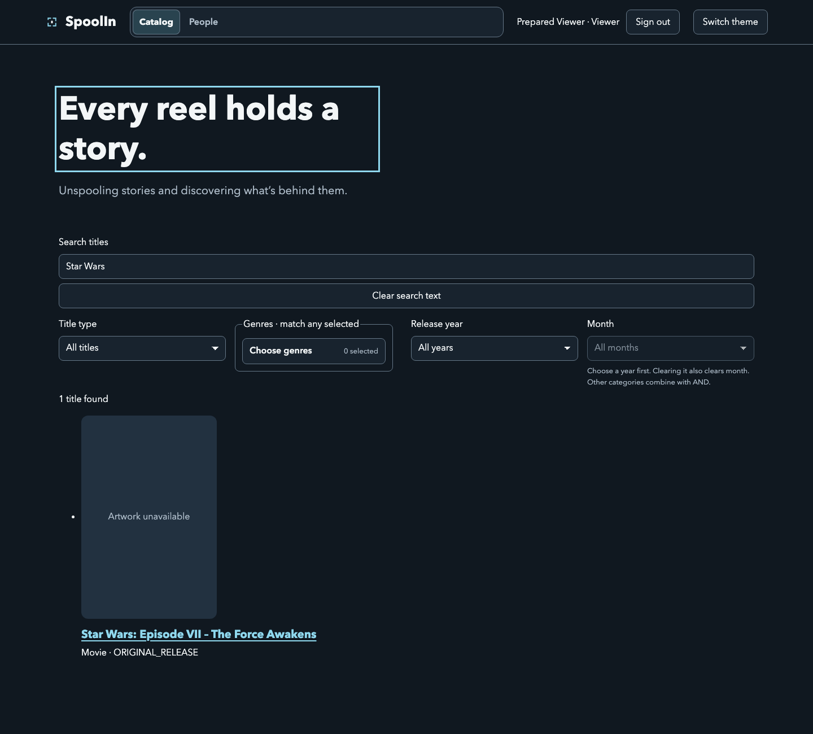

*Viewer example: the signed-in account searches the updated seed catalog, with packaged posters visible in the results.*

Filters help narrow the catalog. If no titles match, clear the search or broaden the filters to return to browsing.

### Viewer example: explore movie details

The following examples use the fictional movie and people created in the [Maintainer walkthrough](#maintainer-example-create-and-edit-a-movie). On a fresh installation, ask a Maintainer to add those examples, or follow the same steps with a seeded movie and its credited people.

1. Sign in as a Viewer, open **Catalog**, and search for `Letters from Tomorrow`.
2. Select the movie to open its public details page.
3. Read the synopsis, release information, genres, and poster. This example shows a 2026 movie about a lighthouse keeper receiving letters dated one day ahead.
4. Scroll to **Credits** to see the people involved. Use **← Catalog** to return to browsing.

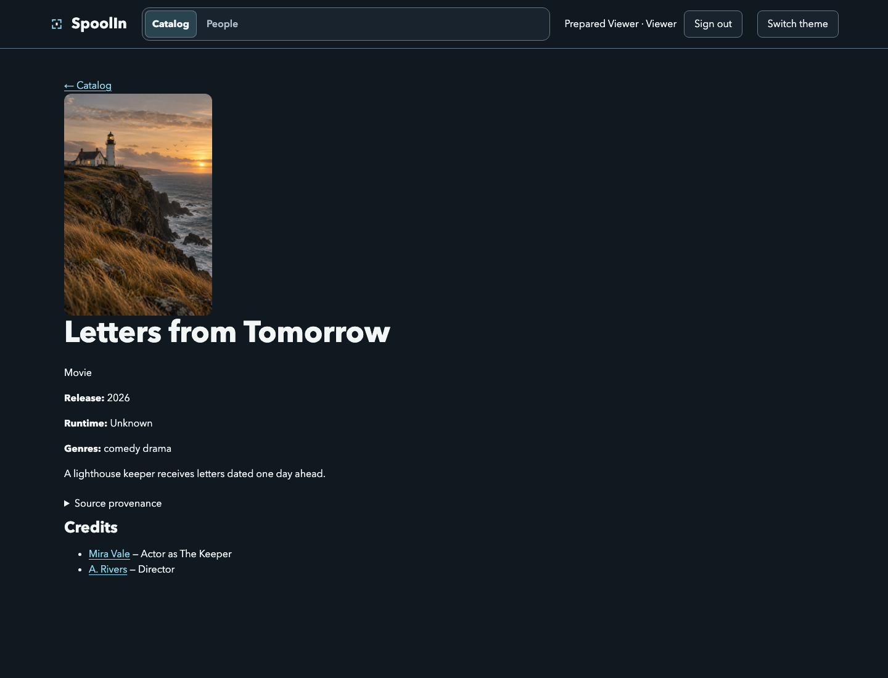

*Movie details example: the poster sits beside the title and release information. Public credits appear below, while the header identifies the Viewer account.*

Missing optional information can appear as unknown. Seed titles include packaged posters. A title without selected artwork can show a placeholder until a Maintainer uploads a poster.

### Viewer example: read movie credits

On the `Letters from Tomorrow` details page, find **Credits**:

1. Find **Mira Vale** and read the **Actor** credit and **The Keeper** character name.
2. Find **A. Rivers** and read the **Director** credit to identify the creator's contribution.
3. Select a person's name to open their public profile. If a longer credits list offers **Load more credits**, use it to continue browsing.


*Credits example: each person has a linked name and contribution. Cast credits can include character names; creator credits show contributions such as directing.*

### Viewer example: explore cast and creator profiles

A person has one shared profile, with credits describing their contributions to individual movies.

#### Cast profile

1. In the movie's **Credits**, select **Mira Vale**.
2. Read the biography, `Fictional actor playing the lighthouse keeper.`
3. Under **Credits**, find **Letters from Tomorrow**, with **Actor** and **The Keeper** in its contribution row. Select the movie title to return to its details.

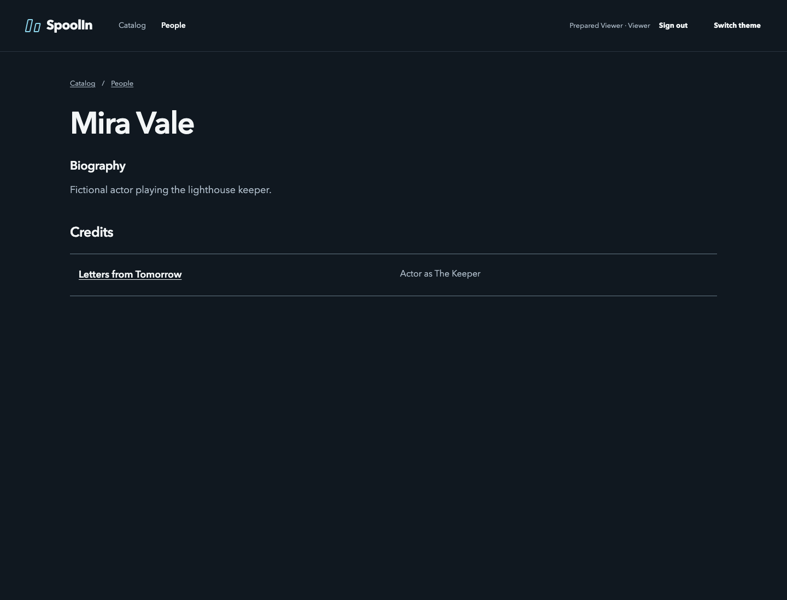

*Cast profile example: Mira Vale's biography sits above the credits list, where the movie title links back to its details.*

#### Creator profile

1. Back on the movie page, select **A. Rivers** in **Credits**.
2. Read the biography, `Fictional director of Letters from Tomorrow.`
3. Under **Credits**, find **Letters from Tomorrow**, with **Director** in its contribution row. Select the movie title to return to its details.

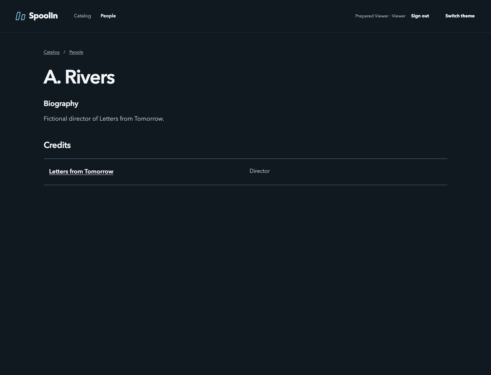

*Creator profile example: the credits list connects A. Rivers to the movie and their directing contribution.*

You can also open **People** and search for either name directly. People with identical names can have separate profiles, so use their biographies and credits to identify the intended person. Longer profile credits lists provide **Load more credits** when more entries are available.

### Maintainer example: create and edit a movie

1. Sign in as a Maintainer and open **Movies** in the navigation.
2. Choose **Create movie**. For a fictional example, enter `Letters from Tomorrow` as the title and `A lighthouse keeper receives letters dated one day ahead.` as the synopsis. Complete the other required fields; add release details and genres where available.
3. Read any field errors and correct the named inputs. The form displays the current limits; don't shorten content based on an old screenshot's limits.
4. Save and wait for confirmation. The app opens **Cast and creators** for the saved movie. Add credits as described below, then select **Done**, or choose **Skip for now**. Both return to **Movies**, where a success panel shows the newly created movie with **Edit movie** and **Review public record** links.
5. To change a movie, return to **Movies**, choose **Edit** for that record, edit its values, and save again.

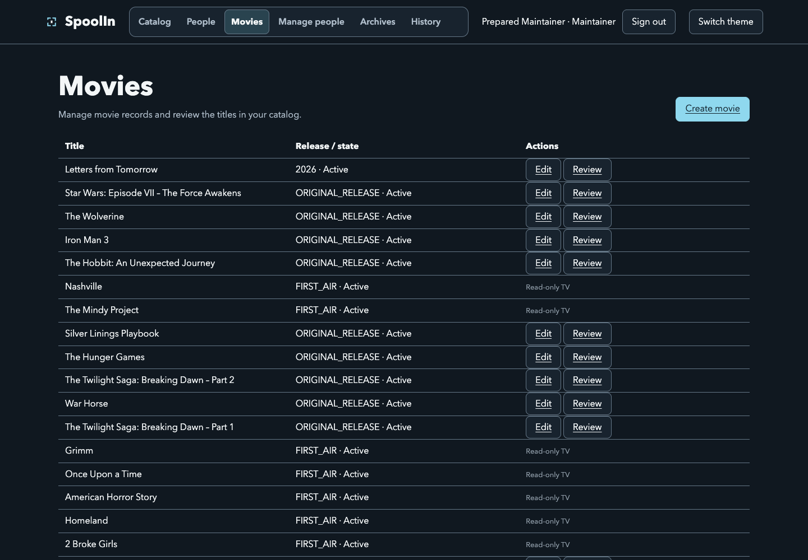

*Maintainer example: the saved fictional movie appears in Movies, with editing controls. The header displays Maintainer and includes management navigation.*

If someone else saves the record while you're editing, SpoolIn asks you to review the current saved values. Compare them with your retained changes before continuing. If the connection drops during a save, use **Check original result** when offered. Repeatedly submitting an uncertain save can make it harder to tell which operation completed.

Use **Search movies** and select **Search**, or press Enter, to find a title. Search includes records beyond the first loaded page. **Clear search** restores the unfiltered list; **Load more movies** retrieves further results.

The seeded catalog also contains TV titles. Those entries are read-only in the movie management list.

### Maintainer example: manage cast and creators

Cast and creators use shared person records. Add the person first, then describe their contribution with a movie credit.

1. Sign in as a Maintainer and open **Manage people** → **Create person**.
2. Enter `A. Rivers` as the professional name and `Fictional director of Letters from Tomorrow.` as the biography. Select **Save person**. After confirmed success, the app returns to **Manage people** with a **Person created** panel and links to edit or review that person.
3. Create another person named `Mira Vale`, with the biography `Fictional actor playing the lighthouse keeper.`
4. To update either biography, open **Manage people**, find the person, choose **Edit**, change the biography, and select **Save person**. Use **Search people** and select **Search**, or press Enter, to find records beyond the first page. **Clear search** restores the list, and **Load more people** retrieves further matches.

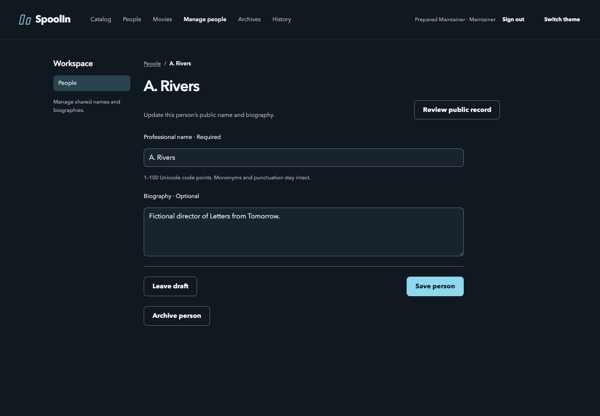

*People example: the editor keeps the professional name and biography together. Credits link this shared person record to their work on individual movies.*

Editing a person updates that identity across its credits. It doesn't merge different people who happen to share a name.

### Maintainer example: manage credits

Open **Movies** and select **Cast and creators** beside `Letters from Tomorrow`. This opens a separate page with the movie title, existing credits, and buttons to add cast or creators. The action is available in both desktop and mobile lists. **Edit** opens movie details, artwork, and archive controls; credits are managed separately.

1. Select **+ Add creator** to reveal the form. Choose **A. Rivers** in **Person** and **Director** in **Role**, then select **Add credit**.
2. Select **+ Add cast**, then choose **Mira Vale** and the **Actor** role. Enter `The Keeper` in **Character names · one per line**, then select **Add credit**. Use **Load more people** to find a person beyond the current options.
3. Wait for confirmation. The form collapses after a successful save; use either plus button to add another credit. The same movie can have both cast and creator credits. Select **Done** when finished to return to Movies. When you opened credits from the movie list, your previous search text, submitted search, loaded results, and scroll position are restored. **Skip for now** appears only during the new-movie creation step; that flow also shows the newly created movie when you return. Unfinished credit input must be saved or discarded before leaving; use **Continue editing** to keep working. If a save result is unknown, check the original result before leaving.
4. To change a credit, select its **Edit credit** control, update the role or supported character names, and select **Save credit**.
5. To remove a contribution, choose **Remove credit** on that row and review its confirmation. Removing a credit removes the relationship; the shared person remains available.

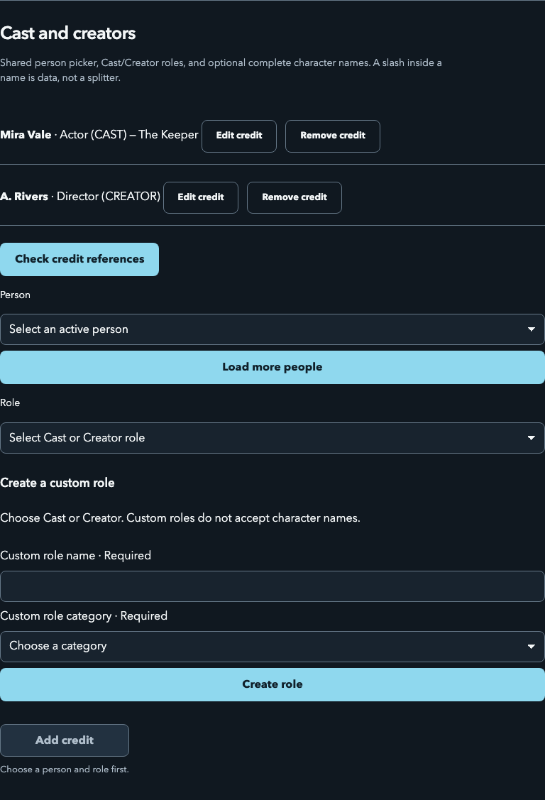

*Credits example: the movie links one creator and one cast member to their existing person records. These screenshots predate the direct **Cast and creators** list action, separate credits page, plus buttons, and creation-step navigation described above.*

### Maintainer example: upload artwork

For the fictional movie, use the repository's sample lighthouse poster:

1. Open **Movies** → **Edit** for `Letters from Tomorrow`.
2. Find **Poster artwork** and choose `docs/design-system/mockup/assets/letters.png` from this checkout. You can also use a PNG, JPEG, or WebP image you have permission to use. If it exceeds the dimension or upload byte limit, the browser automatically prepares a smaller copy before transfer, preserving its aspect ratio and leaving your original file unchanged. The prepared image fits within 8192 pixels per side, 40 million pixels, and the current upload byte limit. Images already within those limits upload unchanged.
3. Keep the page open while the file transfers and the server processes it. A complete transfer percentage doesn't mean the poster is attached yet.
4. Wait for **Saved**, then open the movie's public page to see its poster.

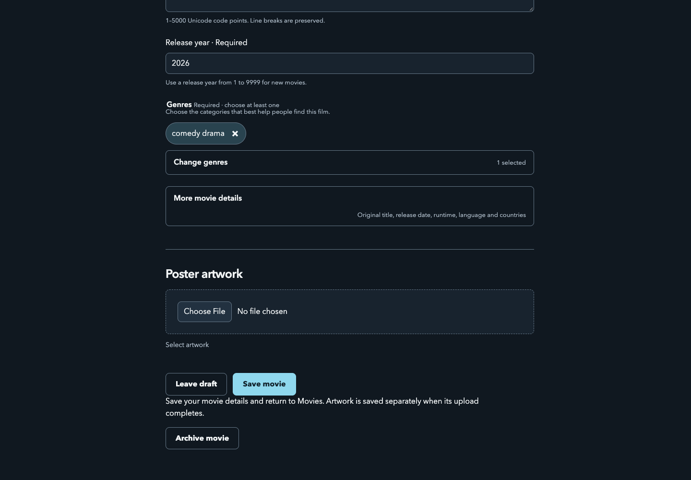

*Artwork example: choose an image in the Poster artwork field. The public movie page above shows the lighthouse poster already attached to this record.*

If the artwork attached but details couldn't refresh, retry the details read before uploading again. **Cancel upload** applies while that action is available. If the outcome is uncertain, use the offered status check; unsupported or unreadable files explain what to change. If the browser cannot prepare a copy within the limits, choose a smaller image. Server validation still applies to every upload.

### Maintainer example: archive and delete records

Archiving removes a record from public browsing and retains a recovery path. Permanent deletion is irreversible. Use a disposable fictional record when following this example.

1. Under **Manage people**, create `Example Person to Remove` with the biography `Disposable fictional record for the archive and deletion walkthrough.` Save it, then choose **Edit person** in the created-record panel on **Manage people**.
2. Select **Archive person**, read the confirmation, and confirm **Archive person**. The application opens **Archives**.
3. Choose the **People** tab and find `Example Person to Remove`. **Restore** returns it to the active catalog if you want to keep it.

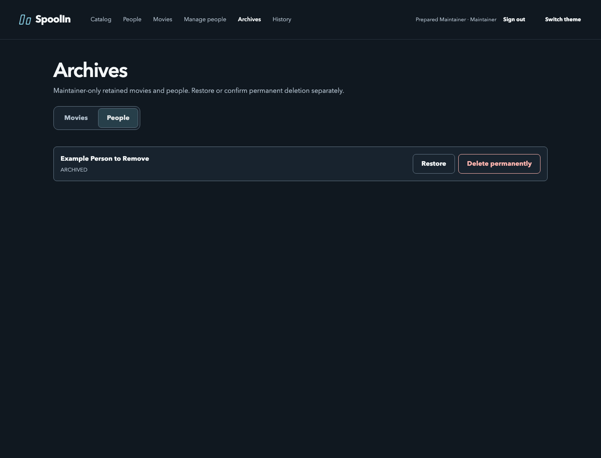

*Archive example: the person is retained privately, with recovery and permanent deletion available as separate actions.*

4. To discard the disposable record, select **Delete permanently**. Read the record name and impact information in **Confirm permanent deletion**.
5. Choose **Permanently delete** only for the intended record. Wait for **The change is confirmed.** before continuing.

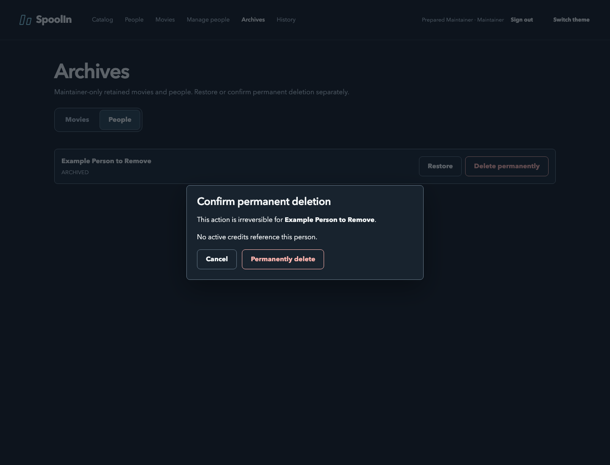

*Deletion example: the confirmation identifies the fictional record before the irreversible action.*

For a movie, open its management page, choose **Archive movie**, then use the **Movies** tab in **Archives** for restoration or permanent deletion. For a person with credits, review the displayed impact on linked movies before deleting. **History** records catalog changes.

### Maintainer example: review History

**History** lets Maintainers review catalog changes without editing the records. It retains entries for archived and permanently deleted records too.

1. Sign in as a **Maintainer**, then select **History** in the main navigation.
2. Read the newest entries first. **Time** shows the UTC timestamp; **Actor** identifies the account by its reference; **Action** describes the change. **Affected record** shows the record type and ID, and **Outcome** shows the recorded result.
3. For example, find a `CREATE_PERSON` entry from the disposable-person walkthrough above and select **Inspect changes**. Review the recorded name and biography under **Before** and **After**. On a phone, use **Review changes** on the entry's card.
4. To match an entry to a movie or person you manage, compare its record ID with the last part of that record's management URL. Select **Load more history** when it appears to read older entries.

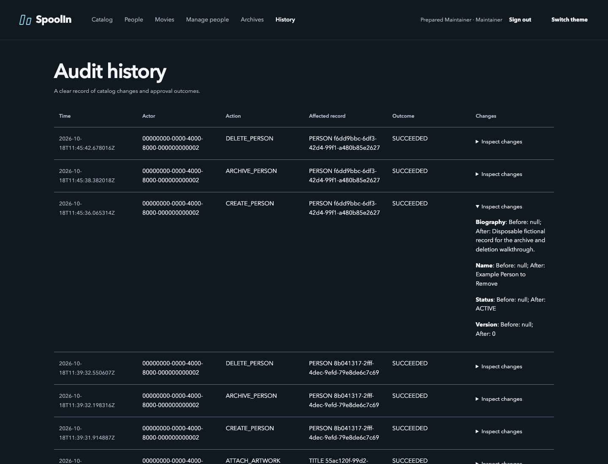

*History example: the expanded CREATE_PERSON entry shows the fictional person's recorded values, even after that disposable record was deleted. Account and record references identify who made the change and what it affected.*

Some entries have no field changes to display. If a large value was omitted, the entry shows its retained summary. History is a read-only record of activity; use the relevant movie, person, or Archives page to make a change.

### Understand feedback

| Message or state | What to do |
| --- | --- |
| Loading | Wait for the requested page or operation to finish |
| Field validation error | Correct the named field; the form keeps your other input |
| Saved | Check the resulting record before starting another change |
| Stale record or changed target | Review the newer saved values and reconcile your edit |
| Uncertain result | Check the original operation before submitting again |
| Upload transferring | Keep the page open while bytes are sent |
| Upload processing | Wait for server processing and attachment confirmation |
| Permission or session problem | Sign in with the correct account role |
| Read failure | Retry the read when offered; a read failure isn't proof that a write failed |

### Use a smaller screen

Navigation links wrap for narrow screens. Select the same labeled links used on desktop. Maintainers can open **Cast and creators** directly from Movies; scroll within each page to reach its form actions. Loading, error, and upload feedback remain part of the same journey.

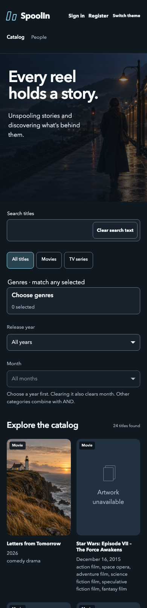

## How it works

The web interface uses Svelte 5, SvelteKit, and TypeScript. Three Kotlin/Spring Boot services handle application responsibilities:

| Component | Responsibility |
| --- | --- |
| Core | Browser entry point, GraphQL, accounts, sessions, and drafts |
| Catalog | Movies, people, credits, catalog changes, and audit history |
| Media | Artwork upload, image processing, and stored artwork |
| PostgreSQL | Persistent service data |
| MCP adapter | Optional in-chat proposal integration, outside the local startup stack |

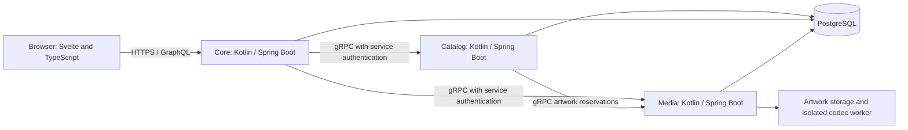

GraphQL carries browser queries and application mutations. Artwork uploads send Base64 image content in an `uploadArtwork` mutation to `/graphql`; the browser tracks transfer progress for that JSON request. Core streams the decoded bytes to Media over gRPC. Services communicate over gRPC, and each service has its own PostgreSQL database. Shared schemas live in `contracts`, and generated clients keep service and frontend contracts consistent.

GitHub renders the Mermaid diagram above automatically. For a local preview, install [Visual Studio Code](https://code.visualstudio.com/download), open this folder, open `README.md`, and select **Open Preview** from the editor's context menu. Current VS Code includes Mermaid Markdown support; older versions can install **Markdown Preview Mermaid Support** from Extensions. See [VS Code's Markdown instructions](https://code.visualstudio.com/docs/languages/markdown). Neither VS Code nor Mermaid is needed to run SpoolIn.

Local startup keeps browser access on your computer, disables external tunnel and in-chat publication, and omits deployment monitoring services. The [deployment and maintenance documents](docs/operations/maintenance.md) describe the separate operational environment.

## Develop and test

### Source development

You can run the whole application in Docker while editing source files. Rerun `make local-start` to build source changes and start the updated services. `make local-setup` prepares configuration; it doesn't build source. For checks directly on the host, install Node.js `24.21.0`, npm `11.19.0`, and Java 21. Kotlin and Spring Boot versions are pinned in [the Gradle version catalog](gradle/libs.versions.toml); frontend versions are pinned in [frontend/package.json](frontend/package.json). Use `./gradlew` to run the repository's Gradle wrapper without installing Gradle separately. The repository helper `ops/bin/toolchain-env.sh` recognizes the documented local tool locations; it doesn't install missing toolchains.

From the repository root:

```bash
npm ci
npm run generate
npm run check
npm run build
npm run test:coverage --workspace frontend
./gradlew test
```

Contract generation requires Java and Node; generated interfaces must match the checked-in schemas. `npm run dev --workspace frontend` starts only Vite, not the backend or database. Use the Docker workflow for the complete application.

`make test-unit` and `make test-integration` use the repository's task-aware verification runners. Integration checks require isolated fixture configuration; follow the [verification workflow](docs/07-harness-workflow.md) and never point test helpers at data you want to keep. Running the application doesn't require installing AI clients, workflow hooks, or external chat integrations.

### Test scope

`make local-test` builds the app and runs the setup-helper regressions, npm type checks, frontend and MCP coverage tests, and Gradle `test` tasks. Its temporary backend test container receives access to the local Docker engine so Testcontainers can manage isolated PostgreSQL fixtures. Application containers do not receive this socket; remote Docker endpoints are unsupported.

The separately named `integrationTest` tasks and browser acceptance suites need their own runtime prerequisites and are not included in `make local-test`. See the [verification workflow](docs/07-harness-workflow.md) for those runners.

Existing unit tests cover successful operations and failure boundaries. Examples include:

| Area | Examples in the repository |
| --- | --- |
| Artwork file validation | [Allowed formats and byte limits](frontend/src/lib/features/artwork/file-validation.test.ts) |
| Upload feedback | [Uncertain cancellation, rejected cancellation, and failed result lookup](frontend/src/lib/features/artwork/upload-controller.test.ts) |
| Recovered drafts | [Editable person values, movie arrays, and nullable fields](services/core/src/test/kotlin/com/spoolin/core/features/draft/DraftProjectionRulesTest.kt) |
| Media upload streams | [Valid headers and chunks, empty or oversized files, checksum mismatch, and cancellation](services/media/src/test/kotlin/com/spoolin/media/features/upload/ChunkSinkRulesTest.kt) |

The [acceptance specification](docs/05-atdd.md) defines the wider expected behavior. These examples and unit-test results do not establish complete scenario, browser, accessibility, or integration coverage.

## AI assistance

I’m Muhammad Okfriansyah, the developer behind SpoolIn. I led the brainstorming, research, product direction, and delivery planning, with AI assistance throughout the process. My work included deciding what to build, reviewing trade-offs, refining requirements, organizing the work, and requesting corrections as the application took shape.

### Human decisions and AI assistance

| Stage | My work | AI assistance |
| --- | --- | --- |
| [Brainstorming](docs/01-brainstorming-result.md) and [research](docs/research/) | Set the questions and constraints, supplied context, evaluated options, and chose the project direction. | Explored alternatives, helped gather and organize research, and recorded discussions and decisions. |
| [Product requirements](docs/02-PRD.md) | Defined the intended users, scope, priorities, and expected behavior; reviewed and refined the requirements. | Helped structure and draft the PRD, clarify requirements, and identify edge cases. |
| [Design](docs/03-design-system.md) and [technical documentation](docs/04-spoolin-techdoc.md) | Reviewed architecture and interface trade-offs, selected the direction, and guided revisions. Included security and monitoring in the delivery scope. | Proposed options and helped draft the design system, technical contracts, diagrams, security controls, and monitoring guidance. |
| [Acceptance scenarios](docs/05-atdd.md) and [implementation planning](docs/06-PLAN.md) | Set expectations, organized the sequence of work, and reviewed priorities and boundaries. | Helped break the work into tasks, draft scenarios, and keep the plan and supporting documentation aligned. |
| [Agent instructions and workflow](docs/07-harness-workflow.md) | Set up and refined the instructions, skills, and working rules used to direct AI-assisted work. | Helped implement and document the workflow, summarize progress, and retain check results and review notes. |
| Implementation and review | Directed the work, reviewed outcomes, and requested changes to setup, seeded data, UI, and documentation. Decided which changes to accept. | Generated and revised code, setup scripts, tests, and documentation; assisted with checks, debugging, screenshots, and code reviews. |

These documents were developed with AI assistance. I own the product decisions and remain responsible for understanding and explaining the delivered work.

### Progress tracking

I used a [Notion Kanban board](https://cord-bluebell-457.notion.site/8a450667b9c642d1b0d13595fa5344ff?v=9ef08933eb1046a5add02d14eb853c76&source=copy_link) to track work across **To-do**, **In progress**, and **Complete**. It covered the planning steps, PRD and technical design, acceptance scenarios, implementation breakdown, security and monitoring plan, agent instructions, and implementation progress. I used it to manage priorities and follow the work from planning into delivery.

The repository retains the resulting instructions, task plans, role definitions, checks, and evidence so changes can be inspected and explained. [The development workflow guide](docs/07-harness-workflow.md) describes the recorded tool setup and its verification limits. A board status records progress; the linked implementation and verification records provide the evidence for what was delivered.

OpenAI image generation produced four fictional prototype artwork assets. Their purpose and provenance are recorded in [the artwork record](docs/design-system/mockup/assets/artwork-provenance.json); they are separate from production catalog seed data. The screenshots in [Use SpoolIn](#use-spoolin) show the running application.

## Project references

- [Product behavior](docs/02-PRD.md)
- [Design system](docs/03-design-system.md)
- [Engineering design](docs/04-spoolin-techdoc.md)
- [Acceptance scenarios](docs/05-atdd.md)
- [Implementation plan](docs/06-PLAN.md)
- [Media isolation policy](docs/release/media-sandbox-policy.md)
