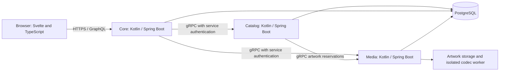

# SpoolIn

SpoolIn is a movie catalog for people who want to discover films and maintain the information behind them. Browse movies and TV entries, search titles and people, explore cast and creator credits, and sign in as a Maintainer to update the catalog.

## Contents

- [What you can do](#what-you-can-do)
- [Run SpoolIn on your computer](#run-spoolin-on-your-computer)
- [Use SpoolIn](#use-spoolin)
- [How it works](#how-it-works)
- [Develop and test](#develop-and-test)
- [AI assistance](#ai-assistance)
- [Project references](#project-references)


## What you can do

Visitors can browse movies and people without an account. Movie pages bring together the synopsis, artwork, release information, cast, and creators. Maintainers can create and edit movies and people, manage credits, upload poster artwork, and archive records. Archives retain a recovery path instead of making a mistaken removal immediately permanent.

SpoolIn also has account registration, retained editing drafts, conflict review when another edit changes a record, and an audit view for catalog changes. Forms show validation errors and save outcomes. Artwork uploads distinguish transfer progress from server processing.

## Run SpoolIn on your computer

Start with the [local setup guide](docs/local-setup.md). It includes installation commands for:

- [Windows with WSL2 Ubuntu](docs/local-setup.md#windows)
- [macOS](docs/local-setup.md#macos)
- [Ubuntu Linux](docs/local-setup.md#ubuntu-linux)

You need Git, Make, Python 3.10 or newer, and Docker with the Compose plugin. Docker builds the application toolchains, so you don't need to install Java or Node just to run the app.

Once those tools are installed, open your terminal and run:

```bash
git clone https://github.com/okfriansyah-moh/spoolIn.git
cd spoolIn
git switch codex/remote-acceptance-closure
make local-setup
make local-start
```

Use the browser address and initial account instructions printed by the setup helper. Keep the terminal open until startup finishes. The first build downloads dependencies and takes longer than later starts.

| Command | What it does |
| --- | --- |
| `make local-setup` | Prepares local configuration and credentials |
| `make local-start` | Builds and starts services, seeds data, and checks readiness |
| `make local-status` | Checks service readiness and codec isolation |
| `make local-logs` | Shows service logs |
| `make local-stop` | Stops services while keeping data |
| `make local-test` | Runs the local verification helper |
| `make local-reset` | Requests confirmation before deleting local data |

Read the [account, restart, reset, and troubleshooting instructions](docs/local-setup.md#start-and-sign-in) before changing generated configuration or deleting data.

## Use SpoolIn

The [illustrated guide](docs/stakeholder-guide.md) walks through browsing, finding people, maintaining movies, adding credits, and uploading artwork. It also explains account permissions and what to do when a save or upload needs attention.

## How it works

The web interface uses Svelte 5, SvelteKit, and TypeScript. Three Kotlin/Spring Boot services handle application responsibilities:

| Component | Responsibility |
| --- | --- |
| Core | Browser entry point, GraphQL, accounts, sessions, and drafts |
| Catalog | Movies, people, credits, catalog changes, and audit history |
| Media | Artwork upload, image processing, and stored artwork |
| PostgreSQL | Persistent service data |
| MCP adapter | Optional in-chat proposal integration, outside the local startup stack |



GraphQL carries browser queries and application mutations. Artwork uploads send Base64 image content in an `uploadArtwork` mutation to `/graphql`; the browser tracks transfer progress for that JSON request. Core streams the decoded bytes to Media over gRPC. Services communicate over gRPC, and each service has its own PostgreSQL database. Shared schemas live in `contracts`, and generated clients keep service and frontend contracts consistent.

GitHub renders the Mermaid diagram above automatically. For a local preview, install [Visual Studio Code](https://code.visualstudio.com/download), open this folder, open `README.md`, and select **Open Preview** from the editor's context menu. Current VS Code includes Mermaid Markdown support; older versions can install **Markdown Preview Mermaid Support** from Extensions. See [VS Code's Markdown instructions](https://code.visualstudio.com/docs/languages/markdown). Neither VS Code nor Mermaid is needed to run SpoolIn.

Local startup keeps browser access on your computer, disables external tunnel and in-chat publication, and omits deployment monitoring services. The [deployment and maintenance documents](docs/operations/maintenance.md) describe the separate operational environment.

## Develop and test

For source work, use the versions pinned in the repository: Java 21, Node.js `24.21.0`, and npm `11.19.0`. The Kotlin and Spring Boot versions are pinned in [the Gradle version catalog](gradle/libs.versions.toml). Use `./gradlew` for Gradle so you don't need a separate Gradle installation. The frontend currently pins Svelte `5.57.2` and SvelteKit `3.0.1`.

The [development instructions](docs/local-setup.md#source-development) explain dependency installation and checks. Unit tests cover frontend controllers and components, Kotlin service behavior, and supporting tooling. Integration and browser checks exercise separate boundaries and need their declared runtime prerequisites. A successful unit run does not establish that every browser, accessibility, or service integration requirement passed.

The [acceptance specification](docs/05-atdd.md) defines expected behavior. The [release handoff](docs/release/handoff.md) and [release verification record](docs/release/remote-acceptance-assessment.json) retain outstanding verification and historical results; they aren't a claim that every specified case has passed.

## AI assistance

AI coding tools support development, documentation, and review in this repository. The project retains instructions, task plans, role definitions, checks, and evidence so changes can be inspected and explained. [The development workflow guide](docs/07-harness-workflow.md) describes the recorded tool setup and its verification limits.

OpenAI image generation produced four fictional prototype artwork assets. Their purpose and provenance are recorded in [the artwork record](docs/design-system/mockup/assets/artwork-provenance.json); they are separate from production catalog seed data. Screenshots in the usage guide show the running application.

The optional in-chat movie proposal feature is application functionality. Local setup disables publication through that integration, and its external-client acceptance remains separate from running the catalog locally.

## Project references

- [Product behavior](docs/02-PRD.md)
- [Design system](docs/03-design-system.md)
- [Engineering design](docs/04-spoolin-techdoc.md)
- [Acceptance scenarios](docs/05-atdd.md)
- [Implementation plan](docs/06-PLAN.md)
- [Media isolation policy](docs/release/media-sandbox-policy.md)
