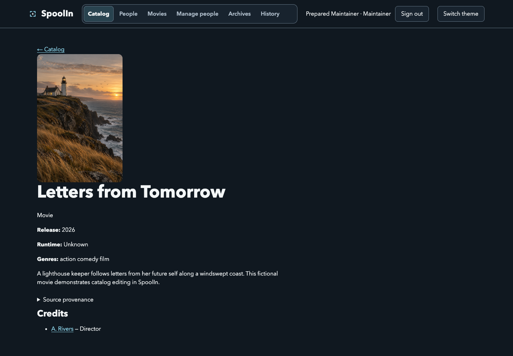
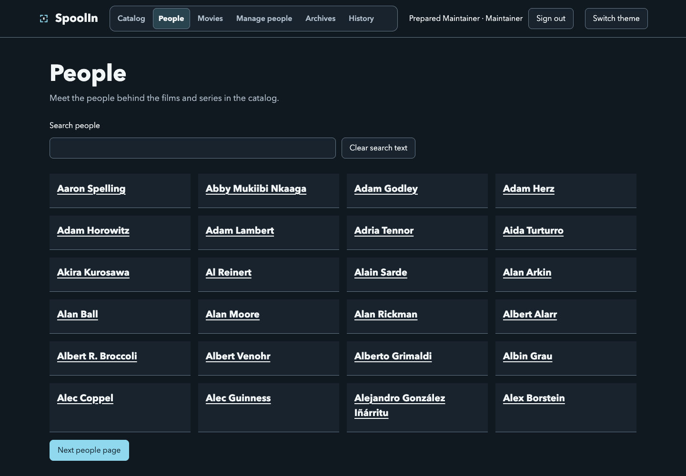
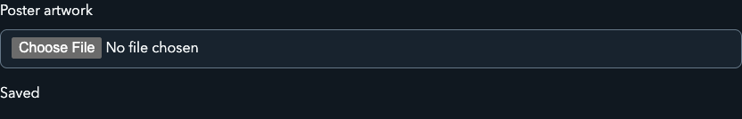
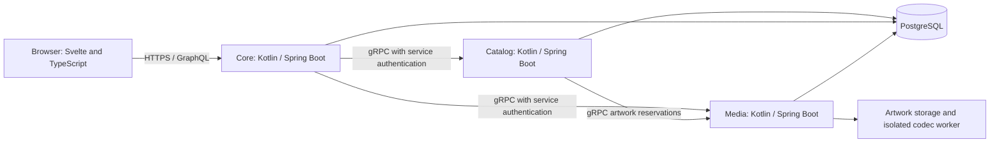

# SpoolIn

SpoolIn is a movie catalog for people who want to discover films and maintain the information behind them. Browse movies and TV entries, search titles and people, explore cast and creator credits, and sign in as a Maintainer to update the catalog.

## Contents

- [What you can do](#what-you-can-do)
- [Run SpoolIn on your computer](#run-spoolin-on-your-computer)
- [Use SpoolIn](#use-spoolin)
  - [Browse and search](#browse-and-search)
  - [Explore a movie](#explore-a-movie)
  - [Find cast and creators](#find-cast-and-creators)
  - [Choose the right account](#choose-the-right-account)
  - [Create and edit movies](#create-and-edit-movies)
  - [Manage people and credits](#manage-people-and-credits)
  - [Upload artwork](#upload-artwork)
  - [Archive and recover records](#archive-and-recover-records)
  - [Understand feedback](#understand-feedback)
  - [Use a smaller screen](#use-a-smaller-screen)
- [How it works](#how-it-works)
- [Develop and test](#develop-and-test)
- [AI assistance](#ai-assistance)
- [Project references](#project-references)


## What you can do

Visitors can browse movies and people without an account. Movie pages bring together the synopsis, artwork, release information, cast, and creators. Maintainers can create and edit movies and people, manage credits, upload poster artwork, and archive records. Archives retain a recovery path instead of making a mistaken removal immediately permanent.

SpoolIn also has account registration, retained editing drafts, conflict review when another edit changes a record, and an audit view for catalog changes. Forms show validation errors and save outcomes. Artwork uploads distinguish transfer progress from server processing.

## Run SpoolIn on your computer

Start with the [local setup guide](docs/local-setup.md). It includes installation commands for:

- [Windows with WSL2 Ubuntu](docs/local-setup.md#windows)
- [macOS](docs/local-setup.md#macos)
- [Ubuntu Linux](docs/local-setup.md#ubuntu-linux)

You need Git, Make, Python 3.10 or newer, and Docker with the Compose plugin. Docker builds the application toolchains, so you don't need to install Java or Node just to run the app.

Once those tools are installed, open your terminal and run:

```bash
git clone https://github.com/okfriansyah-moh/spoolIn.git
cd spoolIn
git switch codex/remote-acceptance-closure
make local-setup
make local-start
```

Use the browser address and initial account instructions printed by the setup helper. Keep the terminal open until startup finishes. The first build downloads dependencies and takes longer than later starts.

| Command | What it does |
| --- | --- |
| `make local-setup` | Prepares local configuration and credentials |
| `make local-start` | Builds and starts services, seeds data, and checks readiness |
| `make local-status` | Checks service readiness and codec isolation |
| `make local-logs` | Shows service logs |
| `make local-stop` | Stops services while keeping data |
| `make local-test` | Runs the local verification helper |
| `make local-reset` | Requests confirmation before deleting local data |

Read the [account, restart, reset, and troubleshooting instructions](docs/local-setup.md#start-and-sign-in) before changing generated configuration or deleting data.

## Use SpoolIn

The screenshots include fictional walkthrough records alongside the seeded catalog. Seed data does not include poster files; the lighthouse poster was uploaded through the application.

### Browse and search

The **Catalog** page lists movies with poster artwork. Select a movie to open its details. Use search when you know part of a title; filters help narrow the catalog. Wait for results to finish loading before changing your search again. An empty result means the current search has no matches; clear it or broaden the filters to return to browsing.


### Explore a movie

A movie page shows its synopsis and available release details, with cast and creator credits below. Select a credited person to explore their profile. Missing optional information can appear as unknown; it doesn't mean the movie failed to load.



### Find cast and creators

Open **People** to browse or search for someone by name. A person's profile connects their biography with credited movies. Cast and creators share person records; a credit describes what that person did on a particular film. Two people with the same name can have separate records, so check their details before linking a credit.



### Choose the right account

| Account | Access |
| --- | --- |
| Visitor | Browse and search public movies, people, and credits |
| Viewer | Browse with a signed-in account |
| Maintainer | Maintain movies, people, credits, artwork, and archived records |

Choose **Sign in** to use the credentials from `.local/accounts.txt`. The local setup creates a Viewer and a Maintainer for trying both experiences. Keep those passwords private. **Register** creates a Viewer account; it doesn't grant Maintainer permissions.

When a session expires, sign in again before continuing an edit. The page explains retained draft recovery when it is available. Don't assume a form is saved just because you can still see its values.

### Create and edit movies

1. Sign in as a Maintainer and open **Movies** in the navigation.
2. Choose **Create movie**. Enter the required title, synopsis, and other fields marked by the form. Add release details and genres where available.
3. Read any field errors and correct the named inputs. The form displays the current limits; don't shorten content based on an old screenshot's limits.
4. Save and wait for confirmation. Open the saved movie to check the displayed information.
5. To change a movie, return to **Movies**, choose **Edit** for that record, edit its values, and save again.


If someone else saves the record while you're editing, SpoolIn asks you to review the current saved values. Compare them with your retained changes before continuing. If the connection drops during a save, use **Check original result** when offered. Repeatedly submitting an uncertain save can make it harder to tell which operation completed.

The seeded catalog also contains TV titles. Those entries are read-only in the movie management list.

### Manage people and credits

Open **Manage people** in the navigation and choose **Create person** to add a professional name and biography, or **Edit** on an existing record to change it. Save the person before using them in a movie credit.

In a movie's **Cast and creators** section, choose an existing **Person** and **Role**, then select **Add credit**. Cast roles can include **Character names · one per line** when the selected role supports them. Creator roles describe contributions such as directing. Existing rows have **Edit credit** and **Remove credit** controls; editing uses **Save credit**. Review the selected person, role, and character names before saving. Editing a person updates that identity across its credits; it doesn't merge other people with the same name.

### Upload artwork

Open a saved movie's management page and find **Poster artwork**. Choose a PNG, JPEG, or WebP image that meets the limits shown by the application. Use artwork you have permission to use.

The upload first transfers the file, then processes it on the server. A complete transfer percentage doesn't mean the poster is attached yet. Wait for the saved confirmation and check the refreshed artwork. If the page says the artwork attached but details couldn't refresh, retry the details read before uploading again.

Cancel applies to an active operation where the control is available. When the outcome is uncertain, use the offered status check. Unsupported or oversized files should show an explanation so you can choose another file.



### Archive and recover records

Archiving removes a movie or person from active catalog browsing while retaining a recovery path. Open the record's management page, choose its archive action, and read the confirmation before proceeding. Inspect affected credits and the impact information shown for the operation.

Use **Archives** in the navigation to review archived records and the actions available for them. Treat permanent deletion as a separate decision: read the impact preview and confirmation rather than assuming it behaves like archiving. **History** in the navigation helps Maintainers inspect recorded catalog changes.

### Understand feedback

| Message or state | What to do |
| --- | --- |
| Loading | Wait for the requested page or operation to finish |
| Field validation error | Correct the named field; the form keeps your other input |
| Saved | Check the resulting record before starting another change |
| Stale record or changed target | Review the newer saved values and reconcile your edit |
| Uncertain result | Check the original operation before submitting again |
| Upload transferring | Keep the page open while bytes are sent |
| Upload processing | Wait for server processing and attachment confirmation |
| Permission or session problem | Sign in with the correct account role |
| Read failure | Retry the read when offered; a read failure isn't proof that a write failed |

Local startup disables external in-chat publication. The catalog and maintenance interface can be explored without connecting a chat provider. External proposal approval and production readiness have separate verification requirements described in the [release records](docs/release/handoff.md).

### Use a smaller screen

Navigation links wrap for narrow screens. Select the same labeled links used on desktop, and scroll to reach form actions and credit sections. Loading, error, and upload feedback remain part of the same journey.


## How it works

The web interface uses Svelte 5, SvelteKit, and TypeScript. Three Kotlin/Spring Boot services handle application responsibilities:

| Component | Responsibility |
| --- | --- |
| Core | Browser entry point, GraphQL, accounts, sessions, and drafts |
| Catalog | Movies, people, credits, catalog changes, and audit history |
| Media | Artwork upload, image processing, and stored artwork |
| PostgreSQL | Persistent service data |
| MCP adapter | Optional in-chat proposal integration, outside the local startup stack |



GraphQL carries browser queries and application mutations. Artwork uploads send Base64 image content in an `uploadArtwork` mutation to `/graphql`; the browser tracks transfer progress for that JSON request. Core streams the decoded bytes to Media over gRPC. Services communicate over gRPC, and each service has its own PostgreSQL database. Shared schemas live in `contracts`, and generated clients keep service and frontend contracts consistent.

GitHub renders the Mermaid diagram above automatically. For a local preview, install [Visual Studio Code](https://code.visualstudio.com/download), open this folder, open `README.md`, and select **Open Preview** from the editor's context menu. Current VS Code includes Mermaid Markdown support; older versions can install **Markdown Preview Mermaid Support** from Extensions. See [VS Code's Markdown instructions](https://code.visualstudio.com/docs/languages/markdown). Neither VS Code nor Mermaid is needed to run SpoolIn.

Local startup keeps browser access on your computer, disables external tunnel and in-chat publication, and omits deployment monitoring services. The [deployment and maintenance documents](docs/operations/maintenance.md) describe the separate operational environment.

## Develop and test

For source work, use the versions pinned in the repository: Java 21, Node.js `24.21.0`, and npm `11.19.0`. The Kotlin and Spring Boot versions are pinned in [the Gradle version catalog](gradle/libs.versions.toml). Use `./gradlew` for Gradle so you don't need a separate Gradle installation. The frontend currently pins Svelte `5.57.2` and SvelteKit `3.0.1`.

The [development instructions](docs/local-setup.md#source-development) explain dependency installation and checks. Unit tests cover frontend controllers and components, Kotlin service behavior, and supporting tooling. Integration and browser checks exercise separate boundaries and need their declared runtime prerequisites. A successful unit run does not establish that every browser, accessibility, or service integration requirement passed.

The [acceptance specification](docs/05-atdd.md) defines expected behavior. The [release handoff](docs/release/handoff.md) and [release verification record](docs/release/remote-acceptance-assessment.json) retain outstanding verification and historical results; they aren't a claim that every specified case has passed.

## AI assistance

AI coding tools support development, documentation, and review in this repository. The project retains instructions, task plans, role definitions, checks, and evidence so changes can be inspected and explained. [The development workflow guide](docs/07-harness-workflow.md) describes the recorded tool setup and its verification limits.

OpenAI image generation produced four fictional prototype artwork assets. Their purpose and provenance are recorded in [the artwork record](docs/design-system/mockup/assets/artwork-provenance.json); they are separate from production catalog seed data. Screenshots in the usage guide show the running application.

The optional in-chat movie proposal feature is application functionality. Local setup disables publication through that integration, and its external-client acceptance remains separate from running the catalog locally.

## Project references

- [Product behavior](docs/02-PRD.md)
- [Design system](docs/03-design-system.md)
- [Engineering design](docs/04-spoolin-techdoc.md)
- [Acceptance scenarios](docs/05-atdd.md)
- [Implementation plan](docs/06-PLAN.md)
- [Media isolation policy](docs/release/media-sandbox-policy.md)
