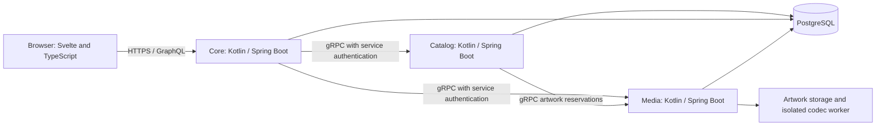

# SpoolIn

SpoolIn is a movie catalog for people who want to discover films and maintain the information behind them. Browse movies and TV entries, search titles and people, explore cast and creator credits, and sign in as a Maintainer to update the catalog.

## Contents

- [What you can do](#what-you-can-do)
- [Run SpoolIn on your computer](#run-spoolin-on-your-computer)
  - [Before you start](#before-you-start)
  - [Windows](#windows)
  - [macOS](#macos)
  - [Ubuntu Linux](#ubuntu-linux)
  - [Download SpoolIn](#download-spoolin)
  - [Start and sign in](#start-and-sign-in)
  - [Everyday commands](#everyday-commands)
  - [Troubleshooting](#troubleshooting)
  - [Source development](#source-development)
  - [Verification limits](#verification-limits)
- [Use SpoolIn](#use-spoolin)
  - [Browse and search](#browse-and-search)
  - [Explore a movie](#explore-a-movie)
  - [Find cast and creators](#find-cast-and-creators)
  - [Choose the right account](#choose-the-right-account)
  - [Create and edit movies](#create-and-edit-movies)
  - [Manage people and credits](#manage-people-and-credits)
  - [Upload artwork](#upload-artwork)
  - [Archive and recover records](#archive-and-recover-records)
  - [Understand feedback](#understand-feedback)
  - [Use a smaller screen](#use-a-smaller-screen)
- [How it works](#how-it-works)
- [Develop and test](#develop-and-test)
- [AI assistance](#ai-assistance)
- [Project references](#project-references)


## What you can do

Visitors can browse movies and people without an account. Movie pages bring together the synopsis, artwork, release information, cast, and creators. Maintainers can create and edit movies and people, manage credits, upload poster artwork, and archive records. Archives retain a recovery path instead of making a mistaken removal immediately permanent.

SpoolIn also has account registration, retained editing drafts, conflict review when another edit changes a record, and an audit view for catalog changes. Forms show validation errors and save outcomes. Artwork uploads distinguish transfer progress from server processing.

## Run SpoolIn on your computer

Use this guide if you're starting from a computer that doesn't have development tools installed. Commands go in a terminal, one block at a time. Don't type the ``` marks around a block. When `sudo` asks for your computer password, the terminal may show nothing as you type; press Enter when you're done.

### Before you start

You need an internet connection for the first download, permission to install software, and enough free storage for container images and build dependencies. Docker runs Linux containers, including on macOS and Windows. Check Docker's linked requirements for your operating system and hardware before installing it. The documentation work used a Docker environment with 8 GiB of memory and 8 CPUs; it had about 15 GiB free before builds. These are observed development resources, not established minimum requirements. Container builds can need additional disk space as caches grow.

| Tool | Why you need it |
| --- | --- |
| Git | Downloads the repository and later updates |
| Docker and Compose | Builds and runs the database and application services |
| Make | Gives the setup commands short, consistent names |
| Python 3.10 or newer | Runs the local setup helper |
| A browser | Opens the application |

Java, Node.js, npm, an editor, and Mermaid preview tools are optional for this container workflow. Docker builds the required application toolchains inside containers and starts PostgreSQL, so you don't need a separate database installation.

### Windows

Use Windows PowerShell for the first step, then Ubuntu for all project commands. WSL2 provides the Linux terminal that the setup scripts expect.

1. Open Start, search for **PowerShell**, and select **Run as administrator**. Install Ubuntu in WSL:

   ```powershell
   wsl --install -d Ubuntu
   ```

   Restart Windows if prompted. Open **Ubuntu** from Start and create the Linux username and password it requests. This is a separate account from your Windows account. Microsoft's [WSL installation guide](https://learn.microsoft.com/en-us/windows/wsl/install) covers installation failures and virtualization requirements.

2. In PowerShell, update WSL and check the installed distribution:

   ```powershell
   wsl --update
   wsl --list --verbose
   ```

   Ubuntu should show version `2`. If it shows `1`, run `wsl --set-version Ubuntu 2`.

3. Download and run [Docker Desktop for Windows](https://docs.docker.com/desktop/setup/install/windows-install/). Select the WSL2 backend when offered, launch Docker Desktop, and wait until the engine is running. In **Settings > Resources > WSL Integration**, enable Ubuntu and apply the change. See [Docker's WSL guide](https://docs.docker.com/desktop/features/wsl/).

4. Open **Ubuntu**, then install the remaining tools:

   ```bash
   sudo apt update
   sudo apt install -y git make python3 ca-certificates curl
   ```

5. In that same Ubuntu terminal, check the tools:

   ```bash
   git --version
   make --version
   python3 --version
   docker version
   docker compose version
   ```

   `docker version` must show both Client and Server. Keep Docker Desktop running. Continue to [Download SpoolIn](#download-spoolin) inside Ubuntu. Store the checkout under your Ubuntu home directory, not `/mnt/c`, to avoid Windows file permission and filesystem performance problems.

### macOS

1. Open **Terminal** from Applications > Utilities. Install Apple's command line tools:

   ```bash
   xcode-select --install
   ```

   Complete the installation dialog. If macOS says the tools are already installed, continue.

2. Install Homebrew, which installs command line software. This command downloads and runs Homebrew's installer; inspect [the Homebrew installation instructions](https://brew.sh/) first:

   ```bash
   /bin/bash -c "$(curl -fsSL https://raw.githubusercontent.com/Homebrew/install/HEAD/install.sh)"
   ```

   Follow the installer's **Next steps**, including its `brew shellenv` instructions, then reopen Terminal. The exact Homebrew path differs between Apple silicon and Intel Macs.

3. Install the tools and Docker Desktop:

   ```bash
   brew install git make python
   brew install --cask docker
   open -a Docker
   ```

   Finish Docker Desktop's first-run setup and wait for the engine. Docker's [Mac installation guide](https://docs.docker.com/desktop/setup/install/mac-install/) explains supported hardware and system requirements. Homebrew installs GNU Make as `gmake`; the macOS `make` command also supports this project's targets.

4. Check the tools:

   ```bash
   git --version
   make --version
   python3 --version
   docker version
   docker compose version
   ```

   `docker version` must include a Server section. Continue to [Download SpoolIn](#download-spoolin).

### Ubuntu Linux

These steps use Ubuntu 22.04 or newer with Docker Engine and Docker's Compose plugin. If you already use Docker Desktop on Ubuntu, keep that installation and verify its active context before continuing; don't install a second engine just for SpoolIn.

1. Open **Terminal** and install basic tools:

   ```bash
   sudo apt update
   sudo apt install -y git make python3 ca-certificates curl
   ```

2. If Docker is already installed, check [Docker's Ubuntu instructions](https://docs.docker.com/engine/install/ubuntu/) for conflicting packages before changing it. For a fresh machine, add Docker's package signing key and repository:

   ```bash
   sudo install -m 0755 -d /etc/apt/keyrings
   sudo curl -fsSL https://download.docker.com/linux/ubuntu/gpg -o /etc/apt/keyrings/docker.asc
   sudo chmod a+r /etc/apt/keyrings/docker.asc
   . /etc/os-release
   sudo tee /etc/apt/sources.list.d/docker.sources > /dev/null <<EOF_DOCKER
   Types: deb
   URIs: https://download.docker.com/linux/ubuntu
   Suites: ${UBUNTU_CODENAME:-$VERSION_CODENAME}
   Components: stable
   Architectures: $(dpkg --print-architecture)
   Signed-By: /etc/apt/keyrings/docker.asc
   EOF_DOCKER
   sudo apt update
   sudo apt install -y docker-ce docker-ce-cli containerd.io docker-buildx-plugin docker-compose-plugin
   sudo systemctl enable --now docker
   ```

   When copying the heredoc block, keep `EOF_DOCKER` on its own line without leading spaces. The package setup follows [Docker's official Ubuntu installation guide](https://docs.docker.com/engine/install/ubuntu/).

3. Allow your account to use Docker, then log out of Ubuntu and log back in:

   ```bash
   sudo usermod -aG docker "$USER"
   ```

   Membership in the Docker group grants privileges comparable to root. Use this on a machine where you control that access. See [Docker's Linux post-installation guide](https://docs.docker.com/engine/install/linux-postinstall/).

4. In a new terminal, check the tools:

   ```bash
   git --version
   make --version
   python3 --version
   docker version
   docker compose version
   docker run --rm hello-world
   ```

   Resolve any permission error before continuing. Run SpoolIn's commands as your normal user so generated files belong to your account.

### Download SpoolIn

Use Ubuntu on Windows, Terminal on macOS, or your Linux terminal:

```bash
mkdir -p ~/projects
cd ~/projects
git clone https://github.com/okfriansyah-moh/spoolIn.git
cd spoolIn
git switch codex/remote-acceptance-closure
```

The local helpers are currently on PR #10's `codex/remote-acceptance-closure` branch, so switch to it before setup. `git clone` creates the `spoolIn` folder. You only need it once. If you already have this repository, open its folder with `cd` and continue. Every `make local-*` command below runs from the folder containing `Makefile`.

### Start and sign in

1. Prepare the local environment:

   ```bash
   make local-setup
   ```

   Setup generates protected local configuration, certificates, and account secrets. Repeating setup preserves existing secrets and data.

2. Start the services:

   ```bash
   make local-start
   ```

   Wait for readiness checks to finish. Open `https://localhost:8443` after startup succeeds. Initial credentials are stored in `.local/accounts.txt`: `maintainer@example.invalid` can edit the catalog, and `viewer@example.invalid` has Viewer access. Their random passwords persist across repeated setup. Startup checks artwork codec isolation too. A codec isolation error means the environment isn't ready, even if a catalog page responds.

3. Trust the generated public local certificate using [the Firefox steps below](#trust-the-local-certificate), then open `https://localhost:8443`. Don't import a private key or turn off certificate validation.

4. In the project terminal, read your initial account details:

   ```bash
   cat .local/accounts.txt
   ```

   Choose **Sign in** and enter the Maintainer email and generated password from that file. Keep the terminal output private and out of screenshots, issues, and commits. Registration creates a Viewer; it doesn't grant catalog editing permissions.

#### Trust the local certificate

Firefox provides the same certificate import route on Windows, macOS, and Linux. You can install it from [Mozilla's download page](https://www.mozilla.org/firefox/new/) if your usual browser's certificate settings are unfamiliar. This changes trust in that Firefox profile.

1. Locate `.local/local-ca.crt` inside your project. `.local` is a hidden folder. From the project terminal, open it with the command for your platform:

   Windows, inside Ubuntu:

   ```bash
   explorer.exe "$(wslpath -w .local)"
   ```

   macOS:

   ```bash
   open .local
   ```

   Linux:

   ```bash
   xdg-open .local
   ```

   In a Linux file picker, press `Ctrl+H` to show hidden folders. On macOS use `Command+Shift+G` and paste the project folder path followed by `/.local` if needed. In Windows, copy the folder address from Explorer into the import dialog.

2. In Firefox open **Settings**, search for **certificates**, and choose **View Certificates**. Select **Authorities**, then **Import**.
3. Select only the generated public `local-ca.crt` file. Confirm trust for identifying websites when Firefox asks. Never import `.local` private key files or share the folder. Mozilla documents [manual certificate import and trust settings](https://wiki.mozilla.org/CA/Changing_Trust_Settings).
4. Open `https://localhost:8443` again. If a warning remains, check that you imported the certificate from this checkout and that the address is exactly `localhost`. Resolve the warning before signing in.

Local certificates expire after 365 days. Renewal needs manual attention; don't delete valued data just to renew a certificate. If you reset the installation, it creates a new local CA, so remove the old SpoolIn local authority from Firefox and repeat the import. Remove that authority when you're finished using this local installation.

Seed data provides 100 movies and 100 TV entries, plus people, genres, and credits for browsing. It doesn't bundle poster image files; records can show artwork placeholders until you upload an image. Changes you make locally stay in Docker volumes across normal stops and restarts. The [stakeholder guide](#use-spoolin) explains the first journeys to try.

### Everyday commands

```bash
make local-status
make local-logs
make local-stop
make local-start
make local-test
```

`make local-test` runs the setup-helper regression suite, builds the app, runs npm type checks, frontend and MCP coverage tests, and Gradle test tasks. Some backend tests use isolated database fixtures. The separately named `integrationTest` tasks and browser acceptance suites are not part of this command.

Container builds keep Linux dependencies in dedicated Docker volumes, so they preserve any Node dependencies installed on your host. Reset removes these build caches too.

Its temporary backend test container receives access to your local Docker engine so Testcontainers can start and remove isolated PostgreSQL fixtures. Application containers do not receive this socket. Remote Docker endpoints are not supported by this helper.

Status checks service readiness and codec isolation as well as container state. Logs print the most recent 200 lines per service, then return to your terminal. Stop retains the database and artwork. Start brings the same installation back.

To update this PR branch in a checkout without local source edits:

```bash
make local-stop
git pull --ff-only
make local-setup
make local-start
```

If Git reports local modifications, preserve or commit them before updating. Don't use a forced reset to fix an update error.

#### Delete local data and start again

`make local-reset` removes this local installation's stored data after its confirmation prompt. This includes accounts, catalog edits, and uploaded artwork. It isn't necessary for a normal restart.

```bash
make local-reset
make local-setup
make local-start
```

Type `DELETE` at the prompt only when you intend to discard the local installation. Keep a backup if the data matters to you.

### Troubleshooting

| What you see | What to check |
| --- | --- |
| `make: command not found` | Install Make for your platform and reopen the terminal. On Windows use Ubuntu. |
| `python3: command not found` | Install Python 3 using your platform steps above. |
| Cannot connect to Docker daemon | Start Docker Desktop, or run `sudo systemctl start docker` on Ubuntu Engine. Check `docker version`. |
| Docker permission denied on Ubuntu | Finish the Docker group step, then log out and back in. |
| `docker` missing inside WSL | Enable Docker Desktop's Ubuntu integration and reopen Ubuntu. |
| Port already in use | Stop the other service using the printed port, then start SpoolIn again. |
| Another local command is running | Wait for the current setup, start, or test command. After an interruption, confirm no local command remains before removing only the empty `.local/action.lock` directory with `rmdir .local/action.lock`. |
| Build download fails | Check your connection, proxy, free disk space, and registry access; retry setup. |
| Page can't be reached | Run `make local-status`, inspect `make local-logs`, and use the exact printed HTTPS address. |
| Artwork codec isolation fails | Preserve the diagnostic. Check Docker's Linux security support and the repository's Media policy; don't disable the sandbox to force a successful start. |
| Sign-in fails | Use the generated local credentials. Registration creates a Viewer, while editing requires a Maintainer. |
| Save outcome is uncertain | Use the page's original-result check before submitting again. |

The [Media isolation policy](docs/release/media-sandbox-policy.md) describes deployment enforcement. The local Media profile uses `systempaths=unconfined` to let Bubblewrap mount a fresh private `/proc`: Docker Desktop's inherited process-filesystem masks blocked that mount in the macOS check. This setting applies only to Media. It retains non-root execution, dropped capabilities, a read-only filesystem, seccomp, and the codec worker's network, PID, user, and mount isolation. Local startup must still verify the codec boundary.

The local profile does not load the production AppArmor policy and is not equivalent to the production environment. Use trusted sample images on your development computer. Local helpers keep deployment configuration separate; don't substitute deployment `make start` for `make local-start`.

### Source development

You can run the whole application in Docker while editing source files. Rerun `make local-start` to build source changes and start the updated services. `make local-setup` prepares configuration; it doesn't build source. For checks directly on the host, install the pinned Node.js `24.21.0`, npm `11.19.0`, and Java 21 toolchains. The repository helper `ops/bin/toolchain-env.sh` recognizes the documented local tool locations; it doesn't install missing toolchains.

From the repository root:

```bash
npm ci
npm run generate
npm run check
npm run build
npm run test:coverage --workspace frontend
./gradlew test
```

Contract generation requires Java and Node; generated interfaces must match the checked-in schemas. `npm run dev --workspace frontend` starts only Vite, not the backend or database. Use the Docker workflow for the complete application.

`make test-unit` and `make test-integration` use the repository's task-aware verification runners. Integration checks require isolated fixture configuration; follow the [verification workflow](docs/07-harness-workflow.md) and never point test helpers at data you want to keep. Running the application doesn't require installing AI clients, workflow hooks, or external chat integrations.

### Verification limits

The local workflow and browser walkthrough were exercised on macOS with Docker Desktop and Docker Engine `29.8.2`, running Linux ARM64 containers. Installer commands were checked against the linked vendor guides; this was not a fresh operating-system installation. Windows/WSL2 and native Ubuntu instructions received source inspection only.

Platform instructions follow the linked vendor installation guides. Successful tool installation depends on your OS version, virtualization settings, and Docker security support. The delivery report records which platforms and application journeys were actually run. Historical release evidence and remaining acceptance work are retained in [the release handoff](docs/release/handoff.md); screenshots alone don't establish every acceptance case.

## Use SpoolIn

The screenshots include fictional walkthrough records alongside the seeded catalog. Seed data does not include poster files; the lighthouse poster was uploaded through the application.

### Browse and search

The **Catalog** page lists movies with poster artwork. Select a movie to open its details. Use search when you know part of a title; filters help narrow the catalog. Wait for results to finish loading before changing your search again. An empty result means the current search has no matches; clear it or broaden the filters to return to browsing.


### Explore a movie

A movie page shows its synopsis and available release details, with cast and creator credits below. Select a credited person to explore their profile. Missing optional information can appear as unknown; it doesn't mean the movie failed to load.


### Find cast and creators

Open **People** to browse or search for someone by name. A person's profile connects their biography with credited movies. Cast and creators share person records; a credit describes what that person did on a particular film. Two people with the same name can have separate records, so check their details before linking a credit.


### Choose the right account

| Account | Access |
| --- | --- |
| Visitor | Browse and search public movies, people, and credits |
| Viewer | Browse with a signed-in account |
| Maintainer | Maintain movies, people, credits, artwork, and archived records |

Choose **Sign in** to use the credentials from `.local/accounts.txt`. The local setup creates a Viewer and a Maintainer for trying both experiences. Keep those passwords private. **Register** creates a Viewer account; it doesn't grant Maintainer permissions.

When a session expires, sign in again before continuing an edit. The page explains retained draft recovery when it is available. Don't assume a form is saved just because you can still see its values.

### Create and edit movies

1. Sign in as a Maintainer and open **Movies** in the navigation.
2. Choose **Create movie**. Enter the required title, synopsis, and other fields marked by the form. Add release details and genres where available.
3. Read any field errors and correct the named inputs. The form displays the current limits; don't shorten content based on an old screenshot's limits.
4. Save and wait for confirmation. Open the saved movie to check the displayed information.
5. To change a movie, return to **Movies**, choose **Edit** for that record, edit its values, and save again.


If someone else saves the record while you're editing, SpoolIn asks you to review the current saved values. Compare them with your retained changes before continuing. If the connection drops during a save, use **Check original result** when offered. Repeatedly submitting an uncertain save can make it harder to tell which operation completed.

The seeded catalog also contains TV titles. Those entries are read-only in the movie management list.

### Manage people and credits

Open **Manage people** in the navigation and choose **Create person** to add a professional name and biography, or **Edit** on an existing record to change it. Save the person before using them in a movie credit.

In a movie's **Cast and creators** section, choose an existing **Person** and **Role**, then select **Add credit**. Cast roles can include **Character names · one per line** when the selected role supports them. Creator roles describe contributions such as directing. Existing rows have **Edit credit** and **Remove credit** controls; editing uses **Save credit**. Review the selected person, role, and character names before saving. Editing a person updates that identity across its credits; it doesn't merge other people with the same name.

### Upload artwork

Open a saved movie's management page and find **Poster artwork**. Choose a PNG, JPEG, or WebP image that meets the limits shown by the application. Use artwork you have permission to use.

The upload first transfers the file, then processes it on the server. A complete transfer percentage doesn't mean the poster is attached yet. Wait for the saved confirmation and check the refreshed artwork. If the page says the artwork attached but details couldn't refresh, retry the details read before uploading again.

Cancel applies to an active operation where the control is available. When the outcome is uncertain, use the offered status check. Unsupported or oversized files should show an explanation so you can choose another file.


### Archive and recover records

Archiving removes a movie or person from active catalog browsing while retaining a recovery path. Open the record's management page, choose its archive action, and read the confirmation before proceeding. Inspect affected credits and the impact information shown for the operation.

Use **Archives** in the navigation to review archived records and the actions available for them. Treat permanent deletion as a separate decision: read the impact preview and confirmation rather than assuming it behaves like archiving. **History** in the navigation helps Maintainers inspect recorded catalog changes.

### Understand feedback

| Message or state | What to do |
| --- | --- |
| Loading | Wait for the requested page or operation to finish |
| Field validation error | Correct the named field; the form keeps your other input |
| Saved | Check the resulting record before starting another change |
| Stale record or changed target | Review the newer saved values and reconcile your edit |
| Uncertain result | Check the original operation before submitting again |
| Upload transferring | Keep the page open while bytes are sent |
| Upload processing | Wait for server processing and attachment confirmation |
| Permission or session problem | Sign in with the correct account role |
| Read failure | Retry the read when offered; a read failure isn't proof that a write failed |

Local startup disables external in-chat publication. The catalog and maintenance interface can be explored without connecting a chat provider. External proposal approval and production readiness have separate verification requirements described in the [release records](docs/release/handoff.md).

### Use a smaller screen

Navigation links wrap for narrow screens. Select the same labeled links used on desktop, and scroll to reach form actions and credit sections. Loading, error, and upload feedback remain part of the same journey.


## How it works

The web interface uses Svelte 5, SvelteKit, and TypeScript. Three Kotlin/Spring Boot services handle application responsibilities:

| Component | Responsibility |
| --- | --- |
| Core | Browser entry point, GraphQL, accounts, sessions, and drafts |
| Catalog | Movies, people, credits, catalog changes, and audit history |
| Media | Artwork upload, image processing, and stored artwork |
| PostgreSQL | Persistent service data |
| MCP adapter | Optional in-chat proposal integration, outside the local startup stack |



GraphQL carries browser queries and application mutations. Artwork uploads send Base64 image content in an `uploadArtwork` mutation to `/graphql`; the browser tracks transfer progress for that JSON request. Core streams the decoded bytes to Media over gRPC. Services communicate over gRPC, and each service has its own PostgreSQL database. Shared schemas live in `contracts`, and generated clients keep service and frontend contracts consistent.

GitHub renders the Mermaid diagram above automatically. For a local preview, install [Visual Studio Code](https://code.visualstudio.com/download), open this folder, open `README.md`, and select **Open Preview** from the editor's context menu. Current VS Code includes Mermaid Markdown support; older versions can install **Markdown Preview Mermaid Support** from Extensions. See [VS Code's Markdown instructions](https://code.visualstudio.com/docs/languages/markdown). Neither VS Code nor Mermaid is needed to run SpoolIn.

Local startup keeps browser access on your computer, disables external tunnel and in-chat publication, and omits deployment monitoring services. The [deployment and maintenance documents](docs/operations/maintenance.md) describe the separate operational environment.

## Develop and test

For source work, use the versions pinned in the repository: Java 21, Node.js `24.21.0`, and npm `11.19.0`. The Kotlin and Spring Boot versions are pinned in [the Gradle version catalog](gradle/libs.versions.toml). Use `./gradlew` for Gradle so you don't need a separate Gradle installation. The frontend currently pins Svelte `5.57.2` and SvelteKit `3.0.1`.

The [development instructions](#source-development) explain dependency installation and checks. Unit tests cover frontend controllers and components, Kotlin service behavior, and supporting tooling. Integration and browser checks exercise separate boundaries and need their declared runtime prerequisites. A successful unit run does not establish that every browser, accessibility, or service integration requirement passed.

The [acceptance specification](docs/05-atdd.md) defines expected behavior. The [release handoff](docs/release/handoff.md) and [release verification record](docs/release/remote-acceptance-assessment.json) retain outstanding verification and historical results; they aren't a claim that every specified case has passed.

## AI assistance

AI coding tools support development, documentation, and review in this repository. The project retains instructions, task plans, role definitions, checks, and evidence so changes can be inspected and explained. [The development workflow guide](docs/07-harness-workflow.md) describes the recorded tool setup and its verification limits.

OpenAI image generation produced four fictional prototype artwork assets. Their purpose and provenance are recorded in [the artwork record](docs/design-system/mockup/assets/artwork-provenance.json); they are separate from production catalog seed data. Screenshots in the usage guide show the running application.

The optional in-chat movie proposal feature is application functionality. Local setup disables publication through that integration, and its external-client acceptance remains separate from running the catalog locally.

## Project references

- [Product behavior](docs/02-PRD.md)
- [Design system](docs/03-design-system.md)
- [Engineering design](docs/04-spoolin-techdoc.md)
- [Acceptance scenarios](docs/05-atdd.md)
- [Implementation plan](docs/06-PLAN.md)
- [Media isolation policy](docs/release/media-sandbox-policy.md)
