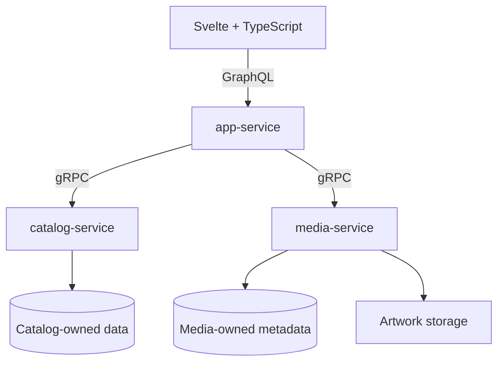

# SpoolIn — Brainstorming Result

Recorded: 9 October 2026, Asia/Jakarta  
Updated: 10 October 2026, Asia/Jakarta — catalog seed data and metadata commitments  
Owner: Muhammad Okfriansyah  
Status: Initial release scope and future direction recorded; detailed implementation decisions remain open.

## 1. Purpose and interpretation

This document consolidates the substantive product, architecture, security, research, and delivery discussion. It preserves the latest direction and explains alternatives that were considered. It is a decision record, not a verbatim transcript or a claim that the application has been implemented or tested.

Status vocabulary:

- **Required:** part of the project requirements baseline.
- **Committed:** explicitly accepted or requested during brainstorming.
- **Working design:** the current architectural direction, carried into detailed design; individual mechanics may still need resolution.
- **Recommended:** a proposed approach that has not been explicitly selected.
- **Open:** a decision or fact still needed before dependent implementation.
- **Deferred:** future release work; not part of the current delivery.

Earlier suggestions that authentication or audit logging were optional have been superseded by the user's explicit commitment to include them. Earlier Movie/People service diagrams have been superseded by the App/Catalog/Media working design. Examples of schemas, roles, storage, and failure handling must not be mistaken for finalized contracts.

## 2. Objective and developer context

The immediate objective is an independently understandable, runnable, tested initial release of SpoolIn, a movie and TV catalog with reliable management and discovery workflows.

Release scheduling depends on verified scope and contributor availability; no release date is committed here.

Developer experience reported by the user:

| Technology | Starting point | Implication |
|---|---|---|
| Spring Boot | Experience using Java | Build on existing Spring knowledge; learn Kotlin-specific behavior deliberately |
| Svelte/TypeScript | Used for A2A Brainstormer | Reuse familiar frontend concepts |
| GraphQL | Experience in Ruby | Transfer schema/query concepts; learn Spring implementation and tests |
| gRPC | No prior experience | Prove and explain a small integration early |

Success includes being able to trace requests, explain tradeoffs and failures, understand AI-assisted code, and make small changes during a walkthrough. Release readiness requires observed behavior and verification evidence.

## 3. Project requirements and acceptance baseline

The requirements below define the project baseline. Research notes and public repositories provide supporting material without adding requirements.

| ID | Explicit requirement | Evidence expected from the release |
|---|---|---|
| A01 | Svelte frontend in TypeScript | Frontend source and working build |
| A02 | Spring Boot services in Kotlin | Backend source and runnable applications |
| A03 | At least two Spring Boot services | Distinct running services with meaningful responsibilities |
| A04 | Service-to-service communication via gRPC | Real RPC calls supporting application features; protobuf contracts and integration checks |
| A05 | Frontend-to-backend communication via GraphQL | Queries/mutations implement application operations; file/auth transport details documented |
| A06 | List movies with artwork | Movie listing displays available artwork and handles missing/broken artwork |
| A07 | Add, delete, and update movies | Working operations with validation and understandable outcomes |
| A08 | Upload movie artwork | Valid upload, progress, processing/success feedback, and failure handling |
| A09 | List cast and creators | Accessible people/credit views |
| A10 | Add, delete, and update cast and creators | Working person management with defined relationship behavior |
| A11 | Search movies, cast, and creators | Defined searchable fields and matching behavior, including no-results/error states |
| A12 | Unit tests with complete cases, including edges | Requirement-linked business and boundary cases; no unsupported coverage guarantee |
| A13 | Responsive web application | Usable layouts at relevant desktop and mobile sizes |
| A14 | Sufficient feedback for upload, listing, updating, and searching | Loading, success, failure, validation, and empty states integrated into features |
| A15 | Public Git repository access | Accessible reviewable repository |
| A16 | README explaining setup, execution, and AI usage | Reproducible instructions and accurate disclosure |
| A17 | Explain project code in a possible walkthrough | Developer understands generated and handwritten code and design choices |

AI assistance is permitted while contributors remain responsible for understanding the code. The baseline does not mandate authentication, RBAC, audit logging, ISO certification, cloud deployment, a particular database, ATDD terminology, a numerical coverage threshold, or three services. Security capabilities below are additional project commitments.

## 4. Decision register

| ID | Status | Decision or direction |
|---|---|---|
| D01 | Committed | Deliver the initial release first; future product expansion stays separate |
| D02 | Working design | Three Kotlin/Spring Boot applications: `app-service`, `catalog-service`, `media-service` |
| D03 | Required | GraphQL for frontend application operations; gRPC between backend services |
| D04 | Committed | Organize implementation around vertical slices |
| D05 | Committed | Design for authentication, authorization, RBAC, and audit logging from the start; implement core functionality first, then complete security |
| D06 | Committed | Consider ISO/IEC 27001/27002-informed security by design; do not claim certification or organizational conformity |
| D07 | Recommended | Viewer/Maintainer roles and predefined initial accounts; exact permission policy and account provisioning remain open |
| D08 | Recommended | Use queries/mutations without GraphQL subscriptions for the initial release |
| D09 | Recommended | Protect stale updates with optimistic concurrency; distinguish duplicate-request handling from duplicate-data rules |
| D10 | Working design | Keep movies, people, and credits within Catalog; keep asset lifecycle in Media |
| D11 | Open | Select artwork transport, attachment/replacement protocol, and recovery/cleanup policy |
| D12 | Open | Select authentication/session mechanism and verified identity propagation through gRPC |
| D13 | Committed | Docker Compose with Make wrappers for reproducible startup, shutdown, restart, inspection, and testing |
| D14 | Open | Live deployment host, budget, and whether deployment belongs in initial release delivery |
| D15 | Committed, deferred | Explore transparent review aggregation after the initial release |
| D16 | Deferred hypothesis | Personal journal, watch-next assistance, series tracking, and personalized critic selection |
| D17 | Committed | Apply code quality, SOLID, DRY, KISS, YAGNI, and constructor dependency injection within vertical slices |
| D18 | Committed | Spring Data JPA/Hibernate for ordinary persistence; parameterized native SQL for complex joins when it improves clarity or query control |
| D19 | Committed | Unit and integration tests, including real gRPC communication and persistence against the selected database engine |
| D20 | Committed | Durable outbox or equivalent work table for reliable cross-service follow-up; saga coordination only when the finalized workflow needs it |
| D21 | Committed | Bounded exponential backoff with jitter for safe transient failures; environment-configurable retry policy and exhaustion notification through one configured channel |
| D22 | Recommended | Initial retry defaults in section 9.2; exact operation policies must respect deadlines and idempotency |
| D23 | Committed | Health/readiness checks, correlated logs, metrics, dashboards, and actionable alerts; numerical SLOs and any SLA remain open |
| D24 | Committed | Seed an initial catalog of 100 distinct movies and 100 distinct TV series, including their metadata; each title type must span multiple release years and months; seeding must be reproducible and safe to rerun |
| D25 | Committed | Categorize movies and TV series by title type and genres, include synopses and useful descriptive metadata, and retain stable identities and source provenance to support future review aggregation; detailed baseline in section 8.2 |
| D26 | Committed | Filter catalog titles by release year and optionally by month within that year, composable with title type, genre, and text search; preserve source date precision |

Writing this record does not authorize deployment, publication, commits, or additional future-product implementation. It does not resolve items explicitly marked open.

## 5. Service architecture and business justification



This represents two domain capabilities plus a frontend-facing application service. Authentication storage and detailed artwork coordination are not finalized by this diagram. Any additional backend-to-backend calls must use gRPC and have a documented purpose.

### 5.1 app-service

Owns the GraphQL schema/resolvers, browser-facing authentication/session integration, client-oriented response composition, gRPC clients, request correlation, call deadlines, and consistent error mapping.

It coordinates requests through domain contracts. It does not directly query Catalog/Media databases or become the sole owner of their business validation and authorization. If local account management is chosen, keep that responsibility in a clearly bounded module rather than allowing `app-service` to become a catch-all.

The name reflects its frontend-facing application responsibilities. `api-service` or `gateway-service` would also be defensible names; renaming alone does not change architecture. A normal Spring Boot application can perform this role; a separate gateway product is not implied.

### 5.2 catalog-service

Owns movies, people, credits/roles, catalog search, catalog validation, selected artwork references, record versions, and audit entries for catalog mutations.

Movies and people are separate entities but participate in tightly related operations. Deleting a movie and removing its credits can occur in a local database transaction without deleting the people. Foreign keys and shared transaction boundaries can enforce relationships without a network call to a People service.

Person deletion policy remains open: reject while referenced, explicitly remove relationships, or another documented behavior. The policy must be intentional and tested.

### 5.3 media-service

Owns asset content, generated identifiers, metadata, content/type/size validation, storage/retrieval, lifecycle state, cleanup, and audit records for relevant media operations.

Media decides whether an asset is valid and available. Catalog decides which movie references it. Catalog should not depend on filesystem paths or storage-provider implementation details.

The boundary is justified by artwork's separate lifecycle and storage/failure concerns. It needs meaningful asset behavior, not merely a trivial wrapper around writing one file. Switching storage implementations should preserve the public asset contract where possible.

### 5.4 Why these boundaries, rather than Movie/People or one application?

| Alternative | Benefit | Why it is not the current working design |
|---|---|---|
| One modular application | Simpler operation and transactions | Reasonable without the project constraint, but does not meet its minimum service count |
| Movie + People, optionally with an API gateway | Independent person management | Credits and deletion rules cross a service boundary unnecessarily for our current workflows |
| Catalog + Media, with GraphQL inside Catalog | Meets the minimum with fewer applications | Still viable; combines frontend API concerns with catalog responsibilities |
| App + Catalog + Media | Explicit frontend boundary and two cohesive capabilities | Current preference; accepts another application, network boundary, and integration-test burden |

The reasoning is cohesion, data ownership, consistency, and failure behavior. It is not proof of a workload that requires microservices. Independent scaling is a possibility, not a measured benefit. Shared contracts need compatibility management; separate processes do not automatically produce independent deployment.

Desired failure isolation must be implemented and tested. For example, editing movie metadata should not require a healthy Media service. A metadata page can display an artwork placeholder only if the query/schema and error handling permit that behavior. App remains a shared dependency for frontend operations.

## 6. Protocol choices and request flows

### 6.1 GraphQL at the frontend boundary

Movie cards, details, and editing forms need different selections of related data. A typed GraphQL schema lets each screen request the appropriate fields while App composes backend results.

REST could also expose an aggregated movie-details endpoint. GraphQL does not uniquely enable aggregation, automatically eliminate backend calls, or guarantee better performance. We accept resolver, authorization, query-limiting, batching, caching, and error-handling work in exchange for the required typed client-facing interface.

### 6.2 gRPC at backend boundaries

Protobuf defines explicit operations and messages; generated client/server interfaces help align implementations. Examples include fetching a catalog entry, updating a movie with an expected version, and validating/storing artwork. Deadlines, status mapping, and cancellation behavior must be intentional.

REST with OpenAPI is also capable of formal contracts and generated clients. We do not claim REST lacks type safety or that gRPC is automatically faster. gRPC is required here and provides a suitable internal contract mechanism. Streaming is an available capability, not a requirement for every operation.

### 6.3 Representative flows

| Use case | Expected ownership and path |
|---|---|
| List/search movies and people | FE query → App → Catalog gRPC; Catalog owns search semantics |
| View a movie and credits | App requests movie/person/credit data from Catalog; resolves artwork information as needed |
| Update a movie | FE mutation with expected version → App → Catalog authorization/validation → atomic data and audit changes |
| Manage a person or credit | App → Catalog; related records remain under one transaction owner |
| Upload/attach artwork | App coordinates Media asset handling and Catalog attachment through explicit contracts; exact sequence remains open |

All three running applications must exercise real responsibilities. Mock-only communication or a decorative second service would not demonstrate the requirement.

## 7. Vertical slice architecture

Vertical slices group code around use cases and observable behavior. Service boundaries govern ownership/deployment; slices govern feature organization and delivery. A slice can span FE, App, and a domain service through intentional contracts.

Illustrative structure, not a prescribed Kotlin package layout:

```text
app-service/features/
  sign-in/
  movie-details/
  update-movie/
  upload-artwork/

catalog-service/features/
  create-movie/
  update-movie/
  delete-movie/
  register-person/
  assign-credit/
  search-catalog/
  attach-artwork/

media-service/features/
  upload-artwork/
  retrieve-artwork/
  delete-artwork/
```

Keep relevant validation, handling, data access, and tests close to the feature. Controllers, services, repositories, and contracts are responsibilities, not mandatory separate classes in every slice. Reuse cohesive domain rules and security/persistence infrastructure; avoid copying them just to isolate folders.

For `UpdateMovie`, the complete behavior includes the edit form, GraphQL input, verified identity, gRPC request, permission check, business validation, expected-version check, persistence, audit entry, and a useful saved/conflict response. Media need not participate.

Deliver thin working paths with tests and feedback rather than building every backend layer before integrating the UI.

### 7.1 Engineering quality and dependency injection

**Committed:** apply SOLID, DRY, KISS, and YAGNI as practical design principles throughout the vertical slices. Keep responsibilities clear, interfaces understandable, and behavior testable. Reuse shared domain knowledge and infrastructure where it is genuinely shared; similar-looking code alone does not justify a common abstraction. Build only abstractions needed by current requirements rather than speculative frameworks or interfaces for every class.

Prefer constructor dependency injection so dependencies are explicit and collaborators can be replaced in tests. Review correctness, readability, naming, cohesion, error handling, and maintainability alongside behavior tests. These principles do not impose a fixed number of layers or classes per feature.

## 8. Data model and catalog behavior

Working concepts:

- **Movie / TV series:** stable title identity, title type, descriptive metadata, version, and selected artwork reference. Both now belong to the initial seeded catalog; the exact shared-table or separate-entity mapping remains open.
- **Person:** stable identity and person details; reusable across movies.
- **Credit:** a relationship between a catalog title and person with a role.
- **Asset:** identity, validated content metadata, storage reference, and lifecycle information owned by Media.

A person can be both cast and creator. Roles such as actor, director, writer, and producer were examples, not a finalized enum. Decide whether multiple acting characters or multiple credits of the same role are supported.

Title and person name must not be assumed globally unique. Stable identifiers are the primary identity. The metadata categories in section 8.2 are established; exact field contracts, lengths, optionality, identifiers, pagination, case sensitivity, partial matching, sorting, and deletion semantics remain open.

Catalog and Media own separate data boundaries. One local database instance with separate databases/schemas was discussed as an economical deployment option; the engine and isolation mechanism are not selected. Cross-service database reads and joins are outside the intended design.

### 8.1 Persistence and complex queries

**Committed:** use Spring Data JPA with Hibernate for ordinary persistence in database-owning services. The user's earlier “HPA” wording was clarified as JPA/Hibernate. This does not select a database engine or require a database in every service.

Prefer parameterized native SQL for complex queries with many joins when it improves clarity or control over the query. Keep SQL within the owning service's data boundary; obtain another service's data through its gRPC contract. Verify query plans, indexes, result mapping, stable ordering, and pagination against the selected database. Native SQL is not automatically faster than ORM-generated SQL, and query parameters must not be interpolated into SQL text.

Keep transaction boundaries explicit. Native writes must preserve applicable version checks, audit behavior, and persistence-context consistency rather than bypassing domain safeguards. Database-specific query behavior belongs in integration tests against the actual selected engine.

### 8.2 Initial catalog, categorization, and seed metadata

**Committed:** provide 100 distinct movies and 100 distinct TV series with metadata in the initial seed dataset. This extends the project baseline, which requires the movie workflows. TV-series catalog entries are now in scope, while detailed season/episode management, watch tracking, and review aggregation remain deferred.

Genres and synopses are part of the catalog rather than future review-only features. A title may have multiple genres. Keep the title type (movie or TV series) separate from its genres, and use consistent genre identities to avoid duplicated categories with different spellings. Catalog owns these records and their categorization; the three-service boundary remains unchanged.

The following baseline supports useful title pages and later matching of reviews to the correct work, inspired by the user's IMDb/Metacritic comparison rather than a commitment to reproduce either platform's full schema:

| Metadata group | Initial baseline |
|---|---|
| Identity | Stable internal ID, movie/TV-series type, display title, original title where different, source-scoped external identifiers where available |
| Description and categories | Synopsis and one or more genres per seeded title; preserve the synopsis language |
| Release context | Release year/date for movies; first-air year/date and series status for TV series, with end year/date where applicable and known |
| Language and origin | Original language and production country/countries where known |
| Duration | Movie runtime where known; any TV duration must be explicitly labeled as an episode runtime rather than a whole-series runtime |
| People and roles | Cast and creator credits with role information, using shared Person records instead of duplicating people per title |
| Artwork | Poster/artwork reference with source attribution where available; support an explicit missing-artwork state |
| Provenance | Metadata source, source record ID or URL, retrieval/snapshot date, and applicable attribution/reuse notes |

Exact validation and nullability belong to detailed schema design. Select seed records with usable titles, synopses, genres, and release context. Preserve unknown optional values explicitly instead of inventing dates, runtimes, credits, or artwork. External identifiers are scoped to their source; title text alone must not merge remakes or similarly named works.

Use a documented, versioned seed snapshot so a fresh demo is reproducible. Running the seed again must not duplicate titles, people, credits, or genres, or silently overwrite user edits. On an empty database, verify exactly 100 movies and 100 TV series; this count describes the initial dataset, not a limit or a reason to remove user-created records on later runs. The source/provider, redistribution and artwork permissions, snapshot format, and seed invocation remain open before implementation. IMDb and Metacritic are product references here, not selected data providers.

**Committed seed variety:** select both the 100 movies and the 100 TV series across multiple years and, where month information is available, multiple months. Include older and newer titles so the dataset meaningfully exercises chronological browsing rather than clustering every record in one year. Document the selected year range and counts by year/month for each title type in the seed manifest. The exact range depends on the chosen source; equal quotas or coverage of every month in every year are not required.

**Committed date filtering:** use the source's original release date for movies and first-air date for TV series, retaining provenance and any supplied regional context. These filters concern release dates, not the date a record was added to our database. A year filter selects that year; an optional month narrows it, for example October 2024. Combine these filters with title type, genre, and text search. Individual episode air dates remain outside the initial scope.

Preserve whether the source supplies a year, year/month, or full date. A title known only to have released in 2024 matches the 2024 filter but no specific month; do not fabricate January 1. A known year/month can match that month without inventing a day. Titles with unknown release years remain available without a date filter and are excluded when a year is selected. Show the available precision honestly in the UI.

Future critic reviews should reference stable catalog identities and retain their own source provenance. No scraped review corpus, invented critic scores, aggregate ratings, season/episode seed quota, or review-ingestion service is included in this seed commitment. Review aggregation remains the future release direction in section 18.

## 9. Artwork transport and lifecycle

The release combines upload progress with frontend-to-backend GraphQL. Spring GraphQL does not directly implement the informal multipart upload specification. Investigate the upload path early rather than leaving it to the final feature.

| Option discussed | Benefit | Cost or question |
|---|---|---|
| Size-limited base64 in a GraphQL mutation | Straightforward JSON/GraphQL request; leading initial candidate | Encoding overhead, buffering, strict request and decoded-size limits |
| Multipart GraphQL through a supporting library | Avoids base64 encoding | Compatibility, request/stream cleanup, limits, and security integration |
| GraphQL-issued signed storage upload | Separates large binary transfer from application requests | Extra storage flow; clarify interpretation of the brief's GraphQL requirement |

No upload strategy is locked. Ordinary URL-based artwork retrieval was discussed; its relationship to the brief must be documented rather than silently assumed. Authentication redirects/endpoints similarly require an explicit interpretation if an external login flow is chosen.

Required UX distinguishes **uploading bytes**, **processing**, and **saved**. Browser upload progress does not prove successful persistence or movie attachment. XHR progress was discussed as one implementation option; subscriptions are unnecessary for this basic feedback.

Lifecycle invariants to resolve in detailed design:

- Invalid/oversized content produces no successful attachment.
- Treat filenames and declared MIME types as untrusted; verify content and use generated storage identifiers.
- Failed replacement should preserve the previous valid artwork where feasible.
- A successful upload followed by failed Catalog attachment has an explicit recovery path.
- Cleanup must not delete assets still in use or race with an attachment in progress.
- Retries must not create unintended duplicate assets or repeated side effects.
- File storage and database changes do not share one ordinary database transaction.

Temporary upload state, ownership/reference tracking, idempotent finalization, and delayed cleanup are candidate techniques, not an agreed protocol. Local persistent storage versus object storage, accepted formats, limits, retention, and image-processing behavior remain open.

### 9.1 Distributed consistency: outbox and saga

gRPC services are distributed even when their calls are synchronous. Neither an outbox nor a saga requires a message broker. Their purpose is to handle consistency and partial failure across separate transaction boundaries.

**Committed:** keep a business database mutation and its successful audit entry in one local transaction. When that mutation requires reliable cross-service follow-up, such as retiring replaced artwork, write an outbox entry or equivalent durable work item in the same transaction. A worker in the owning service can deliver the follow-up through gRPC to Media. No broker or fourth service is required for this approach.

The durable entry prevents committed follow-up work from disappearing in a process crash; it does not make the remote action atomic with the originating transaction or guarantee exactly-once execution. Workers need safe concurrent claiming, restart recovery, and idempotent effects, including the case where Media commits but the worker crashes before recording completion. Exhausted work remains inspectable for controlled recovery.

Use saga coordination only if the finalized artwork workflow needs durable progress across multiple local transactions and compensating actions. A try/catch block is insufficient for crash recovery, and compensation is a business operation rather than an automatic database rollback. Do not introduce a generic saga framework solely because there are three services.

The precise upload/attachment/replacement sequence remains open. An attachment timeout may mean Catalog already committed: resolve its outcome before deleting the uploaded asset. Define reference/lifecycle safeguards so cleanup cannot race with attachment or delete artwork still in use. See the [transactional outbox reference](https://docs.aws.amazon.com/prescriptive-guidance/latest/cloud-design-patterns/transactional-outbox.html) and [saga reference](https://learn.microsoft.com/en-us/azure/architecture/patterns/saga).

### 9.2 Retry policy

**Committed:** use bounded exponential backoff with jitter for failures that are both transient and safe to retry. This applies to eligible RPCs, durable follow-up work, and notification delivery, with an operation-appropriate policy. Retryable mutations require idempotency or another proven duplicate-effect safeguard; a timeout alone is not proof that no side effect occurred.

Environment-configurable defaults below are **recommended**, not a finalized policy for every operation:

| Configuration | Proposed default | Meaning |
|---|---:|---|
| `RETRY_MAX_RETRIES` | 3 | Retries after the initial attempt: at most four total application attempts |
| `RETRY_INITIAL_INTERVAL_MS` | 1000 | Initial backoff interval in milliseconds |
| `RETRY_BACKOFF_MULTIPLIER` | 2 | Exponential growth between retry intervals |
| `RETRY_MAX_INTERVAL_MS` | 30000 | Maximum backoff interval in milliseconds |

Apply jitter to the bounded exponential delay to spread concurrent retries. Validate configuration at startup; zero retries disables retries. Document the chosen jitter strategy and per-operation overrides during implementation design. Persist attempt counts and next-attempt times for durable work so restarting a worker does not reset its retry budget.

Honor cancellation, server retry guidance where applicable, and the total operation deadline; the deadline can stop retries before the configured maximum. Assign one retry owner for each operation and account for client-library behavior so retries in App, gRPC clients, and workers do not multiply unexpectedly. Validation failures, denied access, and stale-version conflicts do not receive automatic retries. A conflict requires review/reload or a newly authorized operation.

### 9.3 Exhaustion and notifications

**Committed:** when an eligible operation exhausts its retry policy, retain actionable failure details and notify through one configured provider. Implement one notification channel for the initial release, behind a small replaceable interface; email, Google Chat, Slack, and Teams are alternatives, not a commitment to implement all four. Provider, destination, and secure credential provisioning remain open deployment decisions. Secrets must not appear in this document, source control, or notification payloads.

Record the operation/correlation identifier, owning service, attempt count, sanitized failure category, and recovery guidance. Deduplicate exhaustion notifications by the failed operation to limit alert storms. For durable work, retain a failed state and support controlled recovery without discarding the original failure evidence or blindly replaying an unsafe action.

Notification delivery itself has bounded retries and observable delivery status. If the notification channel fails, retain that failure and expose it through logs/metrics and operational inspection; do not recursively generate another notification for every notification failure. Notification failure must not alter an already committed business outcome. Actual delivery remains unverified until the configured provider is exercised.

## 10. Authentication, authorization, and RBAC

These are committed user requirements. Core functionality may be implemented first, but completion must include the agreed security capabilities. A schedule problem must be raised explicitly rather than silently making security optional again.

- **Authentication:** establish who is making the request.
- **Authorization:** determine whether that identity may perform the operation.
- **RBAC:** assign permissions through roles; object-specific rules can still be necessary.

Recommended initial matrix, pending confirmation:

| Action | Viewer | Maintainer |
|---|---|---|
| List, search, view details | Allow | Allow |
| Create/update/delete catalog records | Deny | Allow |
| Upload/replace artwork and manage credits | Deny | Allow |
| Manage users/roles | Outside initial scope | Outside initial scope |
| Read audit records | Policy still open | Policy still open |

Whether reads require login or permit anonymous access is unresolved. A separate administrator role is needed only if its permissions are distinct; restricting deletion to that role was discussed but not selected.

App authenticates the frontend request and applies operation-level checks. Securing `/graphql` alone cannot distinguish queries from privileged mutations. Domain services also enforce their operation permissions and business constraints. Hiding buttons is UX, not access control.

A browser session does not automatically propagate to gRPC. Internal calls need verifiable identity and trust boundaries. Arbitrary browser-supplied user IDs or role fields are not trusted credentials. Options include validated tokens or authenticated service communication with integrity-protected user context. Select the exact mechanism before relying on it.

Authentication approaches discussed:

1. Spring Security login/session handling within App and predefined demo accounts.
2. An existing identity provider, with application permissions enforced by our services.

No fourth custom identity service is planned. Sessions versus tokens, account provisioning, credential storage, logout/expiry behavior, transport protection, and CSRF/CORS configuration remain open. Registration, password recovery, and a role-management UI are outside the recommended bounded initial scope.

If an explicit local development identity is used while login is unfinished, it must be isolated to development and must not remain an unrestricted final-deployment path.

## 11. Audit logging

Audit logging is committed. It records actions and selected changes; it is not full version history or a restore feature.

- Catalog records its successful mutations.
- Media records relevant asset actions and lifecycle outcomes.
- App records appropriate authentication/security events and request correlation.
- The gateway alone cannot establish that a backend write committed.

For database mutations, persist the audit entry in the same transaction as the business change. Record denied access and failed authentication separately so rollback of a business transaction does not erase those security events. Coordinate filesystem/object storage outcomes explicitly.

Proposed event fields: timestamp, verified actor ID when available, action, entity type/ID, selected field changes, request correlation ID, and appropriate outcome information. Distinguish service-originated actions from human-originated actions.

Exclude credentials, tokens, raw file contents, and indiscriminate request-body logging. Define audit access and retention. An append-only application interface is not proof of tamper resistance against privileged database access. Without authentication, attribution to a human cannot be asserted reliably.

Dedicated audit services, history dashboards, arbitrary restoration, and compliance-grade immutable storage were not committed. Audit schema, retention, retrieval interface, and protections remain detailed-design decisions.

## 12. ISO-informed security design

The commitment is to consider relevant ISO/IEC 27001/27002 security principles and controls through a risk-based design. ISO 27001 concerns an organization's information security management system; application features alone do not establish conformity or certification.

Proposed evidence structure:

**Risk → selected control → owning component → implementation/verification evidence → remaining limitation**

| Area | Application/design consideration |
|---|---|
| Risk and ownership | Identify protected data, misuse, service boundaries, and failure consequences |
| Access control | Verified identity, least privilege, explicit permission matrix, backend enforcement |
| Communications | Protected deployed traffic and restricted internal access |
| Auditability | Relevant events, access restrictions, retention, correlation |
| Data protection | Secret handling, data minimization, controlled uploads |
| Integrity/recovery | Transactions, concurrency control, recoverable partial failures, backup/restore procedure |
| Development | Review, dependency/secret checks, denied-access and failure tests |
| Operations | Health information, useful monitoring, incident-response responsibilities |

This table is a proposed application baseline, not an exhaustive standards mapping. Distinguish **designed**, **implemented/tested**, and **deployment/organization responsibility**. An intended TLS configuration is not proof of deployed enforcement; a restore procedure is not proof of a successful restore exercise.

Suggested eventual README wording: “The security design considers relevant ISO/IEC 27001 and ISO/IEC 27002 principles. This project does not claim ISO certification or organizational compliance.”

## 13. Editing, subscriptions, concurrency, and duplicates

### 13.1 Queries and mutations are sufficient for the initial UX

Recommended: ordinary GraphQL queries/mutations over HTTP. Refresh affected data after a mutation; consider refetching on navigation/focus. Polling is available if a defined freshness requirement warrants it.

Subscriptions deliver ongoing server events through a supported transport such as WebSockets or SSE. They are not required for CRUD, browser upload progress, audit persistence, or RBAC. They add connection recovery, identity-expiry handling, event authorization, and missed-event behavior.

The initial product is an open/edit/save application, not simultaneous keystroke/cursor collaboration. Subscriptions could later notify a user that another maintainer changed a record, but they do not prevent conflicting writes. No subscription infrastructure is planned absent a concrete live-update requirement.

### 13.2 Optimistic concurrency

Recommended contract: read a record version and send `expectedVersion` with an update. The owning service verifies it and protects the write atomically. If two users read version 5 and one saves version 6, the other's version-5 update must not silently overwrite it.

Preserve the user's unsaved form and return an actionable conflict. Reloading/reviewing and retrying is preferable to automatic blind overwrite. With the selected JPA/Hibernate approach, `@Version` can support database concurrency checks; compare with the original frontend version as well, rather than only a freshly loaded server entity. Native write queries must explicitly preserve equivalent atomic version safeguards. Deletion conflict behavior also needs definition.

### 13.3 Different duplicate problems

| Problem | Proposed safeguard |
|---|---|
| Same create request repeated after double-click/timeout | Operation idempotency with an atomic server-side policy |
| Two independent requests representing the same real-world title/person | Domain-specific matching/duplicate policy and valid database constraints |
| Stale edit overwrites a newer change | Expected-version conflict check |
| Another screen should show a change sooner | Refetch/polling; subscriptions only if justified |

Disable repeated submit in the UI for usability, but do not rely on it for correctness. Define idempotency key scope, request mismatch handling, concurrent duplicate behavior, result retention, and retry outcomes before implementation. Names/titles alone are not safe uniqueness rules.

## 14. Testing and observable acceptance scenarios

The brief explicitly asks for unit and edge-case tests. **Committed project scope also requires integration tests** covering GraphQL contracts, real gRPC communication, persistence, transactions, security, and native SQL against the selected database engine. A small number of browser journeys remains recommended. Tool candidates include GraphQlTester, gRPC test transport plus real service connectivity checks, Testcontainers with the selected database, and the frontend's native test framework. These are candidates, not installed tools or completed checks.

| Area | Representative scenarios to implement and verify |
|---|---|
| Catalog | Valid CRUD; invalid/missing fields; absent IDs; relationship rules; person with multiple roles |
| Seed catalog and metadata | Empty database receives 100 distinct movies and 100 distinct TV series with required seed metadata; reruns preserve counts and user edits; shared people/genres/credits are not duplicated; multiple genres, missing optional values/artwork, source IDs, and same-name distinct titles are handled |
| Release-date variety and filtering | Each seeded title type spans multiple years and known months; manifest counts match the dataset; year and year/month filters combine with type/genre/search; year-only dates never match a month; year/month dates need no fabricated day; unknown years and empty results behave as documented |
| Search | Empty results, partial/case behavior, paging boundaries, stale responses, backend errors |
| Concurrency | Two clients edit one version; stale save rejected; draft retained; deletion conflict policy |
| Idempotency | Repeated/concurrent same request; same key with different payload; timeout after commit |
| Artwork | Accepted content; oversized/empty/disguised content; interrupted upload; storage failure; failed attachment; replacement and cleanup |
| Authorization | Allowed/denied operations; direct backend call cannot bypass checks; expired/invalid identity |
| Audit | Successful transaction has matching event; rollback behavior; security failures retained; secrets excluded |
| Failure isolation | Media outage does not block unrelated catalog edits; deadlines and useful error mapping |
| Persistence | JPA and native SQL mappings; joins/pagination against the selected engine; transaction rollback; version/audit safeguards on native writes |
| Retry policy | Transient recovery; permanent failures not retried; bounded attempts and jitter; deadline/cancellation; environment overrides; timeout after commit |
| Durable follow-up | Atomic mutation/audit/work-item commit and rollback; concurrent duplicate delivery; worker restart; crash after remote commit; exhausted work retained |
| Notifications | Exhaustion produces a sanitized, deduplicated notification; provider failure has bounded retries and visible delivery failure without recursive alerts |
| Monitoring | Detect GraphQL application failures even with HTTP 200; gRPC failures, latency, retry exhaustion, and aging pending work; distinguish readiness from business success |
| Frontend | Responsive views; keyboard-accessible forms; loading, empty, success, error, and processing feedback |
| Delivery | Fresh setup through Make/Docker; migrations/seed data if selected; service connectivity/readiness; data survives stop/start and restart; unit/integration targets report failures; accurate README |

No arbitrary coverage percentage or “production-ready” assertion replaces these scenarios. Tests are built with each slice, not postponed until all features are written. Precise test cases depend on the open contracts below.

## 15. Delivery sequence and walkthrough preparation

Recommended sequence:

1. Finish requirements-to-acceptance mapping and the open design decisions.
2. Establish identity, permissions, audit, and versioning contracts before dependent feature code.
3. Prove one thin Svelte → GraphQL → gRPC → persistence → UI flow, including an invalid request and backend failure.
4. Investigate artwork transport and lifecycle early because it has protocol and consistency risk.
5. Implement CRUD, relationships, search, and artwork as tested vertical slices with feedback.
6. Complete real authentication, authorization/RBAC, and audit behavior; replace any temporary development mechanism.
7. Verify integrated behavior, clean setup, security cases, and deployment-specific controls where applicable.
8. Rehearse, publish the reviewed repository revision with accurate documentation, and preserve the release version.

Functionality-first is sequencing, not permission to omit committed security. A precise daily schedule depends on available hours. Reserve time for integration and rehearsal rather than allocating every hour to feature work.

For each slice, the developer should explain the request path, data ownership, alternatives, failures, tests, and AI contribution. Prepare a short live demonstration and practice a small modification without depending on an AI explanation during the walkthrough.

Useful questions include: why these boundaries; why GraphQL/gRPC; what happens during a service outage; how stale writes are rejected; why an audit record proves a committed change; what happens after a partial artwork failure; and how the application is started from a clean checkout.

## 16. Hosting and reproducible setup

The release requires a repository and README, not a live URL. **Committed:** Docker Compose with Make wrappers provides the reproducible local multi-service setup, including persistent application data and artwork, the 100-movie/100-TV-series seed dataset, and migrations where selected. Document the seed invocation alongside setup; whether it is an explicit command or part of initial startup remains open. CI build/lint/test checks remain recommended. The command contract below records intended behavior; no Makefile, containers, or CI configuration have been implemented by this document.

### 16.1 Make command contract

| Command | Intended behavior |
|---|---|
| `make start` | Build/start the stack and check readiness; report startup failure clearly |
| `make stop` | Stop the stack without deleting persistent data or artwork |
| `make restart` | Restart the stack and check readiness, preserving persistent data |
| `make status` | Show service state and health/readiness information |
| `make logs` | Expose stack logs for diagnosis without printing secrets |
| `make test-unit` | Run unit tests and return a failing exit status on failure |
| `make test-integration` | Run isolated integration tests with required dependencies and return a failing exit status on failure |

Document prerequisites, environment configuration, and command behavior in the README. Integration fixtures must not overwrite normal application data. Destructive data resets must never be implicit in start, stop, restart, or test commands.

### 16.2 Live hosting

GitHub Pages can host static frontend files or documentation, not Spring Boot processes, databases, or persistent upload storage. A static Svelte build is possible; SvelteKit would require an appropriate static configuration and cannot rely on a Pages-hosted server runtime.

GitHub's Pages documentation discourages sensitive transactions such as sending passwords. Therefore the authenticated application should use more suitable application hosting. Pages remains suitable for a static project/architecture showcase.

Recommended live topology, if selected: one public HTTPS origin serves the frontend and routes API requests to App; internal services remain private. This can simplify cookie and cross-origin handling. Hosting provider, costs, persistence, backup, TLS termination, and internal transport are open. No deployment has been performed.

### 16.3 Monitoring, SLOs, and operational response

**Committed:** include health/readiness checks, structured correlated logs, metrics, dashboards, and actionable alerts. Carry correlation identifiers across GraphQL, gRPC, and durable work, while excluding credentials and sensitive payloads from telemetry. Health endpoints alone do not establish that user operations succeed.

Monitor user-visible operation success and latency, GraphQL operation failures even when HTTP returns 200, gRPC errors/deadlines, retry exhaustion, pending-work age, and storage/database health. Separate expected validation/access/conflict outcomes from service failures when defining success metrics. Dashboards should connect user symptoms to failing dependencies and retained work requiring recovery.

Use the [Google SRE definitions](https://sre.google/sre-book/service-level-objectives/): an **SLI** measures service behavior, an **SLO** defines its target, and an **SLA** is an agreement with consequences for meeting or missing objectives. Monitoring supports reliability management; it does not guarantee availability or establish an SLA by itself.

Before deployment, define numeric objectives, measurement windows, eligible operations, latency boundaries, alert thresholds, hosting assumptions, and response ownership. No numerical availability promise or existing SLA is claimed. Select the monitoring tools during implementation design. Include instructions to inspect failures, recover exhausted work safely, and verify notification delivery. Operational alerts and retry-exhaustion alerts should share the selected notification channel where practical; additional providers remain deferred.

## 17. Research and reference repositories

### 17.1 Closest public example and corrected search finding

Initial searches did not find a near-exact match. The user supplied a prior ChatGPT analysis identifying `E0167358/movie-app`; subsequent direct repository inspection confirmed it. The earlier search result was incomplete, not evidence that no matching repository existed.

Verified snapshot: [E0167358/movie-app at a9d728c3851a1efcb4a2d240c6076250bc711a34](https://github.com/E0167358/movie-app/tree/a9d728c3851a1efcb4a2d240c6076250bc711a34).

Inspected manifests/contracts show Svelte/TypeScript, three Kotlin/Spring Boot applications, GraphQL, gRPC, movie/person/credit operations, search, and artwork upload. The frontend uses a base64 GraphQL request with XHR progress. Its declared limitations include best-effort credit cleanup, local storage, no containerized startup, and restricted credit-picker behavior. Test files exist; reported counts and behavior were not independently executed or verified. No repository license was detected.

Use it to compare decisions and investigate questions. It does not establish project correctness or permission to reuse code. Our Catalog/Media boundaries were reasoned from this project's workflows rather than copied from its Movie/People split.

### 17.2 Additional references

| Reference | Useful material | Limitation |
|---|---|---|
| [bookstore-graphql](https://github.com/dmitrysobolev/bookstore-graphql) | Kotlin/Spring GraphQL, related records, CRUD/search, documented tests; MIT license | No complete frontend/gRPC/artwork solution; tests not run here |
| [Spring Kotlin gRPC sample](https://github.com/spring-projects/spring-grpc/tree/main/samples/grpc-server-kotlin) | Official integration reference | Small sample, not application architecture |
| [Svelte RealWorld](https://github.com/sveltejs/realworld) | Frontend CRUD/routing/pagination patterns; MIT license | Different domain/API; adaptation required |
| [Spring GraphQL movie demo](https://github.com/sunny-chung/spring-boot-graphql-demo) | Movie/person schema, nesting, batching, mutations | Older Spring Boot/Neo4j example; not a dependency template |
| [multipart-spring-graphql](https://github.com/nkonev/multipart-spring-graphql) | Upload integration candidate | Requires compatibility and behavior validation |
| [Kotlin Spring gRPC Microservice](https://github.com/AleksK1NG/Kotlin-Spring-gRPC-Microservice) | Internal RPC setup reference | Broader infrastructure than needed; reuse licensing not established |
| [Sultanov GraphQL/gRPC walkthrough](https://sultanov.dev/blog/graphql-api-for-grpc-using-rejoiner-and-spring-boot/) | Gateway composition concept | Historical Java/Rejoiner example, not a current stack template |

The prior pasted ChatGPT report also named other examples without complete repository links. Those unverified references are not relied on for architecture or implementation. Its proposed three-service Movie/People architecture, base64 upload recommendation, and workload priorities were evaluated rather than automatically adopted.

## 18. Deferred personal-product direction

### 18.1 Locked future direction: transparent review aggregation

The user accepted review aggregation as the scale-up direction, explicitly after initial release completion. The working ambition is:

> Explore how critics across languages reviewed a title, understand how its aggregate was calculated, and compare those perspectives with personal taste.

Transparent scoring is the foundation. Indonesian and international perspectives were the recommended initial coverage focus; the exact source list, languages, and reviewer eligibility are still open. “All reviewers worldwide” is a long-term aspiration, not a supportable initial completeness claim.

Potential future capabilities:

- Source-linked critic reviews with original scores and published conversion rules.
- Review counts, distributions, update times, and coverage information.
- Regional/language views without claiming they represent an entire population.
- Personal critic selection, clearly separated from the overall aggregate.
- A separate personal journal and audience-rating view.

Data governance questions precede automation: permitted source access, attribution/reuse, matching titles and seasons correctly, score normalization, syndicated-review deduplication, revised reviews, source inclusion criteria, and reproducible calculation history. Unscored reviews should not silently receive invented numeric ratings. Audience, critic, and personal ratings remain distinct; averaging existing platform aggregates can double-count evidence.

Reviews introduces a domain responsibility for source ingestion, editorial verification, and scoring. It can start with a clear module boundary and become a service when justified. No review tables, ingestion jobs, scoring APIs, or fourth service are required for the initial release.

### 18.2 Journaling/discovery ideas explored but not selected as release scope

Three directions were considered: remembering personal reactions, choosing what to watch next, and resuming series after a break. Example usage cycle: save a title with a reason → watch → record a reaction → use past experience for the next choice.

Potential distinguishing experiences included a short watch-next shortlist, resumption notes bounded by watched episodes to avoid spoilers, and reflecting on changing taste. These remain hypotheses. Whether the first audience is the owner, a few friends, or a public community remains unanswered.

Private journal ownership would require authorization beyond catalog Viewer/Maintainer roles. Catalog maintainers should not automatically gain access to another user's private entries.

### 18.3 Competitor findings and limits

| Product | Verified context | Consequence for our direction |
|---|---|---|
| [Letterboxd](https://letterboxd.com/about/what-is-letterboxd/) | Diary, ratings/reviews, watchlists, lists, discovery | These features alone do not establish differentiation |
| [Trakt](https://forums.trakt.tv/t/trakt-product-update-summer-2026-edition/123790) | Watching history, discovery, sharing | A combined movie/series tracker is not a new category |
| [SeriesGuide](https://www.seriesgui.de/) | Tracking, Trakt integration, repeat viewings, notifications, sync; notes/list features documented in releases | Notes and tracking cannot be claimed as unique; no exhaustive hands-on competitor audit was performed |
| [Metacritic methodology](https://metacritichelp.zendesk.com/hc/en-us/articles/14478499933079-How-do-you-compute-METASCORES) | Selected critics, score conversions, weighting, and further movie-score normalization; audience scores separate | Investigate transparent provenance/scoring and coverage as hypotheses; do not claim a unique market position yet |

The supplied [Metacritic film review page](https://www.metacritic.com/movie/my-undesirable-friends-part-ii---exile/critic-reviews/) could not be retrieved during the discussion. Methodology was verified through official support pages instead. Metacritic does not disclose individual critic weights in its [weighting FAQ](https://metacritichelp.zendesk.com/hc/en-us/articles/14482824029079-Can-you-tell-me-how-each-of-the-different-critics-are-weighted-in-your-formula).

### 18.4 Growth without speculative infrastructure

The three-service initial release foundation is sufficient to begin, not proof of IMDb-scale capacity. Feature growth and traffic growth are different problems. Add cohesive slices/modules for behavior; use measurement to guide query/index improvements, caching, image delivery, and scaling.

TV-series catalog records and metadata now belong to the initial seed commitment in section 8.2, superseding the earlier suggestion to defer all TV support. Detailed season/episode modeling and tracking remain future work within Catalog when needed. Stable identities, migrations, and evolvable contracts prepare for growth without empty endpoints or universal speculative models. Public community features introduce moderation and account-lifecycle requirements not present in the initial release scope.

## 19. Existing organization and source artifacts

The project requirements and decisions are recorded in this repository.

Planning covers scope, product requirements, design, architecture, implementation tasks, acceptance cases, security, monitoring, and contributor workflow.

Recommended reconciliation: move innovation work after the initial release; include implementation and rehearsal tasks; make feedback/tests part of slices; investigate upload early. Those changes have not been performed by creating this file.

The existing [PRD skills comparison](research/prd-skills-comparison-2026-10-09.md) is adjacent research, not this application's PRD or an approved implementation plan. Global skill installation history is outside SpoolIn’s product scope.

## 20. Open decisions and next handoff

| Priority | Unresolved item | Why it matters |
|---|---|---|
| Before scheduling | Focused daily hours/unavailable days | Determines feasible sequencing and contingency |
| Before implementation plan | Confirm final architecture contracts and ownership | Preferred three-service direction is established; detailed flows are not complete |
| Before security code | Login/session/token mechanism, role matrix, account provisioning, gRPC identity trust | Prevents ad hoc security and conflicting assumptions |
| Before schema/API contracts | Fields, role multiplicity, IDs, deletion policy, search/pagination | Defines observable behavior and tests |
| Before seed implementation | Metadata/artwork source and reuse permissions, exact 100-movie/100-series selection, versioned snapshot, seed invocation, and rerun/update policy | Produces a reproducible catalog without duplicate records, fabricated metadata, or overwritten user edits |
| Before artwork slice | Upload transport, limits, storage, attachment/replacement/cleanup protocol | Resolves protocol interpretation and partial failures |
| Before mutation implementation | Version checks and idempotency semantics | Protects edits and retries consistently |
| Before audit implementation | Event schema, access, retention, secret filtering | Makes audit useful and bounded |
| Before build setup | Compatible framework/runtime versions, build tools, database/migrations, test tools | Public examples do not establish our version selection |
| Before retry/worker implementation | Per-operation retryability/idempotency, jitter, deadlines, retry ownership, durable claiming and recovery | Recommended defaults do not resolve ambiguous remote outcomes or safe replay |
| Before monitoring implementation | Telemetry tools, operation outcome classification, correlation, dashboards, alert routing | Health endpoints and HTTP status alone cannot measure user-visible success |
| Before deployment | One notification provider/destination and secure credentials; SLO values/windows, alert thresholds, hosting assumptions, response ownership, any SLA | Makes exhaustion notification and reliability expectations testable without inventing an agreement |
| Before deployment | Hosting choice/budget, persistent storage, public origin, secrets/TLS, backup | A repository/local demo is different from a deployed system |
| After the initial release | Review source availability, eligibility, coverage, scoring method | Determines realistic aggregation product scope |

Next deliverable: one consolidated, decision-complete project design and implementation plan, with requirement-linked acceptance checks. Existing decisions count; do not reopen them without a material change. Obtain the remaining design approval once, rather than asking for separate approval of every section. This document records the session and preserves open work; it does not assert that the implementation plan is already complete.

## 21. Primary technical references

- [Service boundaries](https://learn.microsoft.com/en-us/azure/architecture/microservices/model/microservice-boundaries) and [domain analysis](https://learn.microsoft.com/en-us/azure/architecture/microservices/model/domain-analysis)
- [Gateway aggregation](https://learn.microsoft.com/en-us/azure/architecture/patterns/gateway-aggregation)
- [Vertical slice architecture](https://www.jimmybogard.com/vertical-slice-architecture/)
- [GraphQL queries](https://graphql.org/learn/queries/), [subscriptions](https://graphql.org/learn/subscriptions/), and [file uploads](https://graphql.org/learn/file-uploads/)
- [gRPC introduction](https://grpc.io/docs/what-is-grpc/introduction/) and [core concepts](https://grpc.io/docs/what-is-grpc/core-concepts/)
- [Spring GraphQL transports](https://docs.spring.io/spring-graphql/reference/transports.html) and [security](https://docs.spring.io/spring-graphql/reference/security.html)
- [Spring Security JWT validation](https://docs.spring.io/spring-security/reference/servlet/oauth2/resource-server/jwt.html)
- [OWASP authorization guidance](https://cheatsheetseries.owasp.org/cheatsheets/Authorization_Cheat_Sheet.html)
- [Jakarta Persistence locking](https://jakarta.ee/learn/docs/jakartaee-tutorial/current/persist/persistence-locking/persistence-locking.html)
- [OpenAPI specification](https://spec.openapis.org/oas/latest.html)
- [ISO/IEC 27001](https://www.iso.org/standard/27001) and [ISO/IEC 27002](https://www.iso.org/standard/75652.html)
- [GitHub Pages capabilities](https://docs.github.com/en/pages/getting-started-with-github-pages/what-is-github-pages) and [limits](https://docs.github.com/en/pages/getting-started-with-github-pages/github-pages-limits)
- [SvelteKit static hosting](https://svelte.dev/docs/kit/adapter-static)
- [Transactional outbox](https://docs.aws.amazon.com/prescriptive-guidance/latest/cloud-design-patterns/transactional-outbox.html) and [saga pattern](https://learn.microsoft.com/en-us/azure/architecture/patterns/saga)
- [Google SRE: service level objectives](https://sre.google/sre-book/service-level-objectives/)

References were consulted during the October 9 discussion. Current documentation and repository default branches can change; pin compatible versions when implementation begins. Research inspection is not execution or validation of third-party code.
