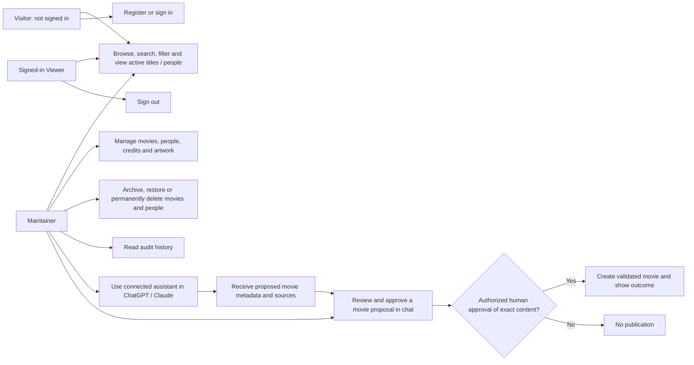
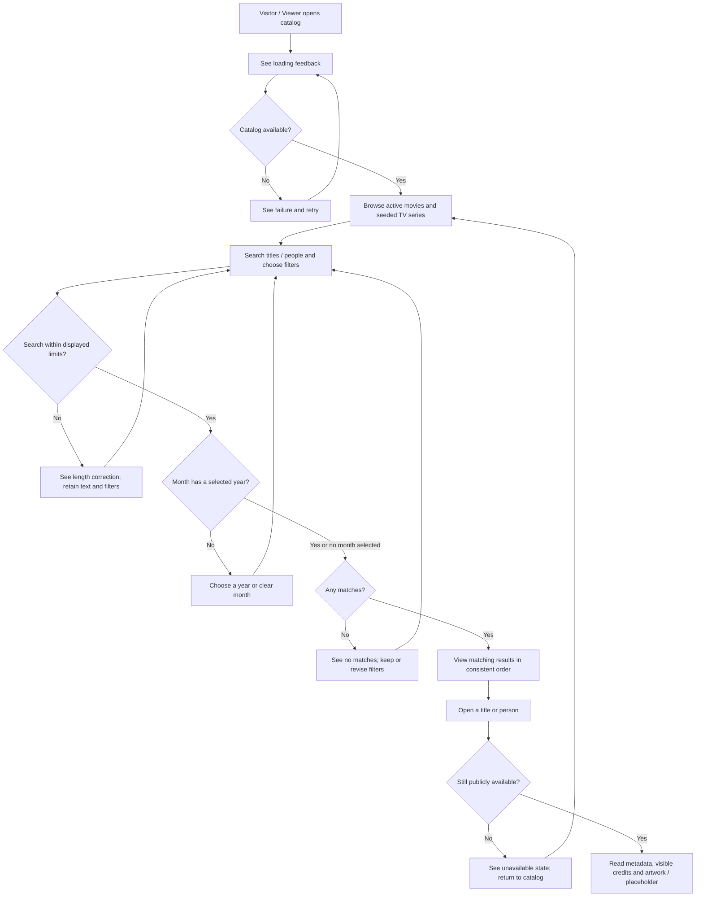
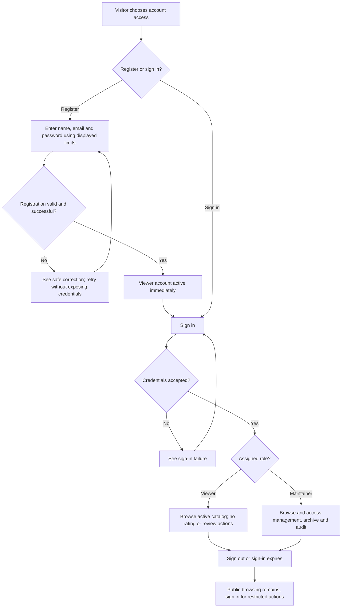
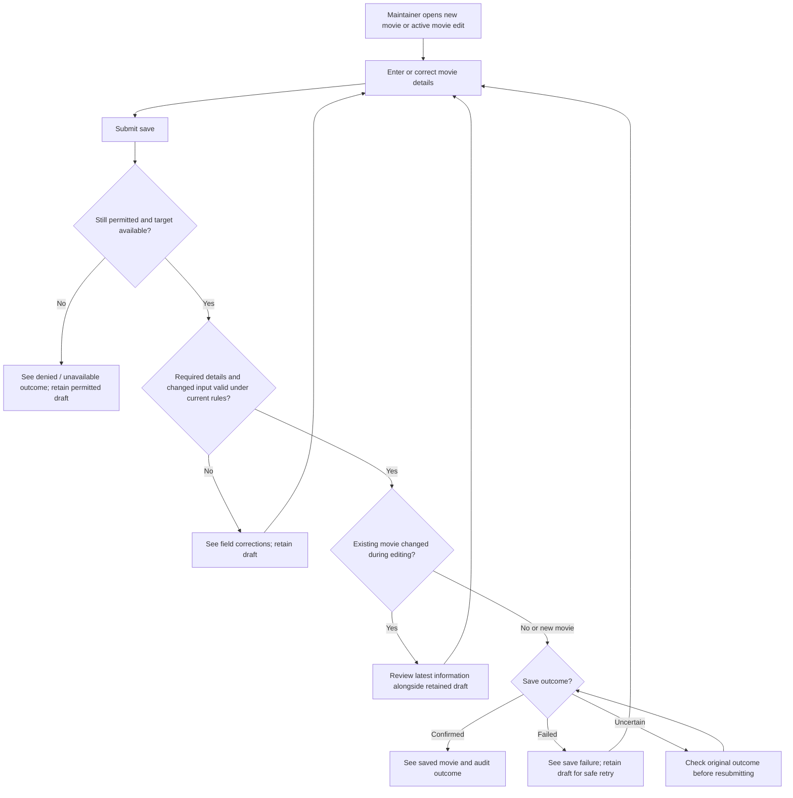
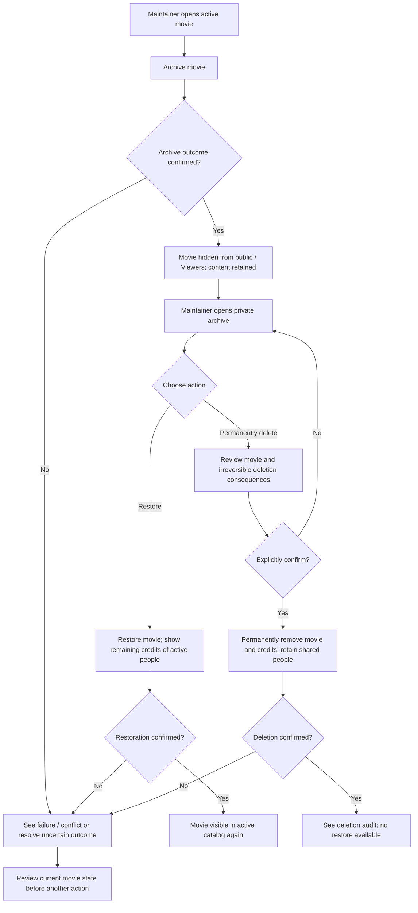
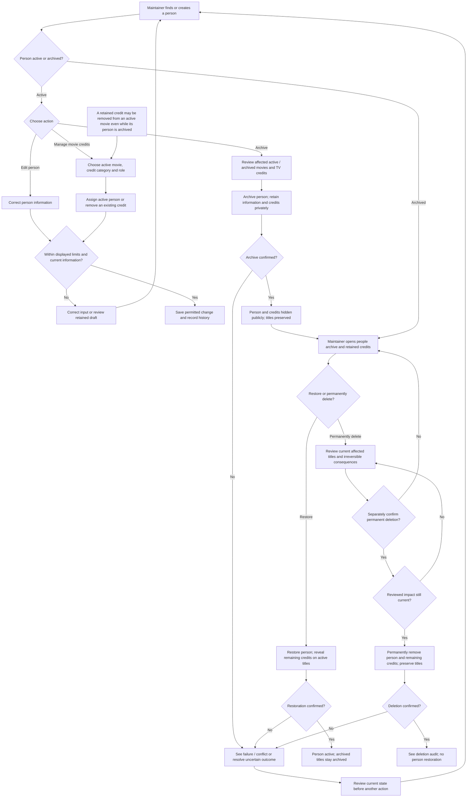
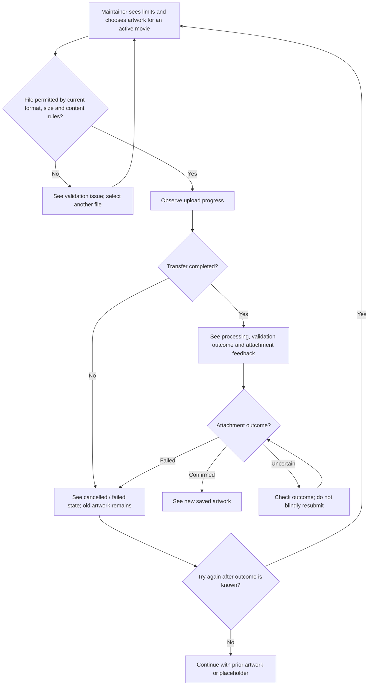
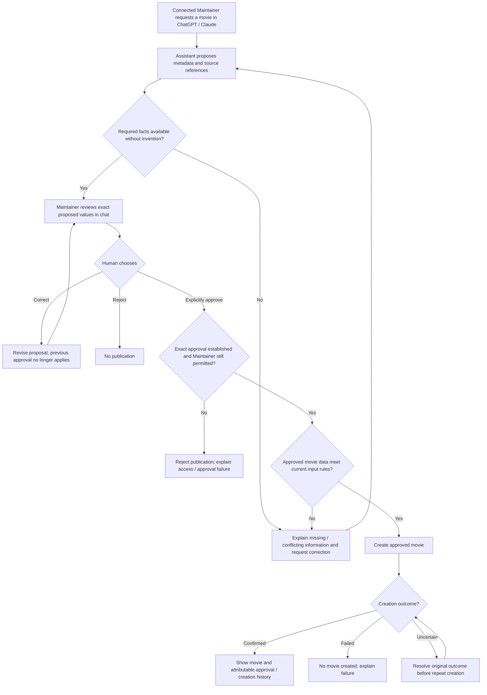
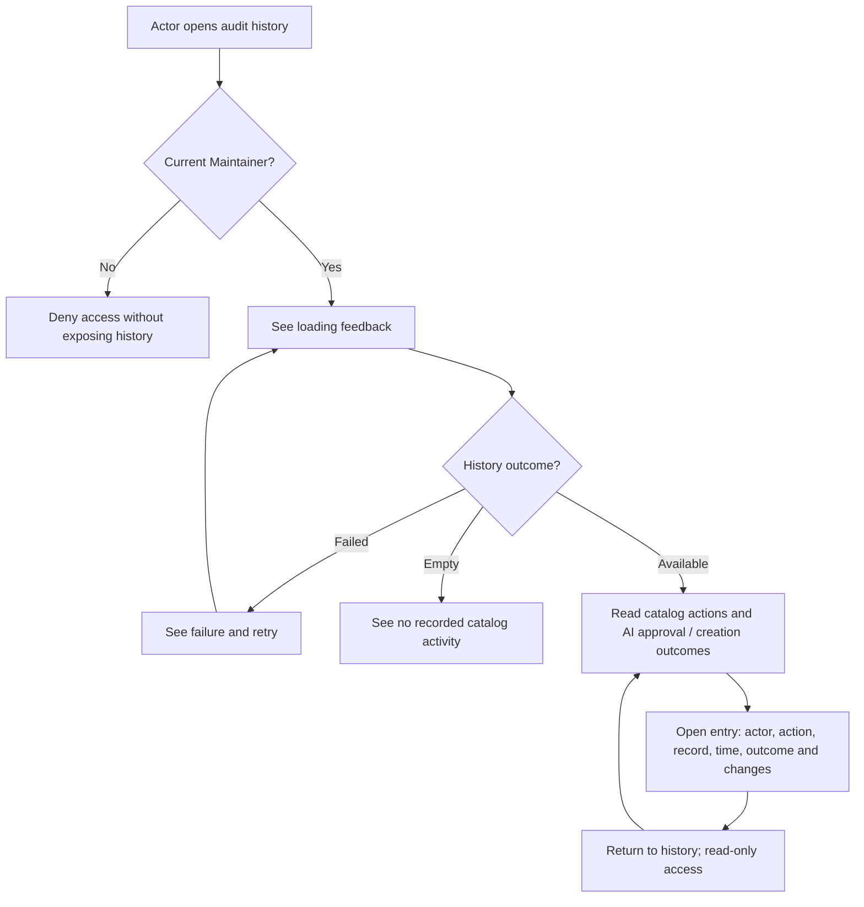

# PRD: SpoolIn initial release delivery

| Field | Value |
|---|---|
| Version / status | 2.4 / Ready for technical design |
| Owner | Muhammad Okfriansyah |
| Created / updated | 10 October 2026 / 11 October 2026, Asia/Jakarta |
| Release purpose | Initial SpoolIn movie and TV catalog release |
| Product authority | Baseline obligations in [section 6.3](#63-project-requirements-coverage) and project decisions in [section 6.4](#64-project-decision-register) and [section 13.1](#131-resolved-product-decisions) |
| Readiness meaning | Product scope, permissions, journeys, and observable outcomes are settled sufficiently to start the detailed techdoc. Engineering decisions remain assigned to that document. |
| Evidence boundary | This status does not establish implementation, passing software tests, deployment, provider delivery, or release acceptance. |

## 1. Purpose and problem

Deliver SpoolIn so a release reviewer can run, use, and understand it independently. Visitors can discover movies and TV series through artwork, metadata, people, search, and filters. Maintainers keep movie information accurate and can ask an assistant in ChatGPT or Claude to propose a movie for explicit human review and approval before creation.

The initial catalog contains 100 distinct movies and 100 distinct TV series. Movie management, clear feedback, protected accounts, accountable changes, and recoverable failures support the initial release experience. Registered Viewers currently have the same catalog-reading capabilities as visitors; ratings and reviews belong to a future release.

This PRD defines product behavior and delivery outcomes. The future techdoc will specify architecture, interfaces, data storage, security mechanisms, configuration mechanisms, infrastructure, and engineering verification. Product input and artwork policies are defined in [section 5.5](#55-input-validation-and-artwork-policy). The project's stack/protocol constraints and existing engineering commitments remain traceable in [section 10](#10-compact-engineering-handoff) without making their detailed design a prerequisite for PRD readiness.

Commercial demand, adoption, performance baselines, and market differentiation are unverified. Release acceptance requires verification against the project requirements.

SpoolIn is named after the spool that holds a length of film. Its brand promise is **“Unspooling stories and discovering what’s behind them.”** The discovery homepage headline is **“Every reel holds a story.”** See the [brand history](design-system/brand-history.md) for the naming narrative and presentation guidance. This branding update, adopted on 11 October 2026, does not change the approved product behavior.

## 2. Authority, interpretation, and status

This PRD contains the baseline obligations, product decisions, business rules, and acceptance criteria needed to review the release. Its requirement and decision identifiers refer to content defined in this document. Public references provide optional supporting guidance; they do not replace requirements stated here.

| Basis | Requirements established here | Interpretation |
|---|---|---|
| Project baseline | A01 through A17 in [section 6.3](#63-project-requirements-coverage) cover the required technologies, catalog operations, feedback, testing, repository release access, README, and code explanation | The baseline defines project requirements. AI assistance is permitted, and the developer must understand the code. Authentication and the three-service design are additional project commitments; cloud hosting, ISO certification, and a numerical coverage threshold are not baseline requirements. |
| Project decisions | D01 through D26 in [section 6.4](#64-project-decision-register) record commitments, working designs, recommendations, open choices, and deferred work | Read each decision with its status and current disposition. [Section 13.1](#131-resolved-product-decisions) states the resolved product policies, including adoption of previously recommended roles and stale-edit protection. |
| Release product policy | [Sections 3 through 9](#3-application-users-permissions-and-journeys) and [section 13.1](#131-resolved-product-decisions) define public access, accounts, catalog behavior, lifecycle, credits, artwork, audit, MCP approval, and privacy | These policies are the approved release behavior. Detailed engineering choices belong to the future techdoc under [section 10](#10-compact-engineering-handoff) and [section 13.2](#132-engineering-and-other-next-phase-register). |
| Input and artwork policy | [Section 5.5](#55-input-validation-and-artwork-policy), FR-017, and NFR-016 establish configurable bounds, accepted content, validation feedback, and safe handling | The selected person/registration name defaults and validation behavior are Committed release policy. Other numerical defaults remain Recommended; technical design records their adoption or alternatives. Public examples support the rationale without establishing universal limits or measured user coverage. |
| Account data protection requirements | NFR-015 and [section 9](#9-conceptual-information-and-privacy) and [section 10.1](#101-constraints-to-carry-into-the-techdoc) require AES-256-GCM for recoverable account PII, key rotation, continued authorized access during rotation, and safe re-encryption before old-key retirement | Passwords require one-way hashing. The techdoc defines implementation and key management. These controls do not establish regulatory compliance or ISO certification. |

All section references point within this PRD. Acceptance scenarios describe intended outcomes unless explicitly marked as completed document checks.

| Status | Meaning |
|---|---|
| Required | Project baseline obligation |
| Committed | Approved release requirement |
| Working design | Preferred engineering direction to carry into technical design |
| Recommended | Proposal that remains unselected unless its adoption is explicitly recorded in this PRD |
| Open | Engineering, operational, or future-scope decision assigned to the appropriate next phase |
| Deferred | Outside initial release delivery, even where the future direction itself is accepted |

Functionality-first sequencing does not remove committed security, audit, reliability, testing, or operational completion. The release includes seeded TV-series discovery and details, public Viewer registration, movie and person archive/restore, a Maintainer audit screen, and limited MCP creation. Viewer/Maintainer permissions and stale-edit protection are settled product policies; their engineering mechanisms remain for the techdoc.

## 3. Application users, permissions, and journeys

The application has three user types. Only signed-in accounts have an account role.

| User type | Meaning | Product access |
|---|---|---|
| Visitor | Someone using the application without signing in | Browse the active catalog and its people; register or sign in |
| Viewer | A signed-in account with the Viewer role | The same catalog-reading access as a Visitor; ratings and reviews remain deferred |
| Maintainer | A signed-in account with the Maintainer role | Catalog reading plus movie, person, credit, artwork, archive, and audit capabilities listed below |

Throughout the product sections, **reader** means any of these users browsing permitted catalog information, and **account holder** means a Viewer or Maintainer. Release review, operations, and development responsibilities are defined separately in [section 12.3](#123-delivery-responsibilities-and-journeys).

### 3.1 Permission matrix

All Maintainers have the same catalog-management permissions. Account roles are Viewer and Maintainer; Visitor describes access without signing in. Cast/Creator categories and Actor/Director/Writer/Producer credit roles describe a person's contribution to a title and grant no application permissions. An audit entry's actor identifies who performed an action; it does not define another account role.

| Capability | Visitor | Viewer | Maintainer |
|---|---|---|---|
| Browse/search/filter active movies and TV series; view metadata and public people/credits | Yes | Yes | Yes |
| Register or sign in | Yes | Already signed in; may sign out | Already signed in; may sign out |
| Create/update movies and manage their credits/artwork | No | No | Yes |
| View movie/people archives; archive/restore/permanently delete movies and people | No | No | Yes |
| Manage shared people and custom credit roles | No | No | Yes |
| View application audit history | No | No | Yes, read-only |
| Approve an AI-proposed movie | No | No | Yes, explicitly in chat |
| Rate/review titles or manage TV-series entries | No; deferred/excluded | No; deferred/excluded | No; deferred/excluded |

A Maintainer may connect an MCP assistant in ChatGPT or Claude to propose a new movie using permitted catalog context. This assistant is a tool acting under that Maintainer's permissions. It cannot approve its own proposal or independently publish it; creation requires the Maintainer's explicit approval of the exact content. The connection grants no account management, movie editing/deletion, credit or artwork management, archive, or audit access.

Public person views show only active people and credits on active titles. Archived people and their credit relationships stay private, as does archived movie information. Account profiles are outside public person views. Maintainer status does not provide a user directory or general access to other users' account PII. Audit records may identify the responsible actor; account emails, credentials, and unrelated profile information are not audit content.

### 3.2 Application journeys

J-05, J-06, and J-07 describe delivery work and appear in [section 12.3](#123-delivery-responsibilities-and-journeys). Journey IDs are preserved rather than renumbered.

| ID | User and need | Entry condition | Product outcome |
|---|---|---|---|
| J-01 | Visitor/Viewer finds a title or person | Public catalog is available | Search/filter active titles, inspect honest metadata and public credits, and distinguish missing information from a failed load |
| J-02 | Maintainer corrects movie information | Signed in with movie-management permission | Create/edit valid core metadata; see saved information or a retained draft with corrective feedback |
| J-03 | Maintainer manages people/credits | Signed in; affected records identified | Reuse active people, manage credit roles, and archive a person before restoration or separately confirmed permanent deletion; preview affected titles |
| J-04 | Maintainer uploads/replaces artwork | Active movie exists; authorized Maintainer selects a file | See transfer, processing, and confirmed attachment; preserve existing artwork on replacement failure |
| J-08 | Visitor creates an account | Name, email, and password available | Register immediately as a Viewer, then sign in without email verification |
| J-09 | Maintainer manages movie removal | Movie active or archived | Archive first; restore later or separately confirm permanent deletion |
| J-10 | Maintainer uses ChatGPT/Claude to add a movie | Connected assistant acting under Maintainer permission | Review proposed metadata and sources in chat; explicitly approve the exact content; receive a confirmed creation result |
| J-11 | Maintainer reviews accountability | Signed in | Inspect read-only catalog history and AI approval/creation outcomes |

## 4. Goals and success criteria

| ID | Outcome | Acceptance measure | Baseline / status |
|---|---|---|---|
| SC-01 | Meet the project baseline | Every A01 through A17 obligation has a mapped requirement and planned evidence | Software evidence unverified; Required |
| SC-02 | Provide a useful starting catalog | Fresh initial dataset contains exactly 100 distinct movies and 100 distinct TV series with usable metadata, provenance, and multiple years/known months per type | Unverified; Committed |
| SC-03 | Preserve user decisions | Edits, archive state, and permanent deletions survive ordinary seed reruns; saved data/artwork survive restarts | Unverified; Committed |
| SC-04 | Protect access and accountability | Public/Viewer/Maintainer permissions hold; private account data stay protected; permitted changes and AI approvals are attributable | Unverified; Committed |
| SC-05 | Make review reproducible | Documented setup, seed, execution, tests, and code explanation can be followed independently | Unverified; Required/Committed |
| SC-06 | Make failures understandable and recoverable | Users see accurate outcomes; operations owners can inspect retained failures, receive alerts, and recover eligible work | Unverified; Committed |
| SC-07 | Establish justified performance expectations | Techdoc defines workload, measurement, limits, and operational targets | Baselines unknown; no invented SLO, coverage percentage, or SLA |
| SC-08 | Publish a reviewable release revision | Publicly accessible reviewed repository revision and release evidence | Release access unverified by this PRD |
| SC-09 | Keep humans in control of AI creation | Both supported chat clients demonstrate exact-content human approval, correction/rejection, safe retry, and denied unauthorized creation | Unverified; Committed |

## 5. Release scope and business rules

### 5.1 Included behavior

Movies support listing, details, search, creation, editing, artwork management, archive, restoration, and permanent deletion. TV-series entries support seeded metadata, listing, details, search, and filters. Maintainers cannot directly create, edit, archive, delete, or manage artwork/credits on TV entries in this release. Shared-person corrections, archiving, restoration, or permanent deletion can still affect the people and credits shown on seeded TV titles. Person lifecycle impact previews include those titles; this does not enable direct TV management.

Manual and AI-assisted movie creation require a usable title, synopsis, at least one genre, and release year. A Maintainer can correct optional information without supplying invented values. Creation publishes an active movie only after validation and a confirmed save. An AI proposal is not a public catalog entry.

Search is case-insensitive partial matching on display/original titles and person names. Empty search text adds no text restriction. Title ordering defaults to newest release context first, with unknown release dates last. Within the precision the source provides, results remain consistently ordered; tie-breakers and navigation mechanics belong to the techdoc. Multiple selected genres match any selected genre; type, genre, year/month, and search combine as narrowing categories. Month requires year; clearing year also clears month. Clearing text preserves other filters. Each visible result must match the currently displayed criteria.

Movies filter by their source original release context; TV series use first-air context. Year-only dates match a year and no month. Year/month dates match that month without inventing a day. Unknown years remain available without a date filter and are excluded when a year is selected. Database-added dates do not substitute for release dates.

Cast and creators share reusable Person records. Start with Actor in Cast and Director, Writer, and Producer in Creator. Maintainers may add custom labels within either category. A person may have several roles on a movie; an acting credit may list several character names. Repeated identical credits do not create duplicated display entries. Names and titles are not globally unique identities; similarly named people and remakes remain distinct.

### 5.2 Removal and editing rules

Archiving hides a movie from public/Viewer listings, search, filters, direct detail access, and public credit views. It preserves the movie's remaining metadata, artwork, and credits in the Maintainer-only archive. A Maintainer may restore it or permanently delete it with a separate confirmation that identifies the movie and irreversibility. There is no direct permanent-delete action for active movies and no restore after permanent deletion. Archive editing is limited to restore/permanent delete; restore first to edit movie content.

People follow the same lifecycle: Active → Archived → Restore or permanently delete. Before archiving a person, a Maintainer reviews affected active movies, archived movies, and TV-series credits. Archiving hides the person from public/Viewer people lists, search, direct details, and displayed credits across titles. It retains their information and credit relationships privately while leaving the titles themselves in their current states. Maintainers can inspect the archived person and retained credits in a Maintainer-only people archive; management views identify retained credits as belonging to an archived person.

Restoring a person makes their remaining credits visible again on active titles. Public credit visibility requires both an active title and an active person. Restoring a movie does not restore an archived person; restoring a person does not restore an archived movie. Neither restoration recreates permanently deleted records or explicitly removed credits. For example, archiving Movie B leaves Alex visible on active Movie A; archiving Alex hides Alex's credits on both. Restoring Alex reveals the credit on Movie A while Movie B stays archived.

Permanent person deletion is available only from the people archive. It requires a current preview of all affected titles and a separate irreversible-deletion confirmation. Confirmation deletes the person and their remaining credits, including retained credits on archived movies and seeded TV titles, while preserving the titles. Cancel leaves everything unchanged. If the previewed impact changes, review and confirm the current impact before deletion. A permanently deleted person cannot be restored.

Restore an archived person before editing their information or assigning new credits. A Maintainer may still remove a retained credit from an active movie; this is an edit to that movie's relationship, not deletion of the Person record. The removed credit does not return when the person is restored. Direct TV credit editing remains excluded. Shared people survive movie deletion, and assets used by surviving titles must remain available.

Ordinary seed reruns preserve movie/person edits, their archive states, permanent deletions, and explicitly removed credits. They must not reactivate archived records, recreate deleted people, or reinstate removed relationships.

Stale saves are rejected, with the draft retained for review against current information. There is no force-overwrite option. If a target is removed, permissions expire, or an outcome is uncertain, explain what is known and retain permitted work for correction or review. Do not claim that a lost response means the operation failed or invite a blind duplicate submission.

A failed artwork replacement keeps the current valid image. A confirmed replacement changes the visible image; any later cleanup must not undo it. Transfer completion alone is not attachment success. Unattached or uncertain artwork remains outside public display until resolved.

### 5.3 Accounts, audit, and AI boundaries

Registration collects name, email, and password and immediately creates a Viewer. Prepared Viewer/Maintainer accounts support the demo. Users cannot choose Maintainer during registration. Sign-in and sign-out are included; public reading remains available after sign-out. Invalid registration/sign-in has understandable feedback without exposing credentials or another account's information.

Maintainers have a read-only audit screen for catalog changes, movie and person lifecycle actions, credit changes, artwork changes, and AI approvals/creation outcomes. It shows actor, action, affected record, time, outcome, and relevant changes. Approval and actual movie creation are distinguishable events; approval does not prove creation succeeded. Technical security events remain available to authorized operational inspection without requiring a separate user-management or security-console product.

MCP creation is limited to one proposed new movie per approval. The connected Maintainer reviews the complete proposed values and source references in ChatGPT or Claude, corrects or rejects them, and explicitly approves the exact content. The proposing Maintainer may approve it; no second person is required. Any change to publishable content requires fresh approval. The assistant cannot infer approval from an earlier request, manufacture it, or use source text as authorization. Creation still requires current Maintainer permission and valid data. Chat approval enforcement and compatibility are techdoc responsibilities, not permission to weaken this rule.

### 5.4 Excluded and deferred

Ratings, reviews, critic aggregation (D15 Committed, deferred), personal journals, watch-next advice, personalized critics, watch tracking, spoiler-aware resumption, community features, and moderation (D16 Deferred hypothesis) remain outside this release. There are no season/episode entities, tracking, individual-episode filters, or episode seed quotas.

Also excluded: interactive TV management, email verification, password recovery, role-management screens, public account directories, AI editing/deletion/account management/artwork actions, arbitrary restoration from audit history, and a separate in-app AI approval queue. Custom credit labels do not imply a separate credit-role administration product.

Cloud hosting remains Open D14 and does not replace local reproducibility. The MCP experience must work in ChatGPT and Claude; the techdoc must determine the required connectivity without assuming that full application hosting has been approved. No extra notification channels, generic saga product, message broker, or fourth identity/audit/review service is required. ISO certification, regulatory compliance, production readiness, and release success are not claimed.

### 5.5 Input validation and artwork policy

Visitors registering or searching, and Maintainers creating or editing movies, people, and credits, need to know what input is accepted before submitting it. Current permissions and the active-record editing rules still apply. Validation cannot grant access, resolve a stale edit, or authorize an AI proposal. FR-017 and NFR-016 govern these outcomes; US-021 provides acceptance criteria.

#### Name defaults

Catalog person names and registration names use separate, configurable defaults. Both are single name fields; do not require a given-name/family-name split, multiple words, or a surname. Support mononyms, Unicode, spaces, hyphens, and apostrophes. A length check does not prove that a name is authentic.

| Field | Default minimum | Default maximum | Status / rationale |
|---|---:|---:|---|
| Catalog person name | 1 character | 100 characters | Committed selected defaults: permit short professional names, including single-character names |
| Registration name | 2 characters | 100 characters | Committed selected defaults: a one-character account name is excluded under the default configuration |

The [LGA workforce data standard, page 20](https://www.local.gov.uk/sites/default/files/documents/workforce-data-standards--bfe.pdf) provides a documented 100-character full-name precedent. [BIGHIT's official profile](https://bts.ibighit.com/eng/profile/) includes the professional name V. These examples support the policy; they do not establish a universal naming standard or prove coverage of every name. Actual user and seed-name distributions have not been measured. [GOV.UK naming guidance](https://design-system.service.gov.uk/patterns/names/) recommends checking available population or user data when selecting field lengths. Technical design must review the selected seed names and record any conflict without abbreviating or replacing a person's name silently.

#### Recommended defaults for other inputs

These Recommended starting values remain unselected and are not baseline requirements. The techdoc must record adopted values or justified alternatives before implementing the affected inputs. Acceptance criteria referring to these numbers apply when these recommended values are configured; the Committed behavior is enforcement of the effective policy.

| Input already within release scope | Recommended minimum when supplied | Recommended maximum | Additional rule |
|---|---:|---:|---|
| Movie display title / optional original title | 1 character | 255 characters | Display title is required; original title may remain unknown |
| Movie synopsis | 1 character | 5,000 characters | Required; length alone does not establish descriptive quality |
| Custom credit role | 1 character | 100 characters | Must belong to Cast or Creator |
| Each optional acting character name | 1 character | 200 characters | Multiple character names remain supported; each supplied name is validated |
| Catalog search | 0 characters | 200 characters | Empty search removes only the text restriction |
| Registration email | Valid, nonempty email | 254 characters | Length does not replace format or existing-account checks |
| Registration password | 15 characters | 128 characters | Apply to new passwords, not to the validity of an existing account's credential |
| Source reference URL, where accepted | Valid, nonempty HTTP/HTTPS URL | 2,048 characters | Does not require a new source-entry screen or authorize fetching arbitrary URLs |

The password recommendation follows [OWASP authentication guidance](https://cheatsheetseries.owasp.org/cheatsheets/Authentication_Cheat_Sheet.html) for accounts without MFA. Exact email/URL syntax, credential-strength checks, and validation mechanisms remain technical-design work under OD-001/OD-003/OD-019. Other exposed fields, including numerical metadata and collection bounds where applicable, must receive documented limits in technical design; this does not add metadata fields or management screens to the release.

#### Validation, safe handling, and feedback

Bounds are inclusive and independently configurable for each applicable field. Required fields remain required, and their effective minimum cannot allow an empty value. Measure text length consistently in Unicode code points. Trim surrounding whitespace from ordinary text before counting and validation while preserving internal spaces, legitimate punctuation, accents, and meaningful synopsis line breaks. Never trim, transform, or silently truncate a password. No field is silently shortened to fit a limit.

A blank optional text value may explicitly clear that value; an omitted edit value leaves it unchanged. Empty search always clears the text restriction, including when a higher minimum is configured for nonempty queries. Validate a supplied nonempty optional value against its bounds. Do not force unknown optional data to become zero, an invented date, or placeholder text. Wire representations of omission and clearing belong to the techdoc.

Show effective limits in field guidance before submission and identify the affected field and correction when validation fails. Preserve permitted non-secret draft content, including an over-limit value so the user can correct it. Passwords never enter recovery drafts, logs, or audit. Invalid catalog or account submission commits no partial record change. Invalid search retains its entered text and other filters with correction feedback; do not run a truncated or silently altered search.

The same effective validation policy applies to creation and editing through forms and direct requests, and to approved MCP creation. A caller cannot bypass it by omitting browser checks. For MCP proposals, prepare normalized publishable values before review; if validation or correction changes those values afterward, obtain fresh approval for the revised proposal. Never alter approved content silently to make it fit a limit.

Catalog text is plain text. Entered markup or instructions must not execute in forms, catalog pages, search results, previews, or audit views. Preserve legitimate names and punctuation during safe handling. [OWASP input-validation guidance](https://cheatsheetseries.owasp.org/cheatsheets/Input_Validation_Cheat_Sheet.html) separates input validation from defenses against injection and unsafe output. Sanitization is not a promise that every vulnerability has been prevented; the techdoc must establish the required safe display and data-handling mechanisms.

#### Artwork policy

Artwork upload and replacement are Maintainer capabilities for active movies. Existing progress, permissions, attachment, and recovery rules remain binding.

| Setting | Policy / proposed default | Status |
|---|---|---|
| Supported formats | Static JPEG, PNG, and WebP | Committed supported formats; configuration may enable a nonempty subset |
| Minimum file size | 1 byte; reject empty files | Recommended size default; rejecting empty files is Committed |
| Maximum file size | 5 MiB, exactly 5,242,880 bytes | Recommended size default |
| Other formats and animation | Reject, including GIF, SVG, animated PNG, and animated WebP | Committed release boundary |

The maximum is an app recommendation informed by [Supabase's standard-upload guidance](https://supabase.com/docs/guides/storage/uploads/standard-uploads), which recommends that method for files up to 6 MB. The recommendation does not select a storage provider or upload transport, and it is not a universal poster standard. A one-byte minimum merely rejects empty content; every accepted file must also be a valid, decodable supported image.

File-size bounds are configurable in bytes and inclusive. Display the effective size limits and enabled formats before file selection. Validate actual content and decodability; an extension, filename, declared content type, or signature alone cannot establish validity. An unsupported, animated, malformed, disguised, or unsafe file attaches nothing. Explain the applicable format, size, content, or processing-limit issue and let the Maintainer select a corrected file. A failed or rejected replacement preserves current artwork and movie information. Distinguish uploading, processing, saved, failed, and uncertain outcomes; transfer completion does not bypass processing or confirm attachment.

Require bounded image processing even when compressed file size is within its limit. Numerical limits on decoded dimensions and resource consumption, content-handling safeguards, and image-processing mechanisms remain OD-007/OD-019 technical-design matters before artwork implementation. [OWASP file-upload guidance](https://cheatsheetseries.owasp.org/cheatsheets/File_Upload_Cheat_Sheet.html) supports content checks and processing safeguards; a byte limit alone does not establish upload safety.

#### Configuration and existing content

Configuration must supply finite whole-number bounds in the appropriate units, with nonnegative text bounds, positive file-size bounds, and minimum no greater than maximum. A required field cannot have a zero effective minimum. Enabled artwork formats must be a nonempty subset of the supported static formats. An unset setting follows its deliberately documented default; an explicitly empty, invalid, or unsupported setting is not treated as unset. Negative values, reversed bounds, and unsupported formats prevent affected functionality from becoming ready, with actionable redacted diagnostics and no silent unlimited or permissive fallback. OD-020 owns configuration keys, sources, precedence, application/reload timing, and distribution of the effective policy.

Changes to limits do not automatically truncate stored content, remove artwork, or invalidate existing password credentials. Existing records and artwork remain readable under their permissions. An unchanged stored field may be retained while other fields are edited; newly entered or changed values must meet current limits. Explicitly clearing an optional field remains allowed. Existing credentials must not be rejected solely because a new-password minimum changed. This compatibility rule does not exempt malicious new submissions or permit unsupported new artwork.

If a limit changes while a draft or upload is in progress, validate changed/new input against the effective policy at submission or attachment. Show updated guidance and the reason for rejection, preserve permitted drafts and prior artwork, and let the user correct or retry safely. A policy change must not permit a stale overwrite, bypass approval, or convert an uncertain save into a confirmed failure. Configuration controls are documented deployment facilities, not a new Maintainer settings screen.

## 6. Requirements and traceability

Required and Committed items are release completion obligations. Working designs and recommendations retain their own status. Technical handoff items remain binding at their recorded status, but unresolved implementation does not block starting the techdoc.

### 6.1 Functional requirements

| ID | Product requirement | Basis / status | Acceptance |
|---|---|---|---|
| FR-001 | Browse visible movies/TV titles, artwork, active people, and public credits | A06/A09/A14 Required; D24/D25 Committed; product policy Committed ([section 13.1](#131-resolved-product-decisions)) | AC-001 through AC-005, AC-113, AC-134, AC-135 |
| FR-002 | Search movie titles and cast/creator names with the approved matching and visibility rules | A11/A14 Required; product policy Committed ([section 13.1](#131-resolved-product-decisions)) | AC-006 through AC-010, AC-022, AC-134, AC-147, AC-159 |
| FR-003 | Combine type/genre/text/year/month filters using honest release precision | D26 Committed; product policy Committed ([section 13.1](#131-resolved-product-decisions)) | AC-011 through AC-015 |
| FR-004 | Create/edit movies and support archive, restore, and confirmed permanent deletion | A07/A14 Required; approved lifecycle Committed | AC-016 through AC-021, AC-108 through AC-110, AC-130, AC-143/AC-144, AC-148, AC-155 |
| FR-005 | Manage active people; archive before restore or confirmed permanent deletion, retaining remaining credits privately | A09/A10/A11 Required; person lifecycle Committed ([section 13.1](#131-resolved-product-decisions)) | AC-022 through AC-025, AC-129, AC-131 through AC-138, AC-140/AC-142, AC-148 |
| FR-006 | Maintain cast/creator credits, starter/custom roles, and multiple roles/character names; respect person lifecycle | A09/A10 support; D25 Committed; product policy Committed ([section 13.1](#131-resolved-product-decisions)) | AC-026 through AC-028, AC-132, AC-135, AC-136, AC-143/AC-144 |
| FR-007 | Preserve usable metadata, explicit unknowns, identity, date precision, and provenance | D25/D26 Committed | AC-029 through AC-032, AC-143, AC-145 |
| FR-008 | Supply the reproducible 100-movie/100-series initial catalog; preserve later movie/person edits, archive states, permanent deletions, and removed credits on reruns | D24 Committed; rerun policy Committed ([section 13.1](#131-resolved-product-decisions)) | AC-033 through AC-037, AC-138, AC-158 |
| FR-009 | Upload movie artwork with validation and distinct transfer/processing/saved feedback | A08/A14 Required | AC-038 through AC-042, AC-149 through AC-151 |
| FR-010 | Recover failed/uncertain artwork changes while protecting prior and still-used artwork | D20/D21 Committed; product policy Committed ([section 13.1](#131-resolved-product-decisions)); D11 mechanics Open | AC-043 through AC-046, AC-152, AC-155, AC-157 |
| FR-011 | Register immediate Viewer accounts, provide demo accounts, and support sign-in/sign-out | D05 Committed; approved account scope Committed | AC-047 through AC-049, AC-111, AC-112, AC-141/AC-142, AC-145/AC-146 |
| FR-012 | Enforce the public/Viewer/Maintainer capability matrix, including private movie/people archives and connected tools | D05 Committed; product policy Committed ([section 13.1](#131-resolved-product-decisions)) | AC-050 through AC-052, AC-113, AC-119, AC-133, AC-134 |
| FR-013 | Keep attributable change/security records and expose read-only Maintainer history for movie/person lifecycle, credits, artwork, and AI approval/creation | D05/D20 and audit UI Committed | AC-053 through AC-056, AC-114, AC-115, AC-127, AC-131 through AC-133, AC-137 |
| FR-014 | Preserve required follow-up through interruptions and make exhausted work inspectable/recoverable | D20/D21 Committed | AC-057 through AC-060 |
| FR-015 | Notify an operations owner through one configured channel and expose delivery failure without alert storms | D21 Committed | AC-061 through AC-063 |
| FR-016 | Create movies from MCP proposals only after exact-content human approval in ChatGPT/Claude | Committed product policy ([section 13.1](#131-resolved-product-decisions)) | AC-116 through AC-122, AC-126, AC-148, AC-156 |
| FR-017 | Submit permitted inputs within visible, configurable bounds; correct invalid values without partial saves or lost drafts | Committed input policy ([section 5.5](#55-input-validation-and-artwork-policy)); non-name numerical defaults Recommended | AC-139 through AC-146, AC-148 through AC-150, AC-153 through AC-159 |

FR-014 and FR-015 describe operational outcomes under the delivery responsibilities in [section 12.3](#123-delivery-responsibilities-and-journeys). They do not create additional application roles or management screens.

### 6.2 Quality and delivery requirements

| ID | Outcome / constraint | Basis / status | Acceptance or compact handoff |
|---|---|---|---|
| NFR-001 | Required project stack and real frontend/backend protocols | A01 through A05, D03 Required | AC-064 through AC-066; [section 10](#10-compact-engineering-handoff) |
| NFR-002 | Preferred App/Catalog/Media ownership with unrelated catalog work usable during artwork outage | D02/D10 Working design | AC-067, AC-068; [section 10](#10-compact-engineering-handoff) |
| NFR-003 | Saved data/artwork persist through restarts; committed persistence safeguards remain | D18/D19 Committed | AC-069 through AC-071 |
| NFR-004 | Safe recovery is bounded and respects cancellation; uncertain outcomes cannot multiply effects | D21 Committed; D22 defaults Recommended | AC-072 through AC-075 |
| NFR-005 | Setup rejects unusable configuration and protects secrets | D13/D21; configuration and secret protection Committed | AC-076 through AC-078, AC-153 through AC-155, AC-157 |
| NFR-006 | Operations owners can assess readiness, diagnose user failures, and act on alerts | D23 Committed | AC-079 through AC-082 |
| NFR-007 | Responsive, keyboard-usable journeys with accurate feedback and retained recoverable work | A13/A14 Required; keyboard use Committed | AC-083 through AC-085, AC-139, AC-147, AC-159 |
| NFR-008 | Meaningful unit/edge and integration evidence proves release behavior | A12 Required; D19 Committed | AC-086 through AC-088 |
| NFR-009 | Cohesive vertical slices and understandable, maintainable project code | D04/D17 Committed | AC-089, AC-090 |
| NFR-010 | Reproducible local setup preserves normal data and isolates verification | D13/D24 Committed | AC-091 through AC-094 |
| NFR-011 | Accessible repository, truthful README/AI disclosure, and code ownership | A15 through A17 Required; D01 Committed | AC-095 through AC-097 |
| NFR-012 | Risk-informed security consideration with accurate evidence and limitations | D06 Committed | AC-098, AC-099 |
| NFR-013 | Interfaces implement the product's validation, optional data, access, and failure behavior | A04/A05/A14 Required support; detailed contracts Open | AC-100 through AC-103, AC-142/AC-143, AC-148 |
| NFR-014 | Preserve stale drafts and prevent unintended duplicate effects without merging distinct works/people | Approved product policy Committed; D09 mechanism Recommended; D21 safe replay Committed | AC-104 through AC-107 |
| NFR-015 | Protect account PII with the selected encryption/rotation constraint; passwords use one-way hashing | Committed product policy ([section 13.1](#131-resolved-product-decisions)) | AC-123 through AC-125, AC-127, AC-128; [section 10](#10-compact-engineering-handoff) |
| NFR-016 | Treat entered text and artwork as untrusted content; enforce the effective policy without unsafe execution, bypass, or silent data loss | Committed input policy ([section 5.5](#55-input-validation-and-artwork-policy)); mechanisms assigned to techdoc | AC-142/AC-143, AC-147/AC-148, AC-151 through AC-158 |

### 6.3 Project requirements coverage

| Baseline ID | Obligation | Requirement / evidence |
|---|---|---|
| A01 | Svelte frontend in TypeScript | NFR-001 / AC-064 |
| A02 | Spring Boot in Kotlin | NFR-001 / AC-064 |
| A03 | At least two meaningful Spring Boot services | NFR-001 / AC-065 |
| A04 | Real service-to-service gRPC | NFR-001/NFR-008 / AC-065, AC-087 |
| A05 | Frontend application communication through GraphQL | NFR-001/NFR-013 / AC-066, AC-100 |
| A06 | List movies with artwork | FR-001 / AC-001, AC-003 |
| A07 | Add, update, delete movies | FR-004 / AC-016 through AC-021, AC-108 through AC-110, AC-130 |
| A08 | Upload movie artwork | FR-009/FR-010 / AC-038 through AC-046 |
| A09 | List cast and creators | FR-001/FR-005/FR-006 / AC-004, AC-022, AC-026, AC-134 |
| A10 | Add, update, delete cast and creators | FR-005/FR-006 / AC-023 through AC-028, AC-131 through AC-133 |
| A11 | Search movies, cast, creators | FR-002 / AC-006 through AC-010, AC-022, AC-134 |
| A12 | Unit tests including complete relevant edge cases | NFR-008 / AC-086, AC-088 |
| A13 | Responsive application | NFR-007 / AC-083 |
| A14 | Sufficient operation feedback | NFR-007; FR-001/FR-002/FR-004/FR-009 / AC-002, AC-009, AC-018, AC-038, AC-085 |
| A15 | Public Git repository access | NFR-011 / AC-095 |
| A16 | Setup/run/AI-use README | NFR-010/NFR-011 / AC-091, AC-096 |
| A17 | Explain project code | NFR-009/NFR-011 / AC-090, AC-097 |

### 6.4 Project decision register

| Decision ID / recorded status | Decision and current disposition | Requirements / acceptance |
|---|---|---|
| D01 Committed | Initial release first; future product work stays separate | NFR-011 / AC-095, AC-096; [section 5.4](#54-excluded-and-deferred) |
| D02 Working design | Three App/Catalog/Media applications; two remains the project minimum | NFR-002 / AC-067; techdoc |
| D03 Required | GraphQL frontend and gRPC backend boundaries | NFR-001/NFR-013 / AC-065, AC-066, AC-100 |
| D04 Committed | Vertical slices | NFR-009 / AC-089; techdoc |
| D05 Committed | Authentication, authorization, RBAC, audit completed for release | FR-011 through FR-013 / AC-047 through AC-056 |
| D06 Committed | ISO-informed consideration, no certification/conformity claim | NFR-012 / AC-098, AC-099 |
| D07 Recommended | Viewer/Maintainer and prepared accounts | Viewer/Maintainer roles and prepared accounts are adopted as Committed policy in [section 13.1](#131-resolved-product-decisions); FR-011/FR-012 / AC-049, AC-050, AC-111 |
| D08 Recommended | Queries/mutations without subscriptions | Remains an engineering recommendation; NFR-013 / AC-100 |
| D09 Recommended | Optimistic concurrency; separate duplicate requests/data | Stale-save rejection selected as product behavior; mechanism stays with techdoc. NFR-014 / AC-104 through AC-107 |
| D10 Working design | Catalog owns titles/people/credits, Media owns assets | NFR-002 / AC-067, AC-068 |
| D11 Open | Artwork transport and lifecycle protocol | Product outcomes settled; mechanics Open in techdoc. FR-009/FR-010 / AC-038 through AC-046 |
| D12 Open | Authentication mechanism and verified internal identity | Product access settled; mechanics Open in techdoc. FR-011/FR-012 / AC-047 through AC-052 |
| D13 Committed | Compose and Make wrappers | NFR-010 / AC-091 through AC-094 |
| D14 Open | Live deployment host, budget, scope | Remains outside this PRD revision; OD-016 |
| D15 Committed, deferred | Transparent review aggregation after the initial release | Excluded by [section 5.4](#54-excluded-and-deferred); provenance groundwork FR-007 / AC-031 remains included |
| D16 Deferred hypothesis | Journaling, discovery assistance, series tracking, personal critics | Excluded by [section 5.4](#54-excluded-and-deferred); no current acceptance obligation |
| D17 Committed | SOLID/DRY/KISS/YAGNI, code quality, constructor injection | NFR-009 / AC-089, AC-090; techdoc |
| D18 Committed | JPA/Hibernate and justified parameterized native SQL | NFR-003 / AC-069, AC-070; techdoc |
| D19 Committed | Unit/integration, real gRPC and selected database checks | NFR-008 / AC-086 through AC-088 |
| D20 Committed | Atomic successful audit, durable follow-up, saga only when needed | FR-013/FR-014 / AC-053, AC-054, AC-057 through AC-060; techdoc mechanics |
| D21 Committed | Bounded safe retries and one configured exhaustion channel | NFR-004/NFR-005, FR-015 / AC-061 through AC-063, AC-072 through AC-078 |
| D22 Recommended | Initial retry settings: 3 retries after the initial attempt (at most 4 total application attempts), initial interval 1,000 ms, multiplier 2, maximum interval 30,000 ms | These are proposed starting values, not finalized per-operation policies. NFR-004 / AC-072, AC-074; [section 10.1](#101-constraints-to-carry-into-the-techdoc) |
| D23 Committed | Health/readiness, logs, metrics, dashboards, actionable alerts | NFR-006 / AC-079 through AC-082 |
| D24 Committed | 100 distinct movies + 100 distinct TV series, variety, reproducible safe reruns | FR-008 / AC-033 through AC-037 |
| D25 Committed | Metadata, type/genres, stable identities, provenance | FR-006/FR-007 / AC-026 through AC-032 |
| D26 Committed | Composable year/month filters with source date precision | FR-003/FR-007 / AC-011 through AC-015, AC-029, AC-032 |

## 7. Product stories and acceptance criteria

These stories describe outcomes for Visitors, Viewers, and Maintainers and inherit the basis and status of their referenced requirements. Delivery and operational scenarios are in [section 12.4](#124-delivery-and-operational-verification), and engineering verification constraints are in [section 10](#10-compact-engineering-handoff). Story and acceptance IDs stay stable across sections, so the sequence here is intentionally non-consecutive. No software criterion is marked passed.

### US-001: Browse titles and people

As a visitor or Viewer, I want to inspect titles, artwork, and credits so I can identify the work and its people. Requirements: FR-001, NFR-007. Reading needs no account and changes no catalog information.

| ID | Scenario | Given | When | Then |
|---|---|---|---|---|
| AC-001 | List and details | Active movies/TV series exist | A reader opens the catalog and a title | The correct title/type, available artwork, metadata, and visible credits appear. No episode-tracking controls appear. |
| AC-002 | Loading, empty, failure | A catalog request is pending, empty, or failed | The reader waits for it | Show loading, a successful empty state, or a failure with retry respectively; an outage never appears as an empty catalog. |
| AC-003 | Missing artwork | Artwork is absent or fails to load | A title is displayed | A placeholder preserves readable title information and navigation; missing artwork does not make the title disappear. |
| AC-004 | Shared and absent credits | An active person has cast/creator credits, another person or title is archived, or credits are unknown | The reader opens public credits | Show applicable credits only where both title and person are active, without cloning the person; unknown credits remain explicit. No archived person/title information or retained credit relationship appears publicly. |
| AC-005 | Unavailable title | A movie was archived or deleted after listing | A visitor/Viewer opens its old detail link | Report that it is unavailable and provide catalog navigation; do not expose archived information or substitute a same-named title. |

### US-002: Search and filter

As a reader, I want search and filters to narrow results together so I can find titles or people. Requirements: FR-002, FR-003, NFR-013. People search concerns catalog people, not account holders.

| ID | Scenario | Given | When | Then |
|---|---|---|---|---|
| AC-006 | Matching | Visible titles have display/original titles and active cast/creator people have names | The reader searches titles or people with a differently cased substring | Return matching visible titles for title search and matching active cast/creator people for name search. Archived people are not returned, and their retained credits do not provide a public title-search match; independent matching title text still may. Account data never appear. |
| AC-007 | No match / clear | Text has no matches with current filters | The reader searches, then clears text | Show no matches first; clearing removes only the text restriction and preserves other filters. |
| AC-008 | Navigation and order | Results include ties, partial dates, and unknown dates | The reader browses results repeatedly | Titles default to newest release context first, unknown dates last; equal input/data have consistent ordering without navigation duplication. Show correction for input outside supported limits. Search length follows [section 5.5](#55-input-validation-and-artwork-policy); navigation and other query limits are techdoc work. |
| AC-009 | Rapid edits / failure | The reader changes a pending search | Results arrive out of order or the latest request fails | Only current criteria control the displayed result; retain those criteria and show their loading/failure state with retry. |
| AC-010 | Permission / interruption | A restricted read is attempted or navigation interrupts a search | The request ends | No restricted data are shown; old results cannot replace the reader's current view. |
| AC-011 | Combined filters | Titles vary in genre, type, year/month, and text | The reader combines filters | Results match at least one selected genre and every other active filter category; resetting one category preserves the others. |
| AC-012 | Partial dates | Titles are known as 2024, October 2024, and 9 October 2024 | The reader selects 2024, then October | All match the year; only the latter two match October. No missing month/day is fabricated. |
| AC-013 | Unknown year | A title's release year is unknown | A year filter is applied or removed | Exclude it while a year is selected; allow it without a date filter. Never filter on the date the record was added. |
| AC-014 | Month validation | No year is selected, or the month is invalid | The reader attempts a month filter or clears year | Month requires a year; invalid months receive correction; clearing year clears month so no hidden date restriction remains. |
| AC-015 | Empty combination | Valid combined filters exclude all titles | Search completes | Show no matches and retain editable filters; do not silently broaden them. |

### US-003: Maintain movies

As a Maintainer, I want accurate movie information and deliberate removal controls so I can manage the catalog without losing work unexpectedly. Requirements: FR-004, FR-013, NFR-014. Writes require current Maintainer access; public/Viewer reads remain unchanged.

| ID | Scenario | Given | When | Then |
|---|---|---|---|---|
| AC-016 | Create | A Maintainer supplies title, synopsis, genre(s), and release year | A valid creation completes | One active movie appears with its saved information and an attributable audit entry; missing optional values remain unknown. |
| AC-017 | Update | An active movie is open for editing | Valid edits are saved | Show the confirmed updated information under the same movie identity, preserving unaffected details and relationships. Clearing an optional value differs from leaving it unchanged. |
| AC-018 | Validation / denied write | Required data are blank/missing, changed input violates the effective bounds/content policy, or permission is absent | A save is attempted | No partial catalog edit occurs; show corrective/permission feedback and retain permitted input. Never retain or echo passwords as form-recovery data. |
| AC-019 | Permanent deletion | A movie is archived and a Maintainer sees its deletion consequences | They separately confirm permanent deletion | Remove it from the archive and catalog permanently, remove its credits, preserve shared people and other titles' artwork, and retain an attributable deletion record. No restore action remains. |
| AC-020 | Changed/removed target | Another action changed, archived, or deleted an edited movie | A stale edit is submitted | Do not overwrite or resurrect it; explain its current state and retain the permitted draft for review. |
| AC-021 | Lost response / artwork outage | A movie save loses confirmation or artwork handling is unavailable | The Maintainer checks the outcome or edits only metadata | Resolve uncertain saves before suggesting resubmission; metadata-only work remains usable independently of artwork availability. |
| AC-108 | Archive | An active movie has artwork and credits | A Maintainer archives it | It disappears from public/Viewer discovery and direct access, appears in the private archive, and retains its information, artwork, and credits. Record the action. |
| AC-109 | Restore movie | An archived movie retains information; some credited people may be archived or permanently deleted | A Maintainer restores the movie | Return it to active discovery with remaining artwork. Show only credits whose people are active; retain archived-person credits privately without restoring the person, and do not recreate deleted people or removed credits. Record restoration. |
| AC-110 | Deletion controls / cancel | A movie is active or archived | A Maintainer considers permanent deletion or cancels confirmation | Active movies offer archive, not direct permanent deletion. Archived movies offer restore and separately confirmed permanent deletion. Cancel changes nothing. |
| AC-130 | Competing or uncertain lifecycle action | Archive, restore, or permanent deletion competes with another change, fails, or loses confirmation | The Maintainer checks the result or repeats the action | Show the current known state without unintended repeated effects; preserve the prior state on a confirmed failed change, require review of competing changes, and resolve uncertainty before claiming success or offering a repeat. |

### US-004: Maintain people and credits

As a Maintainer, I want shared people, clear credit roles, and recoverable archiving so I can manage contributions across titles before deciding on permanent removal. Requirements: FR-005, FR-006, FR-013. Direct credit editing is for active movies. Shared-person lifecycle actions affect movie and TV credits as explained in the impact preview, without enabling direct TV management.

| ID | Scenario | Given | When | Then |
|---|---|---|---|---|
| AC-022 | List/search people | Active people exist or the public list is empty; archived people may also exist | A reader lists/searches people, or a Maintainer opens the people archive | Public results show active catalog people and permitted roles; the Maintainer-only archive identifies archived people and retained credits. Show distinct loading/empty/no-match/failure states; same names do not collapse identities. |
| AC-023 | Create/update | A Maintainer supplies a person name within the effective limits in section 5.5 and valid available details for a new or active person | Save succeeds | Preserve one shared person identity and show corrections through its visible credits. Reject missing/invalid required information with retained input and no partial save; archived people require restoration before editing. |
| AC-024 | Permanent person deletion | A person is archived and a Maintainer reviews the current affected active movies, archived movies, and TV titles | They separately confirm permanent deletion | Remove the person and all remaining retained credits while preserving titles; retain an attributable deletion record and provide no restore. Cancellation removes nothing. Restoring a title cannot recreate the person or credits. |
| AC-025 | Missing/denied/competing action | The person disappeared, changed, was archived, or the actor lacks permission | A write is attempted | Explain the unavailable/denied/conflict result, preserve permitted draft work, and avoid duplicate or unintended edits. Archiving does not authorize a stale active-person save or recreation. |
| AC-129 | Deletion impact changes | A Maintainer reviewed an archived person's affected titles and another change alters that impact | They confirm the earlier permanent-deletion preview | Require review and confirmation of the current affected titles before deleting; do not silently remove retained credits beyond the reviewed impact. |
| AC-026 | Multiple roles | An active shared person and active movie exist | A Maintainer assigns credits | Actor/Director/Writer/Producer are available; custom roles fit Cast or Creator; one person may have multiple roles and multiple acting character names without cloning the person. |
| AC-027 | Invalid/duplicate credit | A name/category/reference is missing, the selected person is archived, or an identical credit exists | The Maintainer saves a new credit | Request correction for invalid input; reject assignment to an archived person until restored, and do not create duplicate identical display entries. Custom labels use consistent category/identity treatment. |
| AC-028 | Remove credit / changing references | An active movie credit exists; its person may be archived or its references may change | A Maintainer removes or updates the credit | A valid permitted change is attributable without deleting the shared person. Removing a retained credit for an archived person is allowed on an active movie and is not reversed by person restoration. Changed/missing references require review and leave no dangling visible credit. |
| AC-131 | Archive person | An active person has credits on active/archived movies or seeded TV titles, or has no credits | A Maintainer reviews affected titles, or sees that none are affected, and archives the person | Hide the person and their credits publicly, retain information and relationships privately, and leave titles in their existing states. Show the person and retained credits in the Maintainer-only people archive and record the archive action. |
| AC-132 | Restore person | An archived person retains credits; some titles or credits may since have been deleted or removed | A Maintainer restores the person | Restore the same person identity and reveal remaining credits only on active titles. Leave archived titles archived; recreate no deleted title or removed credit. Make person editing/new-credit assignment available again and record restoration. |
| AC-133 | Archive-first controls / cancel | A person is active or archived | A Maintainer considers permanent deletion or cancels its separate confirmation | Active people offer archive, never direct permanent deletion, including through direct requests. Archived people offer restore or separately confirmed permanent deletion with affected titles and irreversibility shown. Cancel preserves the person and credits; unauthorized lifecycle requests are denied. |
| AC-134 | Public visibility and archive feedback | A person is archived while their titles may remain active | A Visitor/Viewer lists, searches, follows an old person link, or reads title credits; or a Maintainer opens the people archive | Public views reveal no archived person or retained credit information and do not match titles solely through that hidden credit. Explain unavailable direct access without exposing private details. The restricted archive shows distinct loading, empty, available, denied, and failure-with-retry states. |
| AC-135 | Independent title/person lifecycle | Alex has a credit on active Movie A and Movie B; either Movie B or Alex may be archived | A Maintainer archives/restores the movie or person in either order | Archiving Movie B leaves Alex visible on Movie A. Archiving Alex hides Alex's credits on both; restoring Alex alone reveals Movie A's remaining credit while Movie B stays archived. Restoring Movie B alone leaves archived Alex hidden. Both must be active for the retained credit to be public. |
| AC-136 | Archived-person edit and credit boundary | A person is archived with a retained credit on an active movie | A Maintainer edits the person, assigns a new credit, or removes that retained movie credit | Require restoration before person editing or new assignment. Allow removal of the existing active-movie credit without deleting the person; person restoration does not recreate that credit. Offer no direct TV credit-editing capability. |
| AC-137 | Competing, interrupted, or uncertain person lifecycle | Archive, restore, or permanent deletion competes with a change, loses confirmation, or is interrupted | The Maintainer reviews or repeats the action, including after a restart | Preserve prior state on a confirmed failed change; retain committed state and audit evidence across restart. Require review of conflicts/current deletion impact, reconcile uncertain outcomes, and avoid repeated effects or unconfirmed success. Restoration never recreates a permanently deleted person. |
| AC-138 | Seed rerun after person changes | Seeded people were edited, archived, or permanently deleted and their credits changed or were removed | Ordinary seeding repeats or resumes after interruption | Preserve edits, archive state, permanent deletion, and removed credits; do not reactivate/recreate people or reinstate relationships. Later person/movie restoration still obeys those decisions, with no duplicate people or credits. |

### US-005: Read trustworthy metadata

As a reader, I want useful metadata with source context so I can distinguish works without guessed details. Requirements: FR-007, FR-003. The complete conceptual baseline is in [section 9](#9-conceptual-information-and-privacy).

| ID | Scenario | Given | When | Then |
|---|---|---|---|---|
| AC-029 | Seed metadata | A seeded title is opened | The reader inspects its details | Show usable title/type, synopsis, genres, release/first-air context, known optional metadata, and source attribution; preserve synopsis language. |
| AC-030 | Unknown optional data | Runtime, country, credits, end date, external ID, or artwork is unknown | The record is displayed or edited | Unknown is explicit; it does not become zero runtime, invented credits, a fabricated date, or guessed artwork. |
| AC-031 | Identity/provenance | Remakes or people share names, or sources use similar identifiers | Records are inspected or seeded again | Distinct works/people retain identities; source-scoped IDs and source record/link, snapshot/retrieval date, and reuse notes remain available. Text alone never merges them. |
| AC-032 | TV/date labels | A series has first-air context, status, and optional end context/runtime | Its details are viewed | Label series status and first-air/end information honestly; label TV duration as episode runtime and retain year/year-month/full-date precision. |

### US-007: Upload and recover artwork

As a Maintainer, I want to know which image a movie actually uses and recover from failed uploads. Requirements: FR-009, FR-010. Artwork management applies to active movies; current permissions are required throughout the operation.

| ID | Scenario | Given | When | Then |
|---|---|---|---|---|
| AC-038 | Progress | A Maintainer selects a supported file | Transfer and processing run | Show measured transfer progress, separate processing, then saved only after the movie displays the confirmed attachment. Transfer at 100% is not a saved result. |
| AC-039 | Invalid file | Content is empty, malformed, animated, disguised, unsupported, unsafe, or outside displayed limits | Upload is attempted | Explain the applicable format/size/content/processing-limit issue and attach nothing; preserve previous artwork. Enforce section 5.5 against actual content, not filename or declared type alone. The techdoc defines validation mechanisms and processing limits. |
| AC-040 | Permission/target changes | Permission expires or the movie is archived/deleted during upload | Attachment is attempted | Do not attach to an unauthorized/unavailable target; explain the outcome and preserve the previous valid artwork. |
| AC-041 | Interrupted upload | Transfer is cancelled/interrupted or storage fails | The operation ends | Show cancellation/failure without claiming success, preserve the previous artwork, and allow a fresh attempt once the outcome is known. Resume-from-byte support is not required. |
| AC-042 | Repeated upload | A completed/pending upload is repeated | Requests are processed | Do not create unintended duplicate attachments; show the known result or pending outcome instead of treating each repeat as a new success. |
| AC-043 | Upload succeeded, attachment failed | File transfer/processing completed but the movie was not updated | The Maintainer sees the result | Clearly report that artwork was not attached; keep prior artwork, and offer a safe retry after confirming the failed outcome. No unattached image becomes public. |
| AC-044 | Replacement | A movie already has valid artwork | Replacement succeeds or fails | Success displays the new confirmed image; failure preserves the previous image. Later cleanup cannot remove another title's valid artwork. |
| AC-045 | Uncertain attachment | Confirmation is lost after submission | The Maintainer checks status | Show uncertainty while resolving the result; display success or a recoverable failure only when known. Do not ask for a blind repeat or delete possibly attached artwork. |
| AC-046 | Interrupted cleanup | Cleanup/recovery overlaps another valid use or a restart | Work resumes | Existing attachments stay usable; recovery does not remove referenced artwork or report missing output as completed. |

### US-008: Register, sign in, and enforce access

As a visitor, I want an account I can use immediately; as a signed-in user, I want clear permissions. Requirements: FR-011, FR-012, NFR-015. Ratings/reviews remain deferred, so Viewer registration does not unlock a new catalog-writing feature.

| ID | Scenario | Given | When | Then |
|---|---|---|---|---|
| AC-047 | Sign in | A prepared or registered account exists | Correct or incorrect credentials are submitted | Correct credentials permit sign-in with the assigned role; invalid credentials do not grant access and receive non-sensitive feedback. |
| AC-048 | Expiry/sign-out | A user signs out or their sign-in expires during work | They attempt another restricted action | Require sign-in again; public browsing remains available. Do not claim already committed work rolled back or expose protected drafts to a later different user. |
| AC-049 | Demo access | A release reviewer follows documented account setup | They sign in with prepared Viewer/Maintainer access | Each account demonstrates its assigned capabilities; no unrestricted development bypass substitutes for role enforcement. |
| AC-050 | Role matrix | Visitors, Viewers, and Maintainers try each capability | An action is requested | Results match [section 3.1](#31-permission-matrix), including direct attempts to access hidden actions; all Maintainers have the same management permissions. |
| AC-051 | Bypass attempt | A caller supplies fabricated identity/role claims | They attempt a restricted action | No privilege or data access is granted from those claims; a connected assistant cannot exceed its user's permissions. |
| AC-052 | Mixed permitted/restricted actions | A request combines readable data and restricted effects | It is handled | Restricted information/effects stay denied; any completed permitted action and failed action are distinguishable, without claiming all actions succeeded. |
| AC-111 | Immediate registration | A visitor supplies valid name, email, and password for a new account | Registration succeeds | Create a Viewer eligible to sign in immediately, without email verification; do not allow registration as Maintainer. |
| AC-112 | Invalid/repeated registration | A required field is missing, a registration value violates the effective policy in section 5.5, email is invalid/already used, or submission is repeated | Registration is attempted | Show safe corrective feedback, create no duplicate account, and do not expose whether another account contains private details. Never echo/store the password in recovery drafts or logs. |
| AC-113 | Private archive boundary | An archived movie or person exists | A Visitor/Viewer browses, searches, follows its link, or inspects credits | Do not expose the archived record or its private credit relationships. A Maintainer can inspect it in the appropriate movie or people archive; person archiving does not hide the title itself. |

### US-009: Review accountable history

As a Maintainer, I want read-only history so I can understand catalog changes and AI approvals. Requirements: FR-013, NFR-015. Audit viewing is a privileged product capability, not a restoration feature.

| ID | Scenario | Given | When | Then |
|---|---|---|---|---|
| AC-053 | Confirmed change | A permitted catalog change succeeds | History is inspected | A matching attributable successful-change record exists; a success claim cannot stand without its associated evidence. Technical atomicity remains a handoff commitment. |
| AC-054 | Failed change | An attempted change fails before completion | State/history are inspected | No partial catalog change or misleading successful-change event appears; failure evidence is distinguishable from success. |
| AC-055 | Security/media outcomes | Authentication is denied or artwork lifecycle actions occur | Authorized inspection occurs | Appropriate sanitized outcomes remain attributable and available, even when the business action failed. Security events need not appear in the Maintainer catalog-history screen. |
| AC-056 | Audit privacy/access | Audit contains permitted change details | Someone views it | Only permitted readers see it; credentials, tokens, raw files, and account emails never appear. History is read-only. Retention/protection mechanics belong to the techdoc. |
| AC-114 | Audit screen | A Maintainer has catalog history to inspect | They open history and an entry | Show actor, action, affected record, time, outcome, and relevant changes, explicitly covering movie/person archive, restoration, permanent deletion, credits, artwork, and AI approval/creation. Approval is distinguishable from publication. |
| AC-115 | Audit feedback/denial | History is empty, loading, unavailable, or requested without permission | The screen/request resolves | Show the appropriate loading/empty/failure/denied state; permit safe retry for failure, and provide no editing or arbitrary restore control. |
| AC-127 | Actor attribution without account exposure | An audit event identifies its responsible actor | A Maintainer views it | Show the actor identity needed for accountability without exposing email, credentials, unrelated account details, or a public profile link. Public/catalog/MCP outputs do not reveal private account information. |

### US-011: Continue metadata work during an artwork outage

As a Maintainer, I want to edit movie metadata when artwork handling is unavailable so I can continue work that does not need an image change. Requirement: NFR-002. Related project technology constraints NFR-001 and AC-064 through AC-067 remain in [section 10](#10-compact-engineering-handoff).

| ID | Scenario | Given | When | Then |
|---|---|---|---|---|
| AC-068 | Artwork outage | Artwork handling is unavailable but catalog work is available | A Maintainer edits movie metadata | Unrelated metadata work can succeed; image-dependent work explains its failure without claiming attachment success. |

### US-012: Preserve saved work

As a Maintainer, I want my saved changes to remain available after the application restarts. Requirements: NFR-003. Persistence constraints and AC-069/AC-070 are defined in [section 10](#10-compact-engineering-handoff).

| ID | Scenario | Given | When | Then |
|---|---|---|---|---|
| AC-071 | Restart persistence | Saved records, archives, artwork, audit, and pending/failed work exist | The stack stops/starts or restarts | Those outcomes remain available; recovery continues within its retained budget and no normal command silently resets data. |

### US-015: Complete tasks across devices

As a Visitor, Viewer, or Maintainer, I want readable controls and accurate feedback on desktop and mobile. Requirement: NFR-007. Apply these criteria to registration, archive, audit, and catalog flows.

| ID | Scenario | Given | When | Then |
|---|---|---|---|---|
| AC-083 | Responsive use | Desktop and mobile layouts are exercised | The user completes an included application journey | Content and primary actions remain readable/reachable without clipped controls; supported viewports are specified during design. |
| AC-084 | Keyboard/validation | The user uses a keyboard and submits invalid data | Navigation and feedback are exercised | Controls have clear labels and visible focus; feedback identifies correction, preserves permitted input, and does not rely only on color. |
| AC-085 | Pending/partial outcome | Save, search, upload, registration, or approval is pending or partly complete | Feedback changes | Show the correct stage, discourage repeated submit, and offer safe correction/retry/review; never equate approval or transfer completion with publication. |

### US-018: Save edits without losing or duplicating work

As a Maintainer, I want stale drafts preserved and repeated submissions resolved safely so I do not overwrite another change or create unintended duplicates. Requirement: NFR-014. Related security and interface obligations NFR-012/NFR-013, AC-098 through AC-103, and AC-106 remain in [section 10](#10-compact-engineering-handoff).

| ID | Scenario | Given | When | Then |
|---|---|---|---|---|
| AC-104 | Stale save | Two Maintainers edit the same movie/person | One saves before the other | Reject the later stale save, retain its draft, and require review before resubmission; no force-overwrite option is offered. |
| AC-105 | Repeated submission | The same intended change is submitted twice or after lost confirmation | The outcome is resolved | Show one completed effect or its pending outcome without unintended duplicates; button disabling alone is not the promised behavior. |
| AC-107 | Similar real-world records | Independent works/people share names | Records are created or compared | Preserve distinct identities and do not merge by text alone; explain genuine identity conflicts without silently changing another record. |

### US-019: Approve AI-assisted movie creation in chat

As a connected Maintainer, I want to review suggested metadata in ChatGPT or Claude before it becomes public. Requirements: FR-016, FR-012, FR-007, FR-013, NFR-014, NFR-015. The assistant proposes content as a connected tool; the Maintainer's explicit approval and current permission authorize creation.

| ID | Scenario | Given | When | Then |
|---|---|---|---|---|
| AC-116 | Proposal review | A connected Maintainer requests a movie proposal | The assistant presents it | Show all proposed publishable values, required core metadata, source references, and explicit unknowns in chat before creation; no proposed record is public yet. |
| AC-117 | Exact-content approval | A complete valid proposal is visible to its Maintainer | That human explicitly approves the exact proposal | Create one movie only if permission and validation still hold; show confirmed result and attributable approval/creation history. Self-approval by the proposing Maintainer is allowed. |
| AC-118 | Edit/reject | A proposal is awaiting approval or changes after approval | The Maintainer edits or rejects it | Editing requires a new review and explicit approval of revised content. Rejection publishes nothing; silence or a general earlier request is not approval. |
| AC-119 | Forged/unauthorized approval | A Viewer, disconnected/revoked identity, or assistant claiming human approval attempts creation | The action is evaluated | Deny creation unless actual authorized human approval for the exact content is established. The assistant cannot promote itself or bypass access through MCP. |
| AC-120 | Invalid/unsupported information | Core data are missing or outside effective input limits, sources disagree, or claims cannot be substantiated | A proposal is reviewed or submitted | Mark uncertainty and request correction/clarification; do not invent required metadata to force acceptance. Missing or invalid required data prevent publication even after a generic approval; corrected publishable content requires fresh approval under AC-156. |
| AC-121 | Duplicate/uncertain creation | Approved creation loses its response or is repeated | The Maintainer checks/retries | Resolve the original outcome and report one created movie or a recoverable failure; no blind duplication, silent content change, or unconfirmed success. |
| AC-122 | Both chat clients | Authorized ChatGPT and Claude connections are configured | The proposal/review/correct/approve/reject journey is exercised in each | Both demonstrate the same product permissions and exact-content approval rule; unsupported client enforcement is a release blocker, not permission to accept model-generated approval claims. |
| AC-126 | Hostile source/instruction | Retrieved metadata or model output contains instructions to bypass approval, reveal PII, or perform excluded actions | The proposal flow handles it | Treat it as untrusted content, refuse the unauthorized action, expose no private information, and leave the catalog unchanged until a valid permitted proposal receives human approval. |

AI evaluation must report metadata completeness/provenance, uncertainty handling, approval enforcement, duplicate/uncertain outcomes, and unauthorized-action refusal separately for each supported client. Include ordinary proposals and held-out adverse cases; a combined success rate cannot conceal an approval bypass. Every exercised authorization/approval bypass must be rejected before release. Missing required data must never publish. Sample sizes, fixtures, additional quality targets, and evaluation tooling belong to the techdoc; no population accuracy rate or numerical quality threshold is claimed here. Manual movie creation remains available if an AI/client attempt fails, with no claim that the failed AI proposal was saved.

### US-020: Protect private account information

As an account holder, I want my private information protected while I can continue to use my account. Requirement: NFR-015. The encryption constraints are stated in [section 10](#10-compact-engineering-handoff); the techdoc will define their implementation.

| ID | Scenario | Given | When | Then |
|---|---|---|---|---|
| AC-123 | Private data boundaries | Accounts contain names/emails and password credentials | Public pages, catalog search, other users' access, diagnostics, or MCP proposals are inspected | Private account information is not exposed outside its authorized purpose; email and private name data receive the selected encrypted-at-rest protection. |
| AC-124 | Key rotation continuity | Existing accounts contain protected data and rotation occurs | Existing and new users use permitted account operations | Authorized use continues with correct data; rotation does not expose plaintext, lose account information, or make old accounts inaccessible. |
| AC-125 | Password protection | A user has registered or signed in | Credential storage and outputs are checked by authorized release reviewers | Passwords are protected by one-way password hashing, cannot be retrieved as an account feature, and never appear in readable storage, audit, logs, or AI payloads. |
| AC-128 | Protection failure | Encryption/decryption or required key access fails | A protected operation is attempted | Fail with non-sensitive feedback and operational evidence; never fall back to plaintext, invent missing account values, or overwrite valid protected data with an empty value. |

### US-021: Submit accepted input and correct validation failures

As a Visitor registering or searching, or a Maintainer entering catalog information or artwork, I want visible limits and specific correction feedback so I can complete a permitted action without losing valid work. Requirements: FR-017, NFR-016, NFR-005, NFR-007; related capabilities FR-002/FR-004/FR-005/FR-006/FR-009/FR-010/FR-011/FR-016. [Section 5.5](#55-input-validation-and-artwork-policy) defines the policies and their statuses. Selected name defaults are Committed; other numerical defaults remain Recommended. Scenarios using recommended numbers assume those values have been configured. Configuration verification concerns restricted deployment facilities, not another application role or settings screen.

| ID | Scenario | Given | When | Then |
|---|---|---|---|---|
| AC-139 | Visible effective policy | A permitted form, search field, or artwork selection is available | The user enters information or selects artwork | Show applicable current bounds and enabled formats before submission. Validation feedback names the affected input and correction, is accessible without color alone, and retains permitted non-secret content. Show processing and saved outcomes separately from validation. |
| AC-140 | Person-name boundaries | Person-name defaults are configured and the actor is a Maintainer editing an active person or creating one | They submit otherwise valid person data with a name of 1, 100, 0, or 101 Unicode code points after trimming | Accept lengths 1 and 100, including a single-character professional name; reject empty and 101 with a field-specific error and no partial change. Preserve the rejected draft for correction, and never merge same-named people. |
| AC-141 | Registration-name boundaries | Registration-name defaults are configured and remaining registration data are valid | A visitor submits a name of 2, 100, 1, or 101 code points after trimming | Accept lengths 2 and 100 and create the Viewer on confirmed success. Reject lengths 1 and 101 without creating an account. Explain the configured length restriction without claiming the person's name is unreal or unauthentic. |
| AC-142 | Unicode, mononyms, and counting | A permitted name/text value contains Unicode, internal spaces, accents, a hyphen, or an apostrophe | It is submitted through a form or direct request at a configured boundary | Apply the same Unicode-code-point count and bounds; preserve legitimate characters and internal spacing without demanding two name parts. Count precomposed é as one code point and its e-plus-combining-accent representation as two; byte length must not determine acceptance. A mononym meeting its field's bound is accepted. |
| AC-143 | Whitespace, absence, and clearing | A required ordinary-text field is blank/whitespace-only, or optional original-title/character data are unknown or previously saved | A create/edit supplies blank required text, explicitly clears optional text, or omits an optional edit value | Reject blank required text with no partial save. Permit unknown/cleared optional values; omission preserves the stored value. Validate each supplied nonempty optional value, retain meaningful synopsis line breaks, and create no invented metadata. |
| AC-144 | Other text boundaries | Recommended bounds are configured: title 1 to 255, synopsis 1 to 5,000, role 1 to 100, and each character name 1 to 200 | A permitted save supplies each field at its bounds or immediately outside them, with other requirements valid | Accept the boundary lengths, including a one-character title; reject an empty required value or one above the applicable maximum. Retain the complete permitted draft, commit no partial edit, and silently truncate nothing. Apply character-name limits separately to each supplied name without imposing an invented count limit. |
| AC-145 | Email and source URL | Recommended email/URL maxima are configured | Registration uses a valid email of 254 characters or one of 255; accepted source input uses a valid HTTP/HTTPS URL of 2,048 characters or one of 2,049; or either format is invalid | Length alone permits the exact maximum and rejects the excess; independently reject invalid syntax and preserve required/optional semantics. Existing-account checks still apply. Accepting a URL authorizes no arbitrary fetch or new source-entry feature. Detailed syntax cases transfer to OD-003/OD-019. |
| AC-146 | New-password bounds and preservation | Recommended password bounds of 15 to 128 are configured | A visitor supplies passwords of 14, 15, 128, or 129 code points, including supported Unicode and whitespace | Reject 14 and 129 for length; 15 and 128 pass the length check subject to the adopted credential policy under OD-001. Evaluate the exact entered password without trimming, transformation, or truncation. No password appears in recovery drafts, audit, or diagnostics. Successful sign-in later accepts that same credential under its account policy. |
| AC-147 | Plain-text safety | Entered catalog text, names, search text, or changed values contain markup, apostrophes, or instruction-like content within applicable limits | They appear in forms, catalog/detail pages, search results, previews, or audit history | Treat the content as text and execute no embedded code or instructions. Legitimate punctuation remains intact; content cannot alter another record, grant access, or reveal protected information. Private registration data retain their access boundaries. |
| AC-148 | Direct-request validation | A permitted caller bypasses form checks, or an authorized MCP caller submits an approved movie with invalid changed/new input | The request reaches the application | Enforce the effective bounds and content policy, reject invalid input with corrective feedback, and commit no partial catalog/account change or misleading successful audit event. Denied callers remain denied regardless of input validity. Do not repeat permanently invalid requests automatically. |
| AC-149 | Artwork byte boundaries | Recommended file bounds of 1 to 5,242,880 bytes are configured | A Maintainer submits an empty file, a one-byte invalid file, a valid supported image exactly at the maximum, or a file one byte above it | Reject empty/undecodable content and the oversized file with the specific reason; the exact maximum passes the size check subject to all content/processing checks. Attach no rejected image and preserve previous artwork. MiB is displayed with its exact byte interpretation. |
| AC-150 | Static supported formats | JPEG, PNG, and WebP are enabled and an active movie may lack artwork | A Maintainer uploads valid static examples or attempts GIF, SVG, animated PNG/WebP, or another unsupported format | Supported static files proceed through upload/processing to confirmed attachment if other checks pass. Reject unsupported or animated content with correction feedback and no attachment; do not silently convert animation into an accepted static upload. Missing artwork remains a placeholder on failure. |
| AC-151 | Disguised, malformed, or unsafe image | A file has a permitted extension or declared type but invalid actual content, or a small compressed image exceeds the adopted processing bounds | Artwork is validated or processed | Reject it without attachment or unbounded processing; preserve prior artwork and report a safe content/processing-limit failure. Filename, declared type, or signature alone cannot bypass validation. Numerical processing bounds are established under OD-007/OD-019 before implementation. |
| AC-152 | Replacement failure and correction | A movie has valid artwork and a replacement is rejected or fails processing/attachment | The Maintainer inspects the result and selects a corrected image after the failed outcome is known | Existing artwork and unrelated movie information remain available; show the failure and effective rules, then allow a safe fresh attempt. Confirm a replacement only after attachment. Uncertain outcomes still require reconciliation under AC-045 before repeat submission. |
| AC-153 | Valid policy override | A documented deployment configuration changes an applicable text/file minimum or maximum, or enables a nonempty subset of the static formats | The configuration becomes effective using the techdoc's documented application procedure | Forms and authoritative validation use the same effective policy. Show changed guidance and enforce inclusive new boundaries through direct requests and MCP as well. Required fields stay required; empty search still clears the text restriction even if the nonempty-query minimum increases. A disabled format is rejected for new uploads. No Maintainer configuration screen is implied. |
| AC-154 | Invalid policy configuration | A text bound is negative/nonintegral/nonfinite, a required minimum permits emptiness, file size is nonpositive, minimum exceeds maximum, a setting is explicitly invalid/empty, or the format set is empty/unsupported | The policy is loaded or applied | Affected functionality does not become ready under the invalid policy. Restricted diagnostics identify the setting and correction without secrets; no silent unlimited limit, supported-format expansion, or unsafe fallback occurs. An unset value follows only its documented default. Application/reload behavior remains OD-020. |
| AC-155 | Existing data after tightening | Existing text/artwork were accepted under older limits, or an account's password was valid before new-password bounds changed | Limits tighten, the existing record is read, an unchanged stored field is retained during another edit, or the user signs in | Do not truncate/delete stored text or artwork or invalidate the existing credential solely for the new limits. Keep authorized reads available and permit unchanged fields to remain while validating newly changed input. Invalid new replacement/upload still fails; ordinary reruns do not overwrite preserved data to force conformity. |
| AC-156 | MCP correction changes reviewed content | A Maintainer reviewed a proposal and a publishable value violates a limit or requires normalization/correction | The proposal is submitted or corrected | Invalid values publish nothing. Show the revised exact publishable proposal and obtain fresh explicit human approval before creating it. Neither prior approval nor an assistant claim authorizes changed content; retries/uncertain outcomes still obey AC-121. |
| AC-157 | Policy changes during a draft/upload | Input or artwork met earlier limits, and the policy changes before submission/attachment | The operation is evaluated against the effective policy | If changed/new input no longer qualifies, explain the current rule, preserve permitted draft content and prior artwork, and offer correction or a safe retry. Do not silently shorten input, partially save, bypass stale-edit review or AI approval, or label an uncertain committed outcome as a confirmed failure. |
| AC-158 | Seed compatibility with limits | A fresh snapshot is evaluated against the adopted policy, or a rerun encounters retained data accepted under earlier limits | Initial seeding or an ordinary rerun is verified | Select source-permitted records meeting required seed data and adopted bounds without silently shortening names/metadata or fabricating values. Report incompatible required input rather than claiming a completed 100/100 dataset. Ordinary reruns preserve edits, archives, deletions, and removed credits under AC-035/AC-138 and do not rewrite retained data merely to satisfy tighter limits. |
| AC-159 | Search-length boundary and correction | Recommended search bounds of 0 to 200 are configured and other filters are selected | A reader clears text, submits a 200-code-point query, or enters 201 code points | Clearing text preserves other filters; 200 passes the length check. For 201, retain the full text and filters, show correction, and do not issue a truncated query or present old results as matching the invalid current query. No-match, loading, and failure remain distinct. |

## 8. Product flows and feedback

### 8.1 Application users and capabilities

Related: [section 3.1](#31-permission-matrix), US-008, US-019. The connected assistant is a tool used by the Maintainer, with no independent account role or approval authority.

### 8.2 Public browsing and discovery

Related: US-001, US-002, US-005, US-021. Search bounds are visible; invalid text is retained for correction. Account data and archived movie/person information are outside this flow.

### 8.3 Registration, sign-in, and navigation

Related: US-008, US-020, US-021. Name defaults differ from catalog person names; effective limits appear before submission. Passwords are never echoed in validation or recovery views.

### 8.4 Movie creation and editing

Related: US-003, US-021, AC-104/AC-105. The same effective validation outcomes apply to approved AI creation; corrected publishable content requires fresh approval.

### 8.5 Archive, restore, and permanent deletion

Related: US-003, AC-113. Public readers cannot follow the archive branch.

### 8.6 People, credit roles, and archive-first removal

Related: US-004, US-021, AC-024, AC-129, AC-131 through AC-138. Public credits require an active title and active person. Person lifecycle changes can affect seeded TV credits without enabling direct TV management.

### 8.7 Artwork upload and replacement recovery

Related: US-007, US-021. Show enabled static formats and inclusive size bounds before selection. All failure branches preserve the previous valid artwork.

### 8.8 MCP proposal and human approval in chat

Related: US-019, US-021, AC-156. Reviewed values already reflect ordinary-text trimming; any later change requires fresh approval. This is a chat review flow; there is no separate app approval queue.

### 8.9 Maintainer audit review

Related: US-009. Viewing history cannot mutate records or restore past values.

### 8.10 Shared feedback rules

| State | Product behavior |
|---|---|
| Loading / processing | Keep the current operation and stage visible; transfer progress reflects observed bytes, with separate processing feedback |
| Empty / unknown | Distinguish empty catalog, no search matches, no audit events, unknown optional metadata, and missing artwork |
| Success | Confirm the completed business outcome; approved, transferred, and published are separate states |
| Validation / denied access | Show effective bounds and allowed formats; identify field/content corrections or permission failure without revealing private data. Retain permitted non-secret input without truncation; execute no entered markup. |
| Conflict | Preserve the draft and let the Maintainer review current data before a new submission |
| Failure / uncertainty | Explain what is known; offer safe retry for confirmed failure and outcome checking before repeating uncertain changes |
| Cancel | Leave unaffected data intact; cancellation does not imply that an already completed action was rolled back |

## 9. Conceptual information and privacy

These concepts define what the product represents. Product input units, bounds, and status are defined in [section 5.5](#55-input-validation-and-artwork-policy). Exact field schemas, wire formats, remaining units/limits, storage layouts, and migrations belong to the techdoc.

| Concept | Product meaning and required information |
|---|---|
| Movie / TV series | Stable identity, separate title type, display title, original title where different, descriptive metadata, optional artwork, and public credits. Names alone do not identify a work. |
| Seed metadata | Usable title, synopsis with its language, one or more consistent genres, release/first-air context, stable identity, and provenance. Include supported cast/creator credits without inventing missing people. |
| Optional context | Original language, production countries, movie runtime, TV status/end context where applicable and known, source-scoped external identifiers, and attributed artwork where available. TV duration means episode runtime. |
| Release context | Original release for a movie; first-air for a series. Preserve year, year/month, or full date and supplied regional/source context. No invented January 1 or day-of-month. |
| Genre | Shared category independent of movie/TV type. One title can belong to several genres; spelling variants must not create duplicate categories on reseed. |
| Person / credit | Shared catalog person and a title-specific Cast/Creator relationship with starter/custom role and applicable character names. Credits of archived people remain private; public visibility requires an active person and active title. Account identities are separate. |
| Movie lifecycle | Active, archived, or permanently deleted. Archive preserves remaining content; restore respects person state and removed credits. Permanent deletion offers no product restoration. Audit evidence follows the eventual retention policy. |
| Person lifecycle | Active, archived, or permanently deleted. Archive preserves person information and retained credits privately. Restore reveals surviving credits on active titles; permanent deletion removes the person and retained relationships while preserving titles. |
| Account | Private single-field name/email, protected password credentials, and Viewer/Maintainer role. Registration-name defaults differ from catalog person-name defaults in section 5.5. No public account profile or role-selection registration. |
| AI proposal | Unpublished movie values and source references presented for exact-content human approval; corrected proposals need renewed approval. A proposal is not a review/rating. |
| Audit record | Attributable action, affected record, time, outcome, and relevant changes. It distinguishes approval, creation, failures, movie/person archive/restore/permanent deletion, and credit changes. |
| Provenance | Metadata source, source record ID or URL, retrieval/snapshot date, and attribution/reuse notes. A user's later correction must not silently masquerade as an unchanged source value; the techdoc defines how to retain that distinction. |

Select seed records with adequate required data, spanning multiple release years and known months per title type. Record chosen range and per-type year/month counts in the future seed manifest, without imposing equal quotas or every-month coverage. IMDb/Metacritic are product references, not selected data providers. The 18 October 2026 source-policy revision selects frozen public-page metadata and 200 genuine matched posters, using public TMDB pages first without source accounts or APIs. Record source attribution and supplied rights information without claiming an open license. This supersedes the earlier open-license-only sourcing restriction. Refresh only seed-owned metadata still matching the frozen predecessor; preserve user edits, uploads, explicit artwork removals, archives and deletions. Ordinary TV management remains unavailable.

Protect private account information according to its purpose. Public catalog names are artist/creator information, not a searchable account directory. The application may show a signed-in user their own name; a Maintainer audit may identify an actor for accountability. Neither use authorizes exposing account email or credentials. Encryption/decryption failure must be surfaced safely instead of being mistaken for missing optional data. Account PII must not enter AI movie proposals, raw diagnostic payloads, or notification bodies.

## 10. Compact engineering handoff

### 10.1 Constraints to carry into the techdoc

This section preserves existing obligations without choosing their implementation. The techdoc must trace its design and verification back to these IDs and the product outcomes above.

| Constraint / decision | Status to preserve | Required handoff |
|---|---|---|
| A01 through A05; D03 | Required | Svelte/TypeScript, Kotlin/Spring Boot, at least two meaningful services, frontend application GraphQL, and real backend gRPC. Document any artwork/auth transport interpretation. |
| D02/D10 | Working design | Preferred App/Catalog/Media ownership, domain authorization, separate data ownership, and unrelated catalog work independent of artwork availability. It is not an external three-service requirement. |
| D04/D17 | Committed | Vertical slices, SOLID/DRY/KISS/YAGNI, constructor injection, and understandable code; no invented mandatory class/layer count. |
| D18/D19 | Committed | JPA/Hibernate for ordinary persistence; justified parameterized native SQL with equivalent integrity safeguards; actual selected database and real gRPC integration evidence. |
| D05/D20 | Committed | Successful database change and audit share a local transaction; required cross-service follow-up uses an outbox or equivalent durable work. Concurrent delivery/restart/uncertain outcomes must be safe; saga coordination only if needed. |
| D21/D22 | Committed policy; Recommended D22 defaults | Bounded exponential backoff with jitter for safe transient failures, environment configuration, one retry owner, deadlines/cancellation, retained attempt budget, exhaustion inspection, and one configured notification provider. D22 states the recommended starting values; the techdoc selects operation-specific policies. |
| D23 | Committed; numerical policies Open | Health/readiness, correlated logs, metrics, dashboards, actionable alerts, GraphQL failures even with HTTP 200, gRPC failures/deadlines, pending-work age, and storage/database health. Select tools, thresholds, owners, and measurement windows without inventing an SLA. |
| D13 | Committed | Docker Compose and `make start`, `make stop`, `make restart`, `make status`, `make logs`, `make test-unit`, `make test-integration`, with documented command behavior, isolated tests, readiness checks, failing exits, and persistent data/artwork. |
| D24 through D26 | Committed | Versioned source-permitted seed/snapshot and manifest, exactly 100/100 initially, source precision, identity/provenance, and reruns that preserve movie/person edits, archive states, permanent deletions, and removed credits. |
| D06 | Committed consideration | Risk-to-control/owner/evidence/limitation review informed by ISO/IEC 27001/27002, without certification or organizational-conformity claims. |
| Account data protection requirements; NFR-015 | Committed | AES-256-GCM for recoverable account PII; versioned keys, authorized reads during rotation, safe re-encryption and retirement; one-way password hashing. Validate adaptation to this stack, backup/recovery implications, and safe failure behavior. |
| MCP creation policy; FR-016 | Committed product constraint; mechanism Open | Real ChatGPT/Claude compatibility; authenticated Maintainer scope; trustworthy evidence of explicit human approval for exact content; validation, safe replay, provenance, and audit. Technical feasibility must be demonstrated before this feature is called complete. |
| Input policy; FR-017/NFR-016 | Committed behavior and name defaults; other numerical defaults Recommended | Implement section 5.5 with authoritative validation across entry paths, Unicode-code-point counting, plain-text display, safe data handling, inclusive configurable limits, and compatibility for retained data. Establish adopted email/URL/password rules, remaining field/collection bounds, upload content checks and bounded decoding, configuration distribution/application timing, and meaningful boundary/security verification. Configuration/library/transport choices remain open; do not introduce extra UI or turn recommended values into external obligations. |
| D07/D08/D09 | Product choices adopted only where stated | Viewer/Maintainer/prepared accounts are selected; stale-save protection is selected. Queries/mutations without subscriptions and the specific optimistic-concurrency mechanism remain engineering recommendations. |

### 10.2 Retained engineering acceptance references

These existing IDs are retained, not renumbered or claimed passed. Their short descriptions preserve the original verification intent; the techdoc will supply detailed technical scenarios. Product Given/When/Then criteria are in [section 7](#7-product-stories-and-acceptance-criteria); delivery and operational criteria are in [section 12.4](#124-delivery-and-operational-verification).

| ID | Technical verification obligation | Requirement / next-phase owner |
|---|---|---|
| AC-064 | Build and inspect the mandated frontend/backend technologies and selected compatible toolchain | NFR-001; technical design owner unassigned |
| AC-065 | Exercise meaningful real gRPC features across at least two running Spring Boot applications | NFR-001; technical design |
| AC-066 | Verify frontend GraphQL and documented upload/retrieval/auth exceptions against A05; reconcile the MCP boundary | NFR-001/NFR-013; technical design |
| AC-067 | Validate the preferred App/Catalog/Media responsibilities and absence of cross-service database access | NFR-002; technical design |
| AC-069 | Verify JPA/Hibernate mappings, transactions, rollback, audit, and required-work consistency | NFR-003; technical design |
| AC-070 | Verify applicable native SQL parameterization, joins/order/pagination, mapping, plans, and write safeguards against the chosen engine | NFR-003; technical design |
| AC-072 | Prove bounded safe exponential/jitter retry with one owner and deadline/library-attempt accounting | NFR-004; technical design |
| AC-074 | Validate retry overrides/units/ranges; zero disables retries; D22 numerical defaults remain Recommended | NFR-004/NFR-005; technical design |
| AC-076 | Verify required configuration and redacted startup/not-ready failure without unsafe fallback | NFR-005; technical design |
| AC-077 | Verify documented precedence and explicit missing/empty/false/zero semantics | NFR-005; technical design |
| AC-079 | Distinguish process health, readiness, and actual operation success | NFR-006; technical design |
| AC-080 | Preserve sanitized correlation across frontend requests, internal calls, and durable work | NFR-006; technical design |
| AC-081 | Verify outcome/latency/retry/pending-age/dependency metrics and dashboards, including application errors under HTTP 200 | NFR-006; technical design |
| AC-082 | Exercise actionable alerts, routing, deduplication, and channel failure under selected thresholds | NFR-006/FR-015; technical design |
| AC-086 | Trace unit and edge cases to included requirements without inventing a coverage percentage | NFR-008; technical design |
| AC-087 | Exercise GraphQL contracts, real gRPC, selected database, security/audit, native SQL where used, seed, artwork, recovery, and notification integration | NFR-008; technical design |
| AC-088 | Report failures/blocked/unexecuted checks honestly; test commands fail correctly and isolate normal data | NFR-008; technical design |
| AC-089 | Review cohesive tested vertical slices, shared rules, constructor dependencies, and justified abstractions | NFR-009; technical design |
| AC-090 | Verify readability, ownership, and explanation of generated/handwritten code and design tradeoffs | NFR-009; developer/release reviewer |
| AC-098 | Record relevant risks, selected controls, owners, evidence, and limitations | NFR-012; technical design |
| AC-099 | Distinguish intended controls from tested/deployed proof; do not imply ISO/regulatory certification, TLS enforcement, or successful restore without evidence | NFR-012; technical design |
| AC-100 | Define/verify GraphQL validation against section 5.5, authorization, omission versus clearing, and allowed partial results without partial invalid saves | NFR-013/FR-017/NFR-016; technical design |
| AC-101 | Define/verify internal failure/status mapping, correlation, deadlines, cancellation, and safe recovery | NFR-013; technical design |
| AC-102 | Verify identity, units, presence, precision, Unicode-code-point counting, and boundary compatibility against section 5.5 | NFR-013/NFR-016; technical design |
| AC-103 | Verify effective input/file policies from section 5.5; establish remaining request/query/page and decoded-image resource bounds with understandable outcomes | NFR-013/NFR-016; technical design |
| AC-106 | Define/verify operation identity scope, incompatible reuse, in-progress/expiry/retention behavior, and safe replay | NFR-014; technical design |

The techdoc also owns schemas, bounds for remaining exposed fields/collections, numeric bounds, adoption of Recommended input/file defaults, pagination/tie-breakers, configuration inventory/application timing, password-hashing parameters, protected email lookup, key custody, nonce/envelope handling, backfill, deployment connectivity, and technical test fixtures. These are design tasks, not unresolved product-scope blockers. If technical discovery shows a committed outcome cannot be delivered, raise a concrete scope/tradeoff decision rather than silently changing the product rule.

## 11. Dependencies, risks, and mitigations

| Dependency / risk | Product or delivery impact | Response / ownership |
|---|---|---|
| Expanded registration/archive/audit/MCP scope versus unknown availability | Additional delivery work affects release sequencing | Product owner Muhammad Okfriansyah owns any subsequent scope change; schedule only after availability is known. No commitment is silently dropped. |
| MCP human approval and client compatibility | A model-generated approval claim could bypass the user, or one client might not support the intended interaction | Techdoc must demonstrate trustworthy exact-content approval in both clients. This is a feature-completion blocker, not a reason to invent its mechanism in the PRD. |
| Seed metadata/artwork sources and reuse permission | Dataset may be incomplete or unsuitable to redistribute | Select a permitted versioned source and validate counts, variety, identity, provenance, and non-destructive reruns; technical owner unassigned. |
| Archive/person deletion interactions | Restoring one record could reveal another archived record or recreate removed credits | Require active title and active person for public credits; preserve retained relationships privately, preview deletion impact, and honor explicit removals; AC-024/AC-109/AC-129, AC-131 through AC-138. |
| Input and artwork policy | Excessive input, executable content, disguised files, or incompatible changed limits could cause rejection, exposure, or lost work | Enforce the visible effective policy across entry paths, preserve drafts/prior artwork, verify safe text display and bounded decoding, and retain existing data after tightening; FR-017/NFR-016, AC-139 through AC-159. Technical design owns mechanisms. |
| Name limits and unknown distributions | A bound may exclude a real name; default registration excludes one-character names | Keep separate configurable defaults, support mononyms/Unicode/punctuation, review chosen seed names, and report unsupported names without silent abbreviation; AC-140 through AC-142, AC-158. Broader population coverage is unmeasured. |
| Artwork and uncertain writes | Duplicate effects, lost images, or false success | Preserve current artwork, show uncertain state, reconcile before repeat, and retain recovery evidence; technical design owns mechanics. |
| Registration and PII/key rotation | Account exposure, lost access, or plaintext fallback | Minimize collection to approved fields, restrict disclosure, separate password hashing, and verify rotation/failure behavior; NFR-015. |
| Operational notifications/monitoring | Failures may remain invisible despite apparently healthy processes | Configure and exercise one channel plus required diagnostic outcomes; provider, thresholds, and response owner assigned in technical design. |
| Framework/database/connectivity choices | Reproducibility or required protocol/client compatibility may fail | Retain mandated constraints, perform engineering verification, and document prerequisites; no provider/version is invented here. |
| Technical content mistaken for an approved product feature | Scope could expand to arbitrary restore, account management, or TV editing | Use [section 5](#5-release-scope-and-business-rules) boundaries and requirement-status mapping during design review. |
| Optional live hosting | May add cost, security, and recovery responsibilities | Remains a separate decision. Local Compose and working MCP client connectivity still require evidence. |

## 12. Readiness and eventual release verification

### 12.1 Ready for technical design

Product readiness requires complete product scope, clear application users and permissions, observable outcomes, coherent flowcharts, requirements and decision coverage, and explicit handoff of engineering choices. It does not require implemented code, selected providers, passing software tests, or deployment.

| Readiness check | Result |
|---|---|
| Release product scope and commitments incorporated | Complete: registration, movie/person lifecycle, audit UI, MCP, PII, and configurable input/artwork policies are included; Recommended numerical defaults and deferred scope remain explicit |
| Product decisions separated from implementation choices | Complete: [section 13](#13-product-decisions-and-technical-design-matters) distinguishes resolved product decisions and next-phase ownership |
| Product users, stories, flows, and acceptance outcomes agree | Complete after document review; nine product flowcharts and input/artwork boundary, safe handling, configuration, and compatibility criteria included |
| Baseline and project decision IDs remain traceable | Complete after ID/coverage checks; A01 through A17 and D01 through D26 retained |
| Existing requirement/story/acceptance/open-decision IDs preserved | Complete after continuity checks; new IDs appended without reuse |
| Standalone writing and document integrity | Writing and document checks complete; requirements are stated here and references stay within the PRD or point to optional public guidance |

### 12.2 Release gates remain planned

G-01 establishes product handoff readiness. G-02 through G-08 require future implementation and delivery evidence.

| Gate | Observable condition | Related requirements / evidence | Status |
|---|---|---|---|
| G-01 Product requirements review | Approved scope, business rules, flows, acceptance, and technical handoff are coherent | [Sections 3 through 10](#3-application-users-permissions-and-journeys) and [section 13](#13-product-decisions-and-technical-design-matters) | Complete for technical-design handoff; not software approval |
| G-02 Runtime/boundary proof | Mandated stack/protocols and chosen integration approach work | NFR-001/NFR-002/NFR-013; AC-064 through AC-067, AC-100 through AC-103 | Planned in techdoc |
| G-03 Catalog/seed behavior | Required management/discovery, movie/person lifecycle, metadata/seed/precision, and preservation rules work | FR-001 through FR-008, FR-017; AC-001 through AC-037, AC-108 through AC-110, AC-129 through AC-144, AC-148, AC-155/AC-158/AC-159 | Planned |
| G-04 Artwork/reliability | Upload, replacement, interrupted work, safe retries, exhaustion, and configured notification work | FR-009/FR-010/FR-014/FR-015/FR-017; NFR-004/NFR-016; AC-149 through AC-152, AC-155/AC-157 | Planned |
| G-05 Security/operations | Role enforcement, registration, private movie/people archives, audit UI, private-data protection/rotation, and monitoring/alerts work | FR-011 through FR-013, FR-017; NFR-005/NFR-006/NFR-012/NFR-015/NFR-016; AC-133/AC-134, AC-139/AC-141/AC-142, AC-145 through AC-148, AC-153 through AC-155 | Planned; functionality-first does not waive it |
| G-06 Integrated quality/reproducibility | Responsive/keyboard journeys, restart persistence, real integration, and independent setup work | NFR-003/NFR-007 through NFR-010; US-015 through US-017 | Planned |
| G-07 Release access/walkthrough | All Required/Committed outcomes, including both MCP clients and human approval, have evidence; repository/README and code ownership are verified | NFR-011; FR-016 / AC-116 through AC-122, AC-126, AC-156; AC-095 through AC-097 | Planned; release access requires verification |
| G-08 Hosted deployment, only if selected | Hosting-specific protection, storage/recovery, objectives, and ownership are verified | D14; OD-014/OD-016; NFR-012 | Conditional; no live deployment promised |

### 12.3 Delivery responsibilities and journeys

The following responsibilities concern running, building, and evaluating the release. They are not application user types or account roles. One person may perform several responsibilities; no additional permissions follow from the label.

| Responsibility | Purpose | Access boundary |
|---|---|---|
| Release reviewer | Evaluate the release, setup instructions, behavior, and verification evidence | Uses Visitor access or prepared Viewer/Maintainer accounts when exercising the application. Access to repository and release evidence does not itself grant catalog-management or infrastructure permissions. |
| Operations owner | Run the system, inspect failures, receive configured notifications, and recover eligible work | Uses restricted, documented operational facilities specified in the techdoc. The person and access mechanism remain unassigned. Maintainer status does not grant infrastructure access. |
| Developer | Implement, verify, document, and explain the solution | Uses development and release facilities. Any application access still follows the Visitor/Viewer/Maintainer permissions. |

Operational requirements do not add an in-app operations console. The Maintainer audit screen remains the product's read-only catalog-history feature; operational diagnostics and recovery facilities are a separate technical-design responsibility.

| ID | Responsibility and need | Entry condition | Delivery outcome |
|---|---|---|---|
| J-05 | Release reviewer runs the initial release | Repository access and documented prerequisites | Obtain the initial catalog, exercise product behavior, run documented checks, and verify persistence across restarts |
| J-06 | Operations owner diagnoses failed work | Restricted operational access | Identify failed follow-up, receive configured notification, and recover safely without losing the original failure evidence |
| J-07 | Developer explains the solution | Reviewed release available | Explain project code, tradeoffs, failure behavior, checks, and AI contributions |

### 12.4 Delivery and operational verification

These scenarios preserve setup, seed, reliability, notification, testing, and release-access commitments. Their US identifiers are retained for traceability; they describe delivery responsibilities rather than additional application users. Product stories remain in [section 7](#7-product-stories-and-acceptance-criteria). The verification below is planned, not completed software evidence.

#### US-006: Start with a reproducible catalog

As a release reviewer or operations owner, I want a consistent starting dataset that respects later user decisions. Requirements: FR-008, FR-007, NFR-010. Seed access and invocation are engineering design matters; the observable results are fixed.

| ID | Scenario | Given | When | Then |
|---|---|---|---|---|
| AC-033 | Fresh initial seed | The application has an empty initialized catalog | The documented initial seed completes | Exactly 100 distinct movies and 100 distinct TV series with required seed metadata and one genuine matched poster each exist; shared people/genres/credits are not duplicated. |
| AC-034 | Variety | The initial dataset and manifest exist | Counts and release context are inspected | Each type spans multiple years, older/newer titles, and multiple known months; documented ranges/counts reconcile with the dataset. Equal quotas and every-month coverage are unnecessary. |
| AC-035 | Preserve user decisions | Seeded movies or people were edited, archived, or permanently deleted, credits were removed, and user records were added | Ordinary seeding runs again | Preserve those decisions and user-created records; do not recreate deleted movies/people, reactivate archived records, reinstate removed credits, or duplicate titles/people/genres/credits. The original 100/100 target is not a later catalog cap or reset instruction. |
| AC-036 | Interrupted/concurrent seed | Seed execution is interrupted, repeated, or overlaps | It resumes or completes | Report a truthful partial/failure/completed outcome without duplicate records or lost user decisions; a changed snapshot is not silently treated as the same input. |
| AC-037 | Repeatable/invalid input | Two fresh setups use the same snapshot, or required seed data are invalid | Seeding runs | Valid setups produce equivalent identities/metadata/counts; invalid records cannot be silently omitted while reporting a successful 100/100 dataset. |

#### US-010: Recover follow-up and notify failures

As an operations owner, I want interrupted work to remain inspectable so I can recover it without repeating completed effects. Requirements: FR-014, FR-015. Operational inspection is restricted; its tooling belongs to the techdoc.

| ID | Scenario | Given | When | Then |
|---|---|---|---|---|
| AC-057 | Required follow-up | A confirmed change requires later work | The application stops before follow-up completes | The obligation remains visible and recoverable; an uncommitted change does not leave a false successful follow-up obligation. |
| AC-058 | Repeated/interrupted work | Follow-up is delivered twice or interrupted after completing its effect | Recovery runs | Completed effects are not unintentionally duplicated; completion status is reconciled with what actually happened. |
| AC-059 | Recovery budget | Work already has failed attempts and a scheduled retry | The application restarts | Its prior attempts and failure state remain; restarting does not grant unlimited retries. |
| AC-060 | Exhausted work | Recovery attempts are exhausted | An authorized operations owner inspects it | See operation, owner, attempts, sanitized cause, and safe recovery guidance; controlled recovery preserves the original evidence and checks current conditions. |
| AC-061 | Exhaustion notification | An eligible operation exhausts recovery and one channel is configured | Notification delivery succeeds | The operations owner receives actionable failure/operation context and recovery guidance, with delivery evidence. |
| AC-062 | Notification failure | The configured channel is unavailable or rejects delivery | Delivery fails | Failure stays inspectable without reversing business success or recursively creating more notifications. |
| AC-063 | Repeated exhaustion | The same exhausted operation is observed repeatedly | Alerts are considered | Duplicate signals do not create an uncontrolled alert storm; delivery status remains visible. |

#### US-013: Bound recovery and protect setup

As an operations owner, I want recovery to stop when it cannot safely succeed and setup to protect secrets. Requirements: NFR-004, NFR-005. Detailed AC-072/AC-074/AC-076/AC-077 checks remain engineering handoff items.

| ID | Scenario | Given | When | Then |
|---|---|---|---|---|
| AC-073 | Permanent/uncertain failure | Input is invalid, access denied, an edit stale, or a prior outcome uncertain | Recovery is considered | Ask for correction/review for permanent failures; resolve uncertain effects before repeating a change. |
| AC-075 | Cancel or exhaust | The user cancels or the allowed recovery period/attempt budget ends | Recovery stops | Show cancellation or retained failure accurately; do not launch unlimited new attempts. Notify exhaustion where applicable. |
| AC-078 | Secrets | Setup uses account/provider/key material | Documentation and diagnostics are inspected | Real secrets are absent from repository examples, user messages, logs, audit, and notifications. |

#### US-014: Diagnose user-visible failure

As an operations owner, I want to connect a failed user action with a cause and recovery action. Requirement: NFR-006. AC-079 through AC-082 remain compact engineering handoff items for readiness, correlation, dashboards, and alerts; tool selection does not block product readiness.

#### US-016: Verify and explain the work

As a developer or release reviewer, I want meaningful evidence and understandable code. Requirements: NFR-008, NFR-009. AC-086 through AC-090 remain in [section 10](#10-compact-engineering-handoff) as engineering verification obligations, with unit/edge, actual-database, real-gRPC, and code-quality commitments preserved.

#### US-017: Reproduce and review the release

As a release reviewer, I want setup instructions and honest evidence so I can assess the intended revision. Requirements: NFR-010, NFR-011, FR-008.

| ID | Scenario | Given | When | Then |
|---|---|---|---|---|
| AC-091 | Fresh setup | A clean checkout and documented prerequisites are available | The release reviewer follows setup and seed instructions | The runnable stack and correct initial catalog become available, with clear access details or actionable startup failure. |
| AC-092 | Normal operations | Edits, artwork, and archived movies/people exist | Documented stop/start/restart/status/log actions run | Preserve data and both archive states, verify readiness where appropriate, and expose diagnostic state without secrets. No implicit destructive reset occurs. |
| AC-093 | Verification commands | Normal application data exist | Unit/integration checks run, including a failing case | Tests use isolated data, report failures honestly, and leave normal records/artwork intact. |
| AC-094 | Repeatability | A second environment follows the same documented setup/snapshot | Setup completes | Equivalent supported behavior and initial records result; platform and external-client/provider prerequisites are explicit. Offline operation is not promised. |
| AC-095 | Repository release access | The reviewed revision is ready | Public release access is checked | The release reviewer can publicly access the intended Git revision and required material; evidence identifies the reviewed revision. |
| AC-096 | README/AI disclosure | Implementation and actual verification results exist | README is compared with them | Setup/run/seed/test/recovery instructions and AI use are accurate; limitations and unexecuted checks are explicit. MCP client use is documented without claiming unverified compatibility. |
| AC-097 | Walkthrough | Reviewed code and evidence are available | The developer explains a feature and rehearses a small change | They can explain generated/handwritten code, decisions, failure behavior, tests, and AI contribution. Release readiness requires verification evidence. |

## 13. Product decisions and technical-design matters

### 13.1 Resolved product decisions

The following approved policies resolve product questions for this release. The D01 through D26 register retains each decision's recorded status and identifies adopted recommendations. Implementation questions remain in [section 13.2](#132-engineering-and-other-next-phase-register).

| Product decision / OD reference | Approved product outcome | Coverage |
|---|---|---|
| OD-002: roles and public access, Resolved | Public discovery; Viewer and Maintainer; same permissions for all Maintainers; no role-management UI | FR-011/FR-012; AC-049/AC-050/AC-113 |
| OD-004: deletion behavior, Resolved | Movies and people require archiving before separately confirmed permanent deletion. Person archiving retains credits privately; restoration reveals only surviving credits on active titles. Deletion preserves associated titles and movie deletion preserves shared people. | FR-004/FR-005/FR-006; AC-019/AC-024/AC-108 through AC-110, AC-129 through AC-138 |
| OD-005: discovery product policy, Resolved | Case-insensitive partial title/person search; newest releases first, unknown last; any selected genre and all other filter categories; month requires year | FR-002/FR-003; AC-006 through AC-015, AC-159; search-length policy in section 5.5, remaining navigation/query limits transfer to OD-019 |
| OD-009: editing policy, Resolved | Reject stale writes, retain draft, require review; no force overwrite | NFR-014; AC-020/AC-025/AC-104; concurrency mechanism transfers to techdoc |
| OD-018: TV boundary, Resolved | Seeded TV read/search/filter/metadata only; no direct TV management or episode tracking | FR-001/FR-007/FR-008; AC-001/AC-029/AC-032/AC-033 |
| Account experience; product portion of OD-001 | Prepared accounts plus public name/email/password registration; immediate Viewer activation; no email verification/password recovery | FR-011; AC-047 through AC-049, AC-111/AC-112 |
| Movie/credit information; product portion of OD-003 | Core movie title/synopsis/genre/year required; optional unknowns allowed; starter plus custom Cast/Creator roles; multiple roles/characters | FR-004/FR-006/FR-007; AC-016/AC-026/AC-027/AC-030 |
| Seed preservation; product portion of OD-006 | Preserve movie/person edits, archive states, permanent deletions, removed credits, and user-created records on ordinary reruns | FR-008; AC-035/AC-138 |
| Artwork recovery; product portions of OD-007/OD-008 | Distinguish transfer/processing/attachment; preserve old artwork on failure; resolve uncertainty before repeats | FR-009/FR-010; AC-038 through AC-046 |
| Input bounds, names, and safe handling; product portions of OD-003/OD-019 | Committed: independently configurable inclusive bounds, person-name defaults 1 to 100, registration-name defaults 2 to 100, Unicode-code-point counting, retained non-secret drafts, optional clearing/omission, safe plain-text display, and equivalent direct/MCP validation. Other input numbers in section 5.5 remain Recommended. | FR-017/NFR-016; AC-139 through AC-148, AC-153 through AC-159 |
| Artwork acceptance; product portions of OD-007/OD-019 | Committed: static JPEG/PNG/WebP with a configurable nonempty subset, actual content validation, bounded processing, and rejection preserving prior artwork. File-size defaults of 1 byte and 5 MiB remain Recommended. | FR-009/FR-010/FR-017/NFR-016; AC-039, AC-149 through AC-152, AC-155/AC-157 |
| Configuration compatibility; product portion of OD-020 | Committed: invalid policy prevents affected readiness without unsafe fallback; changes preserve stored data/artwork and existing credentials. Configuration facilities remain outside application settings UI. | NFR-005/NFR-016; AC-153 through AC-155, AC-157/AC-158 |
| Audit UI; product portion of OD-011 | Maintainer read-only history for catalog lifecycle/artwork and AI approval/creation, with attributable actor/action/record/time/outcome/changes | FR-013; AC-114/AC-115/AC-127 |
| MCP creation commitment | Limited new-movie proposals in ChatGPT/Claude; exact-content human approval in chat; same Maintainer may propose/approve; no other AI writes | FR-016; AC-116 through AC-122, AC-126 |
| Account data protection commitment | Protect name/email using selected encryption/rotation; one-way password hashing; no private data in catalog search/AI proposals; safe failure | NFR-015; AC-123 through AC-125, AC-127/AC-128 |
| Document boundary | Product-complete PRD may be Ready for technical design while engineering matters remain Open | G-01; [section 10](#10-compact-engineering-handoff) and [section 12](#12-readiness-and-eventual-release-verification) |

### 13.2 Engineering and other next-phase register

“Assigned to techdoc” describes document ownership; a named engineer is not yet assigned. Product scope is settled, while these engineering and delivery matters remain open. The techdoc must raise any discovered conflict with approved product behavior explicitly.

| ID | Disposition and remaining matter | Affected requirements | Owner / needed by |
|---|---|---|---|
| OD-001 | Product access resolved; authentication/session, expiry, account provisioning, credential-strength checks and adoption of Recommended password bounds, credential protection, and verified service/MCP identity remain for techdoc | FR-011/FR-012/FR-017, NFR-015/NFR-016 | Technical design owner unassigned; before identity-dependent implementation |
| OD-003 | Product information/roles and section 5.5 validation/name policy resolved; schemas, wire presence/units, identifier formats, label normalization, detailed syntax, remaining field/collection bounds, and adoption of Recommended input values remain for techdoc | FR-004 through FR-007, FR-017, NFR-013/NFR-016 | Technical design; before contracts |
| OD-006 | Counts/metadata/precision and non-destructive movie/person reruns fixed; provider/reuse terms, exact records/range, snapshot/manifest, invocation, merge/provenance and restart strategy remain for techdoc | FR-007/FR-008 | Technical design; before seed implementation |
| OD-007 | Upload UX, supported static formats, configurable size policy, and rejection/recovery outcomes fixed in section 5.5; adoption of Recommended byte bounds, transport/A05 interpretation, content checks, decoded-dimension/resource bounds, processing, storage/retrieval remain for techdoc | FR-009/FR-010/FR-017, NFR-001/NFR-013/NFR-016 | Technical design; before artwork implementation |
| OD-008 | Replacement/recovery outcomes fixed; attachment/reference/cleanup/retention and compensation mechanics remain for techdoc | FR-010/FR-014 | Technical design; before lifecycle implementation |
| OD-010 | No unintended duplicate effects or text-only identity merges; replay identity, mismatch/expiry, claims, retention, and uncertain-outcome mechanics remain for techdoc | NFR-014, FR-016 | Technical design; before retryable writes |
| OD-011 | Audit screen/access/content fixed, including movie/person lifecycle; event schema, retention, retrieval, integrity/protection, and technical security-event inspection remain for techdoc | FR-013 | Technical design; before audit implementation |
| OD-012 | Bounded safe recovery fixed; per-operation values, deadlines, jitter, claiming, retry ownership, and controlled-recovery mechanics remain for techdoc | FR-014/NFR-004 | Technical design; before workers/retries |
| OD-013 | One channel and visible delivery/exhaustion behavior fixed; provider/destination/credentials, deduplication, limits, and delivery inspection remain for techdoc | FR-015 | Technical design; before notification verification |
| OD-014 | Operational outcomes committed; telemetry tools, readiness rules, definitions/windows/thresholds, retention/access, and response owner remain for techdoc | NFR-006 | Technical design; before monitoring implementation; deployment SLO/SLA only with justified assumptions |
| OD-015 | Mandated technologies and working ownership retained; compatible versions, database/build/test/migration choices, and detailed boundaries remain for techdoc | NFR-001/NFR-002/NFR-003/NFR-008 | Technical design; before build/contracts |
| OD-016 | Live host/budget/deployment scope stays Open outside this revision; MCP connectivity still needs a viable design | FR-016/NFR-010/NFR-012 | Product owner for hosting scope, technical design for connectivity; before deployment commitment |
| OD-017 | Contributor availability and release scheduling remain unconfirmed | NFR-011 | Muhammad Okfriansyah; before effort-based scheduling |
| OD-019 | Product discovery/feedback and section 5.5 input/artwork policy settled; GraphQL/gRPC and MCP contracts, human-approval enforcement, consistent counting/validation, safe display/data handling, compatibility, remaining request/query/page and decoding resource bounds, ordering ties/navigation, responsive support matrix, and accessibility verification remain for techdoc | NFR-007/NFR-013/NFR-016, FR-016/FR-017 | Technical design; before dependent implementation |
| OD-020 | Startup/secret protection and input-policy configuration/compatibility outcomes fixed; config keys/inventory/sources/precedence, distribution, startup/application/reload mechanics, and secure key/provider provisioning remain for techdoc | NFR-005/NFR-015/NFR-016, FR-017 | Technical design; before runnable setup |

Recommendations remain proposals unless expressly adopted above. Section 5.5 selects configurable name defaults and validation/format behavior; its other input and file-size numbers, including new-password lengths, remain Recommended. Numerical performance thresholds, coverage percentages, retention periods, finalized retry values, password-hashing parameters, providers, hosting platforms, detailed schemas, and encryption-key rotation intervals remain unselected.

## 14. References and revision history

The baseline obligations are listed in [section 6.3](#63-project-requirements-coverage), project decisions in [section 6.4](#64-project-decision-register), and resolved product policies in [section 13.1](#131-resolved-product-decisions). Requirements map to product acceptance in [section 7](#7-product-stories-and-acceptance-criteria), engineering verification in [section 10.2](#102-retained-engineering-acceptance-references), and delivery/operational verification in [section 12.4](#124-delivery-and-operational-verification). These registers provide the release's traceability within this document.

[OWASP password storage guidance](https://cheatsheetseries.owasp.org/cheatsheets/Password_Storage_Cheat_Sheet.html) is optional supporting guidance for one-way password hashing. NFR-015 and AC-125 state the applicable requirement directly; the techdoc will select its implementation parameters.

Supporting references for the input/artwork policy are linked beside their rationale in [section 5.5](#55-input-validation-and-artwork-policy): LGA name-field precedent, BIGHIT professional-name example, GOV.UK naming guidance, OWASP authentication/input/upload guidance, and Supabase upload guidance. These references establish examples and safeguards, not universal limits, a chosen provider, measured coverage, or implementation evidence. The adopted release policy is stated in this PRD.

| Version | Date / timezone | Change / evidence |
|---|---|---|
| 1.0 | 10 October 2026, Asia/Jakarta | Initial Draft with A01 through A17 and D01 through D26 coverage, 107 acceptance identifiers, and open product/engineering decisions. Baseline obligations verified; no implementation evidence claimed. |
| 2.0 | 10 October 2026, Asia/Jakarta | Establishes the product and technical-design boundary. Resolves product policies, adds registration/archive/restore/audit UI/MCP/PII commitments and nine actor/action flowcharts, preserves existing IDs, and moves engineering detail into a compact techdoc handoff. Status is Ready for technical design after document checks and writing review; software verification and release acceptance remain pending. |
| 2.1 | 10 October 2026, Asia/Jakarta | Makes the PRD self-contained for release review, with internal requirement/decision references and independently stated account data protection requirements. Removes private reference dependencies and unrelated personal context, retains all IDs and release behavior, and keeps Ready for technical design status. |
| 2.2 | 10 October 2026, Asia/Jakarta | Clarifies Visitor, Viewer, and Maintainer as the application user types and MCP as a connected tool. Separates delivery responsibilities, journeys, and verification from product stories; preserves all identifiers, release commitments, and Ready for technical design status. |
| 2.3 | 10 October 2026, Asia/Jakarta | Applies archive-first removal to movies and people. Person archiving retains credits privately; restoration reveals only surviving credits on active titles. Adds AC-131 through AC-138, aligns permissions, flows, audit, and seed preservation, and retains Ready for technical design status. |
| 2.4 | 10 October 2026, Asia/Jakarta | Adds configurable input/artwork policies, selected separate name defaults, Recommended other text/password/file-size values, static image formats, safe plain-text/content handling, and compatibility after changed limits. Adds FR-017, NFR-016, US-021, and AC-139 through AC-159; aligns flows, handoff, risks, gates, and OD-003/OD-007/OD-019/OD-020. Document checks complete; Ready for technical design retained, with implementation and software verification pending. |
