# SpoolIn technical design and database specification

| Field | Value |
|---|---|
| Version | 1.11 |
| Updated | 13 October 2026 / Asia/Jakarta |
| Product owner | Muhammad Okfriansyah |
| Engineering owners | Component ownership specified; named technical/security/operator owners unassigned |
| Status | Design specification; dependency lock and trusted client approval pending — see §14 |

SpoolIn’s implementation specification covers the browser application, backend services, contracts, database structures, security and local operations.

Technical terms are explained beside the relevant behavior. [Appendix D](#appendix-d-technical-glossary) provides a linked glossary for reference.

## Contents

- [1. System overview and constraints](#1-system-overview-and-constraints)
- [2. Architecture, deployment and communication](#2-architecture-deployment-and-communication)
  - [2.4 Detailed project structure](#24-detailed-project-structure)
- [3. Frontend engineering](#3-frontend-engineering)
  - [UI reference and implementation map](#311-ui-reference-and-implementation-map)
  - [UI handoff for implementation plans](#312-ui-handoff-for-implementation-plans)
- [4. Backend engineering by service](#4-backend-engineering-by-service)
- [5. API and integration contracts](#5-api-and-integration-contracts)
- [6. Database design](#6-database-design)
- [7. Transactions, lifecycle and durable work](#7-transactions-lifecycle-and-durable-work)
- [8. Identity, security and privacy](#8-identity-security-and-privacy)
  - [API security enforcement](#83-api-security-enforcement)
  - [Configurable rate admission](#84-configurable-rate-admission)
  - [Browser storage and session cookies](#85-browser-storage-and-session-cookie-controls)
- [9. MCP integration and exact-content approval](#9-mcp-integration-and-exact-content-approval)
- [10. Seed data, initialization and migrations](#10-seed-data-initialization-and-migrations)
- [11. Configuration, startup and command contracts](#11-configuration-startup-and-command-contracts)
- [12. Operations, observability and recovery](#12-operations-observability-and-recovery)
  - [JSON logs and severity levels](#1221-json-log-contract)
- [13. Verification strategy](#13-verification-strategy)
- [14. Technical dependencies and release criteria](#14-technical-dependencies-and-release-criteria)
- [Appendix A. Decision history](#appendix-a-decision-history)
  - [Naming register and target-contract changes](#appendix-a3-naming-register-and-target-contract-changes)
- [Appendix B. Requirement traceability](#appendix-b-requirement-traceability)
- [Appendix C. Sources and technical references](#appendix-c-sources-and-technical-references)

- [Appendix D. Technical glossary](#appendix-d-technical-glossary)

## 1. System overview and constraints

SpoolIn is a local movie and television catalog. Visitors browse active titles, people and credits. Registered Viewers use their own authenticated session. Maintainers manage movies, people and credits, review deletion consequences, inspect catalog audit history, and create movies from exact-content proposals in Claude Desktop or ChatGPT.

The catalog starts with 100 movies and 100 television titles from a fixed starter dataset whose sources permit reuse. This frozen snapshot does not change whenever startup runs. Television metadata is read-only.

Movie and person records follow an archive-first lifecycle: archive hides a record while preserving its data and artwork; restore makes surviving data visible again; deletion removes eligible records after reviewing their current consequences. A credit links a title to a person and their role. It is publicly visible only when both the title and person are active.

### 1.1 Actors and capabilities

An **actor** is a person or software component using the system. **Authentication** establishes identity; **authorization** checks which actions that identity may perform. In the table, enforcement identifies the component that checks access.

Transport Layer Security (**TLS**) encrypts a connection and verifies certificate identity. Mutual TLS (**mTLS**) verifies service certificates on both sides of an internal connection. Receiver interceptors are request checks that run before a service handles a call.

Structured Query Language (**SQL**) is the language used to read or change database data; each service may use SQL only against its own database.

| Actor | Capabilities | Enforcement |
|---|---|---|
| Visitor | Search/filter/paginate active titles; inspect active title/person details, public credits, genres and roles; register or sign in | Core validates request boundaries; Catalog applies public visibility independently of authentication |
| Viewer | Visitor capabilities plus own session and account-isolated recovery state where a permitted form exists | Core verifies session ownership; Viewer has no catalog mutation or private audit/archive access |
| Maintainer | Movie/person create/edit/archive/restore/delete; movie credits and role creation; artwork replacement; private management, audit and owned draft recovery; exact-content MCP movie creation | Core resolves identity; Catalog enforces action/object/version/policy rules; Media restricts upload and attachment service calls |
| Local operator (person running SpoolIn) | Configure credentials and keys; run startup/test/recovery commands from the terminal; inspect restricted telemetry/notification records; coordinate backup/restore | Access through the local operating system and service credentials; this responsibility does not grant browser administration permissions |
| Internal service identity (Core, Catalog, Media or MCP adapter) | Allowlisted internal calls made by the software, with verified service identity and scoped actor context where needed | mTLS certificates identify the calling service; receiver interceptors enforce access; no cross-service SQL access |

The local operator is the person maintaining the installation through the operating system (**OS**) and terminal. For a personal installation, this is normally its owner. The same person can sign in as a Maintainer to manage catalog content and act as the local operator to configure, start or recover SpoolIn. Visitor, Viewer and Maintainer describe application access; local operator describes installation responsibilities, not a separate application account or browser role. A command-line interface (**CLI**) accepts typed commands such as `make start`.

An internal service identity, also called a service principal, belongs to software rather than a person. For example, when Core calls Catalog, Catalog verifies Core's service certificate and checks the requested operation. For protected operations, Catalog also verifies the scoped actor context identifying the person on whose behalf Core is calling. Service identity does not replace that person's authorization.

### 1.2 Engineering baseline

SpoolIn Core handles accounts, sessions, protected drafts and client gateways; SpoolIn Catalog handles catalog records; SpoolIn Media handles artwork. These services are shortened to Core, Catalog and Media below. The [naming register](#appendix-a3-naming-register-and-target-contract-changes) distinguishes their display names, database names, source paths and security identities.

The browser user interface (**UI**) uses Svelte/TypeScript and GraphQL through Core. GraphQL is the application programming interface (**API**) through which the browser requests fields or submits changes. A GraphQL **query** reads selected data; a **mutation** submits an action that can change it.

**Schema Definition Language (SDL)** is the text format that defines this API: its available operations, their inputs, their returned fields and which values may be null. SpoolIn keeps the definition in `contracts/graphql/schema.graphql`. For example, the inline declaration `name: String!` means a text field whose value cannot be null; the `!` marks that requirement. The frontend and Core generate request/result types from the same SDL; their build checks verify compatibility. The [complete GraphQL specification](#51-graphql-sdl) defines the actual contract.

Core, Catalog and Media are Kotlin/Spring Boot applications communicating through gRPC: typed remote procedure calls (**RPCs**) between services. Protocol Buffers (protobuf) defines the messages and service methods for those calls.

A separate TypeScript Model Context Protocol (**MCP**) adapter resides in `mcp/`. MCP lets the chat clients discover and call SpoolIn tools through Core. PostgreSQL stores three service-owned databases on one local instance. Each service uses the Java Persistence API (**JPA**) through Hibernate to map its Kotlin entities to its own database tables, with restricted credentials.

Hypertext Transfer Protocol (**HTTP**) carries requests and responses between clients and servers; **HTTPS** protects HTTP using TLS. JavaScript Object Notation (**JSON**) is the structured text format used for GraphQL request bodies and results.

Durable work records are saved database jobs for required follow-up actions. A local database commit makes a service’s changes permanent; a remote effect, such as confirming an artwork reservation, happens in another service later. Saved work lets that follow-up resume after a crash without requiring one transaction across services.

Local startup uses containers with persistent data volumes and `make start`. It applies migrations (versioned database changes) one runner at a time, initializes starter data and prepared accounts, and starts the applications, MCP and monitoring. Claude Desktop connects through a local standard-input/standard-output (stdio) bridge, which translates its process messages to the adapter’s HTTP transport. ChatGPT connects through the private outbound Secure MCP Tunnel with separately provisioned account permissions and credentials. Full application hosting, paid infrastructure and Kubernetes are outside the selected deployment.

Exactly one notification mode is configured: `database` by default, or `smtp`, `slack`, or `google_chat`. Database mode records events; provider acceptance and confirmed delivery are distinct states. Public metadata and movie editing remain usable during Media outages, with artwork represented by a placeholder when unavailable.

### 1.3 Data and behavior constraints

Required metadata, date precision, Unicode text, independent title/person visibility, protected draft isolation and exact-content approval are enforced consistently across browser, gRPC and MCP boundaries. Source identity is independent of display spelling. Publicly accessible material requires an explicit reuse basis before inclusion in a distributed seed snapshot; artwork requires its own permission.

Person biography is an optional plain-text field. Character names are arrays of complete names, so a slash within a name is preserved. A partial date records only known components: a year, a year and month, or a full date. It does not invent a day when one is unknown. Archived people cannot receive new credits, and television titles cannot be directly edited.

Input bounds are configurable validation limits within fixed technical capacities for storage and requests. These capacities are sometimes called storage/request envelopes; they are different from encrypted envelopes in §8.1. Tightening validation preserves previously saved values that are not being changed.

The dependency baseline, resource targets and release prerequisites are specified in the following sections. Historical requirement changes and their affected identifiers are retained in Appendix A.

## 2. Architecture, deployment and communication

#### Architecture overview

**Diagram.** Service ownership, protocols, persistent stores and operational dependencies.

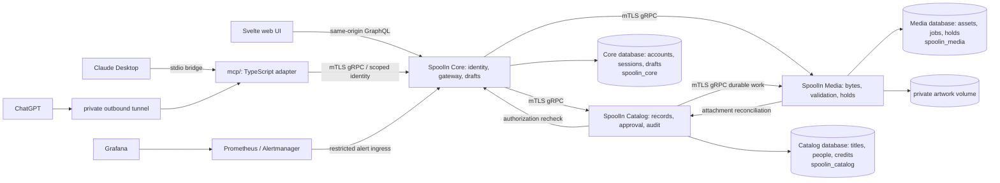


Core owns private accounts, sessions, connector credentials, recovery drafts, authentication events and alert ingress. Catalog owns public/private catalog records, relationships, domain authorization, proposals/approval, selected artwork references, catalog audit and follow-up work. Media owns accepted bytes, bounded processing, immutable output, attachment references, deletion and restricted operational events. Core never reads another database. MCP owns message transport and the static in-chat user interface (UI); Core and Catalog remain responsible for identity and authoritative business state. Saved work handles the required cross-service steps, so no separate message broker or general distributed-workflow coordinator (saga engine) is selected.

The local HTTP listener and dashboard ports bind loopback, making those host entry points accessible from the same computer. gRPC, PostgreSQL and metric-collection (scrape) endpoints listen on the private Docker Compose network. The tunnel forwards only the MCP endpoint; it cannot forward the database, dashboards or unrestricted Core administration. All backend calls, including worker calls, use typed gRPC.

### 2.1 Version and dependency baseline

A dependency pin selects a specific version. A build lock records the resolved direct and indirect dependencies so the build can be reproduced. An image digest identifies the exact container content; a tag is a name that may point to different content later. The architecture-specific digests below must be resolved for each supported processor architecture before the build is verified.

The Java Virtual Machine (**JVM**) runs the Kotlin backend applications. The Java Development Kit (**JDK**) supplies the compiler and runtime tools; long-term support (**LTS**) identifies a supported runtime release line. Spring’s bill of materials (**BOM**) selects a coordinated dependency set. Java Database Connectivity (**JDBC**) is the driver interface through which the backend connects to PostgreSQL.

Gradle’s Kotlin domain-specific language (**DSL**) expresses build configuration in Kotlin. A Java archive (**JAR**) packages compiled JVM code and resources. A software development kit (**SDK**) supplies libraries for implementing a protocol, such as MCP. Server-side rendering (**SSR**) means generating a page’s HTML on a server; SpoolIn instead serves the specified static browser build. Transmission Control Protocol (**TCP**) supplies the network connections used for real gRPC integration checks.

Database text uses **UTF-8**, the Unicode byte encoding named `UTF8` by PostgreSQL. Coordinated Universal Time (**UTC**) provides the common timestamp reference. Storage collation is the rule used to compare and order text; the selected `C` collation and search rules retain their specified behavior.

Resolve the selected dependency baselines into reproducible build locks. Container images require immutable architecture-specific digests for linux/arm64 and linux/amd64; floating `latest` images are excluded. Digest resolution and the complete dependency graph are G-01 prerequisites.

| Component | Selected baseline / dependency rule | Rationale / primary evidence |
|---|---|---|
| JVM | Eclipse Temurin 21.0.12.1+1 LTS; [official release](https://github.com/adoptium/temurin21-binaries/releases/tag/jdk-21.0.12.1%2B1) | Within Spring’s supported range; no native-image build complexity |
| Spring | Boot 4.1.1, Spring gRPC 1.1.1, Boot-managed Spring GraphQL/Security/Data JPA/Actuator | [Boot requirements](https://docs.spring.io/spring-boot/system-requirements.html), [gRPC](https://docs.spring.io/spring-grpc/reference/getting-started.html); gRPC requirements page contains stale 1.0.x text, so resolved BOM alignment needs build evidence |
| Managed JVM libraries | Kotlin 2.4.20, Hibernate 7.4.5.Final, Flyway 12.4.0, grpc-java 1.83.1, protobuf 4.35.1, PostgreSQL JDBC 42.7.13 | Boot 4.1.1 dependency set with the named security patches below; no other independent overrides; [coordinates](https://docs.spring.io/spring-boot/appendix/dependency-versions/coordinates.html) |
| Security patches | Kotlin compiler/plugins/stdlib/reflect 2.4.20; Tomcat embed core/el/websocket 11.0.26; Jackson BOM 3.1.7 | Explicit security overrides to Boot 4.1.1 management; regenerate locks and verify the complete build, compatibility, licenses and advisory scan before acceptance |
| Build | Gradle Kotlin DSL; Gradle 8.14.3 wrapper; Kotlin Spring/JPA plugins at Kotlin version | Reproducible wrapper, JDK 21 target; compile generated protobuf Java stubs used from Kotlin |
| Database | PostgreSQL 18.6; UTF8; UTC; `C` deterministic storage collation; `pg_trgm` | Supported major; [version policy](https://www.postgresql.org/support/versioning/); no H2 substitute |
| UI | Svelte 5.57.2; TypeScript 6.0.3; SvelteKit 3.0.1; adapter-static 4.0.0; Vite 8.3.4; vite-plugin-svelte 7.3.1; npm lockfile | [Svelte release](https://github.com/sveltejs/svelte/releases); client routes with static fallback served by Core, no SSR server or alternate backend |
| MCP | Node 24.21.0 LTS; MCP server/core/client 2.3.1, Node transport 2.1.1; ext-apps 2.0.3; negotiate supported MCP protocol (2026-07-28 or supported legacy), Apps 2026-01-26 | Separate package, generated gRPC client; SDK/Apps declared peer ranges align; validate negotiated protocol and trusted UI support independently in each installed client |
| Image processing | Media invokes libvips 8.18.7 through fixed argument-vector subprocess in its container | Decode/re-encode JPEG/PNG/WebP; no shell interpolation, no extra domain service |
| Observability | Prometheus 3.15.0, Alertmanager 0.34.1, Grafana 13.2.3 | Private local dashboards; exact security-patched image digests are a release lock/evidence obligation |
| Verification | JUnit Jupiter 6.0.3, Spring GraphQlTester, Testcontainers PostgreSQL 2.0.5, Vitest, Testing Library, Playwright | Boot-managed JVM test libraries; real TCP gRPC tests; isolated unit, contract and browser verification |

Primary version evidence for the remaining pins: [Node 24.21.0](https://nodejs.org/en/blog/release/v24.21.0), [TypeScript 6.0.3](https://github.com/microsoft/TypeScript/releases/tag/v6.0.3), [SvelteKit/adapter releases](https://github.com/sveltejs/kit/releases), [Vite 8.3.4](https://github.com/vitejs/vite/releases/tag/v8.3.4), [Svelte Vite plugin 7.3.1](https://github.com/sveltejs/vite-plugin-svelte/releases/tag/@sveltejs/vite-plugin-svelte@7.3.1), [MCP SDK 2.3.1](https://github.com/modelcontextprotocol/typescript-sdk/releases/tag/v2.3.1), [Apps 2.0.3 peer dependencies](https://github.com/modelcontextprotocol/ext-apps/blob/v2.0.3/package.json), [libvips 8.18.7](https://github.com/libvips/libvips/releases/tag/v8.18.7), [Prometheus 3.15.0](https://github.com/prometheus/prometheus/releases/tag/v3.15.0), [Alertmanager 0.34.1](https://github.com/prometheus/alertmanager/releases/tag/v0.34.1), [Grafana 13.2.3](https://github.com/grafana/grafana/releases/tag/v13.2.3).

Kit3's declared minima (Svelte 5.57.1, TypeScript 6, Vite 8.0.12, plugin 7 and Node 22.17) are satisfied by these pins. Resolved dependency compatibility is verified under G-01. Use the framework-neutral MCP Apps browser API; no React UI is selected.

Container repository/version targets: `postgres:18.6-bookworm`, `node:24.21.0-bookworm-slim`, `prom/prometheus:v3.15.0`, `prom/alertmanager:v0.34.1`, `grafana/grafana:13.2.3`; JVM build/runtime images must contain exactly Temurin 21.0.12.1+1, with libvips 8.18.7 in the Media image. Architecture-specific availability, image tag existence and immutable manifest digests require verification under G-01.

Lock transitive npm packages, formatter/linter, generated-code tooling and image digests during build setup. Verify licenses/advisories and retain the resolved graph alongside the selected baselines; see [technical dependencies](#14-technical-dependencies-and-release-criteria).

### 2.2 Deployment and communication inventory

Core serves the static SvelteKit build and browser HTTPS endpoint through host-loopback `localhost:8443`. MCP exposes its authenticated host entry point through host-loopback `localhost:8787`; its container listener is reachable on the private Compose network, and the stdio bridge/tunnel runner use the configured permitted endpoint. The separate MCP exporter listens on private port `8788` with no host publication. Host-loopback publication is distinct from binding only to loopback inside a container, which would prevent private-network access. Internal services listen on the private Compose network, with gRPC on port `9090` per container, separate restricted Actuator HTTP on `8081`, and PostgreSQL on `5432`. Prometheus `9090`, Grafana `3000` and Alertmanager `9093` expose loopback-only operator entry points. Host ports are configurable and checked for collisions before startup; PostgreSQL, gRPC and exporters are not published to the host.

For protected calls, Core supplies a **scoped actor assertion**: signed, short-lived evidence of the user identity and the intended receiver/method. The receiver still checks permissions. The authentication epoch in that evidence is a revocation counter; older credentials are rejected when their counter no longer matches the account. Browser calls also use cross-site request forgery (**CSRF**) protection, which prevents another website from using the browser’s session to submit an unauthorized action.

A **deadline** bounds how long a call may take. The **retry owner** decides whether another attempt is safe. **Outcome reconciliation** means checking the saved result at the owning service after a lost or ambiguous response; a timeout does not prove that nothing changed.

| Caller → receiver | Operation / protocol | Identity and authorization | Budget / retry owner / reconciliation |
|---|---|---|---|
| Browser → Core | Static frontend, POST `/graphql`, GET `/artwork/{assetId}`; HTTPS | Exact Host/Origin, browser session, CSRF for GraphQL; artwork visibility checked by Catalog | Metadata 3 s, artwork 10 s, ordinary mutation 5 s, upload 30 s; client reconciles submitted UUID before resubmitting |
| Core → Catalog | Public/private queries and catalog writes; gRPC | Core service certificate; signed scoped actor assertion for protected operations | 2 s read/3 s mutation within caller budget; no automatic mutation retry; `GetOperation` resolves uncertainty |
| Core → Media | Upload, asset metadata, byte retrieval; gRPC | Core service certificate; actor/intent-bound upload; attachment-bound read | Upload 30 s, retrieval 10 s; close streams on cancellation; Catalog receipt owns final attachment outcome |
| Catalog → Core | `CheckActor`; gRPC | Catalog service certificate; assertion-bound account/credential/epoch | At most 1 s within mutation budget; unavailable identity prevents protected commit |
| MCP → Core | `McpGatewayService` methods; gRPC | MCP certificate plus client-bound connector credential; trusted UI assertion only for approval/rejection | 5 s ordinary/3 s context; adapter resolves original Catalog publish UUID |
| Catalog worker → Media | Asset state, reserve/confirm/release; gRPC | Catalog certificate, hold/asset/title/operation tuple | 5 s per attempt, persisted work budget; query hold/operation before replay |
| Media → Catalog | `GetAttachment`; gRPC | Media certificate; exact hold lookup only | 2 s; fails closed for contradictory/released references; no cross-database access |
| Alertmanager → Core | POST `/internal/alerts`; private HTTP | Alertmanager mTLS identity; fixed receiver endpoint | 2 s; Alertmanager retries non-2xx; Core atomically records deduplicated events and selected-mode work |
| Prometheus → services/MCP | Private metrics HTTP | Scrape identity/allowlisted network; no browser credentials | 2 s scrape timeout, 15 s interval; Prometheus observes failures |
| Operator probes → services | Restricted readiness/liveness, gRPC health | Private network/service identity | 2 s; startup owns bounded polling; probes never mutate catalog data |
| Owning worker → configured provider | SMTP or HTTPS notification | Fixed destination and secret files, selected adapter only | At most 15 s effect attempt; persisted worker budget; ambiguous acceptance remains UNKNOWN |
| Claude bridge/tunnel runner → MCP | Streamable HTTP `/mcp` behind stdio or private tunnel | Separate client-bound credential; negotiated MCP session is not an application session | Transport reconnect bounded; writes reconcile operation receipts; no model-origin approval |

Catalog validates live Core identity before acquiring its database write lock. Media calls Catalog only after committing/releasing its own state transaction. Catalog never holds a transaction while waiting for Media. The synchronous request graph therefore terminates before asynchronous reconciliation; no transaction spans two databases.

### 2.3 Consequential request sequences

#### Catalog read and mutation sequence

**Diagram.** Read composition, owner commit and receipt reconciliation after a lost response.

<details>
<summary>Diagram — Catalog read and mutation sequence</summary>

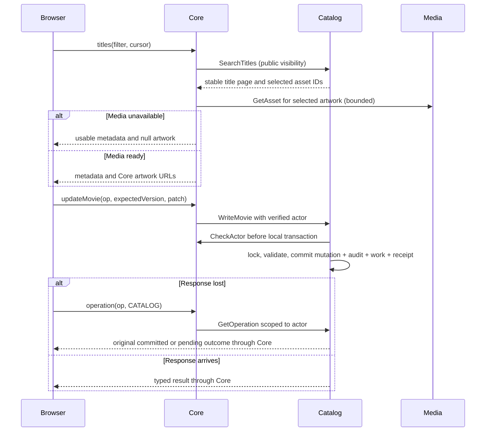

</details>


#### Session bootstrap and protected navigation sequence

**Diagram.** Browser session/CSRF bootstrap and protection of private navigation.

<details>
<summary>Diagram — Session bootstrap and protected navigation sequence</summary>

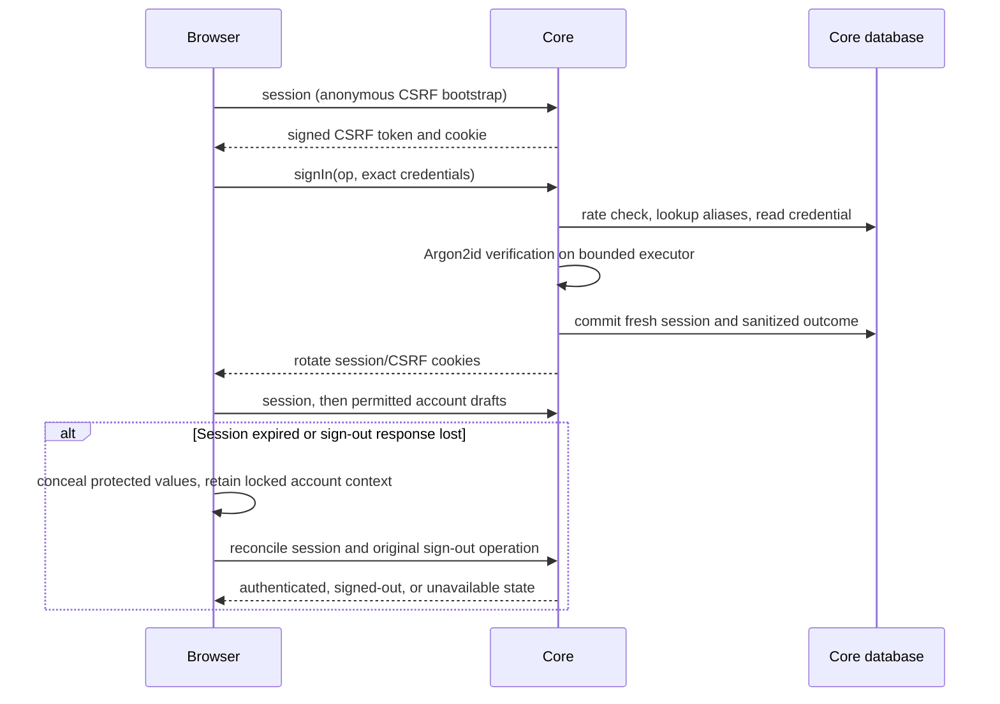

</details>


The artwork reservation/attachment sequence is defined in §7.6. MCP publication is defined in §9. Worker claiming and crash recovery are defined in §7.3 and §7.7.

### 2.4 Detailed project structure

This is the target repository structure for implementation. The current checkout contains documentation;
the application, build and operations paths below describe where their implementation belongs. The
layout retains three backend applications, one static frontend and the separate `mcp/` adapter.
Libraries and test projects are build modules, not additional deployed services.

**Code generation** turns the source API definitions into derived source files. A data transfer object (**DTO**) contains the selected fields passed across a boundary. Object-relational mapping (**ORM**) connects program objects to database rows; JPA/Hibernate provides it inside each owning backend service. Generated DTOs describe exchanges, while service-owned entities describe stored data.

Compare-and-set (**CAS**) updates a record only when its expected version or state still matches. In the boundary map below, draft CAS means an outdated edit cannot silently overwrite a newer saved draft; the existing conflict rules determine the returned result.

- [Repository root](#241-repository-root)
- [Frontend routes and features](#242-frontend-routes-and-features)
- [Backend applications and feature slices](#243-backend-applications-and-feature-slices)
- [Shared contracts and generated types](#244-shared-contracts-and-generated-types)
- [MCP adapter and review UI](#245-mcp-adapter-and-review-ui)
- [Operations, seed data and local state](#246-operations-seed-data-and-local-state)
- [Tests, build order and dependency rules](#247-tests-build-order-and-dependency-rules)
- [Boundary and source map](#248-boundary-and-source-map)

#### 2.4.1 Repository root

**Contract specification.** Target source layout and build ownership. File names establish the intended
locations; the tree does not claim that application code or executable migrations already exist.
Generated and local-only paths are identified separately in §2.4.7.

<details>
<summary>Contract specification — Repository root layout</summary>

```text
spoolin/
├── README.md                         # Setup, entry points and command usage
├── Makefile                          # Seven public commands specified in §11.3
├── settings.gradle.kts               # JVM modules and repository configuration
├── build.gradle.kts                  # Shared JVM build and verification conventions
├── gradle.properties                # Nonsecret build settings
├── gradlew / gradlew.bat             # Pinned Gradle wrapper launchers
├── gradle/
│   ├── wrapper/                      # Wrapper JAR and distribution properties
│   └── libs.versions.toml            # Selected JVM dependencies and build plugins
├── package.json                      # npm workspaces and shared JS build commands
├── package-lock.json                 # One resolved lock for all npm workspaces
├── build-tools/                      # Authored generation and contract-check scripts
├── .gitignore                        # Generated outputs, local config and secret exclusions
├── .editorconfig                     # Shared whitespace and line-ending conventions
├── docs/
│   ├── 01-brainstorming-result.md     # Design history
│   ├── 02-PRD.md                     # Product requirements
│   ├── 03-design-system.md          # Visual specification
│   ├── design-system/               # Existing tokens, contracts and reference mockups
│   ├── 04-spoolin-techdoc.md         # Engineering specification
│   ├── 05-atdd.md                    # Acceptance specification
│   ├── research/                    # Existing research inputs
│   └── prompts/                     # Existing invocation inputs
├── contracts/
│   ├── graphql/                      # Browser schema source
│   ├── grpc/                         # Protobuf source and generated JVM library build
│   └── json/                         # Versioned draft, policy and MCP schema shapes
├── libraries/backend-support/        # Limited stateless JVM support; no domain storage
├── services/
│   ├── core/                         # Browser boundary, identity and spoolin_core database
│   ├── catalog/                      # Catalog behavior and spoolin_catalog database
│   └── media/                        # Image processing and spoolin_media database
├── frontend/                         # Static SvelteKit client
├── mcp/                              # Node adapter and trusted in-chat review UI
├── config/                           # Nonsecret local configuration examples
├── data/seed/                        # Frozen permitted dataset and optional artwork
├── ops/                              # Local containers, monitoring and operator wrappers
└── tests/                            # Cross-service, browser and client verification
```

</details>

The root Gradle build includes `:contracts:grpc`, `:libraries:backend-support`, `:services:core`,
`:services:catalog`, `:services:media` and `:tests:integration`. Only the three `services/` modules
produce Spring Boot applications. npm workspaces are `frontend`, `mcp` and `tests/browser`; they share
the root lockfile while declaring their own dependencies. This selects build organization without
changing the runtime protocols or introducing another frontend server.

#### 2.4.2 Frontend routes and features

**Contract specification.** SvelteKit entry points and browser implementation responsibilities.
Routes compose feature components; feature controllers own request lifetimes and form state.

<details>
<summary>Contract specification — Frontend routes and feature layout</summary>

```text
frontend/
├── package.json
├── vite.config.ts                    # Kit 3 plugin, adapter-static and build/test config
├── tsconfig.json
├── eslint.config.js
├── .prettierrc.json
├── codegen.ts                        # SDL plus named GraphQL operations → TypeScript
├── src/
│   ├── app.html                      # Browser document shell
│   ├── routes/
│   │   ├── +layout.ts                # Client-only route options; no server execution
│   │   ├── +layout.svelte            # Shell, session boundary, theme and navigation
│   │   ├── +page.svelte              # Public catalog
│   │   ├── titles/[id]/+page.svelte
│   │   ├── people/+page.svelte
│   │   ├── people/[id]/+page.svelte
│   │   ├── sign-in/+page.svelte
│   │   ├── register/+page.svelte
│   │   └── manage/
│   │       ├── +layout.svelte        # Maintainer guard before protected rendering
│   │       ├── movies/+page.svelte
│   │       ├── movies/new/+page.svelte
│   │       ├── movies/[id]/+page.svelte
│   │       ├── people/+page.svelte
│   │       ├── people/new/+page.svelte
│   │       ├── people/[id]/+page.svelte
│   │       ├── archives/+page.svelte
│   │       └── audit/+page.svelte
│   └── lib/
│       ├── features/
│       │   ├── catalog/              # Filters, title pages, cursor and query state
│       │   ├── session/              # Sign-in/register/out, bootstrap and access state
│       │   ├── movie/                # Creation/editing and stale-version comparison
│       │   ├── person/               # Person pages and editing
│       │   ├── credit/               # Role picker, credit editing and characters
│       │   ├── artwork/              # File preparation, XHR progress, cancel and polling
│       │   ├── archive/              # Archive/restore and current deletion-impact review
│       │   ├── audit/                # Authorized audit pages and sanitized differences
│       │   └── draft/                # Account-isolated autosave, restore and discard
│       ├── components/               # Shared fields, notices, dialogs and page controls
│       ├── design-system/            # Authored token adapter and shared UI behavior
│       ├── transport/                # GraphQL fetch, XHR, CSRF and safe error mapping
│       ├── policy/                   # Bounds, Unicode counting and presence handling
│       ├── state/                    # Shared session/policy; no passwords or raw files
│       └── generated/                # Ignored GraphQL types and generated token CSS
└── static/                           # Public brand assets; never uploaded artwork
```

</details>

Each feature stores its named `.graphql` operations, `.svelte` components, controller/state `.ts`
files and colocated `*.test.ts` checks together. For example, `features/movie/` contains
`MovieEditor.svelte`, `movie-controller.ts`, `operations.graphql` and their behavior checks.
These names are illustrative file examples; the responsibilities and route paths are the target
structure. Components depend on controllers and typed transport results, not on backend entities.

`docs/design-system/tokens.json` and the design-system specification remain the design inputs.
The token build emits `src/lib/generated/design-tokens.css`; authored adapters and component behavior
stay in `design-system/` and `components/`. Reference mockup JavaScript is not imported as the
production frontend. `frontend/build/` contains the generated static site; the Core packaging step
copies it into Core's generated static resources. No SvelteKit server routes or separate SSR process
are selected. Uploaded artwork always uses Core's authorized retrieval endpoint, never `static/`.

For the selected SvelteKit 3 baseline, `frontend/vite.config.ts` owns the Kit plugin and
`adapter-static` configuration; there is no separate `svelte.config.js`. Root `src/routes/+layout.ts`
disables SSR for the client application. The adapter produces `frontend/build/200.html` as the SPA
fallback, with client routes not requiring a prerendered record list. Core packages that file under
its generated `static/` resources and serves it only for frontend navigation. API, private, health
and exporter paths keep their own handlers/errors. This follows the [Kit 3 configuration
guide](https://svelte.dev/docs/kit/migrating-to-sveltekit-3) and [SPA
guidance](https://svelte.dev/docs/kit/single-page-apps); G-01 still verifies the locked build.

#### 2.4.3 Backend applications and feature slices

**Contract specification.** Layout applied separately to Core, Catalog and Media. `<service>` is a
placeholder for `core`, `catalog` or `media`, not a literal directory name. Kotlin package roots are
`com.spoolin.core`, `com.spoolin.catalog` and `com.spoolin.media` respectively.

<details>
<summary>Contract specification — Backend application layout</summary>

```text
services/<service>/
├── build.gradle.kts                  # Boot application and selected owner dependencies
├── src/
│   ├── main/
│   │   ├── kotlin/com/spoolin/<service>/
│   │   │   ├── Application.kt        # Service startup and constructor-based wiring
│   │   │   ├── config/               # Validated owner-specific settings and bean wiring
│   │   │   ├── boundary/             # HTTP/gRPC filters, identity and error adapters
│   │   │   ├── features/             # Owned behavior grouped by feature (table below)
│   │   │   └── operations/           # Work claiming, audit, receipts and notifications
│   │   └── resources/
│   │       ├── application.yaml      # Nonsecret owner settings and file references
│   │       └── db/migration/         # Immutable Flyway SQL for this database only
│   ├── test/kotlin/com/spoolin/<service>/
│   │   └── features/                 # Unit tests matching the production feature names
│   └── integrationTest/
│       ├── kotlin/com/spoolin/<service>/
│       │   ├── persistence/          # Real PostgreSQL constraints/native operations
│       │   ├── boundary/             # Real HTTP/gRPC authorization and failure behavior
│       │   └── recovery/             # Owned crash, migration, rotation and seed cases
│       └── resources/                # Synthetic isolated fixture inputs
└── build/                            # Ignored classes, resources, JAR and reports
```

</details>

Each feature is a **vertical slice**: its transport handler, command/query logic, validation,
authorization, owned persistence and tests stay together. The folders follow behavior rather than
one global `controllers/`, `services/` and `repositories/` collection. Inside a feature, use
`api/` for the handler and projection mapping, `application/` for commands/queries and transaction
orchestration, `domain/` for relevant rules, and `persistence/` for that owner's entities/repositories
and native SQL. Create a subfolder only when its responsibility exists; a small feature can remain
flat. Domain rules use domain values, not browser components or generated transport messages.

| Application | Feature packages under `features/` | Responsibility and persistence boundary |
|---|---|---|
| Core | `account`, `session`, `connector`, `draft`, `policy`, `ratelimit`, `catalogview`, `artworkproxy`, `mcpgateway`, `alerts`, `crypto`, `bootstrap` | Account/session/connector identity; encrypted drafts and lookups; policy, request throttling and browser composition; bounded upload/proxy; trusted gateway and alert recording; Core-only keys/bootstrap and `spoolin_core` persistence |
| Catalog | `search`, `movie`, `person`, `credit`, `taxonomy`, `lifecycle`, `provenance`, `proposal`, `artwork`, `seed`, `audit` | Public/managed projections; edits and relationships; impact/lifecycle checks; exact-content approval; attachment intents; frozen seed, authorized audit reads and `spoolin_catalog` persistence |
| Media | `upload`, `processing`, `asset`, `hold`, `cleanup` | Accepted stream/job; fixed image processor; metadata/authorized bytes; reservations; safe cleanup and `spoolin_media` persistence |

`operations/` implements each service's own `operation_receipt`, `durable_work` and `operational_event`,
including typed notification work. Catalog `features/audit/` alone owns `catalog_audit_event`.
The operational designs have separately owned physical copies, not one shared
repository. Feature commands call the local operations component within the documented transaction;
workers call typed remote clients after releasing that transaction. Core's `catalogview` and
`artworkproxy` contain remote clients and response composition, not Catalog/Media repositories.

The shared support package owns the stateless JSON log encoder and validated trace-context helpers in
[§12.2.1](#1221-json-log-contract). Each service owns its logger configuration, resource identity and
bounded sink. Boundary interceptors start/close request context; workers start a fresh context per
attempt. Core alone decides browser identity. MCP uses the same field contract through its
`src/operations/` logging helper and writes bridge diagnostics to stderr, preserving protocol stdout.
These helpers do not serialize database entities or own audit persistence.

Catalog's `features/audit` implements authorized audit reads over its local audit repository;
common `operations/` still owns audit insertion/integrity. Core's `features/ratelimit` owns
`request_rate_window`, the §8.4 profile configuration/admission transaction and bounded boundary checks.
MCP owns only the local resource counters described there; it has no database access.

**Code example — feature placement.** For a person edit, Catalog's
`features/person/api/PersonRpcHandler.kt` maps the RPC to
`features/person/application/UpdatePerson.kt`. That command checks the declared identity/version/
policy and uses `features/person/persistence/PersonRepository.kt` within Catalog's transaction.
Domain validation belongs in `features/person/domain/`. These class/file names illustrate placement;
the operation semantics remain those in §5 and §7.

`libraries/backend-support/src/main/kotlin/com/spoolin/support/` contains only reusable stateless
identity verification, policy DTOs, transport/problem mapping, correlation and transaction helpers
per §4.1, with its own unit checks under `src/test/kotlin/`. It cannot own account/catalog/media
entities, repositories, migrations, connection pools or secrets. Key provisioning and signing stay
with their documented owner; a verification helper does not grant another service access to Core data.

#### 2.4.4 Shared contracts and generated types

**Contract specification.** Authoritative machine-readable sources and code-generation build module.
The filenames describe implementation locations for the complete embedded definitions in §5, §6
and §9; they do not introduce new operations or duplicate authorities.

```text
contracts/
├── graphql/
│   └── schema.graphql                # Assemble all §5.1 SDL groups once
├── grpc/
│   ├── build.gradle.kts              # Protoc generation and the JVM contract library
│   ├── src/main/proto/spoolin/v1/
│   │   └── spoolin.proto               # Complete §5.2 messages and four services
│   └── build/generated/source/       # Ignored protobuf and gRPC Java outputs
└── json/
    ├── policy.schema.json            # Declared effective-policy representation
    ├── draft.schema.json             # Versioned permitted recovery payload shapes
    ├── mcp-inputs.schema.json        # §9 tool inputs; policy supplies effective bounds
    └── mcp-outputs.schema.json       # Assemble §5.10 registry and resolve its local refs
```

The target protobuf namespace is `spoolin.v1`. One source `spoolin.proto` contains all review groups, including the established message names, field numbers and service methods.
JVM services depend on the `:contracts:grpc` library; they do not copy `.proto` files or compile
another service's source. MCP generates its own TypeScript client from the same protobuf source
into `mcp/src/generated/`. Keep the selected generator and its version in the build lock under G-01.

Core's build generates GraphQL boundary DTOs into `services/core/build/generated/sources/graphql/`
using the source SDL, then copies that SDL into generated `graphql/` classpath resources;
frontend generation reads that same source plus feature operation documents. There is no separately
maintained SDL copy under Core resources. JSON schemas express the existing fixed shapes, while
effective policy still supplies configurable limits; schema files do not replace owner validation.

Core's GraphQL generator/tool version remains a G-01 lock requirement; its generated boundary
DTOs must support the omission/null semantics in §5.4. Scalar coercion, presence adapters, resolvers,
authorization and error mapping are handwritten in Core's `boundary/graphql/` and feature `api/` code.
Generated DTOs do not become JPA entities. §2.4.8 maps each source to its consumer and packaged output.
Owner-private audit/work payload validators and fingerprint normalization stay in the owning
service's feature or `operations/` code; shared wire schemas do not turn private storage types into
cross-service repositories. Flyway SQL stays inside the database-owning service, not in a shared
contract migration directory.

#### 2.4.5 MCP adapter and review UI

Content Security Policy (**CSP**) tells the browser which scripts and other resources it may load or execute. The MCP review bundle’s policy is verified with the selected chat client, alongside its exact-content approval controls.

**Contract specification.** Independent Node package and trusted review resource. There is no database
adapter, ORM, migration directory or business-state cache in this package.

```text
mcp/
├── package.json
├── tsconfig.json
├── eslint.config.js
├── .prettierrc.json
├── src/
│   ├── server.ts                     # MCP server startup and orderly shutdown
│   ├── transport/                    # Streamable HTTP, stdio bridge and session handling
│   ├── gateway/                      # Typed Core client, deadlines and safe errors
│   ├── identity/                     # Connector configuration and trusted UI assertion
│   ├── tools/                        # Context, propose and operation registrations
│   ├── resources/                    # Review UI and actor-bound proposal resources
│   ├── operations/                   # Private 8788 health/metrics and shutdown state
│   ├── review/
│   │   ├── index.html                # Static MCP Apps resource entry
│   │   ├── main.ts                   # Host API lifecycle and escaped rendering
│   │   ├── review-state.ts           # Exact revision/hash/content display state
│   │   └── review.css                # Existing design-system integration
│   └── generated/                    # Ignored gRPC types/client and review token output
├── test/                             # Transport, gateway, review and exporter checks
└── dist/                             # Ignored compiled server and bundled review resource
```

Model-visible tools and UI-only approval/rejection routes remain separate registrations, with the
verified client enforcement and gateway checks in §9. Review code reads untrusted values as data
and renders escaped text. The UI uses the selected framework-neutral MCP Apps browser API and
TypeScript; it does not add a React application. The stdio bridge and tunnel connect to the same
adapter, with distinct client-bound credentials. Generated types and resource bundles contain no
connector token, challenge instance, mounted key or captured user proposal.

`src/operations/` owns the independent `/health/live`, `/health/ready` and `/metrics` listener
on private `8788`; it is not registered as a model tool. `test/review/` checks rendering/revision
handling, and `test/operations/` checks exporter privacy/readiness. These adapter checks complement
the actual Claude/ChatGPT approval enforcement checks and do not prove trusted host isolation.

The resource bundle emits a self-contained `mcp/dist/review/index.html` with its trusted
application JavaScript/CSS included. There is no separate review asset server or new asset-resource
URI. Its CSP hashes/host framing policy are built and verified with the selected client; user
proposal values remain escaped data. Resource/package checks must load that final artifact.

#### 2.4.6 Operations, seed data and local state

**Contract specification.** Nonsecret implementation inputs and local operator entry points. Secret
files, database volumes and accepted artwork have separate runtime ownership, described below.

<details>
<summary>Contract specification — Operations and initialization layout</summary>

```text
config/
├── local.example.env                 # Nonsecret settings and *_FILE path placeholders
└── accounts.example.yaml             # Prepared-account configuration placeholders
data/seed/
├── manifest.json                     # Frozen records, counts, stable IDs and checksums
├── sources/                          # Reuse evidence and permitted source snapshots
└── artwork/                          # Optional licensed seed files referenced by manifest
ops/
├── compose.yaml                      # Local selected services, network and named volumes
├── containers/
│   ├── core.Dockerfile                # JVM Core plus built static frontend resources
│   ├── catalog.Dockerfile
│   ├── media.Dockerfile               # JVM Media and bounded libvips processor
│   └── mcp.Dockerfile                 # Node adapter and bundled review UI
├── postgres/
│   ├── bootstrap.sql                 # Privileged database/role/extension preparation
│   └── grants.sql                    # Owner-scoped grants after migrations
├── monitoring/
│   ├── prometheus.yaml               # Private scrape targets and retention settings
│   ├── alerts.yaml                   # Proposed expressions from §12.4
│   ├── alertmanager.yaml             # Authenticated Core ingress; no bypass dispatch
│   └── grafana/
│       ├── provisioning/             # Nonsecret datasource/dashboard provisioning
│       └── dashboards/               # Request, work, media, key and notification views
└── bin/
    ├── start.sh                      # §11 ordered startup and bounded readiness
    ├── stop.sh / restart.sh          # Drain and restart preserving data
    ├── status.sh / logs.sh           # Bounded redacted inspection
    ├── migrate.sh / seed.sh          # Owning credentials and serialized initialization
    ├── test-unit.sh                  # Isolated component and contract checks
    ├── test-integration.sh           # Disposable real database/protocol environment
    ├── backup.sh / restore.sh        # Coordinated data/artwork/key recovery
    ├── recover-work.sh               # Audited bounded recovery with original effect IDs
    ├── maintenance.sh                # Owner-scoped bounded retention/purge utility
    ├── rotate-keys.sh                # Core-owned rotation with protected key provisioning
    ├── connector.sh                  # Local authenticated account/client binding
    └── tunnel.sh                     # Configured outbound runner and status
```

</details>

The root Makefile delegates its seven documented public targets to the matching wrappers;
backup/restore, connector and work-recovery utilities remain explicit operator tools, not extra
browser administration features or new required Make targets. Scripts validate prerequisites and
redact diagnostics according to §11–§12. Image and dependency resolution remains G-01 work; this
layout does not claim a working deployment.

`ops/postgres/bootstrap.sql` prepares databases, roles/schema ownership and the Catalog-only
`pg_trgm` extension using protected bootstrap privileges. `migrate.sh` supplies one owner
migrator credential at a time to Flyway over that service's packaged `db/migration/` resources;
`grants.sql` applies the required per-owner grants after tables/history exist. Runtime credentials
never run those stages. `seed.sh` invokes Core bootstrap and Catalog seed logic in their separate
phases, followed by optional Media initialization, rather than writing through another service
database. `maintenance.sh` uses the owner's bounded administrative routines and separate maintenance
credential; `rotate-keys.sh` invokes Core crypto routines. These utilities cannot elevate browser/MCP
requests or expose administrative credentials to ordinary service request handlers.

Core registers alert ingestion explicitly on its private listener/context with the required
mTLS checks, alongside restricted Actuator endpoints; it is not copied into the public browser
listener. Browser HTTPS exposes only its specified static/GraphQL/artwork boundaries. Each service
keeps its gRPC and management listeners private as specified in §2.2 and §5.5.

| Data or artifact | Location and owner | Commit and recovery treatment |
|---|---|---|
| Seed data | `data/seed/manifest.json`, source evidence and optional permitted files; Catalog initialization, Media asset phase | Versioned implementation inputs; preserve manifest identity/checksum and reuse evidence per §10 |
| Real secrets | Protected operator-provisioned files outside the checkout, referenced by existing `*_FILE` settings | Never commit passwords, keys, tokens, certificates' private keys or real account configuration; preserve required key backups separately |
| Optional local settings | Root `.env` with nonsecret overrides/path references | Ignored and not a source of demo credentials; validate against §11.1 |
| Database state | Three separately owned PostgreSQL databases in the persistent named database volume | Runtime state, not repository seed files; coordinated backup covers all owners |
| Accepted artwork | Private persistent Media volume | Include protected output/references in coordinated recovery; no public source/static folder |
| Processing temporary files | Bounded Media/Core temporary storage and quarantine with documented recovery checks | Not versioned; orphan removal must respect accepted jobs and holds |
| Monitoring/log state | Persistent selected monitoring volumes and bounded rotated logs | Runtime retention and privacy rules in §12; no captured secret-bearing logs in fixtures |
| Disposable verification state | Unique test namespace/temporary volumes created by test wrappers | Separate credentials, keys, ports and seed from normal startup; cleanup only that namespace |

#### 2.4.7 Tests, build order and dependency rules

`tests/integration/` is a Gradle test project with `src/test/kotlin/com/spoolin/integration/` grouped
by `identity`, `catalog`, `lifecycle`, `audit`, `artwork`, `work`, `seed`, `migration`, `crypto`,
`notifications`, `config`, `policy` and `operations`.
It verifies multiple real services and PostgreSQL boundaries without importing their private
repositories. Service-local `src/integrationTest/` checks an owner's own persistence and boundary.
Each service build explicitly declares that integration-test source set/task, using the selected
JUnit/Testcontainers dependencies and the owner's compiled code/resources. The root test project
starts the selected packaged services and accesses them through their public/internal contracts.

`tests/browser/` is the Playwright npm workspace with `playwright.config.ts`, `flows/` and
`fixtures/`, covering the routes/states in §3 and Appendix B. `tests/clients/claude/` and
`tests/clients/chatgpt/` hold bounded client-specific approval scenarios, setup/evidence instructions
and sanitized results when actually executed. These directories do not manufacture an automated
host-enforcement test when the client cannot support one; G-03 remains an evidence requirement.
`tests/fixtures/` holds shared synthetic metadata and bounded adversarial file/schema inputs, never
real accounts, user proposals, secrets or unlicensed images. Formal checks are future implementation
artifacts; listing their locations is not evidence of execution.

`tests/contracts/` holds root-runner schema/generation compatibility checks, not another npm
workspace. `build-tools/` contains the authored generators/checkers used by the root build,
including token generation and MCP client generation; module configuration owns its actual
classpath/task wiring. §13.3 maps every verification family to source locations and execution.

| Generated output | Source and build owner | Rule |
|---|---|---|
| `contracts/grpc/build/generated/source/` | Source `.proto`; contract Gradle module | JVM build output; no manual edits |
| `frontend/src/lib/generated/` | Source SDL, named operations and design tokens; frontend build | Rebuild before type checking; ignored derived files |
| `mcp/src/generated/` | Source protobuf and design tokens; adapter build | Rebuild before type checking; no copied business implementations |
| `services/core/build/generated/sources/graphql/` | Source SDL; Core build | Generated JVM boundary DTOs, presence-adapted at the owned boundary; no entities or authorization |
| `services/core/build/resources/main/graphql/` and `services/core/build/resources/main/static/` | Source SDL and `frontend/build/`; Core packaging | Full project-relative generated resource destinations; no independently authored schema/site copy |
| Service `build/`, root `.gradle/`, `node_modules/`, `.svelte-kit/`, `frontend/build/`, `mcp/dist/` | Selected build tools | Ignored local outputs; packages contain required runtime resources |
| Test reports, Playwright traces/screenshots and coverage | Isolated verification runs | Ignored raw outputs; retain only sanitized evidence explicitly needed for release |

Build order: resolve locks and tool versions; generate protobuf/GraphQL types and token adapters;
build the static frontend and MCP review resource; compile the JVM modules and run their unit
checks; package the three applications and adapter; prepare selected container images; then run
the applicable isolated integration checks. The Make test wrappers aggregate
frontend/MCP unit checks, backend unit checks and the applicable contract checks, while integration
wrappers run owner tests, cross-service checks and browser/client checks with explicit unavailable
prerequisites. The unit wrapper does not select `:tests:integration:test`; that cross-service task
runs only with the packaged services in the disposable integration environment. Dependency generation can run independently where its inputs permit; no build phase
starts application migrations against the normal development database.

Allowed source dependencies are routes → frontend features → shared browser transport/components;
MCP transport/tools/review → Core gateway; service boundaries → owned feature commands → owned
persistence; and JVM applications → contract/support libraries. Services exchange data through the
§2.2 protocols. They cannot import another application's entities, repositories or migrations.
Support libraries cannot depend on an application. Browser and MCP code cannot depend on JVM
application internals or database drivers. Test fixtures cannot become runtime domain authorities.
These rules preserve the service-owned databases and transaction boundaries in §6–§7.

[The boundary/source map](#248-boundary-and-source-map) and [verification execution
map](#133-verification-locations-and-command-selection) reconcile the tree with §3–§6 and §13.


#### 2.4.8 Boundary and source map

The maps below connect implementation locations to the shared contracts. Paths under a
Kotlin feature refer to `services/<owner>/src/main/kotlin/com/spoolin/<owner>/features/`;
`boundary/` and `operations/` refer to the same owner's package root. They are target source
locations, not additional routes, RPCs or database structures.

| Browser GraphQL operations | Frontend source | Core boundary and Catalog/Media owner | Verification |
|---|---|---|---|
| `session`, `register`, `signIn`, `signOut` | `frontend/src/lib/features/session/` | Core `account/api`, `session/api`; verified browser session/CSRF before owned identity work | V-AUTH, V-CONFIG, V-UI |
| `policy` | `frontend/src/lib/policy/` and shared state | Core `policy/api`; published effective-policy revision | V-POLICY, V-CONFIG |
| `titles`, `title`, `people`, `person`, `titleCredits`, `personCredits`, `genres`, `creditRoles` | `features/catalog/`, `features/person/`, `features/credit/` | Core `catalogview/api` → Catalog `search`, `taxonomy`, `person` projections; optional Media enrichment | V-READ, V-STACK, V-UI |
| `managedTitle`, `managedPerson`, `managedCredits`, `managedTitles`, `managedPeople` | `features/movie/`, `features/person/`, `features/credit/`, `features/archive/` | Core `catalogview/api` → Catalog owner projections with live Maintainer checks | V-AUTH, V-READ, V-LIFE |
| `createMovie`, `updateMovie`, `movieLifecycle` | `features/movie/`, `features/archive/` | Core GraphQL feature resolver → Catalog `movie`, `lifecycle`; owner transaction/audit/receipt/work | V-WRITE, V-LIFE, V-AUDIT |
| `createPerson`, `updatePerson`, `personLifecycle`, `deletionImpact` | `features/person/`, `features/archive/` | Core GraphQL feature resolver → Catalog `person`, `lifecycle`; current impact verification | V-WRITE, V-LIFE, V-POLICY |
| `createRole`, `addCredit`, `updateCredit`, `removeCredit` | `features/credit/` | Core GraphQL feature resolver → Catalog `taxonomy`, `credit`; title/person/role/version checks | V-WRITE, V-LIFE, V-POLICY |
| `uploadArtwork`, `cancelArtwork` | `features/artwork/` | Core `artworkproxy/api` → Catalog `artwork` intent/cancel; Media `upload`, `processing`, `hold`; owner receipt controls attachment | V-ART, V-WORK, V-UI |
| `drafts`, `saveDraft`, `discardDraft` | `features/draft/` and permitted form controllers | Core `draft/api`; account-scoped authorization/encryption/CAS; safe durable Core receipts for both mutations | V-AUTH, V-CRYPTO, V-POLICY, V-WORK |
| `operation` | Shared transport/outcome controllers | Core owner-receipt router in `operations/`; typed Core/Catalog/Media receipts, not database fan-out | V-WORK, V-STACK |
| `audit` | `features/audit/` | Core `catalogview/api` → Catalog `audit/api`; filtered authorized projection over local audit storage | V-AUDIT, V-AUTH |

Unqualified frontend `features/` paths above are relative to `frontend/src/lib/`. Every operation
from the [GraphQL API definition (SDL)](#51-graphql-sdl) occurs once in this map; its exact permissions, presence and deadline behavior remain
in §5.3–§5.9. A combined page can use multiple rows; layout and component boundaries do not grant
permission. Core's catalog resolvers belong to `catalogview/api`, while artwork, identity and drafts
keep their dedicated Core feature boundaries.

| Other boundary | Handler/source owner | Authoritative definition and consumer |
|---|---|---|
| Static frontend navigation/assets | Core `boundary/http/` and generated static resources | §3.1/§5.5; serves packaged `200.html` for frontend navigation only |
| `/graphql` request dispatch | Core `boundary/graphql/` plus feature `api/` resolvers | `contracts/graphql/schema.graphql`; browser-generated types and Core boundary DTOs |
| `/artwork/{assetId}` | Core `artworkproxy/api` → Catalog access grant → Media `asset/api` | §5.5 and `MediaService.ReadAsset`; authorized byte proxy, no public volume |
| Backend Actuator health/metrics and standard gRPC health | Each service `boundary/` and `config/` | §5.5; private `8081` and authenticated internal gRPC; not a new `spoolin.v1` health RPC |
| `/internal/alerts` | Core `alerts/api` on private listener | §5.5; Alertmanager-authenticated bounded ingestion and atomic recording |
| `/mcp`, stdio bridge | `mcp/src/transport/` | §5.8/§9; client-bound protocol session and tools/resources |
| MCP `/health/live`, `/health/ready`, `/metrics` | `mcp/src/operations/` | §5.5; private exporter `8788`, separate from model tools |
| `IdentityService` | Core `session`, `connector`, and identity boundary | Source `spoolin.v1` protobuf; permitted service actor checks |
| `CatalogService` | Catalog feature `api/` handlers and `operations/` receipt handlers | Source protobuf; Core calls and allowed Media/worker queries |
| `MediaService` | Media `upload`, `asset`, `hold` handlers and owned receipts | Source protobuf; permitted Core/Catalog calls |
| `McpGatewayService` | Core `mcpgateway/api` → permitted Catalog operations | Source protobuf; adapter only, independently gated trusted UI approval |
| MCP tools and proposal/review resources | `mcp/src/tools/`, `resources/`, `review/` → gateway | §5.8/§9 input/output/resource definitions; challenge never model-visible |
| Selected notification provider and owner workers | Owner `operations/notifications/` and `operations/work/` | §7.7; one selected adapter, saved attempt/receipt/reconciliation |

| Source input | Build/generation owner | Consumer and generated/package location |
|---|---|---|
| `contracts/graphql/schema.graphql` and feature `operations.graphql` | Frontend `codegen.ts`; Core Gradle generation/resource tasks | `frontend/src/lib/generated/`; `services/core/build/generated/sources/graphql/`; packaged `classpath:graphql/` |
| `contracts/grpc/src/main/proto/spoolin/v1/spoolin.proto` | Contract Gradle module; MCP client generator | JVM contract JAR and service handlers; `mcp/src/generated/`; retain `spoolin.v1` and field numbers |
| `contracts/json/policy.schema.json`, `form_draft.schema.json`, `mcp-inputs.schema.json`, `mcp-outputs.schema.json` | Root contract checker plus owning Core/MCP build | Core draft/policy validation and MCP effective tool schemas; package required schema data with its consumer, resolving registry refs rather than authoring copies |
| `docs/design-system/tokens.json` | Root token generator called by frontend/MCP builds | Frontend generated token CSS and MCP generated review tokens; shared authored behavior stays separate |
| `frontend/build/`, including `200.html` | Frontend build then Core resource/package task | `services/core/build/resources/main/static/`, packaged `classpath:static/`; verify navigation/asset lookup in the JAR/image |
| `mcp/src/review/` and its generated tokens | MCP resource bundle build | `mcp/dist/review/index.html` with application JS/CSS included; resource handler resolves that package-relative file, not checkout paths or undeclared asset URLs |
| Owner `src/main/resources/db/migration/` | Owner Flyway runner via `migrate.sh` | Packaged owner migration resources; owner migrator only, never runtime schema generation |
| `data/seed/manifest.json`, evidence and optional files | Catalog seed and optional Media initialization | Read-only mounted frozen seed inputs; Core account bootstrap is its own configuration/secret phase |

Build configuration declares these inputs/outputs and depends on generation before compilation,
type checks or packaging. A clean-checkout build must not require ignored generated files to have
been committed. Packaging checks load schemas, static resources, seed inputs and the review resource
from their actual JAR/image/mount locations; an IDE classpath pass is insufficient. The dependency
lock under G-01 resolves generator libraries/versions without changing these ownership rules.


## 3. Frontend engineering

The frontend is the browser application. A query reads data; a mutation requests a change. Feature-owned state means the relevant feature controls its results, pending requests and form values. Polling repeats a bounded status query until the outcome is known; subscriptions would push updates from the server and are not required here.

SvelteKit serves a static client application through Core. Use the existing design system, generated GraphQL operation types, feature-owned reactive state and bounded queries/mutations/polling. The application does not require subscriptions.

#### Frontend outcome and draft types

**Contract specification.** Shared client state representations; pending, failed and uncertain outcomes remain distinct.

```typescript
type Outcome<T> =
  | { kind: 'pending'; operationId: string }
  | { kind: 'confirmed'; operationId: string; value: T }
  | { kind: 'failed'; operationId: string; code: string; fields: FieldIssue[] }
  | { kind: 'uncertain'; operationId: string };
type EditDraft<T> = {
  accountId: string;
  targetId?: string;
  baseVersion?: string;
  operationId?: string;
  values: T;
  policyRevision: string;
};
```


### 3.1 Routes, screens and API dependencies

A route is a browser URL leading to a screen. The single-page application (SPA) renders screens from one browser shell; HTML is the markup used for that shell. Universally unique identifiers (**UUIDs**) identify records independently of their names. Personally identifiable information (**PII**) is information associated with an identifiable person, such as an account name or email; it must not leak into another account’s draft or ordinary logs. A route guard checks session and permission before displaying a protected screen. The backend independently enforces the same access boundary.

SvelteKit generates the static client with the Kit 3 `vite.config.ts` and root `+layout.ts` settings in §2.4.2; Core serves the packaged `200.html` fallback only for frontend routes. Routes use stable UUIDs, not names. Core's fallback excludes `/graphql`, `/artwork`, `/internal` and health/exporter paths so API failures never return the SPA HTML shell.

| Route / feature | Access and components | API operations | State and recovery |
|---|---|---|---|
| `/` catalog | Public; FilterBar, TitleGrid, TitleCard, PageControls | `session`, `policy`, `genres`, `titles` | Debounced search; loading, empty, failure; URL filters and generation-bound responses |
| `/titles/[id]` | Public; TitleMetadata, Artwork, CreditList, ProvenanceDisclosure | `title`, `titleCredits` | Unknown dates stay explicit; hidden/deleted title unavailable; Media failure uses placeholder |
| `/people` and `/people/[id]` | Public; PeopleList, PersonMetadata, CreditList | `people`, `person`, `personCredits` | Independent person visibility; archived credit-linked records excluded |
| `/sign-in`, `/register` | Public; SessionForm, ErrorSummary | `session`, `policy`, `signIn`, `register` | Exact password bytes; generic credential failures; no registration PII or password recovery drafts |
| Session menu/sign-out | Authenticated; SessionBoundary, OutcomeNotice | `signOut`, `session`, `operation` | Conceal protected content immediately; unknown revocation blocks protected submission |
| `/manage/movies`, `/manage/movies/new`, `/manage/movies/[id]` | Maintainer; ManagementList, MovieEditor, DraftNotice | `managedTitles`, `managedTitle`, `genres`, `createMovie`, `updateMovie`, draft operations | Version-bound saves; field errors retain edits; stale data offers explicit compare/reload |
| `/manage/people`, `/manage/people/new`, `/manage/people/[id]` | Maintainer; PersonEditor, ManagementList | `managedPeople`, `managedPerson`, `createPerson`, `updatePerson`, draft operations | Archived record requires restore before edit; duplicate names remain independent IDs |
| Credits panel in managed movie | Maintainer; CreditEditor, RolePicker, CharacterFields | `managedCredits`, `people`, `creditRoles`, `createRole`, `addCredit`, `updateCredit`, `removeCredit` | Active endpoints required for new credits; cast characters preserve complete strings; rejected writes leave old relationships |
| Artwork panel in managed movie | Maintainer; FilePicker, TransferProgress, ArtworkStatus | `uploadArtwork`, `cancelArtwork`, `operation`, `managedTitle` | Transfer, processing and attachment distinct; failed/cancelled replacement preserves old artwork |
| `/manage/archives` | Maintainer; ArchiveTabs, ImpactDialog | `managedTitles`, `managedPeople`, `deletionImpact`, `movieLifecycle`, `personLifecycle` | Archive-first; fresh consequence review; stale impact requests new confirmation |
| `/manage/audit` | Maintainer; AuditTable, AuditDetail | `audit` | Cursor pagination; actor, action, subject kind/ID, time, outcome and sanitized diffs; no credential/account-PII disclosure |
| In-chat movie review | Bound Maintainer; MCP Apps ReviewMovie, ApprovalNotice | `movie_context`, `propose_movie`, `movie_operation`; app-only approve/reject | New revision redraws exact values; trusted UI approval required; uncertain publication queries original UUID |

Session-check failure blocks protected routes/submission but does not block independent public catalog queries through a reachable Core boundary. Keep session-unavailable distinct from confirmed sign-out. Viewer capability is established by the session response, not a route name. Management route guards first resolve session and deny without rendering protected fields. Catalog independently rejects unauthorized operations. After sign-in, validate an internal intended destination against permitted routes; reject external redirect targets.

### 3.1.1 UI reference and implementation map

The [design-system handoff](design-system/index.md), [visual specification](03-design-system.md)
and [component contracts](design-system/components.md) define SpoolIn's presentation and visible
interaction. The [gallery](design-system/mockup/index.html) contains twelve flow pages and 97
states. [Coverage data](design-system/coverage.json) gives their stable identifiers and source
acceptance links; [Appendix B.3](#appendix-b3-ui-state-map) retains the complete state map.

Each row below connects an application context to its visual reference and acceptance case.
The linked case contains the full state list for that flow. A flow is not necessarily a route:
credits/artwork are editor panels, session/policy rules cross multiple screens, and AI review
runs inside its chat client. Mockup URLs and state-selection controls are review tools, not
production routes, required DOM selectors or application features.

| Flow | Production context | Design page and starting state | Expected states |
| --- | --- | --- | --- |
| Catalog | `/` | [Catalog](design-system/mockup/discovery.html#catalog) | [ATDD-256](05-atdd.md#case-atdd-256-inspect-discovery-state-transitions-and-feedback) · 7 states |
| Title details | `/titles/[id]` | [Title details](design-system/mockup/details.html#movie) | [ATDD-257](05-atdd.md#case-atdd-257-inspect-details-state-transitions-and-feedback) · 4 states |
| Account entry | `/sign-in`, `/register` | [Account entry](design-system/mockup/account.html#login) | [ATDD-258](05-atdd.md#case-atdd-258-inspect-account-state-transitions-and-feedback) · 6 states |
| Session boundaries | Shared shell, protected navigation and sign-out menu | [Session boundaries](design-system/mockup/session.html#session-check) | [ATDD-259](05-atdd.md#case-atdd-259-inspect-session-state-transitions-and-feedback) · 10 states |
| Movie management | `/manage/movies`, `/manage/movies/new`, `/manage/movies/[id]` | [Movie management](design-system/mockup/management.html#movies) | [ATDD-260](05-atdd.md#case-atdd-260-inspect-management-state-transitions-and-feedback) · 10 states |
| People and person editing | `/people`, `/people/[id]`, `/manage/people` and its editor routes | [People and person editing](design-system/mockup/people.html#people) | [ATDD-261](05-atdd.md#case-atdd-261-inspect-people-state-transitions-and-feedback) · 9 states |
| Credits | Panel in the managed movie editor | [Credits](design-system/mockup/credits.html#credits) | [ATDD-262](05-atdd.md#case-atdd-262-inspect-credits-state-transitions-and-feedback) · 3 states |
| Artwork | Panel in the managed movie editor | [Artwork](design-system/mockup/artwork.html#artwork) | [ATDD-263](05-atdd.md#case-atdd-263-inspect-artwork-state-transitions-and-feedback) · 10 states |
| Archives and lifecycle | `/manage/archives` | [Archives and lifecycle](design-system/mockup/archives.html#movie-archive) | [ATDD-264](05-atdd.md#case-atdd-264-inspect-archives-state-transitions-and-feedback) · 16 states |
| Catalog history | `/manage/audit` | [Catalog history](design-system/mockup/audit.html#audit) | [ATDD-265](05-atdd.md#case-atdd-265-inspect-audit-state-transitions-and-feedback) · 6 states |
| In-chat movie review | ChatGPT or Claude review resource; outside the browser route tree | [In-chat movie review](design-system/mockup/ai.html#chatgpt) | [ATDD-266](05-atdd.md#case-atdd-266-inspect-ai-state-transitions-and-feedback) · 12 states |
| Validation and presence | Shared form/filter behavior; no configuration screen | [Validation and presence](design-system/mockup/policies.html#text-boundaries) | [ATDD-267](05-atdd.md#case-atdd-267-inspect-policies-state-transitions-and-feedback) · 4 states |

The people reference covers public list/detail and the Maintainer editor. It does not supply
a separate private managed-people list specimen; implement that existing route using the
shared list, access and feedback contracts. Do not treat the public list as permission to
show private management actions. In-chat review has no browser administration or approval queue.

The following owners use the feature folders in [§2.4.2](#242-frontend-routes-and-features).
Component names identify the existing responsibilities; the design specification's suggested
names (for example, CatalogFilters/CatalogResults) map to FilterBar/TitleGrid rather than
requiring a second component implementation. The complete input/result rules remain in
[§5](#5-api-and-integration-contracts).

| Flow | Frontend owner | Components and visual specimen | Existing API dependencies |
| --- | --- | --- | --- |
| Catalog | `catalog/` | [FilterBar / TitleGrid](design-system/mockup/components.html#filters) | `session`, `policy`, `genres`, `titles` |
| Title details | `catalog/` | [TitleMetadata / Artwork / CreditList](design-system/mockup/components.html#artwork) | `title`, `titleCredits` |
| Account entry | `session/` | [SessionForm / ErrorSummary](design-system/mockup/components.html#fields) | `session`, `policy`, `signIn`, `register` |
| Session boundaries | `session/`, `draft/` | [SessionBoundary / OutcomeNotice](design-system/mockup/components.html#draft-isolation) | `session`, `signOut`, `operation`, eligible draft reads |
| Movie management | `movie/`, `draft/` | [ManagementList / MovieEditor / DraftNotice](design-system/mockup/components.html#fields) | `managedTitles`, `managedTitle`, `genres`, `createMovie`, `updateMovie`, `drafts`, `saveDraft`, `discardDraft`, `operation` |
| People and person editing | `person/`, `draft/` | [PeopleList / PersonMetadata / PersonEditor](design-system/mockup/components.html#navigation) | `people`, `person`, `personCredits`, `managedPeople`, `managedPerson`, `createPerson`, `updatePerson`, draft operations |
| Credits | `credit/` | [CreditEditor / RolePicker / CharacterFields](design-system/mockup/components.html#fields) | `managedCredits`, `people`, `creditRoles`, `createRole`, `addCredit`, `updateCredit`, `removeCredit` |
| Artwork | `artwork/` | [FilePicker / TransferProgress / ArtworkStatus](design-system/mockup/components.html#progress) | `uploadArtwork`, `cancelArtwork`, `operation`, `managedTitle` |
| Archives and lifecycle | `archive/` | [ArchiveTabs / ImpactDialog](design-system/mockup/components.html#dialog) | `managedTitles`, `managedPeople`, `deletionImpact`, `movieLifecycle`, `personLifecycle`, `operation` |
| Catalog history | `audit/` | [AuditTable / AuditDetail](design-system/mockup/components.html#navigation) | `audit` |
| In-chat movie review | `mcp/src/review/` | [ReviewMovie / ApprovalNotice](design-system/mockup/components.html#feedback) | `movie_context`, `propose_movie`, `movie_operation`; trusted UI-only approve/reject gateway |
| Validation and presence | `policy/`, relevant form features | [Field / ErrorSummary / OutcomeNotice](design-system/mockup/components.html#fields) | `policy` plus the existing affected query/mutation; no new policy-management API |

For catalog history, the [history specimen](design-system/mockup/audit.html#audit) and
[event detail](design-system/mockup/audit.html#audit-detail) supply the layout. The generated
`AuditOutcome` and `subjectKind` projection in §5 supplies the exact current fields and permitted
values even where a fixture illustrates only one event. An approval event and a later creation
event remain distinct. Session identity is checked before protected fields appear; a gallery
role label is not authorization evidence.

#### Discovery visual overview


*Visual reference — discovery overview in both themes. This existing image illustrates layout,
branding and shared controls; its example movies, counts and dates are fixture data. Open the
[full-size preview](design-system/mockup/assets/design-preview.jpg) or the
[discovery page](design-system/mockup/discovery.html#catalog) for the full view and its states,
or the [gallery](design-system/mockup/index.html) for other flows. It is not a runtime screenshot
or a pixel-perfect acceptance baseline for every viewport.*

### 3.1.2 UI handoff for implementation plans

Each frontend implementation slice carries its production route/panel, relevant design page and
stable state identifiers, component contracts, feature/controller owner, existing API operations,
and linked ATDD cases. Include the applicable loading, empty, invalid, denied, stale, failed,
uncertain and recovered states; do not invent states a flow does not have. Read the linked
state expectations before deriving tasks so a success-only screen does not omit recovery or
access boundaries. [ATDD's UI reference index](05-atdd.md#ui-reference-index) is the acceptance-side
entry point for the same map.

The approved [identity and voice](03-design-system.md#identity-and-voice),
[tokens and themes](03-design-system.md#one-token-authority-two-themes),
[interaction contracts](03-design-system.md#visible-interaction-contracts) and
[component anatomy](design-system/components.md) remain the design inputs. Brand copy and action
meaning are fixed where adopted. Fixture record names, sample counts/dates and simulated progress
are replaceable by real data. Effective bounds, policy revisions, receipt outcomes and permissions
come from the engineering contracts; illustrative mockup values cannot override them.

Implement the visual responsibilities through the selected Svelte components and generated
GraphQL types. Do not import fixture JavaScript or copy HTML state-switching controls into the
application. Frontend/component checks can simulate responses; real browser/service and chat-host
checks must establish the actual states and enforcement at their stated boundaries.

### 3.2 Feature organization and generated requests

JavaScript Object Notation (**JSON**) represents structured request and result values. GraphQL’s schema definition language (**SDL**) declares the available fields, types and operations. Generated request/result types help TypeScript catch incompatible calls during the build. XMLHttpRequest (**XHR**) is used for uploads because it reports bytes actually transferred; ordinary reads use `fetch`. A controller owns a feature’s request and UI state, and AbortController lets it cancel work when that state is no longer needed.

Use the [target frontend layout](#242-frontend-routes-and-features). Organize `frontend/src` into route entrypoints, feature folders for catalog/session/movie/person/credit/artwork/archive/audit, shared design-system components, and small transport/policy/state primitives. Route entrypoints compose features; components receive typed values and callbacks rather than querying databases or knowing gRPC.

Use generated TypeScript result/variable types from the source GraphQL SDL and named operation documents. Define a small typed `fetch` client for JSON queries/mutations and an XHR upload transport for real progress events. Both attach the exact Origin-compatible CSRF header, include same-origin cookies, enforce deadlines and normalize safe errors. No GraphQL normalized-cache library is required. `Long` remains a decimal string throughout TypeScript; UUIDs are opaque strings; dates retain their precision fields.

Feature controllers own AbortController/XHR handles, active query generation, current result, cursor stack, dirty form values and operation UUID. Svelte components consume this state through explicit props/reactive state. Shared session/policy state contains no passwords or connector secrets. The [browser-storage policy](#341-browser-storage-and-restored-page-state) governs theme persistence, temporary CSRF state and protected-response cleanup; controllers cannot add their own persistent cache or storage fallback. Generated contracts are build outputs; validation/counting and domain outcome state are handwritten application behavior.

### 3.3 Search, navigation and request state

Use the [discovery states](design-system/mockup/discovery.html#catalog) and [filter component](design-system/mockup/components.html#filters) for catalog behavior; [people listing](design-system/mockup/people.html#people) uses its own query state. [ATDD-256](05-atdd.md#case-atdd-256-inspect-discovery-state-transitions-and-feedback) and [ATDD-261](05-atdd.md#case-atdd-261-inspect-people-state-transitions-and-feedback) define the corresponding visible expectations.

A cursor is a server-issued page marker, not a page number or editable record ID. Debouncing waits for a short pause in typing before searching. A request generation identifies the current search so a late response from an older search cannot replace it. Cache invalidation marks previously fetched data as outdated and causes the affected views to reload after a confirmed change.

Catalog URL parameters are `q`, `kind`, repeated `genre`, `year`, `month` and `sort` (see [public catalog sorting](#public-catalog-sorting-and-page-navigation)). Absence removes a filter; reject unknown kind, malformed UUID/date, duplicate unsupported parameters and month without year with visible correction. The frontend orders genre UUIDs and removes duplicates before writing the URL. Search text clears without changing other filters; clearing year clears month. Public person listing uses `q` only. Cursor history is feature-local and resets on filter or sort changes; browser history stores the complete filter identity and page cursor for back/forward restoration. Cursors remain opaque and are revalidated by the server.

Wait 250 ms after search changes, abort the previous read, and accept only results matching the current generation and complete criteria. Old results are not labeled as the new query. Page loading preserves valid visible rows with a loading indicator; successful zero rows is distinct from failure. Network errors offer retry with the same read criteria. Bound outstanding requests and never prefetch an unbounded result set. A RATE_LIMITED reply preserves criteria and pending values, shows retry timing and pauses automatic reads/submission until the supplied delay; do not create another mutation UUID. UNAVAILABLE remains a distinct failure. After a lost mutation reply, quota rejection during receipt lookup keeps the intent uncertain until its original owner outcome can be checked.

After a confirmed catalog mutation, invalidate affected public/managed detail and lists, associated credit panels and audit state. After lifecycle changes mark both returned title and person views outdated as appropriate. Requery with fresh cursors rather than patching relationship counts speculatively. A pending or uncertain mutation does not establish a successful cache update. Clear protected caches on expiry/account switch; public visibility invalidation also applies to Maintainers.

### 3.4 Forms, drafts and conflict recovery

The [movie editor](design-system/mockup/management.html#editor), [person editor](design-system/mockup/people.html#person-edit), [session interruption](design-system/mockup/session.html#expired), [account-isolation specimen](design-system/mockup/components.html#draft-isolation) and [clearing rules](design-system/mockup/policies.html#optional-clearing) show the relevant form/recovery views. Their state groups are linked in the [UI map](#311-ui-reference-and-implementation-map); the rules below determine real submission and recovery outcomes.

A policy revision identifies the validation rules used by a submission. Field presence distinguishes “not supplied” from “supplied with a value” or “explicitly cleared.” A Unicode code point is a character encoding unit; it is not always one visible glyph. NFC is a Unicode normalization form, and NUL is the zero character. The rules below preserve exact password content rather than treating it like ordinary display text.

**Idempotency** prevents the same submitted intent from producing its effect twice. **Optimistic version checking** rejects a save when its expected version no longer matches the saved record. A draft is an unfinished form saved for recovery; it is not an applied catalog change.

**Illustrative example — duplicate submission:** if a movie creation response is lost, the browser checks the original operation UUID. Reusing that UUID with the same accepted content follows the original outcome rather than creating a second movie. Different content under the same UUID is a conflict.

**Illustrative example — stale edit:** two tabs open version 5 of a person. One saves an edit, advancing the saved version. The other tab’s save against version 5 is rejected; it retains its edits for comparison and explicit resubmission. The version number is illustrative.

Fetch effective policy before permitting changed-field submission. Reuse code-point counting and field presence rules across form validation and generated request preparation; the backend remains authoritative. Ordinary text trims Unicode White_Space at both ends without NFC conversion, preserves internal spacing and synopsis newlines, counts code points (Kotlin codePointCount / JavaScript iteration), and rejects NUL/unpaired surrogates. Passwords retain exact code points, whitespace and normalization form. Required blanks are errors, optional blank text clears with explicit null, omitted fields remain unchanged, and arrays distinguish unchanged from intentionally empty. Changed fields carry the policy revision; unchanged legacy values remain untouched. Passwords bypass ordinary trimming/normalization and never enter recovery state.

Generate the operation UUID once when a validated submission is dispatched. Disable duplicate local dispatch while pending, but rely on backend idempotency for races. Field errors attach to named controls and preserve drafts. A stale version retains base, draft and current server projection: show changed fields and offer reload/discard or an explicit reviewed resubmission against the current version. There is no force-overwrite path. A transport failure enters uncertain state and polls the owner receipt before permitting a replacement operation.

Drafts autosave after 750 ms idle using `saveDraft`, a fresh top-level operation UUID per dispatched save, and its expected version. The returned `MutationResult.operation` supplies the confirmed draft ID/version, not draft content. Check state and problem before treating a receipt as a save; a failure/expired body is not successful recovery. Keep pending edits in the account-bound controller; after confirmation or response loss, query `operation(id, owner: CORE)` before reading current `drafts`. Match returned draft IDs/versions without claiming that a later draft projection is the original saved payload. A later save uses a new operation UUID. `DraftInput.operationId` still records the separate Catalog submission needing reconciliation; it is not the draft-save receipt identity. Key local draft state by account UUID, target kind and target UUID/new-form UUID; store recovery payload server-side only. Load `drafts` after same-account authentication, then recheck permissions, target existence/version, policy and any submitted operation. A save conflict requires recovery review rather than overwriting another tab. Explicit discard calls `discardDraft` with its own operation UUID; sign-out locks recovery without deleting it. Failed autosave visibly marks unbacked changes. Raw images, passwords, tokens and account-registration PII are excluded. A completed save receipt is historical evidence only: discard/expiry after that save leaves the current draft absent; retrying the saved UUID cannot recreate it. `DraftDiscardResult.discarded` preserves the original deletion/no-op result through replay.

On expiry or account change, remove protected values from the DOM and active controllers, abort reads and revoke object URLs. A dirty non-secret form may remain only in an account-bound locked in-memory recovery slot; no draft content, even encrypted, is persisted in JavaScript-accessible browser storage; [§3.4.1](#341-browser-storage-and-restored-page-state) defines the theme-only exception. Unlock only after the same account is authenticated. If reload occurs before a successful server autosave, unsynchronized changes may be lost.

#### 3.4.1 Browser storage and restored-page state

Browser persistence retains values beyond the active feature controller. It is separate from Core's encrypted database storage and from the browser's protected cookie handling. SpoolIn's application code uses localStorage only for an explicitly selected appearance preference; it does not use sessionStorage, IndexedDB or the Cache API to persist application data. This policy applies to the production frontend and in-chat review code. Existing design-system demonstrations retain their own non-sensitive theme fixture key and do not supply production storage code.

| Rule ID | Data or boundary | Permitted treatment |
|---|---|---|
| TD-THEME-STORAGE | Theme preference | One production localStorage key, `spoolin.theme`, with exactly `dark` or `light`; no account ID or other fields |
| TD-BROWSER-STORAGE | Credentials, account projections, drafts, approval challenges and API responses | No localStorage, sessionStorage, IndexedDB or application-managed cache persistence; permitted temporary feature state remains in memory |
| TD-CSRF-STORAGE | Browser anti-forgery value | Readable through the existing session/anonymous CSRF mechanism; frontend retains it in memory for the request header, never as a persisted login credential |
| TD-BROWSER-CACHE | HTTP responses | Every GraphQL response, including protocol/authentication/domain errors, uses `Cache-Control: no-store`; artwork retains its existing no-store policy; static HTML/CSS/JS assets retain their specified caching |
| TD-HISTORY-REVALIDATION | Logout, expiry, account change and restored pages | Conceal/clear protected DOM and controller projections, abort requests and revoke object URLs; revalidate the current session before protected state becomes usable again |

The theme controller validates both reads and writes against the two fixed values. A missing, invalid or unreadable stored value follows the system color preference. Invalid values are ignored and the invalid application key is removed when storage permits. An invalid requested write is rejected without changing the current theme or stored value. A valid user selection updates the in-memory theme immediately; if persistence fails, theme switching still works for the current page. Persist only explicit valid selections; system fallback need not create an entry. Storage values are untrusted data and cannot become HTML, script, selectors or permissions. Do not read the prototype's `movie-design-theme` key as a production alias.

Credentials and protected data are also excluded from URLs, browser history payloads, telemetry and bundled resources. Existing public catalog filter URLs and opaque pagination markers keep their defined navigation behavior. A theme preference never changes authentication, permissions or draft ownership. Encrypting browser storage with a key available to the same JavaScript does not establish protection from an injected script.

On `pagehide`, lock protected presentation and detach protected DOM/controller projections before a page can be frozen; permitted unsaved non-secret form values may remain only in the existing account-bound concealed memory slot. On `pageshow`, including browser back/forward-cache restoration, and before unlocking after an account/session transition, recheck the session through Core. Pending, denied or unavailable verification leaves protected views concealed and submissions disabled. The same account may recover only after existing target, policy, version and operation checks; another account never receives those values. Back/forward cache is the browser's saved page state, not an application-owned durable store, and no-store headers alone do not replace this cleanup/revalidation.

Browser memory remains readable to script executing with the page's privileges. The concealed slot protects account/UI transitions, not against XSS or a compromised browser. Keep the existing escaped rendering and CSP controls. See [session-cookie controls](#85-browser-storage-and-session-cookie-controls) for credential delivery and persistence, and [verification obligations](#131-compact-storage-verification-obligations) for the retained encrypted draft boundaries.

### 3.5 Artwork and operation feedback

Use the [artwork flow](design-system/mockup/artwork.html#artwork), [measured transfer](design-system/mockup/artwork.html#artwork-transfer), [processing](design-system/mockup/artwork.html#artwork-processing) and [attachment](design-system/mockup/artwork.html#artwork-attached) references together with [ATDD-263](05-atdd.md#case-atdd-263-inspect-artwork-state-transitions-and-feedback). [Lifecycle impact](design-system/mockup/archives.html#impact-current) uses the current consequence-review dialog and [ATDD-264](05-atdd.md#case-atdd-264-inspect-archives-state-transitions-and-feedback).

Transfer progress measures the request bytes sent over the network. Processing means Media is checking and re-encoding the image. Attachment means Catalog has selected that processed asset for the title. These stages have different failure and cancellation outcomes; uploading all bytes alone does not mean the replacement is attached.

Validate configured byte/format bounds before file reading. Base64 encoding runs in bounded preparation state; XHR `upload.progress` alone supplies transferred-body bytes and percentage. Transfer completion switches to server processing/attachment state rather than declaring success. Poll `operation(id, owner: CATALOG)` with 500 ms initial delay, factor 2 to 5 s, stopping foreground polling after five minutes or a terminal result; visibility return/user retry resumes receipt lookup without a new upload UUID. Poll errors remain uncertain. Catalog returns the original receipt throughout finalization.

Cancel aborts local preparation/XHR and, once an intent may exist, submits `cancelArtwork` with a separate cancellation UUID and the original upload UUID. Cancellation won before attachment preserves old artwork; attachment won first displays the confirmed attachment. Loss of either response requires original receipt lookup. Local file handles/object URLs are released on replacement, navigation and terminal outcome; transferred server work follows durable cleanup rules.

The Maintainer audit screen (§3.1) displays each Catalog event’s actor reference, action, affected record kind/ID, time, outcome and allowed changes. Render `APPROVED` as approval, not successful publication; a committed creation has its own `SUCCEEDED` event. Denial/failure/rejection remain distinct. `AuditTable` and `AuditDetail` use the generated `AuditOutcome` values and `subjectKind`; unavailable history uses the existing failure state, not a fabricated empty result.

### 3.6 Components, accessibility and responsive behavior

Read the [component contracts](design-system/components.md), [visual catalog](design-system/mockup/components.html), [layout rules](03-design-system.md#typography-layout-and-shape) and [theme rules](03-design-system.md#one-token-authority-two-themes) together. [ATDD presentation/accessibility cases](05-atdd.md#presentation-and-accessibility-index) verify those responsibilities in the real interface rather than assuming the gallery proves them.

Accessibility covers using the interface with keyboards and assistive technology, including screen readers. Responsive behavior adapts the layout to available screen space. Status announcements and focus movement must describe the actual outcome without relying only on color or animation.

Implement the existing tokens and component contracts through Svelte components: app shell/navigation, labeled fields, filters, cards, metadata lists, notices, progress, confirmations, audit and review views. Share theme-independent behavior; dark/light themes change semantic tokens rather than action order. Plain-text interpolation escapes user content; custom HTML rendering is unnecessary.

Use semantic headings/forms/lists/tables, linked error summaries and field descriptions, explicit pending/uncertain notices, and status announcements without color-only meaning. Confirmation focus starts at Cancel, remains contained, closes with Escape and returns to the opener. Route changes update the document title and focus the content heading. Maintain the defined 44 px targets, 320/390/1440 CSS-pixel layouts, 200% zoom, reduced motion and keyboard operation. Verify Chromium, Firefox and WebKit plus screen-reader smoke paths for the flows in Appendix B.

## 4. Backend engineering by service

### 4.1 Shared implementation conventions

A DTO carries selected fields across a boundary, as introduced in [the project structure](#24-detailed-project-structure). Data definition language (**DDL**) is the SQL that creates or changes tables, columns and constraints. A foreign key (**FK**) is a database constraint that checks a reference to a row in another table in the same database. A projection is a selected view of data for a particular caller, rather than a complete database entity. Constructor injection supplies a component’s dependencies when it is created. A JPA entity maps a database row; serializing a projection instead prevents accidental exposure or loading of unrelated entity fields.

Compare-and-set (**CAS**) changes a row only if its expected version or state still matches. Flushing writes JPA’s pending changes to the database; clearing or refreshing its persistence context prevents cached entity values from overwriting a native SQL update. Draining during shutdown gives in-flight work a bounded chance to finish before resources close.

The [detailed project structure](#24-detailed-project-structure) defines `services/{core,catalog,media}/`, `frontend/`, `mcp/` and `contracts/`, including feature ownership, generated outputs and verification paths. Each service groups transport handlers, authorization, validation, domain behavior, persistence and tests by feature. Shared code is limited to verified identity, policy DTOs, transport/problem mapping, correlation and transactional primitives; repositories for related domain records (aggregates) and JPA entities remain service-owned.

Use constructor injection, immutable DTOs and explicit mutable JPA entities with `@Version` only for designed version columns. Serialize projections rather than entities. Disable Open Session in View; resolve required rows/projections inside bounded owning transactions. Store enums as checked strings, use exact PostgreSQL column definitions, and execute native claim/CAS queries with explicit flush/clear so managed entities cannot overwrite native changes.

Kotlin uses official conventions, ktlint and detekt; TypeScript uses strict mode, ESLint, Prettier and svelte-check. Source SDL/protobuf live under `contracts/`; generated Java/Kotlin/TypeScript artifacts are deterministic build outputs and never hand-edited. Domain errors map centrally to stable public problems; sanitized unexpected causes are logged once at their owner. API/wire compatibility and generation checks run in isolated build/test commands.

Spring MVC request handling uses bounded executors. Database work remains on its transaction thread. Persisted workers own asynchronous effects; request handlers do not launch detached work. gRPC calls propagate remaining deadlines and cancellation; file/stream/process resources close in `finally` or equivalent termination hooks. Stop new claims on shutdown, drain bounded work, preserve uncertain receipts/leases, then close channels and pools.

### 4.2 SpoolIn Core service

SpoolIn Core is the entry point for browser requests and the source of verified user identity. A filter checks an HTTP request before it reaches a handler; a GraphQL resolver handles a schema field or operation. Composition means Core combines permitted Catalog and Media results into the browser response. Argon2id is the selected password-hashing algorithm; hashing verifies passwords without storing their original text. An encryption nonce is a unique value for a particular key, reserved before encrypting. Protected lookup aliases are keyed email-comparison records rather than plaintext emails. Their exact storage, reservation and rotation rules are explained in §8.1.

Core is the browser boundary and identity authority. Its features are registration/login/logout, session resolution, protected draft recovery, policy publication, GraphQL composition, upload ingress/artwork proxy, MCP gateway, and operational alert ingress. It owns the ten `spoolin_core` tables in §6.1.2. Prepared-account initialization is permanent typed evidence in operation_receipt; authentication and draft audit use restricted operational_event records.

HTTP filters enforce Host, Origin, content type, request bounds, CSRF, rate limits and safe correlation before dispatch. GraphQL resolvers translate generated inputs into feature commands or typed Catalog/Media RPCs. Core identity handlers own the [session-cookie lifecycle](#851-cookie-lifecycle-contract), and its HTTP boundary applies no-store even to pre-dispatch GraphQL failures. Core validates transport syntax and request presence; Catalog validates catalog rules; Media validates image content and resource limits. Actor identity is derived from the verified session or connector, never a client field.

Authentication reads protected lookup aliases and bounded password parameters, performs Argon2id off the transaction thread on the two-slot hashing executor, then commits session/account outcomes with required audit atomically. Crypto nonce allocation uses its separate committed transaction. Draft commands authorize the account, reconcile a matching Core operation receipt before current-version checks, and follow the operation→account→draft lock order in §7.3.1; new saves/discards commit their safe receipt and redacted audit with the owned change. Token material is delivered once through its designated HTTP/secret channel and excluded from stored receipts.

Composition uses bounded calls and projection DTOs. `operation` selects the explicit owning receipt source; omission searches the three permitted owner sources under a 3 s total budget and rejects ambiguous UUID matches. Core never joins databases. Artwork metadata enrichment is optional: Media failure yields null artwork while Catalog metadata remains usable. Byte proxying starts only after Catalog grants the current attachment tuple.

`McpGatewayService` permits only model context/proposal/status and separately gated trusted UI approve/reject. It resolves the connector's fixed account/client binding and forwards a short-lived scoped actor assertion. Alert ingress inserts one deduplicated NOTIFICATION durable_work row in a Core transaction before acknowledgement; database mode is already recorded/DONE, while an external mode schedules dispatch. Runtime database credentials cannot perform DDL or access Catalog/Media databases.

Verify Core with session/CSRF/Origin and cross-account draft scenarios, real Catalog/Media gRPC composition, guarded gateway methods, lookup/nonce rotation, and alert rollback/deduplication cases. Failure of Core identity denies protected actions; public Catalog reads remain independent of that live identity check.

### 4.3 SpoolIn Catalog service

SpoolIn Catalog is responsible for the saved movie/person relationships and their access rules. A visibility predicate is a condition deciding which rows a caller may see. A database transaction groups changes so they commit together or roll back together. Primary, foreign, unique and check constraints remain the final storage safeguards even if application validation is bypassed; their meanings are introduced in §6.1.

Catalog owns `spoolin_catalog`: title/person/genre/role/credit relationships, source provenance, seed membership/history, artwork intents/references, proposal revisions with embedded approval evidence, separate business audit and common operational receipts/work/events. Feature modules are public search/detail, management, movie/person editing, credits/taxonomy roles, lifecycle/impact, provenance/seed, artwork attachment, exact-content publication and authorized audit reads, mapped to packages in §2.4.3.

RPC interceptors authenticate caller services and classify public, protected actor and service-only operations. Public queries always apply both endpoint visibility predicates; managed queries require a live Maintainer and never alter public query behavior. Use parameterized native search with stable cursor ties; render partial dates from preserved components. Query projections load credits through bounded pages rather than fetching unbounded entity graphs.

Protected commands resolve/recheck Core identity before the local transaction, then acquire the documented Catalog lock, compare expected versions/current impact, validate current policy and relationships, and commit mutation, successful audit, receipt and required work together. Unique/check/FK constraints remain authoritative when JPA validation is bypassed. Constraint errors map to stable domain codes after rollback; deadlock retries follow the original operation identity and bounded transaction policy.

Artwork BeginArtwork persists the upload obligation before remote transfer. The worker obtains READY Media state and protective reservation outside Catalog transactions, then rechecks active movie/version/policy before selecting the reference. Cancellation races under the same Catalog lock and cannot undo a committed attachment. Approval consumes only an exact current revision/challenge bound to actor/client/hash/expiry and commits one movie into the original publish operation.

Public metadata readiness depends on Catalog migrations/seed/database/policy, not Media availability. A Catalog outage returns unavailable rather than empty results. Verify native SQL/constraints on PostgreSQL, concurrent lifecycle/impact/credit writes, transaction rollback, audit/work atomicity, seed preservation and proposal/attachment races.

### 4.4 SpoolIn Media service

An asset is the stored image and its metadata. Quarantine is a private staging area for bytes that have not passed processing. A hold is a saved reservation that protects an asset from cleanup while Catalog is deciding whether to use it. Backpressure limits how quickly incoming bytes are accepted so memory and processing capacity stay bounded. `fsync` requests durable file writes; renaming publishes a completed file within the volume, while reconciliation handles the gap between that file action and the database commit.

Media owns `spoolin_media`, private quarantine/output volume, asset/hold/media-job metadata and common durable outcomes/audit/work. Features are bounded stream acceptance, safe image validation/re-encoding, asset metadata/read streams, reserve/confirm/release and cleanup.

Upload requires Core service identity, verified actor and existing Catalog intent. Consume one header followed by bounded chunks with backpressure; verify exact bytes/checksum and stop on cancellation or bounds failure. Fsync and rename within the owned volume before committing accepted job metadata. Reconcile rename/commit gaps during startup. Decode/re-encode via fixed libvips arguments in a nonroot bounded subprocess; input names never become shell arguments or storage paths.

All hold mutations lock the asset and affected holds in documented order. READY plus RESERVED/ACTIVE hold protects output against cleanup. Confirmation/release reconciles Catalog's current committed hold/version after releasing Media's local transaction. ReadAsset authenticates Core and validates the requested Catalog tuple; it never serves raw/quarantine paths or unreferenced bytes. Cleanup first commits DELETING under locks, then unlinks idempotently and commits DELETED.

Processor failures produce safe terminal outcomes, preserve old selected artwork, and retain attempt evidence. Disk/resource pressure rejects new uploads before filesystem/DB integrity is endangered. Shutdown cancels streams/processors, closes handles, and leaves durable job/lease state recoverable. Verify malformed/boundary files, processor limits, stream truncation, reserve/read/delete races, missing output, and all DB/filesystem crash points.

### 4.5 MCP adapter

The adapter translates the chat client’s protocol into Core calls. A connector credential binds that client to a specific SpoolIn account. A resource is content exposed through MCP, such as the review UI or proposal data; it is not another database. Standard output (stdout) carries protocol messages, while standard error (stderr) carries sanitized diagnostics.

The top-level TypeScript package owns MCP transport, stdio bridge, typed Core gRPC client, model-facing tool schemas, review-resource rendering and client capability checks. It owns no database, business rules, durable job scheduler or independent actor directory.

Its `operations/` module also implements the separate private exporter/readiness endpoints
in §5.5 and the corresponding locations in §2.4.5. Protocol sessions and exporter readiness are
separate from actor authorization and successful external-client integration.

Its features are transport/session setup, connector resolution, context/proposal/status tools, resource creation and trusted UI approve/reject dispatch. Route all business calls through Core's gateway; Catalog remains the publication owner. A model-visible tool registration cannot route to a trusted approval gateway method. Effective schemas derive from policy; proposal content and evidence remain untrusted plain data.

Model responses omit UI-only challenge metadata. Revision changes invalidate old resource approval; resource rendering shows every publishable field and source evidence. Verify actual host enforcement before enabling approval. UI-only registration or a model-supplied flag alone is insufficient. Connector credentials stay in protected files; protocol stdout contains only stdio MCP messages and diagnostics use sanitized stderr.

Close MCP sessions, gRPC calls and UI listeners on cancellation/shutdown. Reconnect does not regenerate a pending publish UUID. Verify context leakage, direct approval attempts, altered revisions/actors, replay, response loss and exact-content review independently in both clients.

## 5. API and integration contracts

A contract defines the allowed request and response shapes and their behavior. Normative specifications are implementation requirements; code examples illustrate exchanges rather than proving they have executed. An input is supplied by the caller, a result is returned by the owner, and an error code lets the caller select the documented recovery behavior. “Wire representation” means the encoded value sent between components.

### 5.1 GraphQL SDL

In this schema, a scalar is a single value type such as a UUID; an enum is a fixed list of accepted values. Inputs define submitted fields, queries read data, and mutations request changes. The `!` marker means a value cannot be null. GraphQL introspection reveals schema information; enabling or disabling it does not determine who may perform an operation.

One `/graphql` POST JSON endpoint serves the frontend. SDL defines all browser operations; scalar coercion rules and operation inventory are normative. No generic JSON mutation payload. Domain failures return typed outcomes; transport/auth/protocol errors use safe GraphQL extensions. Query partial data may retain usable metadata while artwork fails; mutations never partially apply invalid input. Disabled introspection is not an authorization control.

The following groups form one complete SDL. Combine them in order; each definition appears once.

- [5.1.1 Scalars and enumerations](#511-scalars-and-enumerations)
- [5.1.2 Catalog projections](#512-catalog-projections)
- [5.1.3 Identity, policy and operation projections](#513-identity-policy-and-operation-projections)
- [5.1.4 Browser input objects](#514-browser-input-objects)
- [5.1.5 Browser queries](#515-browser-queries)
- [5.1.6 Browser mutations](#516-browser-mutations)

#### 5.1.1 Scalars and enumerations

**Contract specification.** Common value representations and accepted enum values for every browser operation.

<details>
<summary>Contract specification — 5.1.1 Scalars and enumerations</summary>

```graphql
scalar UUID

scalar Long

scalar DateTime

scalar Cursor

scalar Base64

scalar JSON

enum TitleKind {
  MOVIE
  TV
}

enum RecordState {
  ACTIVE
  ARCHIVED
}

enum ActorRole {
  VIEWER
  MAINTAINER
}

enum OperationState {
  PENDING
  SUCCEEDED
  FAILED
  EXPIRED
}

enum AuditOutcome {
  SUCCEEDED
  DENIED
  FAILED
  APPROVED
  REJECTED
}

enum OperationOwner {
  CORE
  CATALOG
  MEDIA
}

enum LifecycleAction {
  ARCHIVE
  RESTORE
  DELETE
}

enum RoleCategory {
  CAST
  CREATOR
}

enum DatePrecision {
  YEAR
  MONTH
  DAY
  UNKNOWN
}
```

</details>

#### 5.1.2 Catalog projections

**Contract specification.** Catalog-owned records, artwork metadata and paginated public/management projections.

<details>
<summary>Contract specification — 5.1.2 Catalog projections</summary>

```graphql
type PartialDate {
  year: Int
  month: Int
  day: Int
  precision: DatePrecision!
}

type Artwork {
  assetId: UUID!
  url: String!
  width: Int!
  height: Int!
}

type Provenance {
  source: String!
  externalId: String!
  recordUrl: String
  retrievedAt: DateTime!
  reuseNote: String!
  fieldSources: JSON!
  locallyChanged: [String!]!
}

type Genre {
  id: UUID!
  label: String!
}

type CreditRole {
  id: UUID!
  label: String!
  category: RoleCategory!
  allowsCharacters: Boolean!
}

type Credit {
  id: UUID!
  personId: UUID!
  personName: String!
  titleId: UUID!
  titleName: String!
  role: CreditRole!
  characters: [String!]!
  version: Long!
}

type Title {
  id: UUID!
  kind: TitleKind!
  state: RecordState!
  title: String!
  originalTitle: String
  synopsis: String!
  genres: [Genre!]!
  release: PartialDate!
  runtimeMinutes: Int
  originalLanguage: String
  synopsisLanguage: String!
  countries: [String!]!
  tvStatus: String
  tvEnd: PartialDate!
  releaseContext: String
  provenance: [Provenance!]!
  artwork: Artwork
  credits: CreditConnection!
  version: Long!
}

type Person {
  id: UUID!
  name: String!
  biography: String
  state: RecordState!
  version: Long!
}

type TitleConnection {
  nodes: [Title!]!
  pageInfo: PageInfo!
}

type PersonConnection {
  nodes: [Person!]!
  pageInfo: PageInfo!
}

type CreditConnection {
  nodes: [Credit!]!
  pageInfo: PageInfo!
}
```

</details>

#### 5.1.3 Identity, policy and operation projections

**Contract specification.** Session, policy, draft, audit and mutation-result shapes; field exposure follows the owner rules.

<details>
<summary>Contract specification — 5.1.3 Identity, policy and operation projections</summary>

```graphql
type FieldIssue {
  path: String!
  code: String!
  message: String!
}

type Problem {
  code: String!
  message: String!
  fields: [FieldIssue!]!
  retryAfterMs: Int
}

type PageInfo {
  endCursor: Cursor
  hasNextPage: Boolean!
}

type Session {
  authenticated: Boolean!
  role: ActorRole
  accountId: UUID
  displayName: String
  expiresAt: DateTime
  csrfToken: String!
}

type Policy {
  revision: String!
  textBounds: JSON!
  artwork: JSON!
  requestLimits: JSON!
}

type Impact {
  targetId: UUID!
  version: Long!
  token: String!
  affectedCreditCount: Int!
  affectedTitles: [String!]!
  expiresAt: DateTime!
}

type Operation {
  id: UUID!
  state: OperationState!
  resultId: UUID
  version: Long
  problem: Problem
  resultExpired: Boolean!
  artworkPhase: String
}

type MutationResult {
  operation: Operation!
  problem: Problem
}

type ArtworkCancelResult {
  operation: Operation!
  uploadOperation: Operation
  cancelled: Boolean!
}

type DraftDiscardResult {
  operation: Operation!
  discarded: Boolean!
  problem: Problem
}

type Draft {
  id: UUID!
  targetKind: String!
  targetId: UUID
  baseVersion: Long
  values: JSON!
  operationId: UUID
  version: Long!
  expiresAt: DateTime!
}

type AuditEvent {
  id: UUID!
  actorRef: String!
  action: String!
  subjectId: UUID
  changes: JSON!
  operationId: UUID
  at: DateTime!
  outcome: AuditOutcome!
  subjectKind: String!
}

type AuditConnection {
  nodes: [AuditEvent!]!
  pageInfo: PageInfo!
}
```

</details>

#### 5.1.4 Browser input objects

**Contract specification.** Typed create, patch, search and draft inputs. Omission and clearing rules are defined below.

<details>
<summary>Contract specification — 5.1.4 Browser input objects</summary>

```graphql
input PartialDateInput {
  year: Int
  month: Int
  day: Int
}

enum TitleSort { RELEASE_DESC RELEASE_ASC TITLE_ASC TITLE_DESC ADDED_DESC ADDED_ASC }

input SearchInput {
  sort: TitleSort
  text: String
  kind: TitleKind
  genreIds: [UUID!]
  year: Int
  month: Int
}

input MovieInput {
  title: String!
  originalTitle: String
  synopsis: String!
  genreIds: [UUID!]!
  release: PartialDateInput!
  runtimeMinutes: Int
  originalLanguage: String
  synopsisLanguage: String
  countries: [String!]
}

input MoviePatch {
  title: String
  originalTitle: String
  synopsis: String
  genreIds: [UUID!]
  release: PartialDateInput
  runtimeMinutes: Int
  originalLanguage: String
  synopsisLanguage: String
  countries: [String!]
}

input PersonInput {
  name: String!
  biography: String
}

input PersonPatch {
  name: String
  biography: String
}

input CreditInput {
  personId: UUID!
  roleId: UUID!
  characters: [String!]!
}

input CreditPatch {
  roleId: UUID
  characters: [String!]
}

input RegisterInput {
  name: String!
  email: String!
  password: String!
}

input DraftInput {
  targetKind: String!
  targetId: UUID
  baseVersion: Long
  values: JSON!
  operationId: UUID
  policyRevision: String!
}
```

</details>

#### 5.1.5 Browser queries

**Contract specification.** Read operations with declared arguments, page defaults and result nullability.

<details>
<summary>Contract specification — 5.1.5 Browser queries</summary>

```graphql
type Query {
  session: Session!
  policy: Policy!
  titles(
    filter: SearchInput!
    first: Int = 24
    after: Cursor
  ): TitleConnection!
  title(id: UUID!): Title
  people(
    text: String
    first: Int = 24
    after: Cursor
  ): PersonConnection!
  person(id: UUID!): Person
  titleCredits(
    id: UUID!
    first: Int = 24
    after: Cursor
  ): CreditConnection!
  personCredits(
    id: UUID!
    first: Int = 24
    after: Cursor
  ): CreditConnection!
  genres: [Genre!]!
  creditRoles: [CreditRole!]!
  managedTitle(id: UUID!): Title
  managedPerson(id: UUID!): Person
  managedCredits(
    titleId: UUID
    personId: UUID
    first: Int = 24
    after: Cursor
  ): CreditConnection!
  managedTitles(
    state: RecordState!
    first: Int = 24
    after: Cursor
  ): TitleConnection!
  managedPeople(
    state: RecordState!
    first: Int = 24
    after: Cursor
  ): PersonConnection!
  deletionImpact(personId: UUID!): Impact!
  operation(
    id: UUID!
    owner: OperationOwner
  ): Operation
  drafts: [Draft!]!
  audit(
    subjectId: UUID
    first: Int = 24
    after: Cursor
  ): AuditConnection!
}
```

</details>

#### 5.1.6 Browser mutations

**Contract specification.** Write operations with version, policy and operation identifiers preserved.

<details>
<summary>Contract specification — 5.1.6 Browser mutations</summary>

```graphql
type Mutation {
  register(
    operationId: UUID!
    input: RegisterInput!
  ): MutationResult!
  signIn(
    operationId: UUID!
    email: String!
    password: String!
  ): MutationResult!
  signOut(operationId: UUID!): MutationResult!
  createMovie(
    operationId: UUID!
    policyRevision: String!
    input: MovieInput!
  ): MutationResult!
  updateMovie(
    operationId: UUID!
    id: UUID!
    expectedVersion: Long!
    policyRevision: String!
    patch: MoviePatch!
  ): MutationResult!
  movieLifecycle(
    operationId: UUID!
    id: UUID!
    expectedVersion: Long!
    action: LifecycleAction!
    confirmed: Boolean!
  ): MutationResult!
  createPerson(
    operationId: UUID!
    policyRevision: String!
    input: PersonInput!
  ): MutationResult!
  updatePerson(
    operationId: UUID!
    id: UUID!
    expectedVersion: Long!
    policyRevision: String!
    patch: PersonPatch!
  ): MutationResult!
  personLifecycle(
    operationId: UUID!
    id: UUID!
    expectedVersion: Long!
    action: LifecycleAction!
    impactToken: String
    confirmed: Boolean!
  ): MutationResult!
  createRole(
    operationId: UUID!
    category: RoleCategory!
    label: String!
    policyRevision: String!
  ): MutationResult!
  addCredit(
    operationId: UUID!
    titleId: UUID!
    expectedVersion: Long!
    policyRevision: String!
    input: CreditInput!
  ): MutationResult!
  updateCredit(
    operationId: UUID!
    id: UUID!
    expectedVersion: Long!
    policyRevision: String!
    patch: CreditPatch!
  ): MutationResult!
  removeCredit(
    operationId: UUID!
    id: UUID!
    expectedVersion: Long!
  ): MutationResult!
  uploadArtwork(
    operationId: UUID!
    titleId: UUID!
    expectedVersion: Long!
    policyRevision: String!
    content: Base64!
  ): MutationResult!
  cancelArtwork(
    operationId: UUID!
    uploadOperationId: UUID!
  ): ArtworkCancelResult!
  saveDraft(
    operationId: UUID!
    id: UUID!
    expectedVersion: Long
    input: DraftInput!
  ): MutationResult!
  discardDraft(
    operationId: UUID!
    id: UUID!
    expectedVersion: Long!
  ): DraftDiscardResult!
}
```

</details>


`JSON` is read-only policy/audit output except protected draft data: validate that data against the target-specific Movie/Person/Credit draft schema, reject all unknown keys, passwords, files and account fields, and cap plaintext at 65,536 bytes. Catalog mutations use the typed inputs only. `UUID` accepts lowercase, hyphenated UUID only; `Long` is decimal string, never JS number; `DateTime` RFC3339 UTC with <=6 fractional digits; Base64 is strict standard padded encoding, no data URL or whitespace. Null/omission rules use GraphQL argument presence maps, not only Kotlin nullable properties.

Patch omission = retain, explicit null/trimmed blank optional text = clear. Explicit null for required title/synopsis/genres/release/name is FIELD_REQUIRED; empty genre array invalid. Date patch replaces the whole partial tuple, never silently retains an old day. `countries: []` clears, null invalid; `characters: []` clears characters, null invalid. Trim each supplied character string and remove blank entries as explicit optional clearing; reject duplicate remaining values and validate each nonempty name independently. An all-blank array therefore clears to[].

Create null optional values mean unknown. Omitted synopsisLanguage is stored as `und` (undetermined), never guessed; an explicit nonempty BCP47 tag must validate. The only required manual/MCP core is title, synopsis, at least one genre and release year. `managedCredits` requires exactly one titleId/personId; gRPC PageRequest uses target_kind TITLE/PERSON and target_id. Public personCredits/titleCredits require their respective target and ignore no other filter. `expectedVersion` is required for every existing-record mutation. All unsupported keys fail parsing; unknown protobuf fields are forward compatible but unrecognized enums must reject for writes. Queries do not expose internal tables by generic IDs. Success returns a committed operation, not just HTTP 200.

#### 5.1.7 Code example: clear an optional movie field

**Code example — request.** A Maintainer clears originalTitle at version 3; success returns version 4. The literal policy-sha256 is a placeholder for the current policy revision, and UUIDs are illustrative.

```graphql
mutation ($op: UUID!, $id: UUID!, $v: Long!) {
  updateMovie(
    operationId: $op
    id: $id
    expectedVersion: $v
    policyRevision: "policy-sha256"
    patch: {originalTitle: null}
  ) {
    operation {
      id
      state
      version
    }
    problem {
      code
    }
  }
}
```

Send a POST `/graphql` JSON envelope with this operation serialized as `query` and the following object as `variables`; apply the headers and authorization rules in §5.5.

##### 5.1.7 Code example: clear an optional movie field variables

**Code example — request.** Variables for the operation above; these are illustrative request values.

```json
{
  "op": "6ab320cb-2460-41a3-b8a4-019456f127d2",
  "id": "190db10d-02b8-437e-8e7c-ece9c105fe2a",
  "v": "3"
}
```


Expected successful shape: `operation_receipt.state=SUCCEEDED, version="4", problem=null`; stale write: `state=FAILED, problem.code=STALE_VERSION`, originalTitle unchanged and draft retained. A connection loss yields client `uncertain`, even if no response body arrived.

### 5.2 Internal protobuf contracts

A certificate’s Subject Alternative Name (**SAN**) identifies the permitted service names, such as `core` or `catalog`. The receiver checks that service identity separately from the signed user context and the user’s permissions. A protobuf **FieldMask** lists fields intentionally changed by an update; omitted paths retain their existing values under the presence rules below.

Protocol Buffers declares the messages and RPC signatures used between services. Field numbers identify values on the wire and must remain compatible across versions. Optional presence distinguishes an absent value from a supplied default. A FieldMask lists the fields an update intends to change; unlisted fields remain unchanged. Clearing behavior still follows the rules specified below.

Use generated Java protobuf stubs from Kotlin and generated TypeScript transport types in `mcp/`. Unary gRPC is enough for metadata; Upload uses client streaming and artwork retrieval uses server streaming. Use namespace `spoolin.v1` and one source file, `contracts/grpc/src/main/proto/spoolin/v1/spoolin.proto`. Assemble the shared, identity, catalog, media and gateway review groups below into that file once; generate every language client from it. Types correspond exactly to the dictionary's wire mapping; authentication metadata is transport-owned and never accepted from user payload.

The following groups assemble into one complete protobuf contract: header, messages and services. Shared definitions appear once; grouping does not change field numbers or RPC signatures.

- [5.2.1 Protobuf namespace and imports](#521-protobuf-namespace-and-imports)
- [5.2.2 Shared context and outcomes](#522-shared-context-and-outcomes)
- [5.2.3 Catalog messages](#523-catalog-messages)
- [5.2.4 Identity messages](#524-identity-messages)
- [5.2.5 Media messages](#525-media-messages)
- [5.2.6 MCP gateway and policy messages](#526-mcp-gateway-and-policy-messages)
- [5.2.7 IdentityService](#527-identityservice)
- [5.2.8 CatalogService](#528-catalogservice)
- [5.2.9 MediaService](#529-mediaservice)
- [5.2.10 McpGatewayService](#5210-mcpgatewayservice)

#### 5.2.1 Protobuf namespace and imports

**Contract specification.** One proto3 file header for the assembled spoolin.v1 contract.

```protobuf
syntax = "proto3";
package spoolin.v1;
import "google/protobuf/empty.proto";
import "google/protobuf/field_mask.proto";
import "google/protobuf/timestamp.proto";
```

#### 5.2.2 Shared context and outcomes

**Contract specification.** Common identifiers, partial dates and owner-reconciled operation outcomes.

<details>
<summary>Contract specification — 5.2.2 Shared context and outcomes</summary>

```protobuf
message Context {
  string operation_id = 1;
  string correlation_id = 2;
  string policy_revision = 3;
}

message Id {
  string id = 1;
}

message VersionedId {
  Context context = 1;
  string id = 2;
  optional int64 expected_version = 3;
}

message PartialDate {
  optional int32 year = 1;
  optional int32 month = 2;
  optional int32 day = 3;
}

message FieldIssue {
  string path = 1;
  string code = 2;
  string message = 3;
}

message Problem {
  string code = 1;
  repeated FieldIssue fields = 2;
  optional int32 retry_after_ms = 3;
}

message Outcome {
  string operation_id = 1;
  string state = 2;
  optional string result_id = 3;
  optional int64 version = 4;
  optional Problem problem = 5;
  bool result_expired = 6;
}
```

</details>

#### 5.2.3 Catalog messages

**Contract specification.** Catalog projections, writes, lifecycle, approval and artwork authorization messages.

<details>
<summary>Contract specification — 5.2.3 Catalog messages</summary>

```protobuf
message MovieValues {
  string title = 1;
  optional string original_title = 2;
  string synopsis = 3;
  repeated string genre_ids = 4;
  PartialDate release = 5;
  optional int32 runtime_minutes = 6;
  optional string original_language = 7;
  optional string synopsis_language = 8;
  repeated string countries = 9;
}

message MovieWrite {
  Context context = 1;
  optional string id = 2;
  optional int64 expected_version = 3;
  MovieValues values = 4;
  google.protobuf.FieldMask update_mask = 5;
}

message PersonValues {
  string name = 1;
  optional string biography = 2;
}

message PersonWrite {
  Context context = 1;
  optional string id = 2;
  optional int64 expected_version = 3;
  PersonValues values = 4;
  google.protobuf.FieldMask update_mask = 5;
}

message CreditWrite {
  Context context = 1;
  optional string id = 2;
  string title_id = 3;
  string person_id = 4;
  string role_id = 5;
  repeated string characters = 6;
  optional int64 expected_version = 7;
  google.protobuf.FieldMask update_mask = 8;
}

message Lifecycle {
  VersionedId target = 1;
  string action = 2;
  bool confirmed = 3;
  optional string impact_token = 4;
}

message Search {
  optional string text = 1;
  optional string kind = 2;
  repeated string genre_ids = 3;
  optional int32 year = 4;
  optional int32 month = 5;
  int32 first = 6;
  optional string after = 7;
  optional string sort = 8;
}

message Title {
  string id = 1;
  string kind = 2;
  string state = 3;
  MovieValues values = 4;
  int64 version = 5;
  optional string asset_id = 6;
  optional string tv_status = 7;
  PartialDate tv_end = 8;
  optional string release_context = 9;
  repeated Provenance provenance = 10;
}

message TitlePage {
  repeated Title nodes = 1;
  optional string end_cursor = 2;
  bool has_next_page = 3;
}

message Provenance {
  string source = 1;
  string external_id = 2;
  optional string record_url = 3;
  google.protobuf.Timestamp retrieved_at = 4;
  string reuse_note = 5;
  repeated FieldSource field_sources = 6;
  repeated string locally_changed = 7;
}

message FieldSource {
  string field = 1;
  string url = 2;
  string reuse_basis = 3;
  google.protobuf.Timestamp retrieved_at = 4;
  optional string precision = 5;
}

message Person {
  string id = 1;
  PersonValues values = 2;
  string state = 3;
  int64 version = 4;
}

message PersonPage {
  repeated Person nodes = 1;
  optional string end_cursor = 2;
  bool has_next_page = 3;
}

message Credit {
  string id = 1;
  string title_id = 2;
  string person_id = 3;
  string role_id = 4;
  repeated string characters = 5;
  int64 version = 6;
  string person_name = 7;
  string title_name = 8;
  CreditRole role = 9;
}

message PageRequest {
  optional string after = 1;
  int32 first = 2;
  optional string target_id = 3;
  optional string state = 4;
  optional string target_kind = 5;
}

message Genre {
  string id = 1;
  string label = 2;
}

message Genres {
  repeated Genre nodes = 1;
}

message CreditRole {
  string id = 1;
  string category = 2;
  string label = 3;
  bool allows_characters = 4;
}

message Roles {
  repeated CreditRole nodes = 1;
}

message RoleWrite {
  Context context = 1;
  string category = 2;
  string label = 3;
}

message AuditChange {
  string path = 1;
  optional string before_json = 2;
  optional string after_json = 3;
}

message AuditEvent {
  string id = 1;
  string actor_ref = 2;
  string action = 3;
  optional string subject_id = 4;
  repeated AuditChange changes = 5;
  optional string operation_id = 6;
  google.protobuf.Timestamp at = 7;
  string outcome = 8;
  string subject_kind = 9;
}

message AuditPage {
  repeated AuditEvent nodes = 1;
  optional string end_cursor = 2;
  bool has_next_page = 3;
}

message CreditPage {
  repeated Credit nodes = 1;
  optional string end_cursor = 2;
  bool has_next_page = 3;
}

message Impact {
  string target_id = 1;
  int64 version = 2;
  string token = 3;
  int32 affected_credit_count = 4;
  repeated string affected_titles = 5;
  google.protobuf.Timestamp expires_at = 6;
}

message Proposal {
  Context context = 1;
  MovieValues values = 2;
  repeated FieldSource sources = 3;
  optional string proposal_id = 4;
  optional int32 expected_revision = 5;
}

message ProposalRevision {
  string proposal_id = 1;
  int32 revision = 2;
  MovieValues values = 3;
  string content_hash = 4;
  google.protobuf.Timestamp expires_at = 5;
  optional bytes ui_challenge = 6;
}

message ApprovalInput {
  string proposal_id = 1;
  int32 revision = 2;
  string challenge = 3;
  string content_hash = 4;
}

message CancelArtworkRequest {
  Context context = 1;
  string upload_operation_id = 2;
}

message ArtworkCancelOutcome {
  Outcome operation = 1;
  Outcome upload_operation = 2;
  bool cancelled = 3;
}

message ArtworkAccessRequest {
  string asset_id = 1;
  bool management = 2;
}

message ArtworkGrant {
  string asset_id = 1;
  string hold_id = 2;
  string title_id = 3;
  int64 catalog_version = 4;
}
```

</details>

#### 5.2.4 Identity messages

**Contract specification.** Core-owned actor resolution and live credential checks.

```protobuf
message ResolveActorRequest {
  string credential = 1;
  string audience = 2;
}

message Actor {
  string account_id = 1;
  string role = 2;
  int64 auth_epoch = 3;
  google.protobuf.Timestamp expires_at = 4;
  string credential_id = 5;
  optional string client_kind = 6;
}

message CheckActorRequest {
  string account_id = 1;
  string credential_id = 2;
  int64 auth_epoch = 3;
  string audience = 4;
}
```

#### 5.2.5 Media messages

**Contract specification.** Upload/read byte streams and durable attachment-hold projections.

<details>
<summary>Contract specification — 5.2.5 Media messages</summary>

```protobuf
message UploadHeader {
  Context context = 1;
  string actor_id = 2;
  int64 input_bytes = 3;
  string asset_id = 4;
  bytes input_sha256 = 5;
  string intent_id = 6;
}

message UploadChunk {
  oneof part {
    UploadHeader header = 1;
    bytes data = 2;
  }
}

message Hold {
  Context context = 1;
  string hold_id = 2;
  string asset_id = 3;
  string title_id = 4;
  optional int64 catalog_version = 5;
  optional int64 expected_version = 6;
  optional string actor_id = 7;
}

message Asset {
  string id = 1;
  string state = 2;
  optional string format = 3;
  optional int32 width = 4;
  optional int32 height = 5;
  optional int64 output_bytes = 6;
  optional Problem problem = 7;
}

message Attachment {
  string hold_id = 1;
  string state = 2;
  optional int64 catalog_version = 3;
  optional string asset_id = 4;
  optional string title_id = 5;
  optional string actor_id = 6;
}

message AssetReadRequest {
  string asset_id = 1;
  string hold_id = 2;
  int64 catalog_version = 3;
}

message AssetReadHeader {
  string format = 1;
  int64 output_bytes = 2;
  int32 width = 3;
  int32 height = 4;
  bytes content_hash = 5;
}

message AssetReadChunk {
  oneof part {
    AssetReadHeader header = 1;
    bytes data = 2;
  }
}
```

</details>

#### 5.2.6 MCP gateway and policy messages

**Contract specification.** Core gateway policy and bounded movie-context projections for the adapter.

<details>
<summary>Contract specification — 5.2.6 MCP gateway and policy messages</summary>

```protobuf
message TextBound {
  string field = 1;
  int32 min_code_points = 2;
  int32 max_code_points = 3;
  bool required = 4;
}

message ArtworkPolicy {
  int64 max_input_bytes = 1;
  repeated string formats = 2;
  int32 max_dimension_px = 3;
  int64 max_pixels = 4;
}

message RequestLimits {
  int32 max_page = 1;
  int32 max_metadata_bytes = 2;
  int32 max_search_code_points = 3;
}

message PolicySnapshot {
  string revision = 1;
  repeated TextBound text_bounds = 2;
  ArtworkPolicy artwork = 3;
  RequestLimits request_limits = 4;
}

message MovieContextRequest {
  string query = 1;
  int32 limit = 2;
}

message MovieContext {
  TitlePage titles = 1;
  Genres genres = 2;
  Roles roles = 3;
  PolicySnapshot policy = 4;
}
```

</details>

#### 5.2.7 IdentityService

**Contract specification.** RPC entrypoints owned by IdentityService; deadlines and enforcement follow the operation inventory.

```protobuf
service IdentityService {
  rpc ResolveActor(ResolveActorRequest) returns(Actor);
  rpc CheckActor(CheckActorRequest) returns(Actor);
}
```

#### 5.2.8 CatalogService

**Contract specification.** RPC entrypoints owned by CatalogService; deadlines and enforcement follow the operation inventory.

<details>
<summary>Contract specification — 5.2.8 CatalogService</summary>

```protobuf
service CatalogService {
  rpc SearchTitles(Search) returns(TitlePage);
  rpc GetTitle(Id) returns(Title);
  rpc SearchPeople(Search) returns(PersonPage);
  rpc GetPerson(Id) returns(Person);
  rpc PersonCredits(PageRequest) returns(CreditPage);
  rpc TitleCredits(PageRequest) returns(CreditPage);
  rpc ListGenres(google.protobuf.Empty) returns(Genres);
  rpc ListRoles(google.protobuf.Empty) returns(Roles);
  rpc CreateRole(RoleWrite) returns(Outcome);
  rpc ManagedTitles(PageRequest) returns(TitlePage);
  rpc ManagedPeople(PageRequest) returns(PersonPage);
  rpc ManagedTitle(Id) returns(Title);
  rpc ManagedPerson(Id) returns(Person);
  rpc ManagedCredits(PageRequest) returns(CreditPage);
  rpc Audit(PageRequest) returns(AuditPage);
  rpc WriteMovie(MovieWrite) returns(Outcome);
  rpc WritePerson(PersonWrite) returns(Outcome);
  rpc WriteCredit(CreditWrite) returns(Outcome);
  rpc RemoveCredit(VersionedId) returns(Outcome);
  rpc MovieLifecycle(Lifecycle) returns(Outcome);
  rpc PersonLifecycle(Lifecycle) returns(Outcome);
  rpc DeletionImpact(Id) returns(Impact);
  rpc GetOperation(Id) returns(Outcome);
  rpc BeginArtwork(Hold) returns(Outcome);
  rpc GetAttachment(Id) returns(Attachment);
  rpc CancelArtwork(CancelArtworkRequest) returns(ArtworkCancelOutcome);
  rpc ResolveArtworkAccess(ArtworkAccessRequest) returns(ArtworkGrant);
  rpc ProposeMovie(Proposal) returns(ProposalRevision);
  rpc ApproveAndCreate(ApprovalInput) returns(Outcome);
  rpc RejectProposal(ApprovalInput) returns(Outcome);
}
```

</details>

#### 5.2.9 MediaService

**Contract specification.** RPC entrypoints owned by MediaService; deadlines and enforcement follow the operation inventory.

```protobuf
service MediaService {
  rpc Upload(stream UploadChunk) returns(Outcome);
  rpc GetAsset(Id) returns(Asset);
  rpc Reserve(Hold) returns(Attachment);
  rpc Confirm(Hold) returns(Attachment);
  rpc Release(Hold) returns(Attachment);
  rpc GetOperation(Id) returns(Outcome);
  rpc ReadAsset(AssetReadRequest) returns(stream AssetReadChunk);
}
```

#### 5.2.10 McpGatewayService

**Contract specification.** RPC entrypoints owned by McpGatewayService; deadlines and enforcement follow the operation inventory.

```protobuf
service McpGatewayService {
  rpc GetPolicy(google.protobuf.Empty) returns(PolicySnapshot);
  rpc GetMovieContext(MovieContextRequest) returns(MovieContext);
  rpc ProposeMovie(Proposal) returns(ProposalRevision);
  rpc ApproveMovie(ApprovalInput) returns(Outcome);
  rpc RejectMovie(ApprovalInput) returns(Outcome);
  rpc GetMovieOperation(Id) returns(Outcome);
}
```


The embedded contract defines the required identity, Catalog, Media and MCP gateway methods. List-genre/role, managed-list and audit RPCs use the same typed DTOs, cursor/visibility rules and §5.3 inventory. AuditChange JSON strings are bounded allowlisted values, never executable query text. No method tunnels GraphQL or SQL over a generic gRPC call. FieldMask includes a scalar path for any intentional change; masked optional absent = clear, unmasked = retain, masked required absent/default-invalid = reject. Repeated fields need a mask to distinguish empty from unchanged. Never reuse removed field numbers; reserve them. Validate all UUIDs/ranges/enums before owner writes.

For the MCP route, Core implements a scoped gRPC facade for the context/proposal/approval/status subset of these contracts, resolves the connector credential, and forwards to Catalog with its signed actor assertion. MCP cannot use that facade for ordinary catalog editing, audit or identity-directory access. Catalog and Media service-only methods are denied to the MCP service SAN directly.

Identity: TLS authenticates service SAN (`core`, `catalog`, `media`, `mcp`); a Core-signed, audience-specific actor assertion carries account UUID, role, auth_epoch, connector/session ID, issue/expiry <=30 s, request correlation and nonce. Catalog verifies signature/audience/service permission and rechecks live Core credential for destructive or approval operations before local transaction. No client-supplied `X-User-Id` trust. Unavailable or unverifiable Core identity fails protected actions closed. Public metadata still requires a reachable Core boundary, available Core rate admission and available Catalog; it does not depend on Media or a successful browser session check. A revocation racing an already-authorized in-flight commit follows the documented authorization point immediately before the transaction; revocation is checked at that authorization point.

### 5.3 Operation, permission and deadline inventory

Time to live (**TTL**) is the stated period before a record or token expires. Each use has its own limit: a draft’s 24-hour TTL differs from a session’s idle/absolute expiry and from the retention of receipt evidence. Expiry does not prove that an operation had no effect.

Limits bound resource use; validation checks acceptable content; authorization checks permission. These are separate checks. A receipt is the owner’s saved operation state and, while retained, its result. A replay repeats an operation identity; it does not authorize a new effect. A receipt tombstone retains the minimal identity and outcome after detailed results expire, so expiry cannot cause a duplicate effect. Uncertain means the caller lacks a conclusive result, not that the operation failed.

| Boundary operation family | Allowed actor / owner | Deadline and result contract |
|---|---|---|
| titles/title/people/person/personCredits/genres/roles | Public / Catalog, composed by Core | 3 s total, 2 s Catalog budget; public visibility predicates mandatory |
| session/register/signIn/signOut | Browser / Core | 5 s (hashing capped executor); generic credential errors; cookie changes via HTTP response |
| movie/person writes, role creation, credit writes | Maintainer / Catalog | 5 s total, 3 s Catalog; expected version, policy and operation receipt |
| archives/managed lists/impact/audit | Maintainer / Catalog | 3 s, page bounds; audit cannot expose Core PII or secrets |
| draft save/list/discard | Authenticated owner / Core | 3 s, owner filtered; max 20 and 24hTTL enforced under account lock |
| uploadArtwork / Upload | Maintainer active movie / Core→Media | 30 s transfer, chunk 64 KiB, each message<=128 KiB; async processing result PENDING |
| begin/reserve/confirm/release/getAttachment | Allowlisted service actors / Catalog↔Media | 5 s per attempt; durable reconciliation and original operation identity |
| proposal/approve/create/status | Credentialed Maintainer, approval only trusted UI / MCP→Core→Catalog | 5 s; revision/hash/challenge/actor/expiry validation, single creation |
| readiness/metrics/alerts | Private operators/service principals | 2 s probes; bounded authenticated webhook, no public administration |

Status mapping: invalid input→gRPC INVALID_ARGUMENT / typed FIELD_*; unauthenticated→UNAUTHENTICATED; role denial→PERMISSION_DENIED; hidden/not found→NOT_FOUND; stale/impact/idempotency conflict→ABORTED or ALREADY_EXISTS with stable domain code; exhausted capacity→RESOURCE_EXHAUSTED; dependency→UNAVAILABLE; timeout→DEADLINE_EXCEEDED. A mutation timeout remains uncertain until receipt reconciliation. Browser GraphQL may use HTTP 200 for typed domain failures; telemetry counts domain result. Preexecution unauthenticated protocol failures may use 401/403, malformed/oversized 400/413, transport unavailable 503. Never expose underlying SQL/provider text.

Limits: ordinary decoded request 128 KiB; GraphQL query 16 KiB, depth 8, fields 200, aliases 20, one mutation root per request, no HTTP batching, total estimated cost 1000, list first 1..100. Title.credits is a first 24 connection with hasNextPage/endCursor; titleCredits/personCredits provide continuation up to 100 per page, using identical visibility rules. Metadata gRPC message 256 KiB, list reply 1 MiB; return RESOURCE_EXHAUSTED, never silently truncate. HTTP upload envelope 7,100,000 bytes accommodates exact 5 MiB Base64 (6,990,508 chars) plus bounded JSON; strict decoded limit remains 5,242,880 bytes. Proxy/framework/application must all enforce these limits before materializing unbounded bodies.

### 5.4 Projection and presence crosswalk

The per-column wire types describe possible authorized representations, not automatic exposure. `title.display_title→Title.title`, `status→state`, release/end components→PartialDate with derived precision, `asset_id→Artwork.assetId`, `provenance_record→Provenance`; person.name→Person.name; credit joins provide titleName/personName/role without denormalizing stored names. Core account ciphertext decrypts only to the owning Session.displayName; email and password verifiers have no output field. Sessions/credentials/drafts remain owner-only; raw lookup/challenge/token hashes and envelope bytes have no public wire representation. Request receipts and Catalog business audit project only the declared allowlist. Operational events, notification work, key/seed initialization evidence, asset processing metadata and reference promises have no public GraphQL endpoint. Media asset public projection is id/URL/dimensions only; internal gRPC Asset contains processing state/error for authorized owner. `provenance_record` preserves multiple source identities per logical entity; public output excludes deletion/internal reconciliation fields.

All nullable scalars have SQL NULL↔Kotlin nullable↔GraphQL null↔proto optional absence, except explicitly absent fields in patch use FieldMask rules. SQL arrays are one-dimensional and never contain NULL. Empty means no values/unknown collection, not a missing patch. JPA maps text arrays through Hibernate ARRAY support with explicit column type, JSONB with typed JSON mapping and bytea with binary mapping; do not use Java serialization, `@Lob` OID or `@Temporal` on Instant. Every table has an entity or explicit native row DTO; composite keys use `@Embeddable` with complete equals/hashCode. `@Version` applies only to listed version columns, and native writes increment them exactly once. Database timestamp precision is6; truncate incoming nanos to microseconds consistently and test round-trip.

Approval revisions share a stable proposal ID and original creation-operation ID. The operation is initially a PENDING publish intent fingerprinted by actor/client/proposal identity; proposal content hashes separately bind each immutable revision. Correction requests supply proposalId and expectedRevision together; omission of both creates a proposal, and supplying only one is invalid. Revision conflict returns current revision without overwriting it. Creation consumes only the current REVIEW revision under the global Catalog write lock, verifies no existing CREATED revision, and writes the committed result into that same operation.

Corrections use a new revision with fresh challenge, supersede the old REVIEW row atomically, and never mutate its content/hash. Once any revision is CREATED, all later proposal edits/approvals return the original outcome. Ordinary non-proposal operations retain exact request-hash mismatch rejection. The schema's partial unique indexes enforce at most one REVIEW and one CREATED revision per proposal. Adapter imposes max 20 pending proposals per actor under the same write lock.

Proposal source evidence is untrusted but reviewable. `propose_movie` may include `sources` as a bounded array of `{url,field,reuseBasis}` with HTTP/HTTPS URL<=2048, field from allowed movie fields, plain-text reuseBasis<=4000, total request<=128 KiB. These evidence fields appear in the exact review/hash and Catalog provenance, never instruct the model or trigger server fetching. Unsupported or conflicting claims remain unknown or rejected; the Maintainer must correct required facts before approval. Genre IDs must resolve; MCP cannot invent a genre or mutate the taxonomy.

### 5.5 Browser HTTP and operational endpoints

Origin identifies a website by scheme, host and port. Same-origin requests stay within SpoolIn’s configured browser origin. A cookie carries the browser session token; HttpOnly prevents JavaScript from reading it, Secure restricts it to HTTPS, and SameSite limits cross-site use. These cookie properties complement the explicit Origin and CSRF checks below.

Apply the [security enforcement matrix](#83-api-security-enforcement) and [rate admission contract](#84-configurable-rate-admission) to the owned HTTP, GraphQL, RPC and MCP boundaries. The endpoint matrix defines non-GraphQL transport boundaries. Business metadata queries/mutations remain GraphQL. HTTP endpoints never provide arbitrary file, SQL or URL access.

| Endpoint | Input, access and limits | Response / errors / side effects |
|---|---|---|
| GET frontend routes/assets on Core HTTPS | Public static bundle; fixed build manifest; UUID routes handled by client | HTML/CSS/JS with CSP and correct MIME; immutable hashed bundles; SPA fallback excludes API/private paths |
| POST `/graphql` | JSON `{query,operationName?,variables?}`; one operation, `X-Spoolin-Client: web` and exact Origin on all requests; mutations additionally require `X-CSRF-Token`; authenticated paths verify the session cookie; metadata/upload bounds in §5.3 | Typed data/problems, cookie changes on auth mutations; `Cache-Control: no-store` on every response/error; malformed 400, oversized 413, throttled 429, unavailable 503; no GET mutations or batching |
| GET `/artwork/{assetId}` | Lowercase, hyphenated UUID; optional `view=management` requires Maintainer, absence selects public; Core→Catalog ResolveArtworkAccess before Core→Media ReadAsset | 200 static processed image, exact Content-Type/Length, nosniff, no-store; 404 hidden/missing, 401/403 denied private mode, 429 quota with Retry-After, 503 missing dependency or unavailable limiter; unsupported Range returns 416; disconnect cancels stream |
| GET `/actuator/health/liveness` and `/actuator/health/readiness` | Restricted service listener, operator/service identity; 2 s; no credentials in payload | 200 UP or 503 DOWN/OUT_OF_SERVICE with safe component classes; metadata versus artwork readiness separated |
| GET `/actuator/prometheus` | Prometheus identity on private listener | Bounded exporter text; no customer IDs, input values or secrets; scraper timeout 2 s |
| GET `/health/live`, `/health/ready`, `/metrics` on MCP private exporter `8788` | Private operator/scrape identity; independent of model tools | Adapter liveness/readiness and metrics; Core identity/gateway is readiness dependency; client registration/capability status separate |
| POST `/internal/alerts` on Core private listener | Alertmanager mTLS only; application/json, 65,536 bytes, at most 20 alerts, ≤64 labels/annotations per alert | 202 after durable event/work commit; duplicate episode 202 without duplicate work; invalid 400, oversize 413, unavailable persistence 503; acknowledgement never means delivered |
| POST/GET/DELETE `/mcp` on adapter `8787` | Negotiated MCP Streamable HTTP with client-bound connector credential; validate Origin when present and exact loopback Host; protocol/session headers; 128 KiB tool request | Protocol initialization, tools/resources and session lifecycle; safe JSON-RPC errors or structured tool error; transport/session deletion does not delete catalog effects; local quota rejects with 429/Retry-After before dispatch or safe structured protocol error after parsing |

Expose the standard `grpc.health.v1.Health` service on each authenticated internal gRPC listener. Startup uses Check with `spoolin.v1.IdentityService` and `spoolin.v1.McpGatewayService` on Core, `spoolin.v1.CatalogService` on Catalog and `spoolin.v1.MediaService` on Media, with a 2 s deadline; empty service names report process-wide readiness. Maintain SERVING/NOT_SERVING during startup and shutdown. Health is read-only and separate from domain operation receipts; use the standard generated health contract rather than a spoolin.v1 duplicate, following the [gRPC health API](https://grpc.io/docs/guides/health-checking/).

GraphQL requests use `Accept: application/graphql-response+json, application/json`. Return compatible response media types; JSON responses never contain HTML error pages. Core anonymous `session` bootstraps CSRF before registration/sign-in. Protected reads and GraphQL mutations use the same verified session boundary. Set-Cookie is restricted to identity operations; the session credential is transferred only by Set-Cookie and is absent from JSON data, URLs, operation receipts and diagnostics. The declared csrfToken is separate anti-forgery material, not that credential. The response cache policy applies before GraphQL dispatch, so early errors also carry no-store. Transport behavior follows the [GraphQL HTTP guidance](https://graphql.org/learn/serving-over-http/).

Alert ingress accepts the standard Alertmanager webhook object: `version`, `groupKey`, `truncatedAlerts`, `status`, `receiver`, `groupLabels`, `commonLabels`, `commonAnnotations`, `externalURL`, and `alerts`. Each alert has `status`, `labels`, `annotations`, `startsAt`, `endsAt`, `generatorURL`, and `fingerprint`. Require version `4`, firing/resolved status, a 16-character lowercase hexadecimal fingerprint and valid timestamps; bound each label/annotation value to 1,024 characters and ignore unsupported fields rather than dispatching their contents. Only configured service/severity/alert-name and summary/description/runbook keys reach sanitized events; URLs are never fetched. Split oversized Alertmanager groups before sending. Episode deduplication uses fingerprint plus startsAt and distinct firing/resolved transition. Inserting the notification/event receipt and selected-mode work is atomic; external delivery happens after acknowledgement.

### 5.6 Operation semantics and examples

The SDL and per-operation matrix define all browser operations. Required input fields cannot clear. Nullable patches distinguish omission (retain), explicit null (clear only nullable storage), and provided values (validate changed field). Collections use explicit patch presence; empty genre sets reject while empty character arrays are permitted only under role rules. `policyRevision` is the effective policy SHA-256; a stale policy returns `POLICY_CHANGED` and requires changed-field revalidation. `expectedVersion` is the current aggregate/credit/draft version as specified by its operation.

`operation(id, owner)` is actor-scoped: `CORE` for identity and draft receipts, `CATALOG` for catalog/publication/upload intent, and `MEDIA` only for a receipt authorized to that actor. Unknown/hidden returns null; expired result bodies retain their terminal SUCCEEDED/FAILED state with `resultExpired=true`, forbidding blind replay; EXPIRED denotes only never-executed expired intents. With no owner, Core performs bounded authorized lookup and returns `AMBIGUOUS_OPERATION` if multiple owners contain the UUID. Clients use the explicit owner from their flow. Polls do not disclose other actors' outcomes.

Identity operations never recover raw cookies or passwords from receipts. After a lost sign-in response, query `session`; if unauthenticated, reverify credentials under a new sign-in operation rather than expecting a stored token. Registration receipts use the same signed anonymous scope cookie across retries and reveal no account directory. Successful registration creates a Viewer account; authentication then uses signIn. Logout reconciles the original session/operation and clears the cookie once revocation is confirmed.

Cancellation has its own UUID. `cancelArtwork(operationId, uploadOperationId)` calls Catalog CancelArtwork under the current Maintainer who owns the original intent. It atomically marks PREPARING→ABORTED, sets the upload receipt to FAILED with problem CANCELLED and queues protective hold release/reconciliation. Media bytes/job may finish, but ABORTED can never attach. A repeated cancel replays its receipt. If ATTACHED already committed, return `cancelled=false` with the original successful upload outcome; no undo or release of the selected hold. An unknown/hidden intent returns a failed cancellation operation with NOT_FOUND, cancelled=false and uploadOperation=null without fabricating an abort; clients reconcile the original upload before a new cancel attempt.

#### 5.6.1 Code example: search the public catalog

**Code example — request.** A visitor searches active movie titles containing arrival, released in 2016; page size is 24. UUIDs in the response are illustrative and do not select seed records.

```graphql
query Catalog($filter: SearchInput!) {
  titles(filter: $filter, first: 24) {
    nodes {
      id
      title
      release {
        year
        month
        day
        precision
      }
    }
    pageInfo {
      endCursor
      hasNextPage
    }
  }
}
```

Send a POST `/graphql` JSON envelope with this operation serialized as `query` and the following object as `variables`; apply the headers and authorization rules in §5.5.

##### 5.6.1 Code example: search the public catalog variables

**Code example — request.** Variables for the operation above; these are illustrative request values.

```json
{
  "filter": {
    "text": "arrival",
    "kind": "MOVIE",
    "genreIds": [],
    "year": 2016
  }
}
```


#### 5.6.2 Code example: successful catalog response

**Code example — successful response.** Successful response to the catalog request above; one illustrative title, no next page.

```json
{
  "data": {
    "titles": {
      "nodes": [
        {
          "id": "190db10d-02b8-437e-8e7c-ece9c105fe2a",
          "title": "Arrival",
          "release": {
            "year": 2016,
            "month": 11,
            "day": 11,
            "precision": "DAY"
          }
        }
      ],
      "pageInfo": {
        "endCursor": null,
        "hasNextPage": false
      }
    }
  }
}
```


The response illustrates shape, not seed selection. A successful empty page has `nodes:[]`; dependency failure has a safe error and is not relabeled empty.

#### 5.6.3 Code example: synopsis validation failure

**Code example — validation failure.** An update with a missing required synopsis fails atomically with FIELD_REQUIRED; no requested changes commit.

```json
{
  "data": {
    "updateMovie": {
      "operation": {
        "id": "6ab320cb-2460-41a3-b8a4-019456f127d2",
        "state": "FAILED",
        "version": null
      },
      "problem": {
        "code": "FIELD_REQUIRED",
        "message": "Correct the marked fields.",
        "fields": [
          {
            "path": "patch.synopsis",
            "code": "FIELD_REQUIRED",
            "message": "Synopsis is required."
          }
        ],
        "retryAfterMs": null
      }
    }
  }
}
```


#### 5.6.4 Code example: authorization failure

**Code example — authorization failure.** A denied operation returns safe FORBIDDEN extensions; the correlation UUID is illustrative.

```json
{
  "data": null,
  "errors": [
    {
      "message": "This action is unavailable for this account.",
      "extensions": {
        "code": "FORBIDDEN",
        "correlationId": "8a30868c-2fbe-4093-aaab-e054c4a1a7c9"
      }
    }
  ]
}
```


Stale-version result uses the same typed mutation shape with `STALE_VERSION`; no requested field changes. A network failure has no invented server response: the client records uncertain locally and queries the original operation. Credential errors are generic; field paths/messages contain no SQL, provider URLs or submitted secrets.

#### 5.6.5 Code example: save and reconcile a draft

**Code example — request.** An authenticated owner saves a new PERSON draft. These UUIDs and the all-`a` policy hash are illustrative, not prepared accounts or a usable policy revision. Send this operation as the `query` string in POST `/graphql`, with operationName `SaveDraft` and the separate JSON variables below, using the browser Origin/session/CSRF headers. `expectedVersion` is omitted for creation.

```graphql
mutation SaveDraft($operationId: UUID!, $id: UUID!, $input: DraftInput!) {
  saveDraft(operationId: $operationId, id: $id, input: $input) {
    operation {
      id
      state
      resultId
      version
      resultExpired
    }
    problem {
      code
      message
    }
  }
}
```

##### SaveDraft variables

**Code example — request.** The top-level operation ID is the Core save identity. The absent input operationId means no separate Catalog submission needs recovery.

```json
{
  "operationId": "11111111-1111-4111-8111-111111111111",
  "id": "22222222-2222-4222-8222-222222222222",
  "input": {
    "targetKind": "PERSON",
    "values": {
      "name": "O’Connor",
      "biography": null
    },
    "policyRevision": "aaaaaaaaaaaaaaaaaaaaaaaaaaaaaaaaaaaaaaaaaaaaaaaaaaaaaaaaaaaaaaaa"
  }
}
```

##### SaveDraft successful response

**Code example — successful response.** The first accepted save returns this safe receipt. Its version is a decimal string; no draft body is stored in the operation result. Replaying this identical request returns the same receipt even after the current draft changes or disappears.

```json
{
  "data": {
    "saveDraft": {
      "operation": {
        "id": "11111111-1111-4111-8111-111111111111",
        "state": "SUCCEEDED",
        "resultId": "22222222-2222-4222-8222-222222222222",
        "version": "0",
        "resultExpired": false
      },
      "problem": null
    }
  }
}
```

##### SaveDraft changed-content failure

**Code example — validation/authorization failure.** Reuse the save UUID with different values. Core reports IDEMPOTENCY_CONFLICT without changing the winning receipt or draft. An actor-denied request instead uses the safe authorization error; it does not expose another actor's receipt. No embedded draft content appears in either error.

```json
{
  "data": null,
  "errors": [
    {
      "message": "The operation identity was used for a different request.",
      "path": [
        "saveDraft"
      ],
      "extensions": {
        "code": "IDEMPOTENCY_CONFLICT"
      }
    }
  ]
}
```

Because saveDraft is non-null, this resolver error bubbles to `data: null` for the operation, following GraphQL null propagation. This is a request-specific conflict error; it does not rewrite the stored winning operation as FAILED.

##### Core receipt recovery query

**Code example — request.** After a lost save reply, resolve the original Core receipt before another write. Only a confirmed outcome permits reading current `drafts`; an absent/pending/unavailable receipt keeps the original intent uncertain.

```graphql
query RecoverDraft($id: UUID!) {
  operation(id: $id, owner: CORE) {
    id
    state
    resultId
    version
    resultExpired
    problem {
      code
      message
    }
  }
}
```

### 5.7 Internal contract enforcement and compatibility

The service certificate identifies the software calling an RPC. Its Subject Alternative Name (**SAN**) is checked against the permitted service names. An actor assertion separately identifies the person the service is acting for. Its audience is the intended receiver, and its claims are the signed identity/method/expiry fields. A request-supplied role alone is not trusted evidence. The account’s authentication epoch is a revocation counter: older session or connector credentials fail when they no longer match it.

**Illustrative example — Core acting for a Maintainer:** Catalog checks Core’s certificate, verifies Core’s assertion for this Catalog method, and asks Core to confirm the current actor before protected writes. It then applies Catalog’s own permission and version checks. Being called by Core does not grant every caller Maintainer access.

Java Cryptography Architecture (**JCA**) supplies the signature implementation. PKCS#8, DER and X.509 SubjectPublicKeyInfo name the prescribed private/public key encodings; they are file formats, not extra application roles. The random nonce in an actor assertion differs from the encryption counter nonce in §8.1. It does not replace the operation receipt’s duplicate-effect protection.

All internal calls use generated protobuf clients, mTLS service SAN allowlists and bounded correlation/deadline metadata. Core signs actor assertions with audience, account/credential IDs, role, epoch, issue/expiry and nonce; receivers verify and protected Catalog operations call CheckActor before local locking. Request DTO actor fields are cross-checked, never trusted as identity. Worker service identities may call only their permitted effect and receipt methods. Public Core queries use public access context without elevated management visibility.

Actor assertions use fixed Ed25519 signatures through JCA, supported by the selected [Java security algorithm names](https://docs.oracle.com/en/java/javase/21/docs/specs/security/standard-names.html). Only Core holds the private signing key. The `spoolin-actor` gRPC metadata value is `keyId.payload.signature`: unpadded base64url UTF-8 JSON payload and 64-byte signature, with a configured key ID matching `[A-Za-z0-9_-]{1,64}`. Sign the ASCII bytes of `keyId.payload`; reject unknown key IDs, duplicate JSON keys, oversized metadata (>4 KiB), malformed encodings and any request-supplied algorithm.

Claims are `issuer="core"`, intended receiver service `audience` (for example `catalog` or `media` for Core-issued protected calls), full RPC `method` (for example `/spoolin.v1.CatalogService/WriteMovie`), lowercase, hyphenated UUID `accountId`/`credentialId`, nullable `clientKind`, role, decimal-string `authEpoch`, decimal Unix-second `issuedAt`/`expiresAt`, 16-byte random base64url `nonce`, correlation UUID and nullable original `operationId`. Require `0 < expiresAt-issuedAt <= 30`, at most 2 s clock skew, exact receiver/method and matching request actor/operation identifiers. The signature authenticates actor context; the verified channel carries request bytes and the operation receipt enforces exact-content replay.

A nonce is not a substitute for durable idempotency. Receivers never log the token or accept it on a different method. Catalog-to-Media reconciliation uses its restricted service principal and persisted tuple/outcome, rather than forwarding a Core assertion to another audience.

Provision Core's `ACTOR_SIGNING_PRIVATE_KEY_FILE` as PKCS#8 DER with owner-only permissions and a distinct `ACTOR_SIGNING_KEY_ID`. Catalog and Media load `ACTOR_VERIFY_KEYS_FILE`, a bounded JSON map (at most 4 IDs) of key IDs to base64 X.509 SubjectPublicKeyInfo DER public keys. Validate Ed25519 key types at startup. Distribute the new verification key before switching Core's signer, retain the previous verification key for at least 60 s after the switch, then retire it once all old assertions have expired. This trust material is configuration, not a new database table; signing keys remain separate from encryption, CSRF and MCP UI-origin keys.

Catalog RPCs map browser operations directly; WriteMovie/WritePerson discriminate create by absent ID/version and update by present ID/version with FieldMask. WriteCredit discriminates add by absent credit ID and update by present ID; add version checks the title, update/removal checks credit version and increments affected parent/impact versions. ManagedCredits uses PageRequest.target_kind TITLE/PERSON and matching target_id; exactly one GraphQL selector is required. SearchPeople ignores title-only filters by rejecting their presence. List/audit pages use the same first/cursor constraints and deterministic order as their corresponding browser flow.

UploadHeader.intent_id identifies the original Catalog intent, while Context.operation_id identifies the derived Media child operation. Before accepting the job, Media calls Catalog GetAttachment(intent_id) and checks PREPARING plus matching asset/actor, using verified Core actor metadata. Reject stale, aborted or contradictory intent data without committing a job.

Problem.message is a safe owner/Core/adapter translation of its allowlisted code; underlying SQL/provider text is never forwarded.

Catalog GetAttachment projects PREPARING for an open intent, ACTIVE for the currently selected attachment, and RELEASED for aborted/deleted/replaced references. Media hold responses use RESERVED/ACTIVE/RELEASED. Both include the tuple identifiers on success; Catalog’s current title version supplies the fencing value: an ordering check that stops an outdated attachment command from affecting a newer reference. ReadAsset requires a protective Media hold, matching current Catalog tuple/version and authorized Core caller; the stored hold version may be older than current title version after unrelated metadata edits, so equality is checked against Catalog rather than inventing a cross-database constraint.

ReadAsset emits exactly one header followed by ordered data chunks of at most 65,536 bytes; output size is bounded to 8 MiB and each protobuf message to 128 KiB. Header content_hash is the processed output SHA-256; format, dimensions and byte count come from Media metadata. Core verifies total bytes and closes the HTTP response on incomplete streams rather than returning a successful image. Core service-only ResolveArtworkAccess returns the current hold/asset/catalog-version tuple after public/private visibility checks; Media rechecks GetAttachment before opening bytes. Archive/replacement racing an already-authorized response follows the authorization point before its first byte; no subsequent requests reuse an old grant.

New RPCs and additive protobuf fields below complete existing flows without changing existing field numbers. `AssetReadRequest` and `ArtworkGrant` remain internal projections; there are no new storage tables. Lowercase, hyphenated UUID strings, bigint integer fields, microsecond Timestamp values, bounded typed evidence and optional presence rules apply throughout. The `spoolin.v1` namespace replaces the historical `movie.v1` namespace. This changes fully qualified RPC paths and generated type names; no old-path alias or mixed-version compatibility is specified. `CORE` replaces the historical operation-owner value `APP`, and actor assertions use issuer `core`. Deploy and regenerate consumers together; see the [naming register](#appendix-a3-naming-register-and-target-contract-changes). Binary serialization is not used as the deterministic proposal hash format. Presence/evolution follow the [protobuf language guide](https://protobuf.dev/programming-guides/proto3/).

Cancellation signals stop request-owned stream/subprocess work and propagate to upstream calls; durable committed obligations recover through receipts/work instead of being rolled back by a disconnected client. Handlers observe cancellation during processing, following the [gRPC cancellation guidance](https://grpc.io/docs/guides/cancellation/).

#### 5.7.1 Internal method authorization map

The following allowlist reconciles every existing service method with its caller and actor scope. Full RPC paths are `/spoolin.v1.<Service>/<Method>`; verify the calling certificate SAN separately from any actor payload. All unlisted method×SAN pairs are denied before business dispatch. Core resolves browser/connector identity locally, so the retained ResolveActor contract has no permitted network caller. Private health/scrape allowances are separate and never grant domain methods.

| Receiver / methods | Permitted SAN | Additional predicate |
| --- | --- | --- |
| IdentityService.CheckActor | catalog | Exact assertion-bound actor/credential/auth epoch; live lookup before protected Catalog transaction |
| IdentityService.ResolveActor | none | No selected network flow; deny core/catalog/media/mcp. Core resolves its own browser/connector credentials inside its owner boundary |
| CatalogService.SearchTitles/GetTitle/SearchPeople/GetPerson/PersonCredits/TitleCredits/ListGenres/ListRoles | core | Public visibility for public context; no inferred management elevation |
| CatalogService.CreateRole/ManagedTitles/ManagedPeople/ManagedTitle/ManagedPerson/ManagedCredits/Audit/WriteMovie/WritePerson/WriteCredit/RemoveCredit/MovieLifecycle/PersonLifecycle/DeletionImpact/BeginArtwork/CancelArtwork | core | Scoped verified actor, correct permission/version/ownership and live actor recheck where required; direct TV writes denied |
| CatalogService.GetOperation/ResolveArtworkAccess | core | Actor-scoped receipt, or authorized public/current attachment read grant as specified |
| CatalogService.ProposeMovie/ApproveAndCreate/RejectProposal | core | Client-bound live Maintainer; proposal scope; approval/rejection additionally trusted exact UI binding/challenge |
| CatalogService.GetAttachment | media | Exact hold/intent tuple only; PREPARING/ACTIVE/RELEASED projection cannot grant catalog management |
| MediaService.Upload/ReadAsset | core | Verified actor and PREPARING upload intent, or current authorized attachment/grant before first byte |
| MediaService.GetAsset/GetOperation | core, catalog | Core actor/operation scope; Catalog persisted effect/asset/hold reconciliation scope only |
| MediaService.Reserve/Confirm/Release | catalog | Worker persisted asset/title/hold/operation tuple and monotonic version; no Core actor assertion forwarded to another audience |
| McpGatewayService.GetPolicy/GetMovieContext/ProposeMovie/ApproveMovie/RejectMovie/GetMovieOperation | mcp | Client-bound connector scope; trusted private UI assertion additionally for approval/rejection |

Workers use the certificate of their owning service and may invoke only their persisted effect/receipt tuple paths. A valid worker certificate plus an arbitrary actor payload cannot become unrestricted catalog management. The receiver checks both method allowlist and the additional predicate; service identity alone is insufficient. The method map covers the selected flows; it does not grant direct database access.

### 5.8 MCP tools, resources and gateway mapping

A tool is a callable operation registered for the chat client; a gateway maps an allowed tool call to Core. An output schema describes the structured result. UI-only metadata carries values reserved for the verified review component and must be kept out of the model’s context. MIME is the content-type convention used to describe a resource. JSON-RPC is the request/result/error message format used by MCP.

MCP tool input schemas are embedded in §9. Structured tool responses and proposal resource payloads are bounded to 128 KiB; exceeding the envelope returns RESOURCE_EXHAUSTED without silent truncation. Publish output schemas for each tool with `additionalProperties:false` and these typed results:

| Tool / audience | Core gateway / owner | Result and semantic contract |
|---|---|---|
| `movie_context` / model | GetMovieContext → Catalog SearchTitles/ListGenres/ListRoles | `{titles:[{id,title,release,genreIds}],genres:[{id,label}],roles:[{id,label,category,allowsCharacters}],policyRevision}`; active metadata only, at most requested limit 1..20; unknown dates explicit |
| `propose_movie` / model | ProposeMovie → Catalog ProposeMovie | `{proposalId,revision,contentHash,expiresAt,normalizedMovie,policyRevision,status,reviewResourceUri}`; REVIEW only; normalized complete movie values and bounded source evidence; no raw challenge |
| `movie_operation` / model | GetMovieOperation → Catalog GetOperation | `{operationId,state,resultId?,version?,problem?,resultExpired}`; bound connector/actor only; decimal string version; terminal receipt survives response loss |
| `approve_movie` / trusted review UI only | ApproveMovie → Catalog ApproveAndCreate | Same sanitized operation receipt; verify exact current revision/hash/actor/client/challenge and UI origin; successful result identifies one created movie |
| `reject_movie` / trusted review UI only | RejectMovie → Catalog RejectProposal | Same receipt with original publish FAILED/REJECTED; repeat rejection stable; committed creation returns original successful receipt |

MCP resources comprise static `ui://spoolin/movie-review` with MIME `text/html;profile=mcp-app`, and actor-bound `spoolin://proposal/{uuid}/{revision}` structured proposal data. Resource reads require the same connector binding; expired/hidden returns safe unavailable. Tool registration associates the static review UI through _meta.ui.resourceUri. CallToolResult.structuredContent conforms to the output schema in §5.10; safe text content summarizes that same result. Tool-result _meta carries UI-only challenge/revision/hash for the verified host. The static UI is application code; dynamic values are escaped text. Only UI-only host metadata contains the 32-byte challenge and corresponding revision/hash. Model-readable resource bodies exclude the challenge. The review resource URI contains no secret.

Adapter GetPolicy supplies effective bounds before tool registration/refresh; schemas contain effective min/max and the adapter stamps the policy revision into ProposeMovie Context. Gateway approval/rejection require a short-lived signed UI-origin assertion in RPC metadata, issued only after the adapter verifies the installed host's trusted app channel. It binds connector, proposal, revision, hash, invocation ID and expiry; Core verifies adapter signature, audience `core` and the exact `/spoolin.v1.McpGatewayService/ApproveMovie` or `/spoolin.v1.McpGatewayService/RejectMovie` method; Catalog receives the corresponding Core-signed actor assertion with audience `catalog`. A model-supplied origin flag or assertion is rejected. UI-origin assertion issuance remains disabled until the client-specific G-03 evidence is available.

Streamable HTTP negotiates the implemented protocol version, validates session/protocol headers and Origin where supplied, and supports reconnect/termination without duplicating business operations. Stdio reserves stdout for protocol messages. These transports follow the [MCP transport specification](https://modelcontextprotocol.io/specification/2025-11-25/basic/transports); later negotiated protocol changes require compatibility verification. Model tool failures use safe `isError` plus structured Problem; malformed protocol requests use JSON-RPC errors. Separate host/app visibility tests are required for both clients.

#### 5.8.1 Code example: normalized proposal result

**Code example — successful response.** Illustrative propose_movie result in REVIEW. UUIDs, expiry and repeated-letter hashes are example values; real results use actual identifiers, expiry, policy revision and content hash.

```json
{
  "proposalId": "0474c90d-ae22-4f88-a155-42dcd7beb562",
  "revision": 2,
  "contentHash": "aaaaaaaaaaaaaaaaaaaaaaaaaaaaaaaaaaaaaaaaaaaaaaaaaaaaaaaaaaaaaaaa",
  "expiresAt": "2026-10-11T08:10:00Z",
  "normalizedMovie": {
    "title": "Example movie",
    "originalTitle": null,
    "synopsis": "A source-supported synopsis.",
    "genreIds": [
      "190db10d-02b8-437e-8e7c-ece9c105fe2a"
    ],
    "release": {
      "year": 2025,
      "month": null,
      "day": null
    },
    "runtimeMinutes": null,
    "originalLanguage": null,
    "synopsisLanguage": "en",
    "countries": []
  },
  "policyRevision": "bbbbbbbbbbbbbbbbbbbbbbbbbbbbbbbbbbbbbbbbbbbbbbbbbbbbbbbbbbbbbbbb",
  "status": "REVIEW",
  "reviewResourceUri": "spoolin://proposal/0474c90d-ae22-4f88-a155-42dcd7beb562/2"
}
```


Digest strings and identities in this example are placeholders. Publication recomputes the hash of deterministically serialized content and validates real genre/source identities. If UI-only challenge metadata is lost on reload/restart, re-propose the same reviewed values with proposalId/expectedRevision to obtain a fresh immutable revision/challenge under the original publish operation; challenge hashes cannot reconstruct raw challenges. Changed content returns a fresh revision and resource; an old approval produces a stale/expired problem and publishes nothing.

### 5.9 Browser operation inventory

Input fields and result types are defined by the SDL in §5.1; common limits/errors/deadlines are in §5.3. Queries do not change catalog/domain data; session issuance and last-seen housekeeping belong to the identity boundary. Every mutation supplies its own top-level operation UUID, including draft save/discard; draft commands combine durable Core receipts with row identity/version CAS and account predicates. DraftInput.operationId remains the separate Catalog submission reference. All successful catalog commands commit audit and necessary work with the owner receipt.

| Operation | Actor / owner | Validation, projection and effect |
|---|---|---|
| `session` | Any browser / Core | Session + CSRF bootstrap; anonymous and authenticated projections; no secret output |
| `policy` | Public / Core | Effective policy snapshot/revision; protected actions fail readiness on divergent policy |
| `titles` | Public / Catalog | Search/filter AND, genre OR; active records, stable signed cursor |
| `title` | Public / Catalog | Lowercase, hyphenated UUID; hidden/deleted returns null, no same-name substitute |
| `people` | Public / Catalog | Literal bounded name search; active people, stable name/UUID order |
| `person` | Public / Catalog | Lowercase, hyphenated UUID; active person only |
| `titleCredits` | Public / Catalog | Active title AND person; bounded connection |
| `personCredits` | Public / Catalog | Active person AND title; bounded connection |
| `genres` | Public / Catalog | Seed taxonomy, normalized labels and stable label/UUID ordering |
| `creditRoles` | Public / Catalog | Role category and character eligibility, normalized label/UUID order |
| `managedTitle` | Maintainer / Catalog | Private active/archived surviving movie or TV projection; TV remains read-only |
| `managedPerson` | Maintainer / Catalog | Private active/archived person projection |
| `managedCredits` | Maintainer / Catalog | Exactly one titleId/personId selector; retained surviving relationships |
| `managedTitles` | Maintainer / Catalog | Explicit ACTIVE/ARCHIVED state; stable page order |
| `managedPeople` | Maintainer / Catalog | Explicit ACTIVE/ARCHIVED state; name/UUID order |
| `deletionImpact` | Maintainer / Catalog | Person current version/impact tuples; signed 5 min token, no mutation |
| `operation` | Authorized submitting actor / receipt owner | Original UUID and optional explicit owner; hidden/unknown null, expired tombstone retained |
| `drafts` | Authenticated owner / Core | At most 20 eligible decrypted drafts, TTL 24 h; stale target/operation reviewed before restore |
| `audit` | Maintainer / Catalog | Optional subject UUID, timestamp/UUID cursor; immutable sanitized domain changes, required subjectKind and outcome |
| `register` | Anonymous signed registration scope / Core | Name/email/current password validation; protected lookup uniqueness; creates Viewer, no auto sign-in |
| `signIn` | Browser credential submission / Core | Exact password and generic failure; fresh bounded session/cookies after verification |
| `signOut` | Current session / Core | Revoke bound session and acknowledge original operation; uncertain revocation reconciled |
| `createMovie` | Maintainer / Catalog | Current policy, required metadata/genres/partial date; duplicate name allowed, source identity separate |
| `updateMovie` | Maintainer / Catalog | Active MOVIE, expected movie version, changed-field mask/current policy; no TV edits |
| `movieLifecycle` | Maintainer / Catalog | Movie/version, explicit final confirmation; archive first, restore archive, delete archive with current effects |
| `createPerson` | Maintainer / Catalog | Required Unicode name; optional biography; independent identity |
| `updatePerson` | Maintainer / Catalog | Active person/current version; changed fields only |
| `personLifecycle` | Maintainer / Catalog | Version/confirmation; deletion requires current impact token and ARCHIVED state |
| `createRole` | Maintainer / Catalog | Normalized category/label uniqueness; Starter Actor permits characters; custom roles default to allowsCharacters=false and CREATOR forbids characters |
| `addCredit` | Maintainer / Catalog | Active movie/person, title expectedVersion, known role, normalized unique association |
| `updateCredit` | Maintainer / Catalog | Credit expectedVersion; active endpoints; role/characters mask; identity endpoints immutable |
| `removeCredit` | Maintainer / Catalog | Credit expectedVersion; active movie; archived-person relationship may be removed; parent/impact versions advance |
| `uploadArtwork` | Maintainer / Catalog intent + Core/Media stream | Active movie/current version/policy; exact bounded base64; PENDING until safe attachment |
| `cancelArtwork` | Current Maintainer owning upload / Catalog | Separate cancellation UUID; atomically abort preparing intent, preserve attached result if race lost |
| `saveDraft` | Authenticated owner / Core | Required top-level operationId; MutationResult with original safe ID/version receipt; target-specific schema, 64 KiB plaintext, max 20; create omits expectedVersion, update matches version; replay never saves again |
| `discardDraft` | Authenticated owner / Core | Required top-level operationId; DraftDiscardResult with original discarded flag/receipt; delete own draft only, absent/hidden draft false without disclosure; stale existing owned version conflicts; replay never deletes a newer draft |


### 5.10 MCP output schema registry

The registry below supplies each tool's native outputSchema. Resolve its local $ref before registration; toolOutputs indexes schemas and is not an application payload. Definition shapes are fixed; effective input limits derive from policy and total response size remains bounded by the transport envelope. Optional receipt fields may be omitted or null as declared. Dynamic content/source evidence is shown by the actor-bound review resource; model output excludes the UI challenge.

The registry is shown in mergeable groups below. Merge the header, the distinct `$defs` keys and `toolOutputs` into one object before registration. These are schema fragments, not tool-result examples.

- [5.10.1 Registry header](#5101-registry-header)
- [5.10.2 movie_context output](#5102-movie_context-output)
- [5.10.3 propose_movie output](#5103-propose_movie-output)
- [5.10.4 Shared operation receipt output](#5104-shared-operation-receipt-output)
- [5.10.5 Tool output bindings](#5105-tool-output-bindings)

#### 5.10.1 Registry header

**Contract specification.** Set the assembled registry dialect. The following $defs fragments are merged by key; toolOutputs binds each registered tool to its definition.

```json
{
  "$schema": "https://json-schema.org/draft/2020-12/schema"
}
```

#### 5.10.2 movie_context output

**Contract specification.** Shared $defs.context fragment; merge into the same registry without duplicating shared definitions.

<details>
<summary>Contract specification — 5.10.2 movie_context output</summary>

```json
{
  "$defs": {
    "context": {
      "type": "object",
      "properties": {
        "titles": {
          "type": "array",
          "items": {
            "type": "object",
            "properties": {
              "id": {
                "type": "string",
                "format": "uuid"
              },
              "title": {
                "type": "string"
              },
              "release": {
                "type": "object",
                "properties": {
                  "year": {
                    "type": [
                      "integer",
                      "null"
                    ],
                    "minimum": 1,
                    "maximum": 9999
                  },
                  "month": {
                    "type": [
                      "integer",
                      "null"
                    ],
                    "minimum": 1,
                    "maximum": 12
                  },
                  "day": {
                    "type": [
                      "integer",
                      "null"
                    ],
                    "minimum": 1,
                    "maximum": 31
                  },
                  "precision": {
                    "enum": [
                      "YEAR",
                      "MONTH",
                      "DAY",
                      "UNKNOWN"
                    ]
                  }
                },
                "required": [
                  "year",
                  "month",
                  "day",
                  "precision"
                ],
                "additionalProperties": false
              },
              "genreIds": {
                "type": "array",
                "items": {
                  "type": "string",
                  "format": "uuid"
                },
                "maxItems": 20
              }
            },
            "required": [
              "id",
              "title",
              "release",
              "genreIds"
            ],
            "additionalProperties": false
          },
          "maxItems": 20
        },
        "genres": {
          "type": "array",
          "items": {
            "type": "object",
            "properties": {
              "id": {
                "type": "string",
                "format": "uuid"
              },
              "label": {
                "type": "string"
              }
            },
            "required": [
              "id",
              "label"
            ],
            "additionalProperties": false
          }
        },
        "roles": {
          "type": "array",
          "items": {
            "type": "object",
            "properties": {
              "id": {
                "type": "string",
                "format": "uuid"
              },
              "label": {
                "type": "string"
              },
              "category": {
                "enum": [
                  "CAST",
                  "CREATOR"
                ]
              },
              "allowsCharacters": {
                "type": "boolean"
              }
            },
            "required": [
              "id",
              "label",
              "category",
              "allowsCharacters"
            ],
            "additionalProperties": false
          }
        },
        "policyRevision": {
          "type": "string",
          "pattern": "^[0-9a-f]{64}$"
        }
      },
      "required": [
        "titles",
        "genres",
        "roles",
        "policyRevision"
      ],
      "additionalProperties": false
    }
  }
}
```

</details>

#### 5.10.3 propose_movie output

**Contract specification.** Shared $defs.proposalReview fragment; merge into the same registry without duplicating shared definitions.

<details>
<summary>Contract specification — 5.10.3 propose_movie output</summary>

```json
{
  "$defs": {
    "proposalReview": {
      "type": "object",
      "properties": {
        "proposalId": {
          "type": "string",
          "format": "uuid"
        },
        "revision": {
          "type": "integer",
          "minimum": 1
        },
        "contentHash": {
          "type": "string",
          "pattern": "^[0-9a-f]{64}$"
        },
        "expiresAt": {
          "type": "string",
          "format": "date-time"
        },
        "normalizedMovie": {
          "type": "object",
          "properties": {
            "title": {
              "type": "string"
            },
            "originalTitle": {
              "type": [
                "string",
                "null"
              ]
            },
            "synopsis": {
              "type": "string"
            },
            "genreIds": {
              "type": "array",
              "items": {
                "type": "string",
                "format": "uuid"
              },
              "maxItems": 20
            },
            "release": {
              "type": "object",
              "properties": {
                "year": {
                  "type": [
                    "integer",
                    "null"
                  ],
                  "minimum": 1,
                  "maximum": 9999
                },
                "month": {
                  "type": [
                    "integer",
                    "null"
                  ],
                  "minimum": 1,
                  "maximum": 12
                },
                "day": {
                  "type": [
                    "integer",
                    "null"
                  ],
                  "minimum": 1,
                  "maximum": 31
                }
              },
              "required": [
                "year",
                "month",
                "day"
              ],
              "additionalProperties": false
            },
            "runtimeMinutes": {
              "type": [
                "integer",
                "null"
              ],
              "minimum": 1,
              "maximum": 100000
            },
            "originalLanguage": {
              "type": [
                "string",
                "null"
              ]
            },
            "synopsisLanguage": {
              "type": "string"
            },
            "countries": {
              "type": "array",
              "items": {
                "type": "string"
              }
            }
          },
          "required": [
            "title",
            "originalTitle",
            "synopsis",
            "genreIds",
            "release",
            "runtimeMinutes",
            "originalLanguage",
            "synopsisLanguage",
            "countries"
          ],
          "additionalProperties": false
        },
        "policyRevision": {
          "type": "string",
          "pattern": "^[0-9a-f]{64}$"
        },
        "status": {
          "const": "REVIEW"
        },
        "reviewResourceUri": {
          "type": "string",
          "pattern": "^spoolin://proposal/[0-9a-f-]{36}/[0-9]+$"
        }
      },
      "required": [
        "proposalId",
        "revision",
        "contentHash",
        "expiresAt",
        "normalizedMovie",
        "policyRevision",
        "status",
        "reviewResourceUri"
      ],
      "additionalProperties": false
    }
  }
}
```

</details>

#### 5.10.4 Shared operation receipt output

**Contract specification.** Shared $defs.operationReceipt fragment; merge into the same registry without duplicating shared definitions.

<details>
<summary>Contract specification — 5.10.4 Shared operation receipt output</summary>

```json
{
  "$defs": {
    "operationReceipt": {
      "type": "object",
      "properties": {
        "operationId": {
          "type": "string",
          "format": "uuid"
        },
        "state": {
          "enum": [
            "PENDING",
            "SUCCEEDED",
            "FAILED",
            "EXPIRED"
          ]
        },
        "resultId": {
          "type": [
            "string",
            "null"
          ],
          "format": "uuid"
        },
        "version": {
          "type": [
            "string",
            "null"
          ],
          "pattern": "^[0-9]+$"
        },
        "problem": {
          "anyOf": [
            {
              "type": "object",
              "properties": {
                "code": {
                  "type": "string"
                },
                "message": {
                  "type": "string"
                },
                "fields": {
                  "type": "array",
                  "items": {
                    "type": "object",
                    "properties": {
                      "path": {
                        "type": "string"
                      },
                      "code": {
                        "type": "string"
                      },
                      "message": {
                        "type": "string"
                      }
                    },
                    "required": [
                      "path",
                      "code",
                      "message"
                    ],
                    "additionalProperties": false
                  }
                },
                "retryAfterMs": {
                  "type": [
                    "integer",
                    "null"
                  ],
                  "minimum": 0
                }
              },
              "required": [
                "code",
                "message",
                "fields",
                "retryAfterMs"
              ],
              "additionalProperties": false
            },
            {
              "type": "null"
            }
          ]
        },
        "resultExpired": {
          "type": "boolean"
        }
      },
      "required": [
        "operationId",
        "state",
        "resultExpired"
      ],
      "additionalProperties": false
    }
  }
}
```

</details>

#### 5.10.5 Tool output bindings

**Contract specification.** movie_operation, approve_movie and reject_movie share the operation definition; resolve references against the assembled registry.

```json
{
  "toolOutputs": {
    "movie_context": {
      "$ref": "#/$defs/context"
    },
    "propose_movie": {
      "$ref": "#/$defs/proposalReview"
    },
    "movie_operation": {
      "$ref": "#/$defs/operationReceipt"
    },
    "approve_movie": {
      "$ref": "#/$defs/operationReceipt"
    },
    "reject_movie": {
      "$ref": "#/$defs/operationReceipt"
    }
  }
}
```


### 5.11 JSON projections and draft schemas

JavaScript Object Notation (**JSON**) encodes structured values. A schema specifies which keys and value types are allowed. A JSON projection contains only the declared fields for that recipient, even when the underlying row has additional data. In drafts, preserving submitted values for correction is different from applying the normalization rules of a final write.

The JSON scalar has explicit owner-defined shapes. Map generated frontend JSON scalars to these DTOs and validate the runtime shape once at the transport boundary. Reject unknown draft keys; public projections contain only their declared fields.

| Projection | Exact shape / accepted keys | Presence and validation |
|---|---|---|
| `Policy.textBounds` | Object keyed by registrationName, personName, title, originalTitle, synopsis, creditRole, characterName, biography, email, password, search, sourceUrl and reuseBasis. Values `{minCodePoints:Int,maxCodePoints:Int,required:Boolean,normalization:"TRIM_WHITE_SPACE" or "EXACT"}` | All keys present; password EXACT, ordinary text TRIM_WHITE_SPACE. Effective configured bounds follow §11.1; sourceUrl max 2048 and reuseBasis max 4000 are request-envelope bounds |
| `Policy.artwork` | `{maxInputBytes:LongString,formats:["JPEG","PNG","WEBP"],maxDimensionPx:Int,maxPixels:LongString,maxDecodedBytes:LongString,maxOutputBytes:LongString}` | Enabled nonempty subset of formats; physical/processing envelopes from §7.6; decimal strings preserve bigint values |
| `Policy.requestLimits` | `{metadataBytes:Int,uploadEnvelopeBytes:Int,graphqlQueryBytes:Int,maxDepth:Int,maxFields:Int,maxAliases:Int,maxCost:Int,defaultPage:Int,maxPage:Int}` | Positive effective values from §5.3; defaults 131072/7100000/16384/8/200/20/1000/24/100 respectively |
| `Draft.values` for MOVIE | Partial object using only MovieInput fields | Draft may be incomplete/blank or exceed current field policy while being corrected; retain exact non-secret values within 65,536 plaintext bytes. Check types, UUID/date component syntax, Unicode validity and safe envelope, then apply full current business validation only at commit |
| `Draft.values` for PERSON | Partial `{name:String,biography:String or null}` | Same safe draft envelope; targetId refers to edited person or is absent for a new person |
| `Draft.values` for CREDIT | Partial `{titleId:UUID,personId:UUID,roleId:UUID,characters:[String]}` | titleId identifies parent movie for a new credit; targetId identifies an existing credit for editing. Array entries contain no null; no invented character-count limit; recovery rechecks endpoints and role |
| `AuditEvent.changes` | Object of allowlisted catalog field paths → `{before:scalar/array/object/null,after:scalar/array/object/null}` | Owner constructs bounded public-field diffs, opaque IDs and lifecycle/version changes; never arbitrary user JSON, account PII or cryptographic material |
| `Provenance.fieldSources` | Object keyed by supported movie/person/credit field → `{url:String,retrievedAt:DateTime,reuseBasis:String,precision:String or null}` | HTTP/HTTPS references and factual precision; unknown precision null; each source record has at most one evidence item per field, multiple source records can support a field |

Movie creation requires release.year. Unknown synopsis language defaults to `und`; countries default to an empty unknown collection; optional absent original title, runtime and original language remain null. On patch, explicit null cannot clear required release year/synopsis/language; omitted fields remain unchanged. Countries and genres are unique sets, while character order is retained.

MCP citation evidence does not establish a provider's entity identity. When storing reviewed citations without an asserted provider identity, use source `mcp-evidence` and external ID `evidence:<created-movie-uuid>:<sha256-of-source-url>` within the existing source-record envelope. Preserve URL, field/reuse/retrieval evidence and actor-reviewed content; retrievedAt records source-snapshot capture (for supplied evidence, its receipt/review time), rather than claiming the server fetched a URL; no server fetching or inferred redistribution permission. Multiple citations remain separate from the title's identity and source-scoped seed identities.

Draft encryption wraps these values with target/owner/version metadata; raw files, passwords, account registration values, session/connector tokens and approval challenges are forbidden. Draft save preserves input suitable for correction rather than applying mutation normalization prematurely. Recovery and final writes revalidate current permission, policy and version.
Internal projection additions: account/connector UUID and auth_epoch map to Actor/CheckActor only on authenticated internal boundaries; connector.client_kind maps to Actor.client_kind. Catalog title.asset_id/attachment_id/version map to ArtworkGrant; Media asset.format/output_bytes/width/height/content_hash map to AssetReadHeader. Hold.expected_version/actor_id carry verified BeginArtwork input, not new stored columns; original intent stores those values. ProposalRevision.ui_challenge is a transient one-time delivery field backed only by proposal.challenge_hash. It is stripped from model output and every log/audit/receipt. Internal projections do not make these columns public GraphQL fields.

## 6. Database design

### 6.1 Ownership, conventions and relationships

A database table contains rows, and each column stores one defined value. A primary key (**PK**) identifies a row; a foreign key (**FK**) checks a reference to another table in the same database. A unique constraint prevents duplicate identities, a check constraint rejects invalid values, and an index supports specified lookups.

Logical cross-service references store another service’s identifier without a database foreign key; the owning services must verify and reconcile them through their APIs. An entity-relationship (**ER**) diagram summarizes relationships but does not replace the column dictionary. The dictionary describes exact storage and API mappings; data definition language (**DDL**) is the Structured Query Language (**SQL**) that creates those structures. The transactional outbox is saved follow-up work committed alongside a local mutation; each service’s `durable_work` table provides it.

Create `spoolin_core`, `spoolin_catalog` and `spoolin_media`, each with schema `appdata` and its own non-login owner plus separate migrator, runtime, maintenance and backup logins (§12.1). `spoolin_core` stores accounts, sessions, drafts and Core operational state; movie/TV records belong to `spoolin_catalog`. Tables below use unqualified names within that schema. PostgreSQL system catalogs are engine-owned; Flyway owns only its history table. No Spring Session serialized-object tables: the explicit session model below avoids Java object deserialization. No extension except `pg_trgm` (Catalog) is required.

#### 6.1.1 Shared column conventions

**TOAST** is PostgreSQL’s mechanism for storing large column values outside the main row when needed. The encrypted-column descriptions use Advanced Encryption Standard (**AES**) with a 256-bit key and Galois/Counter Mode (**GCM**): AES-256-GCM encrypts protected data and produces an authentication tag used to detect tampering. These are storage explanations; [§8.1](#81-authenticated-encryption-and-key-lifecycle) defines the exact key, nonce, tag and restore rules.

The dictionary is normative for intent/exposure; DDL is normative for physical types, defaults and constraints. A blank SQL default means caller must supply a value, or SQL NULL when nullable. Application record IDs use UUIDv4. Seed identities and internal initialization receipts use UUIDv5 under the fixed manifest namespace; initialization uses the distinct name `initialization/{owner}/{receipt_type}/{version}`. User-request receipt identities retain their existing contract. Names/titles are never unique identities. `ON UPDATE NO ACTION` is the default for all foreign keys because IDs are immutable; every `ON DELETE` policy is stated. Cross-service UUIDs are logical references without foreign keys.

| Physical type | Size / representation | Kotlin/JPA | GraphQL / protobuf when exposed |
|---|---|---|---|
| uuid | 16 bytes; lowercase, hyphenated string externally | UUID / UUID mapping | UUID scalar / validated string |
| bigint | signed 64-bit, 8 bytes; nonnegative counters/version | Long; `@Version` where specified | custom Long decimal **string**, never JS float / int64 |
| integer / smallint | signed 32/16-bit, 4/2 bytes; CHECK narrows domain | Int / Short | Int / int32 |
| boolean | 1-byte payload | Boolean | Boolean / bool |
| text | variable UTF8, TOAST eligible; no arbitrary storage character cap | String, `columnDefinition="text"` | String / string; owner policy bounds changed/new input |
| varchar(n) | maximum n PostgreSQL characters; variable bytes | String length n | String or enum / string or proto enum; only technical bounded tokens use varchar |
| bytea | explicit octet_length check where fixed/bounded | ByteArray / binary | internal unless explicitly base64 or streamed / bytes |
| timestamptz(6) | microsecond precision, stored instant (8 bytes); UTC session | Instant | DateTime RFC3339 UTC / google.protobuf.Timestamp |
| jsonb | object/array structure + byte budget; no Java-serialized objects | typed DTO + Jackson / Hibernate JSON mapping | typed projection, never unrestricted JSON unless declared / typed message |
| text[] | one-dimensional array, no NULL elements; code-point policy per member | typed collection converter or Hibernate array | [String!] / repeated string |
| numeric | **not used**: no monetary/rating data; date/runtime are integers | not applicable | no invented precision/scale |

GraphQL output nullable fields map to nullable Kotlin/proto presence. Patch inputs use protobuf FieldMask plus optional presence; an unmasked field is unchanged and a masked absent optional scalar is cleared. Output optional values are unknown, never zero placeholders. Database dates use year/month/day components instead of a fabricated SQL date. Source JSON provenance retains actual precision. All counters use the signed physical type range plus listed CHECK bounds; overflow is an explicit failure requiring intervention, never wraparound. Timestamp values are PostgreSQL finite UTC instants within the engine range; application rejects infinity and out-of-product-range input. No user-controlled created/updated timestamp bypasses the owner clock. No PostgreSQL enum type is used: string+CHECK makes expand/contract compatibility explicit.

No automatic truncation. Configured text policy maxima must fit a 128 KiB decoded application input budget; encrypted account/draft envelopes have separate fixed byte ceilings. DB text may exceed current UI limits after tightening. Check bytes before encryption/JSON insertion with a stable resource-limit error. Varchar bounds on internal tokens are immutable protocol bounds, not configurable user-name limits. Audit/operation/outbox JSON schemas are versioned and validated in the service; database CHECKs also bound size and container type.

Classification: **public** catalog information only when lifecycle permits; **private** account/draft/credential/proposal content; **restricted** operational/audit metadata. Dictionary exposure `API` means only the authorized typed projection; `internal` means never public GraphQL/MCP output. No raw DB row is serialized. Column audit eligibility is deny-by-default: only public catalog before/after values, opaque subject/actor/operation IDs, lifecycle/version, timestamps, safe error codes and role/category labels may enter audit. Technical hashes, nonce/envelopes, lookup tokens, challenges, credential/session tokens, encrypted payloads and password verifiers never do.

Operational telemetry may contain only bounded action/state/error/count/duration plus correlation in logs; it never contains text field values or arbitrary JSON. This rule applies to every dictionary row, including fields marked API. All PII-bearing columns and hashes are excluded from metrics/logs; even public catalog contents are excluded from routine request logging. Audit uses allowlisted changes only. If before/after public values would exceed the 64 KiB audit envelope, record changed field paths, exact byte lengths and SHA256 digests with `valueOmitted=true`, retaining the actual domain value without truncation.

Audit UI labels omitted values explicitly; it must not display a digest as the original content. This protects atomic audit capacity without creating a tighter input bound. Per-table retention below is selected engineering policy, not a legal requirement.

In these dictionaries, **cardinality/capacity** means the expected number of rows for sizing, not a user-facing maximum. **Lifecycle/retention** states how long data survives and when it may be removed. **API** exposure permits only an authorized response containing selected fields; **internal** means the value is not exposed in public GraphQL/MCP results. Nullable permits SQL NULL, while a default supplies a value when an insert omits the column. Numeric precision/scale and timestamp precision describe stored digits and fractional-second resolution. UTF-8 is the Unicode byte encoding; `bytea` stores bytes, and JSONB stores JSON in PostgreSQL’s structured binary representation.

#### 6.1.2 Relationships and table responsibilities

SpoolIn has **29 physical application tables: Core 10, Catalog 14, Media 5**. Three operational designs have independent copies in each database; 20 other designs belong to one owner. Core/Catalog initialization columns extend their receipt table without adding tables. Flyway contributes one separate framework-managed history table per database. A table count is an inventory, not a future growth budget.

The overviews group responsibilities so a reader can follow one feature at a time. Group boxes are explanatory, not additional tables. The expandable ER diagrams contain every physical foreign key; they show identifiers only, while §6.2 supplies complete columns. A repeated operational design means separate owner-local storage, never shared SQL access.

##### Core responsibility overview

**Diagram.** Ten tables grouped by the work Core performs; arrows describe responsibility, not foreign keys.

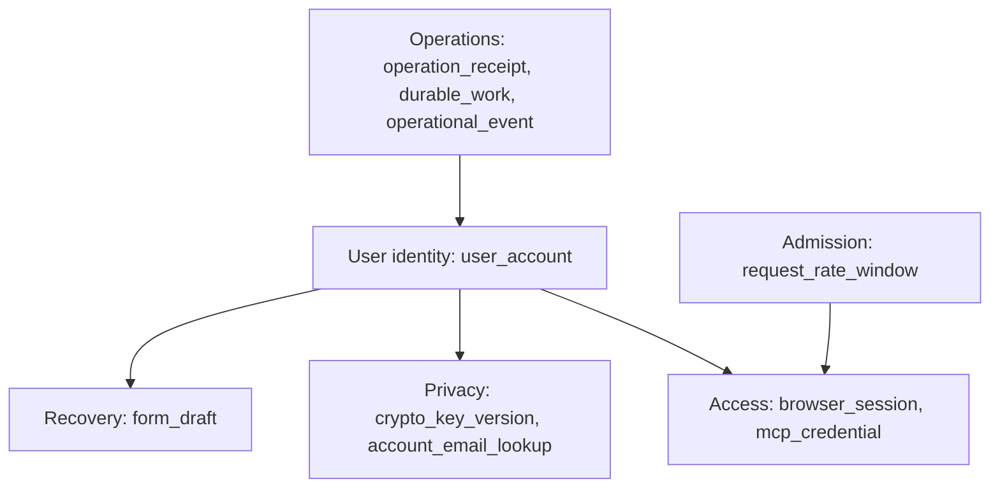

##### Catalog responsibility overview

**Diagram.** Fourteen tables grouped around catalog records, provenance, publication and history.

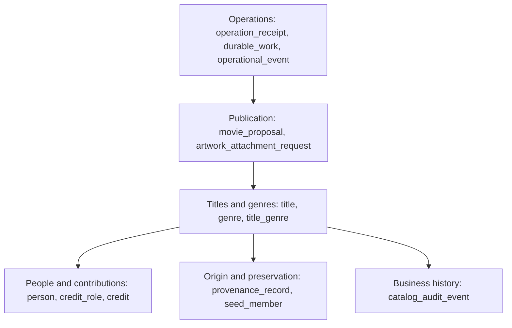

##### Media responsibility overview

**Diagram.** Five tables separate artwork state, reference safety and operational recovery.

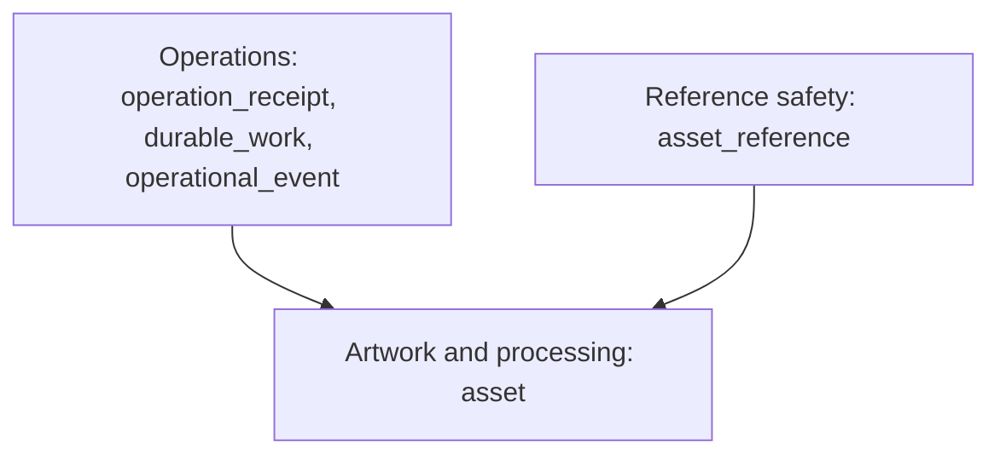

##### Core database relationships

**Diagram.** Complete physical foreign keys in Core; zero-or-one parent markers represent nullable references. Flyway is framework-managed and has no application foreign keys.

<details>
<summary>Diagram — Core database relationships</summary>

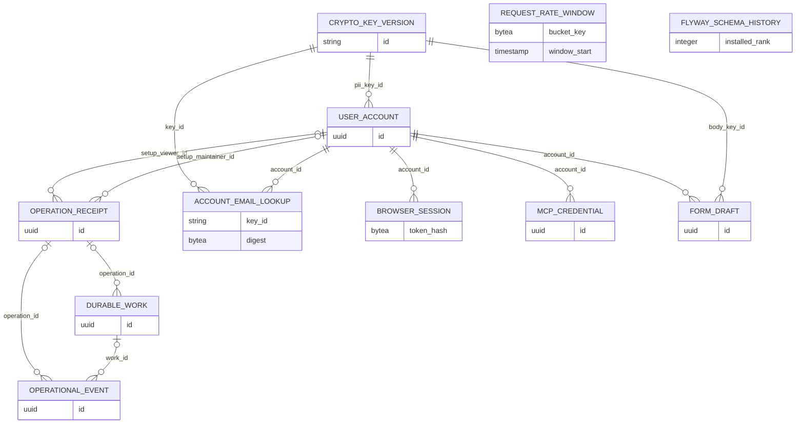

</details>

##### Catalog database relationships

**Diagram.** Complete physical foreign keys in Catalog; zero-or-one parent markers represent nullable references. Flyway is framework-managed and has no application foreign keys.

<details>
<summary>Diagram — Catalog database relationships</summary>

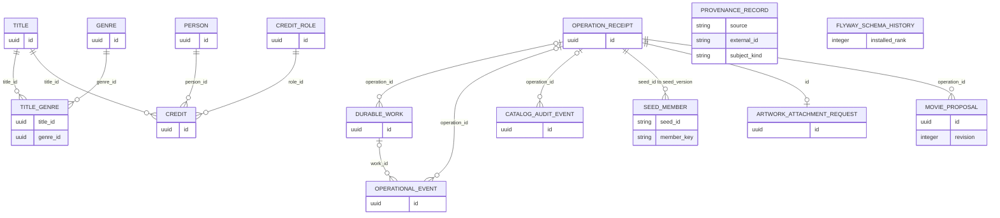

</details>

##### Media database relationships

**Diagram.** Complete physical foreign keys in Media; zero-or-one parent markers represent nullable references. Flyway is framework-managed and has no application foreign keys.

<details>
<summary>Diagram — Media database relationships</summary>

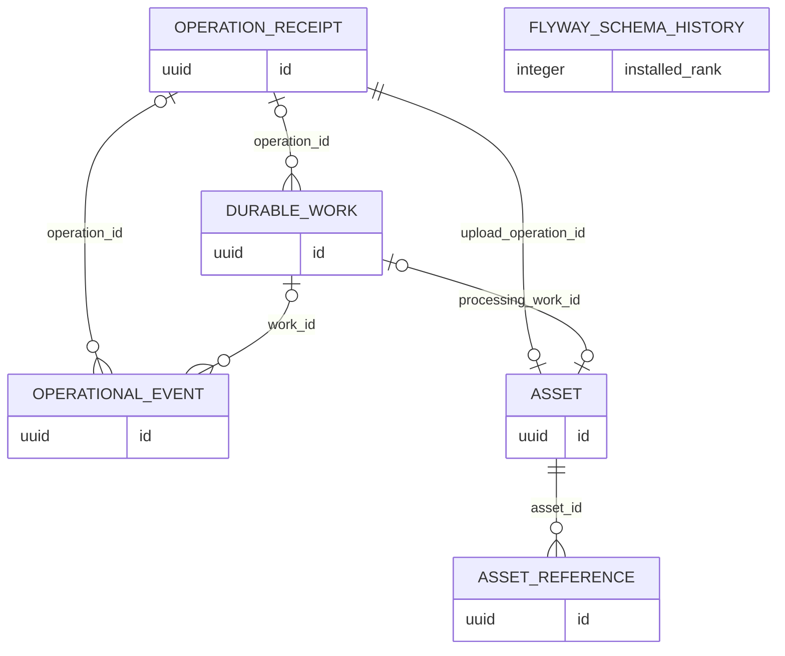

</details>

##### Logical references across service databases

**Diagram.** Cross-owner identifiers validated through authorized RPCs; none is a cross-database foreign key. Key bytes are external to PostgreSQL.

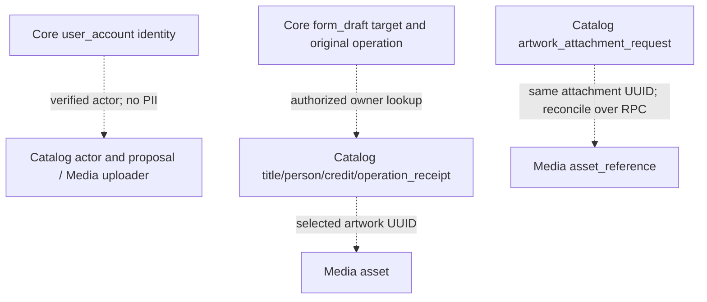

`asset_reference.asset_id → asset.id` is a real Media-local foreign key shown in the Media ER diagram. Core key-version IDs refer to protected key files by deployment configuration, never a table of secret key bytes.

#### 6.1.3 Storage consolidation register

The target schema replaces 38 application tables with 29. This specification change preserves public GraphQL, protobuf and MCP contracts; old table names are historical references, not supported aliases. No deployed-data conversion is claimed. A future implementation with an older live schema must use an explicit reviewed migration/backfill before rollout.

| Previous design | Target storage and retained fields | Preserved rule |
|---|---|---|
| operation | operation_receipt: all existing request columns; receipt_type distinguishes internal initialization | Scoped idempotency, safe seven-day result and lifetime no-repeat tombstone |
| bootstrap | Core operation_receipt: version→setup_version, manifest_hash→setup_manifest_hash, viewer_id/maintainer_id→setup_* IDs; created_at retained | Unique version/checksum, account FKs, permanent evidence and no account reset |
| seed_run | Catalog operation_receipt: id→seed_version, snapshot_hash→seed_snapshot_hash, counts/summary→seed_*; created_at retained, COMPLETE→SUCCEEDED | Full snapshot atomicity, permanent evidence and matching-checksum failure recovery |
| work_item | durable_work: existing scheduling, payload, lease, generation, deadline and budget columns | Transactional outbox, bounded claims and fenced completion |
| notification | durable_work kind NOTIFICATION: event_key/mode/state/summary→notification_*; provider_reference/correlation/timestamps retained; ID becomes work identity | Unique event, truthful delivery evidence, 90-day summary and unresolved retention; former work_id is unnecessary self-linkage |
| work_attempt | operational_event phases: work/generation/attempt/lease preserved; started_at and ended_at→STARTED/FINISHED.created_at; outcome→attempt_outcome; error/operator retained | Start before effect, one completion, safe interrupted recovery and retained prior generations |
| audit_event | Catalog business rows→catalog_audit_event; private/security/technical rows→operational_event ACTIVITY | Business fields/outcomes stay unchanged; operator evidence stays restricted with its separate retention |
| proposal + approval | movie_proposal: original proposal fields; approval actor/connector/hash→approval_*; approved_at, expiry and consumption retained | Composite revision identity, exact-content binding, no second publication, lifetime approval evidence |
| asset + media_job | asset: original fields; job work_id/staging_key/input_hash/created_at→processing_*; job asset_id is the enclosing asset.id | One processing job per asset, private generated path, input identity and evidence cleanup |
| asset_hold | asset_reference; columns and relationships retained | Multiple protected references, fenced release, no time-only deletion of unresolved reservations |
| account / email_lookup / login_session / connector_credential / draft | user_account / account_email_lookup / browser_session / mcp_credential / form_draft | Existing columns, bounds, account isolation, expiry and cryptography |
| key_version / rate_bucket | crypto_key_version / request_rate_window | Nonce allocation/rotation and atomic configurable quotas |
| source_record / artwork_intent | provenance_record / artwork_attachment_request | Provenance tombstones and cross-service attachment outcomes |
| seed_member and catalog domain tables | Retained; seed_member.seed_id now references operation_receipt.seed_version | Existing membership/relationship identities, constraints and deletion preservation |

The dictionaries and owner-specific extensions list every physical column. Merge-only fields retain their original types/size bounds unless a conditional NULL is necessary before creation or after the already-defined purge. Variant checks reject partial or inappropriate field groups. A lower table count is useful only while these rules remain understandable; future entities require a concrete identity, relationship, lifecycle or enforcement need.

### 6.2 Table dictionary and embedded DDL

The three shared operational designs have separate copies in each service database. “Transactional outbox” means the service saves required follow-up work in the same transaction as its own mutation; `durable_work` serves this purpose. Hash-based message authentication code (**HMAC**) produces a digest using a secret key; it supports the specified private-input fingerprints and lookup tokens without serving as encryption. A tombstone is a minimal retained record that an item was removed or an operation already completed. Operation tombstones prevent repeated effects after result bodies expire; seed/provenance tombstones prevent deleted starter data from returning on restart.

The DDL defines the schemas applied through service-owned Flyway migrations. Tables are grouped by owner; the common operational tables are instantiated separately in all three databases. ER diagrams are relationship overviews; the column/constraint dictionaries below define every physical relationship. Each physical column is listed explicitly, including shared operational columns.


#### Persistence implementation ownership

Table ownership follows the feature responsible for its invariants. Shared names denote separately owned entities and repositories. Feature persistence paths are relative to the service's Kotlin package under `features/`; operations paths are owner-local.

| Tables | Owner and implementation responsibility | Reason for the boundary |
|---|---|---|
| `operation_receipt` | Each service: `operations/receipt`; Core `bootstrap` and Catalog `seed` use typed initialization projections | One durable operation identity; permanently retained startup evidence uses explicit owner columns |
| `durable_work` | Each service: `operations/work` and `operations/notifications` share one repository contract | One durable scheduling/recording mechanism; typed notification evidence remains distinct |
| `operational_event` | Each service: `operations/events` | Restricted append-only activity/attempt/recovery evidence with bounded retention |
| `user_account` | Core `account/persistence` | Permanent identity, role, encrypted PII and password verifier |
| `crypto_key_version`, `account_email_lookup` | Core `crypto/persistence` | Key/nonce lifecycle differs from account lifecycle; rotation needs multiple lookup aliases |
| `browser_session` | Core `session/persistence` | Browser expiry, revocation and CSRF binding |
| `mcp_credential` | Core `connector/persistence` | Client-bound token scope and lifetime differ from browser sessions |
| `form_draft` | Core `draft/persistence` | Private recoverable edits expire independently of catalog records |
| `request_rate_window` | Core `ratelimit/persistence` | Atomic short-lived admission counts across replicas |
| `title`, `title_genre` | Catalog `movie/persistence`; TV read projections through `search` | Title identity plus normalized many-to-many genre membership |
| `person`, `credit` | Catalog `person/persistence` and `credit/persistence` | Public people are independent of accounts; contributions have their own uniqueness/version |
| `genre`, `credit_role` | Catalog `taxonomy/persistence` | Reusable definitions with distinct genre versus contribution-role rules |
| `provenance_record` | Catalog `provenance/persistence` | Source-scoped identity and reuse evidence survive record deletion |
| `seed_member` | Catalog `seed` (`SeedProvenance`) and `features/lifecycle` (`LifecycleStore`) | Per-version record/relationship tombstones prevent resurrection; parent receipt stores seed-run evidence |
| `artwork_attachment_request` | Catalog `artwork/persistence` | Attachment/cancellation outcome survives cross-service interruption |
| `movie_proposal` | Catalog `proposal/persistence` | Exact immutable revision owns its one-use approval evidence |
| `catalog_audit_event` | Catalog `audit/persistence` | Permanent business history exposed only to authorized Maintainers |
| `asset`, `asset_reference` | Media `asset/persistence` and `hold/persistence`; `upload` maps embedded processing evidence | One processing record per asset; many reference promises must remain independently protected |
| Flyway history | One framework-managed table per database | Migration metadata; never an authored domain entity |

JPA uses explicit owner entities and typed embedded value objects for notification, approval, processing and initialization fields. A shared vocabulary does not authorize a shared cross-service entity/repository library. Named database constraints and native claim/CAS queries remain authoritative where ORM validation alone cannot establish integrity.

All DDL belongs in the owning service's migration resources. Create operation_receipt, durable_work and operational_event first; create Core key/account tables before its receipt foreign-key extensions, and apply Catalog receipt extensions before seed_member. Finish remaining owner tables and explicit grants before readiness. Apply the Media receipt-type restriction in its migration. An implementation must assemble these review groups in that dependency order; their presentation order is not an executable migration.

Owner `operations/maintenance` implements retention under separate maintenance credentials. Runtime cannot delete append-only events or obtain migration/maintenance credentials through browser/MCP calls. Real PostgreSQL verification must check SQL constraints independently of application policy.

#### Persistence-to-wire projection map

Storage names identify implementation ownership; wire contracts keep their existing names. Generated boundary DTOs apply explicit authorized projections rather than serializing JPA entities.

| Storage | Existing authorized representation | Boundary and exclusions |
|---|---|---|
| REQUEST `operation_receipt` | GraphQL Operation/MutationResult/DraftDiscardResult; protobuf Outcome | Verified submitting actor; safe IDs/version/problem/expired flag; initialization evidence and request hashes never exposed |
| `catalog_audit_event` | GraphQL AuditEvent/AuditConnection; protobuf AuditEvent/AuditPage | Maintainer-only Catalog history; outcome→AuditOutcome/field 8; subject_kind→subjectKind/field 9; actorRef derived without PII |
| `durable_work`, `operational_event` | Restricted owner worker/operator DTOs | No browser/model or generic row RPC; technical history cannot enter Catalog business audit |
| `user_account`, `browser_session` | Owning Session projection and cookie handling | Decrypt only permitted display name; no hashes, token, key material or account email in routine output |
| `mcp_credential`, `crypto_key_version`, `account_email_lookup`, `request_rate_window` | Owner identity/crypto/admission results only | No raw-row endpoint; derive verified claims or admission decisions |
| `form_draft` | Authorized Draft | Decrypt account-owned permitted body; original Catalog operationId remains separate from Core save/discard receipt |
| `title`, `person`, `genre`, `title_genre`, `credit_role`, `credit` | Existing Title/Person/Genre/CreditRole/Credit and corresponding protobuf projections | Apply independent visibility, presence and precision; derive names through permitted joins |
| `provenance_record` | Existing Provenance | Source evidence only; omit internal deletion/reconciliation fields |
| `seed_member` and initialization receipt columns | Restricted initializer/operator evidence | No new GraphQL/MCP/RPC or production UI |
| `artwork_attachment_request` | Existing operation/attachment/cancellation projections | Expose only declared phase/outcome fields; no arbitrary intent-row access |
| `movie_proposal` | Existing proposal/review resource and publish outcome | Original approved wire shape; approval_* fields remain internal; separate APPROVED and SUCCEEDED audit events |
| `asset` | GraphQL Artwork; internal Asset/AssetReadHeader and stream | Public identity/URL/dimensions; processing work/path/input hash remains private |
| `asset_reference` | Existing internal Hold/Attachment/ArtworkGrant tuple | Allowlisted service calls only; reserved protocol method/type names remain unchanged |

AC-114 keeps the same AuditOutcome enum, GraphQL outcome/subjectKind and protobuf field numbers 8/9. Only the physical owner table becomes catalog_audit_event. Core/Media security history and Catalog worker events are excluded by repository/projection ownership.

#### 6.2.1 Date validation helper

Catalog-only immutable function rejects impossible calendar dates, month without year and day without month. This has no extension dependency. Application validation reports field-specific errors before the CHECK catches bypasses.

##### Partial-date validation function

**Database definition.** Shared helper used by the date constraints in the Catalog dictionary.

```sql
CREATE FUNCTION valid_partial_date(y smallint, m smallint, d smallint)
RETURNS boolean LANGUAGE plpgsql IMMUTABLE AS $$
BEGIN
  IF y IS NULL THEN RETURN m IS NULL AND d IS NULL; END IF;
  IF y < 1 OR y > 9999 THEN RETURN false; END IF;
  IF m IS NULL THEN RETURN d IS NULL; END IF;
  IF m < 1 OR m > 12 THEN RETURN false; END IF;
  IF d IS NULL THEN RETURN true; END IF;
  PERFORM make_date(y::integer,m::integer,d::integer);
  RETURN true;
EXCEPTION WHEN datetime_field_overflow THEN RETURN false;
END; $$;
CREATE EXTENSION IF NOT EXISTS pg_trgm;
```


The owning service also rejects a known TV end interval entirely before its known first-air interval; overlapping partial intervals remain honestly uncertain. No fabricated precision is used for validation or display.

The `valid_partial_date` function belongs to Catalog's Flyway resources. The extension
statement in the embedded definition is the bootstrap prerequisite assigned to
`ops/postgres/bootstrap.sql`; it does not authorize runtime extension creation or require a
second owner-independent migration source. Flyway creates/manages its own history table.

#### 6.2.2 Common operational tables

##### `operation_receipt`

Owner: **each service, independent copies**. Remembers an operation identity and outcome. Startup is also an operation: Core account setup and Catalog seed completion use dedicated typed columns on this receipt, rather than separate receipt tables.

Sensitivity and exposure: restricted unless the explicitly authorized projection below permits otherwise. §6.1.1 defines per-column logging/audit rules, physical representations and presence semantics. Ordinary validation remains separate from storage constraints.

Lifecycle/retention: REQUEST result bodies: seven days, then NULL; identity/fingerprint/outcome: installation lifetime. Initialization columns and completed outcome: installation lifetime; no expiry or ordinary result purge.

Cardinality/capacity assumption: One per mutation or initialization version; 100,000 ordinary receipts per service is an unmeasured sizing assumption.

| Column | PostgreSQL type | Null/default/key/check | Meaning / size policy / exposure | Kotlin/JPA → GraphQL / protobuf |
|---|---|---|---|---|
| `id` | `uuid` | `PRIMARY KEY; no SQL default; owner supplies value` | Application-generated immutable identity. API; presence/clearing §5 | `UUID` → UUID / string |
| `actor_scope` | `varchar(96)` | `NOT NULL; no SQL default; owner supplies value` | Authenticated account UUID + scope, or server-issued anonymous registration scope. internal; presence/clearing §5 | `String` → not exposed; no GraphQL/proto field |
| `kind` | `varchar(64)` | `NOT NULL; no SQL default; owner supplies value` | Allowlisted operation name. internal; presence/clearing §5 | `String` → not exposed; no GraphQL/proto field |
| `receipt_type` | `varchar(24)` | NOT NULL DEFAULT 'REQUEST'; checked owner-specific allowlist | REQUEST, ACCOUNT_INITIALIZATION or CATALOG_INITIALIZATION; internal startup types cannot be selected by clients; never routine telemetry; audit only under §6.1.1 allowlist | `ReceiptType` → Internal only; no GraphQL/protobuf field |
| `request_hash` | `bytea` | `NOT NULL CHECK (octet_length(request_hash)=32); no SQL default; owner supplies value` | SHA-256 deterministically serialized nonsecret input; keyed HMAC for credential/PII-bearing input. internal; presence/clearing §5 | `ByteArray` → not exposed; no GraphQL/proto field |
| `hash_key_id` | `varchar(64)` | `no SQL constraint; NULL allowed; no SQL default; owner supplies value` | HMAC secret version for private-input fingerprint, including protected draft mutation input; NULL for plain digest. internal; presence/clearing §5 | `String?` → not exposed; no GraphQL/proto field |
| `state` | `varchar(16)` | `NOT NULL CHECK (state IN ('PENDING','SUCCEEDED','FAILED','EXPIRED')); no SQL default; owner supplies value` | Durable outcome, not transport result. API; presence/clearing §5 | `String` → String/declared enum / string |
| `result` | `jsonb` | `CHECK (result IS NULL OR (jsonb_typeof(result)='object' AND octet_length(result::text)<=16384)); NULL allowed; no SQL default; owner supplies value` | Sanitized typed result IDs/version/error and draft-discard boolean; no tokens/password/name/email or draft values. Core save/discard receipts use the shapes in §7.3.1. API; presence/clearing §5 | `TypedJsonDTO?` → typed projection/JSON / typed message |
| `error_code` | `varchar(64)` | `no SQL constraint; NULL allowed; no SQL default; owner supplies value` | Allowlisted stable failure category. API; presence/clearing §5 | `String?` → String/declared enum / optional string |
| `correlation_id` | `uuid` | `NOT NULL; no SQL default; owner supplies value` | Validated root request ID. API; presence/clearing §5 | `UUID` → UUID / string |
| `created_at` | `timestamptz(6)` | `NOT NULL DEFAULT CURRENT_TIMESTAMP; NOT NULL (explicit or PK)` | Creation instant. API; presence/clearing §5 | `Instant` → DateTime / Timestamp |
| `expires_at` | `timestamptz(6)` | NULL only for initialization; REQUEST requires a finite expiry; no default | Detailed REQUEST-result expiry; initialization evidence never expires; never routine telemetry; audit only under §6.1.1 allowlist | `Instant?` → Internal only; no GraphQL/protobuf field |

###### operation_receipt DDL

**Database definition.** Physical constraints and indexes for the dictionary above. Primary/unique keys create their own indexes; other indexes are explicit.

<details>
<summary>Database definition — operation_receipt DDL</summary>

```sql
CREATE TABLE operation_receipt (
  id uuid PRIMARY KEY,
  actor_scope varchar(96) NOT NULL,
  kind varchar(64) NOT NULL,
  receipt_type varchar(24) NOT NULL DEFAULT 'REQUEST'
    CHECK (receipt_type IN ('REQUEST','ACCOUNT_INITIALIZATION','CATALOG_INITIALIZATION')),
  request_hash bytea NOT NULL CHECK (octet_length(request_hash) = 32),
  hash_key_id varchar(64),
  state varchar(16) NOT NULL CHECK (state IN ('PENDING','SUCCEEDED','FAILED','EXPIRED')),
  result jsonb CHECK (result IS NULL OR (jsonb_typeof(result) = 'object' AND
    octet_length(result::text) <= 16384)),
  error_code varchar(64),
  correlation_id uuid NOT NULL,
  created_at timestamptz(6) NOT NULL DEFAULT CURRENT_TIMESTAMP,
  expires_at timestamptz(6),
  CHECK ((receipt_type = 'REQUEST' AND expires_at IS NOT NULL) OR
         (receipt_type <> 'REQUEST' AND expires_at IS NULL)),
  CHECK (receipt_type = 'REQUEST' OR
         (actor_scope = 'SERVICE_INITIALIZER' AND result IS NULL AND hash_key_id IS NULL
          AND state <> 'EXPIRED'))
);
CREATE INDEX operation_actor_idx ON operation_receipt (actor_scope, created_at DESC, id);
```

</details>

`operation_actor_idx` supports actor-scoped result lookup, ordered by creation time and ID. Existing GraphQL Operation/MutationResult/DraftDiscardResult and protobuf Outcome projections apply only to authorized REQUEST rows. Internal initialization rows have no browser/MCP operation projection; guessed IDs return the existing hidden result. Initialization uses deterministic UUIDv5 under the fixed manifest namespace with name `initialization/{owner}/{receipt_type}/{version}`; the version/checksum identity is also constrained below. No secret enters initialization fingerprints.

JPA maps `receipt_type` as a checked string discriminator, not a polymorphic serialized object. Request repositories always restrict type to REQUEST and verified actor scope. Startup repositories use owner-specific typed initialization fields and cannot call request-result expiry logic.

##### `durable_work`

Owner: **each service, independent copies**. Stores committed follow-up work and notification records. A notification is a typed work record with separately named delivery evidence; it does not require another queue or notification table.

Sensitivity and exposure: restricted unless the explicitly authorized projection below permits otherwise. §6.1.1 defines per-column logging/audit rules, physical representations and presence semantics. Ordinary validation remains separate from storage constraints.

Lifecycle/retention: Ordinary DONE/CANCELLED payloads clear to {} after seven days. Terminal work and notification summaries remain 90 days; keep unresolved EXHAUSTED/UNKNOWN/FAILED evidence until controlled disposition. Dependent events and asset metadata must be safely purged/cleared before work deletion.

Cardinality/capacity assumption: One per required follow-up or deduplicated notification; 100,000 is an unmeasured sizing assumption.

| Column | PostgreSQL type | Null/default/key/check | Meaning / size policy / exposure | Kotlin/JPA → GraphQL / protobuf |
|---|---|---|---|---|
| `id` | `uuid` | `PRIMARY KEY; no SQL default; owner supplies value` | Application-generated immutable identity. API; presence/clearing §5 | `UUID` → UUID / string |
| `operation_id` | `uuid` | `REFERENCES operation_receipt(id) ON DELETE RESTRICT; NULL allowed; no SQL default; owner supplies value` | Originating operation. internal; presence/clearing §5 | `UUID?` → not exposed; no GraphQL/proto field |
| `kind` | `varchar(64)` | `NOT NULL; no SQL default; owner supplies value` | Typed handler name, never executable code. internal; presence/clearing §5 | `String` → not exposed; no GraphQL/proto field |
| `payload` | `jsonb` | `NOT NULL CHECK (jsonb_typeof(payload)='object' AND octet_length(payload::text)<=16384); no SQL default; owner supplies value` | Versioned IDs-only message; no account PII or credential. internal; presence/clearing §5 | `TypedJsonDTO` → not exposed; no GraphQL/proto field |
| `state` | `varchar(16)` | `NOT NULL DEFAULT 'READY' CHECK (state IN ('READY','LEASED','DONE','EXHAUSTED','CANCELLED')); NOT NULL (explicit or PK)` | Durable work lifecycle. internal; presence/clearing §5 | `String` → not exposed; no GraphQL/proto field |
| `generation` | `integer` | `NOT NULL DEFAULT 0 CHECK (generation >= 0); NOT NULL (explicit or PK)` | Explicit operator recovery increments; restart never changes. internal; presence/clearing §5 | `Int` → not exposed; no GraphQL/proto field |
| `attempt_count` | `integer` | NOT NULL DEFAULT 0 CHECK >= 0; <= max_attempts | Attempts started in this generation; STARTED operational events preserve evidence; never routine telemetry; audit only under §6.1.1 allowlist | `Int` → Internal only; no GraphQL/protobuf field |
| `max_attempts` | `integer` | `NOT NULL CHECK (max_attempts BETWEEN 1 AND 10); no SQL default; owner supplies value` | Policy snapshot, default 3 at creation. internal; presence/clearing §5 | `Int` → not exposed; no GraphQL/proto field |
| `next_attempt_at` | `timestamptz(6)` | `NOT NULL DEFAULT CURRENT_TIMESTAMP; NOT NULL (explicit or PK)` | Eligible scheduling time. internal; presence/clearing §5 | `Instant` → not exposed; no GraphQL/proto field |
| `deadline_at` | `timestamptz(6)` | `NOT NULL; no SQL default; owner supplies value` | Persisted absolute generation deadline. internal; presence/clearing §5 | `Instant` → not exposed; no GraphQL/proto field |
| `lease_owner` | `uuid` | `no SQL constraint; NULL allowed; no SQL default; owner supplies value` | Random worker incarnation; NULL when not leased. internal; presence/clearing §5 | `UUID?` → not exposed; no GraphQL/proto field |
| `lease_until` | `timestamptz(6)` | `no SQL constraint; NULL allowed; no SQL default; owner supplies value` | Lease expiry instant. internal; presence/clearing §5 | `Instant?` → not exposed; no GraphQL/proto field |
| `lease_epoch` | `bigint` | `NOT NULL DEFAULT 0 CHECK (lease_epoch >= 0); NOT NULL (explicit or PK)` | Fencing generation increases every claim. internal; presence/clearing §5 | `Long` → not exposed; no GraphQL/proto field |
| `last_error` | `varchar(64)` | `no SQL constraint; NULL allowed; no SQL default; owner supplies value` | Sanitized category. internal; presence/clearing §5 | `String?` → not exposed; no GraphQL/proto field |
| `correlation_id` | `uuid` | `NOT NULL; no SQL default; owner supplies value` | Origin correlation. internal; presence/clearing §5 | `UUID` → not exposed; no GraphQL/proto field |
| `created_at` | `timestamptz(6)` | `NOT NULL DEFAULT CURRENT_TIMESTAMP; NOT NULL (explicit or PK)` | Creation instant. API; presence/clearing §5 | `Instant` → DateTime / Timestamp |
| `updated_at` | `timestamptz(6)` | `NOT NULL DEFAULT CURRENT_TIMESTAMP; NOT NULL (explicit or PK)` | Owner sets to transaction timestamp on update; not a DB automatic update. API; presence/clearing §5 | `Instant` → DateTime / Timestamp |
| `base_delay_ms` | `integer` | `NOT NULL CHECK (base_delay_ms BETWEEN 1 AND 60000); no SQL default; owner supplies value` | Persisted retry base milliseconds. internal; presence/clearing §5 | `Int` → not exposed; no GraphQL/proto field |
| `cap_delay_ms` | `integer` | `NOT NULL CHECK (cap_delay_ms BETWEEN 1 AND 3600000); no SQL default; owner supplies value` | Persisted maximum backoff milliseconds. internal; presence/clearing §5 | `Int` → not exposed; no GraphQL/proto field |
| `backoff_multiplier` | `integer` | `NOT NULL CHECK (backoff_multiplier BETWEEN 1 AND 10); no SQL default; owner supplies value` | Persisted exponential multiplier. internal; presence/clearing §5 | `Int` → not exposed; no GraphQL/proto field |
| `notification_key` | `varchar(160)` | NULL for non-notification; UNIQUE when present | Service/work/generation or alert fingerprint plus episode deduplication identity; never routine telemetry; audit only under §6.1.1 allowlist | `String?` → Internal only; no GraphQL/protobuf field |
| `notification_mode` | `varchar(16)` | NULL for non-notification; database/smtp/slack/google_chat | Selected mode snapshot; changing configuration does not reinterpret an existing record; never routine telemetry; audit only under §6.1.1 allowlist | `NotificationMode?` → Internal only; no GraphQL/protobuf field |
| `notification_state` | `varchar(24)` | NULL for non-notification; RECORDED/PENDING/ACCEPTED/DELIVERY_CONFIRMED/UNKNOWN/FAILED | Provider evidence independent of work scheduler state; never routine telemetry; audit only under §6.1.1 allowlist | `NotificationState?` → Internal only; no GraphQL/protobuf field |
| `notification_summary` | `jsonb` | NULL for non-notification; object <=8192 bytes | Allowlisted IDs, severity, safe cause and runbook reference; no private payload; never routine telemetry; audit only under §6.1.1 allowlist | `NotificationSummary?` → Internal only; no GraphQL/protobuf field |
| `provider_reference` | `varchar(255)` | NULL allowed; no default | Nonsecret provider receipt; NULL when none exists; never routine telemetry; audit only under §6.1.1 allowlist | `String?` → Internal only; no GraphQL/protobuf field |

###### durable_work DDL

**Database definition.** Physical constraints and indexes for the dictionary above. Primary/unique keys create their own indexes; other indexes are explicit.

<details>
<summary>Database definition — durable_work DDL</summary>

```sql
CREATE TABLE durable_work (
  id uuid PRIMARY KEY,
  operation_id uuid REFERENCES operation_receipt(id) ON DELETE RESTRICT,
  kind varchar(64) NOT NULL,
  payload jsonb NOT NULL CHECK (jsonb_typeof(payload) = 'object' AND octet_length(payload::text) <=
    16384),
  state varchar(16) NOT NULL DEFAULT 'READY' CHECK (state IN ('READY', 'LEASED', 'DONE',
    'EXHAUSTED', 'CANCELLED')),
  generation integer NOT NULL DEFAULT 0 CHECK (generation >= 0),
  attempt_count integer NOT NULL DEFAULT 0 CHECK (attempt_count >= 0),
  max_attempts integer NOT NULL CHECK (max_attempts BETWEEN 1 AND 10),
  next_attempt_at timestamptz(6) NOT NULL DEFAULT CURRENT_TIMESTAMP,
  deadline_at timestamptz(6) NOT NULL,
  lease_owner uuid,
  lease_until timestamptz(6),
  lease_epoch bigint NOT NULL DEFAULT 0 CHECK (lease_epoch >= 0),
  last_error varchar(64),
  correlation_id uuid NOT NULL,
  created_at timestamptz(6) NOT NULL DEFAULT CURRENT_TIMESTAMP,
  updated_at timestamptz(6) NOT NULL DEFAULT CURRENT_TIMESTAMP,
  base_delay_ms integer NOT NULL CHECK (base_delay_ms BETWEEN 1 AND 60000),
  cap_delay_ms integer NOT NULL CHECK (cap_delay_ms BETWEEN 1 AND 3600000),
  backoff_multiplier integer NOT NULL CHECK (backoff_multiplier BETWEEN 1 AND 10),
  notification_key varchar(160) UNIQUE,
  notification_mode varchar(16),
  notification_state varchar(24),
  notification_summary jsonb,
  provider_reference varchar(255),
  CHECK (
    (kind <> 'NOTIFICATION' AND notification_key IS NULL AND notification_mode IS NULL
     AND notification_state IS NULL AND notification_summary IS NULL
     AND provider_reference IS NULL)
    OR
    (kind = 'NOTIFICATION' AND notification_key IS NOT NULL
     AND notification_mode IS NOT NULL AND notification_state IS NOT NULL
     AND notification_summary IS NOT NULL
     AND notification_mode IN ('database','smtp','slack','google_chat')
     AND notification_state IN
       ('RECORDED','PENDING','ACCEPTED','DELIVERY_CONFIRMED','UNKNOWN','FAILED')
     AND jsonb_typeof(notification_summary) = 'object'
     AND octet_length(notification_summary::text) <= 8192
     AND (
       (notification_mode = 'database' AND notification_state = 'RECORDED'
        AND state = 'DONE' AND attempt_count = 0 AND generation = 0 AND lease_epoch = 0
        AND provider_reference IS NULL)
       OR (notification_mode <> 'database' AND notification_state <> 'RECORDED'
           AND (notification_state NOT IN ('ACCEPTED','DELIVERY_CONFIRMED') OR state = 'DONE'))
     ))
  ),
  CHECK ((state = 'LEASED' AND lease_owner IS NOT NULL AND lease_until IS NOT NULL) OR (state <>
    'LEASED' AND lease_owner IS NULL AND lease_until IS NULL)),
  CHECK (cap_delay_ms >= base_delay_ms),
  CHECK (attempt_count <= max_attempts)
);
CREATE INDEX work_due_idx ON durable_work (next_attempt_at, id) WHERE state = 'READY';
CREATE INDEX work_expired_idx ON durable_work (lease_until, id) WHERE state = 'LEASED';
CREATE INDEX work_failed_idx ON durable_work (updated_at, id) WHERE state = 'EXHAUSTED';
CREATE INDEX work_operation_idx ON durable_work (operation_id);
CREATE INDEX notification_state_idx ON durable_work
  (notification_state, created_at, id) WHERE kind = 'NOTIFICATION';
```

</details>

`work_due_idx` serves READY claims by next_attempt_at/id; `work_expired_idx` serves lease recovery; `work_failed_idx` serves exhaustion inspection; `work_operation_idx` links origin receipts. `notification_state_idx` serves operator delivery diagnostics; the UNIQUE notification_key protects concurrent duplicate events. No notification-specific field is valid on another work kind.

Database-only recording inserts kind=NOTIFICATION, state=DONE, notification_state=RECORDED and zero attempts in the same transaction as the originating event. Use the existing configured positive retry parameters as inert snapshots, deadline_at=created_at and payload={}; no worker claims, send, attempt event or delivered count follows. External modes use normal bounded claims and preserve PENDING/UNKNOWN/FAILED versus ACCEPTED/DELIVERY_CONFIRMED. An ambiguous send exhausts or awaits reconciliation; it is never automatically re-sent merely because work is READY. Notification summary retention is independent of ordinary payload clearing. All these fields map to owner worker/operator DTOs only.

##### `operational_event`

Owner: **each service, independent copies**. Append-only restricted activity and worker history. Catalog business history remains in catalog_audit_event so the Maintainer projection never exposes worker or security details.

Sensitivity and exposure: restricted unless the explicitly authorized projection below permits otherwise. §6.1.1 defines per-column logging/audit rules, physical representations and presence semantics. Ordinary validation remains separate from storage constraints.

Lifecycle/retention: 90 days for resolved history; never purge events while their work remains exhausted, uncertain or awaiting controlled disposition. Lifetime Catalog business events use the separate table.

Cardinality/capacity assumption: One activity event, two phase events per completed attempt, and one event per controlled recovery generation. Event row growth is a capacity assumption to measure; it is not bounded by reducing table count.

| Column | PostgreSQL type | Null/default/key/check | Meaning / size policy / exposure | Kotlin/JPA → GraphQL / protobuf |
|---|---|---|---|---|
| `id` | `uuid` | `PRIMARY KEY; no SQL default; owner supplies value` | Application-generated immutable identity. internal; never exposed | `UUID` → internal only; no GraphQL/protobuf field |
| `operation_id` | `uuid` | `REFERENCES operation_receipt(id) ON DELETE RESTRICT; NULL allowed; no SQL default; owner supplies value` | Local operation when applicable. internal; never exposed | `UUID?` → internal only; no GraphQL/protobuf field |
| `actor_id` | `uuid` | `no SQL constraint; NULL allowed; no SQL default; owner supplies value` | Opaque verified account ID; NULL for unauthenticated attempt. internal; never exposed | `UUID?` → internal only; no GraphQL/protobuf field |
| `actor_kind` | `varchar(16)` | `NOT NULL CHECK (actor_kind IN ('HUMAN','SERVICE','ANONYMOUS')); no SQL default; owner supplies value` | Never infer human identity from a supplied display name. internal; presence/clearing §5 | `String` → internal only; no GraphQL/protobuf field |
| `action` | `varchar(64)` | `NOT NULL; no SQL default; owner supplies value` | Allowlisted event action. internal; never exposed | `String` → internal only; no GraphQL/protobuf field |
| `subject_kind` | `varchar(24)` | `NOT NULL; no SQL default; owner supplies value` | Catalog title/person/credit/proposal/artwork subject; security/work events use operational_event. internal; never exposed | `String` → internal only; no GraphQL/protobuf field |
| `subject_id` | `uuid` | `no SQL constraint; NULL allowed; no SQL default; owner supplies value` | Logical subject retained after deletion; deliberately no FK. internal; never exposed | `UUID?` → internal only; no GraphQL/protobuf field |
| `outcome` | `varchar(16)` | NULL on attempt start; activity/finish/recovery constraints below | Sanitized activity outcome; attempt classification uses attempt_outcome separately; never routine telemetry; audit only under §6.1.1 allowlist | `String?` → Internal only; no GraphQL/protobuf field |
| `changes` | `jsonb` | NOT NULL DEFAULT '{}'; object <=65536 bytes | Allowlisted technical/security metadata and controlled recovery reason; never raw business snapshots or secret values; never routine telemetry; audit only under §6.1.1 allowlist | `OperationalMetadata` → Internal only; no GraphQL/protobuf field |
| `correlation_id` | `uuid` | `NOT NULL; no SQL default; owner supplies value` | Sanitized correlation. internal; presence/clearing §5 | `UUID` → internal only; no GraphQL/protobuf field |
| `created_at` | `timestamptz(6)` | `NOT NULL DEFAULT CURRENT_TIMESTAMP; NOT NULL (explicit or PK)` | Creation instant. internal; never exposed | `Instant` → internal only; no GraphQL/protobuf field |
| `event_type` | `varchar(24)` | NOT NULL; ACTIVITY/ATTEMPT_STARTED/ATTEMPT_FINISHED/RECOVERY | Selects the constrained record shape; never routine telemetry; audit only under §6.1.1 allowlist | `OperationalEventType` → Internal only; no GraphQL/protobuf field |
| `work_id` | `uuid` | NULL only for ACTIVITY; FK durable_work(id) ON DELETE RESTRICT | Local work identity; never routine telemetry; audit only under §6.1.1 allowlist | `UUID?` → Internal only; no GraphQL/protobuf field |
| `generation` | `integer` | NULL on ACTIVITY; >=0 otherwise | Work recovery generation; never routine telemetry; audit only under §6.1.1 allowlist | `Int?` → Internal only; no GraphQL/protobuf field |
| `attempt_no` | `integer` | NULL on ACTIVITY/RECOVERY; 1..10 for attempts | Attempt identity inside the generation; never routine telemetry; audit only under §6.1.1 allowlist | `Int?` → Internal only; no GraphQL/protobuf field |
| `lease_epoch` | `bigint` | NULL on ACTIVITY; >0 for attempts; >=0 for RECOVERY | Original attempt fence or current recovery fence; not an account authentication epoch; never routine telemetry; audit only under §6.1.1 allowlist | `Long?` → Internal only; no GraphQL/protobuf field |
| `attempt_outcome` | `varchar(24)` | NULL except FINISHED; SUCCEEDED/TRANSIENT/PERMANENT/UNCERTAIN/CANCELLED | Original worker-attempt outcome; no public AuditOutcome expansion; never routine telemetry; audit only under §6.1.1 allowlist | `AttemptOutcome?` → Internal only; no GraphQL/protobuf field |
| `error_code` | `varchar(64)` | NULL allowed; no default | Sanitized cause, never exception text; never routine telemetry; audit only under §6.1.1 allowlist | `String?` → Internal only; no GraphQL/protobuf field |
| `operator_id` | `varchar(96)` | NULL allowed; required for controlled RECOVERY | Verified local operator identity, never arbitrary input identity; never routine telemetry; audit only under §6.1.1 allowlist | `String?` → Internal only; no GraphQL/protobuf field |

###### operational_event DDL

**Database definition.** Physical constraints and indexes for the dictionary above. Primary/unique keys create their own indexes; other indexes are explicit.

<details>
<summary>Database definition — operational_event DDL</summary>

```sql
CREATE TABLE operational_event (
  id uuid PRIMARY KEY,
  operation_id uuid REFERENCES operation_receipt(id) ON DELETE RESTRICT,
  actor_id uuid,
  actor_kind varchar(16) NOT NULL CHECK (actor_kind IN ('HUMAN','SERVICE','ANONYMOUS')),
  action varchar(64) NOT NULL,
  subject_kind varchar(24) NOT NULL,
  subject_id uuid,
  outcome varchar(16) CHECK (outcome IN ('SUCCEEDED','DENIED','FAILED','APPROVED','REJECTED')),
  changes jsonb NOT NULL DEFAULT '{}'::jsonb CHECK (jsonb_typeof(changes) = 'object' AND
    octet_length(changes::text) <= 65536),
  correlation_id uuid NOT NULL,
  created_at timestamptz(6) NOT NULL DEFAULT CURRENT_TIMESTAMP,
  event_type varchar(24) NOT NULL CHECK
    (event_type IN ('ACTIVITY','ATTEMPT_STARTED','ATTEMPT_FINISHED','RECOVERY')),
  work_id uuid REFERENCES durable_work(id) ON DELETE RESTRICT,
  generation integer CHECK (generation >= 0),
  attempt_no integer CHECK (attempt_no BETWEEN 1 AND 10),
  lease_epoch bigint CHECK (lease_epoch >= 0),
  attempt_outcome varchar(24) CHECK
    (attempt_outcome IN ('SUCCEEDED','TRANSIENT','PERMANENT','UNCERTAIN','CANCELLED')),
  error_code varchar(64),
  operator_id varchar(96),
  CHECK (
    (event_type = 'ACTIVITY' AND outcome IS NOT NULL AND work_id IS NULL
     AND generation IS NULL AND attempt_no IS NULL AND lease_epoch IS NULL
     AND attempt_outcome IS NULL)
    OR
    (event_type IN ('ATTEMPT_STARTED','ATTEMPT_FINISHED') AND work_id IS NOT NULL
     AND generation IS NOT NULL AND attempt_no IS NOT NULL
     AND lease_epoch IS NOT NULL AND lease_epoch > 0
     AND ((event_type = 'ATTEMPT_STARTED' AND outcome IS NULL AND attempt_outcome IS NULL
           AND error_code IS NULL)
       OR (event_type = 'ATTEMPT_FINISHED' AND attempt_outcome IS NOT NULL
           AND outcome IS NOT NULL
           AND ((attempt_outcome = 'SUCCEEDED' AND outcome = 'SUCCEEDED')
             OR (attempt_outcome <> 'SUCCEEDED' AND outcome = 'FAILED')))))
    OR
    (event_type = 'RECOVERY' AND outcome IS NOT NULL AND work_id IS NOT NULL
     AND generation IS NOT NULL AND attempt_no IS NULL AND lease_epoch IS NOT NULL
     AND attempt_outcome IS NULL AND operator_id IS NOT NULL)
  )
);
CREATE UNIQUE INDEX event_attempt_phase_uq ON operational_event
  (work_id, generation, attempt_no, event_type)
  WHERE event_type IN ('ATTEMPT_STARTED','ATTEMPT_FINISHED');
CREATE UNIQUE INDEX event_recovery_generation_uq ON operational_event (work_id, generation)
  WHERE event_type = 'RECOVERY';
CREATE INDEX event_work_idx ON operational_event (work_id, generation, attempt_no, created_at);
CREATE INDEX event_time_idx ON operational_event (created_at, id);
CREATE INDEX event_operation_idx ON operational_event (operation_id);
```

</details>

Attempt identity is (work_id,generation,attempt_no); both phase rows carry the same original lease_epoch. STARTED.created_at replaces work_attempt.started_at; FINISHED.created_at replaces ended_at. No FINISHED row means in progress or interrupted, not success. FINISHED.attempt_outcome/error_code and verified operator_id retain the original evidence. The phase unique index rejects duplicate starts/finishes; recovery generation uniqueness prevents duplicate controlled resets.

The owner locks durable_work before inserting phases. A STARTED event commits atomically with its claim before any outbound effect. A completion validates current worker/epoch/lease, verifies its STARTED tuple, then inserts FINISHED and updates work in one transaction. A stale worker cannot append completion. An authorized watchdog reconciles the destination first, closes an abandoned attempt once using its original fence identity, and changes/requeues work under the current locked fence; technical uncertainty is retained explicitly. SQL CHECKs cannot prove another row exists or current lease ownership: these are owner-transaction invariants, tested through PostgreSQL. The matching STARTED event and any FINISHED event are purged together only after their parent is eligible. Runtime has INSERT/SELECT but no UPDATE/DELETE on events; maintenance alone purges eligible evidence. `event_work_idx` supports attempt reconstruction; time/operation indexes support retention and diagnostics.

#### 6.2.3 Initialization receipt extensions

Core and Catalog add the following typed columns to their own `operation_receipt`. Media adds none. These are columns on existing tables, not additional tables. SQL ALTER clauses run after Core account tables exist; the Catalog extension precedes `seed_member` creation.

Owner-specific evidence stays outside the ordinary expiring `result` JSON. It remains restricted to the initializer/operator. Kotlin maps each owner’s initialization projection explicitly; no GraphQL or protobuf field is added. All timestamps use finite UTC `timestamptz(6)`. Startup locks receipt identity/version before domain rows, verifies the exact checksum and uses the same local transaction for data and completed evidence.

##### Core account initialization fields

| Column | PostgreSQL type | Null/default/key/check | Meaning / exposure | Kotlin/JPA → wire |
|---|---|---|---|---|
| `setup_version` | `varchar(32)` | UNIQUE; required only on ACCOUNT_INITIALIZATION; no default | Original bootstrap version; permanent identity | String? → internal only |
| `setup_manifest_hash` | `bytea` | Exactly 32 bytes; required only on ACCOUNT_INITIALIZATION | Nonsecret original manifest checksum; equals request_hash | ByteArray? → internal only; no audit/telemetry |
| `setup_viewer_id` | `uuid` | FK user_account(id), DELETE RESTRICT; required on successful setup | Prepared Viewer identity; never arbitrary account adoption | UUID? → internal only |
| `setup_maintainer_id` | `uuid` | FK user_account(id), DELETE RESTRICT; required on successful setup | Prepared Maintainer identity | UUID? → internal only |

**Database definition.** Owner-specific initialization evidence and preserved account references.

<details>
<summary>Database definition — Core initialization receipt columns</summary>

```sql
ALTER TABLE operation_receipt
  ADD COLUMN setup_version varchar(32) UNIQUE,
  ADD COLUMN setup_manifest_hash bytea CHECK (octet_length(setup_manifest_hash) = 32),
  ADD COLUMN setup_viewer_id uuid REFERENCES user_account(id) ON DELETE RESTRICT,
  ADD COLUMN setup_maintainer_id uuid REFERENCES user_account(id) ON DELETE RESTRICT,
  ADD CONSTRAINT core_receipt_shape CHECK (
    (receipt_type = 'REQUEST' AND setup_version IS NULL AND setup_manifest_hash IS NULL
     AND setup_viewer_id IS NULL AND setup_maintainer_id IS NULL)
    OR
    (receipt_type = 'ACCOUNT_INITIALIZATION' AND kind = 'INITIALIZE_ACCOUNTS'
     AND setup_version IS NOT NULL AND setup_manifest_hash IS NOT NULL
     AND request_hash = setup_manifest_hash
     AND ((state = 'SUCCEEDED' AND setup_viewer_id IS NOT NULL
           AND setup_maintainer_id IS NOT NULL AND setup_viewer_id <> setup_maintainer_id)
       OR (state IN ('PENDING','FAILED') AND setup_viewer_id IS NULL
           AND setup_maintainer_id IS NULL)))
  );
```

</details>

Completed account bindings and checksum are immutable. Failed setup stores no half-created account binding. Retrying the same version/hash may replace FAILED with SUCCEEDED atomically with both accounts, preserving prior failure in operational_event; it cannot promote an existing account by matching its email. Account state changes after setup do not rewrite the receipt.

##### Catalog seed initialization fields

| Column | PostgreSQL type | Null/default/key/check | Meaning / exposure | Kotlin/JPA → wire |
|---|---|---|---|---|
| `seed_version` | `varchar(64)` | UNIQUE; required only on CATALOG_INITIALIZATION; no default | Original seed_run.id; seed_member.seed_id references this key | String? → internal only |
| `seed_snapshot_hash` | `bytea` | Exactly 32 bytes; required only on seed initialization | Frozen snapshot checksum; equals request_hash | ByteArray? → internal only; no audit/telemetry |
| `seed_movie_count` | `integer` | 0..100; successful initialization requires 100 | Original manifest count, never current catalog count | Int? → internal only |
| `seed_tv_count` | `integer` | 0..100; successful initialization requires 100 | Original manifest count | Int? → internal only |
| `seed_summary` | `jsonb` | Object <=16384 bytes; required for seed initialization | Original distribution/source counts/validation revision; permanent typed evidence | SeedSummary? → internal only |

**Database definition.** Permanent seed evidence and the referenced seed-version key.

<details>
<summary>Database definition — Catalog initialization receipt columns</summary>

```sql
ALTER TABLE operation_receipt
  ADD COLUMN seed_version varchar(64) UNIQUE,
  ADD COLUMN seed_snapshot_hash bytea CHECK (octet_length(seed_snapshot_hash) = 32),
  ADD COLUMN seed_movie_count integer CHECK (seed_movie_count BETWEEN 0 AND 100),
  ADD COLUMN seed_tv_count integer CHECK (seed_tv_count BETWEEN 0 AND 100),
  ADD COLUMN seed_summary jsonb CHECK
    (jsonb_typeof(seed_summary) = 'object' AND octet_length(seed_summary::text) <= 16384),
  ADD CONSTRAINT catalog_receipt_shape CHECK (
    (receipt_type = 'REQUEST' AND seed_version IS NULL AND seed_snapshot_hash IS NULL
     AND seed_movie_count IS NULL AND seed_tv_count IS NULL AND seed_summary IS NULL)
    OR
    (receipt_type = 'CATALOG_INITIALIZATION' AND kind = 'INITIALIZE_CATALOG'
     AND seed_version IS NOT NULL AND seed_snapshot_hash IS NOT NULL
     AND request_hash = seed_snapshot_hash AND seed_movie_count IS NOT NULL
     AND seed_tv_count IS NOT NULL AND seed_summary IS NOT NULL
     AND ((state = 'SUCCEEDED' AND seed_movie_count = 100 AND seed_tv_count = 100)
       OR (state IN ('PENDING','FAILED') AND seed_movie_count = 0 AND seed_tv_count = 0)))
  );
```

</details>

`seed_run.state=COMPLETE` maps to internal receipt state SUCCEEDED; FAILED maps to FAILED. Initialization PENDING is internal and cannot report successful partial data. Full data and SUCCEEDED evidence commit together; a pre-commit failure leaves no partial domain records. A separate FAILED receipt may be recorded with zero committed counts. Retry verifies the same version/hash, records prior failure as operational evidence, and may finish once. Complete receipts never return to pending/failed or permit ordinary reseeding. `seed_member` retains its original version-based primary/unique keys and removal tombstones.

##### Media receipt restriction

**Database definition.** Media has request receipts only.

<details>
<summary>Database definition — Media receipt restriction</summary>

```sql
ALTER TABLE operation_receipt
  ADD CONSTRAINT media_receipt_shape CHECK (receipt_type = 'REQUEST');
```

</details>

The initializer lock and unique setup/seed version serialize competing starts. A changed checksum under an existing version fails before domain writes. Permanent evidence is excluded from request expiry and normal work-history purge. Existing role/identity validation, no account reset, no seed resurrection and cross-service phased startup remain mandatory.

#### 6.2.4 Core tables

##### `crypto_key_version`

Owner: **core**. Nonsecret key registry and nonce reservation counter.

Sensitivity: **private/restricted**. Encryption/logging rules: §6.1.1 and §8; only account/draft payloads are encrypted PII, credentials are one-way verifiers, other rows contain no private account fields. Access patterns: owner-only writes and typed reads described by purpose, keys and explicit indexes below; retention scans use the documented maintenance job.

Lifecycle/retention: Keep registry while ciphertext or retained backup needs key; key bytes are mounted files outside DB. Cardinality/capacity assumption: Few key epochs; never one row per nonce.

| Column | PostgreSQL type | Null/default/key/check | Meaning / size policy / exposure | Kotlin/JPA → GraphQL / protobuf |
|---|---|---|---|---|
| `id` | `varchar(64)` | `PRIMARY KEY; no SQL default; owner supplies value` | Operator-supplied immutable key ID, pattern [a-zA-Z0-9_-]{1,64}. internal; presence/clearing §5 | `String` → not exposed; no GraphQL/proto field |
| `purpose` | `varchar(16)` | `NOT NULL CHECK (purpose IN ('PII','DRAFT','EMAIL_LOOKUP')); no SQL default; owner supplies value` | Cryptographic separation. internal; presence/clearing §5 | `String` → not exposed; no GraphQL/proto field |
| `state` | `varchar(16)` | `NOT NULL CHECK (state IN ('WRITE','READ','RETIRED')); no SQL default; owner supplies value` | Only one WRITE key per purpose. internal; presence/clearing §5 | `String` → not exposed; no GraphQL/proto field |
| `next_nonce` | `bigint` | `NOT NULL DEFAULT 1 CHECK (next_nonce > 0); NOT NULL (explicit or PK)` | Next counter; reserved using separately committed row lock; 96-bit encoding with four zero prefix bytes. internal; presence/clearing §5 | `Long` → not exposed; no GraphQL/proto field |
| `created_at` | `timestamptz(6)` | `NOT NULL DEFAULT CURRENT_TIMESTAMP; NOT NULL (explicit or PK)` | Creation instant. API; presence/clearing §5 | `Instant` → DateTime / Timestamp |
| `retire_after` | `timestamptz(6)` | `no SQL constraint; NULL allowed; no SQL default; owner supplies value` | Earliest retirement review, not automatic deletion. internal; presence/clearing §5 | `Instant?` → not exposed; no GraphQL/proto field |

###### crypto_key_version DDL

**Database definition.** Table constraints and indexes corresponding to the visible column dictionary above. Shared operational structures are instantiated per owning database as described in §6.1.

<details>
<summary>Database definition — crypto_key_version DDL</summary>

```sql
CREATE TABLE crypto_key_version (
  id varchar(64) PRIMARY KEY,
  purpose varchar(16) NOT NULL CHECK (purpose IN ('PII','DRAFT','EMAIL_LOOKUP')),
  state varchar(16) NOT NULL CHECK (state IN ('WRITE','READ','RETIRED')),
  next_nonce bigint NOT NULL DEFAULT 1 CHECK (next_nonce > 0),
  created_at timestamptz(6) NOT NULL DEFAULT CURRENT_TIMESTAMP,
  retire_after timestamptz(6)
);
CREATE UNIQUE INDEX key_write_idx ON crypto_key_version (purpose) WHERE state = 'WRITE';
```

</details>


Additional indexes/access paths: `key_write_idx`: Exactly one active write key per purpose; UNIQUE.

Primary keys and UNIQUE constraints create their own B-tree indexes. No other indexes are implicit. Foreign keys do not automatically create indexes; scan exceptions and maintenance are described in §7.4.

##### `user_account`

Owner: **core**. Private identity, role and password verifier.

Sensitivity: **private/restricted**. Encryption/logging rules: §6.1.1 and §8; only account/draft payloads are encrypted PII, credentials are one-way verifiers, other rows contain no private account fields. Access patterns: owner-only writes and typed reads described by purpose, keys and explicit indexes below; retention scans use the documented maintenance job.

Lifecycle/retention: No account deletion UI; preserve for installation lifetime; operator removal outside release scope. Cardinality/capacity assumption: Demo 2; workload assumption 100 accounts.

| Column | PostgreSQL type | Null/default/key/check | Meaning / size policy / exposure | Kotlin/JPA → GraphQL / protobuf |
|---|---|---|---|---|
| `id` | `uuid` | `PRIMARY KEY; no SQL default; owner supplies value` | Application-generated immutable identity. API; presence/clearing §5 | `UUID` → UUID / string |
| `pii_key_id` | `varchar(64)` | `NOT NULL REFERENCES crypto_key_version(id) ON DELETE RESTRICT; no SQL default; owner supplies value` | Encryption key ID, no secret key material. internal; presence/clearing §5 | `String` → not exposed; no GraphQL/proto field |
| `pii_nonce` | `bytea` | `NOT NULL CHECK (octet_length(pii_nonce)=12); no SQL default; owner supplies value` | 96-bit unique per-key nonce. internal; presence/clearing §5 | `ByteArray` → not exposed; no GraphQL/proto field |
| `pii_cipher` | `bytea` | `NOT NULL CHECK (octet_length(pii_cipher) BETWEEN 16 AND 65552); no SQL default; owner supplies value` | UTF8 JSON ciphertext with appended 16-byte GCM tag; max plaintext 65,536 bytes. internal; presence/clearing §5 | `ByteArray` → not exposed; no GraphQL/proto field |
| `password_hash` | `varchar(512)` | `NOT NULL; no SQL default; owner supplies value` | Argon2id PHC string; salt/parameters embedded, never decryptable. internal; presence/clearing §5 | `String` → not exposed; no GraphQL/proto field |
| `role` | `varchar(16)` | `NOT NULL CHECK (role IN ('VIEWER','MAINTAINER')); no SQL default; owner supplies value` | Registration forces VIEWER. API; presence/clearing §5 | `String` → String/declared enum / string |
| `auth_epoch` | `bigint` | `NOT NULL DEFAULT 0 CHECK (auth_epoch >= 0); NOT NULL (explicit or PK)` | Revocation generation for all sessions/connectors. internal; presence/clearing §5 | `Long` → not exposed; no GraphQL/proto field |
| `version` | `bigint` | `NOT NULL DEFAULT 0 CHECK (version >= 0); NOT NULL (explicit or PK)` | Optimistic row version; increment on every domain change. API; presence/clearing §5 | `Long` → Long(decimal string) / int64 |
| `created_at` | `timestamptz(6)` | `NOT NULL DEFAULT CURRENT_TIMESTAMP; NOT NULL (explicit or PK)` | Creation instant. API; presence/clearing §5 | `Instant` → DateTime / Timestamp |
| `updated_at` | `timestamptz(6)` | `NOT NULL DEFAULT CURRENT_TIMESTAMP; NOT NULL (explicit or PK)` | Owner sets to transaction timestamp on update; not a DB automatic update. API; presence/clearing §5 | `Instant` → DateTime / Timestamp |

###### user_account DDL

**Database definition.** Table constraints and indexes corresponding to the visible column dictionary above. Shared operational structures are instantiated per owning database as described in §6.1.

<details>
<summary>Database definition — user_account DDL</summary>

```sql
CREATE TABLE user_account (
  id uuid PRIMARY KEY,
  pii_key_id varchar(64) NOT NULL REFERENCES crypto_key_version(id) ON DELETE RESTRICT,
  pii_nonce bytea NOT NULL CHECK (octet_length(pii_nonce) = 12),
  pii_cipher bytea NOT NULL CHECK (octet_length(pii_cipher) BETWEEN 16 AND 65552),
  password_hash varchar(512) NOT NULL,
  role varchar(16) NOT NULL CHECK (role IN ('VIEWER','MAINTAINER')),
  auth_epoch bigint NOT NULL DEFAULT 0 CHECK (auth_epoch >= 0),
  version bigint NOT NULL DEFAULT 0 CHECK (version >= 0),
  created_at timestamptz(6) NOT NULL DEFAULT CURRENT_TIMESTAMP,
  updated_at timestamptz(6) NOT NULL DEFAULT CURRENT_TIMESTAMP,
  UNIQUE (pii_key_id, pii_nonce)
);
```

</details>


Table constraints: `UNIQUE (pii_key_id, pii_nonce)`.

Primary keys and UNIQUE constraints create their own B-tree indexes. No other indexes are implicit. Foreign keys do not automatically create indexes; scan exceptions and maintenance are described in §7.4.

##### `account_email_lookup`

Owner: **core**. Versioned keyed lookup digest, not recoverable plaintext.

Sensitivity: **private/restricted**. Encryption/logging rules: §6.1.1 and §8; only account/draft payloads are encrypted PII, credentials are one-way verifiers, other rows contain no private account fields. Access patterns: owner-only writes and typed reads described by purpose, keys and explicit indexes below; retention scans use the documented maintenance job.

Lifecycle/retention: Dual aliases during rotation; retire only after full coverage and backup policy. Cardinality/capacity assumption: 1–2 aliases per account.

| Column | PostgreSQL type | Null/default/key/check | Meaning / size policy / exposure | Kotlin/JPA → GraphQL / protobuf |
|---|---|---|---|---|
| `key_id` | `varchar(64)` | `NOT NULL REFERENCES crypto_key_version(id) ON DELETE RESTRICT; no SQL default; owner supplies value` | EMAIL_LOOKUP key version. internal; presence/clearing §5 | `String` → not exposed; no GraphQL/proto field |
| `digest` | `bytea` | `NOT NULL CHECK (octet_length(digest)=32); no SQL default; owner supplies value` | HMAC-SHA-256 of normalized email. internal; presence/clearing §5 | `ByteArray` → not exposed; no GraphQL/proto field |
| `account_id` | `uuid` | `NOT NULL REFERENCES user_account(id) ON DELETE RESTRICT; no SQL default; owner supplies value` | Private owner. internal; presence/clearing §5 | `UUID` → not exposed; no GraphQL/proto field |
| `created_at` | `timestamptz(6)` | `NOT NULL DEFAULT CURRENT_TIMESTAMP; NOT NULL (explicit or PK)` | Creation instant. API; presence/clearing §5 | `Instant` → DateTime / Timestamp |

###### account_email_lookup DDL

**Database definition.** Table constraints and indexes corresponding to the visible column dictionary above. Shared operational structures are instantiated per owning database as described in §6.1.

<details>
<summary>Database definition — account_email_lookup DDL</summary>

```sql
CREATE TABLE account_email_lookup (
  key_id varchar(64) NOT NULL REFERENCES crypto_key_version(id) ON DELETE RESTRICT,
  digest bytea NOT NULL CHECK (octet_length(digest) = 32),
  account_id uuid NOT NULL REFERENCES user_account(id) ON DELETE RESTRICT,
  created_at timestamptz(6) NOT NULL DEFAULT CURRENT_TIMESTAMP,
  PRIMARY KEY (key_id, digest),
  UNIQUE (account_id, key_id)
);
CREATE INDEX email_account_idx ON account_email_lookup (account_id);
```

</details>


Table constraints: `PRIMARY KEY (key_id, digest)`; `UNIQUE (account_id, key_id)`.

Additional indexes/access paths: `email_account_idx`: Account rotation/lookup alias inventory.

Primary keys and UNIQUE constraints create their own B-tree indexes. No other indexes are implicit. Foreign keys do not automatically create indexes; scan exceptions and maintenance are described in §7.4.

##### `browser_session`

Owner: **core**. Server-side opaque session; no generic serialized session attributes.

Sensitivity: **private/restricted**. Encryption/logging rules: §6.1.1 and §8; only account/draft payloads are encrypted PII, credentials are one-way verifiers, other rows contain no private account fields. Access patterns: owner-only writes and typed reads described by purpose, keys and explicit indexes below; retention scans use the documented maintenance job.

Lifecycle/retention: Idle 30 min / absolute 12 h; revoke immediately; retain expired/revoked hash 7 days for reconciliation then purge. Cardinality/capacity assumption: Up to 5 active per account.

| Column | PostgreSQL type | Null/default/key/check | Meaning / size policy / exposure | Kotlin/JPA → GraphQL / protobuf |
|---|---|---|---|---|
| `token_hash` | `bytea` | `PRIMARY KEY CHECK (octet_length(token_hash)=32); no SQL default; owner supplies value` | SHA-256 of 256-bit random cookie; plaintext never stored. internal; presence/clearing §5 | `ByteArray` → not exposed; no GraphQL/proto field |
| `id` | `uuid` | `NOT NULL UNIQUE; no SQL default; owner supplies value` | Nonsecret session ID for internal assertions. internal; presence/clearing §5 | `UUID` → not exposed; no GraphQL/proto field |
| `account_id` | `uuid` | `NOT NULL REFERENCES user_account(id) ON DELETE RESTRICT; no SQL default; owner supplies value` | Owner. internal; presence/clearing §5 | `UUID` → not exposed; no GraphQL/proto field |
| `auth_epoch` | `bigint` | `NOT NULL CHECK (auth_epoch >= 0); no SQL default; owner supplies value` | Must match current account epoch. internal; presence/clearing §5 | `Long` → not exposed; no GraphQL/proto field |
| `csrf_hash` | `bytea` | `NOT NULL CHECK (octet_length(csrf_hash)=32); no SQL default; owner supplies value` | Digest of the encoded session-csrf-v1 HMAC-derived anti-forgery token specified in §8; not a separate random session credential. internal; presence/clearing §5 | `ByteArray` → not exposed; no GraphQL/proto field |
| `created_at` | `timestamptz(6)` | `NOT NULL DEFAULT CURRENT_TIMESTAMP; NOT NULL (explicit or PK)` | Session start. internal; presence/clearing §5 | `Instant` → not exposed; no GraphQL/proto field |
| `last_seen_at` | `timestamptz(6)` | `NOT NULL DEFAULT CURRENT_TIMESTAMP; NOT NULL (explicit or PK)` | Batched update at most once/min. internal; presence/clearing §5 | `Instant` → not exposed; no GraphQL/proto field |
| `expires_at` | `timestamptz(6)` | `NOT NULL; no SQL default; owner supplies value` | Absolute end. internal; presence/clearing §5 | `Instant` → not exposed; no GraphQL/proto field |
| `revoked_at` | `timestamptz(6)` | `no SQL constraint; NULL allowed; no SQL default; owner supplies value` | NULL means not explicitly revoked. internal; presence/clearing §5 | `Instant?` → not exposed; no GraphQL/proto field |

###### browser_session DDL

**Database definition.** Table constraints and indexes corresponding to the visible column dictionary above. Shared operational structures are instantiated per owning database as described in §6.1.

<details>
<summary>Database definition — browser_session DDL</summary>

```sql
CREATE TABLE browser_session (
  token_hash bytea PRIMARY KEY CHECK (octet_length(token_hash) = 32),
  id uuid NOT NULL UNIQUE,
  account_id uuid NOT NULL REFERENCES user_account(id) ON DELETE RESTRICT,
  auth_epoch bigint NOT NULL CHECK (auth_epoch >= 0),
  csrf_hash bytea NOT NULL CHECK (octet_length(csrf_hash) = 32),
  created_at timestamptz(6) NOT NULL DEFAULT CURRENT_TIMESTAMP,
  last_seen_at timestamptz(6) NOT NULL DEFAULT CURRENT_TIMESTAMP,
  expires_at timestamptz(6) NOT NULL,
  revoked_at timestamptz(6)
);
CREATE INDEX session_account_idx ON browser_session (account_id, created_at DESC);
CREATE INDEX session_expiry_idx ON browser_session (expires_at);
```

</details>


Additional indexes/access paths: `session_account_idx`: Per-account session count/revoke; `session_expiry_idx`: Expired session purge.

Primary keys and UNIQUE constraints create their own B-tree indexes. No other indexes are implicit. Foreign keys do not automatically create indexes; scan exceptions and maintenance are described in §7.4.

##### `mcp_credential`

Owner: **core**. Least-privilege local Maintainer MCP credential.

Sensitivity: **private/restricted**. Encryption/logging rules: §6.1.1 and §8; only account/draft payloads are encrypted PII, credentials are one-way verifiers, other rows contain no private account fields. Access patterns: owner-only writes and typed reads described by purpose, keys and explicit indexes below; retention scans use the documented maintenance job.

Lifecycle/retention: Provision outside chat in restricted CLI; 7-day maximum TTL; revoke/rotate explicitly. Cardinality/capacity assumption: One per account/client connection.

| Column | PostgreSQL type | Null/default/key/check | Meaning / size policy / exposure | Kotlin/JPA → GraphQL / protobuf |
|---|---|---|---|---|
| `id` | `uuid` | `PRIMARY KEY; no SQL default; owner supplies value` | Application-generated immutable identity. API; presence/clearing §5 | `UUID` → UUID / string |
| `token_hash` | `bytea` | `NOT NULL UNIQUE CHECK (octet_length(token_hash)=32); no SQL default; owner supplies value` | 256-bit random credential digest; raw secret only local secret file. internal; presence/clearing §5 | `ByteArray` → not exposed; no GraphQL/proto field |
| `account_id` | `uuid` | `NOT NULL REFERENCES user_account(id) ON DELETE RESTRICT; no SQL default; owner supplies value` | Grant owner. internal; presence/clearing §5 | `UUID` → not exposed; no GraphQL/proto field |
| `client_kind` | `varchar(16)` | `NOT NULL CHECK (client_kind IN ('CLAUDE','CHATGPT')); no SQL default; owner supplies value` | Bound client route. internal; presence/clearing §5 | `String` → not exposed; no GraphQL/proto field |
| `auth_epoch` | `bigint` | `NOT NULL CHECK (auth_epoch >= 0); no SQL default; owner supplies value` | Revocation check. internal; presence/clearing §5 | `Long` → not exposed; no GraphQL/proto field |
| `scope` | `varchar(64)` | `NOT NULL CHECK (scope='movie:propose movie:approve'); no SQL default; owner supplies value` | No edit/delete/artwork/audit/account-management tools. internal; presence/clearing §5 | `String` → not exposed; no GraphQL/proto field |
| `created_at` | `timestamptz(6)` | `NOT NULL DEFAULT CURRENT_TIMESTAMP; NOT NULL (explicit or PK)` | Creation instant. API; presence/clearing §5 | `Instant` → DateTime / Timestamp |
| `expires_at` | `timestamptz(6)` | `NOT NULL; no SQL default; owner supplies value` | Hard credential expiry. internal; presence/clearing §5 | `Instant` → not exposed; no GraphQL/proto field |
| `revoked_at` | `timestamptz(6)` | `no SQL constraint; NULL allowed; no SQL default; owner supplies value` | Explicit revocation. internal; presence/clearing §5 | `Instant?` → not exposed; no GraphQL/proto field |

###### mcp_credential DDL

**Database definition.** Table constraints and indexes corresponding to the visible column dictionary above. Shared operational structures are instantiated per owning database as described in §6.1.

<details>
<summary>Database definition — mcp_credential DDL</summary>

```sql
CREATE TABLE mcp_credential (
  id uuid PRIMARY KEY,
  token_hash bytea NOT NULL UNIQUE CHECK (octet_length(token_hash) = 32),
  account_id uuid NOT NULL REFERENCES user_account(id) ON DELETE RESTRICT,
  client_kind varchar(16) NOT NULL CHECK (client_kind IN ('CLAUDE','CHATGPT')),
  auth_epoch bigint NOT NULL CHECK (auth_epoch >= 0),
  scope varchar(64) NOT NULL CHECK (scope = 'movie:propose movie:approve'),
  created_at timestamptz(6) NOT NULL DEFAULT CURRENT_TIMESTAMP,
  expires_at timestamptz(6) NOT NULL,
  revoked_at timestamptz(6)
);
CREATE INDEX connector_account_idx ON mcp_credential (account_id);
```

</details>


Additional indexes/access paths: `connector_account_idx`: Owner revocation.

Primary keys and UNIQUE constraints create their own B-tree indexes. No other indexes are implicit. Foreign keys do not automatically create indexes; scan exceptions and maintenance are described in §7.4.

##### `form_draft`

Owner: **core**. Account-isolated encrypted recovery form, not authoritative catalog.

Sensitivity: **private/restricted**. Encryption/logging rules: §6.1.1 and §8; only account/draft payloads are encrypted PII, credentials are one-way verifiers, other rows contain no private account fields. Access patterns: owner-only writes and typed reads described by purpose, keys and explicit indexes below; retention scans use the documented maintenance job.

Lifecycle/retention: 24 h after update; owner discard; no credentials/files/registration PII. Cardinality/capacity assumption: Maximum 20 live drafts/account, serialized by the Core account lock (§7.3.1).

| Column | PostgreSQL type | Null/default/key/check | Meaning / size policy / exposure | Kotlin/JPA → GraphQL / protobuf |
|---|---|---|---|---|
| `id` | `uuid` | `PRIMARY KEY; no SQL default; owner supplies value` | Application-generated immutable identity. API; presence/clearing §5 | `UUID` → `Draft.id` / no draft RPC |
| `account_id` | `uuid` | `NOT NULL REFERENCES user_account(id) ON DELETE RESTRICT; no SQL default; owner supplies value` | Only this account may retrieve/update. internal; presence/clearing §5 | `UUID` → owner predicate only; no Draft output field / no draft RPC |
| `target_kind` | `varchar(16)` | `NOT NULL CHECK (target_kind IN ('MOVIE','PERSON','CREDIT')); no SQL default; owner supplies value` | Allowlisted form type. protected owner API; presence/clearing §5 | `String` → `DraftInput.targetKind`, `Draft.targetKind` (String) / no draft RPC |
| `target_id` | `uuid` | `no SQL constraint; NULL allowed; no SQL default; owner supplies value` | Logical Catalog ID; NULL for creation. protected owner API; presence/clearing §5 | `UUID?` → `DraftInput.targetId`, `Draft.targetId` (nullable UUID) / no draft RPC |
| `base_version` | `bigint` | `CHECK (base_version >= 0); NULL allowed; no SQL default; owner supplies value` | NULL for new entity. protected owner API; presence/clearing §5 | `Long?` → `DraftInput.baseVersion`, `Draft.baseVersion` (nullable Long string) / no draft RPC |
| `operation_id` | `uuid` | `no SQL constraint; NULL allowed; no SQL default; owner supplies value` | Logical original Catalog submission ID to reconcile before resuming; distinct from the top-level Core save/discard receipt ID. protected owner API; presence/clearing §5 | `UUID?` → `DraftInput.operationId`, `Draft.operationId` (nullable Catalog UUID) / no draft RPC |
| `policy_revision` | `varchar(64)` | `NOT NULL; no SQL default; owner supplies value` | SHA-256 policy version in hex. internal; presence/clearing §5 | `String` → `DraftInput.policyRevision` only; no Draft output field / no draft RPC |
| `body_key_id` | `varchar(64)` | `NOT NULL REFERENCES crypto_key_version(id) ON DELETE RESTRICT; no SQL default; owner supplies value` | Encryption key ID, no secret key material. internal; presence/clearing §5 | `String` → not exposed; no GraphQL/proto field |
| `body_nonce` | `bytea` | `NOT NULL CHECK (octet_length(body_nonce)=12); no SQL default; owner supplies value` | 96-bit unique per-key nonce. internal; presence/clearing §5 | `ByteArray` → not exposed; no GraphQL/proto field |
| `body_cipher` | `bytea` | `NOT NULL CHECK (octet_length(body_cipher) BETWEEN 16 AND 65552); no SQL default; owner supplies value` | UTF8 JSON ciphertext with appended 16-byte GCM tag; max plaintext 65,536 bytes. internal; presence/clearing §5 | `ByteArray` → ciphertext not exposed; authorized decrypt supplies `Draft.values: JSON!` / no draft RPC |
| `version` | `bigint` | `NOT NULL DEFAULT 0 CHECK (version >= 0); NOT NULL (explicit or PK)` | Optimistic row version; increment on every domain change. API; presence/clearing §5 | `Long` (`@Version`) → `Draft.version`, safe save `Operation.version` (Long string) / no draft RPC |
| `updated_at` | `timestamptz(6)` | `NOT NULL DEFAULT CURRENT_TIMESTAMP; NOT NULL (explicit or PK)` | Owner sets to transaction timestamp on update; not a DB automatic update. internal; presence/clearing §5 | `Instant` → no Draft output field; internal ordering/expiry basis / no draft RPC |
| `expires_at` | `timestamptz(6)` | `NOT NULL; no SQL default; owner supplies value` | 24 h after last update. protected owner API; presence/clearing §5 | `Instant` → `Draft.expiresAt: DateTime!` / no draft RPC |

###### form_draft DDL

**Database definition.** Table constraints and indexes corresponding to the visible column dictionary above. Shared operational structures are instantiated per owning database as described in §6.1.

<details>
<summary>Database definition — form_draft DDL</summary>

```sql
CREATE TABLE form_draft (
  id uuid PRIMARY KEY,
  account_id uuid NOT NULL REFERENCES user_account(id) ON DELETE RESTRICT,
  target_kind varchar(16) NOT NULL CHECK (target_kind IN ('MOVIE','PERSON','CREDIT')),
  target_id uuid,
  base_version bigint CHECK (base_version >= 0),
  operation_id uuid,
  policy_revision varchar(64) NOT NULL,
  body_key_id varchar(64) NOT NULL REFERENCES crypto_key_version(id) ON DELETE RESTRICT,
  body_nonce bytea NOT NULL CHECK (octet_length(body_nonce) = 12),
  body_cipher bytea NOT NULL CHECK (octet_length(body_cipher) BETWEEN 16 AND 65552),
  version bigint NOT NULL DEFAULT 0 CHECK (version >= 0),
  updated_at timestamptz(6) NOT NULL DEFAULT CURRENT_TIMESTAMP,
  expires_at timestamptz(6) NOT NULL,
  UNIQUE (body_key_id, body_nonce)
);
CREATE INDEX draft_owner_idx ON form_draft (account_id, updated_at DESC);
CREATE INDEX draft_expiry_idx ON form_draft (expires_at);
```

</details>


Table constraints: `UNIQUE (body_key_id, body_nonce)`.

Additional indexes/access paths: `draft_owner_idx`: Owner listing and limit; `draft_expiry_idx`: Purge.

Primary keys and UNIQUE constraints create their own B-tree indexes. No other indexes are implicit. Foreign keys do not automatically create indexes; scan exceptions and maintenance are described in §7.4.

##### `request_rate_window`

Owner: **core**. Shared fixed-window rate limiter across Core replicas.

Sensitivity: **private/restricted**. Encryption/logging rules: §6.1.1 and §8; only account/draft payloads are encrypted PII, credentials are one-way verifiers, other rows contain no private account fields. Access patterns: owner-only writes and typed reads described by purpose, keys and explicit indexes below; retention scans use the documented maintenance job.

Lifecycle/retention: Purge after twice the window duration, hourly maintenance; no raw IP/email. Cardinality/capacity assumption: Bounded identities × configured windows.

| Column | PostgreSQL type | Null/default/key/check | Meaning / size policy / exposure | Kotlin/JPA → GraphQL / protobuf |
|---|---|---|---|---|
| `bucket_key` | `bytea` | `NOT NULL CHECK (octet_length(bucket_key)=32); no SQL default; owner supplies value` | HMAC of profile/version/window duration + trusted source/account-identifier/credential dimension (§8.4); no raw identity. internal; presence/clearing §5 | `ByteArray` → not exposed; no GraphQL/proto field |
| `window_start` | `timestamptz(6)` | `NOT NULL; no SQL default; owner supplies value` | UTC window aligned to the configured duration using owner database time (§8.4). internal; presence/clearing §5 | `Instant` → not exposed; no GraphQL/proto field |
| `hits` | `integer` | `NOT NULL CHECK (hits > 0); no SQL default; owner supplies value` | Atomic INSERT/UPDATE count bounded by current MAX_REQUESTS; no decrement/refund (§8.4). internal; presence/clearing §5 | `Int` → not exposed; no GraphQL/proto field |
| `expires_at` | `timestamptz(6)` | `NOT NULL; no SQL default; owner supplies value` | Window expiry. internal; presence/clearing §5 | `Instant` → not exposed; no GraphQL/proto field |

###### request_rate_window DDL

**Database definition.** Table constraints and indexes corresponding to the visible column dictionary above. Shared operational structures are instantiated per owning database as described in §6.1.

<details>
<summary>Database definition — request_rate_window DDL</summary>

```sql
CREATE TABLE request_rate_window (
  bucket_key bytea NOT NULL CHECK (octet_length(bucket_key) = 32),
  window_start timestamptz(6) NOT NULL,
  hits integer NOT NULL CHECK (hits > 0),
  expires_at timestamptz(6) NOT NULL,
  PRIMARY KEY (bucket_key, window_start)
);
CREATE INDEX rate_expiry_idx ON request_rate_window (expires_at);
```

</details>


Table constraints: `PRIMARY KEY (bucket_key, window_start)`.

Additional indexes/access paths: `rate_expiry_idx`: Purge.

Primary keys and UNIQUE constraints create their own B-tree indexes. No other indexes are implicit. Foreign keys do not automatically create indexes; scan exceptions and maintenance are described in §7.4.

#### 6.2.5 Catalog tables

##### `title`

Owner: **catalog**. Movie/TV identity, source precision, lifecycle and selected artwork.

Sensitivity: **lifecycle-controlled public metadata; internal identifiers restricted**. Encryption/logging rules: §6.1.1 and §8; only account/draft payloads are encrypted PII, credentials are one-way verifiers, other rows contain no private account fields. Access patterns: owner-only writes and typed reads described by purpose, keys and explicit indexes below; retention scans use the documented maintenance job.

Lifecycle/retention: Active or archived preserved; permanent deletion physical with immutable ledgers/audit retained. Cardinality/capacity assumption: Initially 100 MOVIE + 100 TV; capacity model 10,000.

| Column | PostgreSQL type | Null/default/key/check | Meaning / size policy / exposure | Kotlin/JPA → GraphQL / protobuf |
|---|---|---|---|---|
| `id` | `uuid` | `PRIMARY KEY; no SQL default; owner supplies value` | Application-generated immutable identity. API; presence/clearing §5 | `UUID` → UUID / string |
| `kind` | `varchar(8)` | `NOT NULL CHECK (kind IN ('MOVIE','TV')); no SQL default; owner supplies value` | Immutable type. API; presence/clearing §5 | `String` → String/declared enum / string |
| `status` | `varchar(8)` | `NOT NULL DEFAULT 'ACTIVE' CHECK (status IN ('ACTIVE','ARCHIVED')); NOT NULL (explicit or PK)` | Only movie lifecycle can change; TV remains active. API; presence/clearing §5 | `String` → String/declared enum / string |
| `display_title` | `text` | `NOT NULL CHECK (length(btrim(display_title))>0); no SQL default; owner supplies value` | Default new/changed 1–255 code points. API; presence/clearing §5 | `String` → String/declared enum / string |
| `original_title` | `text` | `no SQL constraint; NULL allowed; no SQL default; owner supplies value` | Optional plain text; default 1–255 when nonempty. API; presence/clearing §5 | `String?` → String/declared enum / optional string |
| `synopsis` | `text` | `NOT NULL CHECK (length(btrim(synopsis))>0); no SQL default; owner supplies value` | Required source-grounded prose; default 1–5000. API; presence/clearing §5 | `String` → String/declared enum / string |
| `synopsis_language` | `varchar(35)` | `NOT NULL; no SQL default; owner supplies value` | BCP47 tag or und when genuinely unknown. API; presence/clearing §5 | `String` → String/declared enum / string |
| `original_language` | `varchar(35)` | `no SQL constraint; NULL allowed; no SQL default; owner supplies value` | BCP47; unknown NULL. API; presence/clearing §5 | `String?` → String/declared enum / optional string |
| `countries` | `text[]` | `NOT NULL DEFAULT '{}'::text[] CHECK (array_position(countries,NULL) IS NULL); NOT NULL (explicit or PK)` | Unique ISO3166-1 alpha2 codes; empty means unknown. API; presence/clearing §5 | `List<String>` → [String!] / repeated string |
| `release_year` | `smallint` | `CHECK (release_year BETWEEN 1 AND 9999); NULL allowed; no SQL default; owner supplies value` | New manual/MCP movies required; import may be unknown. API; presence/clearing §5 | `Short?` → Int / optional int32 |
| `release_month` | `smallint` | `CHECK (release_month BETWEEN 1 AND 12); NULL allowed; no SQL default; owner supplies value` | Only if year known. API; presence/clearing §5 | `Short?` → Int / optional int32 |
| `release_day` | `smallint` | `CHECK (release_day BETWEEN 1 AND 31); NULL allowed; no SQL default; owner supplies value` | Only if month known, calendar-valid. API; presence/clearing §5 | `Short?` → Int / optional int32 |
| `release_context` | `text` | `no SQL constraint; NULL allowed; no SQL default; owner supplies value` | Original release/first-air region/source context, default max 1000. API; presence/clearing §5 | `String?` → String/declared enum / optional string |
| `runtime_minutes` | `integer` | `CHECK (runtime_minutes BETWEEN 1 AND 100000); NULL allowed; no SQL default; owner supplies value` | Movie duration or explicitly TV episode duration; NULL unknown. API; presence/clearing §5 | `Int?` → Int / optional int32 |
| `tv_status` | `varchar(16)` | `CHECK (tv_status IN ('CONTINUING','ENDED','CANCELLED','UNKNOWN')); NULL allowed; no SQL default; owner supplies value` | Required for TV, NULL for MOVIE. API; presence/clearing §5 | `String?` → String/declared enum / optional string |
| `end_year` | `smallint` | `CHECK (end_year BETWEEN 1 AND 9999); NULL allowed; no SQL default; owner supplies value` | TV end context; NULL unknown. API; presence/clearing §5 | `Short?` → Int / optional int32 |
| `end_month` | `smallint` | `CHECK (end_month BETWEEN 1 AND 12); NULL allowed; no SQL default; owner supplies value` | Only with end year. API; presence/clearing §5 | `Short?` → Int / optional int32 |
| `end_day` | `smallint` | `CHECK (end_day BETWEEN 1 AND 31); NULL allowed; no SQL default; owner supplies value` | Only with end month, calendar-valid. API; presence/clearing §5 | `Short?` → Int / optional int32 |
| `asset_id` | `uuid` | `no SQL constraint; NULL allowed; no SQL default; owner supplies value` | Logical current Media asset; no cross-DB FK. API; presence/clearing §5 | `UUID?` → UUID / optional string |
| `attachment_id` | `uuid` | `no SQL constraint; NULL allowed; no SQL default; owner supplies value` | Current immutable Media hold ID; null iff no asset. internal; presence/clearing §5 | `UUID?` → not exposed; no GraphQL/proto field |
| `version` | `bigint` | `NOT NULL DEFAULT 0 CHECK (version >= 0); NOT NULL (explicit or PK)` | Optimistic row version; increment on every domain change. API; presence/clearing §5 | `Long` → Long(decimal string) / int64 |
| `created_at` | `timestamptz(6)` | `NOT NULL DEFAULT CURRENT_TIMESTAMP; NOT NULL (explicit or PK)` | Creation instant. API; presence/clearing §5 | `Instant` → DateTime / Timestamp |
| `updated_at` | `timestamptz(6)` | `NOT NULL DEFAULT CURRENT_TIMESTAMP; NOT NULL (explicit or PK)` | Owner sets to transaction timestamp on update; not a DB automatic update. API; presence/clearing §5 | `Instant` → DateTime / Timestamp |

###### title DDL

**Database definition.** Table constraints and indexes corresponding to the visible column dictionary above. Shared operational structures are instantiated per owning database as described in §6.1.

<details>
<summary>Database definition — title DDL</summary>

```sql
CREATE TABLE title (
  id uuid PRIMARY KEY,
  kind varchar(8) NOT NULL CHECK (kind IN ('MOVIE','TV')),
  status varchar(8) NOT NULL DEFAULT 'ACTIVE' CHECK (status IN ('ACTIVE','ARCHIVED')),
  display_title text NOT NULL CHECK (length(btrim(display_title)) > 0),
  original_title text,
  synopsis text NOT NULL CHECK (length(btrim(synopsis)) > 0),
  synopsis_language varchar(35) NOT NULL,
  original_language varchar(35),
  countries text[] NOT NULL DEFAULT '{}'::text[] CHECK (array_position(countries,NULL) IS NULL),
  release_year smallint CHECK (release_year BETWEEN 1 AND 9999),
  release_month smallint CHECK (release_month BETWEEN 1 AND 12),
  release_day smallint CHECK (release_day BETWEEN 1 AND 31),
  release_context text,
  runtime_minutes integer CHECK (runtime_minutes BETWEEN 1 AND 100000),
  tv_status varchar(16) CHECK (tv_status IN ('CONTINUING','ENDED','CANCELLED','UNKNOWN')),
  end_year smallint CHECK (end_year BETWEEN 1 AND 9999),
  end_month smallint CHECK (end_month BETWEEN 1 AND 12),
  end_day smallint CHECK (end_day BETWEEN 1 AND 31),
  asset_id uuid,
  attachment_id uuid,
  version bigint NOT NULL DEFAULT 0 CHECK (version >= 0),
  created_at timestamptz(6) NOT NULL DEFAULT CURRENT_TIMESTAMP,
  updated_at timestamptz(6) NOT NULL DEFAULT CURRENT_TIMESTAMP,
  CHECK (valid_partial_date(release_year,release_month,release_day)),
  CHECK (valid_partial_date(end_year,end_month,end_day)),
  CHECK ((asset_id IS NULL) = (attachment_id IS NULL)),
  CHECK ((kind = 'TV' AND tv_status IS NOT NULL AND status = 'ACTIVE') OR (kind = 'MOVIE' AND
    tv_status IS NULL AND end_year IS NULL AND end_month IS NULL AND end_day IS NULL)),
  CHECK (cardinality(countries) = 0 OR array_ndims(countries) = 1)
);
CREATE INDEX title_order_idx ON title (status, release_year DESC NULLS LAST, release_month DESC
  NULLS LAST, release_day DESC NULLS LAST, id);
CREATE INDEX title_display_trgm_idx ON title USING GIN (casefold(display_title COLLATE
  pg_unicode_fast) gin_trgm_ops);
CREATE INDEX title_original_trgm_idx ON title USING GIN (casefold(original_title COLLATE
  pg_unicode_fast) gin_trgm_ops);
CREATE INDEX title_asset_idx ON title (asset_id);
```

</details>


Table constraints: `CHECK (valid_partial_date(release_year,release_month,release_day))`; `CHECK (valid_partial_date(end_year,end_month,end_day))`; `CHECK ((asset_id IS NULL) = (attachment_id IS NULL))`; `CHECK ((kind='TV' AND tv_status IS NOT NULL AND status='ACTIVE') OR (kind='MOVIE' AND tv_status IS NULL AND end_year IS NULL AND end_month IS NULL AND end_day IS NULL))`; `CHECK (cardinality(countries)=0 OR array_ndims(countries)=1)`.

Additional indexes/access paths: `title_order_idx`: Stable catalog/archive pagination; `title_display_trgm_idx`: Case-insensitive literal substring; `title_original_trgm_idx`: Original-title substring; `title_asset_idx`: Authoritative artwork reference checks.

Primary keys and UNIQUE constraints create their own B-tree indexes. No other indexes are implicit. Foreign keys do not automatically create indexes; scan exceptions and maintenance are described in §7.4.

##### `person`

Owner: **catalog**. Shared catalog person, separate from private account.

Sensitivity: **lifecycle-controlled public metadata; internal identifiers restricted**. Encryption/logging rules: §6.1.1 and §8; only account/draft payloads are encrypted PII, credentials are one-way verifiers, other rows contain no private account fields. Access patterns: owner-only writes and typed reads described by purpose, keys and explicit indexes below; retention scans use the documented maintenance job.

Lifecycle/retention: Archive preserves credits; permanent delete removes credits, retains identity/audit ledgers. Cardinality/capacity assumption: Initial dataset dependent; capacity model 20,000.

| Column | PostgreSQL type | Null/default/key/check | Meaning / size policy / exposure | Kotlin/JPA → GraphQL / protobuf |
|---|---|---|---|---|
| `id` | `uuid` | `PRIMARY KEY; no SQL default; owner supplies value` | Application-generated immutable identity. API; presence/clearing §5 | `UUID` → UUID / string |
| `name` | `text` | `NOT NULL CHECK (length(btrim(name))>0); no SQL default; owner supplies value` | Default 1–100 code points, not unique. API; presence/clearing §5 | `String` → String/declared enum / string |
| `biography` | `text` | `no SQL constraint; NULL allowed; no SQL default; owner supplies value` | Optional plain text, default max 5000. API; presence/clearing §5 | `String?` → String/declared enum / optional string |
| `status` | `varchar(8)` | `NOT NULL DEFAULT 'ACTIVE' CHECK (status IN ('ACTIVE','ARCHIVED')); NOT NULL (explicit or PK)` | No person edits/new assignments while archived. API; presence/clearing §5 | `String` → String/declared enum / string |
| `impact_version` | `bigint` | `NOT NULL DEFAULT 0 CHECK (impact_version >= 0); NOT NULL (explicit or PK)` | Increment on any affected-credit/title display or lifecycle change. API; presence/clearing §5 | `Long` → Long(decimal string) / int64 |
| `version` | `bigint` | `NOT NULL DEFAULT 0 CHECK (version >= 0); NOT NULL (explicit or PK)` | Optimistic row version; increment on every domain change. API; presence/clearing §5 | `Long` → Long(decimal string) / int64 |
| `created_at` | `timestamptz(6)` | `NOT NULL DEFAULT CURRENT_TIMESTAMP; NOT NULL (explicit or PK)` | Creation instant. API; presence/clearing §5 | `Instant` → DateTime / Timestamp |
| `updated_at` | `timestamptz(6)` | `NOT NULL DEFAULT CURRENT_TIMESTAMP; NOT NULL (explicit or PK)` | Owner sets to transaction timestamp on update; not a DB automatic update. API; presence/clearing §5 | `Instant` → DateTime / Timestamp |

###### person DDL

**Database definition.** Table constraints and indexes corresponding to the visible column dictionary above. Shared operational structures are instantiated per owning database as described in §6.1.

<details>
<summary>Database definition — person DDL</summary>

```sql
CREATE TABLE person (
  id uuid PRIMARY KEY,
  name text NOT NULL CHECK (length(btrim(name)) > 0),
  biography text,
  status varchar(8) NOT NULL DEFAULT 'ACTIVE' CHECK (status IN ('ACTIVE','ARCHIVED')),
  impact_version bigint NOT NULL DEFAULT 0 CHECK (impact_version >= 0),
  version bigint NOT NULL DEFAULT 0 CHECK (version >= 0),
  created_at timestamptz(6) NOT NULL DEFAULT CURRENT_TIMESTAMP,
  updated_at timestamptz(6) NOT NULL DEFAULT CURRENT_TIMESTAMP
);
CREATE INDEX person_name_idx ON person USING GIN (casefold(name COLLATE pg_unicode_fast)
  gin_trgm_ops);
CREATE INDEX person_order_idx ON person (status, casefold(name COLLATE pg_unicode_fast), id);
```

</details>


Additional indexes/access paths: `person_name_idx`: Substring name search; `person_order_idx`: Stable people listing.

Primary keys and UNIQUE constraints create their own B-tree indexes. No other indexes are implicit. Foreign keys do not automatically create indexes; scan exceptions and maintenance are described in §7.4.

##### `genre`

Owner: **catalog**. Curated shared categories, no new management UI.

Sensitivity: **lifecycle-controlled public metadata; internal identifiers restricted**. Encryption/logging rules: §6.1.1 and §8; only account/draft payloads are encrypted PII, credentials are one-way verifiers, other rows contain no private account fields. Access patterns: owner-only writes and typed reads described by purpose, keys and explicit indexes below; retention scans use the documented maintenance job.

Lifecycle/retention: Seed/create shared vocabulary; referenced genres cannot be deleted. Cardinality/capacity assumption: Tens of rows.

| Column | PostgreSQL type | Null/default/key/check | Meaning / size policy / exposure | Kotlin/JPA → GraphQL / protobuf |
|---|---|---|---|---|
| `id` | `uuid` | `PRIMARY KEY; no SQL default; owner supplies value` | Application-generated immutable identity. API; presence/clearing §5 | `UUID` → UUID / string |
| `label` | `text` | `NOT NULL; no SQL default; owner supplies value` | Display label max 100 by policy. API; presence/clearing §5 | `String` → String/declared enum / string |
| `normalized_label` | `text` | `NOT NULL UNIQUE; no SQL default; owner supplies value` | Trim + PostgreSQL casefold(pg_unicode_fast); NFC lookup only, not display rewrite. internal; presence/clearing §5 | `String` → not exposed; no GraphQL/proto field |
| `created_at` | `timestamptz(6)` | `NOT NULL DEFAULT CURRENT_TIMESTAMP; NOT NULL (explicit or PK)` | Creation instant. API; presence/clearing §5 | `Instant` → DateTime / Timestamp |

###### genre DDL

**Database definition.** Table constraints and indexes corresponding to the visible column dictionary above. Shared operational structures are instantiated per owning database as described in §6.1.

<details>
<summary>Database definition — genre DDL</summary>

```sql
CREATE TABLE genre (
  id uuid PRIMARY KEY,
  label text NOT NULL,
  normalized_label text NOT NULL UNIQUE,
  created_at timestamptz(6) NOT NULL DEFAULT CURRENT_TIMESTAMP,
  CHECK (length(btrim(label)) > 0 AND length(normalized_label) > 0)
);
```

</details>


Table constraints: `CHECK (length(btrim(label))>0 AND length(normalized_label)>0)`.

Primary keys and UNIQUE constraints create their own B-tree indexes. No other indexes are implicit. Foreign keys do not automatically create indexes; scan exceptions and maintenance are described in §7.4.

##### `title_genre`

Owner: **catalog**. Normalized title-to-genre association.

Sensitivity: **lifecycle-controlled public metadata; internal identifiers restricted**. Encryption/logging rules: §6.1.1 and §8; only account/draft payloads are encrypted PII, credentials are one-way verifiers, other rows contain no private account fields. Access patterns: owner-only writes and typed reads described by purpose, keys and explicit indexes below; retention scans use the documented maintenance job.

Lifecycle/retention: Cascade with title; preserve genre identity. Cardinality/capacity assumption: At least 1/title enforced by service transaction, policy max 20.

| Column | PostgreSQL type | Null/default/key/check | Meaning / size policy / exposure | Kotlin/JPA → GraphQL / protobuf |
|---|---|---|---|---|
| `title_id` | `uuid` | `NOT NULL REFERENCES title(id) ON DELETE CASCADE; no SQL default; owner supplies value` | Title. API; presence/clearing §5 | `UUID` → UUID / string |
| `genre_id` | `uuid` | `NOT NULL REFERENCES genre(id) ON DELETE RESTRICT; no SQL default; owner supplies value` | Genre. API; presence/clearing §5 | `UUID` → UUID / string |

###### title_genre DDL

**Database definition.** Table constraints and indexes corresponding to the visible column dictionary above. Shared operational structures are instantiated per owning database as described in §6.1.

<details>
<summary>Database definition — title_genre DDL</summary>

```sql
CREATE TABLE title_genre (
  title_id uuid NOT NULL REFERENCES title(id) ON DELETE CASCADE,
  genre_id uuid NOT NULL REFERENCES genre(id) ON DELETE RESTRICT,
  PRIMARY KEY (title_id, genre_id)
);
CREATE INDEX genre_titles_idx ON title_genre (genre_id, title_id);
```

</details>


Table constraints: `PRIMARY KEY (title_id, genre_id)`.

Additional indexes/access paths: `genre_titles_idx`: Genre OR filtering.

Primary keys and UNIQUE constraints create their own B-tree indexes. No other indexes are implicit. Foreign keys do not automatically create indexes; scan exceptions and maintenance are described in §7.4.

##### `credit_role`

Owner: **catalog**. Reusable Cast/Creator starter/custom role identity.

Sensitivity: **lifecycle-controlled public metadata; internal identifiers restricted**. Encryption/logging rules: §6.1.1 and §8; only account/draft payloads are encrypted PII, credentials are one-way verifiers, other rows contain no private account fields. Access patterns: owner-only writes and typed reads described by purpose, keys and explicit indexes below; retention scans use the documented maintenance job.

Lifecycle/retention: Retain while referenced; no destructive role admin. Cardinality/capacity assumption: Tens–hundreds.

| Column | PostgreSQL type | Null/default/key/check | Meaning / size policy / exposure | Kotlin/JPA → GraphQL / protobuf |
|---|---|---|---|---|
| `id` | `uuid` | `PRIMARY KEY; no SQL default; owner supplies value` | Application-generated immutable identity. API; presence/clearing §5 | `UUID` → UUID / string |
| `category` | `varchar(8)` | `NOT NULL CHECK (category IN ('CAST','CREATOR')); no SQL default; owner supplies value` | Contribution category, not access role. API; presence/clearing §5 | `String` → String/declared enum / string |
| `label` | `text` | `NOT NULL; no SQL default; owner supplies value` | Default 1–100 code points. API; presence/clearing §5 | `String` → String/declared enum / string |
| `normalized_label` | `text` | `NOT NULL; no SQL default; owner supplies value` | Trim + PostgreSQL casefold(pg_unicode_fast) + NFC identity within category. internal; presence/clearing §5 | `String` → not exposed; no GraphQL/proto field |
| `allows_characters` | `boolean` | `NOT NULL DEFAULT false; NOT NULL (explicit or PK)` | True only starter Cast/Actor in release. API; presence/clearing §5 | `Boolean` → Boolean / bool |
| `created_at` | `timestamptz(6)` | `NOT NULL DEFAULT CURRENT_TIMESTAMP; NOT NULL (explicit or PK)` | Creation instant. API; presence/clearing §5 | `Instant` → DateTime / Timestamp |

###### credit_role DDL

**Database definition.** Table constraints and indexes corresponding to the visible column dictionary above. Shared operational structures are instantiated per owning database as described in §6.1.

<details>
<summary>Database definition — credit_role DDL</summary>

```sql
CREATE TABLE credit_role (
  id uuid PRIMARY KEY,
  category varchar(8) NOT NULL CHECK (category IN ('CAST','CREATOR')),
  label text NOT NULL,
  normalized_label text NOT NULL,
  allows_characters boolean NOT NULL DEFAULT false,
  created_at timestamptz(6) NOT NULL DEFAULT CURRENT_TIMESTAMP,
  UNIQUE (category, normalized_label),
  CHECK (length(btrim(label)) > 0 AND length(normalized_label) > 0)
);
```

</details>


Table constraints: `UNIQUE (category, normalized_label)`; `CHECK (length(btrim(label))>0 AND length(normalized_label)>0)`.

Primary keys and UNIQUE constraints create their own B-tree indexes. No other indexes are implicit. Foreign keys do not automatically create indexes; scan exceptions and maintenance are described in §7.4.

##### `credit`

Owner: **catalog**. One person-role contribution per title; characters collected in one array.

Sensitivity: **lifecycle-controlled public metadata; internal identifiers restricted**. Encryption/logging rules: §6.1.1 and §8; only account/draft payloads are encrypted PII, credentials are one-way verifiers, other rows contain no private account fields. Access patterns: owner-only writes and typed reads described by purpose, keys and explicit indexes below; retention scans use the documented maintenance job.

Lifecycle/retention: Physical remove with title/person; seed ledger prevents reinstatement. Cardinality/capacity assumption: Capacity model 100,000.

| Column | PostgreSQL type | Null/default/key/check | Meaning / size policy / exposure | Kotlin/JPA → GraphQL / protobuf |
|---|---|---|---|---|
| `id` | `uuid` | `PRIMARY KEY; no SQL default; owner supplies value` | Application-generated immutable identity. API; presence/clearing §5 | `UUID` → UUID / string |
| `title_id` | `uuid` | `NOT NULL REFERENCES title(id) ON DELETE CASCADE; no SQL default; owner supplies value` | Local title. API; presence/clearing §5 | `UUID` → UUID / string |
| `person_id` | `uuid` | `NOT NULL REFERENCES person(id) ON DELETE CASCADE; no SQL default; owner supplies value` | Shared person, may become archived. API; presence/clearing §5 | `UUID` → UUID / string |
| `role_id` | `uuid` | `NOT NULL REFERENCES credit_role(id) ON DELETE RESTRICT; no SQL default; owner supplies value` | Role identity. API; presence/clearing §5 | `UUID` → UUID / string |
| `characters` | `text[]` | `NOT NULL DEFAULT '{}'::text[] CHECK (array_position(characters,NULL) IS NULL); NOT NULL (explicit or PK)` | Each supplied nonempty name 1–200; reject duplicate trimmed names with field feedback; array order preserved. API; presence/clearing §5 | `List<String>` → [String!] / repeated string |
| `version` | `bigint` | `NOT NULL DEFAULT 0 CHECK (version >= 0); NOT NULL (explicit or PK)` | Optimistic row version; increment on every domain change. API; presence/clearing §5 | `Long` → Long(decimal string) / int64 |
| `created_at` | `timestamptz(6)` | `NOT NULL DEFAULT CURRENT_TIMESTAMP; NOT NULL (explicit or PK)` | Creation instant. API; presence/clearing §5 | `Instant` → DateTime / Timestamp |
| `updated_at` | `timestamptz(6)` | `NOT NULL DEFAULT CURRENT_TIMESTAMP; NOT NULL (explicit or PK)` | Owner sets to transaction timestamp on update; not a DB automatic update. API; presence/clearing §5 | `Instant` → DateTime / Timestamp |

###### credit DDL

**Database definition.** Table constraints and indexes corresponding to the visible column dictionary above. Shared operational structures are instantiated per owning database as described in §6.1.

<details>
<summary>Database definition — credit DDL</summary>

```sql
CREATE TABLE credit (
  id uuid PRIMARY KEY,
  title_id uuid NOT NULL REFERENCES title(id) ON DELETE CASCADE,
  person_id uuid NOT NULL REFERENCES person(id) ON DELETE CASCADE,
  role_id uuid NOT NULL REFERENCES credit_role(id) ON DELETE RESTRICT,
  characters text[] NOT NULL DEFAULT '{}'::text[] CHECK (array_position(characters,NULL) IS NULL),
  version bigint NOT NULL DEFAULT 0 CHECK (version >= 0),
  created_at timestamptz(6) NOT NULL DEFAULT CURRENT_TIMESTAMP,
  updated_at timestamptz(6) NOT NULL DEFAULT CURRENT_TIMESTAMP,
  UNIQUE (title_id, person_id, role_id),
  CHECK (cardinality(characters) = 0 OR array_ndims(characters) = 1)
);
CREATE INDEX credit_person_idx ON credit (person_id, title_id, id);
CREATE INDEX credit_role_idx ON credit (role_id);
```

</details>


Table constraints: `UNIQUE (title_id, person_id, role_id)`; `CHECK (cardinality(characters)=0 OR array_ndims(characters)=1)`.

Additional indexes/access paths: `credit_person_idx`: Impact preview/public person credits; `credit_role_idx`: Role reference check.

Primary keys and UNIQUE constraints create their own B-tree indexes. No other indexes are implicit. Foreign keys do not automatically create indexes; scan exceptions and maintenance are described in §7.4.

##### `provenance_record`

Owner: **catalog**. Source-scoped identity/provenance ledger survives physical record deletion.

Sensitivity: **lifecycle-controlled public metadata; internal identifiers restricted**. Encryption/logging rules: §6.1.1 and §8; only account/draft payloads are encrypted PII, credentials are one-way verifiers, other rows contain no private account fields. Access patterns: owner-only writes and typed reads described by purpose, keys and explicit indexes below; retention scans use the documented maintenance job.

Lifecycle/retention: Installation lifetime; tombstones never automatically purged. Cardinality/capacity assumption: One per source/title/person plus manual provenance.

| Column | PostgreSQL type | Null/default/key/check | Meaning / size policy / exposure | Kotlin/JPA → GraphQL / protobuf |
|---|---|---|---|---|
| `source` | `varchar(64)` | `NOT NULL; no SQL default; owner supplies value` | Provider namespace, not title text. API; presence/clearing §5 | `String` → String/declared enum / string |
| `external_id` | `text` | `NOT NULL; no SQL default; owner supplies value` | Provider ID max 255 policy. API; presence/clearing §5 | `String` → String/declared enum / string |
| `subject_kind` | `varchar(8)` | `NOT NULL CHECK (subject_kind IN ('TITLE','PERSON')); no SQL default; owner supplies value` | Logical table class. internal; presence/clearing §5 | `String` → not exposed; no GraphQL/proto field |
| `subject_id` | `uuid` | `NOT NULL; no SQL default; owner supplies value` | Stable logical target, may be permanently deleted; deliberately no FK. internal; presence/clearing §5 | `UUID` → not exposed; no GraphQL/proto field |
| `record_url` | `text` | `no SQL constraint; NULL allowed; no SQL default; owner supplies value` | HTTP/HTTPS reference max 2048; never arbitrary fetch. API; presence/clearing §5 | `String?` → String/declared enum / optional string |
| `retrieved_at` | `timestamptz(6)` | `NOT NULL; no SQL default; owner supplies value` | Snapshot/retrieval instant. API; presence/clearing §5 | `Instant` → DateTime / Timestamp |
| `reuse_note` | `text` | `NOT NULL; no SQL default; owner supplies value` | License/facts/original synopsis reasoning max 4000. API; presence/clearing §5 | `String` → String/declared enum / string |
| `field_sources` | `jsonb` | `NOT NULL CHECK (jsonb_typeof(field_sources)='object' AND octet_length(field_sources::text)<=16384); no SQL default; owner supplies value` | Field→source URL/retrieval/precision mapping; trusted schema, not executable. API; presence/clearing §5 | `TypedJsonDTO` → typed projection/JSON / typed message |
| `locally_changed` | `text[]` | `NOT NULL DEFAULT '{}'::text[] CHECK (array_position(locally_changed,NULL) IS NULL); NOT NULL (explicit or PK)` | Fields changed after import; do not misrepresent edits as original source. API; presence/clearing §5 | `List<String>` → [String!] / repeated string |
| `deleted_at` | `timestamptz(6)` | `no SQL constraint; NULL allowed; no SQL default; owner supplies value` | Permanent deletion tombstone. internal; presence/clearing §5 | `Instant?` → not exposed; no GraphQL/proto field |

###### provenance_record DDL

**Database definition.** Table constraints and indexes corresponding to the visible column dictionary above. Shared operational structures are instantiated per owning database as described in §6.1.

<details>
<summary>Database definition — provenance_record DDL</summary>

```sql
CREATE TABLE provenance_record (
  source varchar(64) NOT NULL,
  external_id text NOT NULL,
  subject_kind varchar(8) NOT NULL CHECK (subject_kind IN ('TITLE','PERSON')),
  subject_id uuid NOT NULL,
  record_url text,
  retrieved_at timestamptz(6) NOT NULL,
  reuse_note text NOT NULL,
  field_sources jsonb NOT NULL CHECK (jsonb_typeof(field_sources) = 'object' AND
    octet_length(field_sources::text) <= 16384),
  locally_changed text[] NOT NULL DEFAULT '{}'::text[] CHECK (array_position(locally_changed, NULL)
    IS NULL),
  deleted_at timestamptz(6),
  PRIMARY KEY (source, external_id, subject_kind),
  CHECK (cardinality(locally_changed) = 0 OR array_ndims(locally_changed) = 1)
);
CREATE INDEX source_subject_idx ON provenance_record (subject_kind, subject_id);
```

</details>


Table constraints: `PRIMARY KEY (source, external_id, subject_kind)`; `CHECK (cardinality(locally_changed)=0 OR array_ndims(locally_changed)=1)`.

Additional indexes/access paths: `source_subject_idx`: Provenance/tombstone per record.

Primary keys and UNIQUE constraints create their own B-tree indexes. No other indexes are implicit. Foreign keys do not automatically create indexes; scan exceptions and maintenance are described in §7.4.

##### `seed_member`

Owner: **catalog**. Immutable membership prevents reseed resurrection, including removed relationships.

Sensitivity: **private/restricted**. Encryption/logging rules: §6.1.1 and §8; only account/draft payloads are encrypted PII, credentials are one-way verifiers, other rows contain no private account fields. Access patterns: owner-only writes and typed reads described by purpose, keys and explicit indexes below; retention scans use the documented maintenance job.

Lifecycle/retention: Installation lifetime; never repopulate applied member. Cardinality/capacity assumption: 200 titles plus people/genres/roles/credits.

| Column | PostgreSQL type | Null/default/key/check | Meaning / size policy / exposure | Kotlin/JPA → GraphQL / protobuf |
|---|---|---|---|---|
| `seed_id` | `varchar(64)` | `NOT NULL REFERENCES operation_receipt(seed_version) ON DELETE RESTRICT; no SQL default; owner supplies value` | Manifest owner. internal; presence/clearing §5 | `String` → not exposed; no GraphQL/proto field |
| `member_key` | `varchar(255)` | `NOT NULL; no SQL default; owner supplies value` | Stable manifest key, not name. internal; presence/clearing §5 | `String` → not exposed; no GraphQL/proto field |
| `subject_kind` | `varchar(16)` | `NOT NULL CHECK (subject_kind IN ('TITLE','PERSON','GENRE','ROLE','CREDIT')); no SQL default; owner supplies value` | Seeded class. internal; presence/clearing §5 | `String` → not exposed; no GraphQL/proto field |
| `subject_id` | `uuid` | `NOT NULL; no SQL default; owner supplies value` | Stable logical ID; no polymorphic FK by design. internal; presence/clearing §5 | `UUID` → not exposed; no GraphQL/proto field |
| `content_hash` | `bytea` | `NOT NULL CHECK (octet_length(content_hash)=32); no SQL default; owner supplies value` | Original member content digest. internal; presence/clearing §5 | `ByteArray` → not exposed; no GraphQL/proto field |
| `applied_at` | `timestamptz(6)` | `NOT NULL DEFAULT CURRENT_TIMESTAMP; NOT NULL (explicit or PK)` | Applied once. internal; presence/clearing §5 | `Instant` → not exposed; no GraphQL/proto field |
| `removed_at` | `timestamptz(6)` | `no SQL constraint; NULL allowed; no SQL default; owner supplies value` | Explicit physical deletion/removal tombstone. internal; presence/clearing §5 | `Instant?` → not exposed; no GraphQL/proto field |

###### seed_member DDL

**Database definition.** Table constraints and indexes corresponding to the visible column dictionary above. Shared operational structures are instantiated per owning database as described in §6.1.

<details>
<summary>Database definition — seed_member DDL</summary>

```sql
CREATE TABLE seed_member (
  seed_id varchar(64) NOT NULL REFERENCES operation_receipt(seed_version) ON DELETE RESTRICT,
  member_key varchar(255) NOT NULL,
  subject_kind varchar(16) NOT NULL CHECK (subject_kind IN ('TITLE', 'PERSON', 'GENRE', 'ROLE',
    'CREDIT')),
  subject_id uuid NOT NULL,
  content_hash bytea NOT NULL CHECK (octet_length(content_hash) = 32),
  applied_at timestamptz(6) NOT NULL DEFAULT CURRENT_TIMESTAMP,
  removed_at timestamptz(6),
  PRIMARY KEY (seed_id, member_key),
  UNIQUE (seed_id, subject_kind, subject_id)
);
```

</details>


Table constraints: `PRIMARY KEY (seed_id, member_key)`; `UNIQUE (seed_id, subject_kind, subject_id)`.

Primary keys and UNIQUE constraints create their own B-tree indexes. No other indexes are implicit. Foreign keys do not automatically create indexes; scan exceptions and maintenance are described in §7.4.

##### `artwork_attachment_request`

Owner: **catalog**. Durable attachment/cancel decision, guards Media cleanup.

Sensitivity: **private/restricted**. Encryption/logging rules: §6.1.1 and §8; only account/draft payloads are encrypted PII, credentials are one-way verifiers, other rows contain no private account fields. Access patterns: owner-only writes and typed reads described by purpose, keys and explicit indexes below; retention scans use the documented maintenance job.

Lifecycle/retention: Outcome tombstone installation lifetime; no bytes here. Cardinality/capacity assumption: One per upload/attachment attempt.

| Column | PostgreSQL type | Null/default/key/check | Meaning / size policy / exposure | Kotlin/JPA → GraphQL / protobuf |
|---|---|---|---|---|
| `id` | `uuid` | `PRIMARY KEY REFERENCES operation_receipt(id) ON DELETE RESTRICT; no SQL default; owner supplies value` | Same UUID as initiating operation/hold. API; presence/clearing §5 | `UUID` → UUID / string |
| `title_id` | `uuid` | `NOT NULL; no SQL default; owner supplies value` | Logical ID retained after title deletion. internal; presence/clearing §5 | `UUID` → not exposed; no GraphQL/proto field |
| `actor_id` | `uuid` | `NOT NULL; no SQL default; owner supplies value` | Authorized account. internal; presence/clearing §5 | `UUID` → not exposed; no GraphQL/proto field |
| `expected_version` | `bigint` | `NOT NULL CHECK (expected_version >= 0); no SQL default; owner supplies value` | Version at selection. internal; presence/clearing §5 | `Long` → not exposed; no GraphQL/proto field |
| `asset_id` | `uuid` | `NOT NULL; no SQL default; owner supplies value` | New logical Media asset. internal; presence/clearing §5 | `UUID` → not exposed; no GraphQL/proto field |
| `old_hold_id` | `uuid` | `no SQL constraint; NULL allowed; no SQL default; owner supplies value` | Previous attachment to release only after new commit. internal; presence/clearing §5 | `UUID?` → not exposed; no GraphQL/proto field |
| `state` | `varchar(16)` | `NOT NULL CHECK (state IN ('PREPARING','ATTACHED','ABORTED')); no SQL default; owner supplies value` | Terminal decision forbids later attach after ABORTED. API; presence/clearing §5 | `String` → String/declared enum / string |
| `policy_revision` | `varchar(64)` | `NOT NULL; no SQL default; owner supplies value` | Effective media validation policy at commit. internal; presence/clearing §5 | `String` → not exposed; no GraphQL/proto field |
| `created_at` | `timestamptz(6)` | `NOT NULL DEFAULT CURRENT_TIMESTAMP; NOT NULL (explicit or PK)` | Creation instant. API; presence/clearing §5 | `Instant` → DateTime / Timestamp |
| `updated_at` | `timestamptz(6)` | `NOT NULL DEFAULT CURRENT_TIMESTAMP; NOT NULL (explicit or PK)` | Owner sets to transaction timestamp on update; not a DB automatic update. API; presence/clearing §5 | `Instant` → DateTime / Timestamp |

###### artwork_attachment_request DDL

**Database definition.** Table constraints and indexes corresponding to the visible column dictionary above. Shared operational structures are instantiated per owning database as described in §6.1.

<details>
<summary>Database definition — artwork_attachment_request DDL</summary>

```sql
CREATE TABLE artwork_attachment_request (
  id uuid PRIMARY KEY REFERENCES operation_receipt(id) ON DELETE RESTRICT,
  title_id uuid NOT NULL,
  actor_id uuid NOT NULL,
  expected_version bigint NOT NULL CHECK (expected_version >= 0),
  asset_id uuid NOT NULL,
  old_hold_id uuid,
  state varchar(16) NOT NULL CHECK (state IN ('PREPARING','ATTACHED','ABORTED')),
  policy_revision varchar(64) NOT NULL,
  created_at timestamptz(6) NOT NULL DEFAULT CURRENT_TIMESTAMP,
  updated_at timestamptz(6) NOT NULL DEFAULT CURRENT_TIMESTAMP
);
CREATE INDEX artwork_pending_idx ON artwork_attachment_request (updated_at, id) WHERE state = 'PREPARING';
CREATE INDEX artwork_title_idx ON artwork_attachment_request (title_id, id);
```

</details>


Additional indexes/access paths: `artwork_pending_idx`: Recovery of abandoned upload/attach; `artwork_title_idx`: Target lifecycle/reconciliation.

Primary keys and UNIQUE constraints create their own B-tree indexes. No other indexes are implicit. Foreign keys do not automatically create indexes; scan exceptions and maintenance are described in §7.4.

##### `movie_proposal`

Owner: **Catalog**. One immutable content revision and its attributable one-use approval evidence. Revision identity supplies the former approval composite foreign-key binding within the same row.

Sensitivity and exposure: restricted unless the explicitly authorized projection below permits otherwise. §6.1.1 defines per-column logging/audit rules, physical representations and presence semantics. Ordinary validation remains separate from storage constraints.

Lifecycle/retention: Content/challenge redacted after seven days when eligible; revision/identity/hash/outcome and approval evidence retained for installation lifetime. Pending/review/uncertain proposals are not prematurely redacted.

Cardinality/capacity assumption: At most 20 pending per actor is application policy; one exact proposal creates at most one title.

| Column | PostgreSQL type | Null/default/key/check | Meaning / size policy / exposure | Kotlin/JPA → GraphQL / protobuf |
|---|---|---|---|---|
| `id` | `uuid` | `NOT NULL; no SQL default; owner supplies value` | Proposal identity. API; presence/clearing §5 | `UUID` → UUID / string |
| `revision` | `integer` | `NOT NULL CHECK (revision > 0); no SQL default; owner supplies value` | Monotonic immutable revision. API; presence/clearing §5 | `Int` → Int / int32 |
| `actor_id` | `uuid` | `NOT NULL; no SQL default; owner supplies value` | Core account logical reference. internal; presence/clearing §5 | `UUID` → not exposed; no GraphQL/proto field |
| `connector_id` | `uuid` | `NOT NULL; no SQL default; owner supplies value` | Core credential logical reference. internal; presence/clearing §5 | `UUID` → not exposed; no GraphQL/proto field |
| `client_kind` | `varchar(16)` | `NOT NULL CHECK (client_kind IN ('CLAUDE','CHATGPT')); no SQL default; owner supplies value` | Trusted adapter route. internal; presence/clearing §5 | `String` → not exposed; no GraphQL/proto field |
| `content` | `jsonb` | `NOT NULL CHECK (jsonb_typeof(content)='object' AND octet_length(content::text)<=131072); no SQL default; owner supplies value` | Exact normalized CreateMovieInput+sources; no account PII. API; presence/clearing §5 | `TypedJsonDTO` → typed projection/JSON / typed message |
| `content_hash` | `bytea` | `NOT NULL CHECK (octet_length(content_hash)=32); no SQL default; owner supplies value` | SHA256 deterministically serialized JSON bytes. API; presence/clearing §5 | `ByteArray` → Base64/bytes / bytes |
| `challenge_hash` | `bytea` | `NOT NULL CHECK (octet_length(challenge_hash)=32); no SQL default; owner supplies value` | Digest of random UI-only capability; raw value only tool _meta. internal; presence/clearing §5 | `ByteArray` → not exposed; no GraphQL/proto field |
| `state` | `varchar(16)` | `NOT NULL CHECK (state IN ('REVIEW','SUPERSEDED','REJECTED','APPROVED','CREATED','EXPIRED','FAILED')); no SQL default; owner supplies value` | Revision state. API; presence/clearing §5 | `String` → String/declared enum / string |
| `operation_id` | `uuid` | `NOT NULL REFERENCES operation_receipt(id) ON DELETE RESTRICT; no SQL default; owner supplies value` | Original creation operation, cannot be replaced on timeout. API; presence/clearing §5 | `UUID` → UUID / string |
| `movie_id` | `uuid` | `no SQL constraint; NULL allowed; no SQL default; owner supplies value` | Logical result retained after future movie deletion. API; presence/clearing §5 | `UUID?` → UUID / optional string |
| `expires_at` | `timestamptz(6)` | `NOT NULL; no SQL default; owner supplies value` | Approval challenge expires 10 min after creation. internal; presence/clearing §5 | `Instant` → not exposed; no GraphQL/proto field |
| `created_at` | `timestamptz(6)` | `NOT NULL DEFAULT CURRENT_TIMESTAMP; NOT NULL (explicit or PK)` | Creation instant. API; presence/clearing §5 | `Instant` → DateTime / Timestamp |
| `approval_actor_id` | `uuid` | NULL until committed approval; immutable afterwards | Exact verified approver; must equal proposal actor_id; never routine telemetry; audit only under §6.1.1 allowlist | `UUID?` → Internal only; no GraphQL/protobuf field |
| `approval_connector_id` | `uuid` | NULL until committed approval; immutable afterwards | Exact connector; must equal connector_id; never routine telemetry; audit only under §6.1.1 allowlist | `UUID?` → Internal only; no GraphQL/protobuf field |
| `approval_content_hash` | `bytea` | NULL until approved; otherwise exactly 32 bytes | Exact approved content hash; must equal immutable content_hash; never routine telemetry; audit only under §6.1.1 allowlist | `ByteArray?` → Internal only; no GraphQL/protobuf field |
| `approved_at` | `timestamptz(6)` | NULL until approved; no SQL default | Actual verified human-approval instant; never routine telemetry; audit only under §6.1.1 allowlist | `Instant?` → Internal only; no GraphQL/protobuf field |
| `approval_expires_at` | `timestamptz(6)` | NULL until approved; > approved_at and <= proposal expires_at | min(approved_at + two minutes, proposal expires_at); historical evidence remains after expiry; never routine telemetry; audit only under §6.1.1 allowlist | `Instant?` → Internal only; no GraphQL/protobuf field |
| `approval_consumed_at` | `timestamptz(6)` | NULL until publication; within approved lifetime | One-use publication consumption, committed with title/receipt/audit; never routine telemetry; audit only under §6.1.1 allowlist | `Instant?` → Internal only; no GraphQL/protobuf field |

###### movie_proposal DDL

**Database definition.** Physical constraints and indexes for the dictionary above. Primary/unique keys create their own indexes; other indexes are explicit.

<details>
<summary>Database definition — movie_proposal DDL</summary>

```sql
CREATE TABLE movie_proposal (
  id uuid NOT NULL,
  revision integer NOT NULL CHECK (revision > 0),
  actor_id uuid NOT NULL,
  connector_id uuid NOT NULL,
  client_kind varchar(16) NOT NULL CHECK (client_kind IN ('CLAUDE','CHATGPT')),
  content jsonb NOT NULL CHECK (jsonb_typeof(content) = 'object' AND octet_length(content::text) <=
    131072),
  content_hash bytea NOT NULL CHECK (octet_length(content_hash) = 32),
  challenge_hash bytea NOT NULL CHECK (octet_length(challenge_hash) = 32),
  state varchar(16) NOT NULL CHECK (state IN ('REVIEW', 'SUPERSEDED', 'REJECTED', 'APPROVED',
    'CREATED', 'EXPIRED', 'FAILED')),
  operation_id uuid NOT NULL REFERENCES operation_receipt(id) ON DELETE RESTRICT,
  movie_id uuid,
  expires_at timestamptz(6) NOT NULL,
  created_at timestamptz(6) NOT NULL DEFAULT CURRENT_TIMESTAMP,
  approval_actor_id uuid,
  approval_connector_id uuid,
  approval_content_hash bytea CHECK (octet_length(approval_content_hash) = 32),
  approved_at timestamptz(6),
  approval_expires_at timestamptz(6),
  approval_consumed_at timestamptz(6),
  CHECK (
    (approval_actor_id IS NULL AND approval_connector_id IS NULL
     AND approval_content_hash IS NULL AND approved_at IS NULL
     AND approval_expires_at IS NULL AND approval_consumed_at IS NULL)
    OR
    (approval_actor_id IS NOT NULL AND approval_connector_id IS NOT NULL
     AND approval_content_hash IS NOT NULL AND approved_at IS NOT NULL
     AND approval_expires_at IS NOT NULL AND approval_actor_id = actor_id
     AND approval_connector_id = connector_id AND approval_content_hash = content_hash
     AND approval_expires_at > approved_at AND approval_expires_at <= expires_at
     AND (approval_consumed_at IS NULL OR
          (approval_consumed_at >= approved_at AND approval_consumed_at <= approval_expires_at)))
  ),
  CHECK ((state = 'CREATED' AND movie_id IS NOT NULL AND approval_consumed_at IS NOT NULL)
      OR (state <> 'CREATED' AND approval_consumed_at IS NULL)),
  PRIMARY KEY (id, revision)
);
CREATE INDEX proposal_owner_idx ON movie_proposal (actor_id, created_at DESC);
CREATE INDEX proposal_operation_idx ON movie_proposal (operation_id, revision);
CREATE UNIQUE INDEX proposal_one_created_idx ON movie_proposal (id) WHERE state = 'CREATED';
CREATE UNIQUE INDEX proposal_one_review_idx ON movie_proposal (id) WHERE state = 'REVIEW';
```

</details>

proposal_owner_idx supports actor history; proposal_operation_idx supports original-operation revisions; proposal_one_created_idx and proposal_one_review_idx enforce one created/current-review revision. No separate expiry index is specified; bounded expiry scans follow §7.4. Approval fields are all absent or a complete verified binding, except approval_consumed_at which is set only by successful publication. Owner transaction locks this exact revision, validates trusted UI actor/connector/hash/challenge and current permission/policy/expiry, then commits approval evidence, title, operation receipt and separate APPROVED/SUCCEEDED catalog events atomically. Changed content creates a new revision; it never overwrites approved content. The model cannot set any approval column. JPA uses an embedded typed ApprovalEvidence value on the proposal entity; no independent approval entity/repository/table remains. All approval columns stay absent from public/model projections; existing trusted UI and publish-result contracts remain unchanged.

##### `catalog_audit_event`

Owner: **Catalog**. Append-only attributable catalog business history, separate from operational/security events.

Sensitivity: **private/restricted**. Encryption/logging rules: §6.1.1 and §8; only account/draft payloads are encrypted PII, credentials are one-way verifiers, other rows contain no private account fields. Access patterns: owner-only writes and typed reads described by purpose, keys and explicit indexes below; retention scans use the documented maintenance job.

Lifecycle/retention: Installation lifetime. Core/Media and Catalog technical events use operational_event with their own retention. Cardinality/capacity assumption: One or several per operation; 200,000 envelope estimate.

| Column | PostgreSQL type | Null/default/key/check | Meaning / size policy / exposure | Kotlin/JPA → GraphQL / protobuf |
|---|---|---|---|---|
| `id` | `uuid` | `PRIMARY KEY; no SQL default; owner supplies value` | Application-generated immutable identity. API; presence/clearing §5 | `UUID` → UUID / string |
| `operation_id` | `uuid` | `REFERENCES operation_receipt(id) ON DELETE RESTRICT; NULL allowed; no SQL default; owner supplies value` | Local operation when applicable. API; presence/clearing §5 | `UUID?` → UUID / optional string |
| `actor_id` | `uuid` | `no SQL constraint; NULL allowed; no SQL default; owner supplies value` | Opaque verified account ID; NULL for unauthenticated attempt. API; presence/clearing §5 | `UUID?` → derived opaque `AuditEvent.actorRef: String!` / `AuditEvent.actor_ref` (string field 2), never a raw account row |
| `actor_kind` | `varchar(16)` | `NOT NULL CHECK (actor_kind IN ('HUMAN','SERVICE','ANONYMOUS')); no SQL default; owner supplies value` | Never infer human identity from a supplied display name. internal; presence/clearing §5 | `String` → internal discriminator for actorRef / no standalone actor_kind field |
| `action` | `varchar(64)` | `NOT NULL; no SQL default; owner supplies value` | Allowlisted event action. API; presence/clearing §5 | `String` → String/declared enum / string |
| `subject_kind` | `varchar(24)` | `NOT NULL; no SQL default; owner supplies value` | Catalog title/person/credit/proposal/artwork subject; security/work events use operational_event. API; presence/clearing §5 | `String` → `AuditEvent.subjectKind: String!` / `AuditEvent.subject_kind` (string, field 9) |
| `subject_id` | `uuid` | `no SQL constraint; NULL allowed; no SQL default; owner supplies value` | Logical subject retained after deletion; deliberately no FK. API; presence/clearing §5 | `UUID?` → UUID / optional string |
| `outcome` | `varchar(16)` | `NOT NULL CHECK (outcome IN ('SUCCEEDED','DENIED','FAILED','APPROVED','REJECTED')); no SQL default; owner supplies value` | Approval separate from actual creation. API; presence/clearing §5 | `AuditOutcome` with JPA `EnumType.STRING` → `AuditEvent.outcome: AuditOutcome!` / `AuditEvent.outcome` (string, field 8) |
| `changes` | `jsonb` | `NOT NULL DEFAULT '{}'::jsonb CHECK (jsonb_typeof(changes)='object' AND octet_length(changes::text)<=65536); NOT NULL (explicit or PK)` | Allowlisted public metadata before/after; bounded snapshot or explicit length/hash summary for large values; no credential, raw binary or account PII. API; presence/clearing §5 | `TypedJsonDTO` → typed projection/JSON / typed message |
| `correlation_id` | `uuid` | `NOT NULL; no SQL default; owner supplies value` | Sanitized correlation. internal; presence/clearing §5 | `UUID` → internal trace/audit correlation / no AuditEvent field |
| `created_at` | `timestamptz(6)` | `NOT NULL DEFAULT CURRENT_TIMESTAMP; NOT NULL (explicit or PK)` | Creation instant. API; presence/clearing §5 | `Instant` → `AuditEvent.at: DateTime!` / `AuditEvent.at` (Timestamp field 7) |

###### catalog_audit_event DDL

**Database definition.** Table constraints and indexes corresponding to the visible column dictionary above. Shared operational structures are instantiated per owning database as described in §6.1.

<details>
<summary>Database definition — catalog_audit_event DDL</summary>

```sql
CREATE TABLE catalog_audit_event (
  id uuid PRIMARY KEY,
  operation_id uuid REFERENCES operation_receipt(id) ON DELETE RESTRICT,
  actor_id uuid,
  actor_kind varchar(16) NOT NULL CHECK (actor_kind IN ('HUMAN','SERVICE','ANONYMOUS')),
  action varchar(64) NOT NULL,
  subject_kind varchar(24) NOT NULL,
  subject_id uuid,
  outcome varchar(16) NOT NULL CHECK (outcome IN ('SUCCEEDED', 'DENIED', 'FAILED', 'APPROVED',
    'REJECTED')),
  changes jsonb NOT NULL DEFAULT '{}'::jsonb CHECK (jsonb_typeof(changes) = 'object' AND
    octet_length(changes::text) <= 65536),
  correlation_id uuid NOT NULL,
  created_at timestamptz(6) NOT NULL DEFAULT CURRENT_TIMESTAMP
);
CREATE INDEX audit_time_idx ON catalog_audit_event (created_at DESC, id DESC);
CREATE INDEX audit_subject_idx ON catalog_audit_event (subject_kind, subject_id, created_at DESC, id DESC);
CREATE INDEX audit_operation_idx ON catalog_audit_event (operation_id);
```

</details>


Additional indexes/access paths: `audit_time_idx`: History cursor; `audit_subject_idx`: Per-record history; `audit_operation_idx`: Operation trace.

Primary keys and UNIQUE constraints create their own B-tree indexes. No other indexes are implicit. Foreign keys do not automatically create indexes; scan exceptions and maintenance are described in §7.4.

#### 6.2.6 Media tables

##### `asset`

Owner: **Media**. Artwork identity, immutable processed output and its one-per-asset processing metadata. Temporary processing evidence shares the asset identity; live reference promises remain separate.

Sensitivity and exposure: restricted unless the explicitly authorized projection below permits otherwise. §6.1.1 defines per-column logging/audit rules, physical representations and presence semantics. Ordinary validation remains separate from storage constraints.

Lifecycle/retention: Unattached candidates: 24 hours; referenced output: indefinitely; deleted identity tombstone: installation lifetime. Remove staging bytes after a reconciled terminal result. Clear the complete processing metadata block after seven days for success or 90 days for failure, only when no unresolved lease/outcome/recovery depends on it.

Cardinality/capacity assumption: Initially optional artwork for up to 200 seeded titles; 10,000 assets is an unmeasured sizing assumption.

| Column | PostgreSQL type | Null/default/key/check | Meaning / size policy / exposure | Kotlin/JPA → GraphQL / protobuf |
|---|---|---|---|---|
| `id` | `uuid` | `PRIMARY KEY; no SQL default; owner supplies value` | Application-generated immutable identity. API; presence/clearing §5 | `UUID` → UUID / string |
| `upload_operation_id` | `uuid` | `NOT NULL UNIQUE REFERENCES operation_receipt(id) ON DELETE RESTRICT; no SQL default; owner supplies value` | Idempotent upload owner. internal; presence/clearing §5 | `UUID` → not exposed; no GraphQL/proto field |
| `actor_id` | `uuid` | `NOT NULL; no SQL default; owner supplies value` | Logical uploader account. internal; presence/clearing §5 | `UUID` → not exposed; no GraphQL/proto field |
| `state` | `varchar(16)` | `NOT NULL CHECK (state IN ('RECEIVING','PROCESSING','READY','REJECTED','DELETING','DELETED')); no SQL default; owner supplies value` | Media lifecycle. API; presence/clearing §5 | `String` → String/declared enum / string |
| `storage_key` | `varchar(160)` | `UNIQUE; NULL allowed; no SQL default; owner supplies value` | Generated UUID-only relative key, NULL before output publication. internal; presence/clearing §5 | `String?` → not exposed; no GraphQL/proto field |
| `content_hash` | `bytea` | `CHECK (octet_length(content_hash)=32); NULL allowed; no SQL default; owner supplies value` | SHA256 re-encoded content; informational, no global dedup. internal; presence/clearing §5 | `ByteArray?` → not exposed; no GraphQL/proto field |
| `format` | `varchar(8)` | `CHECK (format IN ('JPEG','PNG','WEBP')); NULL allowed; no SQL default; owner supplies value` | Actual static decoded input format. API; presence/clearing §5 | `String?` → String/declared enum / optional string |
| `input_bytes` | `bigint` | `NOT NULL CHECK (input_bytes > 0); no SQL default; owner supplies value` | Original exact transferred content bytes. API; presence/clearing §5 | `Long` → Long(decimal string) / int64 |
| `output_bytes` | `bigint` | `CHECK (output_bytes > 0); NULL allowed; no SQL default; owner supplies value` | Processed stored length. API; presence/clearing §5 | `Long?` → Long(decimal string) / optional int64 |
| `width` | `integer` | `CHECK (width > 0); NULL allowed; no SQL default; owner supplies value` | Decoded/display output pixel width. API; presence/clearing §5 | `Int?` → Int / optional int32 |
| `height` | `integer` | `CHECK (height > 0); NULL allowed; no SQL default; owner supplies value` | Decoded/display output pixel height. API; presence/clearing §5 | `Int?` → Int / optional int32 |
| `policy_revision` | `varchar(64)` | `NOT NULL; no SQL default; owner supplies value` | Validation rule revision. internal; presence/clearing §5 | `String` → not exposed; no GraphQL/proto field |
| `provenance` | `jsonb` | `NOT NULL DEFAULT '{}'::jsonb CHECK (jsonb_typeof(provenance)='object' AND octet_length(provenance::text)<=8192); NOT NULL (explicit or PK)` | Licensed source/attribution or uploader assertion, never infer rights. API; presence/clearing §5 | `TypedJsonDTO` → typed projection/JSON / typed message |
| `error_code` | `varchar(64)` | `no SQL constraint; NULL allowed; no SQL default; owner supplies value` | Safe rejection category. API; presence/clearing §5 | `String?` → String/declared enum / optional string |
| `created_at` | `timestamptz(6)` | `NOT NULL DEFAULT CURRENT_TIMESTAMP; NOT NULL (explicit or PK)` | Creation instant. API; presence/clearing §5 | `Instant` → DateTime / Timestamp |
| `updated_at` | `timestamptz(6)` | `NOT NULL DEFAULT CURRENT_TIMESTAMP; NOT NULL (explicit or PK)` | Owner sets to transaction timestamp on update; not a DB automatic update. API; presence/clearing §5 | `Instant` → DateTime / Timestamp |
| `processing_work_id` | `uuid` | NULL before accepted processing or after evidence purge; UNIQUE; FK durable_work DELETE RESTRICT | One processing job per asset; never a public field; never routine telemetry; audit only under §6.1.1 allowlist | `UUID?` → Internal only; no GraphQL/protobuf field |
| `processing_staging_key` | `varchar(160)` | NULL with no processing evidence; required when evidence exists | Generated quarantine-relative UUID path; file may already be removed after terminal result; never routine telemetry; audit only under §6.1.1 allowlist | `String?` → Internal only; no GraphQL/protobuf field |
| `processing_input_hash` | `bytea` | NULL with no evidence; otherwise exactly 32 bytes | Hash of original received bytes; separate from output content_hash; never routine telemetry; audit only under §6.1.1 allowlist | `ByteArray?` → Internal only; no GraphQL/protobuf field |
| `processing_created_at` | `timestamptz(6)` | NULL with no evidence; owner sets on acceptance | Original media_job creation instant; never routine telemetry; audit only under §6.1.1 allowlist | `Instant?` → Internal only; no GraphQL/protobuf field |

###### asset DDL

**Database definition.** Physical constraints and indexes for the dictionary above. Primary/unique keys create their own indexes; other indexes are explicit.

<details>
<summary>Database definition — asset DDL</summary>

```sql
CREATE TABLE asset (
  id uuid PRIMARY KEY,
  upload_operation_id uuid NOT NULL UNIQUE REFERENCES operation_receipt(id) ON DELETE RESTRICT,
  actor_id uuid NOT NULL,
  state varchar(16) NOT NULL CHECK (state IN ('RECEIVING', 'PROCESSING', 'READY', 'REJECTED',
    'DELETING', 'DELETED')),
  storage_key varchar(160) UNIQUE,
  content_hash bytea CHECK (octet_length(content_hash) = 32),
  format varchar(8) CHECK (format IN ('JPEG','PNG','WEBP')),
  input_bytes bigint NOT NULL CHECK (input_bytes > 0),
  output_bytes bigint CHECK (output_bytes > 0),
  width integer CHECK (width > 0),
  height integer CHECK (height > 0),
  policy_revision varchar(64) NOT NULL,
  provenance jsonb NOT NULL DEFAULT '{}'::jsonb CHECK (jsonb_typeof(provenance) = 'object' AND
    octet_length(provenance::text) <= 8192),
  error_code varchar(64),
  created_at timestamptz(6) NOT NULL DEFAULT CURRENT_TIMESTAMP,
  updated_at timestamptz(6) NOT NULL DEFAULT CURRENT_TIMESTAMP,
  processing_work_id uuid UNIQUE REFERENCES durable_work(id) ON DELETE RESTRICT,
  processing_staging_key varchar(160),
  processing_input_hash bytea CHECK (octet_length(processing_input_hash) = 32),
  processing_created_at timestamptz(6),
  CHECK (
    (processing_work_id IS NULL AND processing_staging_key IS NULL
     AND processing_input_hash IS NULL AND processing_created_at IS NULL)
    OR
    (processing_work_id IS NOT NULL AND processing_staging_key IS NOT NULL
     AND processing_input_hash IS NOT NULL AND processing_created_at IS NOT NULL)
  ),
  CHECK (state <> 'PROCESSING' OR processing_work_id IS NOT NULL),
  CHECK (state <> 'READY' OR (storage_key IS NOT NULL AND content_hash IS NOT NULL AND format IS NOT
    NULL AND output_bytes IS NOT NULL AND width IS NOT NULL AND height IS NOT NULL))
);
CREATE INDEX asset_cleanup_idx ON asset (state, updated_at, id);
```

</details>

`asset_cleanup_idx` supports candidate/deletion recovery. UNIQUE processing_work_id retains one job-to-asset binding and its foreign key prevents early work purge. Owner transaction verifies the linked work kind and immutable input identity; PostgreSQL row CHECKs cannot inspect another table. Processing acceptance commits asset PROCESSING, its complete metadata and durable work atomically before dispatch. Failed/incomplete byte reception may remain RECEIVING or become REJECTED without processing metadata. Clearing metadata never clears output identity, provenance or references. The existing Asset/Artwork/stream projections explicitly exclude staging key, processing linkage and original input hash.

##### `asset_reference`

Owner: **media**. Fenced durable reference promise before Catalog attaches.

Sensitivity: **lifecycle-controlled public metadata; internal identifiers restricted**. Encryption/logging rules: §6.1.1 and §8; only account/draft payloads are encrypted PII, credentials are one-way verifiers, other rows contain no private account fields. Access patterns: owner-only writes and typed reads described by purpose, keys and explicit indexes below; retention scans use the documented maintenance job.

Lifecycle/retention: Never expire unresolved RESERVED holds on time alone; RELEASED tombstone installation lifetime. Cardinality/capacity assumption: One per attachment intent; asset may have many holds.

| Column | PostgreSQL type | Null/default/key/check | Meaning / size policy / exposure | Kotlin/JPA → GraphQL / protobuf |
|---|---|---|---|---|
| `id` | `uuid` | `PRIMARY KEY; no SQL default; owner supplies value` | Same UUID as Catalog artwork_attachment_request, immutable. internal; presence/clearing §5 | `UUID` → not exposed; no GraphQL/proto field |
| `asset_id` | `uuid` | `NOT NULL REFERENCES asset(id) ON DELETE RESTRICT; no SQL default; owner supplies value` | Protected object. internal; presence/clearing §5 | `UUID` → not exposed; no GraphQL/proto field |
| `title_id` | `uuid` | `NOT NULL; no SQL default; owner supplies value` | Logical Catalog title. internal; presence/clearing §5 | `UUID` → not exposed; no GraphQL/proto field |
| `state` | `varchar(16)` | `NOT NULL CHECK (state IN ('RESERVED','ACTIVE','RELEASED')); no SQL default; owner supplies value` | RELEASED is terminal; no reactivation. internal; presence/clearing §5 | `String` → not exposed; no GraphQL/proto field |
| `catalog_version` | `bigint` | `CHECK (catalog_version >= 0); NULL allowed; no SQL default; owner supplies value` | Attachment commit version when active. internal; presence/clearing §5 | `Long?` → not exposed; no GraphQL/proto field |
| `created_at` | `timestamptz(6)` | `NOT NULL DEFAULT CURRENT_TIMESTAMP; NOT NULL (explicit or PK)` | Creation instant. API; presence/clearing §5 | `Instant` → DateTime / Timestamp |
| `updated_at` | `timestamptz(6)` | `NOT NULL DEFAULT CURRENT_TIMESTAMP; NOT NULL (explicit or PK)` | Owner sets to transaction timestamp on update; not a DB automatic update. API; presence/clearing §5 | `Instant` → DateTime / Timestamp |

###### asset_reference DDL

**Database definition.** Table constraints and indexes corresponding to the visible column dictionary above. Shared operational structures are instantiated per owning database as described in §6.1.

<details>
<summary>Database definition — asset_reference DDL</summary>

```sql
CREATE TABLE asset_reference (
  id uuid PRIMARY KEY,
  asset_id uuid NOT NULL REFERENCES asset(id) ON DELETE RESTRICT,
  title_id uuid NOT NULL,
  state varchar(16) NOT NULL CHECK (state IN ('RESERVED','ACTIVE','RELEASED')),
  catalog_version bigint CHECK (catalog_version >= 0),
  created_at timestamptz(6) NOT NULL DEFAULT CURRENT_TIMESTAMP,
  updated_at timestamptz(6) NOT NULL DEFAULT CURRENT_TIMESTAMP,
  CHECK (state <> 'ACTIVE' OR catalog_version IS NOT NULL)
);
CREATE INDEX hold_asset_idx ON asset_reference (asset_id, id) WHERE state IN ('RESERVED','ACTIVE');
CREATE INDEX hold_title_idx ON asset_reference (title_id, id);
```

</details>


Table constraints: `CHECK (state<>'ACTIVE' OR catalog_version IS NOT NULL)`.

Additional indexes/access paths: `hold_asset_idx`: Deletion exclusion; `hold_title_idx`: Reference diagnostics.

Primary keys and UNIQUE constraints create their own B-tree indexes. No other indexes are implicit. Foreign keys do not automatically create indexes; scan exceptions and maintenance are described in §7.4.

#### 6.2.7 Framework and engine-owned structures

Flyway creates `flyway_schema_history` separately in each service database. It is owned by the migrator, read by readiness checks, never exposed through GraphQL/MCP and not mapped as a domain JPA entity. Its PostgreSQL physical contract is: `installed_rank integer PK`; `version varchar(50) NULL`; `description varchar(200) NOT NULL`; `type varchar(20) NOT NULL`; `script varchar(1000) NOT NULL`; `checksum integer NULL`; `installed_by varchar(100) NOT NULL`; `installed_on timestamp NOT NULL DEFAULT now()`; `execution_time integer NOT NULL` milliseconds; `success boolean NOT NULL`; B-tree index on `success`. Retain for database lifetime. Flyway's pinned distribution owns the actual DDL; verify it against this inventory before migration tests, do not hand-edit history or manufacture successful rows.

##### Flyway metadata shape

**Code example.** Documentary equivalent of framework-managed metadata; Flyway creates and manages this structure itself.

<details>
<summary>Code example — Flyway metadata shape</summary>

```sql
-- Documentary equivalent only; Flyway creates this itself.
CREATE TABLE flyway_schema_history (
 installed_rank integer PRIMARY KEY, version varchar(50),
 description varchar(200) NOT NULL, type varchar(20) NOT NULL,
 script varchar(1000) NOT NULL, checksum integer,
 installed_by varchar(100) NOT NULL,
 installed_on timestamp NOT NULL DEFAULT now(),
 execution_time integer NOT NULL, success boolean NOT NULL
);
CREATE INDEX flyway_schema_history_s_idx ON flyway_schema_history(success);
```

</details>


PostgreSQL catalogs, indexes, TOAST relations and extension objects are engine-managed and excluded from domain DDL. Flyway history is the only framework-managed table. Framework timestamp without an explicit precision has PostgreSQL default precision 6 and no timezone; history time is interpreted in UTC. The history columns are not domain ORM/wire fields, and contain no user input.

JPA `ddl-auto=validate`, never `create`, `update` or `create-drop` in normal startup. Tests may create isolated disposable databases through migrations only. Runtime cannot create/drop schemas or extensions.

## 7. Transactions, lifecycle and durable work

Atomic means all changes inside one transaction commit together or none do. Isolation controls what a transaction can observe while other transactions run. A lock temporarily orders competing work; optimistic checks instead compare an expected saved version. Durable work coordinates follow-up between services without pretending their databases share one atomic transaction.

### 7.1 Transaction inventory

READ COMMITTED reads committed data per statement; REPEATABLE READ gives the specified read transaction a consistent snapshot. A PostgreSQL transaction advisory lock is an explicit application-chosen lock used here to serialize Catalog writes. A phantom is a row appearing or disappearing while related checks run; consistent locking prevents such changes from invalidating lifecycle or deletion-impact checks. The fixed lock order reduces deadlocks, where transactions otherwise wait on one another. Time-to-live (**TTL**) is an expiry duration, not permission to erase evidence that recovery still needs.

Use READ COMMITTED unless the row says otherwise. Catalog mutations take transaction advisory lock `pg_advisory_xact_lock(41001,1)` before any record lock. This deliberately serializes catalog writes at the small local target and prevents lifecycle/credit/impact phantoms; it is not a scale-out throughput claim. Readers remain concurrent. Lock order is catalog advisory lock → operation → title UUID ascending → person UUID ascending → credits → artwork intent → audit/work. Core order is operation → account → lookup aliases sorted by key/digest → session/draft. Media order is operation → asset UUID → holds UUID → work. Allocate GCM nonces in a separately committed transaction before taking domain locks. No remote call occurs while holding a domain transaction or connection.

| Operation | Atomic boundary / conflict rule | Isolation / recovery |
|---|---|---|
| Register | Account + all current email lookup aliases + operation + redacted audit; hash/encrypt before transaction, uniqueness authoritative | READ COMMITTED; duplicate alias rolls everything back; generic account error |
| Sign in/out | Session issuance/revocation and authentication audit; lock account to enforce five active sessions; session expiry checked on every request | READ COMMITTED; sign-out retries same identity; lost response means browser signed-out view but server revocation uncertain |
| Draft save/discard | Core operation + owner predicate/version CAS + encrypted payload/TTL or deletion + redacted audit, committed together | READ COMMITTED; Core lock order; safe replay before checking current draft version; no overwrite or resurrection |
| Movie/person/credit mutation | Operation identity, current permission, policy, expected versions, domain rows, successful audit, necessary work all commit together | READ COMMITTED + catalog lock; rejected transaction emits no successful audit |
| Archive/restore/delete | Same boundary; enforce current state and title type. Delete person only against current impact token | READ COMMITTED + catalog lock; no cascading cross-service action |
| Browse/detail/impact preview | One consistent read of rows, relationships and count/impact version | REPEATABLE READ, read-only, <=3 s; never keep transaction between pages or while user reviews |
| Approve/create | Lock movie_proposal revision, validate trusted actor/hash/expiry/current policy; set one-use approval fields, insert movie/genres/provenance and commit receipt/catalog audit/work atomically | READ COMMITTED + catalog lock; one commit; changed proposal cannot reuse approval |
| Reserve/attach/release artwork | Each local Media or Catalog transaction is atomic; ordered handshake below | READ COMMITTED with asset locks and version predicates; compensating/reconciling work |
| Worker claim/complete | Claim and attempt evidence commit before effect; completion uses lease epoch CAS | READ COMMITTED, SKIP LOCKED; reconcile uncertain remote effects |
| Seed | One serialized catalog initialization transaction for the complete accepted snapshot | READ COMMITTED + seed advisory lock then catalog lock; failed transaction leaves no partial catalog |
| Rotation/purge | Bounded batches, row lock/CAS, original key retained until completion and restore horizon | READ COMMITTED; resumable through row key IDs, no long global transaction |

Optimistic entities use `@Version Long`. Native update/delete includes `WHERE id=:id AND version=:expected` and checks exactly one affected row; clear/refresh the persistence context before reuse. Native relationship changes explicitly increment parent versions and affected person `impact_version`; bulk JPQL cannot bypass these rules. Translate SQLSTATE 23505 to the named duplicate condition, 23503 to conflict, 23514 to invalid input, 40001/40P01 to bounded safe whole-transaction retry only before a known commit. Lock timeout is a retryable conflict, not success. Never retry only the last statement of an aborted transaction. At most one immediate deadlock/serialization retry inside the original deadline and operation ID; unresolved outcomes require lookup.

`impact_version` advances for credit addition/removal/change, relevant linked-title name/type/state changes, and person metadata/lifecycle changes. Person deletion preview contains person version, impact version, sorted affected credit/title/version tuples, count, and a signed hash valid five minutes. Delete recomputes it under the catalog write lock. Any difference returns `IMPACT_CHANGED` and the fresh preview; no delete until a new explicit human confirmation. Restore reveals only surviving relationships whose two linked records are active. Actual person deletion cascades owned credit rows and marks source/seed tombstones in the same transaction. Movie deletion is allowed only from archive and cascades its credits/genres; source/audit/operation/seed identity survives. TV deletion/edit endpoints reject even Maintainers. Credit updates require an active movie and active referenced person; an archived person's retained credit may only be removed from an active movie. Public and management projections apply their separate visibility rules after each commit.

### 7.2 Search and date semantics

Case folding compares text without case distinctions; Unicode normalization compares specified equivalent encodings. SpoolIn uses these differently for search and role/genre identity and keeps original display text. A stable sort adds a UUID tie-breaker so unchanged records keep their order. Keyset pagination resumes after the last ordered tuple instead of skipping a numbered offset. A tuple is an ordered group of related values, such as date components plus UUID.

Case-insensitive literal substring uses `casefold(value COLLATE pg_unicode_fast) LIKE :escaped ESCAPE '\'`; application escapes `%`, `_` and `\` as literals. Use PostgreSQL 18 [Unicode Default Caseless Matching](https://www.postgresql.org/docs/18/functions-string.html) with the builtin [pg_unicode_fast collation](https://www.postgresql.org/docs/18/collation.html). Casefold the bound search string in PostgreSQL with the same collation before escaping wildcards. This is not accent-insensitive or normalization-insensitive search; display values remain untouched.

Verify accented capitals, sigma and sharp-s against the pinned engine. Preserve original display spelling. Role/genre identity is PostgreSQL `normalize(casefold(:label COLLATE pg_unicode_fast), NFC)` after application trimming, stored explicitly in normalized label; titles/persons use source identity or UUID, never spelling as identity. Source namespace + external ID + kind is unique. One credit per title/person/role; exact duplicate trimmed character values are rejected, and characters are an ordered array with each name validated independently, no invented character-count cap beyond request resource bounds. Arrays express values of one credit; genres and people are normalized relational entities.

Partial date tuple rules: all NULL means unknown; year alone, year+month or valid full date; no month without year, no day without month. No January 1 surrogate. Reject invalid days/leap dates and TV end earlier than known start where comparison is determinate; less precise overlapping intervals are unknown ordering, not fabricated exact dates. Manual/MCP movie creation requires year; unknown synopsis language is `und`, seed titles may carry unknown optional day/month but must meet the frozen source requirements. `valid_partial_date` protects DB validity while endpoint policy protects required year. Default to descending year, month, day NULLS LAST, then UUID ASC; the reader may select the other orders defined below. Within the same year, a known month precedes unknown month. This is an explicit display ordering rather than a claim that imprecise dates have exact chronology.


#### Public catalog sorting and page navigation

The public catalog offers `RELEASE_DESC` (Release date: newest first, default), `RELEASE_ASC` (oldest first), `TITLE_ASC` (Title: A–Z), `TITLE_DESC` (Z–A), `ADDED_DESC` (Added: newest first), and `ADDED_ASC` (oldest first). `SearchInput.sort: TitleSort` is optional; omitted/null uses `RELEASE_DESC`. GraphQL rejects unknown enum values. gRPC `Search.sort` is optional string field 8; Catalog validates its six supported names. Other search/list surfaces retain their existing behavior.

Release sorting compares year, month, day in the selected direction, each `NULLS LAST`. Unknown parts remain unknown; no date is invented. Title sorting compares `casefold(display_title COLLATE pg_unicode_fast)` and retains articles, punctuation and accents. Added sorting compares immutable `title.created_at`, not release/update time; edits, archive and restore do not reset it. Existing seed timestamps are used without inventing import history. Every mode uses UUID ASC for ties. V027 adds active-title indexes for descending release, both folded-title directions and both creation-time directions; V002 already supplies ascending release.

Catalog alone adds `sort` to URL criteria. Omitted/default sort is omitted when serializing; unknown URL sort falls back to release newest. Other URL validation remains unchanged. Sort does not count as an active narrowing filter for empty/no-match classification. A sort/filter change cancels obsolete requests, resets page one and clears cursor history. Preserve existing text debounce and year/month/genre semantics.

Use 24-title replacement pages with Previous titles page, Next titles page and a current-page indicator, without a total-count query or page jumps. Previous uses the stored forward page-start cursor stack; do not add reverse pagination to shared `PageInfo`. Disable unavailable directions and both controls during requests. Retain the grid after a failed move, offer directional retry and restart, and commit history only on success. Successful moves scroll and focus the results heading. An empty later page retains Previous and restart rather than claiming the whole catalog is empty.

Store the current cursor and page-start stack in feature-local browser history state. Back/Forward and reload restore them; ordinary same-tab title links carry a same-origin catalog return context, and Return to catalog restores that state. Modified/new-tab links retain normal browser behavior. Cursors remain outside URLs; copied URLs begin on page one. Invalid/expired cursor reads offer restart with all criteria retained. Browser-state restoration is not trusted authorization; the server always validates cursors.

Signed title cursors bind the selected sort as well as existing criteria, page size and policy. Default ordering retains the existing scope and date payload so valid older default cursors still work. Other modes carry the original display title or microsecond creation timestamp in addition to UUID. New payloads use fixed three-byte Unicode scalars (at most 765 bytes for the 255-code-point title limit), bounded scope and fixed date/UUID/expiry fields; verify the signature before decoding. SQL casefolds the bound original title with the same PostgreSQL collation used for ordering, so casefold expansion never inflates the cursor. For existing titles longer than 255 code points (including a raised text policy), store a signed SHA-256 title fingerprint and UUID instead of the full title. On continuation, Catalog resolves that active title and verifies the fingerprint before binding its full value; a changed, archived or deleted anchor rejects the cursor with restart available. This preserves supported title lengths and the existing cursor-size limit without persisting extra cursor state. Preserve the 1024-byte signed-cursor limit and 15-minute expiry. Generate null-aware lexicographic continuation from the same ordering definition as SQL ORDER BY; bind values and select SQL expressions only from the fixed enum. No client-supplied SQL is interpolated.

Live edits retain keyset browsing rather than a snapshot: unchanged data traverses without duplicates or omissions; additions or ordering edits can change the visible sequence. No stronger cross-request snapshot guarantee is introduced.

#### Catalog search and optimistic update

**Code example.** Parameterized query patterns for public title/credit visibility and version-checked person writes. Bind placeholders through the owner DAO; inspect affected rows and commit audit/outcome atomically.

<details>
<summary>Code example — Catalog search and optimistic update</summary>

```sql
-- Default RELEASE_DESC example; other orders use the matching bound keyset predicate.
-- Bind parameters; :pattern is escaped literal substring with surrounding %.
SELECT t.id, t.display_title, t.release_year, t.release_month, t.release_day,
       t.kind, t.asset_id, t.version
FROM title t
WHERE t.status = 'ACTIVE'
  AND (:kind IS NULL OR t.kind = :kind)
  AND (:pattern IS NULL OR casefold(t.display_title COLLATE pg_unicode_fast) LIKE :pattern ESCAPE
    '\'
       OR casefold(t.original_title COLLATE pg_unicode_fast) LIKE :pattern ESCAPE '\')
  AND (:year IS NULL OR t.release_year = :year)
  AND (:month IS NULL OR t.release_month = :month)
  AND (:no_genres OR EXISTS
      (SELECT 1 FROM title_genre tg
       WHERE tg.title_id = t.id AND tg.genre_id = ANY(:genre_ids)))
  AND (:first_page OR
       ( - coalesce(t.release_year,0), - coalesce(t.release_month,0),
        - coalesce(t.release_day,0), t.id) > (:cy,:cm,:cd,:cid))
ORDER BY t.release_year DESC NULLS LAST, t.release_month DESC NULLS LAST,
         t.release_day DESC NULLS LAST, t.id ASC
LIMIT :limit_plus_one;

SELECT c.id,c.characters,r.label,p.id,p.name
FROM credit c JOIN person p ON p.id = c.person_id
JOIN credit_role r ON r.id = c.role_id JOIN title t ON t.id = c.title_id
WHERE t.id = :title_id AND t.status = 'ACTIVE' AND p.status = 'ACTIVE'
ORDER BY r.category,r.normalized_label,casefold(p.name COLLATE pg_unicode_fast),p.id,c.id;

UPDATE person SET name = :name, version = version + 1,
 impact_version = impact_version + 1, updated_at = CURRENT_TIMESTAMP
WHERE id = :id AND version = :expected AND status = 'ACTIVE';
-- Require affected rows=1; insert audit + operation_receipt result before committing.
```

</details>


Cursor payload is schema version + hash of deterministically serialized filters + visibility/actor scope + last sort tuple + issued time; HMAC authenticated, maximum 1,024 bytes, expires after 15 minutes. Filter/role mismatch or malformed cursor is invalid, not an empty result. Reads are live across pages; concurrent edits can move an item across the boundary. UI refresh starts over; no promise of cross-page snapshot consistency. UUID tie-breakers prevent unstable ordering for unchanged data. Count is optional and must use identical visibility/filter predicates. Native queries bind typed nullable parameters explicitly to avoid PostgreSQL unknown-parameter errors; SQL shown with named parameters is a repository template, not psql syntax.

At least one genre, role character eligibility, <=20 genres per title, and coherent start/end dates are cross-row or endpoint invariants enforced by the single owner transaction after locking. They are enforced as owner-transaction invariants rather than row CHECK constraints. Database constraints protect the specifically declared type/identity/referential checks even if ORM validation is bypassed. NOT NULL alone does not reject blank strings, a missing CHECK does not enforce an application enum, and text columns do not inherit configured code-point limits. SQL boundary tests assert only the actual DDL; separate owner API tests prove configurable validation, object permissions and cross-row rules. No runtime path permits arbitrary SQL updates or direct client database access. Seed and administrative repair must invoke the same validation or independently verify these invariants.

### 7.3 Idempotency and native worker claims

Claiming assigns a due work item to a worker for a limited lease. A heartbeat renews that temporary ownership. The lease epoch increments when ownership changes; fenced completion checks the epoch so an older worker cannot record completion after losing its lease. This worker counter is separate from the account authentication epoch. SKIP LOCKED lets another worker claim available rows instead of waiting on rows already locked.

**Illustrative example — interrupted worker:** a worker stops after sending a request to Media but before saving the result. After the lease expires, recovery marks that attempt uncertain and checks Media’s receipt under the same child operation identity. It must resolve that outcome before deciding whether a retry is safe. An old worker’s local completion fails its lease-epoch check; an already-sent remote effect still needs destination deduplication and reconciliation.

The caller generates one UUID per user intent. Owner inserts `operation_receipt` before side effects. A unique UUID replay checks actor scope, kind and hash of the deterministically serialized request using constant-time equality for secret-derived hashes. Different actor cannot read it; incompatible content returns `IDEMPOTENCY_CONFLICT`. First execution and its successful result commit with the domain write. Synchronous rollback leaves no durable PENDING record; a safe failure receipt can be written in a new transaction. Async operations commit PENDING with durable work. Deterministic request serialization includes explicit clearing, ordered character arrays, sorted set-like genres, expected versions and policy revision. PII requests use keyed HMAC, never ordinary password/email hashes; never persist a raw password or a reusable password-derived request hash. Registration idempotency hashes non-secret normalized identity plus an ephemeral submission nonce, and duplicate completed registration replays only generic success, never a session.

REQUEST result bodies live seven days; retain minimal UUID/actor/kind/hash/status tombstones for installation lifetime. Internal initialization receipts use their permanent typed columns and are excluded from this expiry path. Expired success/failure retains terminal state with result NULL and returns `RESULT_EXPIRED`, not permission to repeat. `EXPIRED` is only for never-executed expired intents. Pending is never purged as expired. Deletion does not erase an operation receipt. Cross-service idempotency derives the child request UUID from parent operation and stable step name, with unique destination receipt; transport retries cannot generate new IDs.

#### 7.3.1 Durable draft receipts

Core treats each draft save/discard as a distinct submitted intent; the receipt_type is REQUEST and the redacted audit is an operational_event ACTIVITY. The top-level mutation `operationId` is required, globally unique within Core's existing `operation_receipt` table, and scoped to the authenticated account. `kind` is `DRAFT_SAVE` or `DRAFT_DISCARD`; `actor_scope` is derived from the verified account, never input. Keep `DraftInput.operationId` and `form_draft.operation_id` for the separate original Catalog submission. No new table, column, RPC or SQL constraint is needed.

Fingerprint the complete typed request with the existing purpose-separated operation HMAC key identified by `hash_key_id`: kind, draft UUID, expected-version presence/value, policy revision and exact draft values/presence. Fingerprint save input before final-write normalization because a recovery draft preserves user text. The operation ID selects the receipt; it does not replace content comparison. Keep old HMAC versions usable for their retained receipts, following §8.1's key-retention rules. Fingerprints, draft values and encryption material cannot enter audit or telemetry.

Authenticate, validate the safe request shape/envelope and pass rate admission first. Then resolve a matching receipt before reapplying mutable business conditions such as current draft version, quota or policy: the same account/kind/content returns its original safe outcome. Different content returns `IDEMPOTENCY_CONFLICT`; a different account gets the existing hidden/unauthorized outcome without receiving receipt details. Rechecking current authentication remains mandatory. Rate-limited requests do not reserve a new business operation.

For a new save, reserve its encryption nonce in the separately committed allocator transaction before domain locks. Serialize the operation claim, then follow Core's existing lock order: operation → account → draft. Lock the account and check the current permitted form/credential state before a new save; recovery storage cannot grant a Viewer access to a Maintainer-only form. Lock before counting live drafts so concurrent creates cannot exceed 20. Receipt replay exposes only the submitting account's safe outcome, never new Catalog editing authority or an unauthorized draft body. Create requires omitted `expectedVersion`; supplied null is invalid. The first inserted draft uses version 0, matching the existing default; an update requires the current version and increments it once. Commit the safe receipt, encrypted draft/version/24-hour TTL and redacted technical audit together. Concurrent matching submissions block on the operation identity or resolve the winner's committed receipt; a conflicting insert rolls back before checking the durable winner. Resolved receipt replays never extend TTL, allocate another draft nonce or emit another successful audit. Two concurrent first submissions can reserve distinct unused nonces before one loses the operation claim; consumed reservations are safely wasted and never reused.

For a new discard, take the same owner lock order. A surviving owned draft requires its current expected version; stale versions return `STALE_VERSION` with no deletion. An absent or another account's draft gives successful `discarded=false` without revealing existence. An owned matching draft is deleted atomically with `discarded=true`, the safe receipt and redacted audit. A repeated discard uses its recorded flag even if the draft UUID is later reused for a different draft; it performs no new deletion. Safe deterministic failures may use the existing separate failure-receipt transaction, which cannot replace a concurrently committed winner.

`operation_receipt.result` for successful save is `{resultId:UUID,version:LongString}`. For successful discard it is `{resultId:UUID,discarded:Boolean}`. Both are fixed allowlisted non-secret objects within the existing 16 KiB capacity. `MutationResult.problem`/`DraftDiscardResult.problem` mirror the original operation problem. On failed or expired discard results, `discarded=false` is only a non-authoritative placeholder; inspect operation state/problem/resultExpired. Kotlin maps the payloads as typed operational DTOs; GraphQL projects the existing Operation fields and the new discarded flag. No raw result row or encrypted draft body is serialized.

Receipt bodies retain the existing seven-day replay period; minimal identity/hash/state tombstones remain for the installation lifetime. `RESULT_EXPIRED` forbids replaying an effect. Draft retention remains 24 hours and is independent of receipt retention. A receipt surviving draft discard, purge or a later version still returns its original IDs/version, never a fabricated current payload or permission to restore it. Foreground recovery reads the receipt with `owner: CORE`, then current authorized drafts; if a discarded flag is needed after response loss, replay the exact original discard request to retrieve its safe recorded flag, never a new discard UUID. The UI shows saved, changed, absent or unavailable accurately. Sign-in retains the separate token-recovery behavior in §5.6; no authentication cookie is stored in a receipt.

#### Worker claim and fenced completion

**Code example.** Parameterized native claim and completion queries. Claim and ATTEMPT_STARTED insertion share one transaction before any effect. Completion and ATTEMPT_FINISHED insertion share one fenced transaction; an expired lease cannot confirm a result.

```sql
WITH candidates AS (
 SELECT id FROM durable_work
 WHERE state = 'READY' AND next_attempt_at <= CURRENT_TIMESTAMP
   AND deadline_at > CURRENT_TIMESTAMP AND attempt_count < max_attempts
 ORDER BY next_attempt_at,id FOR UPDATE SKIP LOCKED LIMIT :batch
)
UPDATE durable_work w SET state = 'LEASED', lease_owner = :worker,
 lease_until = CURRENT_TIMESTAMP + make_interval(secs => :lease_seconds),
 lease_epoch = w.lease_epoch + 1, attempt_count = w.attempt_count + 1,
 updated_at = CURRENT_TIMESTAMP
FROM candidates c WHERE w.id = c.id
RETURNING w.*;
-- Insert operational_event in this same claim transaction.

UPDATE durable_work SET state = 'DONE', lease_owner = NULL, lease_until = NULL,
 updated_at = CURRENT_TIMESTAMP
WHERE id = :id AND state = 'LEASED' AND lease_owner = :worker
 AND lease_epoch = :epoch AND lease_until > CURRENT_TIMESTAMP;
```


A watchdog moves READY rows past deadline or at their attempt limit to EXHAUSTED and emits the deduplicated failure event. A watchdog reclaims expired leases under row locks only after marking the attempt UNCERTAIN and scheduling destination reconciliation; it never assumes no effect. Lease 30 s, heartbeat every 10 s, effect deadline <=15 s; worker starts no effect after losing lease. Lease epoch fences local writes; external destinations also enforce child operation identity. An old worker may finish remotely after lease loss, so fencing alone is insufficient. Native claims execute in an explicit transaction and flush/clear JPA state; claim batches <=10 per worker, concurrency 2 per service. Attempts include one network send, not hidden SDK retries.

#### 7.3.2 Attempt events and initialization replay

Worker claim SQL is only the claim step. Before committing that transaction, insert ATTEMPT_STARTED from the claimed row with a unique event UUID, original work/generation/attempt/lease tuple and correlation. Send only after both changes commit. A duplicate phase or failed insert rolls back the claim; it must not consume an unrecorded outbound attempt.

**Code example — record an attempt start.** Called inside the claim transaction after its UPDATE returns a row. All colon-prefixed values are bound parameters from the verified worker/claimed row. Exactly one inserted row is required before committing.

```sql
INSERT INTO operational_event (
  id, operation_id, actor_kind, action, subject_kind, subject_id,
  outcome, correlation_id, event_type, work_id, generation, attempt_no, lease_epoch
)
SELECT :event_id, operation_id, 'SERVICE', 'WORK_ATTEMPT_STARTED', 'WORK', id,
       NULL, correlation_id, 'ATTEMPT_STARTED', id, generation, attempt_count, lease_epoch
FROM durable_work
WHERE id = :work_id AND state = 'LEASED' AND lease_owner = :worker
  AND lease_epoch = :epoch AND lease_until > clock_timestamp();
```

Completion first locks the same durable_work row and validates the current owner/fence/lease plus the matching STARTED event. In that transaction insert a FINISHED event with the same tuple, typed attempt outcome and safe error; update work/notification state and any local result. If any write or uniqueness check fails, roll back all completion changes. An expired worker cannot append a success or change domain state. Recovery uses the current locked fence, preserves the old attempt tuple, resolves uncertain destination effects and records controlled recovery with the verified operator/reason/new generation. No new event type changes public AuditOutcome.

Initialization replays use receipt_type plus the owner-specific unique setup_version/seed_version and exact checksum, not a user-supplied REQUEST receipt. A same-version hash mismatch fails before writes. SUCCEEDED replays verify permanent evidence without resetting records. FAILED may resume under the initializer lock with the same checksum; retain its prior failure event. Ordinary receipt cleanup cannot erase initialization metadata or turn an expired response into permission to reseed.

### 7.4 Index and query-plan obligations

A query plan describes how PostgreSQL will find rows; EXPLAIN shows that plan, while ANALYZE measures an executed query in the isolated verification environment. An N+1 query pattern runs one initial query and then another per returned row, increasing work as results grow. Autovacuum reclaims obsolete row versions and updates planning statistics; index maintenance is based on measured growth or damage rather than adding an index to every column.

All dictionary indexes specify exact order and partial predicates; none use INCLUDE columns initially. Avoid duplicating PK/UNIQUE indexes. Retained low-cardinality lookup/key FKs can use small sequential scans; crypto_key_version retirement explicitly scans encrypted rows and aliases. `operation_receipt` references in audit/work are indexed only where the actual lookup requires it; add no speculative per-column indexes. Isolated capacity/latency runs (§13 and ATDD F-BENCHMARK) record higher positive READ/MUTATION quotas of 1000000 requests per 60 seconds, within §8.4 bounds, alongside source/credential dimensions and profile revision; production defaults remain unchanged. The limiter stays active: report every 429/error, successful-request latency and offered/admitted/completed counts separately. A run dominated by quota rejection is not service-budget evidence; adjust the isolated positive quota within validated bounds or reduce offered load and repeat, never disable/bypass admission. Abuse-limit fixtures independently use the limits they are testing.

Before implementation acceptance run EXPLAIN (ANALYZE, BUFFERS) in isolated PostgreSQL 18.6 on 200-title seed and a 100k-title synthetic dataset, with rare/common substrings, no filter, multi-genre, unknown dates, archived/private credits, worker due/exhausted and purge batches.

Verify no N+1 reads and bounded rows/bytes; a 200-row sequential scan may be correct. Capture plan and latency evidence; revise indexes for measured needs. Autovacuum remains enabled, ANALYZE after seed/backfill, monitor dead tuples/bloat and long transactions; use CREATE INDEX CONCURRENTLY outside transactional migration when needed, remove failed INVALID indexes safely. REINDEX CONCURRENTLY only for measured bloat/corruption investigation, with disk headroom.

### 7.5 Additional consequential native operations

All examples bind values and execute through the owner; they are embedded specifications. Search parameter folding must use the same expression as the index, and escape `%`, `_` and backslash after folding. The `:pattern` below is therefore an already-folded escaped literal substring, not raw user SQL.

#### Lookup, nonce, rate-limit and purge queries

**Code example.** Parameterized native operations for account lookup, separately committed nonce allocation, bounded throttling and draft expiry. Colon-prefixed names denote bound parameters, not string interpolation.

```sql
SELECT id,name,biography,version FROM person
WHERE status = 'ACTIVE'
 AND (:pattern IS NULL OR casefold(name COLLATE pg_unicode_fast) LIKE :pattern ESCAPE '\')
 AND (:first_page OR (casefold(name COLLATE pg_unicode_fast),id) > (:after_name,:after_id))
ORDER BY casefold(name COLLATE pg_unicode_fast),id LIMIT :limit_plus_one;

-- One query per compatible lookup key, all yielding the same user_account if present.
SELECT a.id,a.pii_key_id,a.pii_nonce,a.pii_cipher,a.password_hash,a.role,a.auth_epoch
FROM account_email_lookup e JOIN user_account a ON a.id = e.account_id
WHERE e.key_id = :lookup_key_id AND e.digest = :hmac_digest;

-- Reserve nonce in its OWN committed transaction, never reused after rollback.
UPDATE crypto_key_version SET next_nonce = next_nonce + 1
WHERE id = :key_id AND purpose = :purpose AND state = 'WRITE'
 AND next_nonce < 9223372036854775807
RETURNING next_nonce - 1;

INSERT INTO request_rate_window(bucket_key,window_start,hits,expires_at)
VALUES (:digest,:window_start,1,:expires_at)
ON CONFLICT (bucket_key,window_start) DO UPDATE
SET hits = request_rate_window.hits + 1
WHERE request_rate_window.hits < :max_hits
RETURNING hits;
-- No row returned means throttled; concurrent callers cannot exceed this window.

WITH expired AS (
 SELECT id FROM form_draft WHERE expires_at < CURRENT_TIMESTAMP
 ORDER BY expires_at,id FOR UPDATE SKIP LOCKED LIMIT 100
)
DELETE FROM form_draft d USING expired e WHERE d.id = e.id;
```


For registration aliases, unique constraints decide concurrent equality; a precheck alone is not sufficient. Draft expiry purge races safely with a locked save: the committed expiry is rechecked before deletion. Backup/key-retirement scans are operator-only and must include all encrypted-column references and retained backups. Native commands use typed parameter bindings and check affected-row/returned-row counts; no interpolated values or identifiers from user input.

### 7.6 Artwork transfer and reference-safe attachment

The attachment intent records Catalog’s attempt to replace artwork; the Media hold protects the candidate image during that decision. Confirmation makes the hold reflect the committed selection; release removes protection only when Catalog no longer references it. Reconciliation checks the authoritative intent/reference after failures. This handshake preserves old artwork on a rejected replacement and prevents cleanup from deleting a still-referenced image.

Base64 encodes bytes as text for the GraphQL upload. A checksum identifies content for integrity checks; it is not an encryption key. Image magic is the format signature, and re-encoding produces a checked static image rather than serving the original file unchanged. Resident set size (**RSS**) measures the processor’s memory use; a decompression bomb expands a small input into excessive memory or pixels.

The browser upload state machine in §3.5 reads a file only after client byte/type checks, encodes strict Base64, and submits GraphQL using XHR upload events. Display actual transferred HTTP-body bytes/total as **transfer progress**, then separate validating/processing/attaching states from server operation polling. Browser read/encoding progress must not be labeled network transfer. No simulated timers. Cancel stops local transfer and invokes the defined cancelArtwork operation for an accepted or uncertain intent; committed server outcomes still require lookup. Core decodes into a bounded temporary spool (maximum configured input bytes), calculates SHA256 and then streams 64 KiB chunks to Media's gRPC Upload. Temporary data is deleted in finally and startup orphan sweep; no unbounded copies in memory. The Catalog intent is committed before accepted asynchronous work can outlive the request. Rate limit two uploads per actor and two processing workers globally.

Media writes quarantine bytes under generated UUID-only paths, never supplied filenames/URLs. Validate exact decoded size 1..5,242,880 bytes; magic, bounded full decode and frame inspection must agree on JPEG/PNG/WebP. Reject GIF/SVG, APNG, animated WebP, polyglot/unsupported decode and malformed files. Processing defaults: width/height 1..8192 px, totalpixels<=40,000,000, decoded pixel budget 160,000,000 bytes, subprocessRSS<=256 MiB, CPU<=5 s, wall<=10 s, temporary disk<=32 MiB, output<=8 MiB. Apply orientation, strip metadata, re-encode static output; persist output checksum/dimensions/format. These are engineering defaults requiring decompression-bomb, codec and boundary tests. Process nonroot, read-only rootfs, no network, no shell, restricted mounts. Reject on resource-limit kill; keep old artwork.

#### Artwork upload and attachment sequence

**Diagram.** Transfer, processing, hold reservation, attachment and reconciliation.

<details>
<summary>Diagram — Artwork upload and attachment sequence</summary>

```mermaid
sequenceDiagram
 participant B as Browser
 participant A as Core
 participant C as Catalog
 participant M as Media
 B->>A: uploadArtwork(op,title,version,policy,Base64)
 A->>C: validate actor/movie; BeginArtwork(op, deterministic asset ID)
 C->>C: commit PREPARING intent + attachment work
 A->>M: bounded Upload stream / child op + asset ID + checksum
 M->>M: durable input + job receipt
 M-->>B: via Core: PENDING / processing
 M->>M: bounded decode, immutable output, READY
 C->>M: Reserve(hold=intent,asset,title)
 M->>M: lock asset; persist RESERVED hold
 M-->>C: hold protected
 C->>C: recheck policy/version/actor; commit reference + audit + confirm work
 C->>M: Confirm(hold,catalogVersion)
 M->>M: ACTIVE hold, idempotent
 C-->>B: operation SUCCEEDED / attached
```

</details>


Before transfer dispatch Core derives the asset UUID and child upload operation from the original intent UUID. Catalog BeginArtwork atomically persists its PENDING operation, PREPARING intent and reconciliation work, including expected title version and policy. If Core dies before Media accepts bytes, recovery observes the missing child receipt until the bounded upload deadline, then marks the intent ABORTED; it never fabricates attachment. Media checks the advertised checksum against received bytes before committing the processing job. Catalog work waits for Media READY or a terminal rejected/expired result, so a crash after successful upload cannot lose the attachment obligation.

Reserve only READY assets belonging to this actor's upload and operation, and only through Catalog-authenticated service call. Hold ID equals Catalog attachment intent ID. No Catalog asset reference commits before the protective hold exists. Under Catalog lock, revalidate current active movie/version and current policy; if changed, persist ABORTED and release work while leaving old artwork selected. At attachment commit set `title.asset_id`, `attachment_id`, increment version, write audit and durable confirm + old-hold-release obligations in the same transaction. If Media fails after this commit, artwork may be temporarily unavailable but metadata and the committed outcome remain valid. Do not label a durable attached reference as rollback because finalization acknowledgement is missing.

Media never expires a RESERVED hold merely because time elapsed. Reconcile it against Catalog's immutable intent outcome: ATTACHED→confirm, ABORTED/deleted-title with conclusive receipt→release, unknown/unreachable→retain and alert after 24h. Old hold releases only after Catalog says it no longer references that hold; monotonic Catalog version prevents stale release/confirm messages from affecting a replacement. Media checks title/asset/hold tuple and does not accept arbitrary caller assertions. Catalog deletion atomically clears its reference and queues release. Archive retains artwork; restore uses the same surviving asset.

Cleanup locks asset and all its holds. Any RESERVED/ACTIVE hold prevents deletion. With no protective hold and asset READY older than 24h, set DELETING atomically; future reserve rejects. Delete bytes idempotently, then mark DELETED, retain metadata/operation tombstone for installation lifetime. A crash after unlink reconciles absence; a crash before unlink retries. Never use raw path names from a client. Quarantine orphan cleanup after 1h cross-checks asset.processing_staging_key, its processing work and active operation receipt before removing bytes; accepted unfinished jobs are not orphans. DB/filesystem commit gap: fsync temp, atomic rename within volume, then commit job/metadata; reconcile unreferenced renamed files after grace. A committed job with missing file fails visibly, not success.

Artwork retrieval is the explicit HTTP GET exception to GraphQL: Core `/artwork/{assetId}` verifies current publicly visible catalog attachment (or Maintainer authorization for private management), then proxies Media bytes with correct Content-Type, nosniff and Cache-Control: no-store for both public and private artwork to preserve lifecycle visibility. No public filesystem/static-volume exposure or arbitrary URL fetching. Metadata queries catch Media failure per artwork field and show a placeholder while preserving title/person/search/edit capability.

### 7.7 Durable work, retries and notifications

Exponential backoff increases the waiting interval between retries. Full jitter randomly chooses a wait within the current bounded interval to avoid workers retrying together. A retry budget limits total attempts and elapsed time, and exhaustion means that budget is spent. The saved schedule and budget survive restarts. An external provider’s acceptance means it accepted the message request; it does not prove inbox delivery or that a person read it.

Catalog mutation/audit/outbox atomicity means a successful transaction cannot lose required follow-up and a rolled-back mutation cannot leave a successful audit/work obligation. Core and Media apply the same rule to their owned operations. The `durable_work` table is the outbox and durable queue; no duplicate parallel outbox table, broker or in-memory-only scheduler. `operational_event` retains STARTED/FINISHED attempt phases and controlled-recovery evidence per generation; technical events never enter catalog_audit_event. Restart neither resets attempt_count nor changes saved max_attempts and deadline values. State changes are explicit READY→LEASED→DONE, READY/LEASED→EXHAUSTED/CANCELLED; lease-loss recovery returns to READY only after reconciliation policy.

Retry defaults: maximum 3 total attempts (initial+2 retries), base 500 ms, multiplier 2, cap5,000 ms, full jitter uniform[0,min(cap,base×2^(attempt-1))], total work deadline60s for normal follow-up; artwork finalization may use5min. `RETRY_MAX_RETRIES=0` means one initial attempt and no retries. Record sampled next_attempt_at in database; after restart honor it. Permanent invalid/denied/not-found/stale/unsupported policy never retries automatically. Transient unavailable/429 with bounded Retry-After may retry if safe/idempotent. Unknown outcome queries destination receipt first; do not treat timeout as a transient no-effect guarantee. Disable gRPC/HTTP/library automatic retries when the owning workflow retries; count every outbound send against budget, including reconnect effects. Cancellation/deadline prevents new sends; it cannot undo already-committed work. Insert exhausted notification work once per `(workId,generation)` using its unique notification_key. Notification-handler failures update their own evidence without recursively dispatching another notification.

Controlled recovery is an authenticated local operator command, not a new Maintainer administration screen. It must display original operation/evidence, recheck authorization/preconditions/target outcome, require an explicit reason, increment generation, reset bounded attempts and deadline, retain previous attempts and append audit. It cannot create a fresh identity for the same effect to bypass destination deduplication. If uncertain notification delivery lacks a receipt/idempotency capability, operator acknowledges that uncertainty and does not blindly resend.

Exactly one mode selected by `NOTIFICATION_MODE`:

| Mode | Credentials / prerequisites | Success evidence and failure handling |
|---|---|---|
| database (default) | None external | Durable durable_work.notification_state=RECORDED with kind=NOTIFICATION and state=DONE; visible in restricted operator query/status. Never say sent/delivered |
| smtp | Fixed SMTP endpoint, TLS verification, username/password as needed, fixed from/to | SMTP acceptance can set ACCEPTED with server response/message ID; this is not proof inbox delivery. DELIVERY_CONFIRMED only if authenticated provider evidence exists. Ambiguous post-DATA timeout→UNKNOWN |
| slack | Secret fixed webhook or token/channel; verified HTTPS | API success/provider reference→ACCEPTED; explicit rejection→FAILED/retryable as classified. Do not claim human receipt |
| google_chat | Secret fixed space webhook/credential, verified HTTPS | Provider success/reference→ACCEPTED; same uncertainty and bounded failure semantics |

External selected mode requires a real integration test showing provider acceptance and any stronger delivery evidence the provider supports; record the provider evidence level. Payload includes environment, service, operation/work UUID, sanitized class, attempt summary and runbook reference, no names/emails/passwords/tokens/raw input. Unique event_key `work:<id>:generation:<n>` or `alert:<fingerprint>:episode:<start>:<status>` deduplicates repeated observations. Insertion of one typed NOTIFICATION durable_work row is atomic. SDK success followed by worker crash is reconciled with provider idempotency/receipt where available. SMTP/webhooks may not offer exactly-once or queryable delivery; then UNKNOWN is terminal pending operator review, not an excuse to resend without limit. Failed notification does not roll back business success or recursively notify about itself; metrics/status retain the failure.

Alertmanager sends only to the private authenticated Core alert receiver, which durably records and dispatches using the selected mode. Do not configure a second direct Slack/email path that bypasses the ledger. Alertmanager deduplication complements, not replaces, the unique database event key. When Core/DB is down, Alertmanager retains/retries within its configured retention and shows unsent alerts in its own local UI; it cannot guarantee a DB notification while that DB is unavailable. Startup/status plus operator dashboard remain the independent detection path.

Cancellation transaction: Catalog locks the cancellation operation and original intent under the Catalog advisory lock, validates actor ownership, and commits PREPARING→ABORTED, original receipt FAILED/CANCELLED, successful cancellation receipt, audit and release/reconciliation work atomically. ATTACHED is terminal: return its existing outcome without replacing or releasing the selected hold. The new cancellation operation uses existing common operation/audit/work tables; no schema additions are required. Media job completion after cancellation can produce only an unselected asset subject to reference-safe cleanup.

## 8. Identity, security and privacy

Password hashing is one-way verification; encryption permits recovery of protected data with the correct key. A lookup token permits exact email matching without storing the email in plaintext. A signature proves who signed an assertion; authorization still checks whether that identity may perform the action. These mechanisms have different keys and purposes. Content Security Policy (**CSP**) restricts browser content execution/loading; cross-origin resource sharing (**CORS**) governs browser access across origins. These complement explicit Origin and CSRF enforcement.

Browser authentication uses server-side sessions. Generate 32 random bytes for each session token; store only SHA-256 in `browser_session`, issue `__Host-spoolin_session` HttpOnly, Secure, SameSite=Lax, Path=/, no Domain, without Expires or Max-Age on issuance or renewal. The [cookie lifecycle](#851-cookie-lifecycle-contract) defines confirmed deletion and browser-restoration limits. Provision locally trusted HTTPS on `https://localhost:8443` before browser use. Browser cookies are never MCP credentials. Session has 30-minute idle and 12-hour absolute expiry, renewed last_seen at most once per minute; revoke explicitly on logout and on account auth_epoch change. Rotate token and CSRF token on sign-in; no session fixation. Remove expired/revoked rows after seven days, retaining sanitized audit for90days. Login response loss does not reveal or reissue old raw tokens from a stored operation result; repeat credential verification may create a new session, with the prior session included in the bounded five-session limit. Sign-out clears browser content immediately and reports uncertainty if server revocation cannot be confirmed; block protected submission and reconcile on reconnect.

All browser GraphQL calls require exact allowed Origin, application/json and X-Spoolin-Client: web; no wildcard CORS. Mutations additionally require X-CSRF-Token. Session bootstrap is a same-origin read; it never bypasses mutation CSRF validation. Before authentication use a server-signed double-submit CSRF token returned by anonymous `session`, bound to the existing non-HttpOnly Secure SameSite=Lax cookie. This readable anonymous anti-forgery value is not an authenticated session credential; retain its existing signed registration-scope behavior. Authentication/scope/anti-forgery cookies are non-persistent on issuance, use Path=/ and no Domain, and carry Secure; HttpOnly is required for credentials and signed scope values not intended for script access, while the existing anonymous CSRF value stays deliberately readable. After authentication derive the synchronizer token as unpadded base64url HMAC-SHA256(CSRF_KEY, UTF-8 session-csrf-v1 + one 0x00 byte + the decoded 32-byte raw session token), store SHA-256 of its encoded value in csrf_hash at issuance, and verify supplied mutation tokens in constant time.

Session reads reconstruct the same token from the verified HttpOnly cookie, so reload and parallel tabs do not require plaintext token storage or rotate parallel-tab tokens. Keep CSRF_KEY_FILE separate and stable across restarts; rotation invalidates existing sessions before issuing new tokens. Reject mutation GETs and cross-origin requests before domain dispatch. Core verifies Host against the configured loopback host to prevent Domain Name System (**DNS**) rebinding: a hostile website changing where its hostname resolves so it can try to reach a local service. CSP `default-src 'self'`, object-src none, frame-ancestors none; frontend bundle hashes/nonces as needed, no unsafe user HTML. MCP review iframe has its own strict CSP and approved host framing policy; browser application's frame-ancestors policy is not copied blindly to it.

Registration trims ordinary name/email surrounding whitespace, validates syntax, and preserves name exactly otherwise. Email normalization is a selected identity rule: The email local-part is the text before `@`. Simple Mail Transfer Protocol (**SMTP**) is the email transport; SMTPUTF8 is its extension for internationalized addresses. Unicode local-part is accepted only if the selected validator/mail transport supports SMTPUTF8; for this local baseline accept an ASCII dot-atom local-part (supported basic characters separated by dots) and an IDNA2008 domain (the specified internationalized-domain-name rules), lowercase both for lookup, preserve original supplied display form encrypted. No plus stripping or provider-specific dot normalization. ASCII local-part case folding is an explicit account-identity choice; test `A@example.org` versus `a@example.org` as one identity. Limit254 code points plus syntax octet bounds; reject controls, CR/LF and display-name syntax. No delivery or verification claim. Login/registration errors do not expose an account directory; account-conflict response is generic. External SMTP operations contact fixed configured recipients, never user-supplied email.

A Password Hashing Competition (**PHC**) encoded string records a password hash together with its algorithm, parameters and salt so it can be verified later. Hash exact UTF-8 password bytes with Argon2id PHC encoded string; initial parameters memory 64 MiB, iterations 3, parallelism 1, random 16-byte salt,32-byte output, version 19. This exceeds the [OWASP baseline](https://cheatsheetseries.owasp.org/cheatsheets/Password_Storage_Cheat_Sheet.html); benchmark at target resources (target 150–500 ms, assumption) before final lock. Bound hashing executor to 2 concurrent requests. New passwords15..128 code points and max 512 UTF-8bytes under supported Unicode; no truncation, composition rules or forced periodic reset. Login accepts the exact stored credential even after policy tightens; verify PHC parameters under a safe maximum and opportunistically rehash after success. Password hash length512 is a physical algorithm-envelope capacity, not a password cap. Passwords/hashes never in audit, drafts, metrics, logs, notifications or proposal content.

Rate admission uses the configurable profiles, identity dimensions and atomic counters in [§8.4](#84-configurable-rate-admission). Defaults retain sign-in 10/account and 60/source per 15 minutes, registration 5/source per hour, mutations 60/credential per minute and reads 120 per minute. These are admission controls, not account lockout. A limiter failure rejects new application admission safely; it does not imply that an earlier timed-out operation did not commit.

### 8.1 Authenticated encryption and key lifecycle

Authenticated encryption with associated data (**AEAD**) protects confidentiality and detects tampering. The selected AES-256-GCM algorithm stores ciphertext plus an authentication tag. Additional authenticated data (**AAD**) binds that ciphertext to its intended row and purpose without encrypting the AAD itself. An encrypted envelope packages the ciphertext and required version/key/nonce metadata; unlike an HTTP request body, it is a storage format.

An encryption **nonce** is a unique value for a particular key. It is not a password or key, but reusing it for different encrypted content under the same GCM key is unsafe. Key rotation introduces a new key version while retaining the old key for required reads and backups. A canary is a small known sample used to check the key path before switching. Hash-based message authentication code (**HMAC**) uses a secret key to produce a verification/lookup digest; the email lookup HMAC does not decrypt the email.

**Illustrative example — reserved nonce:** Core commits a nonce reservation before encrypting a draft. If the later draft save rolls back, that reserved number remains consumed. A retried encryption reserves a fresh number. After restoring a backup, the old counter may lag values already consumed before the restore, so encryption resumes only with a new write key version—not by reusing the restored counter with the old key.

AES-256-GCM uses separate 32-byte keys per purpose/version from mounted secret files with permissions 0600; no keys or master passwords in PostgreSQL, source, Compose examples or images. Encrypt account payload as versioned UTF-8 JSON `{name,emailDisplay,emailNormalized}` and draft payload separately. AAD binds envelope version, service, table, row UUID, column purpose and key ID. Nonce is12bytes; tag 16 bytes appended to ciphertext; dictionary lengths are actual octets. Reject unknown envelope/key version, wrong AAD or authentication failure, return safe unavailable result, alert with row UUID only. Never return ciphertext as plaintext or fallback to unencrypted storage.

For each encryption allocate a unique counter from the corresponding `crypto_key_version` row in a separate committed transaction: `UPDATE ... SET next_nonce=next_nonce+1 WHERE id=:id AND state='WRITE' AND next_nonce < 9223372036854775807 RETURNING next_nonce-1`. Encode returned positive 63-bit value as 8-byte big-endian preceded by 4 zero bytes. A rolled-back domain write wastes a nonce, which is safe; a rolled-back allocation cannot be used. On exhaustion disable writes and rotate. Single active WRITE key per purpose is enforced by a partial unique index; the allocator and all encryption paths use it. Different purpose keys are cryptographically independent. Transaction retries allocate new nonces; do not let ORM retries re-encrypt with an old nonce and different bytes.

Email equality is keyed HMAC-SHA256 over versioned normalized email, stored in `account_email_lookup` with `(key_id,digest)` PK and unique `(account_id,key_id)`. DB readers see encrypted PII and equality tokens, not plaintext. Lookup keys differ from encryption keys. During lookup rotation, require writes to insert both old and new aliases until a resumable backfill proves every account has the new alias. Queries compute both; account creation checks and inserts all active/read-compatible aliases in one transaction. This prevents duplicates while some old accounts have no new digest. Only then retire old aliases/key, retaining recovery copies through the backup horizon. Token values never appear in logs; constant-time comparisons where applicable.

Rotation: provision new secret, register READ key, validate canary decrypt/encrypt, atomically change old WRITE→READ and new→WRITE, re-encrypt batches of 100 using current row key/version CAS, retain old until zero live references AND all retained backups are either expired or tested with retained key material. Draft and account purposes rotate independently. Restart resumes by querying old key IDs; do not mark rows done before ciphertext commits. Encryption metadata and old key material remain needed for historic backups. Read-only key IDs in DB do not grant cryptographic access.

**Restore safety:** pause all writers; restore databases and artwork to a consistent checkpoint, restore needed old keys read-only, provision entirely new encryption/lookup-write key versions before any encryption. Never resume encryption using a restored nonce counter under an old key: the pre-restore system may already have consumed later nonces. Invalidate all restored sessions and connector credentials and increment auth_epoch; rotate CSRF/signing/cursor/lookup secrets as appropriate with alias migration. Prove sample decryption, protected uniqueness and artwork reference reconciliation before readiness. If key backups are missing, encrypted values are unrecoverable; do not invent replacement account data. Backup copies are encrypted at rest with a separate recovery key and filesystem permissions.

### 8.2 Threat model and assurance records

A threat model identifies how untrusted inputs or compromised components could harm the system. A negative verification scenario deliberately attempts a forbidden or unsafe action and checks rejection. Residual risk is what remains after the selected controls. OWASP’s Application Security Verification Standard (**ASVS**) supplies security verification requirements; the ISO references inform risk/control records without establishing certification. “Fail closed” means a missing or unverifiable security prerequisite denies the protected action instead of silently allowing it. Content Security Policy (**CSP**) restricts which browser content may execute or load.

Cross-site scripting (**XSS**) occurs when untrusted content becomes executable code in a browser. Server-side request forgery (**SSRF**) occurs when untrusted input causes a server to contact an unintended destination. Escaped rendering and fixed/allowlisted destinations address these respective threats under the existing enforcement rules.

Use [OWASP ASVS 5.0.0](https://owasp.org/projects/asvs) as the verification catalog, with version-qualified requirement IDs when the implementation selects the exact controls. Map implemented controls to exact `v5.0.0-*` identifiers from the official distribution; the risk table below identifies the relevant control areas and negative scenarios. ISO/IEC27001:2022 and 27002:2022 inform risk ownership, access control, cryptography, logging, configuration and recovery records, with no certification/compliance claim. Local deployment still has untrusted browser/model/file/provider inputs and valuable credentials.

| Risk ID / boundary | Threat and impact | Selected control / ASVS area | Negative verification / residual risk / owner |
|---|---|---|---|
| R-01 browser→Core | Session theft/fixation/CSRF grants writes | Secure HttpOnly session, rotate, Origin/CSRF, narrow host; session/authentication | Reuse revoked token, foreign Origin, login CSRF and expiry; compromised browser still powerful; Core owner |
| R-02 Core→Catalog/Media | Spoofed actor/service escalates permission | mTLS SAN + audience assertion + live destructive recheck; access control/API | Forged role/header/audience, Viewer writes, cross-service credential; in-flight revocation race documented; backend owner |
| R-03 DB/backup | Account PII disclosure or duplicate account | AEAD, separate HMAC aliases, least privilege; data protection/cryptography | DB-only exfiltration lacks plaintext; tamper AAD/tag/key, rotate aliases concurrently; host/key compromise remains; security/operator |
| R-04 restore | Nonce reuse breaks GCM confidentiality/integrity | Committed nonce allocator + new key after restore | Crash allocation, counter exhaustion, restore old counter cannot encrypt with old key; key custody operational; Core/operator |
| R-05 GraphQL/gRPC | Injection, parser abuse, stale overwrite | Parameter binding, strict DTOs, code-point policy, cost/size/deadline/CAS | Apostrophe/markup/unknownfield/deepquery/duplicate/stale/null/clear tests; availability limits measured; API owner |
| R-06 file→Media | Codec exploit/decompression bomb/path traversal | Decode limits, sandbox, no network, generated paths, re-encode | Animated/disguised/hugepixel/malformed/path inputs; decoder zero-day residual; Media owner |
| R-07 worker→services | Duplicate effects or lost obligation | Atomic outbox/audit, stable operation ID, lease epochs/reconciliation | Crash before/after commit/send, stale worker complete, duplicate provider send; external exactly-once not promised; reliability owner |
| R-08 model→approval | Prompt injection or forged consent publishes content | UI-only approval/challenge, immutable hash/revision/actor/expiry, fail closed | Model direct approval/replay/changedactor/payload/doubleclick in each client; host enforcement is blocker until proven; MCP owner |
| R-09 visibility | Archived/private metadata or PII leaks | Both-endpoint active predicates, own-draft checks, no direct asset URL, cache rules | Guess IDs, old cursor/asset URL, account switch, private credits; local operator retains DB power; Catalog/Core |
| R-10 diagnostics/provider | Secrets leak in logs/alerts or malicious URL SSRF | Allowlisted destinations, redaction, bounded labels, no arbitrary fetch | Token/email/input canaries absent from log/audit/provider; fixed endpoint compromise residual; operations owner |
| R-11 seed/supply chain | Unauthorized reuse, tampered dependencies | Field provenance/licenses/checksums, immutable image/package locks | Changed snapshot rejected; missing license blocks bundle; manual evidence needed; data/build owner |
| R-12 lifecycle race | Stale delete removes unexpected credits/artwork | Fresh impact hash under lock, versions, protective holds | Concurrent credit/title changes/delete/attach/cleanup; serialized local writes trade throughput; Catalog/Media |

Assign named risk owners before release. Risk acceptance records the owner, date, evidence and residual exposure. Security acceptance includes the §8.3 injection/output/process controls, §8.4 concurrent/configurable admission, §7.3.1 draft replay, dependency advisories, secret scanning, TLS/cryptography verification, negative authorization tests and client-origin enforcement; see §14.

### 8.3 API security enforcement

Security checks run before input reaches a dangerous sink: a database query, rendered Document Object Model (**DOM**, the browser’s page structure), executable process, privileged tool or outbound connection. A sink is the place where data is used, not simply where it is received. Hibernate Query Language (**HQL**) expresses queries against mapped entities; its values require binding just as SQL values do. Syntax validation and authorization are separate; being well-formed does not grant permission. Legitimate apostrophes, Unicode and markup-looking plain text remain valid where the field contract permits them.

| Boundary / owner | Required checks before use | Protected sink and concurrency/recovery rule | Observable negative verification |
|---|---|---|---|
| Browser GraphQL / Core | Exact Host/Origin, session/CSRF, [cookie/storage rules](#85-browser-storage-and-session-cookie-controls), typed presence/schema/size/cost, object permissions, §8.4 quota | Feature commands only; Catalog/Core transactions own changes; no client SQL or arbitrary resolver dispatch | Forged role/owner, SQL-looking text, unknown keys/masks, deep/aliased requests, concurrent replay/stale save produce no unintended effect |
| Catalog/Core persistence | Bound JDBC/JPA/HQL/native values; fixed table/column/order expressions; typed arrays and masks | Own DB only; unique/check/FK safeguards plus owner invariants/CAS and atomic audit/receipt/work | Apostrophes, comments, UNION/boolean strings and wildcard characters cannot change selected scope or query structure; real PostgreSQL rollback proves no extra rows/effects |
| Browser views and audit / frontend | Escaped Svelte interpolation or text nodes for all dynamic values; validated links, fixed routes; [theme-only persistence and history cleanup](#341-browser-storage-and-restored-page-state) | No user `{@html}`, innerHTML, script/event-handler construction, eval or Function; CSS/selectors/component names are build-owned | Stored/reflected/DOM payloads remain text in forms, details, errors, search, audit and recovery; no script execution, exfiltration or navigation to unsafe schemes |
| Artwork HTTP / Core and Media | Validated UUIDs, current Catalog visibility/attachment grant, READ quota, bounded stream/type/bytes | UUID-selected private paths; processed JPEG/PNG/WebP only, nosniff/no-store; cancel closes streams, existing hold protocol protects references | Traversal/hidden/stale asset and MIME attacks yield safe denial/failure; markup cannot be served as executable artwork |
| Internal gRPC / receiver | mTLS SAN + exact method allowlist, scoped actor issuer/audience/method where required, typed bounds and deadlines | Receiver-owned commands; no generic SQL/GraphQL/process tunnel; no domain transaction held over remote calls | Wrong sender/audience/method or forged payload role is denied before dispatch; worker replay and cancelled streams respect receipts |
| MCP tools/resources / adapter and Core | Verified connector, typed negotiated protocol and bounded schemas; gateway quota; app-only approval isolation | Data/evidence is escaped review content; privileged publication remains outside model consent and bound to current exact content | Prompt/HTML injection, direct approval, source instructions/unsafe URLs, stale/replayed UI challenge cannot authorize publication or fetch data |
| Image processing / Media | Actual codec/resource checks; executable and options fixed; generated paths and structured argument vector | ProcessBuilder-style direct invocation, no shell; untrusted filenames are display data, never an argument/path/option; subprocess has no network | Shell metacharacters, option-looking names, traversal and malformed images cannot execute a second command or escape the private volume |
| Operational endpoints / Core or exporter | Private verified scrape/probe/Alertmanager identity, fixed schemas, bounds and concurrency/deadline budgets | Safe metrics/alerts only; alert labels cannot select SQL, commands, recipient URLs or templates; atomic event deduplication | Forged alert sender, hostile labels/CRLF and duplicate episodes cause no secret disclosure, new destination or duplicate work |
| Durable workers / owning service | Persisted allowed effect tuple, budget/deadline and current lease owner/epoch | Stable destination child ID, fencing and outcome reconciliation; no blind resend after uncertain effect | Lease loss, double claim, late completion and crash after send cannot multiply logical effects or erase unresolved evidence |
| Seed/admin tools / owning service and operator | Verified configuration/manifest/checksums, protected credentials; same invariants or explicit repair verification | Structured arguments, parameterized own-DB operations and no runtime schema privileges | Hostile source text/paths/configuration cannot become executable SQL/process input; unsafe bootstrap configuration fails before readiness |

#### 8.3.1 Database and query injection controls

Bind every external value using the actual JDBC/JPA query API, including HQL and native search/claim/maintenance queries. Parameters carry strings, UUIDs, arrays and numbers; concatenation, string templates and manual quote escaping cannot construct a query from browser, RPC, MCP, source or provider values. Table/column names, joins and ORDER BY directions come from fixed repository code or a closed mapping of allowed enums, never a client-supplied identifier. FieldMask paths select known command properties and cannot become SQL column fragments. Dynamic SQL in database functions is not selected; migration-only identifiers remain trusted static source.

Escaping `%`, `_` and backslash in §7.5 means a search treats them literally. Parameter binding separately prevents SQL/HQL injection. Test legitimate punctuation and hostile-looking text with independent expected IDs; rejecting all apostrophes or stripping markup is not the defense. Bound-query review covers each repository/native operation; direct service attempts must retain the same storage ownership and authorization as browser calls. Follow [OWASP SQL injection prevention](https://cheatsheetseries.owasp.org/cheatsheets/SQL_Injection_Prevention_Cheat_Sheet.html).

#### 8.3.2 Output and executable-input controls

Render catalog text, field errors, drafts, provenance and allowed audit changes as data with Svelte escaping or DOM textContent, including MCP review. Do not inject dynamic values into HTML, JavaScript source, event handlers, CSS or template evaluation. Build-owned frontend and review code remains executable application code; user content does not. Plain-text fields are preserved according to Unicode/presence rules, not blanket HTML stripping. Browser CSP uses the packaged script hashes/nonces and disallows unsafe-eval/unsafe-inline script allowances; the MCP resource uses its host-compatible strict policy without weakening UI-origin enforcement.

Dynamic navigation uses fixed local routes with validated UUIDs, never an unchecked return URL. Clickable citation links allow only parsed HTTP/HTTPS URLs with a hostname and no user-info/control characters; forbidden or malformed schemes, including javascript/data/vbscript, are not clickable. Preserve submitted evidence as escaped text where its data contract permits it; a safe hyperlink projection does not grant server fetching. External links use noopener/noreferrer. Artwork comes only from the authorized proxy; actor-bound ui/spoolin resource URIs are generated protocol values, not general user links. Rich HTML, SVG uploads and arbitrary URL fetches remain outside the selected product.

Media invokes the fixed libvips executable with a fixed option layout, validated numeric parameters and generated UUID-selected paths. A list of arguments avoids shell interpretation, but allowlisted options are also required to prevent argument injection. Reject unknown processing options; never pass an original user filename, shell command or template to a process. No eval, dynamic class deserialization or client-selected executable is used at any boundary. Logs/alerts use bounded structured fields, not untrusted templates. The [JSON logging contract](#1221-json-log-contract) applies redaction before serialization, including early CSRF/session failures; raw headers and error payloads cannot bypass it. See [OWASP XSS prevention](https://cheatsheetseries.owasp.org/cheatsheets/Cross_Site_Scripting_Prevention_Cheat_Sheet.html) and [command injection defenses](https://cheatsheetseries.owasp.org/cheatsheets/OS_Command_Injection_Defense_Cheat_Sheet.html).

### 8.4 Configurable rate admission

Rate admission counts requests before expensive work; idempotency prevents duplicate effects after admission. A replay can consume an attempt quota while still returning the same business outcome. Limits are shared across Core replicas because `request_rate_window` is in `spoolin_core`. Fixed windows align to PostgreSQL UTC time; they are not rolling windows and can admit requests on both sides of a window boundary. This is a deliberate algorithm choice, not a guarantee against every denial-of-service attack.

#### 8.4.1 Rate profile configuration

The keys below are nonsecret settings. Core/MCP private readiness diagnostics expose their SHA-256 `rate_config_revision` over the resolved nonsecret profile/map settings for startup agreement; it is not a metric label or a public Policy/GraphQL field. Core replicas additionally verify their protected rate-key canary privately. Each MAX_REQUESTS is a decimal integer in 1..2147483647, matching the existing positive SQL integer counter without overflow. Each WINDOW_SECONDS is a decimal integer in 1..86400. Zero/negative/empty/fractional/overflow values are invalid; there is no disable-by-zero or unbounded production mode. Omitted values use the listed defaults. Precedence and validated rolling restart follow §11.1; all admitted Core/MCP processes use the same profile revision before readiness.

| Profile | MAX_REQUESTS key / default | WINDOW_SECONDS key / default | Identity and enforcement |
|---|---|---|---|
| Sign-in/account | `RATE_LIMIT_SIGNIN_ACCOUNT_MAX_REQUESTS` / 10 | `RATE_LIMIT_SIGNIN_ACCOUNT_WINDOW_SECONDS` / 900 | HMAC of normalized submitted account identifier, even for nonexistent accounts; Core before Argon2id |
| Sign-in/source | `RATE_LIMIT_SIGNIN_SOURCE_MAX_REQUESTS` / 60 | `RATE_LIMIT_SIGNIN_SOURCE_WINDOW_SECONDS` / 900 | HMAC of trusted connection source; Core before Argon2id, alongside account profile |
| Registration | `RATE_LIMIT_REGISTER_MAX_REQUESTS` / 5 | `RATE_LIMIT_REGISTER_WINDOW_SECONDS` / 3600 | HMAC of trusted connection source; Core before hashing/encryption/account insertion |
| Mutation | `RATE_LIMIT_MUTATION_MAX_REQUESTS` / 60 | `RATE_LIMIT_MUTATION_WINDOW_SECONDS` / 60 | HMAC of verified credential identity; all other browser mutations, including draft save/discard, plus MCP propose/approve/reject at Core |
| Read | `RATE_LIMIT_READ_MAX_REQUESTS` / 120 | `RATE_LIMIT_READ_WINDOW_SECONDS` / 60 | Trusted source for anonymous/public browser reads and public artwork; verified credential for protected reads/private artwork and all read gateway methods; adapter-local requests use verified connector binding |

Core's existing protected rate HMAC key is provisioned through required `RATE_LIMIT_KEY_FILE` (32 bytes, owner-only mounted file, no default), separate from lookup/encryption/signing secrets. It is not distributed to the MCP adapter. Adapter-local counters use ephemeral process-keyed digests of verified connector bindings; they do not persist or expose raw credentials. Rate settings never appear in model-provided tool parameters and cannot be overridden by headers or request bodies. Operator configuration is the only source.

Public-mode browser GraphQL reads use the READ/source profile even for a signed-in actor, so signing in cannot bypass public-source quotas. `session`, `policy` and anonymous receipt probes use READ/source; protected `drafts`, managed/audit/impact and owned `operation_receipt` reads use READ/credential after authentication. Public/private artwork follows the requested visibility mode. Authentication register/signIn use their specific profiles instead of MUTATION. Sign-out uses MUTATION; the UI still clears private state and reconciles uncertain server revocation. MCP GetPolicy/GetMovieContext/GetMovieOperation use READ/credential; ProposeMovie/ApproveMovie/RejectMovie use MUTATION/credential. Browser and MCP credentials are distinct as already specified, not a new account-wide lockout.

#### 8.4.2 Atomic counters, failures and deployment

Derive a bucket key from HMAC over fixed format version, profile, window duration and the trusted identity dimension; never raw IP/email/credential text. Use `floor(databaseUnixSeconds / windowSeconds) * windowSeconds` as UTC window start. Each applicable bucket uses the existing §7.5 parameterized INSERT/UPSERT with max_hits from its validated profile; denied calls do not increment past the maximum. Process sign-in's two bucket keys in deterministic digest/window order in one short Core transaction. Scope tags distinguish SOURCE, ACCOUNT_IDENTIFIER and CREDENTIAL in the HMAC format even when their string representations coincide. Both must admit; if either denies, commit conservative attempted-request consumption of any still-available companion bucket without invoking hashing or reserving a business receipt. This makes both attempt ceilings authoritative and introduces no account-existence difference. Check affected/returned rows, no read-then-write counter race.

Count one admitted selected GraphQL request per distinct (profile, trusted scope/dimension/bucket key), not one per alias/root; cost/depth/field limits remain separate. A query mixing public and protected roots must satisfy both READ/source and READ/credential profiles once each. Core checks bucket keys in deterministic order, conservatively consumes available attempt capacity and dispatches no partial query when any required profile denies. Static packaged frontend files use finite listener/connection/body budgets rather than database-backed application quotas. Cheap structural/Host/Origin/identity rejections do not invoke domain work; anonymous attempts at protected routes use READ/source admission before the safe identity rejection, never a fabricated credential bucket.

Counters commit independently of the later business transaction; a failed/stale/replayed operation does not refund its admission. Ordinary restart cannot clear persistent windows. Keep RATE_LIMIT_KEY_FILE stable across ordinary restart and live windows; replacing it changes identity digests and is an explicit operator transition, never an automatic response to exhaustion. A MAX_REQUESTS change applies to existing same-duration window counters; a WINDOW_SECONDS change creates the new duration's aligned buckets, retaining old rows for purge and recording a profile revision transition. No cross-revision cumulative quota is promised. Rate settings have an operator configuration revision distinct from validation-policy rules; divergent effective profiles fail readiness rather than silently mixing replicas. State the fixed-window boundary and authorized configuration-transition semantics in acceptance tests.

Set `expires_at = window_start + 2 * windowSeconds`; purge only expired buckets hourly. The stored expiry cannot permit a premature counter reset. Counter saturation at the maximum returns throttled, not integer overflow. Replica agreement uses a nonsecret profile revision plus a protected known-input HMAC canary comparison, not a logged key or live user digest; a mismatched rate key cannot silently create independent quotas. Rollback/timeout during counter admission means no request dispatch; return safe `UNAVAILABLE`, not a free pass. Core's limiter outage makes its dependent application admission unavailable, including public reads; the existing Media-outage metadata guarantee remains intact. Already-committed effects remain discoverable once admission recovers, under their original operation IDs.

Transport-level throttling is HTTP 429 with integer Retry-After seconds equal to the ceiling until the latest denied applicable window resets, at least 1. GraphQL error `extensions.code` is `RATE_LIMITED`, with `retryAfterMs` and original operation ID when already known; no account-existence or bucket-key detail is returned. MCP gateway quota rejection is gRPC RESOURCE_EXHAUSTED, with server-owned ASCII trailers `spoolin-error-code=RATE_LIMITED` and `spoolin-retry-after-ms` containing a validated decimal 1..86400000; the adapter maps them to the existing Problem code/retryAfterMs shape without new protobuf fields; the adapter returns a structured tool error with isError=true. The retry delay is guidance, not permission to create a new operation ID; clients retain pending values and reconcile an uncertain earlier mutation first. Limiter storage/unavailable identity failures use UNAVAILABLE/HTTP 503, never 429. Do not expose SQL/provider exceptions.

#### 8.4.3 Adapter resources and internal traffic

The adapter applies local READ counters to authenticated MCP initialization/session operations and resource/list/discovery requests, keyed by verified connector rather than client-chosen session UUID, using the same READ max/window settings. A fresh connection does not clear a live counter. These counters are bounded to live/retained bindings and expire after twice the window; reject new resource/transport admission with safe retry information when capacity or quota is exhausted; unavailable local admission state returns UNAVAILABLE. Before protocol dispatch use HTTP 429/Retry-After; an established resource request receives JSON-RPC error -32000 with data Problem.code=RATE_LIMITED and retryAfterMs. Tool quota failures use their existing structured tool result. Tool calls are counted at Core's persistent gateway profiles, not charged a second adapter-local READ unit. Adapter restart can reset local resource counters; it cannot reset Core's durable tool quotas. This is per-process resource protection, not a distributed counter claim. Use `MCP_RATE_LIMIT_MAX_BINDINGS` default 1024, validated integer 1..100000, as the local counter-map capacity; this is an initial resource budget until measured within the adapter's 256 MiB target. Purge expired counters before allocation; never evict a live counter to admit a different binding. Retain counters across client session deletion/reconnect until their expiry. Capacity exhaustion rejects new bindings safely without clearing existing quotas. Keep body bounds and connection/stream/executor capacities finite regardless of quota settings.

Private Actuator/metrics, grpc.health.v1, authenticated alert ingestion and durable effects use their verified identities and existing bounded listener, pool/executor, deadline and saved retry budgets. They do not use anonymous browser buckets or reset user quotas. In particular, recovery must not wait on a user's mutation quota, and a scrape cannot create a domain receipt. This exemption does not grant blanket methods or bypass SQL/input/output controls. Alertmanager retries a failed acknowledgement using its existing event key, preserving deduplication.

### 8.5 Browser storage and session-cookie controls

This boundary follows the [frontend storage allowlist](#341-browser-storage-and-restored-page-state) and existing Core session/CSRF rules. A non-persistent session cookie omits lifetime attributes when issued; a persistent cookie has Expires or Max-Age that intentionally keeps it beyond the browser session. HttpOnly controls script readability, Secure controls transport behavior, and SameSite limits cross-site transmission. These properties address different threats and do not replace each other.

#### 8.5.1 Cookie lifecycle contract

| Rule ID | Owner and required behavior | Observable boundary |
|---|---|---|
| TD-SESSION-PERSISTENCE | Core issues/renews `__Host-spoolin_session` without Expires or Max-Age; no remember-me or persistent refresh-cookie alternative | Actual Set-Cookie headers and browser cookie attributes on every issuing/renewing identity path |
| TD-SESSION-COOKIE-LIFECYCLE | Secure, HttpOnly, SameSite=Lax, Path=/ and absent Domain on session issuance/renewal; confirmed logout deletes with Max-Age=0 and identical name/path/security scope | Core revocation and browser deletion, including a lost logout response; UI cleanup does not fabricate successful server revocation |
| TD-SESSION-DELIVERY | The opaque 32-random-byte session credential is transferred only by Set-Cookie; Core retains its SHA-256 hash | No raw value in JSON/URLs/storage/receipts/logs; declared csrfToken remains readable anti-forgery data |
| TD-COOKIE-RESIDUAL | Browser restoration may restore a session cookie; Core's existing idle/absolute expiry and revocation remain authoritative | Restored valid sessions follow existing checks; expired/revoked credentials fail even when the browser still has a cookie |

The deletion Max-Age=0 is an explicit expiry command, not an exception allowing persistent issuance. Core invalidates the server-side session as part of the existing signOut operation and emits the deletion header on a confirmed result; an interrupted/uncertain logout keeps protected frontend state locked until reconciliation. Use the existing session identity to reconcile; do not recover raw cookies from receipts. Rotate credentials and anti-forgery values under the existing sign-in rules, keep five active sessions/account, and retain the 30-minute idle/12-hour absolute bounds. Browser closure neither proves revocation nor promises a new login on every restart.

Keep the configured trusted HTTPS listener; no insecure browser-authentication fallback is allowed in configuration, startup or runtime error handling. Secure stays set on local installations too. Browsers can apply localhost exceptions, so a plaintext localhost experiment is not proof that Secure is missing or that transport is protected; verify both the header and the actual configured Core HTTPS boundary. A cookie is hostname/path scoped, not port scoped: different localhost ports are not an isolation guarantee. MCP and other listeners must not accept browser session cookies as their credentials or log raw Cookie/Set-Cookie values. Local browser/profile and trusted-host compromise remain residual risks.

No name/email/role/draft content is embedded in the session cookie, and no session JWT or separate browser refresh token is introduced. Returning the same credential in JSON would bypass its HttpOnly delivery protection and is forbidden. The anonymous readable CSRF cookie and Session.csrfToken retain their anti-forgery purpose; setting HttpOnly on every cookie indiscriminately would break that existing mechanism. Secure/HttpOnly alone do not prevent XSS from acting through a victim's browser, so escaped rendering, CSP, Origin/CSRF and action/object authorization remain required.

#### 8.5.2 Cookie response examples

##### Session cookie issuance

**Code example — successful response.** A verified sign-in issues a non-persistent browser credential. `<opaque-random-session-token>` is a placeholder for the encoded 32-random-byte token, not a usable credential. The header deliberately has no Expires or Max-Age; JSON cannot contain that token. The single long header line preserves HTTP syntax.

```http
Set-Cookie: __Host-spoolin_session=<opaque-random-session-token>; Path=/; Secure; HttpOnly; SameSite=Lax
Cache-Control: no-store
```

##### Session cookie deletion

**Code example — successful response.** A confirmed signOut invalidates the Core session and deletes the cookie. Max-Age=0 expires it immediately, with the same name/path/security attributes and no Domain. An uncertain transport result still follows the original-operation reconciliation rules.

```http
Set-Cookie: __Host-spoolin_session=; Path=/; Secure; HttpOnly; SameSite=Lax; Max-Age=0
Cache-Control: no-store
```

#### 8.5.3 CWE and ASVS verification crosswalk

Common Weakness Enumeration (**CWE**) names classes of weaknesses, not a passing-test status. [CWE-539](https://cwe.mitre.org/data/definitions/539.html) concerns persistent cookies containing sensitive information; [CWE-614](https://cwe.mitre.org/data/definitions/614.html) concerns sensitive HTTPS cookies missing Secure. Theme-only localStorage is a separate client-data-minimization rule, not a claim that CWE-539 names every localStorage issue.

| Rule ID / concern | Selected control and enforcement | ASVS references and planned observation |
|---|---|---|
| TD-CWE-539 / sensitive persistent cookies | Core uses non-persistent opaque session cookies; no sensitive fields or persistent token alternative; server expiry/revocation limits restored cookies | Historical v4.0.3-3.2.3 allowed secured cookies or sessionStorage. Current v5.0.0-14.3.3 covers browser sensitive-data storage with a session-token exception; non-persistent cookie issuance is SpoolIn's stricter selected policy. Observe headers, stores and restored expired/revoked denial |
| TD-CWE-614 / missing Secure | Core always sets Secure on session cookies, retaining locally trusted HTTPS and fail-closed prerequisites | Historical v4.0.3-3.4.1; current v5.0.0-3.3.1. Inspect actual issuance/renewal/deletion attributes and configured transport |
| TD-ASVS-SESSION-CROSSWALK / companion controls | Core/session and frontend jointly enforce cookie delivery, anti-forgery, cleanup and response-cache rules | v5.0.0-3.3.2 SameSite; -3.3.3 host prefix; -3.3.4 HttpOnly/Set-Cookie-only credentials; -14.3.1 client cleanup; -14.3.2 no-store; -7.3.1/-7.3.2 timeouts; -7.4.1 termination |

Pin references to the [ASVS 5.0.0 cookie chapter](https://github.com/OWASP/ASVS/blob/v5.0.0/5.0/en/0x12-V3-Web-Frontend-Security.md), [data protection chapter](https://github.com/OWASP/ASVS/blob/v5.0.0/5.0/en/0x23-V14-Data-Protection.md) and [session chapter](https://github.com/OWASP/ASVS/blob/v5.0.0/5.0/en/0x16-V7-Session-Management.md). The [ASVS 4.0.3 session references](https://github.com/OWASP/ASVS/blob/v4.0.3/4.0/en/0x12-V3-Session-management.md) preserve the historical source of the quoted obligations; their identifiers are not interchangeable with 5.0.0. [OWASP browser-storage guidance](https://cheatsheetseries.owasp.org/cheatsheets/HTML5_Security_Cheat_Sheet.html#local-storage) and [cookie behavior](https://developer.mozilla.org/en-US/docs/Web/HTTP/Reference/Headers/Set-Cookie) explain script access and browser restoration. Mapping records design/verification obligations without asserting certification or executed security acceptance.

Future checks: isolated theme rules challenge malformed values/storage failures; real browser/HTTPS/Core boundaries inspect forbidden application writes, credential delivery, cookie transitions, private response caching and history/account transitions. Include valid restored sessions as a control, plus independently expired/revoked sessions; a browser restart alone is not an expiry oracle. Instrument actual application storage access and network/DOM behavior rather than assuming a mock or an empty starting store proves security. [ATDD-335](05-atdd.md#case-atdd-335-persist-only-validated-theme-preferences), [ATDD-336](05-atdd.md#case-atdd-336-keep-protected-data-out-of-browser-persistence), [ATDD-337](05-atdd.md#case-atdd-337-enforce-non-persistent-secure-session-cookies) and [ATDD-338](05-atdd.md#case-atdd-338-prevent-private-response-caching-and-stale-history-disclosure) cover these selected boundaries, complementing existing session/CSRF/draft cases.

#### 8.5.4 Session and CSRF responsibility map

The session cookie authenticates the browser. The CSRF value proves that a mutation came through
the intended browser interaction; knowing it does not authenticate an account. Cookie lifetimes,
server-session deadlines and temporary page-state cleanup are separate controls.

| Interaction | Core enforcement | Frontend behavior and acceptance reference |
|---|---|---|
| Anonymous `session` | Same-origin read with Host/Origin/client checks; supplies the existing signed readable anti-forgery cookie/value; no mutation header is needed to bootstrap it | Keep the CSRF value in memory. [ATDD-172](05-atdd.md#case-atdd-172-verify-browser-origin-and-session-bound-submission) covers bootstrap and mutation rejection |
| Browser GraphQL read | Host/Origin/client checks and the applicable rate profile; private reads additionally verify session and permissions. Reads do not acquire mutation-only CSRF/version/policy arguments | Rebuild authenticated CSRF state from `session` after reload; never read the HttpOnly credential. Session/storage checks: ATDD-171/336/337 |
| Register/sign-in or authenticated mutation | Require the appropriate anonymous or session-derived `X-CSRF-Token` as well as the existing identity/permission checks. SameSite does not replace this check | Invalid/missing tokens deny before effects; do not persist either kind of CSRF value in a JavaScript store |
| Confirmed sign-out | Revoke the server session and return the matching deletion header. A cookie deletion alone does not prove revocation | Clear/lock protected projections immediately; reconcile the original intent if the reply is lost. ATDD-171/337/338 |
| Idle/absolute expiry or revocation | Reject protected work when the existing server deadlines/epoch checks fail, even if a restored browser still sends a cookie | Conceal protected views and recover only after a valid same-account session and existing draft checks. ATDD-171/179/337/338 |
| Delayed reply or history restoration | Every GraphQL response uses no-store; server authorization remains independent of page cleanup | Accept a response only for the still-current controller/account/session generation. Revalidate restored pages before revealing protected state; no stale reply can unlock another account's view |

The idle deadline remains based on Core's existing `last_seen_at` batching (at most one update per
minute), and absolute expiry remains twelve hours from issuance. Updating last_seen is not a new
cookie/refresh-token endpoint and cannot extend absolute expiry. Logs record safe outcome codes
and correlation only; they never record either the credential or CSRF material.


## 9. MCP integration and exact-content approval

Exact-content approval binds a human decision to the reviewed proposal’s values, revision, actor and expiry. The proposal is a candidate movie, not a saved movie. A challenge is a short-lived secret reserved for the trusted review UI to bind that decision. Client/host means Claude Desktop or ChatGPT’s integration environment; the adapter must verify its enforcement rather than trusting a model-supplied approval flag.

Top-level `mcp/` is a Node process with generated gRPC client and MCP Apps review resource. It owns no database and cannot read credentials from service databases. An operator binds a short-lived connector credential to the prepared Maintainer through an authenticated local CLI/bootstrap flow (not a new UI feature); Core stores only its token hash, client binding, epoch and seven-day expiry. Each client credential is bound to one designated human account; register a private, unshared connector for that person. Tunnel organization/workspace membership is transport access, not proof of application actor identity.

If the client cannot restrict use to the bound human or preserve trusted UI-origin approval, disable publication; never share a prepared Maintainer credential with an entire workspace. Put the raw token in an OS-protected config/secret file. Client/tool arguments cannot choose actor identity. Claude stdio bridge forwards to the running adapter with this credential; stdout contains protocol only, stderr sanitized. ChatGPT tunnel uses a distinct connector credential bound to CHATGPT and a private adapter endpoint. Public context tools expose active metadata only.

Model-visible tools and JSON schemas (all objects reject additionalProperties):

### 9.1 MCP tool input schemas

Each named fragment below defines one tool inputSchema. Assemble the registration map by its tool-name keys; the trusted approval schema is specified separately.

- [9.1.1 movie_context input schema](#911-movie_context-input-schema)
- [9.1.2 propose_movie input schema](#912-propose_movie-input-schema)
- [9.1.3 movie_operation input schema](#913-movie_operation-input-schema)

#### 9.1.1 movie_context input schema

**Contract specification.** Native inputSchema for movie_context; retain the surrounding effective-policy and client-visibility enforcement rules.

```json
{
  "movie_context": {
    "type": "object",
    "properties": {
      "query": {
        "type": "string",
        "maxLength": 200
      },
      "limit": {
        "type": "integer",
        "minimum": 1,
        "maximum": 20
      }
    },
    "required": [
      "query"
    ],
    "additionalProperties": false
  }
}
```

#### 9.1.2 propose_movie input schema

**Contract specification.** Native inputSchema for propose_movie; retain the surrounding effective-policy and client-visibility enforcement rules.

<details>
<summary>Contract specification — 9.1.2 propose_movie input schema</summary>

```json
{
  "propose_movie": {
    "type": "object",
    "properties": {
      "operationId": {
        "type": "string",
        "format": "uuid"
      },
      "title": {
        "type": "string",
        "minLength": 1,
        "maxLength": 255
      },
      "originalTitle": {
        "type": [
          "string",
          "null"
        ]
      },
      "synopsis": {
        "type": "string",
        "minLength": 1,
        "maxLength": 5000
      },
      "genreIds": {
        "type": "array",
        "minItems": 1,
        "maxItems": 20,
        "uniqueItems": true,
        "items": {
          "type": "string",
          "format": "uuid"
        }
      },
      "release": {
        "type": "object",
        "properties": {
          "year": {
            "type": "integer",
            "minimum": 1,
            "maximum": 9999
          },
          "month": {
            "type": [
              "integer",
              "null"
            ],
            "minimum": 1,
            "maximum": 12
          },
          "day": {
            "type": [
              "integer",
              "null"
            ],
            "minimum": 1,
            "maximum": 31
          }
        },
        "required": [
          "year"
        ],
        "additionalProperties": false
      },
      "synopsisLanguage": {
        "type": "string"
      },
      "originalLanguage": {
        "type": [
          "string",
          "null"
        ]
      },
      "countries": {
        "type": "array",
        "items": {
          "type": "string"
        }
      },
      "runtimeMinutes": {
        "type": [
          "integer",
          "null"
        ],
        "minimum": 1,
        "maximum": 100000
      },
      "proposalId": {
        "type": "string",
        "format": "uuid"
      },
      "expectedRevision": {
        "type": "integer",
        "minimum": 1
      },
      "sources": {
        "type": "array",
        "items": {
          "type": "object",
          "properties": {
            "url": {
              "type": "string",
              "maxLength": 2048
            },
            "field": {
              "type": "string"
            },
            "reuseBasis": {
              "type": "string",
              "maxLength": 4000
            }
          },
          "required": [
            "url",
            "field",
            "reuseBasis"
          ],
          "additionalProperties": false
        }
      }
    },
    "required": [
      "operationId",
      "title",
      "synopsis",
      "genreIds",
      "release"
    ],
    "additionalProperties": false
  }
}
```

</details>

#### 9.1.3 movie_operation input schema

**Contract specification.** Native inputSchema for movie_operation; retain the surrounding effective-policy and client-visibility enforcement rules.

```json
{
  "movie_operation": {
    "type": "object",
    "properties": {
      "operationId": {
        "type": "string",
        "format": "uuid"
      }
    },
    "required": [
      "operationId"
    ],
    "additionalProperties": false
  }
}
```


Both app-only actions use this input schema; challenge is unpadded base64url of 32 random bytes, validated for alphabet and strict encoding (re-encoding decoded bytes must reproduce the supplied string), never a model argument:

#### 9.1.4 Trusted review approval input

**Contract specification.** UI-only approval/rejection input. This is a schema definition, not an example approval or a model-accessible authorization path.

```json
{
  "type": "object",
  "properties": {
    "proposalId": {
      "type": "string",
      "format": "uuid"
    },
    "revision": {
      "type": "integer",
      "minimum": 1
    },
    "contentHash": {
      "type": "string",
      "pattern": "^[0-9a-f]{64}$"
    },
    "challenge": {
      "type": "string",
      "minLength": 43,
      "maxLength": 43
    }
  },
  "required": [
    "proposalId",
    "revision",
    "contentHash",
    "challenge"
  ],
  "additionalProperties": false
}
```


Schema defaults shown match policy; regenerate effective tool schemas from current policy revision. JSON Schema string lengths count Unicode code points; server still rejects unpaired surrogates, malformed dates and invalid enums/IDs. Model supplies candidate data only. `movie_context` allows title/genre/role context and no email, account name, audit, hidden archive or protected drafts. No arbitrary web-fetch tool, SQL, filesystem or general write tool. Proposal is restricted to new movie fields, not credits/artwork or TV editing.

`propose_movie` returns `{proposalId,revision,contentHash,expiresAt,normalizedMovie,policyRevision,status:"REVIEW"}` with a review-resource URI. Generate a256-bit challenge; keep only hash in Catalog and deliver raw challenge exclusively through MCP Apps UI-only metadata, absent from text/structured model context/logs. Freeze deterministically serialized JSON (UTF-8, sorted object keys, exact post-trim strings, explicit unknowns, sorted genres), SHA256hash, actor, connector/client, revision and original create operation. Any correction produces a new revision, invalidates previous challenge/approval and redraws exact normalized content. Show all publishable fields, including unknowns, not a summary that omits content.

The in-chat component has explicit Approve/Create and Reject buttons. `reject_movie` is also app-only and takes proposalId/revision/challenge/contentHash; Catalog atomically marks the current revision REJECTED and the original publish intent FAILED without creating a movie. Repeat rejection returns the same result. Rejection after committed creation cannot undo it; return the original outcome. UI-only tool `approve_movie` is registered with `_meta.ui.visibility=["app"]`; its schema requires proposalId, revision, contentHash and challenge. The adapter separately checks trusted host UI capability/channel provenance, and Catalog verifies binding, unexpired10min proposal, one-use challenge, actor live Maintainer status and exact hash. The approval evidence embedded in movie_proposal expires after min(two minutes, remaining proposal lifetime) if not immediately consumed; the selected flow performs approve+create atomically under one local Catalog transaction. Browser must not echo an approval token into model-visible output. Model text such as “user approved” and calls with forged bools never authorize publication. UI event cannot edit values while approving.

The [MCP Apps visibility contract](https://github.com/modelcontextprotocol/ext-apps/blob/main/specification/2026-01-26/apps.mdx) defines required host isolation; actual enforcement is verified separately for each installed client. If a host cannot keep app-only tools and challenge out of model context or cannot attest the UI-origin invocation, expose read/propose but **disable publication**. Do not fall back to a model-visible `approved:true` tool or an in-app queue. A malicious model must fail when calling the approval name directly, guessing/reusing a challenge, changing payload, changing actor/client, replaying after expiry or racing two clicks. This is a release gate separately for Claude and ChatGPT. A host that simply labels calls without enforcing separation is insufficient.

### 9.1 Secure MCP Tunnel and registration prerequisites

[OpenAI Secure MCP Tunnels](https://developers.openai.com/api/docs/guides/secure-mcp-tunnels) provide the selected private outbound route. Prerequisites: eligible ChatGPT account/workspace with custom MCP support and administrator approval as applicable; associated API organization/project; organization-level Tunnels Read+Manage permission for creation and Read+Use for running/selecting; separate runtime API credential with least permitted tunnel rights; registered tunnel identity; installed supported tunnel runner; authenticated ChatGPT connector registration targeting that identity. Tunnel credential is separate from SpoolIn's Maintainer connector credential. Do not put either into model tool inputs or the repository. Account availability/permissions and successful registration cannot be inferred from local readiness.

Operator setup: create/register tunnel in the documented OpenAI control plane, record tunnel_id and intended organization/workspace, provision runtime key as a secret, configure runner's documented local MCP HTTP target and adapter auth header, and register that tunnel in ChatGPT. `make start` starts the configured outbound runner after adapter readiness; runner reconnects within bounded budgets and status reports connected/disconnected. It does not create accounts, buy infrastructure, grant permissions or claim a model can invoke SpoolIn before the user enables the connector.

The current official CLI supports `tunnel-client init --sample sample_mcp_stdio_local --profile spoolin-local --tunnel-id <registered-id> --mcp-command "node /absolute/path/mcp/dist/stdio-bridge.js"`, followed by `tunnel-client doctor --profile spoolin-local --explain` and `tunnel-client run --profile spoolin-local`. The bridge forwards to the already-running adapter and loads its own bound credential from a protected file. The runner receives `CONTROL_PLANE_API_KEY` from the secret-file launcher without logging it. An HTTP profile uses the documented `--mcp-server-url` alternative and verified local trust/auth settings. Validate the runner version/checksum and CLI flags against the installed binary under G-01.

For [Claude Desktop local MCP](https://support.claude.com/en/articles/10949351-getting-started-with-local-mcp-servers-on-claude-desktop), register the top-level adapter's stdio bridge using the installed Desktop's supported local configuration/extension flow, absolute executable/entry path and protected credential reference. Restart/reconnect Desktop when required by that client. The bridge talks only to the already-started local adapter; it must not start another PostgreSQL or domain-service instance. Verify tool/resource discovery and the actual review component, not merely successful JSON config parsing. Record client version, OS, permission/extension support and independently demonstrated approval evidence.

The selected deployment is local with a private outbound tunnel. Missing tunnel/client capabilities block their two-client integration acceptance without changing browser/catalog behavior; see G-03.

### 9.2 Proposal, approval and uncertain publication

#### Proposal review and publication sequence

**Diagram.** Model proposal, trusted exact-content approval and uncertain-result recovery.

<details>
<summary>Diagram — Proposal review and publication sequence</summary>

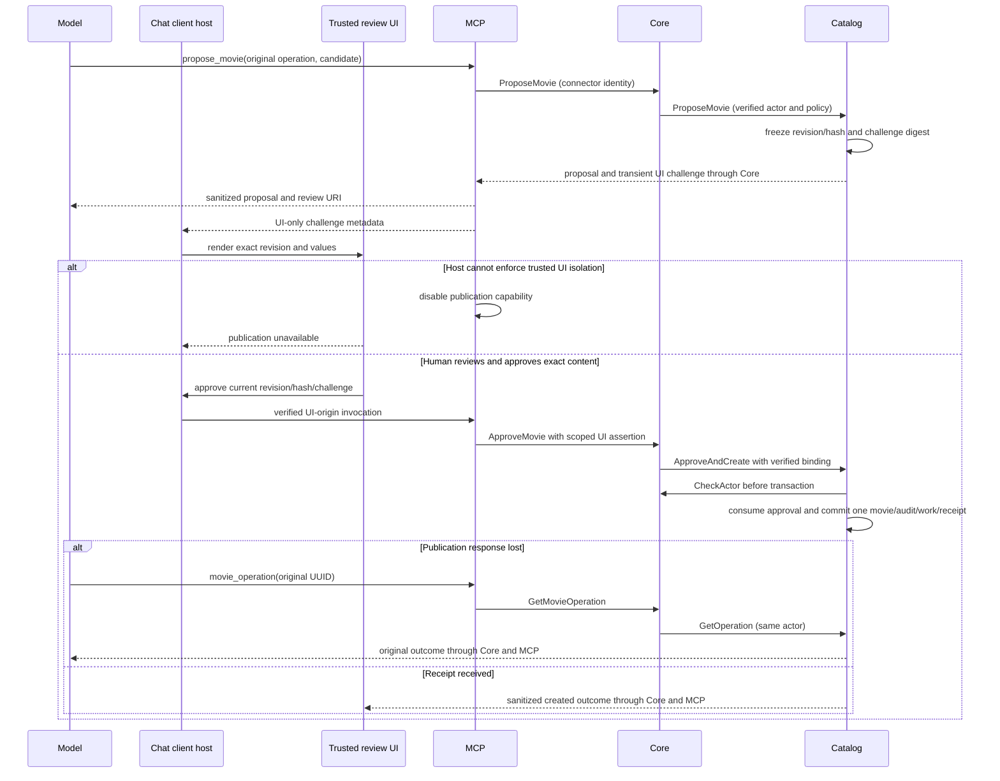

</details>


Reject uses the same trusted channel and current revision binding, with no movie creation. Editing creates a new immutable revision and invalidates prior challenge/resource approval. The model cannot select the trusted gateway path or supply its own UI assertion. Client-specific isolation remains G-03.

## 10. Seed data, initialization and migrations

### 10.1 Frozen seed contract

Seed data is the initial catalog dataset. A manifest lists its records, identities, source/reuse evidence and checksums. Provenance records where each fact came from and the permission basis for reuse. Deterministic identities reproduce the same record IDs from the same source keys; they do not depend on display names. Bootstrap creates the prepared accounts once. These startup phases preserve subsequent edits and removals rather than resetting the installation.

The 18 October 2026 source-policy revision supersedes the earlier open-license-only poster restriction. Keep Wikidata source identities and existing people/credit facts; enrich from public TMDB HTML and page-linked static posters, with public official-page corroboration where necessary. Preparation uses no provider API, account or key. Write original concise factual synopses. Record source URLs and supplied creator/rights information honestly; public availability is not an open-license claim. The current package requires one matched poster per title rather than optional placeholders. No source connection is used during installation or restart. The earlier research findings remain historical under `docs/research/seed-data-audit.md`.

`public-pages-2026-10-v2` retains schema version 2 and introduces source policy `public-pages-v1`, a frozen predecessor at `baselines/wikidata-2026-10-v1.json`, and 200 local poster files. Each artwork entry records file path, SHA-256, dimensions, MIME type, deterministic asset/reference IDs, source name/page/image URLs, retrieval date, and supplied creator/license values (null when unknown). `sources/tmdb-pages.json` records title matching and edition notes. The file inventory and snapshot hashes bind the package; image bytes are validated before import.

The frozen manifest is versioned implementation data loaded deterministically by make start. Schema: manifestVersion, sourcePolicyVersion, namespaceUUID, generatedAt, snapshotSHA256, licenseSummary, expectedMovieCount100, expectedTVCount100, year/month distribution, records and files. Each record has kind/source/externalId/stableUUID/contentSHA256, normalized fields, field-level source URL/retrievedAt/license or permission basis, person/genre/role source identities, credits and artwork checksum/source/rights evidence. Seed manifest IDs never depend on display spelling; UUIDv5 uses namespace + length-prefixed source/kind/externalID. Deterministic record serialization and checksum exclude nondeterministic timestamps. Date facts preserve available precision and original-release/first-air meaning. TV needs end/status where available, not episode tracking. Starter roles include Actor (characters permitted), Director, Writer and Producer, without assuming every source record contains every role.

Before initial commit validate the whole snapshot, exactly 100 distinct movies and 100 distinct TV entries, required synopsis/language/genre/release facts, credit/person references, current input rules and source/rights evidence under the selected source policy. Show actual year/month distributions; no invented equal quotas. If required data are missing/incompatible, fail initialization rather than skip rows or silently trim. Package the 200-record manifest, source-by-source reuse evidence and attributed posters as frozen implementation inputs. This source-policy revision changes the earlier open-license criterion in G-04; it does not itself establish full release acceptance.

One local seed transaction locks seed then catalog, compares manifest ID/hash, creates all missing initial records and provenance_record/seed_member, and commits the typed Catalog operation_receipt as SUCCEEDED with permanent seed evidence atomically. If interrupted before commit, no partial catalog survives; if after commit but before response, exact ID/hash receipt reports complete. Failure details can be recorded as a typed initialization FAILED receipt in a separate transaction with zero committed records; operational_event retains sanitized failure history. A retry may replace that failure receipt with successful evidence only when hash matches, retaining failure in audit. Competing starts wait boundedly and replay the receipt. A changed checksum under the same ID is a fatal manifest conflict.

Ordinary rerun is receipt/provenance verification, **not upsert-to-snapshot**. For an identical manifest, never overwrite existing fields, statuses, artwork, account passwords or user-created rows. An explicit supported snapshot upgrade may refresh only seed-owned metadata still equal to the frozen predecessor; edited values and existing relationships remain unchanged. Deletion marks seed_member.removed_at and provenance_record.deleted_at in the same catalog transaction; removal of a seeded credit marks its seed_member tombstone. Never delete those ledgers when deleting domain rows. A locally edited field is marked in provenance_record.locally_changed; ordinary seed does not need that flag to overwrite nothing, but it preserves explanation for future explicit data revisions. Seed-member absence is not permission to recreate an item when the completed receipt exists. Partial Media initialization resumes its own jobs from manifest file hashes; no Catalog artwork reference is set until the normal hold protocol completes. Metadata seed success and optional artwork completion are separate visible startup stages.

Prepared Viewer/Maintainer account initialization uses its own transaction and ACCOUNT_INITIALIZATION operation_receipt with immutable setup version/hash and account references, containing only identities/config version, never passwords. Passwords come from mounted secret files or one-time operator-generated protected files; diagnostics print their file locations, not contents. Initialization inserts encrypted accounts/aliases/password verifiers and permanent setup receipt once. Existing receipt means validate role/identity and preserve current password/session/account state. Changed manifest/duplicate conflicting account fails clearly, never promotes arbitrary existing Viewer by matching email. The seed operation is cross-service phased initialization, not a distributed transaction; startup records which local phase succeeded and retries missing phases only.

#### Packaged poster import and refresh

The operator command runs Media preparation, Catalog attachment, then Media finalization using protected shared receipt files. Media applies its existing image validation, sandboxed processing and local storage; each ready asset and protective reserved reference commit together. Progress is bound to manifest version, title ID and poster hash; retry verifies existing stored output and does not create duplicate assets. Catalog rechecks title eligibility under a row lock, attaches only to active titles with no artwork or attachment history, and records read-only attribution in `seed_artwork_attribution`. A prior upload, pending replacement, explicit removal, archive or deletion prevents replacement. Finalization activates attached references and releases unused reservations. Metadata completion and poster completion are separate receipts so interrupted artwork work can resume.

The public title/artwork contract retains its existing shape. Selected seed poster attribution appears as an additional read-only `Provenance` entry with source `poster`, external ID equal to the selected asset ID, source-page `recordUrl`, and `fieldSources.artwork` containing the frozen attribution. User replacements no longer expose the old poster attribution. Detail pages link to the source; ordinary TV management remains unavailable.

Refreshes preserve stable title IDs, accounts, user fields, credits, uploads, archives, deletions and tombstones. Unknown baselines and hash conflicts fail rather than reset data. Older titles excluded from a later seed remain outside current membership rather than being deleted. Fresh installations have exactly 100 movies and 100 TV titles; upgraded installations may retain extra records and user artwork overrides. No volume reset is part of this workflow.

### 10.2 Flyway and schema evolution

Flyway applies and records ordered database migrations. Schema evolution changes the database structure over versions. Expand/contract introduces compatible structures first, moves existing data, switches readers, and removes obsolete structures only after the compatibility/recovery window. A backfill fills the new structure for existing rows; resumable keyset batches continue after the last processed identifier. A rollback may restart a compatible older program, but it cannot automatically reverse destructive data changes. The exact migration and restore rules below remain authoritative.

Each service owns migrations for its database and a separate migrator credential. PostgreSQL extension installation and schema ownership are explicit infrastructure bootstrap steps before Flyway. Order: database/roles → Core schema/key metadata → Catalog schema/function/pg_trgm → Media schema → verify each history/checksum → seed/accounts → services. No migration may reference another database. Flyway's schema history lock serializes concurrent migration runners; startup also uses a per-installation command lock to avoid two Compose orchestrators racing. Timeout120s with explicit locked-stage diagnostics, never silently start on incomplete schema.

Use versioned immutable migrations with Flyway validation on every start; don't edit applied SQL/checksums. Transactional PostgreSQL migrations roll back on failure. Nontransactional operations such as concurrent index creation require dedicated migration, detection/removal of incomplete index, and deliberate repair only after state has been inspected. Never run automatic `repair` to hide drift. Runtime JPA validates mappings, but owner migrations are the schema authority.

Expand/contract: deploy additive nullable column/table/index first, dual-read/write if needed, resumable keyset backfill batches of 100 under rate limit, verify counts/checksums, switch reads, wait through rollback and backup horizon, only then remove old contract. Cross-service proto field additions precede use; rolling versions must tolerate unknown fields. Readiness enforces supported schema min/max per binary. A destructive/semantic migration may make old binaries incompatible; rollback is redeploy previous compatible binary or restore consistent backup with explicit loss of later writes, not an imaginary automatic down migration. Before migration capture backup and rehearse on a restored isolated database. Seed version changes are explicit reviewed data migrations and preserve tombstones/edits unless product authorizes a targeted change.

## 11. Configuration, startup and command contracts

### 11.1 Configuration contract

Configuration precedence chooses which source wins when a setting appears more than once. Effective configuration is the resulting validated set of values. A mounted secret file supplies sensitive material at runtime without embedding it in source or images. A rolling restart applies a validated configuration through service restarts; it is different from hot reload inside a running process.

Precedence: explicit process environment → mounted nonsecret config file → documented default. Secrets use required mounted files only, referenced by `*_FILE`; no fallback demo secret. `.env` may contain nonsecret settings/path references and is not committed with real values. Omitted = default only where listed; explicit empty/whitespace is invalid except deliberately empty optional disabled adapter fields. Boolean accepts true/false only, integer decimal finite only, units in names; zero meaningful only where specified. Resolve and validate the complete effective config before readiness. Print setting name and correction, never secret/value contents. Policy updates use validated rolling restart, no hot reload; all participating services must agree on SHA256 of the deterministically serialized policy before protected writes become ready.

| Group | Required/default and validated bounds | Ownership |
|---|---|---|
| DB | Distinct service URLs/users/secret files; pool max 8,minIdle1; connect2s; statement3s; lock2s; idle-in-transaction5s; migration statement120s | Each service; no superuser runtime |
| Network | HTTPS localhost8443, exact Origin; MCP loopback separate port; mTLS cert/key/CA files and service SANs `core`, `catalog`, `media`, `mcp` required for application components | Core/MCP/internal transport |
| Crypto | Independent purpose keys, active key IDs, lookup/signing/rate/cursor and CSRF_KEY_FILE secrets required; 32-byte AES keys, key files with mode 0600 | Core; keys never default |
| Actor signatures | ACTOR_SIGNING_PRIVATE_KEY_FILE and ACTOR_SIGNING_KEY_ID on Core; ACTOR_VERIFY_KEYS_FILE on Catalog/Media; Ed25519 formats and rotation in §5.7 | Core signs; receivers hold public keys only |
| Bootstrap | Prepared Viewer/Maintainer identity and password secret files; frozen manifest identity/hash | Core/Catalog |
| Notification | mode database by default, enum of four; selected adapter required settings, fixed allowed endpoint/recipients | Core and owning workers |
| Recovery | retries 2 [0..9], base 500 ms [1..60000], cap 5000 ms>=base, deadline 60000 ms [1000..3600000], multiplier 2 [1..10], full jitter | Persist effective values per work |
| Text | Person 1..100; registration name 2..100; title/original 1..255 when present; synopsis 1..5000; role 1..100; character 1..200; biography optional 1..5000 | Shared policy, owner validates |
| Credentials/search | email max 254; new password 15..128; search 0..200; URLmax2048 | Core/Catalog; no arbitrary URL-fetch feature |
| Files |1..5242880 bytes, enabled nonempty subset JPEG/PNG/WEBP; processing bounds §7.6 | Media and upload form |
| Structural bounds | Genres<=20; languages BCP47<=35chars, countries uppercase ISO3166-1 alpha2; runtime 1..100000 min; years 1..9999 | Storage/contract envelope, not UI assumptions |
| Request/page | §5 limits; finite positive maxima; enforce response and upload bounds separately | Core/MCP/gRPC |
| Rate admission | Exact RATE_LIMIT_* keys/defaults/bounds, RATE_LIMIT_KEY_FILE and MCP_RATE_LIMIT_MAX_BINDINGS in §8.4; same effective profile revision; no disable-by-zero | Core persistent counters; MCP local resource counters only |
| Logging | LOG_LEVEL defaults info, accepts only debug/info; validated restart, same redaction at both; JSON fields/sinks in §12.2.1 | Each service and MCP; no secret-bearing debug mode |
| Tunnel | enabled=true for configured ChatGPT verification; tunnelID/runtime-keyfile/runnerpath required if enabled | Operator prerequisites; no auto account creation |

Text limits are code points, image units bytes/pixels, retry units milliseconds, session units seconds/minutes explicitly. Required min cannot be0; min<=max; disabled formats cannot be empty/unsupported; distinguish unset from invalidfalse/0/empty. Configurable text maxima may increase up to the fixed request/encryption/technical envelope; validator rejects configurations whose maximum cannot be represented or handled safely. Stored SQL text is not constrained to current policy, so tightening never truncates/deletes values or invalidates unchanged text/artwork/passwords. Account payload's fixed64KiB envelope and technical BCP47/source-ID sizes are compatibility ceilings, not configurable field guidance. Validate changed fields only, but always validate operation relationships/authorization. Manual correction to MCP normalized content always triggers fresh review.

Rate profiles have their own shared configuration revision for §8.4 readiness and rollout; they do not tighten stored text or change the meaning of a draft validation-policy revision. Rate-limit settings and protected key-file references are included in redacted configuration validation without printing the key or identity digests.

MCP UI assertion settings: MCP_UI_ASSERTION_KEY_FILE is a separate 32-byte MAC secret shared only by MCP and Core; MCP_UI_ASSERTION_KEY_ID identifies the active/read-compatible key. Require both only when publication is enabled. MCP_PUBLICATION_ENABLED defaults false until client-specific trusted host enforcement is verified; enabling it still rejects unsupported/unauthenticated UI channels. Rotate with a new write key and bounded 60 s old-read overlap. HMAC-SHA256 signs deterministically serialized UTF-8 JSON containing audience, connector/client, proposal/revision/hash, invocation UUID and expiry at most 30 s; base64url payload/mac travel only in private RPC metadata (max 4 KiB), never model context or telemetry. Core verifies exact method/audience/expiry/mTLS sender and Catalog validates challenge binding. These secrets are separate from tunnel, connector and actor-signing credentials.

### 11.2 Startup DAG and readiness

A directed acyclic graph (**DAG**) orders startup dependencies without a cycle. Readiness means a service can handle its required operations; liveness means its process is still responsive. A running process does not prove migrations, seed initialization, or an external chat integration succeeded. A probe is a bounded status check used by startup or monitoring.

Prerequisites before `make start`: supported macOS/Linux host with Docker Engine/Desktop and Compose v2, Make, ports/disk/resources, registry/network access, local HTTPS trust, prepared config/secret files, client/tunnel registration and credentials where selected. Provision external permissions/credentials separately. The implementation repository supplies pinned build/runtime images, wrappers, frozen seed and sample nonsecret config. The command handles migrations and initialization itself.

#### Startup dependency graph

**Diagram.** Bounded startup stages from configuration validation through readiness.

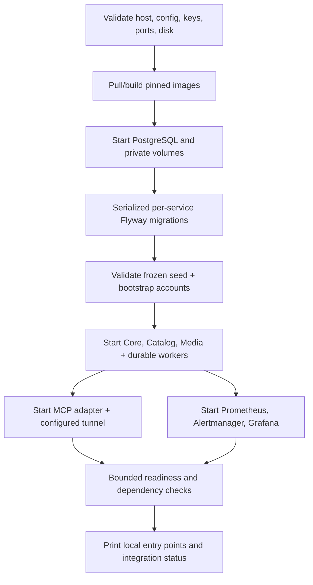


Startup timeout 300 s excluding explicitly reported image download/build stage (bounded to 15 min); each stage has progress and causal failure, no infinite wait. Flyway/seed failures block owner and overall ready. Catalog metadata endpoint can remain ready with Media unavailable after startup; artwork readiness is independently degraded. Overall initial startup requires all selected services, while external ChatGPT/Claude user registration is reported separately. `make start` cannot prove an interactive client used an approval UI. Output distinguishes process running, service ready, integration unverified/connected, database-recording/external notification mode and seed receipt. Do not print raw prepared passwords or tunnel keys. Browser-authentication readiness requires the configured trusted HTTPS endpoint with the fixed Secure cookie policy; startup cannot downgrade to an insecure listener when certificate configuration fails.

### 11.3 All seven Make command contracts

These are terminal commands for the local operator. An exit code is the numeric result reported to the shell: zero indicates the documented success condition, while nonzero identifies failure or incomplete prerequisites. Unit checks examine isolated behavior; integration checks exercise real component boundaries in separate test data/containers.

| Command | Behavior / persistence | Exit contract |
|---|---|---|
| `make start` | Validate→images→DB→migrations→seed/accounts→apps/MCP/monitoring/tunnel→bounded checks; idempotent rerun, volumes retained |0 local selected services ready; nonzero actionable stage failure; external interaction unverified explicitly |
| `make stop` | Stop accepting work, drain, close tunnel/apps/monitoring/DB; preserve named volumes/config/secrets/artwork |0 stopped; nonzero drain/stop failure; never `down -v` |
| `make restart` | Graceful stop then normal start with same persistent installation |0 ready; failure retains diagnostic state/data |
| `make status` | Read-only process/readiness/seed/work/notification/tunnel state, redacted |0 healthy selected local stack,1 degraded/not-ready; external integration evidence separate |
| `make logs` | Redacted bounded tail (default 200lines/service), follow only explicit flag; correlation filter allowed; preserve complete JSON records without color/prefix text (§12.2.1) |0 readable logs,1 failure; no unbounded dump or secret environment |
| `make test-unit` | Deterministic unit/contract checks using isolated temporary artifacts, no normal DB credentials |0 all selected checks passed,1 test failures,2 setup/config failure |
| `make test-integration` | Disposable Compose/Testcontainers namespace and independent DBs/artwork/secrets/ports; PostgreSQL 18.6+real gRPC; cleanup only test namespace |0 all required runnable checks passed,1 test failure,2 prerequisites/blocked required checks; report skipped client/provider checks separately, no false pass |

Common non-test exits:2 prerequisite/config,3 image/build,4 migration/seed,5 bounded readiness/health,130 user interruption. Preserve original failing cause when cleanup also fails. `test-integration` refuses normal installation namespace/volume names and never truncates normal data. External-client tests need their documented credentials/capabilities and cannot be replaced with mocks for final client acceptance. Unit tests may fake time, random jitter and ports, not claim transport/database semantics.

## 12. Operations, observability and recovery

### 12.1 Database access and resource budgets

A database role is a PostgreSQL permission identity, not a browser role. The runtime credential is used by the running service; a migrator changes schema, maintenance performs permitted cleanup, and backup credentials read the required recovery data. A connection pool limits reusable database connections. Least privilege grants each credential only what its responsibility requires.

Sizing estimates are assumptions until measured. TOAST is PostgreSQL storage for large values; multi-version concurrency control (**MVCC**) retains row versions for concurrent transactions. The p95 latency is the time within which 95% of measured requests finish. Memory/disk headroom reserves capacity for temporary work and recovery. Backpressure rejects or slows new work before resources are exhausted.

For each `spoolin_core`, `spoolin_catalog` and `spoolin_media` database, use its `<database>_owner`, `<database>_migrator`, `<database>_runtime`, `<database>_maintenance` and `<database>_backup` role family. Provision a non-login owner role per DB, migrator login member of owner only while migrating, runtime login with CONNECT to its own DB, USAGE on appdata and SELECT/INSERT/UPDATE/DELETE only needed tables; revoke CREATE on public and CONNECT from PUBLIC on all three databases. Runtime cannot modify Flyway history, key secrets, create roles/extensions or access another DB. No cross-database grants, dblink or postgres_fdw. Audit table grant INSERT/SELECT only to runtime; no UPDATE/DELETE. A separate maintenance credential performs bounded audited retention, never exposed to Core/MCP. Migration key metadata writes are limited to Core crypto workflow. Configure pg_hba SCRAM auth/private network and TLS for service DB connections; never trust authentication. Backups use separate read/backup role, not runtime superuser.

Representative grant pattern (repeat with service-specific names; passwords absent):

#### Catalog database grants

**Code example.** Representative SQL grant pattern for the specified credential separation. The example uses spoolin_catalog_runtime/spoolin_catalog_migrator; match configured role names while retaining the documented privileges and timeouts.

```sql
REVOKE CONNECT ON DATABASE spoolin_catalog FROM PUBLIC;
GRANT CONNECT ON DATABASE spoolin_catalog TO spoolin_catalog_runtime, spoolin_catalog_migrator;
REVOKE CREATE ON SCHEMA public FROM PUBLIC;
GRANT USAGE ON SCHEMA appdata TO spoolin_catalog_runtime;
GRANT SELECT,INSERT,UPDATE,DELETE ON ALL TABLES IN SCHEMA appdata TO spoolin_catalog_runtime;
REVOKE UPDATE,DELETE ON appdata.catalog_audit_event, appdata.operational_event
  FROM spoolin_catalog_runtime;
REVOKE ALL ON appdata.flyway_schema_history FROM spoolin_catalog_runtime;
GRANT SELECT ON appdata.flyway_schema_history TO spoolin_catalog_runtime;
-- Apply explicit table grants after each migration; do not blanket-grant future tables.
ALTER ROLE spoolin_catalog_runtime SET statement_timeout = '3s';
ALTER ROLE spoolin_catalog_runtime SET lock_timeout = '2s';
ALTER ROLE spoolin_catalog_runtime SET idle_in_transaction_session_timeout = '5s';
```


Resource assumptions for a developer host:4 CPU/8GiB Docker memory/20GiB free disk minimum; Java services 512 MiB heap each plus native headroom (container 768 MiB Core/Catalog, Media 1 GiB); PostgreSQL 1GiB, shared_buffers256MiB/work_mem4MiB/max_connections50; MCP 256 MiB; Prometheus 512MiB; Grafana 256MiB; Alertmanager 128MiB. Pools8×3 plus migrations/monitoring reserve fit 50 connections; one worker claims 2 effects per service, no unbounded executor. Measure on arm64 andamd64. At these settings 2 concurrent image decoders 256 MiB each must fit Media native budget; reduce concurrency if measurement says otherwise. Backpressure returns explicit retryable capacity, not an out-of-memory (**OOM**) process failure or unbounded buffering.

Capacity assumptions, not measured:200 titles×~8 KiB plus2,000 people×~2 KiB+5,000 credits×~0.5 KiB≈8 MiB logical core; indexes/TOAST/MVCC multiply2–4. 100 accounts encrypted payload~2 KiB plus password/token metadata well below1MiB. 100,000audit/outbox/operation rows×~1–4 KiB≈100–400 MiB before indexes; operation/audit lifetime records grow without a time cap and need monitored disk planning. 200 artworks×0.5 MiB≈100 MiB; physical worst-case200×8 MiB≈1.6 GiB plus quarantine/replacements/backups. Prometheus 15day retention with 1 GiB size cap; logs rotate10MiB×5/service; DB/artwork reserve at least 2×working set for backup/index maintenance. Column “cardinality” entries are sizing assumptions, never feature caps unless explicitly policy.

Performance verification budgets: public query p95<300 ms at 10 concurrent local readers after warmup, mutation metadata p95<500 ms excluding password hashing/media/provider, startup local warm images<120 s, processing<10 s. Benchmark these targets on the selected host before treating them as measured performance. Measure HTTP 200 domain-error rate separately, report hardware/data/percentiles and cold behavior.

### 12.2 Metrics, alerts and privacy

Observability uses metrics, logs and traces to explain system behavior. A metric is an aggregated measurement; a log records an event; a trace follows related work across components. A correlation identifier connects sanitized events for one flow. Metric labels group measurements into series and must stay bounded so record IDs or private content do not create excessive series or leak data. Alert deduplication groups repeated evidence of the same problem into one episode.

Prometheus scrapes private Actuator/MCP exporters every 15 s. Grafana dashboards: request outcomes/latency, GraphQL domain errors, gRPC status/deadlines, DB pool/lock/query times, work due/leased/exhausted/oldest age/retries, seed/migration readiness, Media queue/process failures/disk, crypto/key failures, tunnel availability and notification RECORDED/ACCEPTED/UNKNOWN/FAILED. Labels are bounded service/operation/code/mode, never account/title/query/email/operation UUID. The existing correlation UUID belongs in sanitized logs/traces, not metric labels. HTTP/gRPC/work retain validated bounded correlation, generated if absent/invalid. [§12.2.1](#1221-json-log-contract) defines JSON records, levels, trace context and redaction; it does not change the existing UUID wire/database representation.

Proposed alert defaults: service down >1 min; mutation failure ratio>5% for 5 min with>=20 requests; exhausted work >0 for1min; oldest due work >120 s; notification FAILED/UNKNOWN>0; DB pool >80% for 5 min; disk free<20% warning/<10% critical; crypto auth/key failure>=1; Media processing failure>10%/5min with>=10 jobs; tunnel disconnected>2 min when enabled. Group service+class, wait 30 s, repeat 4 h, resolved event recorded; dedup episode key persists. Invalid alert rules fail validation. Thresholds are assumptions pending workload, not guarantees. Avoid alert storms and recursive “notification failed” dispatch loops.


#### 12.2.1 JSON log contract

A diagnostic log records what a running component did and how it ended. A severity level tells the
operator how urgently to investigate. JSON makes fields independently searchable. SpoolIn's Core,
Catalog, Media and MCP application logs use one compact JSON object per physical line, encoded as
UTF-8 and ending with LF. Newline-delimited JSON (**NDJSON**) is this stream convention; examples
are expanded below for review, while emitted records occupy one line.

The field names and level vocabulary follow [Mekari Log Format Standardization](https://jurnal.atlassian.net/wiki/spaces/EP/pages/48735256814/Mekari+Log+Format+Standardization),
page version 26. SpoolIn makes resource identity mandatory, uses a smaller supported level set,
and limits attributes to safe operational values. The logger identifies the emitting service;
outbound destinations use a separate peer field. No employer SDK, Papertrail account or tracing
backend is a deployment prerequisite. Native PostgreSQL/monitoring/tunnel-client output stays in
separate restricted streams with its own format; it is not mislabeled as this application contract.

| Field | Required type and meaning |
|---|---|
| `level` | Lowercase enum: debug, info, warning, error or fatal; see the level table |
| `timestamp` | UTC RFC3339 string ending in Z, with the available 0..9 fractional digits; represents event time, not collector time |
| `trace_id` | 32 lowercase hexadecimal characters. Nonzero for active traced work; all zeros only when no trace exists, such as pre-context boot diagnostics |
| `span_id` | 16 lowercase hexadecimal characters. Nonzero for an active span; all zeros when untraced. A nonzero span requires a nonzero trace |
| `message` | Required fixed event summary from application code, <=256 UTF-8 bytes; no interpolated user/error text |
| `resource` | Required object with `service.name` (core/catalog/media/mcp), `service.version` (resolved build version), `service.namespace` (spoolin) and `service.env` (local/test); build version is a fixed <=128-byte value |
| `attributes` | Optional allowlisted object: event, operation, boundary, outcome, code, error_class, peer_service, route, method, duration_ms, count and existing correlation_id as applicable. Enum/string bounds <=128 UTF-8 bytes except lowercase, hyphenated UUID; count/duration finite nonnegative numbers; <=16 fields |
| `caller` | Optional project-relative code location without workstation/user paths; omitted by default |
| `dropped_attributes_count` | Optional nonnegative integer when safe attributes were omitted; duplicate keys are rejected before encoding. Omitted values are never copied into `dropped_attributes` |

**TD-LOG-JSON:** every application-owned record, including framework startup, request failures and
worker diagnostics, follows this shape. Disable plain Boot banners, ANSI decoration and raw
console/exception printing on those streams. Configure JVM SLF4J/Logback through a redacting JSON
encoder; the MCP helper uses structured objects and the standard JSON serializer. Framework/ORM
adapters pass through the same redaction and level mapping. Never enable SQL parameter, HTTP
body/header or RPC-message dumps, including in debug mode. Unknown fields are dropped before
serialization; their values cannot be recovered through an auxiliary dropped-values field.

##### 12.2.1.1 Level selection and configuration

| Level | Selected use | Examples of safe event classification |
|---|---|---|
| debug | Optional bounded diagnostic detail, disabled by default | Selected execution branch or sanitized timing; never query values or private payloads |
| info | Normal lifecycle and request outcome | Service ready, request started/completed, validation rejection, stale-version conflict, successful replay |
| warning | Handled security denial, throttling or degraded/retryable behavior requiring investigation | CSRF denial, quota rejection, retry scheduled, uncertain external effect |
| error | Failed request/task or integrity/security failure | Dependency unavailable, exhausted recovery, encryption authentication failure; outcome/code remain explicit |
| fatal | This component cannot start or must stop safely | Invalid required key/config/schema prerequisites; logging this event alone does not terminate a process |

**TD-LOG-LEVELS:** expected validation/conflict outcomes are not system errors. A GraphQL HTTP 200
can still have a failed domain/system outcome; completion events include that classification.
Approval, publication, database recording, provider acceptance and confirmed delivery keep their
existing distinct meanings. Normalization maps framework TRACE to debug, INFO to info, WARN to
warning and ERROR to error. An explicitly identified unrecoverable startup failure uses fatal;
the component still returns its documented failure exit/status. The unused Mekari levels notice,
critical and alert are not emitted by SpoolIn's selected application profile.

**TD-LOG-CONFIG:** `LOG_LEVEL` uses §11.1 precedence, defaults to `info`, accepts only `info` or
`debug`, and takes effect through a validated restart. Omitted means info; explicit empty/unknown
values block readiness with a redacted correction. Both modes always emit warning/error/fatal and
required lifecycle/security outcomes; neither can disable audit persistence or expose secrets.
Temporary debug use ends with an operator restart back to info. Existing 10 MiB × 5 rotated-log
budget per service remains; it bounds retained diagnostic files rather than promising a time span.

##### 12.2.1.2 Correlation, ownership and safe fields

**TD-LOG-CONTEXT:** a trace identifies one execution flow; spans identify individual calls within
it. Use [W3C trace context](https://www.w3.org/TR/trace-context/) through OpenTelemetry-compatible
context APIs, with the resolved instrumentation dependency recorded under G-01. Core creates a
trace at browser ingress; MCP creates one at connector ingress. Untrusted browser/model headers
cannot choose trusted trace/actor/operation context. Trusted mTLS calls propagate validated
traceparent metadata, keep the trace and create child spans; malformed context is replaced safely,
never used for authorization. Do not forward arbitrary tracestate/baggage or user content.

Keep the existing lowercase, hyphenated UUID correlation_id in protobuf context, actor claims, receipts and
durable work. It is distinct from hexadecimal trace_id; no UUID column or protobuf field is
renamed or repurposed. A recovery attempt starts a fresh trace and logs the work's original
correlation UUID, which joins attempts across restarts without adding trace columns to the schema.
User-facing errors retain the existing safe correlationId contract. Request/span contexts are
closed in finally/cancellation paths and cleared before pooled threads or async tasks are reused;
one request/account cannot inherit another's context. No trace collector/exporter is selected here.

**TD-LOG-PRIVACY:** construct safe fields before serialization. Exclude raw Cookie/Set-Cookie,
Authorization, CSRF values, password/verifier, email/name/account/credential identifiers, lookup
digests, encryption keys/nonces/ciphertext, approval challenges, catalog/draft field values, query
variables, request/response bodies, original filenames, source evidence and provider URLs. No
automatic entity, Throwable or protocol-message serialization. Log fixed error codes/classes;
raw exception messages, causes and stack dumps are excluded. The optional error_class is a fixed
allowlisted classification, not arbitrary Throwable text. Operational UUID correlation is searchable
only by the operator and never becomes a metric label, credential or authority to read a receipt.

JSON encoding escapes CR, LF, quotes and control characters; do not concatenate JSON strings.
Hostile input cannot become a new physical log line or a log field key. Log viewers render decoded
strings as escaped text, never HTML or executable templates. Fields remain fixed/allowlisted, so
encoding is an additional safeguard, not permission to log arbitrary input. This follows
[OWASP logging guidance](https://cheatsheetseries.owasp.org/cheatsheets/Logging_Cheat_Sheet.html).

##### 12.2.1.3 Sinks, evidence and failure behavior

**TD-LOG-SINK:** service containers emit JSON to their managed stdout/stderr log sink; stdio MCP
bridge diagnostics use stderr exclusively because stdout carries protocol messages. Human command
entry points/status output are distinct from diagnostic streams. `make logs` preserves complete
JSON lines with service identity inside resource, no display prefixes; parsed filters keep record
boundaries and bounded tails. The operator can pretty-print a copy for reading.

Validate required field types/values before encoding. Invalid required fields produce a small
fixed logger-contract error/count without echoing the rejected record. Invalid optional attributes
are omitted and counted safely; malformed inbound trace context is regenerated at its boundary.

Limit each encoded record to 16 KiB and the asynchronous queue to 1,024 records. Omit optional
fields before encoding if needed; never truncate a serialized JSON line. Nonconforming oversized
events become a small safe logger-contract error/count, without echoing the rejected payload.
Slow/full sinks use bounded best-effort delivery; count discarded diagnostics rather than block
requests indefinitely. A safe fallback uses the same JSON encoder on the alternate diagnostic
stream; recursive logging and raw-text fallback are forbidden. Disk/pipe failure can lose logs;
there is no claim of exactly-once or lossless diagnostic output. The dropped-record metric remains
observable through the private exporter when the log sink itself fails.

Diagnostic request-start and completion events may help explain a crash, but their absence does
not prove an operation rolled back and a start is not a success. `operation_receipt`, durable_work,
operational_event and catalog_audit_event retain their existing transactional, access and retention
rules. Audit/attempt evidence commits at the existing owner boundary, independently of log
threshold/queue delivery. A sink failure cannot fabricate, suppress or replace required durable
evidence. Log retention/rotation grants remain operator-only and are separate from permanent
Catalog business history and 90-day resolved operational records.

##### 12.2.1.4 Illustrative JSON records

**Code example — successful request outcome.** Core completes a public titles query. The trace,
span, correlation UUID and version are illustrative values, not authentication credentials or a
tested build. Emitted output is this object compacted onto one physical line.

```json
{
  "level": "info",
  "timestamp": "2026-10-13T12:00:00.123Z",
  "trace_id": "a1ac0334fcb72ad1513859d416b5ff26",
  "span_id": "b819e2324b94eacd",
  "message": "Request completed",
  "resource": {
    "service.name": "core",
    "service.version": "example-build",
    "service.namespace": "spoolin",
    "service.env": "local"
  },
  "attributes": {
    "event": "request_completed",
    "operation": "titles",
    "boundary": "graphql",
    "outcome": "SUCCESS",
    "code": "OK",
    "duration_ms": 24,
    "correlation_id": "8a30868c-2fbe-4093-aaab-e054c4a1a7c9"
  }
}
```

**Code example — authorization failure.** Core rejects an authenticated mutation with an invalid
CSRF value before dispatch. The log reports only the safe cause and correlation; it does not
include either cookie or anti-forgery value. Identifiers/version are illustrative as above.

```json
{
  "level": "warning",
  "timestamp": "2026-10-13T12:00:01.123Z",
  "trace_id": "b1ac0334fcb72ad1513859d416b5ff26",
  "span_id": "c819e2324b94eacd",
  "message": "Browser mutation denied",
  "resource": {
    "service.name": "core",
    "service.version": "example-build",
    "service.namespace": "spoolin",
    "service.env": "local"
  },
  "attributes": {
    "event": "request_denied",
    "boundary": "graphql",
    "outcome": "DOMAIN_REJECTED",
    "code": "CSRF_INVALID",
    "correlation_id": "b4600c04-14ee-4e70-a7b5-15830a7b1a8e"
  }
}
```

The frontend still receives the existing safe API error and no-store response. A log message
is diagnostic evidence for the operator, not a replacement for that response or a browser route.

### 12.3 Retention, purge and backup runbooks

Retention determines how long evidence/data stays available; purge permanently removes eligible expired data. A runbook states what to inspect, which recovery action is safe, and what proves recovery. A checkpoint is the coordinated saved state of databases, artwork and key material. Recovery point objective (**RPO**) is the target maximum data-loss interval; recovery time objective (**RTO**) is the target time to restore service. The proposed values here are untested goals. PostgreSQL write-ahead logging (**WAL**) supports database recovery; a SQL dump alone does not include artwork or encryption keys.

Hourly maintenance selects expired sessions/credentials/rate windows/drafts in keyset batches of 100; it checks state, deletes encrypted drafts without decrypting, and emits counts rather than content. Daily purge removes resolved operational_event history and terminal durable_work/notification evidence after 90 days only when no pending, uncertain, exhausted or recovery dependency remains. Keep matching attempt phases together. Clear ordinary completed work payloads after seven days; retain notification_summary for its separate 90-day period. Clear eligible asset processing metadata before deleting referenced work; never remove output/reference evidence because staging metadata expired.

REQUEST receipt result bodies expire after seven days; their no-repeat identity/fingerprint/outcome remains for installation lifetime. ACCOUNT_INITIALIZATION and CATALOG_INITIALIZATION evidence never enters this expiry path. Catalog business history, seed/provenance tombstones, completed initialization and proposal approval evidence remain for installation lifetime. After seven days and only when no review/pending/uncertain dependency remains, redact proposal content to {} and replace challenge_hash with a fresh nonusable digest, preserving the original content_hash and all approval/consumption fields. These columns remain NOT NULL; redacted content is not inspectable original content. Key metadata remains while current records or retained backups require it.

Daily operator-triggered encrypted backup and before migrations: stop writers/workers and capture one coordinated checkpoint of all 3 DBs, artwork volume, nonsecret config/version manifest and separately protected key material. Use pg_dump custom format for each DB plus roles/grants inventory and checksum manifest; because writes are quiesced, dumps and files align without distributed snapshot claims. Resume after verification. Keep 7 daily + 4 weekly copies subject to disk budget, one separate physical location chosen by operator; no paid backup service assumed. Proposed RPO 24 h / RTO 1 h are untested goals. Never promise crash recovery from a SQL dump alone without artwork/keys.

Restore drill in isolated namespace: verify checksums and versions, restore roles/grants/schema/data/files, use new encryption WRITE keys (§8), invalidate restored auth material, run integrity/seed-tombstone/artwork-hold reconciliation, execute sample public/protected reads and uniqueness/rotation test, then record elapsed time and actual loss horizon. Production/local replacement requires operator to stop old writer first; never run restored and original installation with shared secrets/nonces and divergent data. In-place rollback after destructive migration needs the same procedure and acknowledgement of post-backup write loss.

| Symptom | Investigation / safe action | Evidence before recovery is complete |
|---|---|---|
| Startup migration/seed fails | Read stage/code/hash; compare history and frozen manifest; fix config/input, rerun same identity; no automatic repair/reset | Correct history, exact initial counts or truthful retained catalog receipt |
| Media unavailable | Keep metadata serving; inspect queue/disk/processor; restart Media, reconcile reserved holds/receipts | Old artwork safe; no duplicate attach; pending outcome resolved |
| Mutation uncertain | Query owner operation using same UUID; if pending inspect durable work, if expired retain no-repeat result | Terminal receipt or explicit unresolved status; never generate replacement identity blindly |
| Deadlock/slow DB | Inspect sanitized locks/long transactions and EXPLAIN in isolated copy; respect lock order and bounded retry | No stale overwrites; latency/plan evidence |
| Key failure | Stop protected writes, validate mount/keyID/AAD; restore correct read key, never plaintext fallback | Canary + sampled decrypt + nonce-safe new WRITE key |
| Disk low | Stop new uploads before critical; inspect protected/orphan volumes and retention; expand/free safe logs only | DB WAL and protected assets intact, free headroom verified |
| Notification unknown/fails | Inspect ledger/attempt/provider receipt; repair selected adapter; controlled replay only when safe | Recorded versus accepted/delivered accurately labeled |
| Tunnel/client unavailable | Inspect outbound connection/permissions/tunnel identity and client registration; no public-port workaround | Independent discovery + exact-content approval tests per client |

Shutdown: mark unready, stop claims, reject new mutations, drain active requests<=30 s and workers<=30 s, cancel processors/streams, persist uncertain lease state, close pools then stop DB. Forced kill relies on transactions/lease recovery, not shutdown callbacks for correctness. Rollout is local maintenance window: backup, additive migration, start compatible binaries, readiness, smoke outcomes, resume writes. Rollback binary only if schema/data remain compatible; otherwise restore. Status/logs distinguish healthy processes from correct business effects.

### 12.4 Metric contracts and alert expressions

Export bounded metrics through Micrometer/Actuator for JVM services and a small adapter exporter using the [Prometheus text format](https://prometheus.io/docs/instrumenting/exposition_formats/). Fixed labels are service, operation, boundary, outcome, code, state, mode, client and volume where listed. The `service` label uses `core`, `catalog`, `media` or `mcp` for these application components. Other label values come from their allowlists; no UUID, account, title, query, filesystem path or provider URL becomes a label. Histograms use seconds and predefined buckets 0.01, 0.05, 0.1, 0.3, 0.5, 1, 3, 5, 15 and 30.

| Metric | Type / labels | Measurement boundary |
|---|---|---|
| `spoolin_operation_results_total` | Counter; service/operation/boundary/outcome/code | One logical owner result or ingress result per completed request; SUCCESS, DOMAIN_REJECTED, SYSTEM_FAILED, UNCERTAIN separated, including GraphQL HTTP 200 errors |
| `spoolin_operation_duration_seconds` | Histogram; service/operation/boundary | Entry to reply/termination at owner or ingress, identified separately; includes waits, excludes later durable effects |
| `spoolin_work_items` | Gauge; service/state | Current scheduled durable_work row counts by state; exclude database-only NOTIFICATION recording rows, which have no worker lifecycle |
| `spoolin_oldest_due_work_seconds` | Gauge; service | Age since oldest READY work became due; zero when none, collection failure leaves scrape unhealthy rather than zero |
| `spoolin_notification_events` | Gauge; service/mode/state | durable_work rows WHERE kind=NOTIFICATION grouped by notification_mode/notification_state; RECORDED/ACCEPTED/UNKNOWN/FAILED and confirmed delivery remain separate |
| `spoolin_pool_active_connections`, `spoolin_pool_max_connections` | Gauges; service | Bounded runtime pool usage/capacity; migration pool excluded |
| `spoolin_disk_available_bytes`, `spoolin_disk_capacity_bytes` | Gauges; service/volume | Owned database/artwork/backup volume headroom, configured finite volume labels |
| `spoolin_crypto_failures_total` | Counter; service/code | Authentication/key/unavailable/nonce-exhaustion classes; no secret or row ID label |
| `spoolin_media_processing_total` | Counter; outcome | Completed processors: SUCCESS or FAILED; rejected file validation separately in operation results |
| `spoolin_tunnel_connected`, `spoolin_tunnel_enabled` | Gauges; client | Runner connection/configuration for CHATGPT; connection is distinct from successful client review |
| `spoolin_log_dropped_total` | Counter; service/level/reason | Discarded diagnostic records; fixed reasons queue_full, sink_failed or contract_invalid; no payload/identity label |
| `spoolin_service_ready` | Gauge; service | Dependency readiness; complements Prometheus `up` process/exporter reachability |

Proposed alert expressions use the owner boundary where duplication would affect rates. Assign warning/critical severity and the §12.3 runbook corresponding to the service/class. Alertmanager groups by service/class, waits 30 s, repeats every four hours and durably records resolution through Core.

| Alert | PromQL / evaluation window | Severity / recovery |
|---|---|---|
| Service unavailable | `up == 0` or `spoolin_service_ready == 0`, for 1 min | Critical; clears on healthy scrape/readiness |
| System mutation failure | `sum by(service)(rate(spoolin_operation_results_total{boundary="owner",outcome="SYSTEM_FAILED"}[5m])) / clamp_min(sum by(service)(rate(spoolin_operation_results_total{boundary="owner"}[5m])),0.001) > 0.05` with at least 20 total results in 5 min; restrict operation allowlist to mutations | Warning; validation/denial/conflict are separate expected outcomes |
| Exhausted work / delayed work | `spoolin_work_items{state="EXHAUSTED"} > 0`, for 1 min; or `spoolin_oldest_due_work_seconds > 120` | Warning; clears after controlled recovery/eligible completion |
| Notification failure/uncertainty | `spoolin_notification_events{state=~"FAILED\|UNKNOWN"} > 0` | Warning; operator resolves evidence/state; record locally without recursively dispatching this alert through the failed adapter |
| Pool pressure | `spoolin_pool_active_connections / spoolin_pool_max_connections > 0.8`, for 5 min | Warning; clears when sustained usage falls |
| Low disk | `spoolin_disk_available_bytes / spoolin_disk_capacity_bytes < 0.2`; critical at `< 0.1` | Warning/critical; restrict new uploads at critical headroom and verify safe space recovery |
| Crypto fault | `increase(spoolin_crypto_failures_total[5m]) >= 1` | Critical; inspect keys/AAD/nonce safety; recovery requires canary verification |
| Processing failures | FAILED rate / total processor rate > 0.1 over 5 min with at least 10 jobs | Warning; clears after bounded processor recovery |
| Tunnel unavailable | `spoolin_tunnel_connected == 0` and enabled==1, for 2 min | Warning; clears on reconnection; client approval acceptance still independently required |

Expressions and thresholds require promtool/rule tests with missing series, counter reset, low traffic, domain failures, firing/resolved duplicates and selected-mode receiver failure. Dashboard panels show the same metrics and state meanings. These are workload targets pending operational measurements.

## 13. Verification strategy

Verification obligations describe checks still to be implemented and executed. A fixture supplies known inputs/state; an oracle is the expected observable result used to judge a check. Acceptance test-driven development (**ATDD**) derives executable acceptance tests from agreed behavior. The verification families group checks by concern; they do not mean those checks have already passed.

Verification combines feature-level tests, real PostgreSQL and gRPC integration, browser flows, and independent client/provider acceptance. The families below define required scenarios; implementation results are recorded against the individual identifiers in Appendix B. Runtime evidence is pending implementation.

### 13.1 Verification families and database-specific obligations

| Family | Future setup / action / observable oracle |
|---|---|
| V-READ | Seed real PostgreSQL with active/archived movie/TV/person ties, Unicode names, partial/unknown dates; exercise GraphQL and real Catalog gRPC; assert exact visible IDs/metadata, stable cursors, literal substring/filter AND/genre OR, no hidden leakage and loading/empty/failure separation |
| V-WRITE | Two real sessions/transactions issue valid/invalid/stale/repeated movie/person/credit writes; assert affected rows, versions, exact stored values, no partial changes, successful audit/work only on committed mutation; real distinct same-name works remain distinct |
| V-LIFE | Archive/restore/delete both linked records under concurrency, stale impact token and cancellation; assert remaining public/private credits, latest impact review, tombstones, old artwork protection and no deleted relationship resurrection |
| V-SEED | Fresh100/100, multi-year/month counts, invalid input/license/hash conflict, kill before/after commit, two simultaneous starts, edits/archives/deletions/removed credits/account/artwork then rerun; assert reproducible identities and every preservation invariant |
| V-ART | Stream actual boundary files over GraphQL/base64→gRPC to isolated filesystem; measure transfer events, malformed/animated/bomb/oversize rejection, codec resource kill, policy/permission/target race, reserve/attach/finalize/cleanup crashes and stale worker; assert safe old/new selected bytes and no referenced deletion |
| V-AUTH | Prepared/registered Viewer/Maintainer, forged roles, expired/revoked/fixed sessions, bad Origin/CSRF, login policy changes, account-switched drafts and the __Host-spoolin_session cookie; assert owner isolation and generic denial, exact passwords and no secret leakage; draft replay original IDs/versions after later edit/discard/purge without resurrecting content |
| V-AUDIT | Inspect committed/failed/security/media outcomes and Maintainer audit GraphQL; assert actor pseudonym, action, subject kind/ID, time, outcome and intended public-field diffs; APPROVED/REJECTED remain distinct from committed SUCCEEDED creation; verify all five AuditOutcome values and fields 8/9 against stored Catalog events, immutable history, denial to Viewer/Visitor, no PII/hash/token/body secrets |
| V-WORK | Crash at every commit/send/receipt boundary, two claiming workers, lease expiry/heartbeat loss/stale epoch, restart persisted backoff,0 retries, exhaustion/cancel/control recovery; assert one logical effect, bounded sends, retained evidence and true uncertainty |
| V-NOTIFY | Independently configure database/smtp/slack/google_chat, inject explicit rejection/ambiguous timeout/repeated alert/failed channel; assert one selected adapter, durable dedup, RECORDED≠ACCEPTED≠DELIVERY_CONFIRMED and nonrecursive failures; external test needs provider evidence |
| V-STACK | Build pinned dependencies/images on declared platforms, generated contracts, JPA validation and real network gRPC including streaming/cancellation; assert service-role DB isolation, metadata survival with Media stopped and container restart persistence |
| V-CONFIG | Missing/empty/false/zero/out-of-range/malformed settings, every RATE_LIMIT_* profile plus key file/revision divergence; assert readiness fail with redacted correction, documented precedence, policy revision consistency and unchanged stored values after tightening |
| V-OPS | JSON log parsing/level/config/redaction/context/sink checks in §12.2.1 plus isolated Make commands including deliberate failures, clean setup and rerun, metric/alert rules, HTTP 200 domain failures, logs/correlation redaction, graceful/forced restart, disk pressure, backup and full restore with keys/artwork; assert truthful exits and state |
| V-UI | All 97 source states, both themes/1440/390/320 widths, keyboard/focus/announcements/zoom/reduced motion, cross-browser requests with delay/out-of-order/loss; assert visible feedback and recoverable drafts |
| V-MCP | Separately in real ClaudeDesktop and ChatGPT private tunnel: context→proposal→exact UI review→approve/reject/revise→receipt; model-forged/direct approval, stale/crossactor/client/hash/expiry/replay, source prompt injection and interrupted reply all fail safely |
| V-CRYPTO | Query DB/backup raw values, duplicate normalized email races, dual-alias rotation/backfill interruption, AEAD tamper/AAD/key loss, nonce allocation rollback/exhaustion, restore old counters with new WRITE keys, credential invalidation; assert no plaintext/duplicates/nonce reuse |
| V-POLICY | Boundary and boundary±1 for every configured field/file, composed/decomposed Unicode/mononyms/unpaired surrogates, omit/null/blank/clear, direct GraphQL/gRPC/MCP, tightened policy and mid-draft change; assert no truncation, no partial commit, exact preserved legacy value |
| V-HANDOFF | Review source→design→ATDD→ticket links later, ownership/style/generation, README/AI disclosure and publicly accessible reviewed revision; retain requirement links and executed release-verification results |

Additional DB acceptance: attempt every CHECK/UNIQUE/FK violation directly in an isolated PostgreSQL 18.6 database; exercise every ON DELETE/NO ACTION branch; timestamp microsecond round-trip, bigint string wire precision, empty versus NULL arrays and JSON bounds; rollback after audit insert and after work insert; query-plan tests for exact indexes; Flyway from empty and previous-version databases, checksum drift, concurrent lock, transactional/nontransactional failure and resumable backfill; explicit runtime-role denial for other databases and DDL/audit modification. Use the actual PostgreSQL engine for these behaviors; schema syntax checks alone do not satisfy integration acceptance.

### 13.2 Additional boundary verification

Verify actor assertions against altered signatures/claims, unknown or retired keys, wrong algorithms/key types, duplicate JSON keys, stale/future timestamps, method/audience mismatch and revoked credentials. Exercise overlapping key rotation without distributing Core's private key; assert that a valid token cannot authorize another actor or method and that repeated writes still reconcile the same durable receipt.

Exercise every GraphQL field in §5.9 at its allowed and denied actor boundary. Compile generated RPC clients for Core, Catalog, Media and MCP; verify bounded actual byte streams, truncated reads and cancellation. Race CancelArtwork against attachment and lost responses; assert one preserved terminal upload outcome. Prove source ownership, ambiguous receipt rejection, draft create/update CAS and live identity recheck. Inject alert persistence rollback, duplicate firing/resolved episodes and selected-mode delivery failures. Check API/SPA routing and nosniff/no-store artwork responses. Negative MCP tests must exercise the actual host channel in each client, including direct gateway/model approval attempts and challenge leakage.

#### Security and admission verification

Use V-POLICY/V-AUTH/V-WRITE/V-WORK/V-UI/V-MCP/V-CONFIG for the matrix in §8.3 and profiles in §8.4. Unit cases verify closed query/URL/argument mappings, exact preserved text, HMAC input separation, profile bounds and deterministic window/retry calculations. Unit mocks do not prove SQL binding, distributed counters or host isolation. Real PostgreSQL/gRPC/browser cases cover all applicable operations with their actual permission and transaction boundary.

Exercise SQL-looking strings, apostrophes, literal wildcards, markup/event-handler/unsafe-URL strings, template/script-looking values and shell/option/traversal filenames. Assert independent expected record IDs, exact text where allowed, no script/second process/network request and no prohibited storage/audit/work side effects. Test direct RPC/MCP attempts, not only a browser-hidden control. Security controls preserve Unicode, optional clearing and committed legacy values.

For each rate profile, test defaults and nondefault positive limits/windows, bounds and malformed settings, simultaneous Core replicas, both sign-in dimensions, spoofed forwarded headers/client UUIDs, counter saturation, restart, fixed-window boundaries, config-duration transitions, limiter DB failure and safe recovery. Assert exact admitted counts and rejection code/retry information, private digests and no business receipt for a denied new operation. Separately prove adapter resource accounting and that workers/probes/alerts retain their own bounded identity paths.

For draft save/discard, test same-ID/same-content replay, concurrent duplicates, changed-content conflict, cross-account denial, stale version, the 20-draft create race, response loss, transaction rollback, successful replay after a later save/discard/expiry, seven-day body expiry and retained tombstone. Assert one committed change/technical audit, safe receipt contents, separate Catalog operation identity and no TTL extension or resurrection. Actual nonce allocator tests still require real committed allocation, not a mock returning a reused nonce.

#### Logging verification

For TD-LOG-JSON/LEVELS/CONFIG, independently parse every physical output line from Core, Catalog,
Media and MCP, including boot, validation/CSRF/throttle/system failures and worker recovery. Assert
required fields, lower-case levels, UTC timestamps, finite bounded attributes and one complete
object per line; normal/domain rejection and HTTP 200 system failure must retain distinct codes.
Unit fixtures cover fixed field construction, escaping, mapping, bounds and info/debug/invalid
configuration. Real logger/boundary tests prove framework output and the configured sinks agree.

For TD-LOG-CONTEXT/PRIVACY, follow one trusted internal flow and independent concurrent/cancelled
flows; assert child-span continuity, stable existing correlation UUID and no pooled-context bleed.
Restart a worker and join its fresh trace to the original UUID. Challenge hostile trace headers,
duplicate keys, CR/LF/quotes, exception messages and secret canaries; capture safely with transient
test memory and retain only sanitized results. All modes, early errors, alternate sinks and views
must exclude credential/CSRF/draft/approval/query/provider content.

For TD-LOG-SINK, fill queues, stop readers, fail disk/pipe delivery and inspect dropped counters,
valid bounded fallback and no recursive/raw output. Observe unchanged receipt/audit/work commits
through fresh database readers. Verify rotation/bounded make logs and protocol-only MCP stdout.
These are future acceptance obligations; parsing illustrative JSON does not prove runtime safety.

### 13.3 Verification locations and command selection

The following locations reconcile §13.1–§13.2 with the repository layout. They specify future
verification ownership, not executed tests. Owner unit tests mirror feature packages under
`services/<owner>/src/test/kotlin/`; owner database/boundary cases use `src/integrationTest/` and
real isolated PostgreSQL/gRPC. Unqualified `features/` in browser unit checks means
`frontend/src/lib/features/`.

| Verification family | Source/check locations | Selection and required evidence |
|---|---|---|
| V-READ | Catalog `search`/`taxonomy` unit cases; owner boundary/persistence cases; `tests/integration/.../catalog`; `tests/browser/flows/discovery` | Unit logic via unit command; real search/visibility/GraphQL/gRPC and browser states via integration |
| V-WRITE | Owner feature unit/DB cases; `tests/integration/.../catalog`; editor unit cases and browser management flows | Integration proves concurrent sessions/version/rollback/native storage; unit validation alone is insufficient |
| V-LIFE | Catalog lifecycle/impact/credit owner cases; `tests/integration/.../lifecycle`; browser archives flows | Real concurrency, updated impact review, archive/restore/delete and surviving artwork |
| V-SEED | Core bootstrap, Catalog seed and Media initialization cases; `tests/integration/.../seed` | Fresh/rerun/concurrent-start/partial-crash and edited/deleted preservation on isolated data |
| V-ART | Frontend artwork unit cases; Core/Catalog/Media owner boundaries; `tests/integration/.../artwork`; browser artwork flows | Real byte streams and isolated files, transfer events, processor limits and attachment/cleanup races |
| V-AUTH | Core identity/draft/ratelimit unit and owner integration cases; `tests/integration/.../identity`; browser session flows | Real sessions, CSRF/Origin, role denial, exact password policy and account-switch isolation |
| V-AUDIT | Owner `operations/events` cases; Catalog `audit` feature; `tests/integration/.../audit`; browser audit flows | Real commit/rollback, immutable grants and authorized sanitized GraphQL projections |
| V-WORK | Owner operations unit/DB cases; `tests/integration/.../work` | Real concurrent claims, persisted budgets, lease loss, uncertain destination receipt and recovery |
| V-NOTIFY | Owner notification adapters and alert ingestion cases; `tests/integration/.../notifications` | Four-mode contract/fault checks; live provider acceptance requires credentials for each claimed external mode, not stub evidence |
| V-STACK | `tests/contracts/`; contract/support JVM checks; owner boundary cases; `tests/integration/.../operations` | Generation/schema checks in unit; real packaged images, DB-role isolation, network gRPC and Media-outage behavior in integration |
| V-CONFIG | Owner configuration and root/operator wrapper checks; `tests/integration/.../config` | Unit parser validation plus real bounded startup/readiness/privacy for missing/conflicting settings |
| V-OPS | Support encoder/context unit checks, `mcp/test/operations`; owner boundary checks and `tests/integration/.../operations`; isolated command, monitoring and recovery fixtures | Unit rules plus real JVM/MCP/stdout/stdio/gRPC/worker boundaries prove §12.2.1 JSON/levels/redaction/context/failure behavior, seven commands/exits, shutdown, disk and coordinated restore; raw secret-bearing evidence is not committed |
| V-UI | Colocated feature/component tests; `tests/browser/flows` | Unit interaction checks plus Playwright Chromium/Firefox/WebKit, all 97 states/themes/sizes; accessible screen-reader smoke evidence where required |
| V-MCP | `mcp/test/{transport,gateway,review,operations}`; Core/Catalog boundaries; `tests/clients/claude` and `tests/clients/chatgpt` | Unit/component and real gateway checks complement independent actual-host negative/approval tests; a local UI fixture does not prove host isolation |
| V-CRYPTO | Core crypto/lookup/key unit and owner integration cases; `tests/integration/.../crypto` | Real nonce allocation, alias races, rotation/interruption, encrypted DB/backup inspection and safe restore |
| V-POLICY | Frontend policy/presence unit cases; owner validators; `tests/integration/.../policy`; `tests/contracts/` | Unit Unicode/presence boundaries plus direct GraphQL/gRPC/MCP and stored-value preservation integration |
| V-HANDOFF | Sanitized release evidence index and source/design links in `docs/`; isolated repository/setup checks | Documentary release review and future ATDD/ticket handoff; no automatic tests, tickets or extra document created by this specification |

`...` abbreviates `src/test/kotlin/com/spoolin/integration/` beneath `tests/integration/`, not a
literal directory. Brace groups denote separate directories. The browser workspace uses its actual
route/feature flows, not another production frontend. Evidence files reference the verification ID,
environment, trigger/result and limitations without containing private inputs or credentials.

`make test-unit` runs named frontend/MCP/root contract-check scripts and contract/support/service
unit tasks. Generation and compilation are prerequisites; owner `integrationTest`, cross-service
`:tests:integration:test`, browser end-to-end and live provider/client checks are excluded from that
unit selection. Shared synthetic fixtures cannot start normal development services implicitly.

`make test-integration` creates the isolated namespace/credentials/volumes, applies owner migration
and initialization, then runs owner `integrationTest`, cross-service checks and browser verification.
Client/provider verification is recorded with its actual evidence level. A selected/required check
that cannot run is setup/blocked evidence and exit 2 under §11.3, never a passed skip. For default
database notifications, no external provider credential is a startup prerequisite; external-mode
claims still need their own real acceptance evidence. Check failures return 1, and 0 is reserved for
all selected runnable checks passing with required prerequisites satisfied. Cleanup targets only
that run's disposable state, even after failure.


### 13.1 Compact storage verification obligations

These obligations refine the existing verification families and ATDD cases; they are future implementation checks, not executed acceptance evidence.

| Boundary | Required observable checks |
|---|---|
| Receipt variants and initialization | Reject mixed/partial owner fields, wrong receipt type and duplicate initialization version; retain successful setup/seed evidence after ordinary seven-day result purge; same-hash failed startup resumes, conflicting hash and completed rerun do not reset data |
| Notification work | Reject notification fields on other kinds and partial notification records; concurrent duplicate keys produce one event; database recording is DONE/RECORDED with zero attempts/sends; external acceptance, confirmation, failure and uncertainty remain distinct |
| Operational history | Claim and STARTED commit together; no send before commit; one FINISHED per attempt; stale lease cannot finish; watchdog preserves original tuple and reconciles destination; restart does not reset budget; unresolved histories survive purge |
| Catalog history and approval | Technical/security events never enter Maintainer history; preserve all AuditOutcome fields; incomplete/mismatched approval evidence rejects; one exact revision publishes once; content redaction preserves approval/consumption evidence |
| Asset processing and references | Reject partial processing metadata/duplicate work binding; processing transaction rollback leaves no accepted job; cleanup preserves active/reserved references; clearing terminal processing evidence preserves output/provenance and lifetime tombstones |
| Retained controls | Existing account isolation, encrypted email uniqueness/rotation, nonce allocation/restore, atomic quotas, optimistic versions, deletion-impact freshness, SQL binding and safe rendering remain independently verified |

Database probes test actual DDL checks/keys/FKs; cross-row ownership, current lease, permission and cryptographic validity use the enforcing service transaction with real PostgreSQL/gRPC boundaries. Compare authorized API results to the exact storage projections, including internal initialization denial. Do not substitute generic success assertions or an in-memory database.

## 14. Technical dependencies and release criteria

A release gate is required evidence before the affected capability is considered complete. An unassigned engineering owner means a responsible implementer has not yet been named; it does not create another account or prevent the installation owner from acting as local operator. Service-level objectives (**SLOs**) are operating targets; service-level agreements (**SLAs**) are commitments. This specification’s benchmark and recovery targets remain subject to measurement and are not established SLAs.

Appendix A records decisions and superseded choices; Appendix B maps functional/nonfunctional requirements (**FR/NFR**), acceptance criteria (**AC**) and UI states to design and verification. Those identifiers provide traceability, meaning a reader can follow a requirement to its implementation rules and expected outcome. Appendix C records source fingerprints (hashes identifying exact source content) and references. Historical terms remain linked to the [technical glossary](#appendix-d-technical-glossary).

Status: **design specification; dependency lock and trusted approval integration unresolved**. Browser/catalog engineering can proceed against the contracts; dependency builds and both clients' approval capability require evidence before their dependent integration is complete. Runtime acceptance evidence is pending implementation. Numerical capacity, performance, alert and recovery targets require measurement on the selected host.

| Gate | Required technical evidence | Dependency / owner |
|---|---|---|
| G-01 dependency/image lock | Resolve pinned JVM/npm/generated-tool peer graph, architecture-specific immutable images and tunnel runner/flags; verify licenses/advisories and reproducible build | Build/runtime setup; build owner unassigned |
| G-02 real DB/contracts | Apply owned Flyway DDL on PostgreSQL 18.6, compile generated GraphQL/protobuf clients, reconcile JPA types/constraints, run real gRPC/SQL concurrency checks | Persistence and boundary integration; backend owner unassigned |
| G-03 both client approval | Verify installed client versions/permissions/registration, challenge isolation, trusted UI-origin assertions and model-negative cases independently in Claude Desktop and ChatGPT | MCP publication remains disabled for unsupported hosts; integration/security owner unassigned |
| G-04 licensed frozen dataset | Assemble exact 100 movie/100 TV snapshot, stable identities, distributions, field-level sources, checksums/reuse evidence and permitted artwork | Initial seed packaging; catalog owner unassigned |
| G-05 operational proof | Verify seven command contracts, isolated test data, selected notification evidence, TLS/keys, graceful/forced restart, disk targets and coordinated restore | Local operational acceptance; operator owner unassigned |
| G-06 release ownership | Assign technical/security/operator owners and verify required repository/setup/disclosure material and accessible release revision | Release commitments in NFR-011 and AC-095–097; product owner coordinates |

Frontend and backend checks use the verification families in §13 and source mappings in Appendix B. External provider/client acceptance uses real configured integrations; unavailable prerequisites remain explicitly pending rather than producing a passing result. Security control mappings identify design obligations and residual risks, not certification.

## Appendix A. Decision history

### Appendix A.1 Baseline decisions and requirement changes

The selected baseline resolves earlier open choices while retaining their source identifiers. Current product behavior comes from the PRD and these recorded dispositions; design-system references supply presentation and interaction behavior. Illustrative fixtures do not define backend validation or authorization.

| ID | Baseline decision | Changed disposition / source references |
|---|---|---|
| TD-U-001 | PostgreSQL; JPA/Hibernate; parameterized native SQL where justified | D18, OD-015; older database choice Open is resolved. Kubernetes remains outside the deployment baseline |
| TD-U-002 | `make start` includes migrations, safe seed, demo accounts, apps, MCP and operational monitoring | D13, OD-006/020, AC-091–094; separate manual seed/migration startup is superseded |
| TD-U-003 | Independent top-level `mcp/` TypeScript adapter, outside `services/`, no DB access | D02/10, OD-015/016; three Spring domain/application services remain; adapter is an additional protocol process, not a fourth domain/identity service |
| TD-U-004 | Local application; Claude Desktop local adapter plus ChatGPT private Secure MCP Tunnel after external prerequisites | FR-016, AC-122, OD-016/019; both clients remain required; no public hosting or inbound tunnel is selected |
| TD-U-005 | Exactly one notification mode: database (default), SMTP, Slack or Google Chat | FR-015, D21, OD-013, AC-061/062/063/082; external delivery is conditional on selected external mode. Database mode records only and satisfies the revised local release obligation, not the old delivery claim |
| TD-U-006 | Seed from openly reusable internet facts, no mandatory data-provider account | FR-007/008, OD-006, AC-033–037/158; facts may have multiple sources, with field provenance and separately permitted artwork |
| TD-U-007 | Embedded database specification | Tables, every column/type/size, constraints/indexes, transactions, ORM/wire mappings, migrations, capacity and recovery; schema and contract changes are reconciled together |
| TD-U-009 | JSON application logs with explicit levels, safe correlation and redaction | §12.2.1 adopts the inspected Mekari field convention with explicit SpoolIn scope/choices; no employer SDK or infrastructure dependency, API or storage schema change |
| TD-U-008 | Theme-only JavaScript storage; non-persistent Secure HttpOnly session cookies; explicit CWE-539/614 coverage | Production `spoolin.theme` dark/light only; Core owns cookie lifecycle and server expiry. ASVS 4.0.3 references retain historical context; current mappings use 5.0.0. No database/wire schema change |

### Appendix A.2 Architecture decisions

| ADR | Decision / alternatives / consequence | Source and reversal trigger |
|---|---|---|
| ADR-01 | Three service DBs on one PostgreSQL instance. Reject shared tables/cross-DB FK; retain local atomicity with logical references and durable work | TD-U-001, NFR-002/003; revisit only with demonstrated operational need |
| ADR-02 | JPA for aggregates, native SQL for search/claim/CAS; no generic repository framework | AC-069/070; preserve DB constraints and real-engine tests |
| ADR-03 | Local serialized Catalog writes and optimistic versions. Reject distributed transaction for artwork | Lifecycle/impact requirements; measured write contention may justify finer locks later |
| ADR-04 | Server sessions and AEAD PII with separate lookup aliases, no browser JSON Web Token (JWT) storage | FR-009..011/NFR-015; additional identity features require new product decision |
| ADR-05 | Atomic outbox/work tables and explicit uncertainty. No blanket automatic retries | FR-014/015/NFR-004/014; provider limitations stay visible |
| ADR-06 | Separate MCP adapter and trusted in-chat approval; no model consent flags | TD-U-003/004, AC-116..128/156; incompatible host blocks writes, not weaker approval |
| ADR-07 | Default DB recording, one optional external adapter. No mandatory paid notification infrastructure | TD-U-005 supersedes external-only release interpretation |
| ADR-08 | Frozen reusable seed with retained tombstones. No startup live scraping or destructive reseed | TD-U-006, AC-033..037/138/158; new dataset is a reviewed versioned migration |
| ADR-09 | Text storage plus configurable code-point validation. JSONB only for bounded evidence/payload snapshots | FR-017/NFR-016; normalized relations for identity/credits/genres |
| ADR-10 | One techdoc includes schema/contracts/assurance/traceability, no extra implementation artifacts | Shared schema/API/assurance references remain co-located; executable artifacts belong to implementation |

### Appendix A.3 Naming register and target-contract changes

SpoolIn Core is the identity and gateway service, not the movie catalog. Its database stores private accounts, sessions and drafts. SpoolIn Catalog stores titles, people and credits; SpoolIn Media stores asset metadata, processing jobs and attachment holds. The short service names Core, Catalog and Media refer to these same components throughout this specification.

| Naming surface | Historical spelling | Target spelling / rule |
|---|---|---|
| Service display names | App, Catalog, Media | SpoolIn Core, SpoolIn Catalog, SpoolIn Media |
| Physical PostgreSQL databases | `movie_app`, `movie_catalog`, `movie_media` | `spoolin_core`, `spoolin_catalog`, `spoolin_media` |
| Core source/build identity | `services/app/`, `com.spoolin.app`, `:services:app`, `app.Dockerfile` | `services/core/`, `com.spoolin.core`, `:services:core`, `core.Dockerfile`; generated GraphQL/resources use `services/core/build/` |
| Catalog/Media source/package | `services/catalog/`, `services/media/` | Paths unchanged; `com.spoolin.catalog` and `com.spoolin.media` |
| Internal caller/receiver identities | Core was named `app` | Certificate SAN/service identity allowlist: `core`, `catalog`, `media`, `mcp`; match the intended receiver, never the display name |
| Actor assertion issuer | `app` | `core`; Core alone signs user actor assertions; receivers check exact issuer, receiver audience and fully qualified method |
| Operation owner on GraphQL/MCP | `APP` | `CORE`; `CATALOG` and `MEDIA` unchanged |
| Protobuf namespace/source | `movie.v1`; `contracts/grpc/src/main/proto/movie/v1/movie.proto` | `spoolin.v1`; one source `contracts/grpc/src/main/proto/spoolin/v1/spoolin.proto` |
| RPC method and readiness names | `/movie.v1.<Service>/<Method>`, `movie.v1.<Service>` | `/spoolin.v1.<Service>/<Method>` and `spoolin.v1.<Service>`; service/message/method names and existing field numbers retained |
| Database role families | Earlier examples used `catalog_runtime`, `catalog_migrator` | For each target database: `<database>_owner`, `_migrator`, `_runtime`, `_maintenance`, `_backup`; §12.1 preserves distinct privileges |
| Target repository root | `movie-app/` | `spoolin/` in target layouts; actual checkout `/Users/mekari/Developer/personal-project/movie-app` stays in place |
| Schema and generic configuration | `appdata`; existing key names | Unchanged; values referring to renamed services/databases use the target names |
| Domain terminology | `MovieInput`, `createMovie`, `propose_movie`, movie feature directories | Unchanged: movies remain part of SpoolIn's domain |
| Required framework/protocol vocabulary | MCP `"app"` visibility, `mcp-app`, MCP Apps, `grpc.health.v1`, `frontend/src/app.html` | Unchanged; UI-only/app-only means trusted MCP review visibility, not the former App service |
| Historical references | Movie App source titles, actual source paths, source requirement wording, stable IDs and fingerprints | Retained as evidence; App/Catalog/Media in NFR-002 and AC-067 means the same responsibilities now named Core/Catalog/Media |

**Target-contract change.** Namespace, operation-owner and issuer changes are deliberate breaking changes to this target specification. Old RPC paths, `APP` results and issuer `app` are not accepted aliases. Regenerate clients, update receivers/allowlists, certificate SANs, actor-signing bindings, startup health names and test expectations together. Configure private-network service names as `core`, `catalog`, `media` and `mcp`; these are separate from loopback browser/tunnel entry points. No live database rename or existing-checkout rename is implied.

**Audit projection correction (AC-114).** `AuditOutcome` defines `SUCCEEDED`, `DENIED`, `FAILED`, `APPROVED` and `REJECTED`; `AuditEvent.outcome` and `subjectKind` expose values already stored in `catalog_audit_event`. Protobuf adds string fields `outcome = 8` and `subject_kind = 9` while preserving fields 1–7. The projection is additive inside the new namespace; approval/rejection must remain distinct from publication. Existing audit visibility, append-only storage and retention rules remain in force.

Consumer specifications, including acceptance-test design, must use the current version's namespace, security bindings, owner identifiers and audit projection while retaining stable case/requirement IDs and source history. Runtime compatibility or passing integration evidence requires implementation verification; document synchronization alone does not establish it.

### Appendix A.4 Security and draft target-contract changes

Version 1.7 completes boundary-specific injection/output/process protections and configurable rate admission while preserving the selected PostgreSQL topology, database constraints, internal service namespace, audit projection and lifecycle rules. Rate numbers formerly expressed as fixed prose are the explicit configurable defaults in §8.4. Registration/sign-in retain their separate credential/token behavior; metadata operation during Media outage remains supported, whereas unavailable Core rate storage rejects new application admission safely.

The target browser cookie is `__Host-spoolin_session`, replacing the historical `__Host-movie_session`; its HttpOnly/Secure/SameSite/Path/no-Domain attributes are unchanged. No old-cookie alias is specified. This is a preimplementation target contract, not a performed live-session migration.

`saveDraft` and `discardDraft` now require top-level operationId. Save returns `MutationResult!` rather than Draft; discard returns `DraftDiscardResult!` rather than Boolean. `DraftDiscardResult` exposes operation/discarded/problem. These are deliberate GraphQL input/result changes: regenerate frontend/Core boundary types and update fixtures together. Operation names remain the same; DraftInput.operationId still identifies the separate Catalog submission. Replay returns safe durable IDs/version/outcome, not retained plaintext or restoration authority. Storage reuses operation/audit/draft and existing key metadata; protobuf and DDL are unchanged. Unsupported old draft mutation signatures are not accepted aliases.

The stable PRD/design requirements and historical identifiers remain authoritative. Existing ATDD cases retain their IDs and unexecuted status while source expectations are reconciled and complementary security scenarios are added. Approval/publication audit meanings and protobuf AuditEvent fields 1–9 remain as selected in version 1.6.

## Appendix B. Requirement traceability

Release access requires a publicly accessible reviewed Git revision and required material (NFR-011).

The register retains all 17 functional requirements, 16 nonfunctional requirements, 159 acceptance criteria and 97 UI states. Mappings identify design coverage and required verification; executed runtime results are maintained by the implementation verification workflow.

### Appendix B.1 Requirement dispositions

| Source ID | Source requirement | Design anchors / verification families | Disposition |
|---|---|---|---|
| FR-001 | Browse visible movies/TV titles, artwork, active people, and public credits | [frontend](#3-frontend-engineering); [transactions](#7-transactions-lifecycle-and-durable-work); V-LIFE; V-READ + V-LIFE; V-READ + V-UI | Design specified; future runtime evidence required |
| FR-002 | Search movie titles and cast/creator names with the approved matching and visibility rules | [contracts](#5-api-and-integration-contracts); [frontend](#3-frontend-engineering); [transactions](#7-transactions-lifecycle-and-durable-work); V-LIFE; V-POLICY; V-POLICY + V-UI; V-READ + V-UI; V-WRITE + V-LIFE | Design specified; future runtime evidence required |
| FR-003 | Combine type/genre/text/year/month filters using honest release precision | [transactions](#7-transactions-lifecycle-and-durable-work); V-READ + V-UI | Design specified; future runtime evidence required |
| FR-004 | Create/edit movies and support archive, restore, and confirmed permanent deletion | [contracts](#5-api-and-integration-contracts); [runtime](#11-configuration-startup-and-command-contracts); [transactions](#7-transactions-lifecycle-and-durable-work); V-CONFIG + V-POLICY; V-LIFE; V-POLICY; V-WRITE + V-LIFE | Design specified; future runtime evidence required |
| FR-005 | Manage active people; archive before restore or confirmed permanent deletion, retaining remaining credits privately | [contracts](#5-api-and-integration-contracts); [seed](#10-seed-data-initialization-and-migrations); [transactions](#7-transactions-lifecycle-and-durable-work); V-LIFE; V-POLICY; V-SEED; V-WRITE + V-LIFE | Design specified; future runtime evidence required |
| FR-006 | Maintain cast/creator credits, starter/custom roles, and multiple roles/character names; respect person lifecycle | [contracts](#5-api-and-integration-contracts); [transactions](#7-transactions-lifecycle-and-durable-work); V-LIFE; V-POLICY; V-WRITE | Design specified; future runtime evidence required |
| FR-007 | Preserve usable metadata, explicit unknowns, identity, date precision, and provenance | [contracts](#5-api-and-integration-contracts); [seed](#10-seed-data-initialization-and-migrations); V-POLICY; V-SEED | Design specified; future runtime evidence required |
| FR-008 | Supply the reproducible 100-movie/100-series initial catalog; preserve later movie/person edits, archive states, permanent deletions, and removed credits on reruns | [seed](#10-seed-data-initialization-and-migrations); V-SEED; V-SEED + V-POLICY | Design specified; future runtime evidence required |
| FR-009 | Upload movie artwork with validation and distinct transfer/processing/saved feedback | [artwork](#76-artwork-transfer-and-reference-safe-attachment); V-ART | Design specified; future runtime evidence required |
| FR-010 | Recover failed/uncertain artwork changes while protecting prior and still-used artwork | [artwork](#76-artwork-transfer-and-reference-safe-attachment); [contracts](#5-api-and-integration-contracts); [runtime](#11-configuration-startup-and-command-contracts); V-ART; V-CONFIG + V-POLICY; V-POLICY + V-ART | Design specified; future runtime evidence required |
| FR-011 | Register immediate Viewer accounts, provide demo accounts, and support sign-in/sign-out | [contracts](#5-api-and-integration-contracts); [identity](#8-identity-security-and-privacy); V-AUTH; V-AUTH + V-CRYPTO; V-POLICY | Design specified; future runtime evidence required |
| FR-012 | Enforce the public/Viewer/Maintainer capability matrix, including private movie/people archives and connected tools | [frontend](#3-frontend-engineering); [identity](#8-identity-security-and-privacy); [mcp](#9-mcp-integration-and-exact-content-approval); [transactions](#7-transactions-lifecycle-and-durable-work); V-AUTH; V-LIFE; V-MCP; V-READ + V-LIFE | Design specified; future runtime evidence required |
| FR-013 | Keep attributable change/security records and expose read-only Maintainer history for movie/person lifecycle, credits, artwork, and AI approval/creation | [contracts](#5-api-and-integration-contracts); [security](#82-threat-model-and-assurance-records); [transactions](#7-transactions-lifecycle-and-durable-work); V-AUDIT; V-AUDIT + V-UI; V-LIFE | Design specified; future runtime evidence required |
| FR-014 | Preserve required follow-up through interruptions and make exhausted work inspectable/recoverable | [reliability](#77-durable-work-retries-and-notifications); V-WORK | Design specified; future runtime evidence required |
| FR-015 | Notify an operations owner through one configured channel and expose delivery failure without alert storms | [reliability](#77-durable-work-retries-and-notifications); V-NOTIFY | Revised by TD-U-005: database recording default; external delivery conditional |
| FR-016 | Create movies from MCP proposals only after exact-content human approval in ChatGPT/Claude | [contracts](#5-api-and-integration-contracts); [mcp](#9-mcp-integration-and-exact-content-approval); V-MCP; V-MCP + V-POLICY; V-POLICY | Both clients required; private tunnel prerequisites and fail-closed UI capability gate |
| FR-017 | Submit permitted inputs within visible, configurable bounds; correct invalid values without partial saves or lost drafts | [artwork](#76-artwork-transfer-and-reference-safe-attachment); [contracts](#5-api-and-integration-contracts); [frontend](#3-frontend-engineering); [mcp](#9-mcp-integration-and-exact-content-approval); [runtime](#11-configuration-startup-and-command-contracts); [seed](#10-seed-data-initialization-and-migrations); V-ART; V-CONFIG + V-POLICY; V-MCP + V-POLICY; V-POLICY; V-POLICY + V-ART; V-POLICY + V-UI; V-SEED + V-POLICY | Design specified; future runtime evidence required |
| NFR-001 | Required project stack and real frontend/backend protocols | [architecture](#2-architecture-deployment-and-communication); V-STACK | Design specified; future runtime evidence required |
| NFR-002 | Preferred App/Catalog/Media ownership with unrelated catalog work usable during artwork outage | [architecture](#2-architecture-deployment-and-communication); V-STACK | Design specified; future runtime evidence required |
| NFR-003 | Saved data/artwork persist through restarts; committed persistence safeguards remain | [transactions](#7-transactions-lifecycle-and-durable-work); V-STACK + V-WRITE | Design specified; future runtime evidence required |
| NFR-004 | Safe recovery is bounded and respects cancellation; uncertain outcomes cannot multiply effects | [reliability](#77-durable-work-retries-and-notifications); V-WORK | Design specified; future runtime evidence required |
| NFR-005 | Setup rejects unusable configuration and protects secrets | [contracts](#5-api-and-integration-contracts); [runtime](#11-configuration-startup-and-command-contracts); V-CONFIG; V-CONFIG + V-POLICY; V-POLICY + V-ART | Design specified; future runtime evidence required |
| NFR-006 | Operations owners can assess readiness, diagnose user failures, and act on alerts | [operations](#12-operations-observability-and-recovery); V-OPS + V-NOTIFY | Design specified; future runtime evidence required |
| NFR-007 | Responsive, keyboard-usable journeys with accurate feedback and retained recoverable work | [contracts](#5-api-and-integration-contracts); [frontend](#3-frontend-engineering); V-POLICY; V-POLICY + V-UI; V-UI | Design specified; future runtime evidence required |
| NFR-008 | Meaningful unit/edge and integration evidence proves release behavior | [verification](#appendix-b-requirement-traceability); V-HANDOFF + V-STACK | Design specified; future runtime evidence required |
| NFR-009 | Cohesive vertical slices and understandable, maintainable project code | [verification](#appendix-b-requirement-traceability); V-HANDOFF + V-STACK | Design specified; future runtime evidence required |
| NFR-010 | Reproducible local setup preserves normal data and isolates verification | [runtime](#11-configuration-startup-and-command-contracts); V-OPS + V-SEED | Design specified; future runtime evidence required |
| NFR-011 | Accessible repository, truthful README/AI disclosure, and code ownership | [readiness](#14-technical-dependencies-and-release-criteria); V-HANDOFF | Design specified; future runtime evidence required |
| NFR-012 | Risk-informed security consideration with accurate evidence and limitations | [security](#82-threat-model-and-assurance-records); V-HANDOFF + V-AUTH | Design specified; future runtime evidence required |
| NFR-013 | Interfaces implement the product's validation, optional data, access, and failure behavior | [contracts](#5-api-and-integration-contracts); V-POLICY; V-POLICY + V-STACK | Design specified; future runtime evidence required |
| NFR-014 | Preserve stale drafts and prevent unintended duplicate effects without merging distinct works/people | [transactions](#7-transactions-lifecycle-and-durable-work); V-WRITE | Design specified; future runtime evidence required |
| NFR-015 | Protect account PII with the selected encryption/rotation constraint; passwords use one-way hashing | [identity](#8-identity-security-and-privacy); [security](#82-threat-model-and-assurance-records); V-AUDIT; V-CRYPTO | Design specified; future runtime evidence required |
| NFR-016 | Treat entered text and artwork as untrusted content; enforce the effective policy without unsafe execution, bypass, or silent data loss | [artwork](#76-artwork-transfer-and-reference-safe-attachment); [contracts](#5-api-and-integration-contracts); [mcp](#9-mcp-integration-and-exact-content-approval); [runtime](#11-configuration-startup-and-command-contracts); [seed](#10-seed-data-initialization-and-migrations); V-ART; V-CONFIG + V-POLICY; V-MCP + V-POLICY; V-POLICY; V-POLICY + V-ART; V-SEED + V-POLICY | Design specified; future runtime evidence required |

### Appendix B.2 Acceptance-criterion map

Each criterion links its observable outcome to the design operation, storage boundary and verification family. For AC-061/062/063/082 apply the explicit selected-mode supersession; all other identifiers retain their PRD meaning.

#### AC-001

- **Design / operation:** [transactions](#7-transactions-lifecycle-and-durable-work): titles/title/people/person; query state
- **Database structures or boundary:** title/person/credit/title_genre
- **Verification obligation:** The correct title/type, available artwork, metadata, and visible credits appear. No episode-tracking controls appear.
- **Verification family:** V-READ + V-UI

#### AC-002

- **Design / operation:** [transactions](#7-transactions-lifecycle-and-durable-work): titles/title/people/person; query state
- **Database structures or boundary:** title/person/credit/title_genre
- **Verification obligation:** Show loading, a successful empty state, or a failure with retry respectively; an outage never appears as an empty catalog.
- **Verification family:** V-READ + V-UI

#### AC-003

- **Design / operation:** [transactions](#7-transactions-lifecycle-and-durable-work): titles/title/people/person; query state
- **Database structures or boundary:** title/person/credit/title_genre
- **Verification obligation:** A placeholder preserves readable title information and navigation; missing artwork does not make the title disappear.
- **Verification family:** V-READ + V-UI

#### AC-004

- **Design / operation:** [transactions](#7-transactions-lifecycle-and-durable-work): titles/title/people/person; query state
- **Database structures or boundary:** title/person/credit/title_genre
- **Verification obligation:** Show applicable credits only where both title and person are active, without cloning the person; unknown credits remain explicit. No archived person/title information or retained credit relationship appears publicly.
- **Verification family:** V-READ + V-UI

#### AC-005

- **Design / operation:** [transactions](#7-transactions-lifecycle-and-durable-work): titles/title/people/person; query state
- **Database structures or boundary:** title/person/credit/title_genre
- **Verification obligation:** Report that it is unavailable and provide catalog navigation; do not expose archived information or substitute a same-named title.
- **Verification family:** V-READ + V-UI

#### AC-006

- **Design / operation:** [transactions](#7-transactions-lifecycle-and-durable-work): titles/title/people/person; query state
- **Database structures or boundary:** title/person/credit/title_genre
- **Verification obligation:** Return matching visible titles for title search and matching active cast/creator people for name search. Archived people are not returned, and their retained credits do not provide a public title-search match; independent matching title text still may. Account data never appear.
- **Verification family:** V-READ + V-UI

#### AC-007

- **Design / operation:** [transactions](#7-transactions-lifecycle-and-durable-work): titles/title/people/person; query state
- **Database structures or boundary:** title/person/credit/title_genre
- **Verification obligation:** Show no matches first; clearing removes only the text restriction and preserves other filters.
- **Verification family:** V-READ + V-UI

#### AC-008

- **Design / operation:** [transactions](#7-transactions-lifecycle-and-durable-work): titles/title/people/person; query state
- **Database structures or boundary:** title/person/credit/title_genre
- **Verification obligation:** Titles default to newest release context first, unknown dates last; equal input/data have consistent ordering without navigation duplication. Show correction for input outside supported limits. Search length follows [section 5.5](02-PRD.md#55-input-validation-and-artwork-policy); navigation and other query limits are techdoc work.
- **Verification family:** V-READ + V-UI

#### AC-009

- **Design / operation:** [transactions](#7-transactions-lifecycle-and-durable-work): titles/title/people/person; query state
- **Database structures or boundary:** title/person/credit/title_genre
- **Verification obligation:** Only current criteria control the displayed result; retain those criteria and show their loading/failure state with retry.
- **Verification family:** V-READ + V-UI

#### AC-010

- **Design / operation:** [transactions](#7-transactions-lifecycle-and-durable-work): titles/title/people/person; query state
- **Database structures or boundary:** title/person/credit/title_genre
- **Verification obligation:** No restricted data are shown; old results cannot replace the reader's current view.
- **Verification family:** V-READ + V-UI

#### AC-011

- **Design / operation:** [transactions](#7-transactions-lifecycle-and-durable-work): titles/title/people/person; query state
- **Database structures or boundary:** title/person/credit/title_genre
- **Verification obligation:** Results match at least one selected genre and every other active filter category; resetting one category preserves the others.
- **Verification family:** V-READ + V-UI

#### AC-012

- **Design / operation:** [transactions](#7-transactions-lifecycle-and-durable-work): titles/title/people/person; query state
- **Database structures or boundary:** title/person/credit/title_genre
- **Verification obligation:** All match the year; only the latter two match October. No missing month/day is fabricated.
- **Verification family:** V-READ + V-UI

#### AC-013

- **Design / operation:** [transactions](#7-transactions-lifecycle-and-durable-work): titles/title/people/person; query state
- **Database structures or boundary:** title/person/credit/title_genre
- **Verification obligation:** Exclude it while a year is selected; allow it without a date filter. Never filter on the date the record was added.
- **Verification family:** V-READ + V-UI

#### AC-014

- **Design / operation:** [transactions](#7-transactions-lifecycle-and-durable-work): titles/title/people/person; query state
- **Database structures or boundary:** title/person/credit/title_genre
- **Verification obligation:** Month requires a year; invalid months receive correction; clearing year clears month so no hidden date restriction remains.
- **Verification family:** V-READ + V-UI

#### AC-015

- **Design / operation:** [transactions](#7-transactions-lifecycle-and-durable-work): titles/title/people/person; query state
- **Database structures or boundary:** title/person/credit/title_genre
- **Verification obligation:** Show no matches and retain editable filters; do not silently broaden them.
- **Verification family:** V-READ + V-UI

#### AC-016

- **Design / operation:** [transactions](#7-transactions-lifecycle-and-durable-work): createMovie/updateMovie/movieLifecycle
- **Database structures or boundary:** title/operation_receipt/catalog_audit_event/durable_work
- **Verification obligation:** One active movie appears with its saved information and an attributable audit entry; missing optional values remain unknown.
- **Verification family:** V-WRITE + V-LIFE

#### AC-017

- **Design / operation:** [transactions](#7-transactions-lifecycle-and-durable-work): createMovie/updateMovie/movieLifecycle
- **Database structures or boundary:** title/operation_receipt/catalog_audit_event/durable_work
- **Verification obligation:** Show the confirmed updated information under the same movie identity, preserving unaffected details and relationships. Clearing an optional value differs from leaving it unchanged.
- **Verification family:** V-WRITE + V-LIFE

#### AC-018

- **Design / operation:** [transactions](#7-transactions-lifecycle-and-durable-work): createMovie/updateMovie/movieLifecycle
- **Database structures or boundary:** title/operation_receipt/catalog_audit_event/durable_work
- **Verification obligation:** No partial catalog edit occurs; show corrective/permission feedback and retain permitted input. Never retain or echo passwords as form-recovery data.
- **Verification family:** V-WRITE + V-LIFE

#### AC-019

- **Design / operation:** [transactions](#7-transactions-lifecycle-and-durable-work): createMovie/updateMovie/movieLifecycle
- **Database structures or boundary:** title/operation_receipt/catalog_audit_event/durable_work
- **Verification obligation:** Remove it from the archive and catalog permanently, remove its credits, preserve shared people and other titles' artwork, and retain an attributable deletion record. No restore action remains.
- **Verification family:** V-WRITE + V-LIFE

#### AC-020

- **Design / operation:** [transactions](#7-transactions-lifecycle-and-durable-work): createMovie/updateMovie/movieLifecycle
- **Database structures or boundary:** title/operation_receipt/catalog_audit_event/durable_work
- **Verification obligation:** Do not overwrite or resurrect it; explain its current state and retain the permitted draft for review.
- **Verification family:** V-WRITE + V-LIFE

#### AC-021

- **Design / operation:** [transactions](#7-transactions-lifecycle-and-durable-work): createMovie/updateMovie/movieLifecycle
- **Database structures or boundary:** title/operation_receipt/catalog_audit_event/durable_work
- **Verification obligation:** Resolve uncertain saves before suggesting resubmission; metadata-only work remains usable independently of artwork availability.
- **Verification family:** V-WRITE + V-LIFE

#### AC-022

- **Design / operation:** [transactions](#7-transactions-lifecycle-and-durable-work): people/createPerson/updatePerson/personLifecycle
- **Database structures or boundary:** person/credit/operation_receipt
- **Verification obligation:** Public results show active catalog people and permitted roles; the Maintainer-only archive identifies archived people and retained credits. Show distinct loading/empty/no-match/failure states; same names do not collapse identities.
- **Verification family:** V-WRITE + V-LIFE

#### AC-023

- **Design / operation:** [transactions](#7-transactions-lifecycle-and-durable-work): people/createPerson/updatePerson/personLifecycle
- **Database structures or boundary:** person/credit/operation_receipt
- **Verification obligation:** Preserve one shared person identity and show corrections through its visible credits. Reject missing/invalid required information with retained input and no partial save; archived people require restoration before editing.
- **Verification family:** V-WRITE + V-LIFE

#### AC-024

- **Design / operation:** [transactions](#7-transactions-lifecycle-and-durable-work): people/createPerson/updatePerson/personLifecycle
- **Database structures or boundary:** person/credit/operation_receipt
- **Verification obligation:** Remove the person and all remaining retained credits while preserving titles; retain an attributable deletion record and provide no restore. Cancellation removes nothing. Restoring a title cannot recreate the person or credits.
- **Verification family:** V-WRITE + V-LIFE

#### AC-025

- **Design / operation:** [transactions](#7-transactions-lifecycle-and-durable-work): people/createPerson/updatePerson/personLifecycle
- **Database structures or boundary:** person/credit/operation_receipt
- **Verification obligation:** Explain the unavailable/denied/conflict result, preserve permitted draft work, and avoid duplicate or unintended edits. Archiving does not authorize a stale active-person save or recreation.
- **Verification family:** V-WRITE + V-LIFE

#### AC-026

- **Design / operation:** [contracts](#5-api-and-integration-contracts): createRole/addCredit/updateCredit/removeCredit
- **Database structures or boundary:** credit/credit_role/person/title
- **Verification obligation:** Actor/Director/Writer/Producer are available; custom roles fit Cast or Creator; one person may have multiple roles and multiple acting character names without cloning the person.
- **Verification family:** V-WRITE

#### AC-027

- **Design / operation:** [contracts](#5-api-and-integration-contracts): createRole/addCredit/updateCredit/removeCredit
- **Database structures or boundary:** credit/credit_role/person/title
- **Verification obligation:** Request correction for invalid input; reject assignment to an archived person until restored, and do not create duplicate identical display entries. Custom labels use consistent category/identity treatment.
- **Verification family:** V-WRITE

#### AC-028

- **Design / operation:** [contracts](#5-api-and-integration-contracts): createRole/addCredit/updateCredit/removeCredit
- **Database structures or boundary:** credit/credit_role/person/title
- **Verification obligation:** A valid permitted change is attributable without deleting the shared person. Removing a retained credit for an archived person is allowed on an active movie and is not reversed by person restoration. Changed/missing references require review and leave no dangling visible credit.
- **Verification family:** V-WRITE

#### AC-029

- **Design / operation:** [seed](#10-seed-data-initialization-and-migrations): initialize/verify seed; title detail
- **Database structures or boundary:** title/person/provenance_record/operation_receipt seed evidence/seed_member
- **Verification obligation:** Show usable title/type, synopsis, genres, release/first-air context, known optional metadata, and source attribution; preserve synopsis language.
- **Verification family:** V-SEED

#### AC-030

- **Design / operation:** [seed](#10-seed-data-initialization-and-migrations): initialize/verify seed; title detail
- **Database structures or boundary:** title/person/provenance_record/operation_receipt seed evidence/seed_member
- **Verification obligation:** Unknown is explicit; it does not become zero runtime, invented credits, a fabricated date, or guessed artwork.
- **Verification family:** V-SEED

#### AC-031

- **Design / operation:** [seed](#10-seed-data-initialization-and-migrations): initialize/verify seed; title detail
- **Database structures or boundary:** title/person/provenance_record/operation_receipt seed evidence/seed_member
- **Verification obligation:** Distinct works/people retain identities; source-scoped IDs and source record/link, snapshot/retrieval date, and reuse notes remain available. Text alone never merges them.
- **Verification family:** V-SEED

#### AC-032

- **Design / operation:** [seed](#10-seed-data-initialization-and-migrations): initialize/verify seed; title detail
- **Database structures or boundary:** title/person/provenance_record/operation_receipt seed evidence/seed_member
- **Verification obligation:** Label series status and first-air/end information honestly; label TV duration as episode runtime and retain year/year-month/full-date precision.
- **Verification family:** V-SEED

#### AC-033

- **Design / operation:** [seed](#10-seed-data-initialization-and-migrations): initialize/verify seed; title detail
- **Database structures or boundary:** title/person/provenance_record/operation_receipt seed evidence/seed_member
- **Verification obligation:** Exactly 100 distinct movies and 100 distinct TV series with required seed metadata exist; shared people/genres/credits are not duplicated.
- **Verification family:** V-SEED

#### AC-034

- **Design / operation:** [seed](#10-seed-data-initialization-and-migrations): initialize/verify seed; title detail
- **Database structures or boundary:** title/person/provenance_record/operation_receipt seed evidence/seed_member
- **Verification obligation:** Each type spans multiple years, older/newer titles, and multiple known months; documented ranges/counts reconcile with the dataset. Equal quotas and every-month coverage are unnecessary.
- **Verification family:** V-SEED

#### AC-035

- **Design / operation:** [seed](#10-seed-data-initialization-and-migrations): initialize/verify seed; title detail
- **Database structures or boundary:** title/person/provenance_record/operation_receipt seed evidence/seed_member
- **Verification obligation:** Preserve those decisions and user-created records; do not recreate deleted movies/people, reactivate archived records, reinstate removed credits, or duplicate titles/people/genres/credits. The original 100/100 target is not a later catalog cap or reset instruction.
- **Verification family:** V-SEED

#### AC-036

- **Design / operation:** [seed](#10-seed-data-initialization-and-migrations): initialize/verify seed; title detail
- **Database structures or boundary:** title/person/provenance_record/operation_receipt seed evidence/seed_member
- **Verification obligation:** Report a truthful partial/failure/completed outcome without duplicate records or lost user decisions; a changed snapshot is not silently treated as the same input.
- **Verification family:** V-SEED

#### AC-037

- **Design / operation:** [seed](#10-seed-data-initialization-and-migrations): initialize/verify seed; title detail
- **Database structures or boundary:** title/person/provenance_record/operation_receipt seed evidence/seed_member
- **Verification obligation:** Valid setups produce equivalent identities/metadata/counts; invalid records cannot be silently omitted while reporting a successful 100/100 dataset.
- **Verification family:** V-SEED

#### AC-038

- **Design / operation:** [artwork](#76-artwork-transfer-and-reference-safe-attachment): uploadArtwork/Upload/Reserve/Confirm/Release
- **Database structures or boundary:** asset/asset_reference/asset processing fields/artwork_attachment_request
- **Verification obligation:** Show measured transfer progress, separate processing, then saved only after the movie displays the confirmed attachment. Transfer at 100% is not a saved result.
- **Verification family:** V-ART

#### AC-039

- **Design / operation:** [artwork](#76-artwork-transfer-and-reference-safe-attachment): uploadArtwork/Upload/Reserve/Confirm/Release
- **Database structures or boundary:** asset/asset_reference/asset processing fields/artwork_attachment_request
- **Verification obligation:** Explain the applicable format/size/content/processing-limit issue and attach nothing; preserve previous artwork. Enforce section 5.5 against actual content, not filename or declared type alone. The techdoc defines validation mechanisms and processing limits.
- **Verification family:** V-ART

#### AC-040

- **Design / operation:** [artwork](#76-artwork-transfer-and-reference-safe-attachment): uploadArtwork/Upload/Reserve/Confirm/Release
- **Database structures or boundary:** asset/asset_reference/asset processing fields/artwork_attachment_request
- **Verification obligation:** Do not attach to an unauthorized/unavailable target; explain the outcome and preserve the previous valid artwork.
- **Verification family:** V-ART

#### AC-041

- **Design / operation:** [artwork](#76-artwork-transfer-and-reference-safe-attachment): uploadArtwork/Upload/Reserve/Confirm/Release
- **Database structures or boundary:** asset/asset_reference/asset processing fields/artwork_attachment_request
- **Verification obligation:** Show cancellation/failure without claiming success, preserve the previous artwork, and allow a fresh attempt once the outcome is known. Resume-from-byte support is not required.
- **Verification family:** V-ART

#### AC-042

- **Design / operation:** [artwork](#76-artwork-transfer-and-reference-safe-attachment): uploadArtwork/Upload/Reserve/Confirm/Release
- **Database structures or boundary:** asset/asset_reference/asset processing fields/artwork_attachment_request
- **Verification obligation:** Do not create unintended duplicate attachments; show the known result or pending outcome instead of treating each repeat as a new success.
- **Verification family:** V-ART

#### AC-043

- **Design / operation:** [artwork](#76-artwork-transfer-and-reference-safe-attachment): uploadArtwork/Upload/Reserve/Confirm/Release
- **Database structures or boundary:** asset/asset_reference/asset processing fields/artwork_attachment_request
- **Verification obligation:** Clearly report that artwork was not attached; keep prior artwork, and offer a safe retry after confirming the failed outcome. No unattached image becomes public.
- **Verification family:** V-ART

#### AC-044

- **Design / operation:** [artwork](#76-artwork-transfer-and-reference-safe-attachment): uploadArtwork/Upload/Reserve/Confirm/Release
- **Database structures or boundary:** asset/asset_reference/asset processing fields/artwork_attachment_request
- **Verification obligation:** Success displays the new confirmed image; failure preserves the previous image. Later cleanup cannot remove another title's valid artwork.
- **Verification family:** V-ART

#### AC-045

- **Design / operation:** [artwork](#76-artwork-transfer-and-reference-safe-attachment): uploadArtwork/Upload/Reserve/Confirm/Release
- **Database structures or boundary:** asset/asset_reference/asset processing fields/artwork_attachment_request
- **Verification obligation:** Show uncertainty while resolving the result; display success or a recoverable failure only when known. Do not ask for a blind repeat or delete possibly attached artwork.
- **Verification family:** V-ART

#### AC-046

- **Design / operation:** [artwork](#76-artwork-transfer-and-reference-safe-attachment): uploadArtwork/Upload/Reserve/Confirm/Release
- **Database structures or boundary:** asset/asset_reference/asset processing fields/artwork_attachment_request
- **Verification obligation:** Existing attachments stay usable; recovery does not remove referenced artwork or report missing output as completed.
- **Verification family:** V-ART

#### AC-047

- **Design / operation:** [identity](#8-identity-security-and-privacy): session/signIn/signOut/authorize
- **Database structures or boundary:** user_account/browser_session/mcp_credential/form_draft
- **Verification obligation:** Correct credentials permit sign-in with the assigned role; invalid credentials do not grant access and receive non-sensitive feedback.
- **Verification family:** V-AUTH

#### AC-048

- **Design / operation:** [identity](#8-identity-security-and-privacy): session/signIn/signOut/authorize
- **Database structures or boundary:** user_account/browser_session/mcp_credential/form_draft
- **Verification obligation:** Require sign-in again; public browsing remains available. Do not claim already committed work rolled back or expose protected drafts to a later different user.
- **Verification family:** V-AUTH

#### AC-049

- **Design / operation:** [identity](#8-identity-security-and-privacy): session/signIn/signOut/authorize
- **Database structures or boundary:** user_account/browser_session/mcp_credential/form_draft
- **Verification obligation:** Each account demonstrates its assigned capabilities; no unrestricted development bypass substitutes for role enforcement.
- **Verification family:** V-AUTH

#### AC-050

- **Design / operation:** [identity](#8-identity-security-and-privacy): session/signIn/signOut/authorize
- **Database structures or boundary:** user_account/browser_session/mcp_credential/form_draft
- **Verification obligation:** Results match [section 3.1](02-PRD.md#31-permission-matrix), including direct attempts to access hidden actions; all Maintainers have the same management permissions.
- **Verification family:** V-AUTH

#### AC-051

- **Design / operation:** [identity](#8-identity-security-and-privacy): session/signIn/signOut/authorize
- **Database structures or boundary:** user_account/browser_session/mcp_credential/form_draft
- **Verification obligation:** No privilege or data access is granted from those claims; a connected assistant cannot exceed its user's permissions.
- **Verification family:** V-AUTH

#### AC-052

- **Design / operation:** [identity](#8-identity-security-and-privacy): session/signIn/signOut/authorize
- **Database structures or boundary:** user_account/browser_session/mcp_credential/form_draft
- **Verification obligation:** Restricted information/effects stay denied; any completed permitted action and failed action are distinguishable, without claiming all actions succeeded.
- **Verification family:** V-AUTH

#### AC-053

- **Design / operation:** [security](#82-threat-model-and-assurance-records): mutation audit/audit query
- **Database structures or boundary:** catalog_audit_event/operation_receipt
- **Verification obligation:** A matching attributable successful-change record exists; a success claim cannot stand without its associated evidence. Technical atomicity remains a handoff commitment.
- **Verification family:** V-AUDIT

#### AC-054

- **Design / operation:** [security](#82-threat-model-and-assurance-records): mutation audit/audit query
- **Database structures or boundary:** catalog_audit_event/operation_receipt
- **Verification obligation:** No partial catalog change or misleading successful-change event appears; failure evidence is distinguishable from success.
- **Verification family:** V-AUDIT

#### AC-055

- **Design / operation:** [security](#82-threat-model-and-assurance-records): mutation audit/audit query
- **Database structures or boundary:** catalog_audit_event/operation_receipt
- **Verification obligation:** Appropriate sanitized outcomes remain attributable and available, even when the business action failed. Security events need not appear in the Maintainer catalog-history screen.
- **Verification family:** V-AUDIT

#### AC-056

- **Design / operation:** [security](#82-threat-model-and-assurance-records): mutation audit/audit query
- **Database structures or boundary:** catalog_audit_event/operation_receipt
- **Verification obligation:** Only permitted readers see it; credentials, tokens, raw files, and account emails never appear. History is read-only. Retention/protection mechanics belong to the techdoc.
- **Verification family:** V-AUDIT

#### AC-057

- **Design / operation:** [reliability](#77-durable-work-retries-and-notifications): claim/reconcile/recover work
- **Database structures or boundary:** durable_work/operational_event/operation_receipt
- **Verification obligation:** The obligation remains visible and recoverable; an uncommitted change does not leave a false successful follow-up obligation.
- **Verification family:** V-WORK

#### AC-058

- **Design / operation:** [reliability](#77-durable-work-retries-and-notifications): claim/reconcile/recover work
- **Database structures or boundary:** durable_work/operational_event/operation_receipt
- **Verification obligation:** Completed effects are not unintentionally duplicated; completion status is reconciled with what actually happened.
- **Verification family:** V-WORK

#### AC-059

- **Design / operation:** [reliability](#77-durable-work-retries-and-notifications): claim/reconcile/recover work
- **Database structures or boundary:** durable_work/operational_event/operation_receipt
- **Verification obligation:** Its prior attempts and failure state remain; restarting does not grant unlimited retries.
- **Verification family:** V-WORK

#### AC-060

- **Design / operation:** [reliability](#77-durable-work-retries-and-notifications): claim/reconcile/recover work
- **Database structures or boundary:** durable_work/operational_event/operation_receipt
- **Verification obligation:** See operation, owner, attempts, sanitized cause, and safe recovery guidance; controlled recovery preserves the original evidence and checks current conditions.
- **Verification family:** V-WORK

#### AC-061

- **Design / operation:** [reliability](#77-durable-work-retries-and-notifications): record/dispatch notification
- **Database structures or boundary:** durable_work notification fields/durable_work/operational_event
- **Verification obligation:** The operations owner receives actionable failure/operation context and recovery guidance, with delivery evidence. TD-U-005: database mode asserts durable recording only; external-mode acceptance/delivery claims require corresponding evidence.
- **Verification family:** V-NOTIFY

#### AC-062

- **Design / operation:** [reliability](#77-durable-work-retries-and-notifications): record/dispatch notification
- **Database structures or boundary:** durable_work notification fields/durable_work/operational_event
- **Verification obligation:** Failure stays inspectable without reversing business success or recursively creating more notifications. TD-U-005: database mode asserts durable recording only; external-mode acceptance/delivery claims require corresponding evidence.
- **Verification family:** V-NOTIFY

#### AC-063

- **Design / operation:** [reliability](#77-durable-work-retries-and-notifications): record/dispatch notification
- **Database structures or boundary:** durable_work notification fields/durable_work/operational_event
- **Verification obligation:** Duplicate signals do not create an uncontrolled alert storm; delivery status remains visible. TD-U-005: database mode asserts durable recording only; external-mode acceptance/delivery claims require corresponding evidence.
- **Verification family:** V-NOTIFY

#### AC-064

- **Design / operation:** [architecture](#2-architecture-deployment-and-communication): build/gRPC/GraphQL/degraded metadata
- **Database structures or boundary:** service-owned DBs/asset
- **Verification obligation:** Build and inspect the mandated frontend/backend technologies and selected compatible toolchain
- **Verification family:** V-STACK

#### AC-065

- **Design / operation:** [architecture](#2-architecture-deployment-and-communication): build/gRPC/GraphQL/degraded metadata
- **Database structures or boundary:** service-owned DBs/asset
- **Verification obligation:** Exercise meaningful real gRPC features across at least two running Spring Boot applications
- **Verification family:** V-STACK

#### AC-066

- **Design / operation:** [architecture](#2-architecture-deployment-and-communication): build/gRPC/GraphQL/degraded metadata
- **Database structures or boundary:** service-owned DBs/asset
- **Verification obligation:** Verify frontend GraphQL and documented upload/retrieval/auth exceptions against A05; reconcile the MCP boundary
- **Verification family:** V-STACK

#### AC-067

- **Design / operation:** [architecture](#2-architecture-deployment-and-communication): build/gRPC/GraphQL/degraded metadata
- **Database structures or boundary:** service-owned DBs/asset
- **Verification obligation:** Validate the preferred App/Catalog/Media responsibilities and absence of cross-service database access
- **Verification family:** V-STACK

#### AC-068

- **Design / operation:** [architecture](#2-architecture-deployment-and-communication): build/gRPC/GraphQL/degraded metadata
- **Database structures or boundary:** service-owned DBs/asset
- **Verification obligation:** Unrelated metadata work can succeed; image-dependent work explains its failure without claiming attachment success.
- **Verification family:** V-STACK

#### AC-069

- **Design / operation:** [transactions](#7-transactions-lifecycle-and-durable-work): JPA/native SQL/restart
- **Database structures or boundary:** all application tables/volumes
- **Verification obligation:** Verify JPA/Hibernate mappings, transactions, rollback, audit, and required-work consistency
- **Verification family:** V-STACK + V-WRITE

#### AC-070

- **Design / operation:** [transactions](#7-transactions-lifecycle-and-durable-work): JPA/native SQL/restart
- **Database structures or boundary:** all application tables/volumes
- **Verification obligation:** Verify applicable native SQL parameterization, joins/order/pagination, mapping, plans, and write safeguards against the chosen engine
- **Verification family:** V-STACK + V-WRITE

#### AC-071

- **Design / operation:** [transactions](#7-transactions-lifecycle-and-durable-work): JPA/native SQL/restart
- **Database structures or boundary:** all application tables/volumes
- **Verification obligation:** Those outcomes remain available; recovery continues within its retained budget and no normal command silently resets data.
- **Verification family:** V-STACK + V-WRITE

#### AC-072

- **Design / operation:** [reliability](#77-durable-work-retries-and-notifications): retry/cancel/reconcile
- **Database structures or boundary:** durable_work/operational_event/operation_receipt
- **Verification obligation:** Prove bounded safe exponential/jitter retry with one owner and deadline/library-attempt accounting
- **Verification family:** V-WORK

#### AC-073

- **Design / operation:** [reliability](#77-durable-work-retries-and-notifications): retry/cancel/reconcile
- **Database structures or boundary:** durable_work/operational_event/operation_receipt
- **Verification obligation:** Ask for correction/review for permanent failures; resolve uncertain effects before repeating a change.
- **Verification family:** V-WORK

#### AC-074

- **Design / operation:** [reliability](#77-durable-work-retries-and-notifications): retry/cancel/reconcile
- **Database structures or boundary:** durable_work/operational_event/operation_receipt
- **Verification obligation:** Validate retry overrides/units/ranges; zero disables retries; D22 numerical defaults remain Recommended
- **Verification family:** V-WORK

#### AC-075

- **Design / operation:** [reliability](#77-durable-work-retries-and-notifications): retry/cancel/reconcile
- **Database structures or boundary:** durable_work/operational_event/operation_receipt
- **Verification obligation:** Show cancellation or retained failure accurately; do not launch unlimited new attempts. Notify exhaustion where applicable.
- **Verification family:** V-WORK

#### AC-076

- **Design / operation:** [runtime](#11-configuration-startup-and-command-contracts): validate configuration/secret mounts
- **Database structures or boundary:** crypto_key_version/operation_receipt setup evidence
- **Verification obligation:** Verify required configuration and redacted startup/not-ready failure without unsafe fallback
- **Verification family:** V-CONFIG

#### AC-077

- **Design / operation:** [runtime](#11-configuration-startup-and-command-contracts): validate configuration/secret mounts
- **Database structures or boundary:** crypto_key_version/operation_receipt setup evidence
- **Verification obligation:** Verify documented precedence and explicit missing/empty/false/zero semantics
- **Verification family:** V-CONFIG

#### AC-078

- **Design / operation:** [runtime](#11-configuration-startup-and-command-contracts): validate configuration/secret mounts
- **Database structures or boundary:** crypto_key_version/operation_receipt setup evidence
- **Verification obligation:** Real secrets are absent from repository examples, user messages, logs, audit, and notifications.
- **Verification family:** V-CONFIG

#### AC-079

- **Design / operation:** [operations](#12-operations-observability-and-recovery): readiness/metrics/alerts
- **Database structures or boundary:** durable_work/durable_work notification fields
- **Verification obligation:** Distinguish process health, readiness, and actual operation success
- **Verification family:** V-OPS + V-NOTIFY

#### AC-080

- **Design / operation:** [operations](#12-operations-observability-and-recovery): readiness/metrics/alerts
- **Database structures or boundary:** durable_work/durable_work notification fields
- **Verification obligation:** Preserve sanitized correlation across frontend requests, internal calls, and durable work
- **Verification family:** V-OPS + V-NOTIFY

#### AC-081

- **Design / operation:** [operations](#12-operations-observability-and-recovery): readiness/metrics/alerts
- **Database structures or boundary:** durable_work/durable_work notification fields
- **Verification obligation:** Verify outcome/latency/retry/pending-age/dependency metrics and dashboards, including application errors under HTTP 200
- **Verification family:** V-OPS + V-NOTIFY

#### AC-082

- **Design / operation:** [operations](#12-operations-observability-and-recovery): readiness/metrics/alerts
- **Database structures or boundary:** durable_work/durable_work notification fields
- **Verification obligation:** Exercise actionable alerts, routing, deduplication, and channel failure under selected thresholds TD-U-005: database mode asserts durable recording only; external-mode acceptance/delivery claims require corresponding evidence.
- **Verification family:** V-OPS + V-NOTIFY

#### AC-083

- **Design / operation:** [frontend](#3-frontend-engineering): responsive/keyboard/pending state
- **Database structures or boundary:** form_draft/operation_receipt where state persists
- **Verification obligation:** Content and primary actions remain readable/reachable without clipped controls; supported viewports are specified during design.
- **Verification family:** V-UI

#### AC-084

- **Design / operation:** [frontend](#3-frontend-engineering): responsive/keyboard/pending state
- **Database structures or boundary:** form_draft/operation_receipt where state persists
- **Verification obligation:** Controls have clear labels and visible focus; feedback identifies correction, preserves permitted input, and does not rely only on color.
- **Verification family:** V-UI

#### AC-085

- **Design / operation:** [frontend](#3-frontend-engineering): responsive/keyboard/pending state
- **Database structures or boundary:** form_draft/operation_receipt where state persists
- **Verification obligation:** Show the correct stage, discourage repeated submit, and offer safe correction/retry/review; never equate approval or transfer completion with publication.
- **Verification family:** V-UI

#### AC-086

- **Design / operation:** [verification](#appendix-b-requirement-traceability): test/review vertical slices
- **Database structures or boundary:** all DB schemas and contracts
- **Verification obligation:** Trace unit and edge cases to included requirements without inventing a coverage percentage
- **Verification family:** V-HANDOFF + V-STACK

#### AC-087

- **Design / operation:** [verification](#appendix-b-requirement-traceability): test/review vertical slices
- **Database structures or boundary:** all DB schemas and contracts
- **Verification obligation:** Exercise GraphQL contracts, real gRPC, selected database, security/audit, native SQL where used, seed, artwork, recovery, and notification integration
- **Verification family:** V-HANDOFF + V-STACK

#### AC-088

- **Design / operation:** [verification](#appendix-b-requirement-traceability): test/review vertical slices
- **Database structures or boundary:** all DB schemas and contracts
- **Verification obligation:** Report failures/blocked/unexecuted checks honestly; test commands fail correctly and isolate normal data
- **Verification family:** V-HANDOFF + V-STACK

#### AC-089

- **Design / operation:** [verification](#appendix-b-requirement-traceability): test/review vertical slices
- **Database structures or boundary:** all DB schemas and contracts
- **Verification obligation:** Review cohesive tested vertical slices, shared rules, constructor dependencies, and justified abstractions
- **Verification family:** V-HANDOFF + V-STACK

#### AC-090

- **Design / operation:** [verification](#appendix-b-requirement-traceability): test/review vertical slices
- **Database structures or boundary:** all DB schemas and contracts
- **Verification obligation:** Verify readability, ownership, and explanation of generated/handwritten code and design tradeoffs
- **Verification family:** V-HANDOFF + V-STACK

#### AC-091

- **Design / operation:** [runtime](#11-configuration-startup-and-command-contracts): all seven Make commands
- **Database structures or boundary:** all DBs/Flyway/seed/volumes
- **Verification obligation:** The runnable stack and correct initial catalog become available, with clear access details or actionable startup failure.
- **Verification family:** V-OPS + V-SEED

#### AC-092

- **Design / operation:** [runtime](#11-configuration-startup-and-command-contracts): all seven Make commands
- **Database structures or boundary:** all DBs/Flyway/seed/volumes
- **Verification obligation:** Preserve data and both archive states, verify readiness where appropriate, and expose diagnostic state without secrets. No implicit destructive reset occurs.
- **Verification family:** V-OPS + V-SEED

#### AC-093

- **Design / operation:** [runtime](#11-configuration-startup-and-command-contracts): all seven Make commands
- **Database structures or boundary:** all DBs/Flyway/seed/volumes
- **Verification obligation:** Tests use isolated data, report failures honestly, and leave normal records/artwork intact.
- **Verification family:** V-OPS + V-SEED

#### AC-094

- **Design / operation:** [runtime](#11-configuration-startup-and-command-contracts): all seven Make commands
- **Database structures or boundary:** all DBs/Flyway/seed/volumes
- **Verification obligation:** Equivalent supported behavior and initial records result; platform and external-client/provider prerequisites are explicit. Offline operation is not promised.
- **Verification family:** V-OPS + V-SEED

#### AC-095

- **Design / operation:** [readiness](#14-technical-dependencies-and-release-criteria): release access/README/disclosure/walkthrough
- **Database structures or boundary:** not a database behavior
- **Verification obligation:** The release reviewer can publicly access the intended Git revision and required material; evidence identifies the reviewed revision.
- **Verification family:** V-HANDOFF

#### AC-096

- **Design / operation:** [readiness](#14-technical-dependencies-and-release-criteria): release access/README/disclosure/walkthrough
- **Database structures or boundary:** not a database behavior
- **Verification obligation:** Setup/run/seed/test/recovery instructions and AI use are accurate; limitations and unexecuted checks are explicit. MCP client use is documented without claiming unverified compatibility.
- **Verification family:** V-HANDOFF

#### AC-097

- **Design / operation:** [readiness](#14-technical-dependencies-and-release-criteria): release access/README/disclosure/walkthrough
- **Database structures or boundary:** not a database behavior
- **Verification obligation:** They can explain generated/handwritten code, decisions, failure behavior, tests, and AI contribution. Release readiness requires verification evidence.
- **Verification family:** V-HANDOFF

#### AC-098

- **Design / operation:** [security](#82-threat-model-and-assurance-records): risk/evidence review
- **Database structures or boundary:** sensitive and audit structures
- **Verification obligation:** Record relevant risks, selected controls, owners, evidence, and limitations
- **Verification family:** V-HANDOFF + V-AUTH

#### AC-099

- **Design / operation:** [security](#82-threat-model-and-assurance-records): risk/evidence review
- **Database structures or boundary:** sensitive and audit structures
- **Verification obligation:** Distinguish intended controls from tested/deployed proof; do not imply ISO/regulatory certification, TLS enforcement, or successful restore without evidence
- **Verification family:** V-HANDOFF + V-AUTH

#### AC-100

- **Design / operation:** [contracts](#5-api-and-integration-contracts): GraphQL/gRPC validation/limits
- **Database structures or boundary:** typed DTO/column mappings
- **Verification obligation:** Define/verify GraphQL validation against section 5.5, authorization, omission versus clearing, and allowed partial results without partial invalid saves
- **Verification family:** V-POLICY + V-STACK

#### AC-101

- **Design / operation:** [contracts](#5-api-and-integration-contracts): GraphQL/gRPC validation/limits
- **Database structures or boundary:** typed DTO/column mappings
- **Verification obligation:** Define/verify internal failure/status mapping, correlation, deadlines, cancellation, and safe recovery
- **Verification family:** V-POLICY + V-STACK

#### AC-102

- **Design / operation:** [contracts](#5-api-and-integration-contracts): GraphQL/gRPC validation/limits
- **Database structures or boundary:** typed DTO/column mappings
- **Verification obligation:** Verify identity, units, presence, precision, Unicode-code-point counting, and boundary compatibility against section 5.5
- **Verification family:** V-POLICY + V-STACK

#### AC-103

- **Design / operation:** [contracts](#5-api-and-integration-contracts): GraphQL/gRPC validation/limits
- **Database structures or boundary:** typed DTO/column mappings
- **Verification obligation:** Verify effective input/file policies from section 5.5; establish remaining request/query/page and decoded-image resource bounds with understandable outcomes
- **Verification family:** V-POLICY + V-STACK

#### AC-104

- **Design / operation:** [transactions](#7-transactions-lifecycle-and-durable-work): CAS/replay/distinct source identity
- **Database structures or boundary:** operation_receipt/title/person/provenance_record
- **Verification obligation:** Reject the later stale save, retain its draft, and require review before resubmission; no force-overwrite option is offered.
- **Verification family:** V-WRITE

#### AC-105

- **Design / operation:** [transactions](#7-transactions-lifecycle-and-durable-work): CAS/replay/distinct source identity
- **Database structures or boundary:** operation_receipt/title/person/provenance_record
- **Verification obligation:** Show one completed effect or its pending outcome without unintended duplicates; button disabling alone is not the promised behavior.
- **Verification family:** V-WRITE

#### AC-106

- **Design / operation:** [transactions](#7-transactions-lifecycle-and-durable-work): CAS/replay/distinct source identity
- **Database structures or boundary:** operation_receipt/title/person/provenance_record
- **Verification obligation:** Define/verify operation identity scope, incompatible reuse, in-progress/expiry/retention behavior, and safe replay
- **Verification family:** V-WRITE

#### AC-107

- **Design / operation:** [transactions](#7-transactions-lifecycle-and-durable-work): CAS/replay/distinct source identity
- **Database structures or boundary:** operation_receipt/title/person/provenance_record
- **Verification obligation:** Preserve distinct identities and do not merge by text alone; explain genuine identity conflicts without silently changing another record.
- **Verification family:** V-WRITE

#### AC-108

- **Design / operation:** [transactions](#7-transactions-lifecycle-and-durable-work): movieLifecycle
- **Database structures or boundary:** title/credit/seed_member/asset_reference
- **Verification obligation:** It disappears from public/Viewer discovery and direct access, appears in the private archive, and retains its information, artwork, and credits. Record the action.
- **Verification family:** V-LIFE

#### AC-109

- **Design / operation:** [transactions](#7-transactions-lifecycle-and-durable-work): movieLifecycle
- **Database structures or boundary:** title/credit/seed_member/asset_reference
- **Verification obligation:** Return it to active discovery with remaining artwork. Show only credits whose people are active; retain archived-person credits privately without restoring the person, and do not recreate deleted people or removed credits. Record restoration.
- **Verification family:** V-LIFE

#### AC-110

- **Design / operation:** [transactions](#7-transactions-lifecycle-and-durable-work): movieLifecycle
- **Database structures or boundary:** title/credit/seed_member/asset_reference
- **Verification obligation:** Active movies offer archive, not direct permanent deletion. Archived movies offer restore and separately confirmed permanent deletion. Cancel changes nothing.
- **Verification family:** V-LIFE

#### AC-111

- **Design / operation:** [identity](#8-identity-security-and-privacy): register
- **Database structures or boundary:** user_account/account_email_lookup/operation_receipt
- **Verification obligation:** Create a Viewer eligible to sign in immediately, without email verification; do not allow registration as Maintainer.
- **Verification family:** V-AUTH + V-CRYPTO

#### AC-112

- **Design / operation:** [identity](#8-identity-security-and-privacy): register
- **Database structures or boundary:** user_account/account_email_lookup/operation_receipt
- **Verification obligation:** Show safe corrective feedback, create no duplicate account, and do not expose whether another account contains private details. Never echo/store the password in recovery drafts or logs.
- **Verification family:** V-AUTH + V-CRYPTO

#### AC-113

- **Design / operation:** [frontend](#3-frontend-engineering): public/managed visibility
- **Database structures or boundary:** title/person/credit
- **Verification obligation:** Do not expose the archived record or its private credit relationships. A Maintainer can inspect it in the appropriate movie or people archive; person archiving does not hide the title itself.
- **Verification family:** V-READ + V-LIFE

#### AC-114

- **Design / operation:** [contracts](#5-api-and-integration-contracts): audit
- **Database structures or boundary:** catalog_audit_event
- **Verification obligation:** Show actor, action, affected record, time, outcome, and relevant changes, explicitly covering movie/person archive, restoration, permanent deletion, credits, artwork, and AI approval/creation. Approval is distinguishable from publication.
- **Verification family:** V-AUDIT + V-UI

#### AC-115

- **Design / operation:** [contracts](#5-api-and-integration-contracts): audit
- **Database structures or boundary:** catalog_audit_event
- **Verification obligation:** Show the appropriate loading/empty/failure/denied state; permit safe retry for failure, and provide no editing or arbitrary restore control.
- **Verification family:** V-AUDIT + V-UI

#### AC-116

- **Design / operation:** [mcp](#9-mcp-integration-and-exact-content-approval): context/propose/approve/create/status
- **Database structures or boundary:** movie_proposal (including approval evidence)/operation_receipt/title
- **Verification obligation:** Show all proposed publishable values, required core metadata, source references, and explicit unknowns in chat before creation; no proposed record is public yet.
- **Verification family:** V-MCP

#### AC-117

- **Design / operation:** [mcp](#9-mcp-integration-and-exact-content-approval): context/propose/approve/create/status
- **Database structures or boundary:** movie_proposal (including approval evidence)/operation_receipt/title
- **Verification obligation:** Create one movie only if permission and validation still hold; show confirmed result and attributable approval/creation history. Self-approval by the proposing Maintainer is allowed.
- **Verification family:** V-MCP

#### AC-118

- **Design / operation:** [mcp](#9-mcp-integration-and-exact-content-approval): context/propose/approve/create/status
- **Database structures or boundary:** movie_proposal (including approval evidence)/operation_receipt/title
- **Verification obligation:** Editing requires a new review and explicit approval of revised content. Rejection publishes nothing; silence or a general earlier request is not approval.
- **Verification family:** V-MCP

#### AC-119

- **Design / operation:** [mcp](#9-mcp-integration-and-exact-content-approval): context/propose/approve/create/status
- **Database structures or boundary:** movie_proposal (including approval evidence)/operation_receipt/title
- **Verification obligation:** Deny creation unless actual authorized human approval for the exact content is established. The assistant cannot promote itself or bypass access through MCP.
- **Verification family:** V-MCP

#### AC-120

- **Design / operation:** [mcp](#9-mcp-integration-and-exact-content-approval): context/propose/approve/create/status
- **Database structures or boundary:** movie_proposal (including approval evidence)/operation_receipt/title
- **Verification obligation:** Mark uncertainty and request correction/clarification; do not invent required metadata to force acceptance. Missing or invalid required data prevent publication even after a generic approval; corrected publishable content requires fresh approval under AC-156.
- **Verification family:** V-MCP

#### AC-121

- **Design / operation:** [mcp](#9-mcp-integration-and-exact-content-approval): context/propose/approve/create/status
- **Database structures or boundary:** movie_proposal (including approval evidence)/operation_receipt/title
- **Verification obligation:** Resolve the original outcome and report one created movie or a recoverable failure; no blind duplication, silent content change, or unconfirmed success.
- **Verification family:** V-MCP

#### AC-122

- **Design / operation:** [mcp](#9-mcp-integration-and-exact-content-approval): context/propose/approve/create/status
- **Database structures or boundary:** movie_proposal (including approval evidence)/operation_receipt/title
- **Verification obligation:** Both demonstrate the same product permissions and exact-content approval rule; unsupported client enforcement is a release blocker, not permission to accept model-generated approval claims.
- **Verification family:** V-MCP

#### AC-123

- **Design / operation:** [identity](#8-identity-security-and-privacy): encrypt/hash/rotate
- **Database structures or boundary:** user_account/account_email_lookup/crypto_key_version
- **Verification obligation:** Private account information is not exposed outside its authorized purpose; email and private name data receive the selected encrypted-at-rest protection.
- **Verification family:** V-CRYPTO

#### AC-124

- **Design / operation:** [identity](#8-identity-security-and-privacy): encrypt/hash/rotate
- **Database structures or boundary:** user_account/account_email_lookup/crypto_key_version
- **Verification obligation:** Authorized use continues with correct data; rotation does not expose plaintext, lose account information, or make old accounts inaccessible.
- **Verification family:** V-CRYPTO

#### AC-125

- **Design / operation:** [identity](#8-identity-security-and-privacy): encrypt/hash/rotate
- **Database structures or boundary:** user_account/account_email_lookup/crypto_key_version
- **Verification obligation:** Passwords are protected by one-way password hashing, cannot be retrieved as an account feature, and never appear in readable storage, audit, logs, or AI payloads.
- **Verification family:** V-CRYPTO

#### AC-126

- **Design / operation:** [mcp](#9-mcp-integration-and-exact-content-approval): hostile proposal/context review
- **Database structures or boundary:** movie_proposal (including approval evidence)
- **Verification obligation:** Treat it as untrusted content, refuse the unauthorized action, expose no private information, and leave the catalog unchanged until a valid permitted proposal receives human approval.
- **Verification family:** V-MCP

#### AC-127

- **Design / operation:** [security](#82-threat-model-and-assurance-records): audit actor attribution
- **Database structures or boundary:** operational_event/user_account
- **Verification obligation:** Show the actor identity needed for accountability without exposing email, credentials, unrelated account details, or a public profile link. Public/catalog/MCP outputs do not reveal private account information.
- **Verification family:** V-AUDIT

#### AC-128

- **Design / operation:** [identity](#8-identity-security-and-privacy): safe protection failure
- **Database structures or boundary:** crypto_key_version/user_account/form_draft
- **Verification obligation:** Fail with non-sensitive feedback and operational evidence; never fall back to plaintext, invent missing account values, or overwrite valid protected data with an empty value.
- **Verification family:** V-CRYPTO

#### AC-129

- **Design / operation:** [transactions](#7-transactions-lifecycle-and-durable-work): person/movie lifecycle and impact
- **Database structures or boundary:** person/title/credit/seed_member
- **Verification obligation:** Require review and confirmation of the current affected titles before deleting; do not silently remove retained credits beyond the reviewed impact.
- **Verification family:** V-LIFE

#### AC-130

- **Design / operation:** [transactions](#7-transactions-lifecycle-and-durable-work): person/movie lifecycle and impact
- **Database structures or boundary:** person/title/credit/seed_member
- **Verification obligation:** Show the current known state without unintended repeated effects; preserve the prior state on a confirmed failed change, require review of competing changes, and resolve uncertainty before claiming success or offering a repeat.
- **Verification family:** V-LIFE

#### AC-131

- **Design / operation:** [transactions](#7-transactions-lifecycle-and-durable-work): person/movie lifecycle and impact
- **Database structures or boundary:** person/title/credit/seed_member
- **Verification obligation:** Hide the person and their credits publicly, retain information and relationships privately, and leave titles in their existing states. Show the person and retained credits in the Maintainer-only people archive and record the archive action.
- **Verification family:** V-LIFE

#### AC-132

- **Design / operation:** [transactions](#7-transactions-lifecycle-and-durable-work): person/movie lifecycle and impact
- **Database structures or boundary:** person/title/credit/seed_member
- **Verification obligation:** Restore the same person identity and reveal remaining credits only on active titles. Leave archived titles archived; recreate no deleted title or removed credit. Make person editing/new-credit assignment available again and record restoration.
- **Verification family:** V-LIFE

#### AC-133

- **Design / operation:** [transactions](#7-transactions-lifecycle-and-durable-work): person/movie lifecycle and impact
- **Database structures or boundary:** person/title/credit/seed_member
- **Verification obligation:** Active people offer archive, never direct permanent deletion, including through direct requests. Archived people offer restore or separately confirmed permanent deletion with affected titles and irreversibility shown. Cancel preserves the person and credits; unauthorized lifecycle requests are denied.
- **Verification family:** V-LIFE

#### AC-134

- **Design / operation:** [transactions](#7-transactions-lifecycle-and-durable-work): person/movie lifecycle and impact
- **Database structures or boundary:** person/title/credit/seed_member
- **Verification obligation:** Public views reveal no archived person or retained credit information and do not match titles solely through that hidden credit. Explain unavailable direct access without exposing private details. The restricted archive shows distinct loading, empty, available, denied, and failure-with-retry states.
- **Verification family:** V-LIFE

#### AC-135

- **Design / operation:** [transactions](#7-transactions-lifecycle-and-durable-work): person/movie lifecycle and impact
- **Database structures or boundary:** person/title/credit/seed_member
- **Verification obligation:** Archiving Movie B leaves Alex visible on Movie A. Archiving Alex hides Alex's credits on both; restoring Alex alone reveals Movie A's remaining credit while Movie B stays archived. Restoring Movie B alone leaves archived Alex hidden. Both must be active for the retained credit to be public.
- **Verification family:** V-LIFE

#### AC-136

- **Design / operation:** [transactions](#7-transactions-lifecycle-and-durable-work): person/movie lifecycle and impact
- **Database structures or boundary:** person/title/credit/seed_member
- **Verification obligation:** Require restoration before person editing or new assignment. Allow removal of the existing active-movie credit without deleting the person; person restoration does not recreate that credit. Offer no direct TV credit-editing capability.
- **Verification family:** V-LIFE

#### AC-137

- **Design / operation:** [transactions](#7-transactions-lifecycle-and-durable-work): person/movie lifecycle and impact
- **Database structures or boundary:** person/title/credit/seed_member
- **Verification obligation:** Preserve prior state on a confirmed failed change; retain committed state and audit evidence across restart. Require review of conflicts/current deletion impact, reconcile uncertain outcomes, and avoid repeated effects or unconfirmed success. Restoration never recreates a permanently deleted person.
- **Verification family:** V-LIFE

#### AC-138

- **Design / operation:** [seed](#10-seed-data-initialization-and-migrations): rerun after person/credit changes
- **Database structures or boundary:** seed_member/provenance_record/person/credit
- **Verification obligation:** Preserve edits, archive state, permanent deletion, and removed credits; do not reactivate/recreate people or reinstate relationships. Later person/movie restoration still obeys those decisions, with no duplicate people or credits.
- **Verification family:** V-SEED

#### AC-139

- **Design / operation:** [contracts](#5-api-and-integration-contracts): effective policy/new and changed input
- **Database structures or boundary:** text fields/user_account/credit
- **Verification obligation:** Show applicable current bounds and enabled formats before submission. Validation feedback names the affected input and correction, is accessible without color alone, and retains permitted non-secret content. Show processing and saved outcomes separately from validation.
- **Verification family:** V-POLICY

#### AC-140

- **Design / operation:** [contracts](#5-api-and-integration-contracts): effective policy/new and changed input
- **Database structures or boundary:** text fields/user_account/credit
- **Verification obligation:** Accept lengths 1 and 100, including a single-character professional name; reject empty and 101 with a field-specific error and no partial change. Preserve the rejected draft for correction, and never merge same-named people.
- **Verification family:** V-POLICY

#### AC-141

- **Design / operation:** [contracts](#5-api-and-integration-contracts): effective policy/new and changed input
- **Database structures or boundary:** text fields/user_account/credit
- **Verification obligation:** Accept lengths 2 and 100 and create the Viewer on confirmed success. Reject lengths 1 and 101 without creating an account. Explain the configured length restriction without claiming the person's name is unreal or unauthentic.
- **Verification family:** V-POLICY

#### AC-142

- **Design / operation:** [contracts](#5-api-and-integration-contracts): effective policy/new and changed input
- **Database structures or boundary:** text fields/user_account/credit
- **Verification obligation:** Apply the same Unicode-code-point count and bounds; preserve legitimate characters and internal spacing without demanding two name parts. Count precomposed é as one code point and its e-plus-combining-accent representation as two; byte length must not determine acceptance. A mononym meeting its field's bound is accepted.
- **Verification family:** V-POLICY

#### AC-143

- **Design / operation:** [contracts](#5-api-and-integration-contracts): effective policy/new and changed input
- **Database structures or boundary:** text fields/user_account/credit
- **Verification obligation:** Reject blank required text with no partial save. Permit unknown/cleared optional values; omission preserves the stored value. Validate each supplied nonempty optional value, retain meaningful synopsis line breaks, and create no invented metadata.
- **Verification family:** V-POLICY

#### AC-144

- **Design / operation:** [contracts](#5-api-and-integration-contracts): effective policy/new and changed input
- **Database structures or boundary:** text fields/user_account/credit
- **Verification obligation:** Accept the boundary lengths, including a one-character title; reject an empty required value or one above the applicable maximum. Retain the complete permitted draft, commit no partial edit, and silently truncate nothing. Apply character-name limits separately to each supplied name without imposing an invented count limit.
- **Verification family:** V-POLICY

#### AC-145

- **Design / operation:** [contracts](#5-api-and-integration-contracts): effective policy/new and changed input
- **Database structures or boundary:** text fields/user_account/credit
- **Verification obligation:** Length alone permits the exact maximum and rejects the excess; independently reject invalid syntax and preserve required/optional semantics. Existing-account checks still apply. Accepting a URL authorizes no arbitrary fetch or new source-entry feature. Detailed syntax cases transfer to OD-003/OD-019.
- **Verification family:** V-POLICY

#### AC-146

- **Design / operation:** [contracts](#5-api-and-integration-contracts): effective policy/new and changed input
- **Database structures or boundary:** text fields/user_account/credit
- **Verification obligation:** Reject 14 and 129 for length; 15 and 128 pass the length check subject to the adopted credential policy under OD-001. Evaluate the exact entered password without trimming, transformation, or truncation. No password appears in recovery drafts, audit, or diagnostics. Successful sign-in later accepts that same credential under its account policy.
- **Verification family:** V-POLICY

#### AC-147

- **Design / operation:** [contracts](#5-api-and-integration-contracts): effective policy/new and changed input
- **Database structures or boundary:** text fields/user_account/credit
- **Verification obligation:** Treat the content as text and execute no embedded code or instructions. Legitimate punctuation remains intact; content cannot alter another record, grant access, or reveal protected information. Private registration data retain their access boundaries.
- **Verification family:** V-POLICY

#### AC-148

- **Design / operation:** [contracts](#5-api-and-integration-contracts): effective policy/new and changed input
- **Database structures or boundary:** text fields/user_account/credit
- **Verification obligation:** Enforce the effective bounds and content policy, reject invalid input with corrective feedback, and commit no partial catalog/account change or misleading successful audit event. Denied callers remain denied regardless of input validity. Do not repeat permanently invalid requests automatically.
- **Verification family:** V-POLICY

#### AC-149

- **Design / operation:** [artwork](#76-artwork-transfer-and-reference-safe-attachment): upload/validate/replace
- **Database structures or boundary:** asset/asset_reference/artwork_attachment_request
- **Verification obligation:** Reject empty/undecodable content and the oversized file with the specific reason; the exact maximum passes the size check subject to all content/processing checks. Attach no rejected image and preserve previous artwork. MiB is displayed with its exact byte interpretation.
- **Verification family:** V-ART

#### AC-150

- **Design / operation:** [artwork](#76-artwork-transfer-and-reference-safe-attachment): upload/validate/replace
- **Database structures or boundary:** asset/asset_reference/artwork_attachment_request
- **Verification obligation:** Supported static files proceed through upload/processing to confirmed attachment if other checks pass. Reject unsupported or animated content with correction feedback and no attachment; do not silently convert animation into an accepted static upload. Missing artwork remains a placeholder on failure.
- **Verification family:** V-ART

#### AC-151

- **Design / operation:** [artwork](#76-artwork-transfer-and-reference-safe-attachment): upload/validate/replace
- **Database structures or boundary:** asset/asset_reference/artwork_attachment_request
- **Verification obligation:** Reject it without attachment or unbounded processing; preserve prior artwork and report a safe content/processing-limit failure. Filename, declared type, or signature alone cannot bypass validation. Numerical processing bounds are established under OD-007/OD-019 before implementation.
- **Verification family:** V-ART

#### AC-152

- **Design / operation:** [artwork](#76-artwork-transfer-and-reference-safe-attachment): upload/validate/replace
- **Database structures or boundary:** asset/asset_reference/artwork_attachment_request
- **Verification obligation:** Existing artwork and unrelated movie information remain available; show the failure and effective rules, then allow a safe fresh attempt. Confirm a replacement only after attachment. Uncertain outcomes still require reconciliation under AC-045 before repeat submission.
- **Verification family:** V-ART

#### AC-153

- **Design / operation:** [runtime](#11-configuration-startup-and-command-contracts): apply policy/preserve old content
- **Database structures or boundary:** text fields/assets/password hash
- **Verification obligation:** Forms and authoritative validation use the same effective policy. Show changed guidance and enforce inclusive new boundaries through direct requests and MCP as well. Required fields stay required; empty search still clears the text restriction even if the nonempty-query minimum increases. A disabled format is rejected for new uploads. No Maintainer configuration screen is implied.
- **Verification family:** V-CONFIG + V-POLICY

#### AC-154

- **Design / operation:** [runtime](#11-configuration-startup-and-command-contracts): apply policy/preserve old content
- **Database structures or boundary:** text fields/assets/password hash
- **Verification obligation:** Affected functionality does not become ready under the invalid policy. Restricted diagnostics identify the setting and correction without secrets; no silent unlimited limit, supported-format expansion, or unsafe fallback occurs. An unset value follows only its documented default. Application/reload behavior remains OD-020.
- **Verification family:** V-CONFIG + V-POLICY

#### AC-155

- **Design / operation:** [runtime](#11-configuration-startup-and-command-contracts): apply policy/preserve old content
- **Database structures or boundary:** text fields/assets/password hash
- **Verification obligation:** Do not truncate/delete stored text or artwork or invalidate the existing credential solely for the new limits. Keep authorized reads available and permit unchanged fields to remain while validating newly changed input. Invalid new replacement/upload still fails; ordinary reruns do not overwrite preserved data to force conformity.
- **Verification family:** V-CONFIG + V-POLICY

#### AC-156

- **Design / operation:** [mcp](#9-mcp-integration-and-exact-content-approval): revise and approve exact content
- **Database structures or boundary:** movie_proposal (including approval evidence)
- **Verification obligation:** Invalid values publish nothing. Show the revised exact publishable proposal and obtain fresh explicit human approval before creating it. Neither prior approval nor an assistant claim authorizes changed content; retries/uncertain outcomes still obey AC-121.
- **Verification family:** V-MCP + V-POLICY

#### AC-157

- **Design / operation:** [contracts](#5-api-and-integration-contracts): mid-draft/upload policy change
- **Database structures or boundary:** form_draft/artwork_attachment_request/movie_proposal
- **Verification obligation:** If changed/new input no longer qualifies, explain the current rule, preserve permitted draft content and prior artwork, and offer correction or a safe retry. Do not silently shorten input, partially save, bypass stale-edit review or AI approval, or label an uncertain committed outcome as a confirmed failure.
- **Verification family:** V-POLICY + V-ART

#### AC-158

- **Design / operation:** [seed](#10-seed-data-initialization-and-migrations): seed policy validation/rerun
- **Database structures or boundary:** operation_receipt seed evidence/seed_member/provenance_record
- **Verification obligation:** Select source-permitted records meeting required seed data and adopted bounds without silently shortening names/metadata or fabricating values. Report incompatible required input rather than claiming a completed 100/100 dataset. Ordinary reruns preserve edits, archives, deletions, and removed credits under AC-035/AC-138 and do not rewrite retained data merely to satisfy tighter limits.
- **Verification family:** V-SEED + V-POLICY

#### AC-159

- **Design / operation:** [frontend](#3-frontend-engineering): search boundary/correction
- **Database structures or boundary:** title/person query; no input persistence
- **Verification obligation:** Clearing text preserves other filters; 200 passes the length check. For 201, retain the full text and filters, show correction, and do not issue a truncated query or present old results as matching the invalid current query. No-match, loading, and failure remain distinct.
- **Verification family:** V-POLICY + V-UI

### Appendix B.3 UI state map

All 97 state identifiers are retained, each linked to its source HTML anchor. The source is an interactive fixture, not implementation evidence. Review each state in both themes at 1440/390/320px through V-UI, then connect its request/action to the referenced acceptance obligations. No second frontend or new design-system deliverable is created.

| Source flow / state | Source location | Linked acceptance obligations | Verification |
|---|---|---|---|
| `discovery/catalog` | [catalog](design-system/mockup/discovery.html#catalog) | [AC-001](#ac-001), [AC-003](#ac-003), [AC-006](#ac-006), [AC-007](#ac-007), [AC-008](#ac-008), [AC-011](#ac-011), [AC-012](#ac-012), [AC-013](#ac-013), [AC-014](#ac-014), [AC-015](#ac-015), [AC-083](#ac-083), [AC-084](#ac-084), [AC-159](#ac-159) | V-UI |
| `discovery/catalog-loading` | [catalog-loading](design-system/mockup/discovery.html#catalog-loading) | [AC-002](#ac-002), [AC-009](#ac-009) | V-UI |
| `discovery/catalog-empty` | [catalog-empty](design-system/mockup/discovery.html#catalog-empty) | [AC-002](#ac-002) | V-UI |
| `discovery/catalog-failure` | [catalog-failure](design-system/mockup/discovery.html#catalog-failure) | [AC-002](#ac-002), [AC-009](#ac-009), [AC-010](#ac-010) | V-UI |
| `discovery/catalog-outdated` | [catalog-outdated](design-system/mockup/discovery.html#catalog-outdated) | [AC-009](#ac-009), [AC-010](#ac-010) | V-UI |
| `discovery/catalog-invalid` | [catalog-invalid](design-system/mockup/discovery.html#catalog-invalid) | [AC-008](#ac-008), [AC-139](#ac-139), [AC-159](#ac-159) | V-UI |
| `discovery/catalog-no-match` | [catalog-no-match](design-system/mockup/discovery.html#catalog-no-match) | [AC-007](#ac-007), [AC-015](#ac-015) | V-UI |
| `details/movie` | [movie](design-system/mockup/details.html#movie) | [AC-001](#ac-001), [AC-003](#ac-003), [AC-004](#ac-004), [AC-029](#ac-029), [AC-030](#ac-030), [AC-031](#ac-031), [AC-107](#ac-107), [AC-113](#ac-113), [AC-123](#ac-123) | V-UI |
| `details/tv` | [tv](design-system/mockup/details.html#tv) | [AC-029](#ac-029), [AC-030](#ac-030), [AC-031](#ac-031), [AC-032](#ac-032) | V-UI |
| `details/unavailable` | [unavailable](design-system/mockup/details.html#unavailable) | [AC-005](#ac-005), [AC-010](#ac-010), [AC-113](#ac-113), [AC-134](#ac-134) | V-UI |
| `details/identities` | [identities](design-system/mockup/details.html#identities) | [AC-031](#ac-031), [AC-107](#ac-107) | V-UI |
| `account/login` | [login](design-system/mockup/account.html#login) | [AC-047](#ac-047), [AC-049](#ac-049), [AC-083](#ac-083), [AC-084](#ac-084), [AC-111](#ac-111), [AC-125](#ac-125), [AC-146](#ac-146), [AC-155](#ac-155) | V-UI |
| `account/register` | [register](design-system/mockup/account.html#register) | [AC-083](#ac-083), [AC-084](#ac-084), [AC-111](#ac-111), [AC-112](#ac-112), [AC-139](#ac-139), [AC-141](#ac-141), [AC-142](#ac-142), [AC-145](#ac-145), [AC-146](#ac-146) | V-UI |
| `account/registered` | [registered](design-system/mockup/account.html#registered) | [AC-111](#ac-111), [AC-112](#ac-112) | V-UI |
| `account/registration-failure` | [registration-failure](design-system/mockup/account.html#registration-failure) | [AC-112](#ac-112), [AC-141](#ac-141), [AC-145](#ac-145), [AC-146](#ac-146) | V-UI |
| `account/viewer` | [viewer](design-system/mockup/account.html#viewer) | [AC-047](#ac-047), [AC-049](#ac-049), [AC-050](#ac-050), [AC-051](#ac-051), [AC-052](#ac-052) | V-UI |
| `account/maintainer` | [maintainer](design-system/mockup/account.html#maintainer) | [AC-047](#ac-047), [AC-048](#ac-048), [AC-049](#ac-049), [AC-050](#ac-050) | V-UI |
| `session/session-check` | [session-check](design-system/mockup/session.html#session-check) | [AC-048](#ac-048), [AC-050](#ac-050) | V-UI |
| `session/auth-unavailable` | [auth-unavailable](design-system/mockup/session.html#auth-unavailable) | [AC-047](#ac-047), [AC-128](#ac-128) | V-UI |
| `session/expired` | [expired](design-system/mockup/session.html#expired) | [AC-048](#ac-048) | V-UI |
| `session/denied` | [denied](design-system/mockup/session.html#denied) | [AC-050](#ac-050), [AC-051](#ac-051), [AC-052](#ac-052), [AC-113](#ac-113), [AC-134](#ac-134) | V-UI |
| `session/recheck` | [recheck](design-system/mockup/session.html#recheck) | [AC-048](#ac-048), [AC-104](#ac-104), [AC-105](#ac-105) | V-UI |
| `session/other-account` | [other-account](design-system/mockup/session.html#other-account) | [AC-048](#ac-048), [AC-123](#ac-123), [AC-125](#ac-125) | V-UI |
| `session/signout` | [signout](design-system/mockup/session.html#signout) | [AC-048](#ac-048) | V-UI |
| `session/signed-out` | [signed-out](design-system/mockup/session.html#signed-out) | [AC-048](#ac-048) | V-UI |
| `session/signout-failed` | [signout-failed](design-system/mockup/session.html#signout-failed) | [AC-048](#ac-048) | V-UI |
| `session/signout-uncertain` | [signout-uncertain](design-system/mockup/session.html#signout-uncertain) | [AC-048](#ac-048) | V-UI |
| `management/movies` | [movies](design-system/mockup/management.html#movies) | [AC-016](#ac-016), [AC-017](#ac-017), [AC-110](#ac-110) | V-UI |
| `management/editor` | [editor](design-system/mockup/management.html#editor) | [AC-017](#ac-017), [AC-018](#ac-018), [AC-020](#ac-020), [AC-083](#ac-083), [AC-084](#ac-084), [AC-104](#ac-104), [AC-143](#ac-143), [AC-144](#ac-144) | V-UI |
| `management/create` | [create](design-system/mockup/management.html#create) | [AC-016](#ac-016), [AC-018](#ac-018), [AC-143](#ac-143), [AC-144](#ac-144), [AC-148](#ac-148) | V-UI |
| `management/saved` | [saved](design-system/mockup/management.html#saved) | [AC-016](#ac-016), [AC-017](#ac-017), [AC-053](#ac-053) | V-UI |
| `management/save-failed` | [save-failed](design-system/mockup/management.html#save-failed) | [AC-018](#ac-018), [AC-054](#ac-054) | V-UI |
| `management/save-uncertain` | [save-uncertain](design-system/mockup/management.html#save-uncertain) | [AC-021](#ac-021), [AC-073](#ac-073), [AC-105](#ac-105) | V-UI |
| `management/save-resolved` | [save-resolved](design-system/mockup/management.html#save-resolved) | [AC-021](#ac-021), [AC-105](#ac-105) | V-UI |
| `management/target-changed` | [target-changed](design-system/mockup/management.html#target-changed) | [AC-020](#ac-020), [AC-104](#ac-104) | V-UI |
| `management/media-outage` | [media-outage](design-system/mockup/management.html#media-outage) | [AC-021](#ac-021), [AC-046](#ac-046), [AC-068](#ac-068) | V-UI |
| `management/draft-cancel` | [draft-cancel](design-system/mockup/management.html#draft-cancel) | [AC-075](#ac-075), [AC-085](#ac-085) | V-UI |
| `people/people` | [people](design-system/mockup/people.html#people) | [AC-006](#ac-006), [AC-022](#ac-022), [AC-031](#ac-031), [AC-107](#ac-107), [AC-123](#ac-123), [AC-134](#ac-134) | V-UI |
| `people/people-loading` | [people-loading](design-system/mockup/people.html#people-loading) | [AC-022](#ac-022) | V-UI |
| `people/people-empty` | [people-empty](design-system/mockup/people.html#people-empty) | [AC-022](#ac-022) | V-UI |
| `people/people-failure` | [people-failure](design-system/mockup/people.html#people-failure) | [AC-022](#ac-022) | V-UI |
| `people/person-unavailable` | [person-unavailable](design-system/mockup/people.html#person-unavailable) | [AC-004](#ac-004), [AC-113](#ac-113), [AC-134](#ac-134) | V-UI |
| `people/person` | [person](design-system/mockup/people.html#person) | [AC-004](#ac-004), [AC-022](#ac-022), [AC-031](#ac-031), [AC-123](#ac-123), [AC-135](#ac-135) | V-UI |
| `people/person-edit` | [person-edit](design-system/mockup/people.html#person-edit) | [AC-023](#ac-023), [AC-083](#ac-083), [AC-084](#ac-084), [AC-140](#ac-140), [AC-142](#ac-142), [AC-143](#ac-143), [AC-148](#ac-148) | V-UI |
| `people/person-conflict` | [person-conflict](design-system/mockup/people.html#person-conflict) | [AC-025](#ac-025), [AC-104](#ac-104) | V-UI |
| `people/person-archived` | [person-archived](design-system/mockup/people.html#person-archived) | [AC-023](#ac-023), [AC-027](#ac-027), [AC-136](#ac-136) | V-UI |
| `credits/credits` | [credits](design-system/mockup/credits.html#credits) | [AC-026](#ac-026), [AC-027](#ac-027), [AC-028](#ac-028), [AC-083](#ac-083), [AC-084](#ac-084), [AC-143](#ac-143), [AC-144](#ac-144) | V-UI |
| `credits/credit-duplicate` | [credit-duplicate](design-system/mockup/credits.html#credit-duplicate) | [AC-027](#ac-027), [AC-105](#ac-105) | V-UI |
| `credits/credit-retained` | [credit-retained](design-system/mockup/credits.html#credit-retained) | [AC-028](#ac-028), [AC-132](#ac-132), [AC-135](#ac-135), [AC-136](#ac-136) | V-UI |
| `artwork/artwork` | [artwork](design-system/mockup/artwork.html#artwork) | [AC-038](#ac-038), [AC-039](#ac-039), [AC-083](#ac-083), [AC-084](#ac-084), [AC-139](#ac-139), [AC-149](#ac-149), [AC-150](#ac-150), [AC-151](#ac-151) | V-UI |
| `artwork/artwork-transfer` | [artwork-transfer](design-system/mockup/artwork.html#artwork-transfer) | [AC-038](#ac-038), [AC-041](#ac-041) | V-UI |
| `artwork/artwork-processing` | [artwork-processing](design-system/mockup/artwork.html#artwork-processing) | [AC-038](#ac-038) | V-UI |
| `artwork/artwork-attached` | [artwork-attached](design-system/mockup/artwork.html#artwork-attached) | [AC-038](#ac-038), [AC-042](#ac-042), [AC-044](#ac-044), [AC-046](#ac-046) | V-UI |
| `artwork/artwork-cancelled` | [artwork-cancelled](design-system/mockup/artwork.html#artwork-cancelled) | [AC-041](#ac-041), [AC-075](#ac-075) | V-UI |
| `artwork/artwork-invalid` | [artwork-invalid](design-system/mockup/artwork.html#artwork-invalid) | [AC-039](#ac-039), [AC-149](#ac-149), [AC-150](#ac-150), [AC-151](#ac-151) | V-UI |
| `artwork/artwork-failed` | [artwork-failed](design-system/mockup/artwork.html#artwork-failed) | [AC-041](#ac-041), [AC-043](#ac-043), [AC-044](#ac-044), [AC-152](#ac-152) | V-UI |
| `artwork/artwork-target` | [artwork-target](design-system/mockup/artwork.html#artwork-target) | [AC-040](#ac-040) | V-UI |
| `artwork/artwork-uncertain` | [artwork-uncertain](design-system/mockup/artwork.html#artwork-uncertain) | [AC-042](#ac-042), [AC-045](#ac-045) | V-UI |
| `artwork/artwork-policy` | [artwork-policy](design-system/mockup/artwork.html#artwork-policy) | [AC-153](#ac-153), [AC-155](#ac-155), [AC-157](#ac-157) | V-UI |
| `archives/movie-archive` | [movie-archive](design-system/mockup/archives.html#movie-archive) | [AC-108](#ac-108), [AC-109](#ac-109), [AC-110](#ac-110), [AC-113](#ac-113) | V-UI |
| `archives/movie-impact` | [movie-impact](design-system/mockup/archives.html#movie-impact) | [AC-108](#ac-108), [AC-110](#ac-110) | V-UI |
| `archives/movie-restore` | [movie-restore](design-system/mockup/archives.html#movie-restore) | [AC-109](#ac-109), [AC-135](#ac-135) | V-UI |
| `archives/movie-delete` | [movie-delete](design-system/mockup/archives.html#movie-delete) | [AC-019](#ac-019), [AC-110](#ac-110) | V-UI |
| `archives/person-archive` | [person-archive](design-system/mockup/archives.html#person-archive) | [AC-024](#ac-024), [AC-129](#ac-129), [AC-131](#ac-131), [AC-132](#ac-132), [AC-133](#ac-133), [AC-134](#ac-134), [AC-135](#ac-135), [AC-136](#ac-136) | V-UI |
| `archives/person-impact` | [person-impact](design-system/mockup/archives.html#person-impact) | [AC-131](#ac-131), [AC-133](#ac-133) | V-UI |
| `archives/person-restore` | [person-restore](design-system/mockup/archives.html#person-restore) | [AC-132](#ac-132), [AC-135](#ac-135), [AC-136](#ac-136) | V-UI |
| `archives/person-delete` | [person-delete](design-system/mockup/archives.html#person-delete) | [AC-024](#ac-024), [AC-129](#ac-129), [AC-133](#ac-133) | V-UI |
| `archives/impact-changed` | [impact-changed](design-system/mockup/archives.html#impact-changed) | [AC-129](#ac-129), [AC-130](#ac-130), [AC-137](#ac-137) | V-UI |
| `archives/deleted` | [deleted](design-system/mockup/archives.html#deleted) | [AC-019](#ac-019), [AC-024](#ac-024), [AC-137](#ac-137) | V-UI |
| `archives/archive-loading` | [archive-loading](design-system/mockup/archives.html#archive-loading) | [AC-134](#ac-134) | V-UI |
| `archives/archive-empty` | [archive-empty](design-system/mockup/archives.html#archive-empty) | [AC-134](#ac-134) | V-UI |
| `archives/archive-failed` | [archive-failed](design-system/mockup/archives.html#archive-failed) | [AC-130](#ac-130), [AC-134](#ac-134), [AC-137](#ac-137) | V-UI |
| `archives/archive-uncertain` | [archive-uncertain](design-system/mockup/archives.html#archive-uncertain) | [AC-130](#ac-130), [AC-137](#ac-137) | V-UI |
| `archives/archive-denied` | [archive-denied](design-system/mockup/archives.html#archive-denied) | [AC-113](#ac-113), [AC-133](#ac-133), [AC-134](#ac-134) | V-UI |
| `archives/impact-current` | [impact-current](design-system/mockup/archives.html#impact-current) | [AC-129](#ac-129), [AC-137](#ac-137) | V-UI |
| `audit/audit` | [audit](design-system/mockup/audit.html#audit) | [AC-053](#ac-053), [AC-054](#ac-054), [AC-055](#ac-055), [AC-056](#ac-056), [AC-114](#ac-114), [AC-127](#ac-127), [AC-131](#ac-131), [AC-132](#ac-132), [AC-133](#ac-133), [AC-137](#ac-137) | V-UI |
| `audit/audit-detail` | [audit-detail](design-system/mockup/audit.html#audit-detail) | [AC-053](#ac-053), [AC-054](#ac-054), [AC-056](#ac-056), [AC-114](#ac-114), [AC-127](#ac-127) | V-UI |
| `audit/audit-loading` | [audit-loading](design-system/mockup/audit.html#audit-loading) | [AC-056](#ac-056), [AC-115](#ac-115) | V-UI |
| `audit/audit-empty` | [audit-empty](design-system/mockup/audit.html#audit-empty) | [AC-056](#ac-056), [AC-115](#ac-115) | V-UI |
| `audit/audit-failed` | [audit-failed](design-system/mockup/audit.html#audit-failed) | [AC-056](#ac-056), [AC-115](#ac-115) | V-UI |
| `audit/audit-denied` | [audit-denied](design-system/mockup/audit.html#audit-denied) | [AC-056](#ac-056), [AC-115](#ac-115) | V-UI |
| `ai/chatgpt` | [chatgpt](design-system/mockup/ai.html#chatgpt) | [AC-116](#ac-116), [AC-117](#ac-117), [AC-118](#ac-118), [AC-120](#ac-120), [AC-122](#ac-122), [AC-126](#ac-126) | V-UI |
| `ai/claude` | [claude](design-system/mockup/ai.html#claude) | [AC-116](#ac-116), [AC-117](#ac-117), [AC-118](#ac-118), [AC-120](#ac-120), [AC-122](#ac-122), [AC-126](#ac-126) | V-UI |
| `ai/ai-approved` | [ai-approved](design-system/mockup/ai.html#ai-approved) | [AC-117](#ac-117) | V-UI |
| `ai/ai-created` | [ai-created](design-system/mockup/ai.html#ai-created) | [AC-117](#ac-117), [AC-121](#ac-121) | V-UI |
| `ai/ai-corrected` | [ai-corrected](design-system/mockup/ai.html#ai-corrected) | [AC-118](#ac-118), [AC-120](#ac-120), [AC-156](#ac-156) | V-UI |
| `ai/ai-rejected` | [ai-rejected](design-system/mockup/ai.html#ai-rejected) | [AC-118](#ac-118) | V-UI |
| `ai/ai-denied` | [ai-denied](design-system/mockup/ai.html#ai-denied) | [AC-119](#ac-119), [AC-126](#ac-126) | V-UI |
| `ai/ai-unknown` | [ai-unknown](design-system/mockup/ai.html#ai-unknown) | [AC-120](#ac-120), [AC-148](#ac-148), [AC-156](#ac-156) | V-UI |
| `ai/ai-uncertain` | [ai-uncertain](design-system/mockup/ai.html#ai-uncertain) | [AC-121](#ac-121) | V-UI |
| `ai/ai-hostile` | [ai-hostile](design-system/mockup/ai.html#ai-hostile) | [AC-123](#ac-123), [AC-126](#ac-126) | V-UI |
| `ai/ai-approved-v2` | [ai-approved-v2](design-system/mockup/ai.html#ai-approved-v2) | [AC-117](#ac-117), [AC-118](#ac-118), [AC-156](#ac-156) | V-UI |
| `ai/ai-created-v2` | [ai-created-v2](design-system/mockup/ai.html#ai-created-v2) | [AC-117](#ac-117), [AC-121](#ac-121), [AC-156](#ac-156) | V-UI |
| `policies/text-boundaries` | [text-boundaries](design-system/mockup/policies.html#text-boundaries) | [AC-139](#ac-139), [AC-140](#ac-140), [AC-141](#ac-141), [AC-142](#ac-142), [AC-144](#ac-144), [AC-147](#ac-147) | V-UI |
| `policies/optional-clearing` | [optional-clearing](design-system/mockup/policies.html#optional-clearing) | [AC-017](#ac-017), [AC-030](#ac-030), [AC-143](#ac-143) | V-UI |
| `policies/policy-changed` | [policy-changed](design-system/mockup/policies.html#policy-changed) | [AC-153](#ac-153), [AC-155](#ac-155), [AC-157](#ac-157) | V-UI |
| `policies/policy-unavailable` | [policy-unavailable](design-system/mockup/policies.html#policy-unavailable) | [AC-128](#ac-128), [AC-154](#ac-154) | V-UI |

## Appendix C. Sources and technical references

### Appendix C.1 Source fingerprints

Hashes are SHA-256 over current file bytes. The complete design subtree digest below uses sorted design-relative path + TAB + file digest + LF and excludes filesystem metadata `.DS_Store`. The coverage source fingerprint matches the PRD. A later source change requires reconciliation before relying on this document.

| Source | SHA-256 |
|---|---|
| [docs/02-PRD.md](02-PRD.md) | `55eb812ec2e51f09b88d1eacde1763b65833f55d6a9124feab906a03ed86be39` |
| [docs/01-brainstorming-result.md](01-brainstorming-result.md) | `13b5808bbc52bfb590bba17f72f5ecb5c4bad40703b4dadd1583721960769c17` |
| [docs/design-system/brand-history.md](design-system/brand-history.md) | `dfaee90462fc4d8858484c2d9348391536389e70ce624315aa71202855d00eba` |
| [docs/design-system/components.md](design-system/components.md) | `7b205b5bca64c20b210d345701161c2aae1e1ec1f6cbee65dd56853624b3992c` |
| [docs/design-system/contrast.json](design-system/contrast.json) | `906aac8dfc144b9a7c25ecad33345ca9d2841c29f1619749d37969ec1121a87f` |
| [docs/design-system/coverage.json](design-system/coverage.json) | `43d9552c37495adc2535bb30f62c157155c4a3390a13af7239fe01ca6a6cd4f9` |
| [docs/design-system/coverage.md](design-system/coverage.md) | `73c6f72fa4f46510ce7de376843cb406e3264a27123953d280d53d7b5e983310` |
| [docs/03-design-system.md](03-design-system.md) | `9283730f2632a20b4080aa28553c978fb22d4fcecf3ef46e5a111526973766b2` |
| [docs/design-system/index.md](design-system/index.md) | `448725ac9bcc8d83b6792202bf44270a89ed925a71ac01c15cd18129ab3ba05a` |
| [docs/design-system/mockup/account.html](design-system/mockup/account.html) | `ece3fe085ffc951a9dfb02b761f964e11118d229f6637bccfae6263015bf400a` |
| [docs/design-system/mockup/ai.html](design-system/mockup/ai.html) | `b2c78e2099f8330cf8c5e5e2803dc3773e5b2ae85911700d6ae58d8543077156` |
| [docs/design-system/mockup/app.js](design-system/mockup/app.js) | `0ef35c4398822d0d2975e0f9d656e89d1f762b6bedc02721512835922d79e88d` |
| [docs/design-system/mockup/archives.html](design-system/mockup/archives.html) | `e63c6a843f9d59788dd1282c728eb7192344184c27dc2c93aa574f8aa78f6bfa` |
| [docs/design-system/mockup/artwork.html](design-system/mockup/artwork.html) | `c8e67eb13c28e2f2c4f17dcd81ffb75fdba2cc14bf30592e557de4691d75b8ef` |
| [docs/design-system/mockup/assets/artwork-provenance.json](design-system/mockup/assets/artwork-provenance.json) | `c522be6e9d9b1e0a4385d6fe6eb89f66f778038110eb8aa5a03a16f0a4803b6b` |
| [docs/design-system/mockup/assets/city.png](design-system/mockup/assets/city.png) | `bc9ccea08bd0fa7be24d1f7ad3d4ebe95c5bae44ecad998ee9ef19e7a9c7f5d0` |
| [docs/design-system/mockup/assets/design-preview.jpg](design-system/mockup/assets/design-preview.jpg) | `b4eb4d7cd00bbf86f8431002b2298270153960a044c9d0d251e42ed5b4ec3604` |
| [docs/design-system/mockup/assets/fjord.png](design-system/mockup/assets/fjord.png) | `ee8bf577c7d47096a9cb3c7871c71fd42e6acc6d644235e18024d166031cf266` |
| [docs/design-system/mockup/assets/hero.png](design-system/mockup/assets/hero.png) | `31cb15bbd482e9b175b8ec48c7213798cf1a9849e36a987eb086ea81f53c4db9` |
| [docs/design-system/mockup/assets/icon.svg](design-system/mockup/assets/icon.svg) | `c50c905a3766613399baeb04389efa1b98f0902235f09e59a1cdc8d8ce9f6cce` |
| [docs/design-system/mockup/assets/letters.png](design-system/mockup/assets/letters.png) | `cfbe74fdc555d4f17c5389f59f1ea266ff44049dfdc6cdf7ba8d5089c8171f61` |
| [docs/design-system/mockup/audit.html](design-system/mockup/audit.html) | `dd1abe1b1ccaa9c972272787b1f0dd764272c0361d3c274c8975f74e7a15bb18` |
| [docs/design-system/mockup/components.html](design-system/mockup/components.html) | `d4a24aa11aed1d55b18d1085a09c5161b622805df51d42bdbee75f699f720ce0` |
| [docs/design-system/mockup/components.js](design-system/mockup/components.js) | `a125092e99e82fb9eadac41b77b76958e217df944109c8eda651748c607d661f` |
| [docs/design-system/mockup/credits.html](design-system/mockup/credits.html) | `10e90349a8b7a98cbf20cf41d3c6186c6bbe689e42baa2a4386534edb80863ac` |
| [docs/design-system/mockup/details.html](design-system/mockup/details.html) | `22eee407ac91c4a39e6108dbcd68f7c059ecaeca9a7ac0e10425a39c915feccb` |
| [docs/design-system/mockup/discovery.html](design-system/mockup/discovery.html) | `26b6d773cdc88cda1f351b625b816b77e81ad0f3779bc7dd3bee95a317390263` |
| [docs/design-system/mockup/docs.css](design-system/mockup/docs.css) | `0b1beb805445306f76810ac05a1fa846b281ca00141e04af421683c5f952e698` |
| [docs/design-system/mockup/index.html](design-system/mockup/index.html) | `82f513b5982cc8141e1c058f22415d7de632ccb1e83ca0e7f00c9f089da2afbf` |
| [docs/design-system/mockup/management.html](design-system/mockup/management.html) | `a3d247de6c6073d581bf0d88fa8f87f0727ef3c0d843bd23d74420ade1066059` |
| [docs/design-system/mockup/people.html](design-system/mockup/people.html) | `3c99befedf7fedd3ca8385d8f0720178dec40f3069a6a130e01b73a994c084e0` |
| [docs/design-system/mockup/policies.html](design-system/mockup/policies.html) | `a1c34927cdcf49edbed1e78f613916dcde3c4510c24325c9e0dc60994c71ed72` |
| [docs/design-system/mockup/session.html](design-system/mockup/session.html) | `c333a60f3c874d4feb4210e1f6d93f745e1a25d3e5931f62ce77d5ed9c7a1f96` |
| [docs/design-system/mockup/system.css](design-system/mockup/system.css) | `7ef2f5e5d0d3c7536e255127c7667d51694ea3eb272e613eac9089787a021d7b` |
| [docs/design-system/mockup/theme.js](design-system/mockup/theme.js) | `1d6ae3fe7138b56c4169ac988045d0bb9ae21cc86fc849f5b6c35d10f68c5138` |
| [docs/design-system/mockup/tokens.css](design-system/mockup/tokens.css) | `9d79a52abd67e466935e3749505dd4b8348a98ab873e898e9479903c10ddd0aa` |
| [docs/design-system/tokens.json](design-system/tokens.json) | `459d60d53f830bf72b8bec0b269b090271f715816c3b21a897b4cf6183757029` |
| [docs/design-system/verification.md](design-system/verification.md) | `fdb766d93861741115e04cb074bf2fffd4543c598975328dc3d0d57f2f9d5f45` |

Design subtree composite SHA-256: `cbe8fe55ac72bf7ca30f8b76df44eeea072ec3e3aee2c8fac44037ffa26a2181` (35 files; sorted design-relative path + TAB + file SHA-256 rows, each ending with LF).

### Appendix C.2 Primary technical references

Logging reference: [Mekari Log Format Standardization](https://jurnal.atlassian.net/wiki/spaces/EP/pages/48735256814/Mekari+Log+Format+Standardization), page
`48735256814`, version 26, updated 2025-06-02T08:49:40.207Z; read 13 October 2026.
SHA-256 of the connector's UTF-8 Markdown body: `2227bfea45f8a15c8a9930ddb87c934e7c1f677108f205233f871ddedd285721`. The format/levels inform §12.2.1;
its employer-specific SDKs, workflow instructions and historical SDK availability are not SpoolIn
requirements. This is a private supporting reference; the complete selected contract remains in
this document. [OWASP logging guidance](https://cheatsheetseries.owasp.org/cheatsheets/Logging_Cheat_Sheet.html)
supports safe event construction, redaction and failure verification; [W3C trace context](https://www.w3.org/TR/trace-context/)
defines transport context identifiers. Diagnostic JSON is not claimed to be an OTLP exporter format.

Injection and API input/output guidance: [OWASP SQL/HQL injection prevention](https://cheatsheetseries.owasp.org/cheatsheets/SQL_Injection_Prevention_Cheat_Sheet.html), [XSS prevention](https://cheatsheetseries.owasp.org/cheatsheets/Cross_Site_Scripting_Prevention_Cheat_Sheet.html), [OS command injection defenses](https://cheatsheetseries.owasp.org/cheatsheets/OS_Command_Injection_Defense_Cheat_Sheet.html) and [GraphQL security](https://cheatsheetseries.owasp.org/cheatsheets/GraphQL_Cheat_Sheet.html), reviewed 13 October 2026. These support §8.3 controls and do not constitute runtime security evidence.

Primary pages were consulted 10 October 2026. The source snapshots establish product and interaction requirements. Primary references support technical mechanisms, dependency baselines and licensing; resolved build/client evidence is tracked in §14.

- [Spring Boot requirements](https://docs.spring.io/spring-boot/system-requirements.html), [managed coordinates](https://docs.spring.io/spring-boot/appendix/dependency-versions/coordinates.html), [Spring gRPC getting started](https://docs.spring.io/spring-grpc/reference/getting-started.html).
- [PostgreSQL version policy](https://www.postgresql.org/support/versioning/), [transaction isolation](https://www.postgresql.org/docs/18/transaction-iso.html), [explicit locking](https://www.postgresql.org/docs/18/explicit-locking.html), [indexes](https://www.postgresql.org/docs/18/indexes.html), [pg_trgm](https://www.postgresql.org/docs/18/pgtrgm.html).
- [Svelte releases](https://github.com/sveltejs/svelte/releases), [SvelteKit releases](https://github.com/sveltejs/kit/releases), [Node releases](https://nodejs.org/en/blog), [MCP TypeScript SDK](https://github.com/modelcontextprotocol/typescript-sdk/releases), [MCP Apps](https://github.com/modelcontextprotocol/ext-apps/releases).
- [Secure MCP Tunnels](https://developers.openai.com/api/docs/guides/secure-mcp-tunnels), [Claude Desktop local MCP](https://support.claude.com/en/articles/10949351-getting-started-with-local-mcp-servers-on-claude-desktop), [MCP Apps UI visibility](https://github.com/modelcontextprotocol/ext-apps/blob/main/specification/2026-01-26/apps.mdx).
- [OWASP ASVS](https://owasp.org/projects/asvs), [Password Storage](https://cheatsheetseries.owasp.org/cheatsheets/Password_Storage_Cheat_Sheet.html), [ISO27001](https://www.iso.org/standard/27001), [ISO27002](https://www.iso.org/standard/75652.html).
- [Wikidata licensing](https://www.wikidata.org/wiki/Wikidata:Licensing), [Alertmanager configuration](https://prometheus.io/docs/alerting/latest/configuration/).
- [GraphQL HTTP transport](https://graphql.org/learn/serving-over-http/), [protobuf field presence/evolution](https://protobuf.dev/programming-guides/proto3/), [gRPC cancellation](https://grpc.io/docs/guides/cancellation/), [MCP Streamable HTTP/stdio](https://modelcontextprotocol.io/specification/2025-11-25/basic/transports). Contract refinement references accessed 11 October 2026.


## Appendix D. Technical glossary

Definitions below describe concepts used in SpoolIn. Exact limits, schemas and lifecycle rules remain in the linked sections.

| Term | Definition |
|---|---|
| AAD and AEAD | [Read explanation](#aad-and-aead) |
| Actor and service principal | [Read explanation](#actor-and-service-principal) |
| API and contract | [Read explanation](#api-and-contract) |
| Archive and deletion | [Read explanation](#archive-and-deletion) |
| Assertion and audience | [Read explanation](#assertion-and-audience) |
| ATDD and verification oracle | [Read explanation](#atdd-and-verification-oracle) |
| Authentication and authorization | [Read explanation](#authentication-and-authorization) |
| Authentication epoch | [Read explanation](#authentication-epoch) |
| Backfill and expand/contract | [Read explanation](#backfill-and-expandcontract) |
| Backpressure and bounded work | [Read explanation](#backpressure-and-bounded-work) |
| Base64 and base64url | [Read explanation](#base64-and-base64url) |
| Bootstrap and seed | [Read explanation](#bootstrap-and-seed) |
| Deterministic representation | [Read explanation](#deterministic-representation) |
| Cardinality and capacity | [Read explanation](#cardinality-and-capacity) |
| CAS and optimistic version checks | [Read explanation](#cas-and-optimistic-version-checks) |
| Checksum and fingerprint | [Read explanation](#checksum-and-fingerprint) |
| Claims and interceptors | [Read explanation](#claims-and-interceptors) |
| Correlation and traces | [Read explanation](#correlation-and-traces) |
| CSP and browser policy | [Read explanation](#csp-and-browser-policy) |
| Browser storage and session cookies | [Read explanation](#browser-storage-and-session-cookies) |
| CWE and ASVS mappings | [Read explanation](#cwe-and-asvs-mappings) |
| CSRF and Origin | [Read explanation](#csrf-and-origin) |
| Cursor and keyset pagination | [Read explanation](#cursor-and-keyset-pagination) |
| DDL and SQL | [Read explanation](#ddl-and-sql) |
| Deadline and cancellation | [Read explanation](#deadline-and-cancellation) |
| Dependency pin and image digest | [Read explanation](#dependency-pin-and-image-digest) |
| DTO and projection | [Read explanation](#dto-and-projection) |
| Durable work and outbox | [Read explanation](#durable-work-and-outbox) |
| Encrypted envelope and request body | [Read explanation](#encrypted-envelope-and-request-body) |
| ER diagram and logical reference | [Read explanation](#er-diagram-and-logical-reference) |
| Fail closed | [Read explanation](#fail-closed) |
| Fencing and lease epoch | [Read explanation](#fencing-and-lease-epoch) |
| Field presence and FieldMask | [Read explanation](#field-presence-and-fieldmask) |
| Flyway and schema history | [Read explanation](#flyway-and-schema-history) |
| Frontend state and cache invalidation | [Read explanation](#frontend-state-and-cache-invalidation) |
| GraphQL and SDL | [Read explanation](#graphql-and-sdl) |
| gRPC and protobuf | [Read explanation](#grpc-and-protobuf) |
| Hashing and HMAC | [Read explanation](#hashing-and-hmac) |
| Hold and attachment intent | [Read explanation](#hold-and-attachment-intent) |
| HTTP and JSON-RPC | [Read explanation](#http-and-json-rpc) |
| Idempotency and replay | [Read explanation](#idempotency-and-replay) |
| Isolation and atomic commit | [Read explanation](#isolation-and-atomic-commit) |
| JPA and persistence context | [Read explanation](#jpa-and-persistence-context) |
| JSON and JSONB | [Read explanation](#json-and-jsonb) |
| Lease and heartbeat | [Read explanation](#lease-and-heartbeat) |
| Local operator and database roles | [Read explanation](#local-operator-and-database-roles) |
| Loopback and private network | [Read explanation](#loopback-and-private-network) |
| MCP and trusted UI | [Read explanation](#mcp-and-trusted-ui) |
| Metrics and observability | [Read explanation](#metrics-and-observability) |
| NDJSON and log severity | [Read explanation](#ndjson-and-log-severity) |
| mTLS and SAN | [Read explanation](#mtls-and-san) |
| Nonce and key version | [Read explanation](#nonce-and-key-version) |
| Partial date and Unicode | [Read explanation](#partial-date-and-unicode) |
| PII and telemetry | [Read explanation](#pii-and-telemetry) |
| Primary and foreign keys | [Read explanation](#primary-and-foreign-keys) |
| Proposal revision and challenge | [Read explanation](#proposal-revision-and-challenge) |
| Provenance and reuse permission | [Read explanation](#provenance-and-reuse-permission) |
| Readiness and liveness | [Read explanation](#readiness-and-liveness) |
| Receipt and uncertain outcome | [Read explanation](#receipt-and-uncertain-outcome) |
| Reconciliation | [Read explanation](#reconciliation) |
| Requirements and traceability | [Read explanation](#requirements-and-traceability) |
| Retention and tombstones | [Read explanation](#retention-and-tombstones) |
| Retries and jitter | [Read explanation](#retries-and-jitter) |
| RPO and RTO | [Read explanation](#rpo-and-rto) |
| SLO and SLA | [Read explanation](#slo-and-sla) |
| Transaction locks and deadlocks | [Read explanation](#transaction-locks-and-deadlocks) |
| TTL and time units | [Read explanation](#ttl-and-time-units) |
| UUID and deterministic identity | [Read explanation](#uuid-and-deterministic-identity) |
| WAL and MVCC | [Read explanation](#wal-and-mvcc) |

### AAD and AEAD

Additional authenticated data (AAD) binds ciphertext to context such as row, purpose and key version. Authenticated encryption with associated data (AEAD) also detects altered content or context; AES-256-GCM is the selected implementation.

See [the applicable specification](#81-authenticated-encryption-and-key-lifecycle).

### Actor and service principal

An actor is a person or software component using the system. A service principal is a software identity authenticated by its service certificate, not another human account. The acting user still needs permission for a protected operation.

See [the applicable specification](#11-actors-and-capabilities).

### API and contract

An application programming interface (API) defines how a caller interacts with a component. A contract specifies allowed inputs, results, permissions and failure behavior. Browser GraphQL, internal gRPC and MCP tools have different boundaries and owners.

See [the applicable specification](#5-api-and-integration-contracts).

### Archive and deletion

Archive hides a record while preserving data and artwork; restore reveals surviving data again. Deletion removes eligible records after the documented consequence checks. Archiving a person also hides public credits linked to that person.

See [the applicable specification](#71-transaction-inventory).

### Assertion and audience

An assertion is signed evidence of identity and context. Its audience is the intended receiver. Core assertions bind user, credential, receiver, RPC method and expiry; they cannot be reused as unrestricted authorization for another service or method.

See [the applicable specification](#57-internal-contract-enforcement-and-compatibility).

### ATDD and verification oracle

Acceptance test-driven development (ATDD) derives tests from agreed behavior. An oracle is the expected observable result that decides whether a check passes. The documented verification obligations are not evidence that tests have executed.

See [the applicable specification](#13-verification-strategy).

### Authentication and authorization

Authentication verifies who a caller is. Authorization checks what that caller may do to a particular object. A valid service certificate or browser session alone does not grant permission to edit the catalog.

See [the applicable specification](#11-actors-and-capabilities).

### Authentication epoch

The account’s revocation generation counter. Sessions and connector credentials carry the generation issued to them; Core rejects them if it no longer matches the account. It is different from the worker lease epoch.

See [the applicable specification](#57-internal-contract-enforcement-and-compatibility).

### Backfill and expand/contract

A backfill populates a new structure for existing rows. Expand/contract adds compatible structures, moves and verifies data, switches use, then removes old structures after the compatibility/recovery window. It does not guarantee automatic reversal of destructive migrations.

See [the applicable specification](#102-flyway-and-schema-evolution).

### Backpressure and bounded work

Backpressure limits incoming work or rejects it with a documented capacity outcome when resources are busy. Bounded means a finite limit on size, concurrency, time or attempts; it is not an assertion that the system cannot fail.

See [the applicable specification](#44-spoolin-media-service).

### Base64 and base64url

Text encodings for bytes. Base64 carries the GraphQL artwork input; base64url uses a URL-safe alphabet for specified tokens and signatures. Encoding is not encryption, and encoded data still needs size and content validation.

See [the applicable specification](#76-artwork-transfer-and-reference-safe-attachment).

### Bootstrap and seed

Bootstrap initializes prepared accounts. Seed initializes the starter catalog from a frozen manifest. Each owns its local transaction and receipt; rerunning startup verifies completed phases and preserves later edits, passwords and removals.

See [the applicable specification](#101-frozen-seed-contract).

### Deterministic representation

The prescribed stable representation used when comparing identities or hashing content. Ordered character arrays, sorted genre sets, explicit clearing and expected versions have distinct rules. Deterministic serialization is not permission to normalize passwords or discard date precision.

See [the applicable specification](#73-idempotency-and-native-worker-claims).

### Cardinality and capacity

Cardinality is a number of rows or related records. Dictionary cardinality/capacity entries estimate storage needs; they do not impose feature limits unless an explicit validation rule says so. Relationship cardinality describes one-to-one, one-to-many or similar relationships.

See [the applicable specification](#61-ownership-conventions-and-relationships).

### CAS and optimistic version checks

Compare-and-set (CAS) applies a change only if the expected state/version still matches. Optimistic checks reject a stale edit instead of overwriting a newer one. They also protect draft saves and worker completion.

See [the applicable specification](#71-transaction-inventory).

### Checksum and fingerprint

A checksum/digest identifies content for integrity or comparison. A fingerprint identifies an exact source or request representation. Plain SHA-256 and keyed HMAC have different uses; sensitive request/lookup handling follows its specified keyed scheme.

See [the applicable specification](#81-authenticated-encryption-and-key-lifecycle).

### Claims and interceptors

Claims are the signed identity/context fields in an assertion. Interceptors check RPC identity, metadata or permission before a handler runs. Request fields claiming a role do not establish verified identity.

See [the applicable specification](#57-internal-contract-enforcement-and-compatibility).

### Correlation and traces

A correlation identifier connects sanitized events from the same flow. A trace follows related work across services. Neither is an authorization token; correlation IDs belong in bounded logs/traces rather than metric labels.

See [the applicable specification](#122-metrics-alerts-and-privacy).

### Browser storage and session cookies

localStorage is JavaScript-readable persistent key/value storage; sessionStorage is JavaScript-readable tab-scoped storage. IndexedDB and the Cache API are other script-accessible storage mechanisms. SpoolIn permits only the validated theme localStorage entry and keeps protected recovery data in Core. Browser-managed static caching and the HttpOnly session-cookie channel are distinct from application storage.

A non-persistent session cookie omits Expires/Max-Age on issuance. Secure, HttpOnly and SameSite protect separate aspects of transport/script access/cross-site use. Deletion uses Max-Age=0, and browser restoration may retain a session cookie; Core expiry/revocation remains authoritative. Back/forward cache freezes a page for later restoration, so protected presentation rechecks session state.

See [frontend policy](#341-browser-storage-and-restored-page-state) and [cookie lifecycle](#851-cookie-lifecycle-contract).

### CWE and ASVS mappings

CWE describes weakness classes. CWE-539 names sensitive information in persistent cookies; CWE-614 names a missing Secure attribute on sensitive HTTPS cookies. ASVS supplies versioned verification requirements. A mapping points to controls and planned observations, not proof of implementation or certification; the same number can mean different requirements in different versions.

See [the exact crosswalk](#853-cwe-and-asvs-verification-crosswalk).

### CSP and browser policy

Content Security Policy (CSP) restricts executable/loaded content and framing. CORS governs browser cross-origin access. Cookie protections, Origin, CSRF and CSP have distinct roles; the embedded MCP UI also needs its own verified host framing policy.

See [the applicable specification](#8-identity-security-and-privacy).

### CSRF and Origin

Cross-site request forgery (CSRF) is an attempt to submit actions using a browser’s credentials from another website. Origin identifies the scheme, host and port. Core checks the configured Origin and session-bound CSRF token before protected dispatch.

See [the applicable specification](#55-browser-http-and-operational-endpoints).

### Cursor and keyset pagination

A cursor is a signed, expiring marker tied to filter and visibility scope. Keyset pagination resumes after the last ordered values, using UUID tie-breakers. It provides stable ordering for unchanged data, not a shared snapshot across separately requested pages.

See [the applicable specification](#72-search-and-date-semantics).

### DDL and SQL

Structured Query Language (SQL) reads or changes relational data. Its data definition language (DDL) creates tables, constraints and indexes. The embedded DDL specifies future service-owned migrations; examples with named parameters are repository templates.

See [the applicable specification](#62-table-dictionary-and-embedded-ddl).

### Deadline and cancellation

A deadline bounds how long work may run; cancellation stops request-owned work where possible. Neither proves an already-sent write had no effect. Persisted work and owner receipts reconcile consequential operations after a disconnection.

See [the applicable specification](#57-internal-contract-enforcement-and-compatibility).

### Dependency pin and image digest

A pin selects a version; a build lock records resolved dependencies. A container digest identifies exact image content, while a tag is a potentially movable name. Architecture-specific image resolution remains a release prerequisite.

See [the applicable specification](#21-version-and-dependency-baseline).

### DTO and projection

A data transfer object (DTO) contains boundary data. A projection selects the fields relevant and permitted for a caller. A JPA entity models storage; returning the whole entity instead can expose unrelated fields or trigger unwanted database reads.

See [the applicable specification](#41-shared-implementation-conventions).

### Durable work and outbox

A durable work item is a saved follow-up job that survives restart. A transactional outbox saves that obligation alongside the local mutation/audit/receipt. SpoolIn uses durable_work for both purposes, with destination idempotency and recovery rather than a distributed transaction.

See [the applicable specification](#77-durable-work-retries-and-notifications).

### Encrypted envelope and request body

A request body carries submitted fields over a protocol. An encrypted envelope packages protected stored data with key/version/nonce metadata and authentication information. Storage/request “envelope” can also mean a fixed byte capacity; it does not always refer to encryption.

See [the applicable specification](#81-authenticated-encryption-and-key-lifecycle).

### ER diagram and logical reference

An entity-relationship (ER) diagram summarizes table relationships. A logical reference carries another service’s identifier without a cross-database foreign key. API verification and reconciliation protect those references; the diagrams do not create physical constraints.

See [the applicable specification](#61-ownership-conventions-and-relationships).

### Fail closed

Deny a protected action when its security prerequisite is missing or unverifiable. For example, unsupported trusted chat approval disables publication. This does not make public metadata depend on live user identity checks.

See [the applicable specification](#82-threat-model-and-assurance-records).

### Fencing and lease epoch

A lease epoch is a worker-ownership counter. Fencing compares the expected generation/version so outdated workers or attachment messages cannot change newer local state. Fencing cannot undo a remote effect already sent; destination receipts still matter.

See [the applicable specification](#73-idempotency-and-native-worker-claims).

### Field presence and FieldMask

Presence distinguishes omitted, supplied and explicitly cleared fields. A protobuf FieldMask lists intended update paths. Unmasked fields remain unchanged; clearing masked fields follows each declared optional/required rule. Null, unknown, empty and omitted are not interchangeable.

See [the applicable specification](#54-projection-and-presence-crosswalk).

### Flyway and schema history

Flyway applies ordered migrations to each owner’s database and records their versions/checksums. Its history lock serializes runners. Runtime JPA validates mappings but does not replace migration ownership or justify automatic repair of drift.

See [the applicable specification](#102-flyway-and-schema-evolution).

### Frontend state and cache invalidation

A feature controller owns its current requests, results and form values. Cache invalidation marks affected fetched views outdated after a confirmed change. A request generation rejects late results from older searches; it is different from authentication or lease epochs.

See [the applicable specification](#33-search-navigation-and-request-state).

### GraphQL and SDL

GraphQL is the browser query/mutation interface. Schema Definition Language (**SDL**) is its text format for declaring available operations, inputs, returned fields and nullability. SpoolIn’s source definition is `contracts/graphql/schema.graphql`; frontend/Core generated types come from that definition. For example, `name: String!` denotes a text field that cannot be null. A scalar is a single value; an enum is an accepted value list; introspection describes the schema rather than granting authorization.

See [the applicable specification](#51-graphql-sdl).

### gRPC and protobuf

gRPC makes typed remote procedure calls (RPCs) between services. Protocol Buffers defines their messages and service signatures. Field numbers, types and presence must remain compatible across versions; generated code is a build output.

See [the applicable specification](#52-internal-protobuf-contracts).

### Hashing and HMAC

Hashing produces a one-way digest; password hashing uses Argon2id and does not permit password recovery. Hash-based message authentication code (HMAC) also uses a secret key. Email equality tokens use HMAC separately from encryption keys; signatures use their prescribed signing keys.

See [the applicable specification](#8-identity-security-and-privacy).

### Hold and attachment intent

Catalog’s intent records an artwork replacement attempt. Media’s hold protects the asset during and after selection. Release is permitted only after conclusive reference/outcome checks; elapsed time alone cannot release an unresolved reserved hold.

See [the applicable specification](#76-artwork-transfer-and-reference-safe-attachment).

### HTTP and JSON-RPC

HTTP carries browser requests, artwork bytes and selected operational/MCP endpoints. HTTPS protects HTTP with TLS. JSON-RPC structures MCP request/result/error messages; it does not mean the adapter can call arbitrary backend methods.

See [the applicable specification](#55-browser-http-and-operational-endpoints).

### Idempotency and replay

Idempotency prevents duplicate effects for the same operation identity and compatible content. Replay repeats that identity; incompatible content returns a conflict. After a result expires, the retained outcome prevents blindly executing the operation again.

See [the applicable specification](#73-idempotency-and-native-worker-claims).

### Isolation and atomic commit

Atomic commit saves all changes in one transaction together or none. Isolation controls concurrent reads/writes. READ COMMITTED is per-statement committed visibility; the designated REPEATABLE READ transactions use a consistent read snapshot. No transaction spans service databases.

See [the applicable specification](#71-transaction-inventory).

### JPA and persistence context

Java Persistence API (JPA) maps entities to database rows through Hibernate. Its persistence context tracks managed entities. Flush writes pending changes; clear/refresh avoids stale managed values overwriting native SQL updates. Entity mappings remain service-owned.

See [the applicable specification](#41-shared-implementation-conventions).

### JSON and JSONB

JavaScript Object Notation (JSON) represents objects and arrays. JSONB is PostgreSQL’s structured binary JSON storage. The specified DTO/schema and byte bounds govern each use; a JSON field is not permission for arbitrary keys or executable query text.

See [the applicable specification](#511-json-projections-and-draft-schemas).

### Lease and heartbeat

A lease grants temporary work ownership. A heartbeat renews it. When the lease expires, recovery treats the remote outcome as uncertain and reconciles it before safe rescheduling. Restart does not reset persisted retry budgets.

See [the applicable specification](#73-idempotency-and-native-worker-claims).

### Local operator and database roles

The local operator is the person maintaining the installation, normally its owner. Browser roles govern application access; PostgreSQL roles govern database privileges; service identities govern internal calls. One person may be both local operator and signed-in Maintainer.

See [the applicable specification](#11-actors-and-capabilities).

### Loopback and private network

Loopback host ports are reachable from the same computer. The private Compose network connects selected containers without publishing database/gRPC ports to the host. The outbound tunnel exposes only its configured MCP integration, not unrestricted backend access.

See [the applicable specification](#22-deployment-and-communication-inventory).

### MCP and trusted UI

Model Context Protocol (MCP) connects chat tools/resources to Core through the adapter. The UI is the human-facing review component. Model-visible tool output is separate from UI-only challenge metadata; publication requires verified host enforcement for the particular client.

See [the applicable specification](#9-mcp-integration-and-exact-content-approval).

### Metrics and observability

Metrics aggregate measurements; logs record events; traces follow a flow. Observability combines them to explain system health and failures. Labels group metric series and must exclude private content and unbounded record identifiers.

See [the applicable specification](#122-metrics-alerts-and-privacy).

### NDJSON and log severity

Newline-delimited JSON (NDJSON) contains one complete JSON object per physical line. Log severity
classifies the urgency of an event; it does not determine whether a database transaction committed.
SpoolIn uses debug/info/warning/error/fatal and keeps secrets out of every level. Trace/span IDs
connect calls within an execution; the existing correlation UUID also connects later retries.

See [JSON log contract](#1221-json-log-contract) for fields, levels, configuration and sinks.

### mTLS and SAN

Mutual Transport Layer Security (mTLS) authenticates both ends using certificates. Subject Alternative Name (SAN) identifies permitted service names in those certificates. Channel identity is checked separately from the acting user’s assertion and permission.

See [the applicable specification](#57-internal-contract-enforcement-and-compatibility).

### Nonce and key version

An encryption nonce must be unique for its key; Core reserves it in a separate committed transaction. A key version selects the cryptographic material. Restoring an old counter cannot safely resume encryption with the old key. Assertion nonces are separately random and do not replace operation deduplication.

See [the applicable specification](#81-authenticated-encryption-and-key-lifecycle).

### Partial date and Unicode

A partial date keeps only known components and never invents January 1. Unicode code points are encoding values, not necessarily visible glyphs. NFC normalization and case folding have specific permitted uses; passwords retain their exact original content.

See [the applicable specification](#72-search-and-date-semantics).

### PII and telemetry

Personally identifiable information (PII) includes account name/email. Telemetry is operational data such as logs, metrics and traces. PII, credentials and protected content must not enter ordinary telemetry even when the application can show them to an authorized user.

See [the applicable specification](#61-ownership-conventions-and-relationships).

### Primary and foreign keys

A primary key (PK) identifies a row. A foreign key (FK) protects an in-database reference. Unique and check constraints protect duplicate identity and value rules. Indexes support specified queries; they do not replace authorization or application-level cross-row checks.

See [the applicable specification](#61-ownership-conventions-and-relationships).

### Proposal revision and challenge

A revision identifies one immutable proposal content version. The challenge binds trusted human review to that revision and actor. Changed content requires a new review; the model cannot approve by supplying its own consent or origin flag.

See [the applicable specification](#92-proposal-approval-and-uncertain-publication).

### Provenance and reuse permission

Provenance records source identities, URLs, retrieval evidence and field origins. Public availability alone does not establish permission to redistribute text or artwork. Source-scoped identity is independent of title/person spelling.

See [the applicable specification](#101-frozen-seed-contract).

### Readiness and liveness

Readiness confirms a service can handle its required operations. Liveness checks process responsiveness. Neither by itself proves a chat client’s registration/approval integration worked; startup reports that evidence separately.

See [the applicable specification](#112-startup-dag-and-readiness).

### Receipt and uncertain outcome

A receipt is the owning service’s saved operation state/result. Uncertain means the caller lacks conclusive evidence, often after response loss. Query the original identity before replay or replacement; timeout alone is not failure or proof of no effect.

See [the applicable specification](#73-idempotency-and-native-worker-claims).

### Reconciliation

Check authoritative saved state and receipts to resolve a cross-service discrepancy or ambiguous result. Examples include a Media hold awaiting Catalog confirmation and an operation whose response was lost. Unknown/unreachable evidence does not authorize unsafe cleanup or unlimited resend.

See [the applicable specification](#76-artwork-transfer-and-reference-safe-attachment).

### Requirements and traceability

Functional requirements (FR) describe capabilities; nonfunctional requirements (NFR) describe quality/operational obligations. Acceptance criteria (AC) and UI states define expected outcomes. Stable IDs link these sources to design rules and verification without implying completed implementation.

See [the applicable specification](#appendix-b-requirement-traceability).

### Retention and tombstones

Retention states how long data/evidence survives. A tombstone is minimal retained evidence of deletion or a completed operation. Its purpose depends on the table: preserve seed removals, prevent duplicate effects, or track asset outcomes. Purging result content does not erase those safeguards.

See [the applicable specification](#62-table-dictionary-and-embedded-ddl).

### Retries and jitter

A retry is another attempt within a saved budget. Exponential backoff increases its waiting interval; full jitter samples a delay within the prescribed bound. Unknown outcomes reconcile first, and notification providers may lack queryable receipts or exactly-once guarantees.

See [the applicable specification](#77-durable-work-retries-and-notifications).

### RPO and RTO

Recovery point objective (RPO) targets the maximum data-loss interval. Recovery time objective (RTO) targets restoration duration. SpoolIn’s proposed 24-hour/1-hour values need a measured coordinated backup/restore drill; they are not demonstrated guarantees.

See [the applicable specification](#123-retention-purge-and-backup-runbooks).

### SLO and SLA

A service-level objective (SLO) is an operating target; a service-level agreement (SLA) is a commitment. Benchmark, resource and alert numbers in this specification remain targets/assumptions until measured, not established contractual SLAs.

See [the applicable specification](#14-technical-dependencies-and-release-criteria).

### Transaction locks and deadlocks

A lock temporarily orders conflicting work. An advisory lock is an application-chosen PostgreSQL lock; row locks protect selected rows. A deadlock occurs when transactions wait on one another. Follow the documented ordering and bounded whole-transaction retry, not a retry of only the last failed statement.

See [the applicable specification](#71-transaction-inventory).

### TTL and time units

Time-to-live (TTL) is an expiry duration. Deadlines, lease durations and retention periods serve different purposes. Expiry cannot discard unresolved work/holds or authorize repeating a completed operation. Milliseconds, seconds, bytes and pixels follow each specified contract.

See [the applicable specification](#11-configuration-startup-and-command-contracts).

### UUID and deterministic identity

A universally unique identifier (UUID) identifies a record/operation without relying on display spelling. Application records use UUIDv4; seed identities and internal initialization receipts use their separately named UUIDv5 schemes under the fixed manifest namespace. A retry preserves its original operation UUID rather than inventing a new one.

See [the applicable specification](#61-ownership-conventions-and-relationships).

### WAL and MVCC

Write-ahead logging (WAL) supports PostgreSQL recovery. Multi-version concurrency control (MVCC) retains row versions for concurrent transactions; autovacuum maintains them. These database mechanisms do not include artwork or keys in a SQL dump or create one snapshot across services.

See [the applicable specification](#121-database-access-and-resource-budgets).
