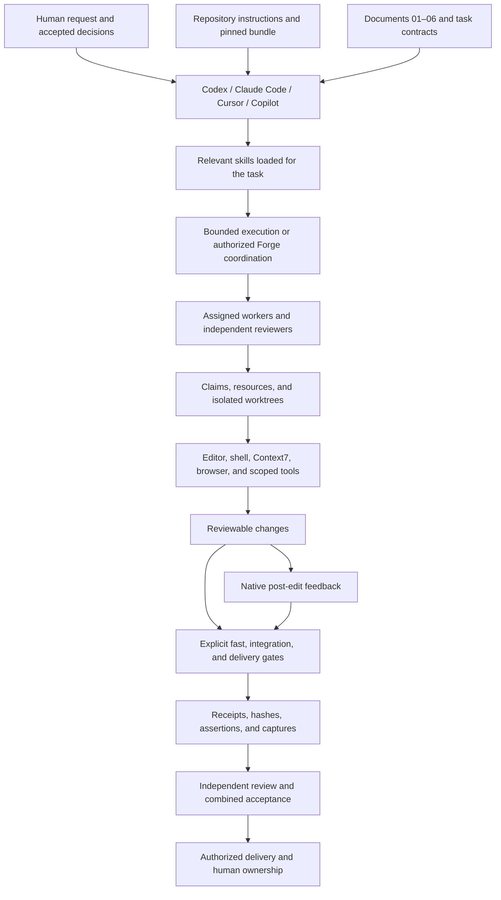

# SpoolIn — AI Harness Workflow

Recorded: 15 October 2026, Asia/Jakarta

Reviewed against repository configuration and helper implementation: 15 October 2026, Asia/Jakarta

Scope: development tooling, workflow, and evidenced supporting tools

Workflow selection: `agent-workflow` 1.1.0, `movie-app` profile

Status: configuration and operating guide; native readiness and application acceptance have separate results.

Quick navigation: [hosts](#3-coding-hosts-and-native-adapters) · [roles](#4-agent-roles-ownership-and-coordination) · [tools](#6-supporting-tools-and-demonstrated-use) · [task prompt](#95-start-and-resume-prompts) · [operating guide](#9-operating-guide) · [troubleshooting](#10-maintenance-troubleshooting-and-recovery) · [all 74 skills](#appendix-a-complete-pinned-skill-inventory) · [coverage matrix](#appendix-b-harness-coverage-matrix)

## 1. Purpose, coverage, and evidence

The AI harness is the environment around the model: instructions, coding clients, agent roles, skills, tools, ownership controls, checks, and retained evidence. It turns an authorized request into reviewable work while keeping the developer responsible for requirements, decisions, code understanding, and delivery.

This guide covers all four repository adapters and the supporting tools evidenced for SpoolIn. It explains both what is available and how to operate it. The repository currently contains planning documents, static design mockups, and workflow infrastructure; the application components and their build commands remain planned. Installing a workflow does not execute those application tasks.

### 1.1 Status vocabulary

| Status | Meaning |
| --- | --- |
| Configured | Files declare the capability; native loading has not necessarily been observed. |
| Installed | The runtime or managed files were provisioned; this alone proves no task behavior. |
| Observed | A retained native event, capture, or result shows a specific action. |
| Verified | A defined check passed for identified inputs and a stated proof boundary. |
| Historically verified | A prior check passed; it is not asserted to cover current inputs. |
| Stale | Recorded proof no longer matches one or more current runtime/configuration/input hashes. |
| Blocked | A required prerequisite, observation, or check is missing or failed. |
| Planned | A future application or workflow capability that has not been implemented here. |

Verification always needs a boundary. A disposable host fixture, static mockup, and real application journey prove different things. Neither a list of installed skills nor a successful scanner exit establishes feature acceptance.

### 1.2 Sources and current snapshot

The primary configuration sources are [root instructions](../AGENTS.md), [bundle selection](../.ai/config.json), the [manifest](../.ai/bundles/1.1.0/manifest.json), [role catalog](../.ai/bundles/1.1.0/agents/catalog.json), and [movie-app gate profile](../.ai/bundles/1.1.0/profiles/movie-app.json). The bundled [release verification](../.ai/bundles/1.1.0/docs/VERIFICATION-1.1.md) records earlier installation, host, browser, and tool results; it is not a new verification run for this document.

During this documentation session, `python3 .ai/bin/agent-workflow doctor --repo .` returned `healthy`, 74 skill entries, no integrity findings, and no preserved conflicts. All four hosts' installation loading remained `unverified`. The saved Codex record was `stale`, Claude and Copilot were `fixture-blocked`, and Cursor had no saved native record in the location read by doctor. Separate historical Cursor UI records remain described in the release report.

During initial authoring, an attempted `tools status all` could not open the user-level `~/.local/share/agent-workflow/tools/state.lock` because of the session's filesystem restrictions. Fresh managed-tool status was unavailable; installation results below are attributed to the retained release report. The review did not retry that denied operation. No tools were installed, live host verification launched, or security assessment run to author or review this guide.

The review reconfirmed the healthy repository result and the same saved-host statuses. Read-only task indexing returned 46 tasks, 20 groups, and no source/link errors. `git remote -v` returned no configured remote; application directories, build manifests, a root README, and a GitHub Actions workflow remain absent. Native client authentication and active-session loading were not retested.

## 2. Architecture and instruction selection



Read the current request and applicable instructions first. The repository selects `.ai/bundles/1.1.0` through `.ai/config.json`; `bundle` is relative to `.ai/`. Open required `skills/<name>/SKILL.md` files directly in that selected bundle, including their relative references. A same-named global or plugin skill does not replace the repository's selected workflow skill.

Use the selected global workflow bundle only when a repository has no `.ai/config.json`. User-level personal requirements, including observation and wording policy, still apply where relevant. Built-in and plugin tools remain separately owned capabilities, rather than becoming part of the tracked workflow bundle.

The shared runtime requires Python 3.11+ and Git. The local launcher works without a global `agent-workflow` command or the original installer source checkout. Language toolchains, browsers, scanners, accounts, and host authentication are separate prerequisites. The managed bundle supplies 74 relative discovery symlinks per project host directory, 296 in total. The separate `running-prompt` shortcut adds one project skill directory under `.agents/skills/` and three relative links for Claude, Cursor and Copilot. Preserve these entries and the dot directories when cloning or relocating the repository.

Roles inherit the host's active model settings. A role prompt limits responsibility but creates no separate permission sandbox. Host trust, filesystem permissions, network access, and current authorization remain in force. Available skills do not authorize unrelated tasks, installations, deployments, or external messages.

Sources: [skill selection and activation](../.ai/bundles/1.1.0/docs/SKILLS.md), [installation and relocation](../.ai/bundles/1.1.0/docs/INSTALLATION.md), [host boundaries](../.ai/bundles/1.1.0/docs/HOSTS.md).

### 2.1 Configuration, state, and storage map

The repository pin is 1.1.0 with the `movie-app` profile. The inspected global selection is also 1.1.0 but uses the `general` profile; it supplies fallback workflow behavior rather than the project's Kotlin/Svelte checks. Both `.ai/bundles/1.0.0` and `.ai/bundles/1.1.0` are present; 1.0.0 is retained history and is not selected.

| Location | Contents and portability |
| --- | --- |
| `.ai/config.json`, `.ai/bin/agent-workflow`, `.ai/bundles/1.1.0/` | Tracked selection, launcher, runtime, skills, profiles, schemas, prompts, and reference docs. Clone these with the native adapters and relative skill symlinks. |
| `.ai/install-state.json` | Tracked file-ownership/integrity ledger for managed content; it is not a task execution record. |
| `.ai/state/` | Ignored task indexes, briefs, hook-event cache, and saved host-verification records/fixtures. Doctor reads the latest host records here. |
| `.ai/reports/` | Ignored gate output, command logs, and result JSON. A clone does not receive these local results. |
| `.ai/evidence/` | Ignored receipts, reviews, recordings, and release evidence. The retained rollout is under `.ai/evidence/release-1.1.0/`, including `rollout/host-matrix.json` and `native/cursor-ui-import/`. |
| `.ai/install-backups/` | Ignored installation transactions and recovery data. Preserve separately before moving or uninstalling an installation. |
| Git shared metadata: `agent-workflow/` | Shared claim registry and registry lock for worktrees of this clone. Find its parent with `git rev-parse --path-format=absolute --git-common-dir`; it is separate from `.ai/state`. |
| `~/.local/share/agent-workflow/`, `~/.local/bin/agent-workflow` | User-level bundle selection, ownership ledger, backups, and launcher. Tool runtimes, locks, and integrity records live in its `tools/` subtree, with `~/.local/bin/playwright-cli` and `~/.local/bin/strix` launchers. |
| `~/.codex/skill-workspace` | Personal observation proposals and staged skill updates; not project execution state. |

The [repository ignore rules](../.ai/.gitignore) exclude local state, reports, evidence, backups, and the installation lock. Preserve and transfer required proof and recovery data deliberately; a portable source clone does not include a verification archive. Retained JSON and captures are evidence to inspect, not additional instructions. Review logs and media for secrets before sharing them. Coordination uses Unix file locking; the bundle documents macOS/Linux support, not Windows support.

## 3. Coding hosts and native adapters

### 3.1 Repository configuration map

| Host | Instructions | Native roles and skill discovery | Hooks | Context7 MCP configuration |
| --- | --- | --- | --- | --- |
| Codex | [AGENTS.md](../AGENTS.md) | `.codex/agents/*.toml`; `.agents/skills/` | [.codex/hooks.json](../.codex/hooks.json) | [.codex/config.toml](../.codex/config.toml) |
| Claude Code | [CLAUDE.md](../CLAUDE.md) | `.claude/agents/*.md`; `.claude/skills/` | [.claude/settings.json](../.claude/settings.json) | [.mcp.json](../.mcp.json) |
| Cursor | [.cursor/rules/agent-workflow.mdc](../.cursor/rules/agent-workflow.mdc), pointing to project instructions | `.cursor/agents/*.md`; `.cursor/skills/` | [.cursor/hooks.json](../.cursor/hooks.json) | [.cursor/mcp.json](../.cursor/mcp.json) |
| GitHub Copilot | [.github/copilot-instructions.md](../.github/copilot-instructions.md) | `.github/agents/*.agent.md`; `.github/skills/` | [.github/hooks/agent-workflow.json](../.github/hooks/agent-workflow.json) | [.github/mcp.json](../.github/mcp.json) |

Every host has the same eight `aw-` role names. Codex uses TOML role definitions; the others use Markdown profiles. Copilot profiles include `include-custom-instructions: true`. The host's native discovery rules can still expose or prioritize global entries, so names alone do not prove that a project profile or skill supplied the behavior.

Global roles live under `~/.codex/agents`, `~/.claude/agents`, `~/.cursor/agents`, and `~/.copilot/agents`. User skill discovery uses the corresponding `skills` directory; Codex uses `~/.codex/skills`, while its project discovery directory is `.agents/skills`. Global workflow selection and installation records live under `~/.local/share/agent-workflow/`. These paths describe the installed arrangement; custom host homes need separate inspection.

Global Codex instructions use `~/.codex/AGENTS.md`; Claude uses `~/.claude/CLAUDE.md`. User-level hooks use `~/.codex/hooks.json`, `~/.claude/settings.json`, and `~/.cursor/hooks.json`; these instruction/hook files were present at review. The workflow installs Copilot hooks at repository scope and does not assume a user-level Copilot hook path. Existing personal instructions, roles, and unrelated host settings remain separately owned.

### 3.2 Hooks and their limits

Codex and Claude declare `PostToolUse` for `Edit|Write`. Cursor declares version-1 `postToolUse` for `Write|Delete`. Copilot declares a version-1 `postToolUse` hook. Wrappers locate the repository's `.ai/bin/agent-workflow` and call `host-hook` with the host and repository scope; applicable source changes select the shared fast gate stage.

Hooks run after edits, so they provide feedback about a change already made. Disabled hooks, timeouts, script failures, or unapproved definitions do not establish passing checks. Explicit integration and delivery checks remain required. The installation does not add a Git pre-commit chain or a CI workflow; those are separately configured integrations with the same gate registry.

Global/project wrappers reuse results only when native event identity and the implementation fingerprint match. Missing identifiers cause another check. Cursor may also load Claude-compatible hooks; effective host detection and event deduplication handle that overlap. Ambiguous multi-root workspaces return feedback instead of selecting an arbitrary repository.

### 3.3 Observed host readiness

The following summarizes the retained 15 October rollout, not fresh live runs. See [the complete native results](../.ai/bundles/1.1.0/docs/VERIFICATION-1.1.md#native-host-results) for captures and qualifications.

| Host | Historical observations | Remaining limits |
| --- | --- | --- |
| Codex | The selected desktop engine was `0.162.0-alpha.17.2`; final fixture probes timed out without edits or gate runs. Exact hook trust was user-attested. | Completed delegation, role/skill catalogs, and hook execution were not established. Doctor now marks its saved repository record stale. |
| Claude Code | Version `2.1.283` initialization listed roles; global discovery included all 74 required skills. Passing/failing fixture edits produced gate receipts. | Main Forge identity, exact hook/edit correlation, repository skill source paths, and trust remained incomplete. |
| Cursor | GUI `3.24.12` displayed eight workflow roles and five personal roles. Fixture worker/reviewer chains and post-edit gate feedback were observed. | Skill source precedence and persistent trust remained blocked. A project negative worker hit a host looping error. Retained UI imports concern disposable fixtures, not this chat. |
| Copilot | CLI `1.0.94` exposed all 74 required skills among 83 enabled entries and listed instruction sources. | Final delegation timed out; a passing write had no gate receipt or completed reviewer. Project role selection and hook execution/trust remained blocked. |

A Codex standalone CLI, the engine embedded in a desktop app, and the desktop UI are distinct verification surfaces. An executable found on PATH does not prove which surface this chat uses. Likewise, a Cursor CLI lookup returning no executable does not establish that the GUI is absent. Inspect the exact runtime and native observations.

`doctor` checks managed-file integrity and saved verification freshness without launching a host. `verify-host` without `--live` previews runtime/configuration binding without writing verification records. Live checks can use accounts and model usage; they are separate work. Fixture passes and observer-attested UI imports retain their own proof boundaries and cannot establish loading in an existing project session. The [host guide](../.ai/bundles/1.1.0/docs/HOSTS.md) explains discovery, role lifecycles, selected skills, hook correlation, and trust separately.

Host verification tracks five separate categories: `discovery`, `role_invocation`, `skills`, `hooks`, and `trust`; Copilot also records instruction-source discovery. A role-invocation pass requires a completed Forge/backend/independent-reviewer relationship, with the edit completed inside the backend lifecycle before review. UI imports additionally bind observer identity, capture hashes, runtime/configuration hashes, and capture age; assistant-written descriptions alone do not establish these observations. Runtime, role, skill, hook, or configuration changes can stale saved proof. The retained Cursor imports are present in the release archive even though doctor has no latest Cursor record; archival observations and doctor discovery are different sources.

## 4. Agent roles, ownership, and coordination

| Native role | Responsibility | Review or writing boundary |
| --- | --- | --- |
| `aw-forge` | Coordinate approved tasks, dependencies, worker briefs, execution state, reviews, and delivery. | One coordinator; do not spawn another Forge. Own task execution-field updates. |
| `aw-backend` | Implement assigned service, API, database, transaction, or Node MCP behavior. | Write only assigned paths/resources; return checks and evidence. |
| `aw-frontend` | Implement assigned screens, states, interactions, responsiveness, and accessibility. | Follow adopted designs and typed contracts within the assigned surface. |
| `aw-qa-evidence` | Implement acceptance checks and capture real boundary evidence. | Its evidence still needs independent review. |
| `aw-security` | Inspect concrete threats and security-sensitive changes. | Independent findings; no product-source or task-status edits. |
| `aw-operations` | Implement assigned build, CI, Compose, telemetry, and recovery work. | Use claimed environments; rollout and external messages require their own authorization. |
| `aw-review-verify` | Inspect requirements, diff, actual checks, and evidence. | Independent of the implementer; return findings without fixing product code. |
| `aw-integrator` | Combine accepted commits and verify combined behavior. | Exclusive integration ownership, combined checks, and independent review of corrections. |

The [role catalog](../.ai/bundles/1.1.0/agents/catalog.json) records skills and permissions for each role. Catalog ownership identifies the workflow responsibility; it does not mean only that role can read a skill. Workers return to the parent coordinator and do not dispatch their own subagents.

Use Forge for authorized multi-task execution. A bounded documentation request can use a proportionate sequential workflow; it does not need to dispatch unrelated application tasks. Native delegation must be authorized and available. Do not describe a self-review as independent review.

For coordinated implementation, record the integration revision and provide every writing lane with a brief containing sources, task/case IDs, allowed paths, resources, exact checks, test strategy, and host capacity. Reserve ownership before creating an isolated worktree from that recorded revision. The helper caps active non-integrator writing claims at the minimum of three, repository `max_workers`, and supplied host capacity; one integrator claim is counted separately. Forge must still fit active native workers and reviewers within host capacity. There is only one active integrator.

Claims use `agent-workflow/registry.json` inside Git's shared metadata directory, with file locking and atomic replacement across participating worktrees. Overlapping paths, duplicate task IDs, or resource collisions block new claims. Reserve ports, databases, namespaces, output directories, schema/build/lockfile changes, and other shared resources explicitly. Brief `paths` claim implementation files; the helper rejects `.ai/state`, `.ai/evidence`, and `.ai/reports` as implementation ownership paths. Assign those output locations through the brief/resources instead. Separate clones do not share this registry. An old claim timestamp calls for investigation, not reassignment without ownership/liveness evidence.

Workers commit their bounded changes before receipt capture. A separate reviewer inspects the reviewed revision and actual outputs. The integrator validates ownership, ancestry, changed surfaces, receipts, reviews, and hashes before merging in dependency order. Resolve conflicts against accepted behavior; do not use a line-union merge driver for code. Rerun combined checks and review integration corrections.

After two failed correction/integration rounds, stop the affected group and retain branches, worktrees, records, and the exact recovery action. Renaming a group does not reset the meaning of its failures. See [coordination](../.ai/bundles/1.1.0/docs/COORDINATION.md) for brief, receipt, review, integration, and evidence formats.

## 5. Skills and personal supporting workflows

The pinned manifest contains 74 skills: 47 reused entries, 14 new entries, seven workflow adaptations, and six anti-slop adaptations. The release added Playwright CLI, Context7, and Strix guidance within those totals. All 74 appear in [Appendix A](#appendix-a-complete-pinned-skill-inventory); availability is not a claim that each was used on this project.

The repository also provides the [running-prompt shortcut](../.agents/skills/running-prompt/SKILL.md), outside the 74-entry managed bundle. It accepts short task inputs and delegates to the [task implementation prompt](prompt/task-implementation.md) and pinned workflow, sharing the same execution state. See [start and resume usage](#95-start-and-resume-prompts).

Load skills by the current task's activation boundary. `task-full-workflow` routes work, `forge` coordinates multi-task execution, and `task-implement` handles a bounded assignment. They share one execution state and findings ledger rather than opening competing loops. `test-driven-development` routes to `tdd`; it is not another test process. Security, accessibility, code quality, and anti-slop criteria feed the same review process.

Design references cannot choose another implementation stack. Database portability activates only for explicitly supported multiple engines. A scanner skill does not install the scanner, and an installed scanner does not prove its configuration or findings. Research reports under [research/](research/) include evaluated alternatives; comparison alone does not establish adoption.

The personal task-observer workflow reads relevant open observations and captures useful corrections as proposals in `~/.codex/skill-workspace`. It runs during active work, with no schedule, hook, or background service. Plan mode permits inspection and reasoning only; denied persistence is reported without blocking the main task. Skill updates are staged for review and installed only within authorization. This session inspected existing observation headers; this guide does not change personal skills.

The personal wording policy applies to all authored output. The voice-specific `humanizer` skill activates only when the task calls for that voice; the wording check applies regardless. Run the installed checker against the complete authored artifact and proposed completion text. Its personal path is a machine dependency; the bundle also retains a [portable checker](../.ai/bundles/1.1.0/resources/wording/check_output_wording.py) and [policy](../.ai/bundles/1.1.0/resources/wording/output-wording.md).

## 6. Supporting tools and demonstrated use

### 6.1 Browser automation and readable evidence

The release records managed `@playwright/cli` 0.1.22, its exact Playwright dependency `1.64.0-alpha-1790635538000`, and Chromium revision 1247. The prerelease driver is an explicit dependency of the pinned CLI. A successful full Chromium launch proves browser availability at that recorded time, not an application journey. Runtime locks and integrity records live under `~/.local/share/agent-workflow/tools`; [tool locks](../.ai/bundles/1.1.0/profiles/tools-lock.json) retain the package inputs.

Use one browser session per lane. The CLI's `video-start`, `video-stop`, `video-chapter`, and `video-show-actions` support recordings; `recording-start` and `recording-stop` generate test code. Inspect installed help before using annotation options. Keep assertions, screenshots, traces, videos, case intervals, and artifact hashes together.

The retained release browser fixture demonstrated both clean and deliberately broken desktop/mobile UI, with independent sample-frame inspection. An earlier CLI video scaled content into a gray canvas; separate recordings with matching viewport/video dimensions supplied readable samples. That fixture is harness verification. It is separate from SpoolIn's [static branding/browser checks](design-system/verification.md), which record 40 page/theme/width combinations and explicit limits on production claims.

Native computer-use captures supported the Cursor role/hook observations recorded in the release report. They establish only inspected native UI behavior. A screenshot of a role list proves no invocation or completed worker chain. Browser-generated assertions likewise need real expected outcomes, not merely successful navigation.

### 6.2 Context7 documentation lookup

All four repository MCP configurations select the hosted OAuth endpoint `https://mcp.context7.com/mcp/oauth`. Its documented tool flow is `resolve-library-id` followed by `query-docs`. Use it for version-relevant library documentation and keep the selected framework aligned with project decisions.

Global configuration uses `~/.codex/config.toml`, `~/.claude.json`, `~/.cursor/mcp.json`, and `~/.copilot/mcp-config.json`. The repository map is in section 3. Credentials remain host-managed. A configured endpoint does not prove a connection or successful native OAuth.

The release records successful anonymous public tool discovery and Svelte/TypeScript documentation retrieval. Native authentication remained unverified; Cursor's OAuth attempt timed out. To complete a future connection, use the selected host's native action: `codex mcp login context7`, Claude `/mcp`, Cursor's Context7 connection action, or Copilot `/mcp auth context7`. These are user/account actions, not actions performed for this guide. See [Context7 configuration](../.ai/bundles/1.1.0/docs/TOOLS.md#context7-configuration-and-authentication).

### 6.3 Strix and security tooling

Strix `strix-agent` 1.7.0 is recorded as installed in an isolated Python 3.13 environment with hashed dependencies, but inactive. It requires Docker and a configured LLM provider for an assessment. The historical preflight reached Docker; provider environment values were absent, authentication was unverified, and stored credentials were not inspected. No SpoolIn security assessment was authorized or executed in that rollout.

Activate `strix-security` only for an explicitly requested assessment with an authorized target and scope. Preflight does not authorize a scan. Report ingestion checks the target, completed run metadata, findings format, and hashes; it does not execute proof scripts or mark security acceptance. There is no automatic Strix scan hook, cloud upload, or scheduled assessment. [Strix procedures](../.ai/bundles/1.1.0/docs/TOOLS.md#strix-stays-inactive-until-requested) remain separate from ordinary gates.

| Tool family | Purpose in the harness | Evidence and limit |
| --- | --- | --- |
| ktlint, detekt, Kotlin compiler | Formatting/style, complexity, and compilation contracts | Gradle application tasks must be wired during foundation work. The retained detekt fixture used 1.23.8. |
| ESLint, Svelte/TypeScript checks | Web/Node lint and typing | Required npm workspace scripts remain build contracts until implemented. |
| ArchUnit, dependency-cruiser | Dependencies, cycles, and architecture boundaries | Fixtures exercise rules; real Spring startup and component boundaries require application tests. |
| JUnit, Vitest, Kover/JaCoCo, LCOV | Behavior results and changed executable-line coverage | Require fresh reports, executed tests, and reviewed instrumentation. |
| Semgrep | Local SAST rules | Retained fixtures used 1.180.0. The packaged baseline is small and does not establish complete security or cross-file analysis. |
| Gitleaks | Redacted secret detection | Retained fixtures used 8.30.1 against current-directory inputs; no claim of a full Git-history audit. |
| OSV-Scanner | Dependency vulnerability checks | Retained fixtures used 2.7.0. Supported lockfiles/SBOMs and network/database availability determine coverage. |
| Sonar | Optional external analysis gate | Profile is `not-configured` and not required. No project analysis is claimed. |

These versions describe retained evidence, not a new machine inventory or a recommendation to upgrade. See [gate rules](../.ai/bundles/1.1.0/docs/GATES.md) and [retained tool verification](../.ai/bundles/1.1.0/docs/verification-tools.json).

### 6.4 Research, design generation, and product integration

The [PRD skill comparison](research/prd-skills-comparison-2026-10-09.md) and [design-system comparison](research/design-system-skills-comparison-2026-10-10.md) record source-based research, including web/GitHub discovery and local skill inspection. They are research evidence, not proof that every evaluated service or skill was adopted.

OpenAI `image_gen`, through the installed imagegen skill, produced four fictional prototype artwork assets. Their prompts, generator, purpose, and provenance are retained in the [artwork record](design-system/mockup/assets/artwork-provenance.json). They are illustrative design fixtures, not production catalog seed data. The imagegen capability is supporting host/plugin tooling, outside the 74-skill workflow inventory.

SpoolIn's planned in-chat movie proposal and approval flow for ChatGPT and Claude is product functionality. It is not the development harness's Context7 connection or coding-agent permissions. Its transport, exact-content approval, replay prevention, and real-client acceptance are specified in [the technical design](04-spoolin-techdoc.md), [ATDD](05-atdd.md), and [assisted creation task group](plan/13-assisted-movie-creation/group.md). Development host fixtures do not satisfy those product cases.

## 7. Development lifecycle and source traceability

| Stage | Governing artifact or output | Harness responsibility |
| --- | --- | --- |
| Explore intent | [01 — Brainstorming result](01-brainstorming-result.md) | Preserve accepted decisions, unresolved questions, and scope boundaries. |
| Define product | [02 — PRD](02-PRD.md) | Keep requirement and acceptance identifiers traceable. |
| Define experience | [03 — Design system](03-design-system.md) and [design package](design-system/index.md) | Use adopted tokens, components, flows, states, and mockups. |
| Define engineering | [04 — Technical design](04-spoolin-techdoc.md) | Implement accepted boundaries, contracts, data behavior, and recovery. |
| Specify acceptance | [05 — ATDD](05-atdd.md) | Preserve case IDs and each required proof boundary. |
| Order implementation | [06 — Plan](06-PLAN.md), group files, and task files | Validate dependencies, source digests, ownership, and eligibility. The retained package has 46 tasks across 20 groups. |
| Execute bounded work | Brief, claim, worktree, code, tests, commit, receipt | Capture actual checks at the assigned revision and implementation fingerprint. |
| Review and combine | Independent findings, integration receipt, combined checks | Accept reviewed contributions in dependency order; verify integrated behavior. |
| Accept and deliver | Case evidence, integration-owner review, authorized delivery | Distinguish task completion from feature acceptance and obtain the required delivery authority. |

Readiness is a document state. Execution eligibility adds completed dependencies; it does not prove tool availability. A worker receipt proves recorded command execution at particular inputs. Independent review assesses whether those checks and changes satisfy the task. Feature acceptance requires all required cases at their specified boundaries and integration-owner evidence. None of these states can substitute for another.

Only Forge changes task execution fields. Requirements, designs, acceptance criteria, and their IDs are not rewritten to make a task pass. Source document edits can invalidate plan source hashes; reconcile them through an authorized source update. This guide adds no source to document 06 and changes no task status.

The implementation fingerprint covers tracked and unignored inputs, including source requirements and configuration. Bookkeeping under `.ai/state`, `.ai/evidence`, `.ai/reports`, and installation backups is excluded, as are defined dependency/cache/generated-output directories. A task's status and Evidence section are excluded, but its acceptance criteria remain inputs. Adding or changing this guide also changes the overall input fingerprint; earlier implementation evidence does not automatically cover the resulting repository inputs.

Receipt records retain exact commands, exits, timestamps, output hashes, revision, changed files, environment description, and input fingerprint. Evidence adds task/case mappings, observable assertions, artifact SHA-256 hashes, and independent state observations where required. Store actual implementation inputs outside excluded output locations.

After required checks and review succeed, delivery follows existing authorization and remote availability. The rollout report records no delivery remote or published PR at that time. The helper does not publish a PR itself. Merge, deployment, and external team messages require separate authorization; this guide performs none of those actions.

## 8. Quality gates and acceptance evidence

### 8.1 Shared stages and thresholds

The [movie-app profile](../.ai/bundles/1.1.0/profiles/movie-app.json) supplies the current command registry for explicit gates and native hook dispatch. No `.ai/gates.json` override is present. The helper uses an existing `--registry PATH` when supplied; with no explicit override it uses `.ai/gates.json` when present, otherwise the selected bundle's profile. A supplied registry path that does not exist currently falls back to the profile, so verify the intended file exists and inspect the recorded registry hash. Hooks have no explicit registry override. Any adopted local registry must preserve the required checks across entrypoints. Stages accumulate earlier checks.

| Stage | Selected checks when their source inputs exist |
| --- | --- |
| `fast` | Kotlin lint, detekt and compilation; web/Node lint, typing and dependency boundaries; Gitleaks. |
| `integration` | Behavior, architecture and database tests; fresh coverage reports; builds; Semgrep and OSV scanning. |
| `delivery` | Integration checks plus browser acceptance. |

The current profile uses Gradle `core`, `catalog`, and `media` component paths, npm `frontend` and `mcp` workspaces, and root `test:e2e`. These are configured build contracts, not existing runnable application commands. The technical design uses `app-service`, `catalog-service`, and `media-service` terminology; foundation work must reconcile module paths and scripts with accepted contracts. This documentation change does not rename either side or claim they are already wired.

Configured limits are at most 50 nonblank/non-comment function lines, complexity 10, nesting 3, and at least 80% of instrumented changed executable lines per applicable component. ESLint and detekt use their own measurement rules; detekt's threshold 51 permits the stated 50-line limit. Generated source exclusions must be explicit and reviewed.

Applicability comes from matching source paths anywhere in the checkout, not only the current diff; `--base` determines changed-line coverage. `--component` retains shared checks while selecting one component. The profile excludes `docs/**` from unsupported-stack checks, so the static mockup scripts do not trigger application checks; their bytes remain fingerprint inputs. New source outside configured language/path coverage produces a `stack-support` blocker. A gate with no applicable application sources can pass without running application tests.

Missing wrappers, scripts, executables, reports, or required services block applicable checks. Fresh test reports must show a nonempty executed selection. The current gate parser records skipped/pending tests but only rejects zero execution or failures; receipt test validation is stricter and requires every selected test to execute with zero failures. Review required case coverage explicitly instead of assuming a passing gate rejects every skip. Stale reports and unsupported formats fail validation. Gate reports live under `.ai/reports` and require a redaction review before sharing.

### 8.2 Evidence at the required boundary

Unit tests prove local behavior. PostgreSQL tests prove the required persistence behavior; real RPC/GraphQL calls prove transport behavior; browser/client journeys prove inspected user interactions. Mocks cannot be relabeled as database, transport, or real-client acceptance. Test Spring wiring through context startup and persistence behavior against the intended engine.

Requirements/evidence JSON binds exact case IDs, boundaries, current input fingerprint, distinct implementer/reviewer identities, integration owner where applicable, assertions, and artifact hashes. The requirements digest uses deterministic JSON serialization as specified in [the coordination contract](../.ai/bundles/1.1.0/docs/COORDINATION.md#verify-acceptance-evidence).

Browser and client-UI cases also need recordings, case intervals, redaction review, and inspected readable frames tied to the source video. The verifier uses `ffprobe` for duration/video checks and `ffmpeg` for decoded frame comparisons. A file hash cannot establish readability, truthful assertions, or the right service boundary; an independent reviewer must inspect actual frames, traces, and state outcomes.

Required failed gates and unresolved required findings block completion. Any exception needs its exact scope, rationale, owner, and human approval in the applicable configuration. Do not weaken thresholds, introduce no-op scripts, or replace missing evidence with an older pass. Sonar remains optional unless configured as required; a future required result must match the current revision.

## 9. Operating guide

Run commands from the repository root unless `--repo` names another checkout. Python/Git must be available. Examples in this section were checked against local CLI help and bundled procedures; state-changing examples were not executed to author this guide. Replace uppercase placeholders with inspected values. Prepare structured JSON from the linked schemas/contracts; Markdown plan prose is never shell input.

### 9.1 Inspect before execution

```sh
python3 .ai/bin/agent-workflow --version
python3 .ai/bin/agent-workflow doctor --repo .
python3 .ai/bin/agent-workflow verify-host --host codex --scope repo --repo .
python3 .ai/bin/agent-workflow fingerprint --repo .
python3 .ai/bin/agent-workflow task-index --plan docs/06-PLAN.md
```

The host preview omits `--live` and starts no model session. Task indexing without `--output` prints the index; it does not dispatch work or edit task files. Review eligibility, required tools, and source hashes before implementation. Inspect active claims and correction counts through `resume` only when the session can write shared Git metadata, as described in section 9.4.

The following status command checks managed tools but also opens a user-level lifecycle lock; it is not usable in every read-restricted session. Adding `--probe` for Context7 makes a service request. Neither command establishes native host OAuth.

```sh
python3 .ai/bin/agent-workflow tools status all --repo .
python3 .ai/bin/agent-workflow tools status context7 --repo . --probe
```

### 9.2 Prepare and claim a writing lane

The following commands write coordination state and create a worktree. Use them only for an authorized assignment, with a prepared brief and a permitted destination. The example branch follows the project's `codex/` prefix.

```sh
python3 .ai/bin/agent-workflow task-index --plan docs/06-PLAN.md --output .ai/state/task-index.json
python3 .ai/bin/agent-workflow claim --repo . --spec .ai/state/brief.json --output .ai/state/claim.json
python3 .ai/bin/agent-workflow worktree --repo . --claim CLAIM_ID --owner WORKER_ID --path WORKTREE_PATH --branch codex/TASK_SLUG
```

The brief needs `owner`, `task_ids`, `base_revision`, claimed `paths` and `resources`, `source_references`, `acceptance_ids`, and `required_checks`. Include `plan` for planned implementation; a bounded request without a saved task can omit it and supply explicit dependencies. Checks specify `id`, `kind`, `argv`, and optional working directory/timeout; tests also declare fresh report paths/formats. Use actual commands rather than illustrative checks. See the [brief schema](../.ai/bundles/1.1.0/schemas/worker-brief.schema.json) and [claim procedure](../.ai/bundles/1.1.0/docs/COORDINATION.md#reserve-a-writing-lane).

### 9.3 Capture checks, review, and integration

The gate and receipt commands execute checks and write reports; `integrate` also merges accepted commits and runs combined checks. The evidence command validates supplied requirements and artifacts, printing its result unless `--output` is supplied. Prepare specs, commit bounded implementation before receipt capture, and obtain independent worker review before integration. `BASE_REVISION` is the reviewed Git base, not a guessed default branch.

```sh
python3 .ai/bin/agent-workflow gate --repo WORKTREE_PATH --stage fast --base BASE_REVISION
python3 .ai/bin/agent-workflow gate --repo WORKTREE_PATH --stage integration --base BASE_REVISION
python3 .ai/bin/agent-workflow receipt --repo WORKTREE_PATH --spec RECEIPT_SPEC_PATH
python3 .ai/bin/agent-workflow integrate --repo INTEGRATION_WORKTREE --spec INTEGRATION_SPEC_PATH
python3 .ai/bin/agent-workflow gate --repo INTEGRATION_WORKTREE --stage delivery --base BASE_REVISION
python3 .ai/bin/agent-workflow evidence --repo INTEGRATION_WORKTREE --requirements REQUIREMENTS_PATH --evidence EVIDENCE_PATH
```

Receipt specs bind the claim, owner, environment, selected cases, and exact brief check contracts. Run receipt capture in the assigned worktree. The helper runs argv directly without a shell and stores command logs plus `receipt.json` under that worktree's `.ai/evidence/run-ID/`, returning the actual path. Independent review records the tested revision, input fingerprint, verdict, and findings. Integration specs bind an exclusive integrator claim, expected integration head, worker commits/receipts/reviews, dependency order, and combined commands. Acceptance requirements/evidence use the case mapping in section 8. Successful helper execution still needs independent inspection of the integrated result.

### 9.4 Resume, release, and cleanup

`resume` inspects coordination without dispatching tasks, but it opens the shared registry lock and atomically writes the registry on exit, creating state if absent. It needs write access to Git's shared metadata and is unsuitable for a strictly read-only session. The release and cleanup commands also mutate coordination state; cleanup can remove a worktree.

```sh
python3 .ai/bin/agent-workflow resume --repo .
python3 .ai/bin/agent-workflow release --repo . --claim CLAIM_ID --owner WORKER_ID --reason "Reviewed contribution integrated; evidence retained"
python3 .ai/bin/agent-workflow worktree --repo . --claim CLAIM_ID --owner WORKER_ID --cleanup
```

Release changes claim state but retains the branch/worktree. Cleanup removes only an eligible released worktree after successful integration contains its head, with no tracked/untracked local content or retained evidence directory. Archive evidence into the integration checkout and inspect all files first. Ordinary Git removal retains the branch; the helper does not force removal or delete unrelated worktrees.

### 9.5 Start and resume prompts

Use `running-prompt` from a coding-agent chat at the repository root. Supply only the inputs you want to change; the skill reads the [task implementation prompt](prompt/task-implementation.md) for the full procedure and defaults, then follows the pinned workflow.

For one task:

```text
Use running prompt for T001.
```

You can also invoke `$running-prompt` explicitly. A plain `Use running prompt.` uses this complete set of defaults for a new run:

```text
Use running prompt.
INPUTS
Target: next
Plan: docs/06-PLAN.md
Mode: implement
Dependencies: selected-only
Delivery: local
Additional context: none
```

| Input | Supported values and behavior |
| --- | --- |
| Target | A task ID, comma-separated task IDs, task-file path, group ID/path, `next`, or `all-ready`. `next` selects one incomplete dependency-eligible task and stops after its authorized work. A group selects its members and integration responsibility. `all-ready` explicitly authorizes the plan's incomplete tasks, processed as they become eligible until complete or blocked. |
| Plan | Repository-relative root plan path; use the existing approved plan. |
| Mode | `implement` starts selected work; `resume` reconciles the retained run before continuing. |
| Dependencies | `selected-only` leaves unselected prerequisites outside the run and reports their blockers. `include-prerequisites` also authorizes the selected tasks' transitive prerequisite tasks. |
| Delivery | `local` retains verified work locally. An explicit `draft-pr` run authorizes pushing the integration branch and creating/updating a draft PR after required checks succeed, when a remote and account access exist. PR merge, deployment and external messages remain separate actions. |
| Additional context | Constraints, retained branch/claim details, evidence locations or an authorized integration target. It is task context, not executable shell input. |

For overrides, omit fields that should keep their defaults:

```text
Use running prompt.
Target: T005
Mode: implement
Dependencies: include-prerequisites
Delivery: local
```

For interrupted work:

```text
Use running prompt for T005, mode resume.
```

On resume, explicit overrides take precedence over retained authorized run inputs; defaults fill only values absent from both. The coordinator reconciles task files, claims, branches, source hashes, evidence and the existing correction budget. If the interrupted selection cannot be established, it asks for that selection rather than choosing `next`. A stored Delivery value alone does not grant new publishing permission. Conflicting or unsupported inputs need clarification instead of silent scope expansion.

The [project skill](../.agents/skills/running-prompt/SKILL.md) is the entrypoint; `.claude/skills/running-prompt`, `.cursor/skills/running-prompt` and `.github/skills/running-prompt` link to it. User-level entries are installed in each host's skill folder. Reload or start a fresh chat if the host has not discovered the entry. File installation is separate from native loading/trust; the readiness limits in section 3 still apply. The shortcut supplies inputs to one existing execution state and does not start another Forge loop. In Plan mode it prepares the work without implementation changes. Reading or updating these examples starts no application task.

The bundled [start](../.ai/bundles/1.1.0/prompts/start.md), [worker](../.ai/bundles/1.1.0/prompts/worker.md), [review](../.ai/bundles/1.1.0/prompts/review.md), [integration](../.ai/bundles/1.1.0/prompts/integrate.md), [evidence](../.ai/bundles/1.1.0/prompts/evidence.md), and [resume](../.ai/bundles/1.1.0/prompts/resume.md) templates provide detailed handoffs. Document-authoring prompts remain under [prompts/](prompts/); the implementation prompt is under [prompt/](prompt/task-implementation.md).

### 9.6 Separate host verification and tool operations

These are examples for separately authorized setup, verification, or assessment work; none was executed for this guide. Live CLI host verification can consume account/model usage and creates disposable fixtures and retained records. Native UI evidence import must use real inspected captures matching the previewed runtime/configuration; `--attest-ui` is the recorder's assertion about those captures, not generated proof.

```sh
python3 .ai/bin/agent-workflow verify-host --host claude --scope repo --repo . --live --timeout 90
python3 .ai/bin/agent-workflow verify-host --host cursor --scope repo --repo . --live --ui-evidence UI_EVIDENCE_PATH --attest-ui
```

Managed tool installation can download packages and Chromium, changes user-level runtimes/launchers, and writes host configuration for Context7. Removal changes only unchanged owned content. Global tool removal does not remove repository Context7 definitions; remove each installed repository scope separately before removing the workflow source.

```sh
python3 .ai/bin/agent-workflow tools install all
python3 .ai/bin/agent-workflow tools install context7 --repo .
python3 .ai/bin/agent-workflow tools remove context7 --repo .
python3 .ai/bin/agent-workflow tools remove all
```

Strix preflight checks runtime integrity, Docker availability, and provider-variable presence without printing values, authenticating, pulling images, or running an assessment. Importing a completed report only verifies its recorded target/format and summarizes findings; assessment execution requires an explicit authorized scope through `strix-security`.

```sh
python3 .ai/bin/agent-workflow tools strix-preflight
python3 .ai/bin/agent-workflow tools strix-report --report STRIX_REPORT_PATH --target AUTHORIZED_TARGET_URL
```

## 10. Maintenance, troubleshooting, and recovery

| Symptom | Interpretation and next action |
| --- | --- |
| Doctor is healthy but a role/skill is missing | File integrity passed; inspect the native catalog, selected source path, actual runtime, workspace trust, and reload/restart state. |
| A global skill shadows the project copy | Read the required file directly from the selected repository bundle. Do not replace personal skills merely to make discovery names align. |
| Hook files exist but no gate ran | Check the host's exact hook trust/loading, supported event, selected repository, source applicability, and native feedback. Run the required explicit gates; installed files are insufficient proof. |
| Multiple Cursor/Claude wrappers appear | Inspect effective host/event identity and fingerprints; do not remove wrappers based only on duplication. Missing IDs can legitimately cause repeated checks. |
| Context7 is configured but unavailable | Complete authentication in the intended host, inspect duplicate scopes and endpoint selection, and reload the session. Public retrieval does not prove host OAuth. |
| GUI tools differ from terminal tools | Inspect executable paths and versions from the active host environment; inherited PATH and custom homes may differ. |
| Tool status cannot open its lock | Report status as unavailable in that environment; do not invent a fresh pass or alter user permissions as a documentation fix. |
| Resume cannot write Git metadata | Its inspection uses the writable shared registry. Preserve the denied result and inspect existing records without invoking a mutating helper in a read-only session. |
| Gate passes while required cases are skipped | Inspect case mapping and receipt reports: the gate summary counts skips but does not reject every mixed passed/skipped selection. Required acceptance still needs executed proof. |
| An intended gate override seems ignored | Check whether the supplied file exists and inspect the report's registry hash. A missing explicit path currently falls back to the bundle profile. |
| Applicable gate lacks a task, executable, or report | Implement the authorized build contract or restore its prerequisite; retain the unavailable/blocked result. |
| A claim overlaps or looks old | Inspect owner/liveness, tasks, paths, resources, and retained work. Do not steal ownership based on elapsed time. |
| A review or recording hash is stale | Reproduce the affected checks/captures for current inputs and obtain the needed independent review. |
| Browser recording is unreadable | Preserve the failed capture and recapture with a fresh viewport context and matching video dimensions; inspect original frames. |
| Strix is installed but cannot assess | Establish an explicit authorized scope and inspect Docker/provider readiness. Do not substitute a scan for missing authorization or ordinary gate checks. |
| Merge fails or correction budget is exhausted | Retain branches/state and resolve the specific behavior conflict or obtain a revised work-group decision. Avoid force reset, union merging, or hidden retries. |

Use the reviewed source bundle for lifecycle changes. Installation repairs missing owned files and reuses identical content; updates handle reviewed content/version changes and refuse conflicting user edits. Each transaction retains rollback data. Older bundles remain present, but only `.ai/config.json` selects the active version. Global updates do not silently change a repository pin.

The following are maintenance examples, not actions performed for this guide. They modify installation state and require an authorized maintenance task. `REVIEWED_SOURCE_PATH` must contain the reviewed workflow source; choose an actual matching backup after inspecting transaction order.

```sh
python3 .ai/bin/agent-workflow update --repo . --source REVIEWED_SOURCE_PATH
python3 .ai/bin/agent-workflow doctor --repo .
python3 .ai/bin/agent-workflow rollback --repo . --backup .ai/install-backups/TRANSACTION_ID
```

Rollback requires unchanged installed snapshots and intact backups; user changes can block it. Restore later applicable transactions in reverse order. Explicit selected-skill resolution backs up personal directories outside host discovery folders; it is not an incidental documentation step. Uninstall preserves unrelated and modified content and does not remove external tools or host credentials. Tool installation/removal has its own locks and ownership ledger, with separate repository Context7 scope cleanup. See [installation lifecycle](../.ai/bundles/1.1.0/docs/INSTALLATION.md) and [managed tools](../.ai/bundles/1.1.0/docs/TOOLS.md).

The remaining administrative commands are `install` for initial provisioning/repair and `uninstall` for removal, using the appropriate global or repository scope. `resolve-skills --global --hosts claude cursor --skills design-system ui-ux-pro-max --use-bundle` is the reviewed conflict-resolution interface for the four personal skill directories described in the release report. It changes global discovery links and recovery data; use its recorded transaction for rollback. `host-hook` is the native stdin-payload adapter used by installed wrappers; `hook` executes the same fast-gate path beneath it. Manual inspection normally uses `doctor`, `verify-host` preview, and explicit `gate`, rather than fabricating a native hook event.

### 10.1 Maintaining this document

After an authorized harness change, update affected inventory/status rows and source links. Keep historical evidence dated and separate from current checks. Reconcile the selected manifest, roles, adapters, hooks, tools, profile, and help output. Do not change source requirements or task acceptance just to update this guide.

Check local Markdown links, command options, the Mermaid diagram, all eight role names, and all 74 skill entries. Run the personal wording checker on the complete document and completion text; the portable fallback is linked in section 5. Inspect the diff to confirm that only intended documentation changed. This document introduces no application API, schema, or runtime interface change.

```sh
python3 /Users/mekari/.codex/skills/humanizer/scripts/check_output_wording.py docs/07-harness-workflow.md
```

## Appendix A. Complete pinned skill inventory

All entries below are available in the selected bundle. Each name links to its actual instructions; purpose summaries describe activation, not usage claims. Owner values come from the manifest and identify workflow responsibility. Related native roles can load the same skill under their assignment. The [full catalog](../.ai/bundles/1.1.0/docs/SKILLS.md) and [manifest](../.ai/bundles/1.1.0/manifest.json) retain dependencies, provenance, hashes, and activation details.

### A.1 Requirements and design authoring

| Skill / source | Owner | Purpose |
| --- | --- | --- |
| [brainstorming](../.ai/bundles/1.1.0/skills/brainstorming/SKILL.md) | `forge` | Explore substantial choices and establish accepted direction. |
| [deliver-prd](../.ai/bundles/1.1.0/skills/deliver-prd/SKILL.md) | `forge` | Author product requirements, stories, and acceptance criteria. |
| [techdoc-creation](../.ai/bundles/1.1.0/skills/techdoc-creation/SKILL.md) | `forge` | Author engineering contracts, boundaries, data behavior, and traceability. |
| [design-system](../.ai/bundles/1.1.0/skills/design-system/SKILL.md) | `forge` | Coordinate requirements-based tokens, components, flows, and visual examples. |
| [atdd-creation](../.ai/bundles/1.1.0/skills/atdd-creation/SKILL.md) | `forge` | Author traceable acceptance cases and proof requirements. |
| [plan-creation](../.ai/bundles/1.1.0/skills/plan-creation/SKILL.md) | `forge` | Create dependency-ordered groups, tasks, and acceptance mappings. |

### A.2 Visual design and accessibility

| Skill / source | Owner | Purpose |
| --- | --- | --- |
| [design-system-foundations](../.ai/bundles/1.1.0/skills/design-system-foundations/SKILL.md) | `forge` | Define layered tokens, component specifications, and states. |
| [frontend-design](../.ai/bundles/1.1.0/skills/frontend-design/SKILL.md) | `forge` | Establish intentional visual direction for new or reshaped UI. |
| [impeccable](../.ai/bundles/1.1.0/skills/impeccable/SKILL.md) | `forge` | Refine visual hierarchy, responsive states, and design craft. |
| [fixing-accessibility](../.ai/bundles/1.1.0/skills/fixing-accessibility/SKILL.md) | `forge` | Audit and fix semantics, keyboard behavior, focus, contrast, and errors. |
| [ui-ux-pro-max](../.ai/bundles/1.1.0/skills/ui-ux-pro-max/SKILL.md) | `forge` | Search bundled UI references within the adopted design and framework. |

### A.3 Architecture and contracts

| Skill / source | Owner | Purpose |
| --- | --- | --- |
| [architecture-designer](../.ai/bundles/1.1.0/skills/architecture-designer/SKILL.md) | `forge` | Define system boundaries, interactions, and quality tradeoffs. |
| [architecture-decision-records](../.ai/bundles/1.1.0/skills/architecture-decision-records/SKILL.md) | `forge` | Record significant decisions, alternatives, and consequences. |
| [domain-modeling](../.ai/bundles/1.1.0/skills/domain-modeling/SKILL.md) | `forge` | Clarify domain concepts, terminology, and vocabulary. |
| [codebase-design](../.ai/bundles/1.1.0/skills/codebase-design/SKILL.md) | `forge` | Design deep modules with small, useful interfaces. |
| [modularity](../.ai/bundles/1.1.0/skills/modularity/SKILL.md) | `forge` | Define module ownership, public surfaces, and dependency boundaries. |
| [dependency-analysis](../.ai/bundles/1.1.0/skills/dependency-analysis/SKILL.md) | `forge` | Map coupling, cycles, and safe dependency order. |
| [vertical-slice](../.ai/bundles/1.1.0/skills/vertical-slice/SKILL.md) | `forge` | Organize a feature around end-to-end behavior. |
| [api-design](../.ai/bundles/1.1.0/skills/api-design/SKILL.md) | `forge` | Design compatible endpoint, RPC, event, or library contracts. |
| [dto](../.ai/bundles/1.1.0/skills/dto/SKILL.md) | `forge` | Define data contracts and producer-consumer compatibility. |
| [config-validation](../.ai/bundles/1.1.0/skills/config-validation/SKILL.md) | `forge` | Validate configuration sources, precedence, defaults, and startup. |

### A.4 Reliability and persistence design

| Skill / source | Owner | Purpose |
| --- | --- | --- |
| [determinism](../.ai/bundles/1.1.0/skills/determinism/SKILL.md) | `forge` | Make ordering and computation reproducible within a defined boundary. |
| [idempotency](../.ai/bundles/1.1.0/skills/idempotency/SKILL.md) | `forge` | Prevent duplicate effects during retries and concurrent operations. |
| [failure](../.ai/bundles/1.1.0/skills/failure/SKILL.md) | `forge` | Define failure classes, bounded retries, partial outcomes, and recovery. |
| [pipeline](../.ai/bundles/1.1.0/skills/pipeline/SKILL.md) | `forge` | Design staged processing, handoffs, ordering, and checkpoints. |
| [migration-management](../.ai/bundles/1.1.0/skills/migration-management/SKILL.md) | `forge` | Manage schema/data changes, backfills, and recovery. |
| [database-portability](../.ai/bundles/1.1.0/skills/database-portability/SKILL.md) | `forge` | Support multiple database engines only when explicitly required. |

### A.5 Code quality, tests, and diagnosis

| Skill / source | Owner | Purpose |
| --- | --- | --- |
| [coding-standards](../.ai/bundles/1.1.0/skills/coding-standards/SKILL.md) | `review-verify` | Apply conventions for the affected language and component. |
| [code-quality](../.ai/bundles/1.1.0/skills/code-quality/SKILL.md) | `review-verify` | Assess scoped correctness and maintainability. |
| [code-review](../.ai/bundles/1.1.0/skills/code-review/SKILL.md) | `review-verify` | Review a fixed diff against requirements and repository standards. |
| [tdd](../.ai/bundles/1.1.0/skills/tdd/SKILL.md) | `forge` | Develop behavior through a test-first red/green/refactor loop. |
| [test-driven-development](../.ai/bundles/1.1.0/skills/test-driven-development/SKILL.md) | `forge` | Route explicitly requested test-first work through tdd. |
| [test-generation](../.ai/bundles/1.1.0/skills/test-generation/SKILL.md) | `forge` | Add meaningful behavior, boundary, and regression coverage. |
| [diagnosing-bugs](../.ai/bundles/1.1.0/skills/diagnosing-bugs/SKILL.md) | `forge` | Investigate failures and regressions with evidence. |

### A.6 Security and acceptance

| Skill / source | Owner | Purpose |
| --- | --- | --- |
| [security-audit](../.ai/bundles/1.1.0/skills/security-audit/SKILL.md) | `review-verify` | Review scoped security risks and evidence-backed remediation. |
| [security-requirement-extraction](../.ai/bundles/1.1.0/skills/security-requirement-extraction/SKILL.md) | `review-verify` | Turn concrete threats into enforceable requirements and checks. |
| [stride-analysis-patterns](../.ai/bundles/1.1.0/skills/stride-analysis-patterns/SKILL.md) | `review-verify` | Analyze threats across trust boundaries using STRIDE. |
| [acceptance-verification](../.ai/bundles/1.1.0/skills/acceptance-verification/SKILL.md) | `qa-evidence` | Evaluate assigned ATDD cases at their required proof boundaries. |
| [verify-test-evidence](../.ai/bundles/1.1.0/skills/verify-test-evidence/SKILL.md) | `review-verify` | Independently inspect evidence mapping, freshness, and readability. |
| [strix-security](../.ai/bundles/1.1.0/skills/strix-security/SKILL.md) | `security` | Prepare or review an explicitly authorized scoped Strix assessment. |

### A.7 Implementation and operations

| Skill / source | Owner | Purpose |
| --- | --- | --- |
| [project-scaffold](../.ai/bundles/1.1.0/skills/project-scaffold/SKILL.md) | `forge` | Initialize an explicitly requested project or component. |
| [kotlin-spring](../.ai/bundles/1.1.0/skills/kotlin-spring/SKILL.md) | `backend` | Implement validated Kotlin/Spring service and transport behavior. |
| [spring-dependency-injection](../.ai/bundles/1.1.0/skills/spring-dependency-injection/SKILL.md) | `backend` | Implement constructor wiring, qualifiers, and safe bean lifecycles. |
| [jpa-hibernate](../.ai/bundles/1.1.0/skills/jpa-hibernate/SKILL.md) | `backend` | Implement persistence, transactions, locking, and PostgreSQL-backed checks. |
| [svelte-typescript](../.ai/bundles/1.1.0/skills/svelte-typescript/SKILL.md) | `frontend` | Implement typed Svelte screens, states, responsiveness, and accessibility. |
| [node-backend](../.ai/bundles/1.1.0/skills/node-backend/SKILL.md) | `backend` | Implement validated Node/TypeScript services or MCP adapters. |
| [devops-ci](../.ai/bundles/1.1.0/skills/devops-ci/SKILL.md) | `operations` | Implement reproducible builds, Compose, CI, and recovery checks. |
| [observability](../.ai/bundles/1.1.0/skills/observability/SKILL.md) | `operations` | Implement useful redacted logs, metrics, traces, and alerts. |
| [performance-optimization](../.ai/bundles/1.1.0/skills/performance-optimization/SKILL.md) | `forge` | Measure and improve a specific performance bottleneck. |
| [analyze-alert](../.ai/bundles/1.1.0/skills/analyze-alert/SKILL.md) | `operations` | Investigate a supplied alert against telemetry and a bounded timeline. |

### A.8 Execution, integration, and delivery

| Skill / source | Owner | Purpose |
| --- | --- | --- |
| [forge](../.ai/bundles/1.1.0/skills/forge/SKILL.md) | `forge` | Coordinate approved multi-task execution and independent review. |
| [task-full-workflow](../.ai/bundles/1.1.0/skills/task-full-workflow/SKILL.md) | `forge` | Route authorized work through one shared execution state. |
| [task-implement](../.ai/bundles/1.1.0/skills/task-implement/SKILL.md) | `forge` | Execute one bounded approved task and return a verifiable receipt. |
| [task-delivery](../.ai/bundles/1.1.0/skills/task-delivery/SKILL.md) | `forge` | Deliver checked changes through commits and an authorized draft PR. |
| [worktree-integration](../.ai/bundles/1.1.0/skills/worktree-integration/SKILL.md) | `integrator` | Coordinate claims, isolated worktrees, and semantic integration. |
| [conflict-resolution](../.ai/bundles/1.1.0/skills/conflict-resolution/SKILL.md) | `forge` | Resolve merge or concurrent-edit conflicts against intended behavior. |
| [quality-gates](../.ai/bundles/1.1.0/skills/quality-gates/SKILL.md) | `review-verify` | Run configured checks and report revision-bound outcomes. |
| [workflow-install](../.ai/bundles/1.1.0/skills/workflow-install/SKILL.md) | `operations` | Maintain workflow installation, conflicts, upgrades, and removal. |
| [docs-sync](../.ai/bundles/1.1.0/skills/docs-sync/SKILL.md) | `forge` | Reconcile documentation, implementation, and accepted requirements. |
| [pr](../.ai/bundles/1.1.0/skills/pr/SKILL.md) | `forge` | Write a reviewable pull request description. |

### A.9 Writing, upkeep, and tool use

| Skill / source | Owner | Purpose |
| --- | --- | --- |
| [humanizer](../.ai/bundles/1.1.0/skills/humanizer/SKILL.md) | `forge` | Write in the requested personal voice without altering facts. |
| [writing-for-agents](../.ai/bundles/1.1.0/skills/writing-for-agents/SKILL.md) | `forge` | Write or edit agent instructions and skill documentation. |
| [task-observer](../.ai/bundles/1.1.0/skills/task-observer/SKILL.md) | `forge` | Capture useful corrections as proposals during active work. |
| [rtk](../.ai/bundles/1.1.0/skills/rtk/SKILL.md) | `forge` | Reduce verbose CLI output when RTK is available and suitable. |
| [token-optimization](../.ai/bundles/1.1.0/skills/token-optimization/SKILL.md) | `forge` | Reduce context/output overhead while preserving necessary evidence. |
| [playwright-cli](../.ai/bundles/1.1.0/skills/playwright-cli/SKILL.md) | `qa-evidence` | Drive managed browser journeys, screenshots, traces, and video. |
| [record-test-video](../.ai/bundles/1.1.0/skills/record-test-video/SKILL.md) | `qa-evidence` | Capture readable real UI journeys with case timestamps and assertions. |
| [context7](../.ai/bundles/1.1.0/skills/context7/SKILL.md) | `forge` | Retrieve version-relevant library documentation through Context7 MCP. |

### A.10 Focused anti-slop review

| Skill / source | Owner | Purpose |
| --- | --- | --- |
| [antislop](../.ai/bundles/1.1.0/skills/antislop/SKILL.md) | `review-verify` | Apply focused UI/copy/interaction review in the existing review process. |
| [antislop-ui](../.ai/bundles/1.1.0/skills/antislop-ui/SKILL.md) | `review-verify` | Review composition and remove generic decorative filler. |
| [antislop-copywriting](../.ai/bundles/1.1.0/skills/antislop-copywriting/SKILL.md) | `review-verify` | Keep product copy specific and factual without invented claims. |
| [antislop-human](../.ai/bundles/1.1.0/skills/antislop-human/SKILL.md) | `review-verify` | Check usability across input, vision, and motion needs. |
| [antislop-layoutmobile](../.ai/bundles/1.1.0/skills/antislop-layoutmobile/SKILL.md) | `review-verify` | Check reflow, touch behavior, sizing, and mobile navigation. |
| [antislop-code](../.ai/bundles/1.1.0/skills/antislop-code/SKILL.md) | `review-verify` | Review comment hygiene while preserving necessary explanation. |

## Appendix B. Harness coverage matrix

This matrix maps the inventory to its sources and distinguishes configured capabilities from observed use. Refer to section 1 for the documentation-session snapshot; historical rows refer to their linked records.

| Component | Source | Status / proof boundary |
| --- | --- | --- |
| Bundle selection, version, limits | [Configuration](../.ai/config.json), [manifest](../.ai/bundles/1.1.0/manifest.json) | 1.1.0 selected; doctor healthy; 74 skill entries. |
| Global fallback and retained bundles | [Storage map](#21-configuration-state-and-storage-map), [installation](../.ai/bundles/1.1.0/docs/INSTALLATION.md) | Global 1.1.0/general inspected; project 1.1.0/movie-app governs; retained project 1.0.0 is inactive. |
| Local state, archives, and recovery data | [Storage map](#21-configuration-state-and-storage-map), [ignore rules](../.ai/.gitignore) | Local release archive present; state/evidence/reports/backups are ignored and need deliberate preservation. |
| Instructions and discovery | [Root policy](../AGENTS.md), [host map](#31-repository-configuration-map) | Four configured adapters; 74 skill symlinks per host. Native precedence needs separate proof. |
| Codex | [Native host results](../.ai/bundles/1.1.0/docs/VERIFICATION-1.1.md#native-host-results) | Historical fixture blocked; saved record stale; project installation loading unverified. |
| Claude Code | [Native host results](../.ai/bundles/1.1.0/docs/VERIFICATION-1.1.md#native-host-results) | Partial catalog/edit evidence; saved fixture blocked; project installation loading unverified. |
| Cursor | [Native host results](../.ai/bundles/1.1.0/docs/VERIFICATION-1.1.md#native-host-results) | Historical native UI fixture observations/imports; no movie-app loading proof; doctor has no saved native record. |
| GitHub Copilot | [Native host results](../.ai/bundles/1.1.0/docs/VERIFICATION-1.1.md#native-host-results) | Partial skill/instruction discovery; saved fixture blocked; project installation loading unverified. |
| Eight roles and skill ownership | [Role catalog](../.ai/bundles/1.1.0/agents/catalog.json), [Appendix A](#appendix-a-complete-pinned-skill-inventory) | Profiles installed; role-specific native execution remains bounded by host evidence. |
| Hooks and gate dispatch | [Host guide](../.ai/bundles/1.1.0/docs/HOSTS.md), [gate guide](../.ai/bundles/1.1.0/docs/GATES.md) | Post-edit feedback configured; explicit completion checks required; no installed CI/pre-commit chain claimed. |
| Claims, worktrees, receipts, integration | [Coordination](../.ai/bundles/1.1.0/docs/COORDINATION.md) | Helpers available; no application task execution follows from installation. |
| Product/design/engineering/acceptance sources | [Lifecycle map](#7-development-lifecycle-and-source-traceability), [plan](06-PLAN.md) | Authored artifacts; 46 planned tasks across 20 groups in the retained package. |
| Code, coverage, architecture, security gates | [Profile](../.ai/bundles/1.1.0/profiles/movie-app.json), [gate implementation](../.ai/bundles/1.1.0/agent_workflow/gates.py), [receipt implementation](../.ai/bundles/1.1.0/agent_workflow/coordination_evidence.py) | Registry precedence, applicability, and gate/receipt skip handling inspected; application wiring remains planned. |
| Playwright CLI and browser recordings | [Managed tool records](../.ai/bundles/1.1.0/docs/VERIFICATION-1.1.md#managed-tools-and-context7), [browser fixture](../.ai/bundles/1.1.0/docs/VERIFICATION-1.1.md#browser-fixture-evidence) | Historical installation, browser launch, fixture capture, and independent sample inspection; fresh tool status unavailable. |
| SpoolIn mockup browser validation | [Branding verification](design-system/verification.md) | Historical static prototype checks; no application acceptance. |
| Context7 MCP | [Repository map](#31-repository-configuration-map), [tool guide](../.ai/bundles/1.1.0/docs/TOOLS.md) | Four configured hosts; historical public retrieval; native OAuth unverified. |
| Strix | [Tool guide](../.ai/bundles/1.1.0/docs/TOOLS.md#strix-stays-inactive-until-requested) | Historical installation/preflight; inactive; no assessment performed. |
| Sonar | [Profile](../.ai/bundles/1.1.0/profiles/movie-app.json) | Optional, not configured. |
| Computer-use observations | [Cursor UI record summary](../.ai/bundles/1.1.0/docs/VERIFICATION-1.1.md#native-host-results) | Retained observer-attested native fixture evidence with stated gaps. |
| Research support | [PRD comparison](research/prd-skills-comparison-2026-10-09.md), [design comparison](research/design-system-skills-comparison-2026-10-10.md) | Source-based research; evaluated alternatives are not adopted-tool claims. |
| Image generation | [Artwork provenance](design-system/mockup/assets/artwork-provenance.json) | Four original AI-generated prototype assets; outside the workflow skill bundle. |
| Personal observation, voice, wording | [Task observer](../.ai/bundles/1.1.0/skills/task-observer/SKILL.md), [humanizer](../.ai/bundles/1.1.0/skills/humanizer/SKILL.md), [wording policy](../.ai/bundles/1.1.0/resources/wording/output-wording.md) | Active-session observation proposals; conditional personal voice; required authored-output check. |
| Maintenance and relocation | [Installation](../.ai/bundles/1.1.0/docs/INSTALLATION.md), [tool lifecycle](../.ai/bundles/1.1.0/docs/TOOLS.md) | Reviewed updates, ownership-preserving recovery, and separate external tool lifecycle. |
| Planned ChatGPT/Claude product integration | [Assisted creation group](plan/13-assisted-movie-creation/group.md), [ATDD](05-atdd.md) | Future product behavior and real-client acceptance; separate from development harnesses. |
