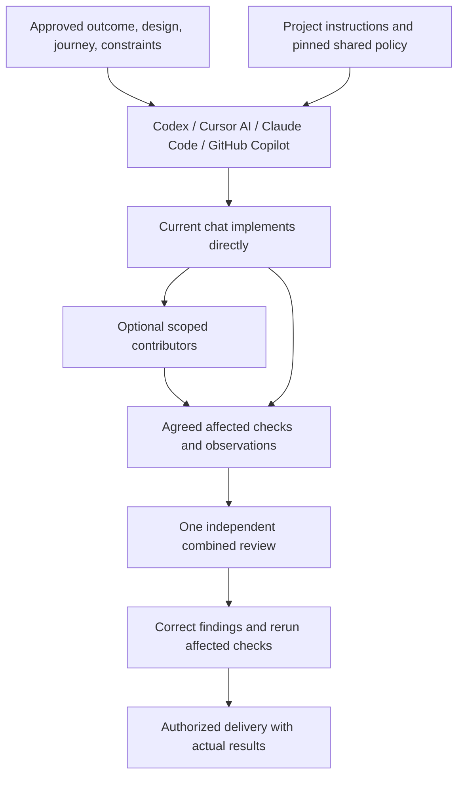

# SpoolIn — AI Harness Workflow

Updated: 21 October 2026, Asia/Jakarta

Target release: `agent-workflow` **1.3.0**, `movie-app` profile. The actual installed selection is recorded in [.ai/config.json](../.ai/config.json); installation and live host observations are separate results.

Quick navigation: [hosts](#3-coding-hosts-and-native-adapters) · [roles](#4-agent-roles-ownership-and-coordination) · [checks](#8-quality-gates-and-acceptance-evidence) · [start/resume](#95-start-and-resume-prompts) · [maintenance](#10-maintenance-troubleshooting-and-recovery) · [74 skills](#appendix-a-complete-pinned-skill-inventory) · [verification status](#appendix-b-harness-coverage-matrix)

## Current selection delivery policy

**Read the approved outcome → implement → run agreed affected checks → obtain one independent combined review → correct findings → deliver.**

This is the only workflow for Codex, Cursor AI, Claude Code, and GitHub Copilot. There are no fast, complete, lightweight, strict, or other workflow tracks. Task scope and project requirements determine the checks inside this procedure. Starting, resuming, delegating, and selecting a delivery destination do not change its completion rules.

The current chat coordinates and implements directly in one suitable checkout by default. Optional contributors receive bounded assignments; one independent reviewer inspects the combined change. The [delivery policy](../.ai/bundles/1.3.0/docs/DELIVERY.md) defines completion. The [task prompt](prompt/task-implementation.md) supplies portable invocation and inputs.

## 1. Purpose, coverage, and evidence

The harness connects approved requirements and designs to implementation, focused checks, review, and delivery. Host adapters translate discovery locations and native syntax while preserving the same responsibilities and constraints.

SpoolIn has application source, Gradle modules, npm workspaces, operational scripts, a Docker development environment, and a repository check registry. See the [application README](../README.md) for current setup. Their presence does not establish every feature's acceptance or every host's live loading.

### 1.1 Status vocabulary

| Status | Meaning |
| --- | --- |
| Implemented | Source contains the stated behavior; verification is reported separately. |
| Installed | Managed files/runtime were provisioned; native loading is not implied. |
| Live verified | A named native surface performed the observed action at identified inputs. |
| Historically verified | An earlier observation is retained without asserting current coverage. |
| Pending / blocked | A required result is missing or failed; it is not a pass. |

A CLI, desktop engine, IDE, disposable fixture, and actual application journey are different observation boundaries. File integrity, a skill listing, or a successful scanner exit cannot establish feature acceptance.

### 1.2 Sources and current snapshot

Read [root instructions](../AGENTS.md), [bundle selection](../.ai/config.json), [manifest](../.ai/bundles/1.3.0/manifest.json), [role catalog](../.ai/bundles/1.3.0/agents/catalog.json), and the [project registry](../.ai/gates.json). The registry takes precedence over the bundled movie-app profile when present.

The [retained 1.1 report](../.ai/bundles/1.3.0/docs/VERIFICATION-1.1.md) and appendices below describe dated evidence. They are not a new four-host verification campaign. Read the release handoff and current doctor/native results for actual installation status; do not infer them from this guide's target version.

## 2. Architecture and instruction selection



Resolve `.ai/config.json` before global fallback; its bundle path is relative to `.ai`. Read the relevant skill and its relative resources from that bundle. A same-named global/plugin skill does not replace the project pin. Without a project pin, use the installed global bundle. Personal instructions and independently owned plugin capabilities retain their boundaries.

Load only instructions needed for the selected work. A role catalog lists available guidance, not a loading checklist. Shared instructions must work without this desktop chat's tools or machine-specific home paths.

### 2.1 Configuration, state, and storage map

| Location | Purpose |
| --- | --- |
| `.ai/config.json`, `.ai/bin/agent-workflow`, `.ai/bundles/1.3.0/` | Project pin, launcher, runtime, prompts, skills, schemas, and policy. |
| `.ai/gates.json` | Project check commands and applicability; preserve its requirements. |
| `.ai/install-state.json` | Managed-file ownership/integrity, separate from task progress. |
| `.ai/state/`, `.ai/reports/`, `.ai/evidence/` | Local state, runner output, and observations. Ignored outputs need deliberate transfer. |
| `.ai/install-backups/` | Matching installation transactions and rollback data. |
| Git shared metadata `agent-workflow/` | Selection/ownership registry shared by worktrees of the same clone. |
| `~/.local/share/agent-workflow/` | Global fallback, installation ledger, backups, and separately owned tool state. |

Clone tracked dot directories and relative discovery links together. Separate clones do not share ownership locks. Preserve evidence and backups when relocating. Inspect captures/logs for secrets before sharing.

## 3. Coding hosts and native adapters

### 3.1 Repository configuration map

| Host | Instructions | Native agents and skills | Hooks |
| --- | --- | --- | --- |
| Codex | [AGENTS.md](../AGENTS.md) | `.codex/agents/*.toml`; `.agents/skills/` | `.codex/hooks.json` |
| Cursor AI | [.cursor/rules/agent-workflow.mdc](../.cursor/rules/agent-workflow.mdc) points to project instructions | `.cursor/agents/*.md`; `.cursor/skills/` | `.cursor/hooks.json` |
| Claude Code | [CLAUDE.md](../CLAUDE.md) | `.claude/agents/*.md`; `.claude/skills/` | `.claude/settings.json` |
| GitHub Copilot | [.github/copilot-instructions.md](../.github/copilot-instructions.md) | `.github/agents/*.agent.md`; `.github/skills/` | `.github/hooks/agent-workflow.json` |

All adapters derive from shared policy/roles. Preserve unrelated User Rules, permissions, authentication, model settings, MCP configuration, and hooks. Role instructions constrain responsibility; they do not create a permission sandbox.

Global discovery uses supported host locations documented in [HOSTS.md](../.ai/bundles/1.3.0/docs/HOSTS.md). Check the loaded definition's origin as well as its name: a personal profile can shadow a project profile, particularly in Copilot CLI. Project instructions must resolve the repository bundle before fallback resources.

### 3.2 Hooks and their limits

Hooks provide post-edit feedback using shared definitions. They are not another workflow or final acceptance. Explicit no-test constraints apply to automatic hooks too; establish the selected run's constraint before editing. Missing hooks, timeouts, disabled definitions, and unapproved trust cannot be reported as successful checks.

Use existing dispatch and result reuse; do not install replacement agent services. If native independent review is unavailable, use a separate supported reviewer or leave review pending. Self-review is not independent review.

### 3.3 Observed host readiness

Record adapter integrity, instruction/skill discovery, selected bundle, direct implementation, reviewer invocation, hooks, and trust separately for each actual surface.

| Host | Surface distinction and action after update |
| --- | --- |
| Codex | Desktop engine and CLI are separate. Reload the session if discovery is stale; inspect the actual engine and definition origins. |
| Cursor AI | Desktop UI and CLI require separate observations. Reload project rules/skills through the supported client action; retain personal User Rules. |
| Claude Code | Confirm project instructions, subagent constraints, skills, and settings merge in a fresh session. |
| GitHub Copilot | CLI and installed IDE are separate. Confirm custom-agent origin, repository instructions, and supported hook loading on each observed surface. |

Respect native trust prompts and permissions. Static adapter validation proves formatting/discovery inputs, not live operation. Unavailable clients remain explicitly unverified with the missing observation named. Installing an executable proves neither its authentication nor the IDE's behavior.

## 4. Agent roles, ownership, and coordination

| Role | Responsibility and activation |
| --- | --- |
| `aw-forge` | Current chat coordinates and directly implements; owns the selection and delivery. No nested coordinator. |
| `aw-frontend` | Optional contributor for approved presentation, states, interactions, and accessibility. |
| `aw-backend` | Optional contributor for selected API, persistence, transaction, and failure contracts. |
| `aw-operations` | Optional contributor for required build/runtime/operations changes. |
| `aw-qa-evidence` | Selected observations requiring another operator. |
| `aw-security` | Concrete threats or changed security boundaries needing specialist scrutiny. |
| `aw-review-verify` | One independent reviewer of the complete result; returns actionable findings without implementing fixes. |
| `aw-integrator` | Concurrent composition only, under the existing selection. |

Delegation changes ownership, not completion rules. Reuse one checkout for serial work. Concurrent writers claim isolated paths, worktrees, and shared resources using the existing [coordination contract](../.ai/bundles/1.3.0/docs/COORDINATION.md). Preserve host capacity and worker limits.

Provide contributors with the approved outcome, references, allowed paths/resources, constraints, and agreed checks. Compose checked contributions in dependency order before the single combined review. Worker-level independent acceptance is not required. Integration requires an existing valid selection and ownership before mutation; composition remains pending final acceptance.

Use one Git-shared selection record and findings ledger. Transfer coordinator ownership when switching hosts; conversational memory does not transfer. Retain task IDs, checkout, constraints, valid results, findings, repair budgets, and next action. Prevent two active coordinators from mutating the same selection.

## 5. Skills and planning handoff

The 74-entry [skill inventory](#appendix-a-complete-pinned-skill-inventory) lists capabilities, not compulsory steps. Read the [activation catalog](../.ai/bundles/1.3.0/docs/SKILLS.md) for conditions and provenance.

Execution entry points route to this procedure. Planning/design generation applies to unresolved decisions; implementation follows the approved design. Specialist stack, security, accessibility, and verification guidance activates only for relevant changed concerns. TDD follows an explicit strategy or user request. Findings join the existing combined review.

Use chat or the existing task document for one compact brief: outcome and boundaries; complete journey; precise visual references/states/sizes; allowed changes and protected files; dependencies/interfaces; agreed checks and delivery destination. Resolve material conflicts before dependent implementation. Routine coding choices follow project conventions.

During product implementation, protect workflow code, bundled skills, agents, gate policy, and unplanned Python files. Do not regenerate plans, renumber tasks, tune the harness, or restart design exploration. New user instructions amend affected scope inside the same selection. Harness maintenance is a separately requested task using this same procedure.

Personal observation captures proposals during active work without scheduling or blocking product work. Apply the [wording policy](../.ai/bundles/1.3.0/resources/wording/output-wording.md) and checker before delivering authored output.

## 6. Supporting tools

Use existing project runners and available host tools. Version-relevant library documentation may use Context7; actual OAuth and connectivity need their own observation. Browser assertions/direct inspection serve ordinary UI verification. Use recordings only when requested or required for a selected observation. An actual reader observation cannot be replaced by DOM assertions or audio energy.

Strix remains inactive until a scoped assessment is requested. Tool installation, a configured MCP endpoint, and scanner preflight are not application acceptance. Historical tool versions and observations are retained in [Appendix C](#appendix-c-historical-supporting-tool-observations-15-october-2026); current procedures are in [TOOLS.md](../.ai/bundles/1.3.0/docs/TOOLS.md).

## 7. Development lifecycle and source traceability

Use the approved [requirements](02-PRD.md), [design](03-design-system.md), [visual references](design-system/index.md), [technical contracts](04-spoolin-techdoc.md), [acceptance cases](05-atdd.md), and [task plan](06-PLAN.md) relevant to the selection. Preserve IDs and required observation boundaries. Only the coordinator updates execution fields after acceptance.

For changed UI, open the actual reference, implement one representative state, and compare before propagating shared styling. Match layout, density, spacing, typography, colors, borders, assets, cropping, controls, and relevant states at agreed sizes under comparable content/fonts/theme. Verify entry, actions, confirmed completion, return destination, retained context, and required recovery. Correct differences before delivery.

Appearance and behavior need separate observations. Claim pixel identity only with a supporting comparison. Missing or excluded inspection stays unverified; do not substitute a new visual direction.

## 8. Quality gates and acceptance evidence

Preserve 80% changed executable-line coverage, at most 50 function lines, complexity 10, nesting 3, and required security/acceptance boundaries. Use the [project registry](../.ai/gates.json), actual component commands, and shared runner; all hosts select the same checks.

Use the agreed selection/PR baseline, including committed changes since it, staged/unstaged changes, additions/deletions, and relevant untracked source. Ordinary component edits select that component and actual consumers. Shared contracts/build/locks/policy require broader checks where necessary. Documentation-only changes select document checks. Unknown executable inputs or invalid baseline/ownership require conservative selection with an explanation.

Technical gate stage/component filters are check selectors within this procedure. They are not workflow tiers. Read [GATES.md](../.ai/bundles/1.3.0/docs/GATES.md) for current command options rather than copying a full test campaign from this guide.

Run each required command once for valid inputs; reuse only results matching source/tests, command, configuration, toolchain/environment, and artifact integrity. Rerun affected checks after corrections. Required whole-component commands remain required where supported selectors cannot satisfy the same obligation.

Missing tools, empty execution, stale reports, failed checks, and unresolved required findings do not pass. Use real database/transport/browser/permission/recovery boundaries when selected cases require them. Mocks prove only their stated boundary.

An explicit no-test instruction adds/runs no tests, including hooks, and permits no hidden browser trials. Perform independent source review and disclose omitted checks. Keep product acceptance pending where required observations were excluded. An authorized draft may disclose limits without marking them passed; merge/release claims retain applicable requirements.

Keep configured correction limits and the selection-wide optional-tool budget: two focused attempts or 20 minutes. Host changes, workers, branches, and renamed phases do not reset limits. Real product/security/accessibility defects remain implementation work.

## 9. Operating guide

### 9.1 Inspect before execution

From the repository root, read the instructions and selected brief. Run doctor once before substantial execution:

```sh
python3 .ai/bin/agent-workflow --version
python3 .ai/bin/agent-workflow doctor --repo .
```

Doctor reports managed integrity and saved results, not a fresh live host run. Use `--help` and [HOSTS.md](../.ai/bundles/1.3.0/docs/HOSTS.md) for host-specific preview/live commands. A live probe uses the selected runtime/account; report the actual surface and results.

### 9.2 Implement the selection

Record scope once. Implement directly in one suitable checkout. Use claimed worktrees only for concurrent contributions or to protect unrelated work. Preserve unrelated changes and serialize shared ports, databases, build outputs, and lockfiles. Follow exact command shapes in [COORDINATION.md](../.ai/bundles/1.3.0/docs/COORDINATION.md) only when those helpers are needed.

### 9.3 Check, review, and deliver

Run agreed affected checks with existing runners. Obtain one independent combined review of requirements, visual/journey fidelity, contracts, correctness, security, accessibility, and actual results. Correct findings in the same branch/ledger and rerun affected checks. Local delivery retains reviewed source; authorized publication uses the established remote/destination. A missing remote blocks publication, not local work.

Report implemented behavior, actual checks, review verdict, local/published revisions, and remaining limits separately. State whether a PR update changed source or metadata only. Source review alone is not verified acceptance.

### 9.4 Resume and recovery

Resume from the retained selection, branch/worktree, ownership, inputs, findings, checks, limits, and next action. Explicit overrides win; otherwise retain authorized values before applying defaults. Transfer coordinator ownership before another host writes. Do not select another task because recovery is inconvenient.

Commit at natural milestones. At least every 45 minutes, record actual changed behavior, relevant checks, local/published heads, remaining work, and next action. Support tooling is not product progress. Retain branches/evidence when blocked; report the exact recovery action. “Finish and wrap up” retains the goal; an explicit stop stops work.

### 9.5 Start and resume prompts

The same text works from a repository-root chat in each host:

| Host | Start | Resume |
| --- | --- | --- |
| Codex | `Use running prompt for T001.` | `Use running prompt for T001, mode resume.` |
| Cursor AI | `Use running prompt for T001.` | `Use running prompt for T001, mode resume.` |
| Claude Code | `Use running prompt for T001.` | `Use running prompt for T001, mode resume.` |
| GitHub Copilot | `Use running prompt for T001.` | `Use running prompt for T001, mode resume.` |

The [project shortcut](../.agents/skills/running-prompt/SKILL.md) reads the [task prompt](prompt/task-implementation.md). Native `$` or slash shortcuts are optional where supported. If discovery is stale, reload the relevant host/session or explicitly reference the project shortcut. Do not change the procedure to imitate another host's syntax.

The prompt retains six inputs: Target (`next`), Plan (`docs/06-PLAN.md`), Mode (`implement`), Dependencies (`selected-only`), Delivery (`local`), and Additional context (`none`). `next` selects one eligible incomplete task; broader selection requires explicit input. Resume uses explicit inputs, then retained authorized values, then defaults. Additional context is data, never shell input.

## 10. Maintenance, troubleshooting, and recovery

Perform harness changes only for requested maintenance. Use the reviewed reusable source and existing installer; preserve personal instructions, unrelated settings/hooks, other project pins, and edited managed files. Global updates do not change project pins automatically.

```sh
python3 .ai/bin/agent-workflow update --repo . --source REVIEWED_SOURCE_PATH
python3 .ai/bin/agent-workflow doctor --repo .
python3 .ai/bin/agent-workflow rollback --repo . --backup .ai/install-backups/TRANSACTION_ID
```

These are maintenance examples, not an assertion that they ran. Inspect the matching backup and transaction order before rollback. Never overwrite a conflict to conceal drift. A rollback can require reconciliation when installed files changed after the transaction. Keep original personal content and use supported conflict handling.

If hooks run excluded checks, stop that feedback and diagnose the selected constraint before further edits. If a host loads global content instead of the pin, inspect definition origins and discovery links. If no reviewer can run, report review pending. Do not create replacement services or relabel self-review.

After maintenance, update current prompts, host adapters, catalogs, linked docs, examples, versions, and status claims together. Preserve dated evidence without restamping it. Check local links/anchors, documented commands, diagrams, eight roles, 74 entries, and authored wording. Installation alone does not resume application tasks or establish universal native operation.

## Appendix A. Complete pinned skill inventory

All entries below are available in the selected bundle. Each name links to its actual instructions; purpose summaries describe activation, not usage claims. Owner values come from the manifest and identify workflow responsibility. Related native roles can load the same skill under their assignment. The [full catalog](../.ai/bundles/1.3.0/docs/SKILLS.md) and [manifest](../.ai/bundles/1.3.0/manifest.json) retain dependencies, provenance, hashes, and activation details.

### A.1 Requirements and design authoring

| Skill / source | Owner | Purpose |
| --- | --- | --- |
| [brainstorming](../.ai/bundles/1.3.0/skills/brainstorming/SKILL.md) | `forge` | Explore substantial choices and establish accepted direction. |
| [deliver-prd](../.ai/bundles/1.3.0/skills/deliver-prd/SKILL.md) | `forge` | Author product requirements, stories, and acceptance criteria. |
| [techdoc-creation](../.ai/bundles/1.3.0/skills/techdoc-creation/SKILL.md) | `forge` | Author engineering contracts, boundaries, data behavior, and traceability. |
| [design-system](../.ai/bundles/1.3.0/skills/design-system/SKILL.md) | `forge` | Coordinate requirements-based tokens, components, flows, and visual examples. |
| [atdd-creation](../.ai/bundles/1.3.0/skills/atdd-creation/SKILL.md) | `forge` | Author traceable acceptance cases and proof requirements. |
| [plan-creation](../.ai/bundles/1.3.0/skills/plan-creation/SKILL.md) | `forge` | Create dependency-ordered groups, tasks, and acceptance mappings. |

### A.2 Visual design and accessibility

| Skill / source | Owner | Purpose |
| --- | --- | --- |
| [design-system-foundations](../.ai/bundles/1.3.0/skills/design-system-foundations/SKILL.md) | `forge` | Define layered tokens, component specifications, and states. |
| [frontend-design](../.ai/bundles/1.3.0/skills/frontend-design/SKILL.md) | `forge` | Establish intentional visual direction for new or reshaped UI. |
| [impeccable](../.ai/bundles/1.3.0/skills/impeccable/SKILL.md) | `forge` | Refine visual hierarchy, responsive states, and design craft. |
| [fixing-accessibility](../.ai/bundles/1.3.0/skills/fixing-accessibility/SKILL.md) | `forge` | Audit and fix semantics, keyboard behavior, focus, contrast, and errors. |
| [ui-ux-pro-max](../.ai/bundles/1.3.0/skills/ui-ux-pro-max/SKILL.md) | `forge` | Search bundled UI references within the adopted design and framework. |

### A.3 Architecture and contracts

| Skill / source | Owner | Purpose |
| --- | --- | --- |
| [architecture-designer](../.ai/bundles/1.3.0/skills/architecture-designer/SKILL.md) | `forge` | Define system boundaries, interactions, and quality tradeoffs. |
| [architecture-decision-records](../.ai/bundles/1.3.0/skills/architecture-decision-records/SKILL.md) | `forge` | Record significant decisions, alternatives, and consequences. |
| [domain-modeling](../.ai/bundles/1.3.0/skills/domain-modeling/SKILL.md) | `forge` | Clarify domain concepts, terminology, and vocabulary. |
| [codebase-design](../.ai/bundles/1.3.0/skills/codebase-design/SKILL.md) | `forge` | Design deep modules with small, useful interfaces. |
| [modularity](../.ai/bundles/1.3.0/skills/modularity/SKILL.md) | `forge` | Define module ownership, public surfaces, and dependency boundaries. |
| [dependency-analysis](../.ai/bundles/1.3.0/skills/dependency-analysis/SKILL.md) | `forge` | Map coupling, cycles, and safe dependency order. |
| [vertical-slice](../.ai/bundles/1.3.0/skills/vertical-slice/SKILL.md) | `forge` | Organize a feature around end-to-end behavior. |
| [api-design](../.ai/bundles/1.3.0/skills/api-design/SKILL.md) | `forge` | Design compatible endpoint, RPC, event, or library contracts. |
| [dto](../.ai/bundles/1.3.0/skills/dto/SKILL.md) | `forge` | Define data contracts and producer-consumer compatibility. |
| [config-validation](../.ai/bundles/1.3.0/skills/config-validation/SKILL.md) | `forge` | Validate configuration sources, precedence, defaults, and startup. |

### A.4 Reliability and persistence design

| Skill / source | Owner | Purpose |
| --- | --- | --- |
| [determinism](../.ai/bundles/1.3.0/skills/determinism/SKILL.md) | `forge` | Make ordering and computation reproducible within a defined boundary. |
| [idempotency](../.ai/bundles/1.3.0/skills/idempotency/SKILL.md) | `forge` | Prevent duplicate effects during retries and concurrent operations. |
| [failure](../.ai/bundles/1.3.0/skills/failure/SKILL.md) | `forge` | Define failure classes, bounded retries, partial outcomes, and recovery. |
| [pipeline](../.ai/bundles/1.3.0/skills/pipeline/SKILL.md) | `forge` | Design staged processing, handoffs, ordering, and checkpoints. |
| [migration-management](../.ai/bundles/1.3.0/skills/migration-management/SKILL.md) | `forge` | Manage schema/data changes, backfills, and recovery. |
| [database-portability](../.ai/bundles/1.3.0/skills/database-portability/SKILL.md) | `forge` | Support multiple database engines only when explicitly required. |

### A.5 Code quality, tests, and diagnosis

| Skill / source | Owner | Purpose |
| --- | --- | --- |
| [coding-standards](../.ai/bundles/1.3.0/skills/coding-standards/SKILL.md) | `review-verify` | Apply conventions for the affected language and component. |
| [code-quality](../.ai/bundles/1.3.0/skills/code-quality/SKILL.md) | `review-verify` | Assess scoped correctness and maintainability. |
| [code-review](../.ai/bundles/1.3.0/skills/code-review/SKILL.md) | `review-verify` | Review a fixed diff against requirements and repository standards. |
| [tdd](../.ai/bundles/1.3.0/skills/tdd/SKILL.md) | `forge` | Develop behavior through a test-first red/green/refactor loop. |
| [test-driven-development](../.ai/bundles/1.3.0/skills/test-driven-development/SKILL.md) | `forge` | Route explicitly requested test-first work through tdd. |
| [test-generation](../.ai/bundles/1.3.0/skills/test-generation/SKILL.md) | `forge` | Add meaningful behavior, boundary, and regression coverage. |
| [diagnosing-bugs](../.ai/bundles/1.3.0/skills/diagnosing-bugs/SKILL.md) | `forge` | Investigate failures and regressions with evidence. |

### A.6 Security and acceptance

| Skill / source | Owner | Purpose |
| --- | --- | --- |
| [security-audit](../.ai/bundles/1.3.0/skills/security-audit/SKILL.md) | `review-verify` | Review scoped security risks and evidence-backed remediation. |
| [security-requirement-extraction](../.ai/bundles/1.3.0/skills/security-requirement-extraction/SKILL.md) | `review-verify` | Turn concrete threats into enforceable requirements and checks. |
| [stride-analysis-patterns](../.ai/bundles/1.3.0/skills/stride-analysis-patterns/SKILL.md) | `review-verify` | Analyze threats across trust boundaries using STRIDE. |
| [acceptance-verification](../.ai/bundles/1.3.0/skills/acceptance-verification/SKILL.md) | `qa-evidence` | Evaluate assigned ATDD cases at their required proof boundaries. |
| [verify-test-evidence](../.ai/bundles/1.3.0/skills/verify-test-evidence/SKILL.md) | `review-verify` | Independently inspect evidence mapping, freshness, and readability. |
| [strix-security](../.ai/bundles/1.3.0/skills/strix-security/SKILL.md) | `security` | Prepare or review an explicitly authorized scoped Strix assessment. |

### A.7 Implementation and operations

| Skill / source | Owner | Purpose |
| --- | --- | --- |
| [project-scaffold](../.ai/bundles/1.3.0/skills/project-scaffold/SKILL.md) | `forge` | Initialize an explicitly requested project or component. |
| [kotlin-spring](../.ai/bundles/1.3.0/skills/kotlin-spring/SKILL.md) | `backend` | Implement validated Kotlin/Spring service and transport behavior. |
| [spring-dependency-injection](../.ai/bundles/1.3.0/skills/spring-dependency-injection/SKILL.md) | `backend` | Implement constructor wiring, qualifiers, and safe bean lifecycles. |
| [jpa-hibernate](../.ai/bundles/1.3.0/skills/jpa-hibernate/SKILL.md) | `backend` | Implement persistence, transactions, locking, and PostgreSQL-backed checks. |
| [svelte-typescript](../.ai/bundles/1.3.0/skills/svelte-typescript/SKILL.md) | `frontend` | Implement typed Svelte screens, states, responsiveness, and accessibility. |
| [node-backend](../.ai/bundles/1.3.0/skills/node-backend/SKILL.md) | `backend` | Implement validated Node/TypeScript services or MCP adapters. |
| [devops-ci](../.ai/bundles/1.3.0/skills/devops-ci/SKILL.md) | `operations` | Implement reproducible builds, Compose, CI, and recovery checks. |
| [observability](../.ai/bundles/1.3.0/skills/observability/SKILL.md) | `operations` | Implement useful redacted logs, metrics, traces, and alerts. |
| [performance-optimization](../.ai/bundles/1.3.0/skills/performance-optimization/SKILL.md) | `forge` | Measure and improve a specific performance bottleneck. |
| [analyze-alert](../.ai/bundles/1.3.0/skills/analyze-alert/SKILL.md) | `operations` | Investigate a supplied alert against telemetry and a bounded timeline. |

### A.8 Execution, integration, and delivery

| Skill / source | Owner | Purpose |
| --- | --- | --- |
| [forge](../.ai/bundles/1.3.0/skills/forge/SKILL.md) | `forge` | Coordinate and directly implement approved work; use one independent combined review. |
| [task-full-workflow](../.ai/bundles/1.3.0/skills/task-full-workflow/SKILL.md) | `forge` | Route authorized work through one shared execution state. |
| [task-implement](../.ai/bundles/1.3.0/skills/task-implement/SKILL.md) | `forge` | Execute one bounded approved task and return a verifiable receipt. |
| [task-delivery](../.ai/bundles/1.3.0/skills/task-delivery/SKILL.md) | `forge` | Deliver checked changes through commits and an authorized draft PR. |
| [worktree-integration](../.ai/bundles/1.3.0/skills/worktree-integration/SKILL.md) | `integrator` | Coordinate claims, isolated worktrees, and semantic integration. |
| [conflict-resolution](../.ai/bundles/1.3.0/skills/conflict-resolution/SKILL.md) | `forge` | Resolve merge or concurrent-edit conflicts against intended behavior. |
| [quality-gates](../.ai/bundles/1.3.0/skills/quality-gates/SKILL.md) | `review-verify` | Run configured checks and report revision-bound outcomes. |
| [workflow-install](../.ai/bundles/1.3.0/skills/workflow-install/SKILL.md) | `operations` | Maintain workflow installation, conflicts, upgrades, and removal. |
| [docs-sync](../.ai/bundles/1.3.0/skills/docs-sync/SKILL.md) | `forge` | Reconcile documentation, implementation, and accepted requirements. |
| [pr](../.ai/bundles/1.3.0/skills/pr/SKILL.md) | `forge` | Write a reviewable pull request description. |

### A.9 Writing, upkeep, and tool use

| Skill / source | Owner | Purpose |
| --- | --- | --- |
| [humanizer](../.ai/bundles/1.3.0/skills/humanizer/SKILL.md) | `forge` | Write in the requested personal voice without altering facts. |
| [writing-for-agents](../.ai/bundles/1.3.0/skills/writing-for-agents/SKILL.md) | `forge` | Write or edit agent instructions and skill documentation. |
| [task-observer](../.ai/bundles/1.3.0/skills/task-observer/SKILL.md) | `forge` | Capture useful corrections as proposals during active work. |
| [rtk](../.ai/bundles/1.3.0/skills/rtk/SKILL.md) | `forge` | Reduce verbose CLI output when RTK is available and suitable. |
| [token-optimization](../.ai/bundles/1.3.0/skills/token-optimization/SKILL.md) | `forge` | Reduce context/output overhead while preserving necessary evidence. |
| [playwright-cli](../.ai/bundles/1.3.0/skills/playwright-cli/SKILL.md) | `qa-evidence` | Drive managed browser journeys, screenshots, traces, and video. |
| [record-test-video](../.ai/bundles/1.3.0/skills/record-test-video/SKILL.md) | `qa-evidence` | Capture readable real UI journeys with case timestamps and assertions. |
| [context7](../.ai/bundles/1.3.0/skills/context7/SKILL.md) | `forge` | Retrieve version-relevant library documentation through Context7 MCP. |

### A.10 Focused anti-slop review

| Skill / source | Owner | Purpose |
| --- | --- | --- |
| [antislop](../.ai/bundles/1.3.0/skills/antislop/SKILL.md) | `review-verify` | Apply focused UI/copy/interaction review in the existing review process. |
| [antislop-ui](../.ai/bundles/1.3.0/skills/antislop-ui/SKILL.md) | `review-verify` | Review composition and remove generic decorative filler. |
| [antislop-copywriting](../.ai/bundles/1.3.0/skills/antislop-copywriting/SKILL.md) | `review-verify` | Keep product copy specific and factual without invented claims. |
| [antislop-human](../.ai/bundles/1.3.0/skills/antislop-human/SKILL.md) | `review-verify` | Check usability across input, vision, and motion needs. |
| [antislop-layoutmobile](../.ai/bundles/1.3.0/skills/antislop-layoutmobile/SKILL.md) | `review-verify` | Check reflow, touch behavior, sizing, and mobile navigation. |
| [antislop-code](../.ai/bundles/1.3.0/skills/antislop-code/SKILL.md) | `review-verify` | Review comment hygiene while preserving necessary explanation. |


## Appendix B. Harness coverage matrix

| Surface | Current source / required observation |
| --- | --- |
| Policy, prompts, roles, 74 skills | [Delivery](../.ai/bundles/1.3.0/docs/DELIVERY.md), [catalog](../.ai/bundles/1.3.0/docs/SKILLS.md), and reviewed release inputs. |
| Global/project installation | Actual installer transaction, matching digests, doctor output, and backup/rollback result. |
| Four native hosts | Each actual CLI/desktop/IDE needs discovery, bundle origin, direct implementation, separate review, hooks, and trust observations. |
| Product behavior/design | Selected application checks and direct reference/journey observations; historical fixtures are insufficient. |
| Optional tools | Named runtime/connection/assessment result at its actual boundary. |

### Historical native results — 15 October 2026

The table below preserves the earlier rollout. It does not verify release 1.3.0 or current project sessions. Original details remain in the [dated release report](../.ai/bundles/1.3.0/docs/VERIFICATION-1.1.md#native-host-results).

| Host | Historical observations | Remaining limits |
| --- | --- | --- |
| Codex | The selected desktop engine was `0.162.0-alpha.17.2`; final fixture probes timed out without edits or gate runs. Exact hook trust was user-attested. | Completed delegation, role/skill catalogs, and hook execution were not established. Doctor now marks its saved repository record stale. |
| Claude Code | Version `2.1.283` initialization listed roles; global discovery included all 74 required skills. Passing/failing fixture edits produced gate receipts. | Main Forge identity, exact hook/edit correlation, repository skill source paths, and trust remained incomplete. |
| Cursor | GUI `3.24.12` displayed eight workflow roles and five personal roles. Fixture worker/reviewer chains and post-edit gate feedback were observed. | Skill source precedence and persistent trust remained blocked. A project negative worker hit a host looping error. Retained UI imports concern disposable fixtures, not this chat. |
| Copilot | CLI `1.0.94` exposed all 74 required skills among 83 enabled entries and listed instruction sources. | Final delegation timed out; a passing write had no gate receipt or completed reviewer. Project role selection and hook execution/trust remained blocked. |

## Appendix C. Historical supporting-tool observations (15 October 2026)

### C.1 Browser automation and readable evidence

The release records managed `@playwright/cli` 0.1.22, its exact Playwright dependency `1.64.0-alpha-1790635538000`, and Chromium revision 1247. The prerelease driver is an explicit dependency of the pinned CLI. A successful full Chromium launch proves browser availability at that recorded time, not an application journey. Runtime locks and integrity records live under `~/.local/share/agent-workflow/tools`; [tool locks](../.ai/bundles/1.3.0/profiles/tools-lock.json) retain the package inputs.

For current browser work, use one session per concurrent contributor. The CLI's `video-start`, `video-stop`, `video-chapter`, and `video-show-actions` support recordings; `recording-start` and `recording-stop` generate test code. Inspect installed help before using annotation options. Keep assertions, screenshots, traces, videos, case intervals, and artifact hashes together.

The retained release browser fixture demonstrated both clean and deliberately broken desktop/mobile UI, with independent sample-frame inspection. An earlier CLI video scaled content into a gray canvas; separate recordings with matching viewport/video dimensions supplied readable samples. That fixture is harness verification. It is separate from SpoolIn's [static branding/browser checks](design-system/verification.md), which record 40 page/theme/width combinations and explicit limits on production claims.

Native computer-use captures supported the Cursor role/hook observations recorded in the release report. They establish only inspected native UI behavior. A screenshot of a role list proves no invocation or completed worker chain. Browser-generated assertions likewise need real expected outcomes, not merely successful navigation.

### C.2 Context7 documentation lookup

All four repository MCP configurations select the hosted OAuth endpoint `https://mcp.context7.com/mcp/oauth`. Its documented tool flow is `resolve-library-id` followed by `query-docs`. Use it for version-relevant library documentation and keep the selected framework aligned with project decisions.

Global configuration uses `~/.codex/config.toml`, `~/.claude.json`, `~/.cursor/mcp.json`, and `~/.copilot/mcp-config.json`. The repository map is in section 3. Credentials remain host-managed. A configured endpoint does not prove a connection or successful native OAuth.

The release records successful anonymous public tool discovery and Svelte/TypeScript documentation retrieval. Native authentication remained unverified; Cursor's OAuth attempt timed out. To complete a future connection, use the selected host's native action: `codex mcp login context7`, Claude `/mcp`, Cursor's Context7 connection action, or Copilot `/mcp auth context7`. These are user/account actions, not actions performed for this guide. See [Context7 configuration](../.ai/bundles/1.3.0/docs/TOOLS.md#context7-configuration-and-authentication).

### C.3 Strix and security tooling

Strix `strix-agent` 1.7.0 is recorded as installed in an isolated Python 3.13 environment with hashed dependencies, but inactive. It requires Docker and a configured LLM provider for an assessment. The historical preflight reached Docker; provider environment values were absent, authentication was unverified, and stored credentials were not inspected. No SpoolIn security assessment was authorized or executed in that rollout.

Activate `strix-security` only for an explicitly requested assessment with an authorized target and scope. Preflight does not authorize a scan. Report ingestion checks the target, completed run metadata, findings format, and hashes; it does not execute proof scripts or mark security acceptance. There is no automatic Strix scan hook, cloud upload, or scheduled assessment. [Strix procedures](../.ai/bundles/1.3.0/docs/TOOLS.md#strix-stays-inactive-until-requested) remain separate from ordinary gates.

| Tool family | Purpose in the harness | Evidence and limit |
| --- | --- | --- |
| ktlint, detekt, Kotlin compiler | Formatting/style, complexity, and compilation contracts | The recorded fixture does not establish current application task results. The retained detekt fixture used 1.23.8. |
| ESLint, Svelte/TypeScript checks | Web/Node lint and typing | Current workspace scripts exist; the historical fixture does not establish their results. |
| ArchUnit, dependency-cruiser | Dependencies, cycles, and architecture boundaries | Fixtures exercise rules; real Spring startup and component boundaries require application tests. |
| JUnit, Vitest, Kover/JaCoCo, LCOV | Behavior results and changed executable-line coverage | Require fresh reports, executed tests, and reviewed instrumentation. |
| Semgrep | Local SAST rules | Retained fixtures used 1.180.0. The packaged baseline is small and does not establish complete security or cross-file analysis. |
| Gitleaks | Redacted secret detection | Retained fixtures used 8.30.1 against current-directory inputs; no claim of a full Git-history audit. |
| OSV-Scanner | Dependency vulnerability checks | Retained fixtures used 2.7.0. Supported lockfiles/SBOMs and network/database availability determine coverage. |
| Sonar | Optional external analysis gate | Profile is `not-configured` and not required. No project analysis is claimed. |

These versions describe retained evidence, not a new machine inventory or a recommendation to upgrade. See [gate rules](../.ai/bundles/1.3.0/docs/GATES.md) and [retained tool verification](../.ai/bundles/1.3.0/docs/verification-tools.json).

### C.4 Research, design generation, and product integration

The [PRD skill comparison](research/prd-skills-comparison-2026-10-09.md) and [design-system comparison](research/design-system-skills-comparison-2026-10-10.md) record source-based research, including web/GitHub discovery and local skill inspection. They are research evidence, not proof that every evaluated service or skill was adopted.

OpenAI `image_gen`, through the installed imagegen skill, produced four fictional prototype artwork assets. Their prompts, generator, purpose, and provenance are retained in the [artwork record](design-system/mockup/assets/artwork-provenance.json). They are illustrative design fixtures, not production catalog seed data. The imagegen capability is supporting host/plugin tooling, outside the 74-skill workflow inventory.

SpoolIn's specified in-chat movie proposal and approval flow for ChatGPT and Claude is product functionality. It is not the development harness's Context7 connection or coding-agent permissions. Its transport, exact-content approval, replay prevention, and real-client acceptance are specified in [the technical design](04-spoolin-techdoc.md), [ATDD](05-atdd.md), and [assisted creation task group](plan/18-assisted-movie-creation-transport-and-review/group.md). Development host fixtures do not satisfy those product cases.

## Ownership transfer between coding hosts

After the old coordinator stops and releases its active claims, use the selected bundle's `selection --action transfer` with the existing selection ID, recorded owner, next owner and expected full Git revision. The new host resumes that same record; inputs, constraints, findings and budgets are retained. Stale revisions and mutations by the former owner are rejected. See the [transfer contract](../.ai/bundles/1.3.0/docs/COORDINATION.md#transfer-a-selection-between-hosts).

## Release 1.3.0 verification on 21 October 2026

The reviewed reusable source is `2dfeba592b4ccc6e7cfe5ca29415f846b2384e77`. Its required source suite passed 296 tests. The combined independent review accepted the source, project changes and candidate installation with no unresolved required findings.

Global and movie-app updates selected 1.3.0 with 74 skills, zero conflicts and healthy integrity results. Every file under the source runtime, skills, docs, prompts, roles, adapters, profiles and schemas matched both installed bundles. An isolated 1.2.1 → 1.3.0 → rollback → 1.3.0 exercise returned healthy results and preserved its personal-settings control. Existing detekt policy bytes were unchanged when the build references moved to 1.3.0.

The following table records the initial rollout attempts before the device-aware amendment below.

| Host and observed surface | Actual observation | Remaining limits |
|---|---|---|
| Codex embedded desktop engine | Bounded native smoke stopped after its patch operation failed; no product work was performed. | Fixture freshness also changed. Native profile, review and hook proof remain unverified; this is not a desktop UI loading pass. |
| Cursor AI desktop 3.25.6 | In the disposable workspace, the current chat edited `smoke.json` once to exactly `{"value":"pass"}`. A separate native subagent completed read-only review. The UI reported 56 seconds and no tests, shell, Git or publication. File content was inspected independently. | Named profile identity, complete skill-origin discovery and correlated hook execution were not established. This observation is not a blanket host-certification result. |
| Claude Code CLI | Native initialization listed the expected agents. | Captured metadata did not establish the main profile, project skill origins or correlated notification hooks; full native proof remains incomplete. |
| GitHub Copilot CLI | Native catalogs returned the required enabled skills and instruction sources. | Bounded smoke timed out; complete review/hook proof and IDE behavior remain unverified. |

Native verification limits do not invalidate the passing source/adapter checks, and source/adapter checks do not establish missing native observations. The GitHub Copilot IDE surface was not exercised. No application feature or application acceptance suite was started by this release task.

The source bundle is delivered through the movie-app draft PR. The standalone harness source remains local until its owner creates a separate repository. The completion message supplies the published project revision and PR link. Installation backups are retained by the existing installer; historical verification sections above retain their original dates and results.

## Device-aware verification amendment on 21 October 2026

A Mac freeze and automatic restart were reported during live-host verification. The cause is unconfirmed; system crash reports were inaccessible. No further native clients, browser captures, application suites or container builds were launched for this amendment.

The shared runner now derives budgets from the execution device, including effective CPU/memory and supported container limits. It admits one substantial workload at a time across hosts, reserves memory/disk headroom, caps supported workers and command output, samples active resource use, and stops unsafe batches. Stable device state survives client temporary-directory changes and ordinary restarts. Observed descendant identities are retained for cleanup and recovery; POSIX sampling cannot establish complete containment of a never-observed child that detaches between samples. Native Windows execution is blocked because its process containment is unavailable. Linux/container and Windows readings have mocked coverage, not live platform certification.

The optional `resources` object remains in existing installation configuration. Increasing automatic ceilings requires explicit user authorization; installer updates preserve those preferences. `resources --repo .` inspects capacity without starting a workload. After addressing a stopped condition, `resources --repo . --resume` requires healthy readings and no surviving recorded owner/descendants. It does not rerun checks. See [budgets and recovery](../.ai/bundles/1.3.0/docs/GATES.md#execution-device-budgets-and-recovery) for fields, supported worker contracts, retention limits and enforcement boundaries. Arbitrary commands and manual IDE actions outside the runner have an instruction boundary rather than mechanical enforcement.

Focused amendment verification passed 153 tests, run serially: 19 resource-controller/process cases, 17 mocked OS cases, 24 gate cases, 65 host-parser cases and 28 affected-selection/reuse cases. The only process cleanup exercise used one tiny parent and one detached sleeping child; no resource-exhaustion experiment was performed. One independent combined review covers these changes and reporting. The prior 296-test result remains evidence for its earlier source revision and is not presented as verification of this amendment.

An actual read-only check on the 16 GiB, eight-CPU Mac reported warning memory pressure, about 2.66 GiB of estimated available memory and a 4 GiB reserve. Admission returned blocked with a zero available workload budget. Remaining live verification therefore stays pending; no limit was raised to force it to run. The capacity observation is a point-in-time result and does not identify the restart cause.

| Host and surface | Retained actual observation before the resource amendment | Remaining proof |
|---|---|---|
| Codex desktop / embedded engine | This desktop chat implements the amendment and invokes an independent reviewer. The embedded-engine follow-up completed a native fixture edit and a separate `aw-review-verify` child; local native rollout metadata identifies the reviewer and completion. | The exec stream alone omits that child identity. Named coordinator-profile origins and correlated native hook proof remain unverified. No new embedded-engine smoke was launched after the incident. |
| Cursor AI desktop 3.25.6 | The earlier fixture edit and separate review completed in 56 seconds. Customize showed eight project roles; opening Forge identified the project `.cursor/agents/aw-forge.md`. Hooks showed the project command, matching `smoke.json` Write input/tool ID and notification output. No gate artifact was created. | The inspected skill entry resolved globally; selected project skill-origin discovery remains unverified. A materialized disposable skill experiment did not establish a discovery fix. No further GUI smoke was launched. |
| Claude Code CLI | A follow-up completed one native edit and separate reviewer in about a minute. Expected agents/skills were available. Durable native hook attachments correlate the edit tool ID with project/global hook commands, successful exit and notification output. | Named coordinator-profile and selected skill origins remain unverified. The stream alone omits the hook correlation supplied by those durable attachments. Desktop/IDE behavior is not established by CLI output. |
| GitHub Copilot CLI | A follow-up completed one native patch and separate reviewer in about a minute. The parser now recognizes native patch `fileEdits`; enabled skills/instruction catalogs were observed. | Named coordinator-profile origins and native hook events remain unverified. |
| GitHub Copilot in VS Code 1.142.0 | The disposable workspace opened in Restricted Mode. Trust for only that fixture was explicitly authorized and its native Trust action was selected. | The final trust state, project agent/skill discovery, edit/review and hooks were not confirmed before the interruption. Reopen that fixture and inspect trust/loading only after resource admission passes; do not expand trust to parent folders. |

The temporary CLI capture files were cleared after the restart; durable native Claude, Copilot and Codex transcripts were recovered and inspected for the stated edit/review behavior. Cursor observations are retained in the preceding computer-use tool outputs in this chat; separate raw capture files were not recovered. These observations support the stated individual behaviors, not universal four-host verification. The current device refusal is an expected safety result, not a native-host pass. Global/project installation integrity and published revisions are reported separately in the PR and completion message. Application requirements, tasks, quality thresholds and previous evidence remain unchanged.

The reviewed amendment source is `270ad39078f6a7f53fb697f49cd5cfd590795eb3`. Global and project updates installed 1.3.0 with zero conflicts. Both integrity checks are healthy with zero findings; all 481 bundle files match the reviewed source. Backup contents were checked against recorded pre-update hashes: 61 global entries and 62 project entries, with zero errors. Amendment backups are `~/.local/share/agent-workflow/install-backups/20261021-113220-24314bf7` and `.ai/install-backups/20261021-113225-2be76d5d`. This checks backup integrity; it is separate from the earlier isolated rollback exercise. No native probe or application suite was launched to force a pass under the reported memory pressure.
